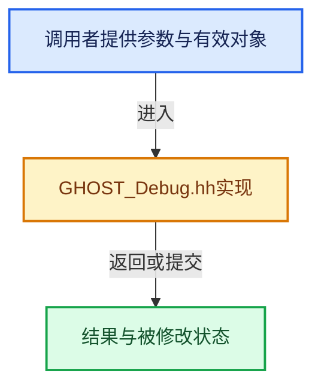

# 实现依赖专题：intern/ghost/intern/GHOST_Debug.hh

[方向导航](README.md) · [符号索引](../%E7%AC%A6%E5%8F%B7%E4%BE%9D%E8%B5%96%E4%B8%8E%E5%AE%9E%E7%8E%B0%E7%B4%A2%E5%BC%95.md)

本专题从正文实际调用进入，集中保存共享实现。函数有稳定锚点，可从调用处直接跳到对应完整函数；递归与互相调用通过回链组织。

## 本文件的实现关系





<a id="m-e1ca7e811752"></a>

## 宏 `GHOST_ASSERT`

<!-- annotated:2b0bf9c35770b0 -->

```cpp
#    define GHOST_ASSERT(x, info) \
      { \
        if (!(x)) { \
          fprintf(stderr, "GHOST_ASSERT failed: "); \
          fprintf(stderr, info); \
          fprintf(stderr, "\n"); \
          abort(); \
        } \
      } \
      ((void)0)
/* Show the failure in non-release builds too. */
```

<details>
<summary>核对原始源码：intern/ghost/intern/GHOST_Debug.hh · L56—L66</summary>

<!-- original:2b0bf9c35770b0:intern/ghost/intern/GHOST_Debug.hh:56:66 -->

```cpp
#    define GHOST_ASSERT(x, info) \
      { \
        if (!(x)) { \
          fprintf(stderr, "GHOST_ASSERT failed: "); \
          fprintf(stderr, info); \
          fprintf(stderr, "\n"); \
          abort(); \
        } \
      } \
      ((void)0)
/* Show the failure in non-release builds too. */
```

</details>

宏在预处理阶段展开，参数替换、重复求值和条件编译应直接从该定义检查。与普通函数不同，宏不会自动提供参数类型检查；构建配置选择哪个定义需结合外围条件。

<a id="m-deec761cb532"></a>

## 宏 `GHOST_ASSERT`

<!-- annotated:68569e6c80ce73 -->

```cpp
#    define GHOST_ASSERT(x, info) \
      { \
        if (!(x)) { \
          GHOST_PRINT("GHOST_ASSERT failed: "); \
          GHOST_PRINT(info); \
          GHOST_PRINT("\n"); \
        } \
      } \
      ((void)0)
#  endif
```

<details>
<summary>核对原始源码：intern/ghost/intern/GHOST_Debug.hh · L68—L77</summary>

<!-- original:68569e6c80ce73:intern/ghost/intern/GHOST_Debug.hh:68:77 -->

```cpp
#    define GHOST_ASSERT(x, info) \
      { \
        if (!(x)) { \
          GHOST_PRINT("GHOST_ASSERT failed: "); \
          GHOST_PRINT(info); \
          GHOST_PRINT("\n"); \
        } \
      } \
      ((void)0)
#  endif
```

</details>

宏在预处理阶段展开，参数替换、重复求值和条件编译应直接从该定义检查。与普通函数不同，宏不会自动提供参数类型检查；构建配置选择哪个定义需结合外围条件。

<a id="m-3f4c4d5110a9"></a>

## 宏 `GHOST_ASSERT`

<!-- annotated:789944ad4a3e30 -->

```cpp
#  define GHOST_ASSERT(x, info) ((void)0)
#endif /* `!defined(NDEBUG)` */
```

<details>
<summary>核对原始源码：intern/ghost/intern/GHOST_Debug.hh · L79—L80</summary>

<!-- original:789944ad4a3e30:intern/ghost/intern/GHOST_Debug.hh:79:80 -->

```cpp
#  define GHOST_ASSERT(x, info) ((void)0)
#endif /* `!defined(NDEBUG)` */
```

</details>

宏在预处理阶段展开，参数替换、重复求值和条件编译应直接从该定义检查。与普通函数不同，宏不会自动提供参数类型检查；构建配置选择哪个定义需结合外围条件。

## 完整成员与函数实现
