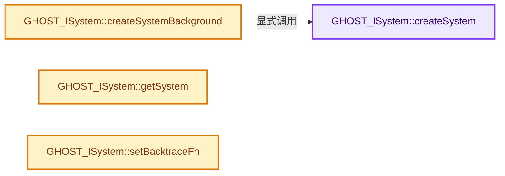

# 实现依赖专题：intern/ghost/intern/GHOST_ISystem.cc

[方向导航](README.md) · [符号索引](../%E7%AC%A6%E5%8F%B7%E4%BE%9D%E8%B5%96%E4%B8%8E%E5%AE%9E%E7%8E%B0%E7%B4%A2%E5%BC%95.md)

本专题从正文实际调用进入，集中保存共享实现。函数有稳定锚点，可从调用处直接跳到对应完整函数；递归与互相调用通过回链组织。

## 本文件的实现关系




## 完整成员与函数实现

<a id="f-aea7c66dcfce530e"></a>

### `GHOST_ISystem::createSystem`

实现位置：[intern/ghost/intern/GHOST_ISystem.cc](../../../../../intern/ghost/intern/GHOST_ISystem.cc) · L44—L225。

接口参数：

- `bool verbose`
- `[[maybe_unused]] bool background`

**教学注释版**

<!-- annotated:a1588f865c4b9a -->

```cpp
GHOST_TSuccess GHOST_ISystem::createSystem(bool verbose, [[maybe_unused]] bool background)
{
  /* When GHOST fails to start, report the back-ends that were attempted.
   * A Verbose argument could be supported in printing isn't always desired. */
  struct GHOST_BackendInfo {
    const char *id = nullptr;
    /** The cause of the failure. */
    std::string failure_msg;
  };
  std::vector<GHOST_BackendInfo> backends_attempted;

  GHOST_TSuccess success;
  if (!system_) {
#if defined(WITH_HEADLESS)
    /* Pass. */
#elif defined(WITH_GHOST_WAYLAND)
#  if defined(WITH_GHOST_WAYLAND_DYNLOAD)
    const bool has_wayland_libraries = ghost_wl_dynload_libraries_init();
#  else
    const bool has_wayland_libraries = true;
#  endif
#endif

#if defined(WITH_HEADLESS)
    /* Pass. */
#elif defined(WITH_GHOST_X11) && defined(WITH_GHOST_WAYLAND)
    /* Special case, try Wayland, fall back to X11. */
    if (has_wayland_libraries) {
      backends_attempted.push_back({"WAYLAND"});
      try {
        CLOG_INFO(&LOG, "Create Wayland system");
        system_ = new GHOST_SystemWayland(background);
      }
      catch (const std::runtime_error &e) {
        if (verbose) {
          backends_attempted.back().failure_msg = e.what();
        }
        CLOG_INFO(&LOG, "Wayland system not created, falling back to X11");
        delete system_;
        system_ = nullptr;
#  ifdef WITH_GHOST_WAYLAND_DYNLOAD
        ghost_wl_dynload_libraries_exit();
#  endif
      }
    }
    else {
      system_ = nullptr;
    }

    if (!system_) {
      /* Try to fall back to X11. */
      backends_attempted.push_back({"X11"});
      try {
        CLOG_INFO(&LOG, "Create X11 system");
        system_ = new GHOST_SystemX11();
      }
      catch (const std::runtime_error &e) {
        if (verbose) {
          backends_attempted.back().failure_msg = e.what();
        }
        delete system_;
        system_ = nullptr;
      }
    }
#elif defined(WITH_GHOST_X11)
    backends_attempted.push_back({"X11"});
    try {
      CLOG_INFO(&LOG, "Create X11 system");
      system_ = new GHOST_SystemX11();
    }
    catch (const std::runtime_error &e) {
      if (verbose) {
        backends_attempted.back().failure_msg = e.what();
      }
      delete system_;
      system_ = nullptr;
    }
#elif defined(WITH_GHOST_WAYLAND)
    if (has_wayland_libraries) {
      backends_attempted.push_back({"WAYLAND"});
      try {
        CLOG_INFO(&LOG, "Create Wayland system");
        system_ = new GHOST_SystemWayland(background);
      }
      catch (const std::runtime_error &e) {
        if (verbose) {
          backends_attempted.back().failure_msg = e.what();
        }
        delete system_;
        system_ = nullptr;
#  ifdef WITH_GHOST_WAYLAND_DYNLOAD
        ghost_wl_dynload_libraries_exit();
#  endif
      }
    }
    else {
      system_ = nullptr;
    }
#elif defined(WITH_GHOST_SDL)
    backends_attempted.push_back({"SDL"});
    try {
      CLOG_INFO(&LOG, "Create SDL system");
      system_ = new GHOST_SystemSDL();
    }
    catch (const std::runtime_error &e) {
      if (verbose) {
        backends_attempted.back().failure_msg = e.what();
      }
      delete system_;
      system_ = nullptr;
    }
#elif defined(WIN32)
    backends_attempted.push_back({"WIN32"});
    CLOG_INFO(&LOG, "Create Windows system");
    system_ = new GHOST_SystemWin32();
#elif defined(__APPLE__)
    backends_attempted.push_back({"COCOA"});
    CLOG_INFO(&LOG, "Create Cocoa system");
    system_ = new GHOST_SystemCocoa(background);
#endif

    if (system_) {
      system_backend_id_ = backends_attempted.back().id;
    }
    else if (verbose || CLOG_CHECK(&LOG, CLG_LEVEL_INFO)) {
      bool show_messages = false;
      std::string msg = "Failed to initialize display for back-end(s): [";
      for (int i = 0; i < backends_attempted.size(); i++) {
        const GHOST_BackendInfo &backend_item = backends_attempted[i];
        if (i != 0) {
          msg += ", ";
        }
        msg += "'" + std::string(backend_item.id) + "'";
        if (!backend_item.failure_msg.empty()) {
          show_messages = true;
        }
      }
      msg += "]\n";
      if (show_messages) {
        for (int i = 0; i < backends_attempted.size(); i++) {
          const GHOST_BackendInfo &backend_item = backends_attempted[i];
          msg += "  '";
          msg += backend_item.id;
          msg += "': ";
          msg += backend_item.failure_msg.empty() ? "<unknown>" : backend_item.failure_msg.c_str();
          msg += "\n";
        }
      }
      CLOG_STR_INFO_NOCHECK(&LOG, msg.c_str());

#ifdef WITH_GHOST_WAYLAND
#  ifndef WITH_GHOST_X11
      /* Special case, Blender will eventually drop X11.
       * show a more user friendly warning while this is in the process
       * of being disabled by default. */

      const char *wayland_display = getenv("WAYLAND_DISPLAY");
      if (!(wayland_display && wayland_display[0])) {
        const char *x11_display = getenv("DISPLAY");
        if (x11_display && x11_display[0]) {
          /* WAYLAND isn't available but X11 is.
           * Print a message to let the users know how to enable X11.
           * Since this is a non-standard option (currently - but used for "lite" builds),
           * the user is likely a developer who created their own build. */
          CLOG_STR_INFO_NOCHECK(
              &LOG,
              "Built without X11 support, enable \"WITH_GHOST_X11\" build-option to use X11.\n");
        }
      }
#  endif /* !WITH_GHOST_X11 */
#endif   /* WITH_GHOST_WAYLAND */
    }
    success = system_ != nullptr ? GHOST_kSuccess : GHOST_kFailure;
  }
  else {
    success = GHOST_kFailure;
  }
  if (success) {
    success = system_->init();
  }
  return success;
}
```

<details>
<summary>核对原始源码：intern/ghost/intern/GHOST_ISystem.cc · L44—L225</summary>

<!-- original:a1588f865c4b9a:intern/ghost/intern/GHOST_ISystem.cc:44:225 -->

```cpp
GHOST_TSuccess GHOST_ISystem::createSystem(bool verbose, [[maybe_unused]] bool background)
{
  /* When GHOST fails to start, report the back-ends that were attempted.
   * A Verbose argument could be supported in printing isn't always desired. */
  struct GHOST_BackendInfo {
    const char *id = nullptr;
    /** The cause of the failure. */
    std::string failure_msg;
  };
  std::vector<GHOST_BackendInfo> backends_attempted;

  GHOST_TSuccess success;
  if (!system_) {
#if defined(WITH_HEADLESS)
    /* Pass. */
#elif defined(WITH_GHOST_WAYLAND)
#  if defined(WITH_GHOST_WAYLAND_DYNLOAD)
    const bool has_wayland_libraries = ghost_wl_dynload_libraries_init();
#  else
    const bool has_wayland_libraries = true;
#  endif
#endif

#if defined(WITH_HEADLESS)
    /* Pass. */
#elif defined(WITH_GHOST_X11) && defined(WITH_GHOST_WAYLAND)
    /* Special case, try Wayland, fall back to X11. */
    if (has_wayland_libraries) {
      backends_attempted.push_back({"WAYLAND"});
      try {
        CLOG_INFO(&LOG, "Create Wayland system");
        system_ = new GHOST_SystemWayland(background);
      }
      catch (const std::runtime_error &e) {
        if (verbose) {
          backends_attempted.back().failure_msg = e.what();
        }
        CLOG_INFO(&LOG, "Wayland system not created, falling back to X11");
        delete system_;
        system_ = nullptr;
#  ifdef WITH_GHOST_WAYLAND_DYNLOAD
        ghost_wl_dynload_libraries_exit();
#  endif
      }
    }
    else {
      system_ = nullptr;
    }

    if (!system_) {
      /* Try to fall back to X11. */
      backends_attempted.push_back({"X11"});
      try {
        CLOG_INFO(&LOG, "Create X11 system");
        system_ = new GHOST_SystemX11();
      }
      catch (const std::runtime_error &e) {
        if (verbose) {
          backends_attempted.back().failure_msg = e.what();
        }
        delete system_;
        system_ = nullptr;
      }
    }
#elif defined(WITH_GHOST_X11)
    backends_attempted.push_back({"X11"});
    try {
      CLOG_INFO(&LOG, "Create X11 system");
      system_ = new GHOST_SystemX11();
    }
    catch (const std::runtime_error &e) {
      if (verbose) {
        backends_attempted.back().failure_msg = e.what();
      }
      delete system_;
      system_ = nullptr;
    }
#elif defined(WITH_GHOST_WAYLAND)
    if (has_wayland_libraries) {
      backends_attempted.push_back({"WAYLAND"});
      try {
        CLOG_INFO(&LOG, "Create Wayland system");
        system_ = new GHOST_SystemWayland(background);
      }
      catch (const std::runtime_error &e) {
        if (verbose) {
          backends_attempted.back().failure_msg = e.what();
        }
        delete system_;
        system_ = nullptr;
#  ifdef WITH_GHOST_WAYLAND_DYNLOAD
        ghost_wl_dynload_libraries_exit();
#  endif
      }
    }
    else {
      system_ = nullptr;
    }
#elif defined(WITH_GHOST_SDL)
    backends_attempted.push_back({"SDL"});
    try {
      CLOG_INFO(&LOG, "Create SDL system");
      system_ = new GHOST_SystemSDL();
    }
    catch (const std::runtime_error &e) {
      if (verbose) {
        backends_attempted.back().failure_msg = e.what();
      }
      delete system_;
      system_ = nullptr;
    }
#elif defined(WIN32)
    backends_attempted.push_back({"WIN32"});
    CLOG_INFO(&LOG, "Create Windows system");
    system_ = new GHOST_SystemWin32();
#elif defined(__APPLE__)
    backends_attempted.push_back({"COCOA"});
    CLOG_INFO(&LOG, "Create Cocoa system");
    system_ = new GHOST_SystemCocoa(background);
#endif

    if (system_) {
      system_backend_id_ = backends_attempted.back().id;
    }
    else if (verbose || CLOG_CHECK(&LOG, CLG_LEVEL_INFO)) {
      bool show_messages = false;
      std::string msg = "Failed to initialize display for back-end(s): [";
      for (int i = 0; i < backends_attempted.size(); i++) {
        const GHOST_BackendInfo &backend_item = backends_attempted[i];
        if (i != 0) {
          msg += ", ";
        }
        msg += "'" + std::string(backend_item.id) + "'";
        if (!backend_item.failure_msg.empty()) {
          show_messages = true;
        }
      }
      msg += "]\n";
      if (show_messages) {
        for (int i = 0; i < backends_attempted.size(); i++) {
          const GHOST_BackendInfo &backend_item = backends_attempted[i];
          msg += "  '";
          msg += backend_item.id;
          msg += "': ";
          msg += backend_item.failure_msg.empty() ? "<unknown>" : backend_item.failure_msg.c_str();
          msg += "\n";
        }
      }
      CLOG_STR_INFO_NOCHECK(&LOG, msg.c_str());

#ifdef WITH_GHOST_WAYLAND
#  ifndef WITH_GHOST_X11
      /* Special case, Blender will eventually drop X11.
       * show a more user friendly warning while this is in the process
       * of being disabled by default. */

      const char *wayland_display = getenv("WAYLAND_DISPLAY");
      if (!(wayland_display && wayland_display[0])) {
        const char *x11_display = getenv("DISPLAY");
        if (x11_display && x11_display[0]) {
          /* WAYLAND isn't available but X11 is.
           * Print a message to let the users know how to enable X11.
           * Since this is a non-standard option (currently - but used for "lite" builds),
           * the user is likely a developer who created their own build. */
          CLOG_STR_INFO_NOCHECK(
              &LOG,
              "Built without X11 support, enable \"WITH_GHOST_X11\" build-option to use X11.\n");
        }
      }
#  endif /* !WITH_GHOST_X11 */
#endif   /* WITH_GHOST_WAYLAND */
    }
    success = system_ != nullptr ? GHOST_kSuccess : GHOST_kFailure;
  }
  else {
    success = GHOST_kFailure;
  }
  if (success) {
    success = system_->init();
  }
  return success;
}
```

</details>

**沿实际写入检查状态**

- `system_ = new GHOST_SystemWayland(background);`
- `system_ = nullptr;`
- `system_ = new GHOST_SystemX11();`
- `system_ = new GHOST_SystemSDL();`
- `system_ = new GHOST_SystemWin32();`
- `system_ = new GHOST_SystemCocoa(background);`
- `system_backend_id_ = backends_attempted.back().id;`
- `msg += ", ";`
- `msg += "'" + std::string(backend_item.id) + "'";`
- `show_messages = true;`
- `msg += "]\n";`
- `msg += "  '";`
- `msg += backend_item.id;`
- `msg += "': ";`
- `msg += backend_item.failure_msg.empty() ? "<unknown>" : backend_item.failure_msg.c_str();`
- `msg += "\n";`
- `success = system_ != nullptr ? GHOST_kSuccess : GHOST_kFailure;`
- `success = GHOST_kFailure;`
- `success = system_->init();`

**结果出口**

- `return success;`

**继续追踪实现**

- `ghost_wl_dynload_libraries_init` → [调用协议](../%E6%A8%A1%E6%9D%BF%E5%AE%8F%E4%B8%8E%E5%8A%A8%E6%80%81%E5%88%86%E6%B4%BE%E5%8D%8F%E8%AE%AE.md)：函数指针、局部可调用对象或未展开的宏；必须结合调用者环境。调用位置L61。
- `backends_attempted.push_back` → [外部契约](https://eel.is/c++draft/)：这个边界按实际表达式及所属类型核对参数、返回值、寿命与失败行为。这里提供接口入口，不声称已解释该第三方版本的内部实现。
- `CLOG_INFO` → [CLOG_INFO · L190](%E4%BE%9D%E8%B5%96-CLG_log-e9051b.md#m-f8b5efdfcc0f)。宏定义由构建条件选择。
- `backends_attempted.back` → [外部契约](https://eel.is/c++draft/)：这个边界按实际表达式及所属类型核对参数、返回值、寿命与失败行为。这里提供接口入口，不声称已解释该第三方版本的内部实现。
- `e.what` → [外部契约](https://eel.is/c++draft/)：这个边界按实际表达式及所属类型核对参数、返回值、寿命与失败行为。这里提供接口入口，不声称已解释该第三方版本的内部实现。
- `ghost_wl_dynload_libraries_exit` → [ghost_wl_dynload_libraries_exit · L11474](%E4%BE%9D%E8%B5%96-GHOST_SystemWayland-7c97b0.md#f-9a0b27f8cd1a106b)。
- `CLOG_CHECK` → [CLOG_CHECK · L147](%E4%BE%9D%E8%B5%96-CLG_log-e9051b.md#m-27348fec3943)。宏定义由构建条件选择。
- `backends_attempted.size` → [外部契约](https://eel.is/c++draft/)：这个边界按实际表达式及所属类型核对参数、返回值、寿命与失败行为。这里提供接口入口，不声称已解释该第三方版本的内部实现。
- `std::string` → [外部契约](https://eel.is/c++draft/)：这个边界按实际表达式及所属类型核对参数、返回值、寿命与失败行为。这里提供接口入口，不声称已解释该第三方版本的内部实现。
- `backend_item.failure_msg.empty` → [调用协议](../%E6%A8%A1%E6%9D%BF%E5%AE%8F%E4%B8%8E%E5%8A%A8%E6%80%81%E5%88%86%E6%B4%BE%E5%8D%8F%E8%AE%AE.md)：接收对象类型依赖auto、返回值或模板实例；不按同名猜测目标。调用位置L177。
- `backend_item.failure_msg.c_str` → [调用协议](../%E6%A8%A1%E6%9D%BF%E5%AE%8F%E4%B8%8E%E5%8A%A8%E6%80%81%E5%88%86%E6%B4%BE%E5%8D%8F%E8%AE%AE.md)：接收对象类型依赖auto、返回值或模板实例；不按同名猜测目标。调用位置L188。
- `CLOG_STR_INFO_NOCHECK` → [CLOG_STR_INFO_NOCHECK · L206](%E4%BE%9D%E8%B5%96-CLG_log-e9051b.md#m-600de2db61cc)。宏定义由构建条件选择。
- `msg.c_str` → [外部契约](https://eel.is/c++draft/)：这个边界按实际表达式及所属类型核对参数、返回值、寿命与失败行为。这里提供接口入口，不声称已解释该第三方版本的内部实现。
- `getenv` → [调用协议](../%E6%A8%A1%E6%9D%BF%E5%AE%8F%E4%B8%8E%E5%8A%A8%E6%80%81%E5%88%86%E6%B4%BE%E5%8D%8F%E8%AE%AE.md)：函数指针、局部可调用对象或未展开的宏；必须结合调用者环境。调用位置L200。
- `system_->init` → [调用协议](../%E6%A8%A1%E6%9D%BF%E5%AE%8F%E4%B8%8E%E5%8A%A8%E6%80%81%E5%88%86%E6%B4%BE%E5%8D%8F%E8%AE%AE.md)：接收对象类型依赖auto、返回值或模板实例；不按同名猜测目标。调用位置L222。

<a id="f-3ec26e4a2541066d"></a>

### `GHOST_ISystem::createSystemBackground`

实现位置：[intern/ghost/intern/GHOST_ISystem.cc](../../../../../intern/ghost/intern/GHOST_ISystem.cc) · L227—L251。

**教学注释版**

<!-- annotated:cf71b885a1fa43 -->

```cpp
GHOST_TSuccess GHOST_ISystem::createSystemBackground()
{
  GHOST_TSuccess success;
  if (!system_) {
#if !defined(WITH_HEADLESS)
    /* Try to create a off-screen render surface with the graphical systems. */
    CLOG_INFO(&LOG, "Create background system");
    success = createSystem(false, true);
    if (success) {
      return success;
    }
    /* Try to fall back to headless mode if all else fails. */
#endif
    CLOG_INFO(&LOG, "Create headless system");
    system_ = new GHOST_SystemHeadless();
    success = system_ != nullptr ? GHOST_kSuccess : GHOST_kFailure;
  }
  else {
    success = GHOST_kFailure;
  }
  if (success) {
    success = system_->init();
  }
  return success;
}
```

<details>
<summary>核对原始源码：intern/ghost/intern/GHOST_ISystem.cc · L227—L251</summary>

<!-- original:cf71b885a1fa43:intern/ghost/intern/GHOST_ISystem.cc:227:251 -->

```cpp
GHOST_TSuccess GHOST_ISystem::createSystemBackground()
{
  GHOST_TSuccess success;
  if (!system_) {
#if !defined(WITH_HEADLESS)
    /* Try to create a off-screen render surface with the graphical systems. */
    CLOG_INFO(&LOG, "Create background system");
    success = createSystem(false, true);
    if (success) {
      return success;
    }
    /* Try to fall back to headless mode if all else fails. */
#endif
    CLOG_INFO(&LOG, "Create headless system");
    system_ = new GHOST_SystemHeadless();
    success = system_ != nullptr ? GHOST_kSuccess : GHOST_kFailure;
  }
  else {
    success = GHOST_kFailure;
  }
  if (success) {
    success = system_->init();
  }
  return success;
}
```

</details>

**沿实际写入检查状态**

- `success = createSystem(false, true);`
- `system_ = new GHOST_SystemHeadless();`
- `success = system_ != nullptr ? GHOST_kSuccess : GHOST_kFailure;`
- `success = GHOST_kFailure;`
- `success = system_->init();`

**结果出口**

- `return success;`

**继续追踪实现**

- `CLOG_INFO` → [CLOG_INFO · L190](%E4%BE%9D%E8%B5%96-CLG_log-e9051b.md#m-f8b5efdfcc0f)。宏定义由构建条件选择。
- `createSystem` → [GHOST_ISystem::createSystem · L44](%E4%BE%9D%E8%B5%96-GHOST_ISystem-75010f.md#f-aea7c66dcfce530e)。
- `system_->init` → [调用协议](../%E6%A8%A1%E6%9D%BF%E5%AE%8F%E4%B8%8E%E5%8A%A8%E6%80%81%E5%88%86%E6%B4%BE%E5%8D%8F%E8%AE%AE.md)：接收对象类型依赖auto、返回值或模板实例；不按同名猜测目标。调用位置L248。

<a id="f-0483b05f8dc0805c"></a>

### `GHOST_ISystem::getSystem`

实现位置：[intern/ghost/intern/GHOST_ISystem.cc](../../../../../intern/ghost/intern/GHOST_ISystem.cc) · L267—L270。

**教学注释版**

<!-- annotated:67b1680651f7fc -->

```cpp
GHOST_ISystem *GHOST_ISystem::getSystem()
{
  return system_;
}
```

<details>
<summary>核对原始源码：intern/ghost/intern/GHOST_ISystem.cc · L267—L270</summary>

<!-- original:67b1680651f7fc:intern/ghost/intern/GHOST_ISystem.cc:267:270 -->

```cpp
GHOST_ISystem *GHOST_ISystem::getSystem()
{
  return system_;
}
```

</details>

**结果出口**

- `return system_;`

**继续追踪实现**

本实现没有需要继续展开的显式调用；检查返回表达式、对象转换和调用者前置条件。

<a id="f-4d400ba31716faa7"></a>

### `GHOST_ISystem::setBacktraceFn`

实现位置：[intern/ghost/intern/GHOST_ISystem.cc](../../../../../intern/ghost/intern/GHOST_ISystem.cc) · L282—L285。

接口参数：

- `GHOST_TBacktraceFn backtrace_fn`

**教学注释版**

<!-- annotated:84de1de6c842e9 -->

```cpp
void GHOST_ISystem::setBacktraceFn(GHOST_TBacktraceFn backtrace_fn)
{
  GHOST_ISystem::backtrace_fn_ = backtrace_fn;
}
```

<details>
<summary>核对原始源码：intern/ghost/intern/GHOST_ISystem.cc · L282—L285</summary>

<!-- original:84de1de6c842e9:intern/ghost/intern/GHOST_ISystem.cc:282:285 -->

```cpp
void GHOST_ISystem::setBacktraceFn(GHOST_TBacktraceFn backtrace_fn)
{
  GHOST_ISystem::backtrace_fn_ = backtrace_fn;
}
```

</details>

**沿实际写入检查状态**

- `GHOST_ISystem::backtrace_fn_ = backtrace_fn;`

**继续追踪实现**

本实现没有需要继续展开的显式调用；检查返回表达式、对象转换和调用者前置条件。
