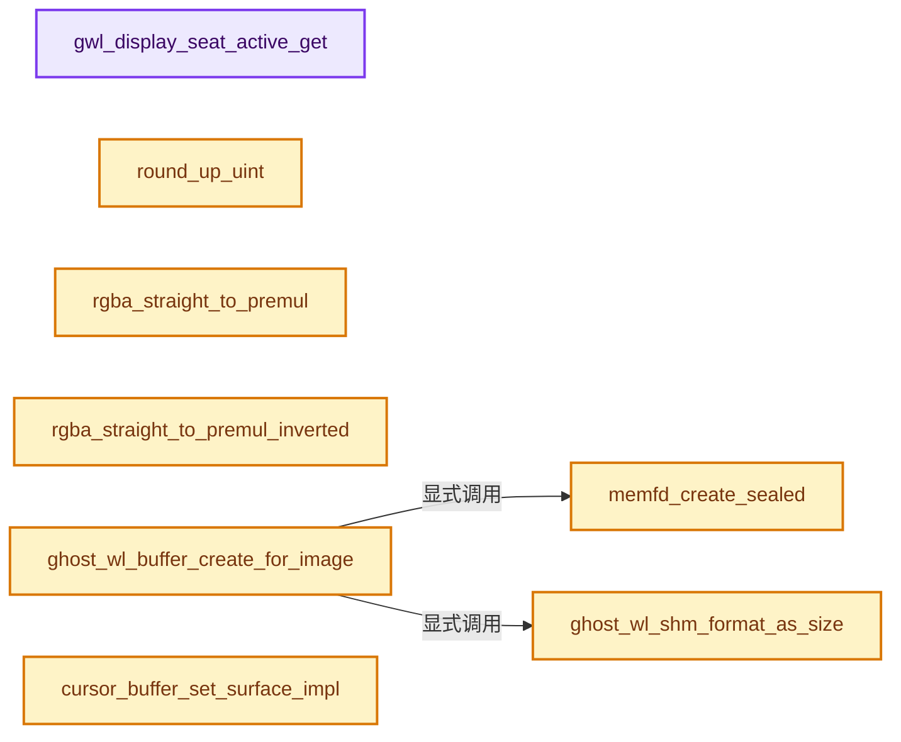
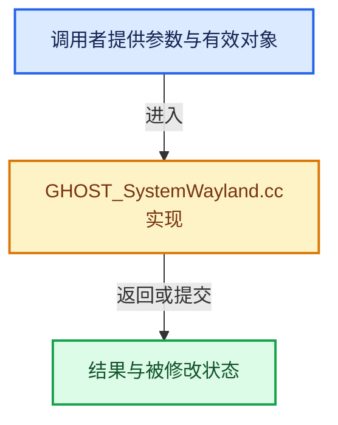

# 实现依赖专题：intern/ghost/intern/GHOST_SystemWayland.cc

[方向导航](README.md) · [符号索引](../%E7%AC%A6%E5%8F%B7%E4%BE%9D%E8%B5%96%E4%B8%8E%E5%AE%9E%E7%8E%B0%E7%B4%A2%E5%BC%95.md)

本专题从正文实际调用进入，集中保存共享实现。函数有稳定锚点，可从调用处直接跳到对应完整函数；递归与互相调用通过回链组织。

## 本文件的实现关系






## 完整成员与函数实现

<a id="f-67b13586720ddf45"></a>

### `gwl_display_seat_active_get`

实现位置：[intern/ghost/intern/GHOST_SystemWayland.cc](../../../../../intern/ghost/intern/GHOST_SystemWayland.cc) · L1769—L1775。

接口参数：

- `const GWL_Display *display`

**教学注释版**

<!-- annotated:64e2d01b709de7 -->

```cpp
static GWL_Seat *gwl_display_seat_active_get(const GWL_Display *display)
{
  if (display->seats.empty()) [[unlikely]] {
    return nullptr;
  }
  return display->seats[display->seats_active_index];
}
```

<details>
<summary>核对原始源码：intern/ghost/intern/GHOST_SystemWayland.cc · L1769—L1775</summary>

<!-- original:64e2d01b709de7:intern/ghost/intern/GHOST_SystemWayland.cc:1769:1775 -->

```cpp
static GWL_Seat *gwl_display_seat_active_get(const GWL_Display *display)
{
  if (display->seats.empty()) [[unlikely]] {
    return nullptr;
  }
  return display->seats[display->seats_active_index];
}
```

</details>

**结果出口**

- `return nullptr;`
- `return display->seats[display->seats_active_index];`

**继续追踪实现**

- `display->seats.empty` → [调用协议](../%E6%A8%A1%E6%9D%BF%E5%AE%8F%E4%B8%8E%E5%8A%A8%E6%80%81%E5%88%86%E6%B4%BE%E5%8D%8F%E8%AE%AE.md)：接收对象类型依赖auto、返回值或模板实例；不按同名猜测目标。调用位置L1771。

<a id="f-db0b9869786f9ed4"></a>

### `round_up_uint`

实现位置：[intern/ghost/intern/GHOST_SystemWayland.cc](../../../../../intern/ghost/intern/GHOST_SystemWayland.cc) · L2038—L2041。

接口参数：

- `const uint32_t x`
- `const uint32_t multiple`

**教学注释版**

<!-- annotated:5fcf6f48d7c55c -->

```cpp
static uint32_t round_up_uint(const uint32_t x, const uint32_t multiple)
{
  return ((x + multiple - 1) / multiple) * multiple;
}
```

<details>
<summary>核对原始源码：intern/ghost/intern/GHOST_SystemWayland.cc · L2038—L2041</summary>

<!-- original:5fcf6f48d7c55c:intern/ghost/intern/GHOST_SystemWayland.cc:2038:2041 -->

```cpp
static uint32_t round_up_uint(const uint32_t x, const uint32_t multiple)
{
  return ((x + multiple - 1) / multiple) * multiple;
}
```

</details>

**结果出口**

- `return ((x + multiple - 1) / multiple) * multiple;`

**继续追踪实现**

本实现没有需要继续展开的显式调用；检查返回表达式、对象转换和调用者前置条件。

<a id="f-a98e180c7577015a"></a>

### `rgba_straight_to_premul`

实现位置：[intern/ghost/intern/GHOST_SystemWayland.cc](../../../../../intern/ghost/intern/GHOST_SystemWayland.cc) · L2043—L2051。

接口参数：

- `uint32_t rgba_uint`

**教学注释版**

<!-- annotated:d249584d8cb92a -->

```cpp
static uint32_t rgba_straight_to_premul(uint32_t rgba_uint)
{
  uint8_t *rgba = reinterpret_cast<uint8_t *>(&rgba_uint);
  const uint32_t alpha = uint32_t(rgba[3]);
  rgba[0] = uint8_t(((alpha * rgba[0]) + (0xff / 2)) / 0xff);
  rgba[1] = uint8_t(((alpha * rgba[1]) + (0xff / 2)) / 0xff);
  rgba[2] = uint8_t(((alpha * rgba[2]) + (0xff / 2)) / 0xff);
  return rgba_uint;
}
```

<details>
<summary>核对原始源码：intern/ghost/intern/GHOST_SystemWayland.cc · L2043—L2051</summary>

<!-- original:d249584d8cb92a:intern/ghost/intern/GHOST_SystemWayland.cc:2043:2051 -->

```cpp
static uint32_t rgba_straight_to_premul(uint32_t rgba_uint)
{
  uint8_t *rgba = reinterpret_cast<uint8_t *>(&rgba_uint);
  const uint32_t alpha = uint32_t(rgba[3]);
  rgba[0] = uint8_t(((alpha * rgba[0]) + (0xff / 2)) / 0xff);
  rgba[1] = uint8_t(((alpha * rgba[1]) + (0xff / 2)) / 0xff);
  rgba[2] = uint8_t(((alpha * rgba[2]) + (0xff / 2)) / 0xff);
  return rgba_uint;
}
```

</details>

**沿实际写入检查状态**

- `rgba[0] = uint8_t(((alpha * rgba[0]) + (0xff / 2)) / 0xff);`
- `rgba[1] = uint8_t(((alpha * rgba[1]) + (0xff / 2)) / 0xff);`
- `rgba[2] = uint8_t(((alpha * rgba[2]) + (0xff / 2)) / 0xff);`

**结果出口**

- `return rgba_uint;`

**继续追踪实现**

本实现没有需要继续展开的显式调用；检查返回表达式、对象转换和调用者前置条件。

<a id="f-1f7e5910a863bec9"></a>

### `rgba_straight_to_premul_inverted`

实现位置：[intern/ghost/intern/GHOST_SystemWayland.cc](../../../../../intern/ghost/intern/GHOST_SystemWayland.cc) · L2053—L2061。

接口参数：

- `uint32_t rgba_uint`

**教学注释版**

<!-- annotated:808566d26958f6 -->

```cpp
static uint32_t rgba_straight_to_premul_inverted(uint32_t rgba_uint)
{
  uint8_t *rgba = reinterpret_cast<uint8_t *>(&rgba_uint);
  const uint32_t alpha = uint32_t(rgba[3]);
  rgba[0] = uint8_t(((alpha * (0xff - rgba[0])) + (0xff / 2)) / 0xff);
  rgba[1] = uint8_t(((alpha * (0xff - rgba[1])) + (0xff / 2)) / 0xff);
  rgba[2] = uint8_t(((alpha * (0xff - rgba[2])) + (0xff / 2)) / 0xff);
  return rgba_uint;
}
```

<details>
<summary>核对原始源码：intern/ghost/intern/GHOST_SystemWayland.cc · L2053—L2061</summary>

<!-- original:808566d26958f6:intern/ghost/intern/GHOST_SystemWayland.cc:2053:2061 -->

```cpp
static uint32_t rgba_straight_to_premul_inverted(uint32_t rgba_uint)
{
  uint8_t *rgba = reinterpret_cast<uint8_t *>(&rgba_uint);
  const uint32_t alpha = uint32_t(rgba[3]);
  rgba[0] = uint8_t(((alpha * (0xff - rgba[0])) + (0xff / 2)) / 0xff);
  rgba[1] = uint8_t(((alpha * (0xff - rgba[1])) + (0xff / 2)) / 0xff);
  rgba[2] = uint8_t(((alpha * (0xff - rgba[2])) + (0xff / 2)) / 0xff);
  return rgba_uint;
}
```

</details>

**沿实际写入检查状态**

- `rgba[0] = uint8_t(((alpha * (0xff - rgba[0])) + (0xff / 2)) / 0xff);`
- `rgba[1] = uint8_t(((alpha * (0xff - rgba[1])) + (0xff / 2)) / 0xff);`
- `rgba[2] = uint8_t(((alpha * (0xff - rgba[2])) + (0xff / 2)) / 0xff);`

**结果出口**

- `return rgba_uint;`

**继续追踪实现**

本实现没有需要继续展开的显式调用；检查返回表达式、对象转换和调用者前置条件。

<a id="f-2ff516c27f5684fc"></a>

### `memfd_create_sealed`

实现位置：[intern/ghost/intern/GHOST_SystemWayland.cc](../../../../../intern/ghost/intern/GHOST_SystemWayland.cc) · L2567—L2590。

接口参数：

- `const char *name`

**教学注释版**

<!-- annotated:1794789a3813ad -->

```cpp
static int memfd_create_sealed(const char *name)
{
#ifdef HAVE_MEMFD_CREATE
  const int fd = memfd_create(name, MFD_CLOEXEC | MFD_ALLOW_SEALING);
  if (fd >= 0) {
    fcntl(fd, F_ADD_SEALS, F_SEAL_SHRINK | F_SEAL_SEAL);
  }
  return fd;
#else  /* HAVE_MEMFD_CREATE */
  char *path = getenv("XDG_RUNTIME_DIR");
  if (!path) {
    errno = ENOENT;
    return -1;
  }
  char *tmpname;
  asprintf(&tmpname, "%s/%s-XXXXXX", path, name);
  const int fd = mkostemp(tmpname, O_CLOEXEC);
  if (fd >= 0) {
    unlink(tmpname);
  }
  // [讲解] free：归还相匹配的C分配存储，不自动执行C++析构；不可用于Windows的_aligned_malloc结果。
  free(tmpname);
  return fd;
#endif /* !HAVE_MEMFD_CREATE */
}
```

<details>
<summary>核对原始源码：intern/ghost/intern/GHOST_SystemWayland.cc · L2567—L2590</summary>

<!-- original:1794789a3813ad:intern/ghost/intern/GHOST_SystemWayland.cc:2567:2590 -->

```cpp
static int memfd_create_sealed(const char *name)
{
#ifdef HAVE_MEMFD_CREATE
  const int fd = memfd_create(name, MFD_CLOEXEC | MFD_ALLOW_SEALING);
  if (fd >= 0) {
    fcntl(fd, F_ADD_SEALS, F_SEAL_SHRINK | F_SEAL_SEAL);
  }
  return fd;
#else  /* HAVE_MEMFD_CREATE */
  char *path = getenv("XDG_RUNTIME_DIR");
  if (!path) {
    errno = ENOENT;
    return -1;
  }
  char *tmpname;
  asprintf(&tmpname, "%s/%s-XXXXXX", path, name);
  const int fd = mkostemp(tmpname, O_CLOEXEC);
  if (fd >= 0) {
    unlink(tmpname);
  }
  free(tmpname);
  return fd;
#endif /* !HAVE_MEMFD_CREATE */
}
```

</details>

**沿实际写入检查状态**

- `errno = ENOENT;`

**结果出口**

- `return fd;`
- `return -1;`

**继续追踪实现**

- `memfd_create` → [调用协议](../%E6%A8%A1%E6%9D%BF%E5%AE%8F%E4%B8%8E%E5%8A%A8%E6%80%81%E5%88%86%E6%B4%BE%E5%8D%8F%E8%AE%AE.md)：函数指针、局部可调用对象或未展开的宏；必须结合调用者环境。调用位置L2570。
- `fcntl` → [调用协议](../%E6%A8%A1%E6%9D%BF%E5%AE%8F%E4%B8%8E%E5%8A%A8%E6%80%81%E5%88%86%E6%B4%BE%E5%8D%8F%E8%AE%AE.md)：函数指针、局部可调用对象或未展开的宏；必须结合调用者环境。调用位置L2572。
- `getenv` → [调用协议](../%E6%A8%A1%E6%9D%BF%E5%AE%8F%E4%B8%8E%E5%8A%A8%E6%80%81%E5%88%86%E6%B4%BE%E5%8D%8F%E8%AE%AE.md)：函数指针、局部可调用对象或未展开的宏；必须结合调用者环境。调用位置L2576。
- `asprintf` → [调用协议](../%E6%A8%A1%E6%9D%BF%E5%AE%8F%E4%B8%8E%E5%8A%A8%E6%80%81%E5%88%86%E6%B4%BE%E5%8D%8F%E8%AE%AE.md)：函数指针、局部可调用对象或未展开的宏；必须结合调用者环境。调用位置L2582。
- `mkostemp` → [调用协议](../%E6%A8%A1%E6%9D%BF%E5%AE%8F%E4%B8%8E%E5%8A%A8%E6%80%81%E5%88%86%E6%B4%BE%E5%8D%8F%E8%AE%AE.md)：函数指针、局部可调用对象或未展开的宏；必须结合调用者环境。调用位置L2583。
- `unlink` → [blender::deg::Relation::unlink · L15](../11-Depsgraph%E4%B8%8E%E5%B9%B6%E8%A1%8C%E4%BB%BB%E5%8A%A1%E7%B3%BB%E7%BB%9F/%E4%BE%9D%E8%B5%96-depsgraph_relation-5d0905.md#f-04d76367797bd5ad)。
- `free` → [外部契约](https://eel.is/c++draft/c.malloc)：归还相匹配的C分配存储，不自动执行C++析构；不可用于Windows的_aligned_malloc结果。

<a id="f-e1f6caaeb4dab863"></a>

### `ghost_wl_shm_format_as_size`

实现位置：[intern/ghost/intern/GHOST_SystemWayland.cc](../../../../../intern/ghost/intern/GHOST_SystemWayland.cc) · L2813—L2825。

接口参数：

- `enum wl_shm_format format`

**教学注释版**

<!-- annotated:bd9778999f3052 -->

```cpp
static size_t ghost_wl_shm_format_as_size(enum wl_shm_format format)
{
  switch (format) {
    case WL_SHM_FORMAT_ARGB8888: {
      return 4;
    }
    default: {
      /* Support other formats as needed. */
      GHOST_ASSERT(0, "Unexpected format passed in!");
      return 4;
    }
  }
}
```

<details>
<summary>核对原始源码：intern/ghost/intern/GHOST_SystemWayland.cc · L2813—L2825</summary>

<!-- original:bd9778999f3052:intern/ghost/intern/GHOST_SystemWayland.cc:2813:2825 -->

```cpp
static size_t ghost_wl_shm_format_as_size(enum wl_shm_format format)
{
  switch (format) {
    case WL_SHM_FORMAT_ARGB8888: {
      return 4;
    }
    default: {
      /* Support other formats as needed. */
      GHOST_ASSERT(0, "Unexpected format passed in!");
      return 4;
    }
  }
}
```

</details>

**结果出口**

- `return 4;`

**继续追踪实现**

- `GHOST_ASSERT` → [GHOST_ASSERT · L56](%E4%BE%9D%E8%B5%96-GHOST_Debug-d2cec3.md#m-e1ca7e811752)；[GHOST_ASSERT · L68](%E4%BE%9D%E8%B5%96-GHOST_Debug-d2cec3.md#m-deec761cb532)；[GHOST_ASSERT · L79](%E4%BE%9D%E8%B5%96-GHOST_Debug-d2cec3.md#m-3f4c4d5110a9)。宏定义由构建条件选择。

<a id="f-ffd37121844e8b36"></a>

### `ghost_wl_buffer_create_for_image`

实现位置：[intern/ghost/intern/GHOST_SystemWayland.cc](../../../../../intern/ghost/intern/GHOST_SystemWayland.cc) · L2834—L2864。

接口参数：

- `wl_shm *shm`
- `const int32_t size_xy[2]`
- `enum wl_shm_format format`
- `void **r_buffer_data`
- `size_t *r_buffer_data_size`

**教学注释版**

<!-- annotated:9a21caa6842df0 -->

```cpp
static wl_buffer *ghost_wl_buffer_create_for_image(wl_shm *shm,
                                                   const int32_t size_xy[2],
                                                   enum wl_shm_format format,
                                                   void **r_buffer_data,
                                                   size_t *r_buffer_data_size)
{
  const int fd = memfd_create_sealed("ghost-wl-buffer");
  wl_buffer *buffer = nullptr;
  if (fd >= 0) {
    const int32_t buffer_stride = size_xy[0] * ghost_wl_shm_format_as_size(format);
    const int32_t buffer_size = buffer_stride * size_xy[1];
    if (posix_fallocate(fd, 0, buffer_size) == 0) {
      void *buffer_data = mmap(nullptr, buffer_size, PROT_READ | PROT_WRITE, MAP_SHARED, fd, 0);
      if (buffer_data != MAP_FAILED) {
        if (wl_shm_pool *pool = wl_shm_create_pool(shm, fd, buffer_size)) {
          buffer = wl_shm_pool_create_buffer(pool, 0, UNPACK2(size_xy), buffer_stride, format);
          wl_shm_pool_destroy(pool);
          if (buffer) {
            *r_buffer_data = buffer_data;
            *r_buffer_data_size = size_t(buffer_size);
          }
        }
        if (buffer == nullptr) [[unlikely]] {
          munmap(buffer_data, buffer_size);
        }
      }
    }
    close(fd);
  }
  return buffer;
}
```

<details>
<summary>核对原始源码：intern/ghost/intern/GHOST_SystemWayland.cc · L2834—L2864</summary>

<!-- original:9a21caa6842df0:intern/ghost/intern/GHOST_SystemWayland.cc:2834:2864 -->

```cpp
static wl_buffer *ghost_wl_buffer_create_for_image(wl_shm *shm,
                                                   const int32_t size_xy[2],
                                                   enum wl_shm_format format,
                                                   void **r_buffer_data,
                                                   size_t *r_buffer_data_size)
{
  const int fd = memfd_create_sealed("ghost-wl-buffer");
  wl_buffer *buffer = nullptr;
  if (fd >= 0) {
    const int32_t buffer_stride = size_xy[0] * ghost_wl_shm_format_as_size(format);
    const int32_t buffer_size = buffer_stride * size_xy[1];
    if (posix_fallocate(fd, 0, buffer_size) == 0) {
      void *buffer_data = mmap(nullptr, buffer_size, PROT_READ | PROT_WRITE, MAP_SHARED, fd, 0);
      if (buffer_data != MAP_FAILED) {
        if (wl_shm_pool *pool = wl_shm_create_pool(shm, fd, buffer_size)) {
          buffer = wl_shm_pool_create_buffer(pool, 0, UNPACK2(size_xy), buffer_stride, format);
          wl_shm_pool_destroy(pool);
          if (buffer) {
            *r_buffer_data = buffer_data;
            *r_buffer_data_size = size_t(buffer_size);
          }
        }
        if (buffer == nullptr) [[unlikely]] {
          munmap(buffer_data, buffer_size);
        }
      }
    }
    close(fd);
  }
  return buffer;
}
```

</details>

**沿实际写入检查状态**

- `buffer = wl_shm_pool_create_buffer(pool, 0, UNPACK2(size_xy), buffer_stride, format);`

**结果出口**

- `return buffer;`

**继续追踪实现**

- `memfd_create_sealed` → [memfd_create_sealed · L2567](%E4%BE%9D%E8%B5%96-GHOST_SystemWayland-7c97b0.md#f-2ff516c27f5684fc)。
- `ghost_wl_shm_format_as_size` → [ghost_wl_shm_format_as_size · L2813](%E4%BE%9D%E8%B5%96-GHOST_SystemWayland-7c97b0.md#f-e1f6caaeb4dab863)。
- `posix_fallocate` → [调用协议](../%E6%A8%A1%E6%9D%BF%E5%AE%8F%E4%B8%8E%E5%8A%A8%E6%80%81%E5%88%86%E6%B4%BE%E5%8D%8F%E8%AE%AE.md)：函数指针、局部可调用对象或未展开的宏；必须结合调用者环境。调用位置L2845。
- `mmap` → [调用协议](../%E6%A8%A1%E6%9D%BF%E5%AE%8F%E4%B8%8E%E5%8A%A8%E6%80%81%E5%88%86%E6%B4%BE%E5%8D%8F%E8%AE%AE.md)：函数指针、局部可调用对象或未展开的宏；必须结合调用者环境。调用位置L2846。
- `wl_shm_create_pool` → [调用协议](../%E6%A8%A1%E6%9D%BF%E5%AE%8F%E4%B8%8E%E5%8A%A8%E6%80%81%E5%88%86%E6%B4%BE%E5%8D%8F%E8%AE%AE.md)：函数指针、局部可调用对象或未展开的宏；必须结合调用者环境。调用位置L2848。
- `wl_shm_pool_create_buffer` → [调用协议](../%E6%A8%A1%E6%9D%BF%E5%AE%8F%E4%B8%8E%E5%8A%A8%E6%80%81%E5%88%86%E6%B4%BE%E5%8D%8F%E8%AE%AE.md)：函数指针、局部可调用对象或未展开的宏；必须结合调用者环境。调用位置L2849。
- `UNPACK2` → [UNPACK2 · L22](%E4%BE%9D%E8%B5%96-GHOST_utildefines-34b996.md#m-00ad768fe1c1)；[UNPACK2 · L234](../01-%E5%9F%BA%E7%A1%80%E5%AE%B9%E5%99%A8%E4%B8%8E%E7%8E%B0%E4%BB%A3CPP/%E4%BE%9D%E8%B5%96-BLI_utildefines-293a0a.md#m-96ff8266d239)；[UNPACK2 · L13](%E4%BE%9D%E8%B5%96-gpu_shader_utildefines.bsl-e9f199.md#m-8316603fb9a6)。宏定义由构建条件选择。
- `wl_shm_pool_destroy` → [调用协议](../%E6%A8%A1%E6%9D%BF%E5%AE%8F%E4%B8%8E%E5%8A%A8%E6%80%81%E5%88%86%E6%B4%BE%E5%8D%8F%E8%AE%AE.md)：函数指针、局部可调用对象或未展开的宏；必须结合调用者环境。调用位置L2850。
- `munmap` → [调用协议](../%E6%A8%A1%E6%9D%BF%E5%AE%8F%E4%B8%8E%E5%8A%A8%E6%80%81%E5%88%86%E6%B4%BE%E5%8D%8F%E8%AE%AE.md)：函数指针、局部可调用对象或未展开的宏；必须结合调用者环境。调用位置L2857。
- `close` → [GHOST_WindowWayland::close · L2682](%E4%BE%9D%E8%B5%96-GHOST_WindowWayland-934deb.md#f-af96c798a02e85ed)。

<a id="f-ca83ca13a0f28b8c"></a>

### `cursor_buffer_set_surface_impl`

实现位置：[intern/ghost/intern/GHOST_SystemWayland.cc](../../../../../intern/ghost/intern/GHOST_SystemWayland.cc) · L3017—L3047。

接口参数：

- `const wl_cursor_image *wl_image`
- `wl_buffer *buffer`
- `wl_surface *wl_surface`
- `const int scale`

**教学注释版**

<!-- annotated:bbbb4b9e4e1a8a -->

```cpp
static void cursor_buffer_set_surface_impl(const wl_cursor_image *wl_image,
                                           wl_buffer *buffer,
                                           wl_surface *wl_surface,
                                           const int scale)
{
  const int32_t image_size_x = int32_t(wl_image->width);
  const int32_t image_size_y = int32_t(wl_image->height);
  GHOST_ASSERT((image_size_x % scale) == 0 && (image_size_y % scale) == 0,
               "The size must be a multiple of the scale!");
  (void)image_size_x;
  (void)image_size_y;

  wl_surface_set_buffer_scale(wl_surface, scale);
  wl_surface_attach(wl_surface, buffer, 0, 0);
  if (wl_surface_get_version(wl_surface) >= WL_SURFACE_DAMAGE_BUFFER_SINCE_VERSION) {
    wl_surface_damage_buffer(wl_surface,
                             0,
                             0,
                             // [讲解] std::numeric_limits<int32_t>::max：按比较关系选取较大值。本讲解中的增长公式同时满足最低请求和几何增长；若保存返回引用，还需注意实参寿命。
                             std::numeric_limits<int32_t>::max(),
                             std::numeric_limits<int32_t>::max());
  }
  else {
    /* Effectively deprecated according to documentation. */
    wl_surface_damage(wl_surface,
                      0,
                      0,
                      std::numeric_limits<int32_t>::max(),
                      std::numeric_limits<int32_t>::max());
  }
  wl_surface_commit(wl_surface);
}
```

<details>
<summary>核对原始源码：intern/ghost/intern/GHOST_SystemWayland.cc · L3017—L3047</summary>

<!-- original:bbbb4b9e4e1a8a:intern/ghost/intern/GHOST_SystemWayland.cc:3017:3047 -->

```cpp
static void cursor_buffer_set_surface_impl(const wl_cursor_image *wl_image,
                                           wl_buffer *buffer,
                                           wl_surface *wl_surface,
                                           const int scale)
{
  const int32_t image_size_x = int32_t(wl_image->width);
  const int32_t image_size_y = int32_t(wl_image->height);
  GHOST_ASSERT((image_size_x % scale) == 0 && (image_size_y % scale) == 0,
               "The size must be a multiple of the scale!");
  (void)image_size_x;
  (void)image_size_y;

  wl_surface_set_buffer_scale(wl_surface, scale);
  wl_surface_attach(wl_surface, buffer, 0, 0);
  if (wl_surface_get_version(wl_surface) >= WL_SURFACE_DAMAGE_BUFFER_SINCE_VERSION) {
    wl_surface_damage_buffer(wl_surface,
                             0,
                             0,
                             std::numeric_limits<int32_t>::max(),
                             std::numeric_limits<int32_t>::max());
  }
  else {
    /* Effectively deprecated according to documentation. */
    wl_surface_damage(wl_surface,
                      0,
                      0,
                      std::numeric_limits<int32_t>::max(),
                      std::numeric_limits<int32_t>::max());
  }
  wl_surface_commit(wl_surface);
}
```

</details>

**继续追踪实现**

- `GHOST_ASSERT` → [GHOST_ASSERT · L56](%E4%BE%9D%E8%B5%96-GHOST_Debug-d2cec3.md#m-e1ca7e811752)；[GHOST_ASSERT · L68](%E4%BE%9D%E8%B5%96-GHOST_Debug-d2cec3.md#m-deec761cb532)；[GHOST_ASSERT · L79](%E4%BE%9D%E8%B5%96-GHOST_Debug-d2cec3.md#m-3f4c4d5110a9)。宏定义由构建条件选择。
- `wl_surface_set_buffer_scale` → [调用协议](../%E6%A8%A1%E6%9D%BF%E5%AE%8F%E4%B8%8E%E5%8A%A8%E6%80%81%E5%88%86%E6%B4%BE%E5%8D%8F%E8%AE%AE.md)：函数指针、局部可调用对象或未展开的宏；必须结合调用者环境。调用位置L3029。
- `wl_surface_attach` → [调用协议](../%E6%A8%A1%E6%9D%BF%E5%AE%8F%E4%B8%8E%E5%8A%A8%E6%80%81%E5%88%86%E6%B4%BE%E5%8D%8F%E8%AE%AE.md)：函数指针、局部可调用对象或未展开的宏；必须结合调用者环境。调用位置L3030。
- `wl_surface_get_version` → [调用协议](../%E6%A8%A1%E6%9D%BF%E5%AE%8F%E4%B8%8E%E5%8A%A8%E6%80%81%E5%88%86%E6%B4%BE%E5%8D%8F%E8%AE%AE.md)：函数指针、局部可调用对象或未展开的宏；必须结合调用者环境。调用位置L3031。
- `wl_surface_damage_buffer` → [调用协议](../%E6%A8%A1%E6%9D%BF%E5%AE%8F%E4%B8%8E%E5%8A%A8%E6%80%81%E5%88%86%E6%B4%BE%E5%8D%8F%E8%AE%AE.md)：函数指针、局部可调用对象或未展开的宏；必须结合调用者环境。调用位置L3032。
- `std::numeric_limits<int32_t>::max` → [外部契约](https://eel.is/c++draft/alg.min.max)：按比较关系选取较大值。本讲解中的增长公式同时满足最低请求和几何增长；若保存返回引用，还需注意实参寿命。
- `wl_surface_damage` → [调用协议](../%E6%A8%A1%E6%9D%BF%E5%AE%8F%E4%B8%8E%E5%8A%A8%E6%80%81%E5%88%86%E6%B4%BE%E5%8D%8F%E8%AE%AE.md)：函数指针、局部可调用对象或未展开的宏；必须结合调用者环境。调用位置L3040。
- `wl_surface_commit` → [调用协议](../%E6%A8%A1%E6%9D%BF%E5%AE%8F%E4%B8%8E%E5%8A%A8%E6%80%81%E5%88%86%E6%B4%BE%E5%8D%8F%E8%AE%AE.md)：函数指针、局部可调用对象或未展开的宏；必须结合调用者环境。调用位置L3046。

<a id="f-d8a44ae514cbc37d"></a>

### `gwl_seat_cursor_find_wl_shape_from_ghost`

实现位置：[intern/ghost/intern/GHOST_SystemWayland.cc](../../../../../intern/ghost/intern/GHOST_SystemWayland.cc) · L3049—L3164。

接口参数：

- `const GHOST_TStandardCursor shape`

**教学注释版**

<!-- annotated:c60e16e5e0f477 -->

```cpp
static std::optional<wp_cursor_shape_device_v1_shape> gwl_seat_cursor_find_wl_shape_from_ghost(
    const GHOST_TStandardCursor shape)
{
  /* Cases that return `std::nullopt` mean the cursor is not available. */

  /* Unused WAYLAND cursors:
   *
   * #WP_CURSOR_SHAPE_DEVICE_V1_SHAPE_PROGRESS.
   * #WP_CURSOR_SHAPE_DEVICE_V1_SHAPE_CELL.
   * #WP_CURSOR_SHAPE_DEVICE_V1_SHAPE_NO_DROP.
   * #WP_CURSOR_SHAPE_DEVICE_V1_SHAPE_NESW_RESIZE.
   * #WP_CURSOR_SHAPE_DEVICE_V1_SHAPE_NWSE_RESIZE.
   * #WP_CURSOR_SHAPE_DEVICE_V1_SHAPE_DND_ASK.
   * #WP_CURSOR_SHAPE_DEVICE_V1_SHAPE_ALL_RESIZE.
   */

  switch (shape) {
    case GHOST_kStandardCursorDefault:
      return WP_CURSOR_SHAPE_DEVICE_V1_SHAPE_DEFAULT;
    case GHOST_kStandardCursorRightArrow:
      return WP_CURSOR_SHAPE_DEVICE_V1_SHAPE_E_RESIZE;
    case GHOST_kStandardCursorLeftArrow:
      return WP_CURSOR_SHAPE_DEVICE_V1_SHAPE_W_RESIZE;
    case GHOST_kStandardCursorInfo:
      return WP_CURSOR_SHAPE_DEVICE_V1_SHAPE_CONTEXT_MENU;
    case GHOST_kStandardCursorDestroy:
      return std::nullopt;
    case GHOST_kStandardCursorHelp:
      return WP_CURSOR_SHAPE_DEVICE_V1_SHAPE_HELP;
    case GHOST_kStandardCursorWait:
      return WP_CURSOR_SHAPE_DEVICE_V1_SHAPE_WAIT;
    case GHOST_kStandardCursorText:
      return WP_CURSOR_SHAPE_DEVICE_V1_SHAPE_TEXT;
    case GHOST_kStandardCursorCrosshair:
      return WP_CURSOR_SHAPE_DEVICE_V1_SHAPE_CROSSHAIR;
    case GHOST_kStandardCursorCrosshairA:
      return std::nullopt;
    case GHOST_kStandardCursorCrosshairB:
      return std::nullopt;
    case GHOST_kStandardCursorCrosshairC:
      return std::nullopt;
    case GHOST_kStandardCursorPencil:
      return std::nullopt;
    case GHOST_kStandardCursorUpArrow:
      return WP_CURSOR_SHAPE_DEVICE_V1_SHAPE_N_RESIZE;
    case GHOST_kStandardCursorDownArrow:
      return WP_CURSOR_SHAPE_DEVICE_V1_SHAPE_S_RESIZE;
    case GHOST_kStandardCursorVerticalSplit:
      return WP_CURSOR_SHAPE_DEVICE_V1_SHAPE_COL_RESIZE;
    case GHOST_kStandardCursorHorizontalSplit:
      return WP_CURSOR_SHAPE_DEVICE_V1_SHAPE_ROW_RESIZE;
    case GHOST_kStandardCursorEraser:
      return std::nullopt;
    case GHOST_kStandardCursorKnife:
      return std::nullopt;
    case GHOST_kStandardCursorEyedropper:
      return std::nullopt;
    case GHOST_kStandardCursorZoomIn:
      return WP_CURSOR_SHAPE_DEVICE_V1_SHAPE_ZOOM_IN;
    case GHOST_kStandardCursorZoomOut:
      return WP_CURSOR_SHAPE_DEVICE_V1_SHAPE_ZOOM_OUT;
    case GHOST_kStandardCursorMove:
      return WP_CURSOR_SHAPE_DEVICE_V1_SHAPE_MOVE;
    case GHOST_kStandardCursorHandOpen:
      return WP_CURSOR_SHAPE_DEVICE_V1_SHAPE_GRAB;
    case GHOST_kStandardCursorHandClosed:
      return WP_CURSOR_SHAPE_DEVICE_V1_SHAPE_GRABBING;
    case GHOST_kStandardCursorHandPoint:
      return WP_CURSOR_SHAPE_DEVICE_V1_SHAPE_POINTER;
    case GHOST_kStandardCursorNSEWScroll:
      return WP_CURSOR_SHAPE_DEVICE_V1_SHAPE_ALL_SCROLL;
    case GHOST_kStandardCursorNSScroll:
      return std::nullopt;
    case GHOST_kStandardCursorEWScroll:
      return std::nullopt;
    case GHOST_kStandardCursorStop:
      return WP_CURSOR_SHAPE_DEVICE_V1_SHAPE_NOT_ALLOWED;
    case GHOST_kStandardCursorUpDown:
      return WP_CURSOR_SHAPE_DEVICE_V1_SHAPE_NS_RESIZE;
    case GHOST_kStandardCursorLeftRight:
      return WP_CURSOR_SHAPE_DEVICE_V1_SHAPE_EW_RESIZE;
    case GHOST_kStandardCursorTopSide:
      return WP_CURSOR_SHAPE_DEVICE_V1_SHAPE_N_RESIZE;
    case GHOST_kStandardCursorBottomSide:
      return WP_CURSOR_SHAPE_DEVICE_V1_SHAPE_S_RESIZE;
    case GHOST_kStandardCursorLeftSide:
      return WP_CURSOR_SHAPE_DEVICE_V1_SHAPE_W_RESIZE;
    case GHOST_kStandardCursorRightSide:
      return WP_CURSOR_SHAPE_DEVICE_V1_SHAPE_E_RESIZE;
    case GHOST_kStandardCursorTopLeftCorner:
      return WP_CURSOR_SHAPE_DEVICE_V1_SHAPE_NW_RESIZE;
    case GHOST_kStandardCursorTopRightCorner:
      return WP_CURSOR_SHAPE_DEVICE_V1_SHAPE_NE_RESIZE;
    case GHOST_kStandardCursorBottomRightCorner:
      return WP_CURSOR_SHAPE_DEVICE_V1_SHAPE_SE_RESIZE;
    case GHOST_kStandardCursorBottomLeftCorner:
      return WP_CURSOR_SHAPE_DEVICE_V1_SHAPE_SW_RESIZE;
    case GHOST_kStandardCursorCopy:
      return WP_CURSOR_SHAPE_DEVICE_V1_SHAPE_COPY;
    case GHOST_kStandardCursorLeftHandle:
      return std::nullopt;
    case GHOST_kStandardCursorRightHandle:
      return std::nullopt;
    case GHOST_kStandardCursorBothHandles:
      return std::nullopt;
    case GHOST_kStandardCursorBlade:
      return std::nullopt;
    case GHOST_kStandardCursorSlip:
      return std::nullopt;
    case GHOST_kStandardCursorCustom:
      return std::nullopt;
  }
  GHOST_ASSERT(0, "Unhandled GHOST cursor shape!");
  /* Shape not found. */
  return std::nullopt;
}
```

<details>
<summary>核对原始源码：intern/ghost/intern/GHOST_SystemWayland.cc · L3049—L3164</summary>

<!-- original:c60e16e5e0f477:intern/ghost/intern/GHOST_SystemWayland.cc:3049:3164 -->

```cpp
static std::optional<wp_cursor_shape_device_v1_shape> gwl_seat_cursor_find_wl_shape_from_ghost(
    const GHOST_TStandardCursor shape)
{
  /* Cases that return `std::nullopt` mean the cursor is not available. */

  /* Unused WAYLAND cursors:
   *
   * #WP_CURSOR_SHAPE_DEVICE_V1_SHAPE_PROGRESS.
   * #WP_CURSOR_SHAPE_DEVICE_V1_SHAPE_CELL.
   * #WP_CURSOR_SHAPE_DEVICE_V1_SHAPE_NO_DROP.
   * #WP_CURSOR_SHAPE_DEVICE_V1_SHAPE_NESW_RESIZE.
   * #WP_CURSOR_SHAPE_DEVICE_V1_SHAPE_NWSE_RESIZE.
   * #WP_CURSOR_SHAPE_DEVICE_V1_SHAPE_DND_ASK.
   * #WP_CURSOR_SHAPE_DEVICE_V1_SHAPE_ALL_RESIZE.
   */

  switch (shape) {
    case GHOST_kStandardCursorDefault:
      return WP_CURSOR_SHAPE_DEVICE_V1_SHAPE_DEFAULT;
    case GHOST_kStandardCursorRightArrow:
      return WP_CURSOR_SHAPE_DEVICE_V1_SHAPE_E_RESIZE;
    case GHOST_kStandardCursorLeftArrow:
      return WP_CURSOR_SHAPE_DEVICE_V1_SHAPE_W_RESIZE;
    case GHOST_kStandardCursorInfo:
      return WP_CURSOR_SHAPE_DEVICE_V1_SHAPE_CONTEXT_MENU;
    case GHOST_kStandardCursorDestroy:
      return std::nullopt;
    case GHOST_kStandardCursorHelp:
      return WP_CURSOR_SHAPE_DEVICE_V1_SHAPE_HELP;
    case GHOST_kStandardCursorWait:
      return WP_CURSOR_SHAPE_DEVICE_V1_SHAPE_WAIT;
    case GHOST_kStandardCursorText:
      return WP_CURSOR_SHAPE_DEVICE_V1_SHAPE_TEXT;
    case GHOST_kStandardCursorCrosshair:
      return WP_CURSOR_SHAPE_DEVICE_V1_SHAPE_CROSSHAIR;
    case GHOST_kStandardCursorCrosshairA:
      return std::nullopt;
    case GHOST_kStandardCursorCrosshairB:
      return std::nullopt;
    case GHOST_kStandardCursorCrosshairC:
      return std::nullopt;
    case GHOST_kStandardCursorPencil:
      return std::nullopt;
    case GHOST_kStandardCursorUpArrow:
      return WP_CURSOR_SHAPE_DEVICE_V1_SHAPE_N_RESIZE;
    case GHOST_kStandardCursorDownArrow:
      return WP_CURSOR_SHAPE_DEVICE_V1_SHAPE_S_RESIZE;
    case GHOST_kStandardCursorVerticalSplit:
      return WP_CURSOR_SHAPE_DEVICE_V1_SHAPE_COL_RESIZE;
    case GHOST_kStandardCursorHorizontalSplit:
      return WP_CURSOR_SHAPE_DEVICE_V1_SHAPE_ROW_RESIZE;
    case GHOST_kStandardCursorEraser:
      return std::nullopt;
    case GHOST_kStandardCursorKnife:
      return std::nullopt;
    case GHOST_kStandardCursorEyedropper:
      return std::nullopt;
    case GHOST_kStandardCursorZoomIn:
      return WP_CURSOR_SHAPE_DEVICE_V1_SHAPE_ZOOM_IN;
    case GHOST_kStandardCursorZoomOut:
      return WP_CURSOR_SHAPE_DEVICE_V1_SHAPE_ZOOM_OUT;
    case GHOST_kStandardCursorMove:
      return WP_CURSOR_SHAPE_DEVICE_V1_SHAPE_MOVE;
    case GHOST_kStandardCursorHandOpen:
      return WP_CURSOR_SHAPE_DEVICE_V1_SHAPE_GRAB;
    case GHOST_kStandardCursorHandClosed:
      return WP_CURSOR_SHAPE_DEVICE_V1_SHAPE_GRABBING;
    case GHOST_kStandardCursorHandPoint:
      return WP_CURSOR_SHAPE_DEVICE_V1_SHAPE_POINTER;
    case GHOST_kStandardCursorNSEWScroll:
      return WP_CURSOR_SHAPE_DEVICE_V1_SHAPE_ALL_SCROLL;
    case GHOST_kStandardCursorNSScroll:
      return std::nullopt;
    case GHOST_kStandardCursorEWScroll:
      return std::nullopt;
    case GHOST_kStandardCursorStop:
      return WP_CURSOR_SHAPE_DEVICE_V1_SHAPE_NOT_ALLOWED;
    case GHOST_kStandardCursorUpDown:
      return WP_CURSOR_SHAPE_DEVICE_V1_SHAPE_NS_RESIZE;
    case GHOST_kStandardCursorLeftRight:
      return WP_CURSOR_SHAPE_DEVICE_V1_SHAPE_EW_RESIZE;
    case GHOST_kStandardCursorTopSide:
      return WP_CURSOR_SHAPE_DEVICE_V1_SHAPE_N_RESIZE;
    case GHOST_kStandardCursorBottomSide:
      return WP_CURSOR_SHAPE_DEVICE_V1_SHAPE_S_RESIZE;
    case GHOST_kStandardCursorLeftSide:
      return WP_CURSOR_SHAPE_DEVICE_V1_SHAPE_W_RESIZE;
    case GHOST_kStandardCursorRightSide:
      return WP_CURSOR_SHAPE_DEVICE_V1_SHAPE_E_RESIZE;
    case GHOST_kStandardCursorTopLeftCorner:
      return WP_CURSOR_SHAPE_DEVICE_V1_SHAPE_NW_RESIZE;
    case GHOST_kStandardCursorTopRightCorner:
      return WP_CURSOR_SHAPE_DEVICE_V1_SHAPE_NE_RESIZE;
    case GHOST_kStandardCursorBottomRightCorner:
      return WP_CURSOR_SHAPE_DEVICE_V1_SHAPE_SE_RESIZE;
    case GHOST_kStandardCursorBottomLeftCorner:
      return WP_CURSOR_SHAPE_DEVICE_V1_SHAPE_SW_RESIZE;
    case GHOST_kStandardCursorCopy:
      return WP_CURSOR_SHAPE_DEVICE_V1_SHAPE_COPY;
    case GHOST_kStandardCursorLeftHandle:
      return std::nullopt;
    case GHOST_kStandardCursorRightHandle:
      return std::nullopt;
    case GHOST_kStandardCursorBothHandles:
      return std::nullopt;
    case GHOST_kStandardCursorBlade:
      return std::nullopt;
    case GHOST_kStandardCursorSlip:
      return std::nullopt;
    case GHOST_kStandardCursorCustom:
      return std::nullopt;
  }
  GHOST_ASSERT(0, "Unhandled GHOST cursor shape!");
  /* Shape not found. */
  return std::nullopt;
}
```

</details>

**结果出口**

- `return WP_CURSOR_SHAPE_DEVICE_V1_SHAPE_DEFAULT;`
- `return WP_CURSOR_SHAPE_DEVICE_V1_SHAPE_E_RESIZE;`
- `return WP_CURSOR_SHAPE_DEVICE_V1_SHAPE_W_RESIZE;`
- `return WP_CURSOR_SHAPE_DEVICE_V1_SHAPE_CONTEXT_MENU;`
- `return std::nullopt;`
- `return WP_CURSOR_SHAPE_DEVICE_V1_SHAPE_HELP;`
- `return WP_CURSOR_SHAPE_DEVICE_V1_SHAPE_WAIT;`
- `return WP_CURSOR_SHAPE_DEVICE_V1_SHAPE_TEXT;`
- `return WP_CURSOR_SHAPE_DEVICE_V1_SHAPE_CROSSHAIR;`
- `return WP_CURSOR_SHAPE_DEVICE_V1_SHAPE_N_RESIZE;`
- `return WP_CURSOR_SHAPE_DEVICE_V1_SHAPE_S_RESIZE;`
- `return WP_CURSOR_SHAPE_DEVICE_V1_SHAPE_COL_RESIZE;`
- `return WP_CURSOR_SHAPE_DEVICE_V1_SHAPE_ROW_RESIZE;`
- `return WP_CURSOR_SHAPE_DEVICE_V1_SHAPE_ZOOM_IN;`
- `return WP_CURSOR_SHAPE_DEVICE_V1_SHAPE_ZOOM_OUT;`
- `return WP_CURSOR_SHAPE_DEVICE_V1_SHAPE_MOVE;`
- `return WP_CURSOR_SHAPE_DEVICE_V1_SHAPE_GRAB;`
- `return WP_CURSOR_SHAPE_DEVICE_V1_SHAPE_GRABBING;`
- `return WP_CURSOR_SHAPE_DEVICE_V1_SHAPE_POINTER;`
- `return WP_CURSOR_SHAPE_DEVICE_V1_SHAPE_ALL_SCROLL;`
- `return WP_CURSOR_SHAPE_DEVICE_V1_SHAPE_NOT_ALLOWED;`
- `return WP_CURSOR_SHAPE_DEVICE_V1_SHAPE_NS_RESIZE;`
- `return WP_CURSOR_SHAPE_DEVICE_V1_SHAPE_EW_RESIZE;`
- `return WP_CURSOR_SHAPE_DEVICE_V1_SHAPE_NW_RESIZE;`
- `return WP_CURSOR_SHAPE_DEVICE_V1_SHAPE_NE_RESIZE;`
- `return WP_CURSOR_SHAPE_DEVICE_V1_SHAPE_SE_RESIZE;`
- `return WP_CURSOR_SHAPE_DEVICE_V1_SHAPE_SW_RESIZE;`
- `return WP_CURSOR_SHAPE_DEVICE_V1_SHAPE_COPY;`

**继续追踪实现**

- `GHOST_ASSERT` → [GHOST_ASSERT · L56](%E4%BE%9D%E8%B5%96-GHOST_Debug-d2cec3.md#m-e1ca7e811752)；[GHOST_ASSERT · L68](%E4%BE%9D%E8%B5%96-GHOST_Debug-d2cec3.md#m-deec761cb532)；[GHOST_ASSERT · L79](%E4%BE%9D%E8%B5%96-GHOST_Debug-d2cec3.md#m-3f4c4d5110a9)。宏定义由构建条件选择。

<a id="f-b8b9da9f7cec429e"></a>

### `gwl_seat_cursor_buffer_scale_calc`

实现位置：[intern/ghost/intern/GHOST_SystemWayland.cc](../../../../../intern/ghost/intern/GHOST_SystemWayland.cc) · L3172—L3182。

接口参数：

- `const GWL_Seat *seat`

**教学注释版**

<!-- annotated:d912619a0cd278 -->

```cpp
static int gwl_seat_cursor_buffer_scale_calc(const GWL_Seat *seat)
{
  int scale = 1;
  if (seat->wl.pointer) {
    // [讲解] std::max：按比较关系选取较大值。本讲解中的增长公式同时满足最低请求和几何增长；若保存返回引用，还需注意实参寿命。
    scale = std::max(scale, seat->pointer.buffer_scale);
  }
  if (seat->wp.tablet_seat) {
    scale = std::max(scale, seat->tablet.buffer_scale);
  }
  return scale;
}
```

<details>
<summary>核对原始源码：intern/ghost/intern/GHOST_SystemWayland.cc · L3172—L3182</summary>

<!-- original:d912619a0cd278:intern/ghost/intern/GHOST_SystemWayland.cc:3172:3182 -->

```cpp
static int gwl_seat_cursor_buffer_scale_calc(const GWL_Seat *seat)
{
  int scale = 1;
  if (seat->wl.pointer) {
    scale = std::max(scale, seat->pointer.buffer_scale);
  }
  if (seat->wp.tablet_seat) {
    scale = std::max(scale, seat->tablet.buffer_scale);
  }
  return scale;
}
```

</details>

**沿实际写入检查状态**

- `scale = std::max(scale, seat->pointer.buffer_scale);`
- `scale = std::max(scale, seat->tablet.buffer_scale);`

**结果出口**

- `return scale;`

**继续追踪实现**

- `std::max` → [外部契约](https://eel.is/c++draft/alg.min.max)：按比较关系选取较大值。本讲解中的增长公式同时满足最低请求和几何增长；若保存返回引用，还需注意实参寿命。

<a id="f-b04c4b8683ca3398"></a>

### `gwl_seat_cursor_buffer_set`

实现位置：[intern/ghost/intern/GHOST_SystemWayland.cc](../../../../../intern/ghost/intern/GHOST_SystemWayland.cc) · L3254—L3291。

接口参数：

- `const GWL_Seat *seat`
- `const wl_cursor_image *wl_image`
- `wl_buffer *buffer`

**教学注释版**

<!-- annotated:2f71b2228e2a64 -->

```cpp
static void gwl_seat_cursor_buffer_set(const GWL_Seat *seat,
                                       const wl_cursor_image *wl_image,
                                       wl_buffer *buffer)
{
  const GWL_Cursor *cursor = &seat->cursor;
  const bool visible = (cursor->visible && cursor->is_hardware);

  const int scale = gwl_seat_cursor_buffer_scale_calc(seat);

  /* This is a requirement of WAYLAND, when this isn't the case,
   * it causes Blender's window to close intermittently. */
  if (seat->wl.pointer) {
    const int32_t hotspot_x = int32_t(wl_image->hotspot_x) / scale;
    const int32_t hotspot_y = int32_t(wl_image->hotspot_y) / scale;
    cursor_buffer_set_surface_impl(wl_image, buffer, cursor->wl.surface_cursor, scale);
    wl_pointer_set_cursor(seat->wl.pointer,
                          seat->pointer.serial,
                          visible ? cursor->wl.surface_cursor : nullptr,
                          hotspot_x,
                          hotspot_y);
  }

  /* Set the cursor for all tablet tools as well. */
  if (!seat->wp.tablet_tools.empty()) {
    const int32_t hotspot_x = int32_t(wl_image->hotspot_x) / scale;
    const int32_t hotspot_y = int32_t(wl_image->hotspot_y) / scale;
    for (zwp_tablet_tool_v2 *zwp_tablet_tool_v2 : seat->wp.tablet_tools) {
      GWL_TabletTool *tablet_tool = static_cast<GWL_TabletTool *>(
          zwp_tablet_tool_v2_get_user_data(zwp_tablet_tool_v2));
      cursor_buffer_set_surface_impl(wl_image, buffer, tablet_tool->wl.surface_cursor, scale);
      zwp_tablet_tool_v2_set_cursor(zwp_tablet_tool_v2,
                                    tablet_tool->serial,
                                    visible ? tablet_tool->wl.surface_cursor : nullptr,
                                    hotspot_x,
                                    hotspot_y);
    }
  }
}
```

<details>
<summary>核对原始源码：intern/ghost/intern/GHOST_SystemWayland.cc · L3254—L3291</summary>

<!-- original:2f71b2228e2a64:intern/ghost/intern/GHOST_SystemWayland.cc:3254:3291 -->

```cpp
static void gwl_seat_cursor_buffer_set(const GWL_Seat *seat,
                                       const wl_cursor_image *wl_image,
                                       wl_buffer *buffer)
{
  const GWL_Cursor *cursor = &seat->cursor;
  const bool visible = (cursor->visible && cursor->is_hardware);

  const int scale = gwl_seat_cursor_buffer_scale_calc(seat);

  /* This is a requirement of WAYLAND, when this isn't the case,
   * it causes Blender's window to close intermittently. */
  if (seat->wl.pointer) {
    const int32_t hotspot_x = int32_t(wl_image->hotspot_x) / scale;
    const int32_t hotspot_y = int32_t(wl_image->hotspot_y) / scale;
    cursor_buffer_set_surface_impl(wl_image, buffer, cursor->wl.surface_cursor, scale);
    wl_pointer_set_cursor(seat->wl.pointer,
                          seat->pointer.serial,
                          visible ? cursor->wl.surface_cursor : nullptr,
                          hotspot_x,
                          hotspot_y);
  }

  /* Set the cursor for all tablet tools as well. */
  if (!seat->wp.tablet_tools.empty()) {
    const int32_t hotspot_x = int32_t(wl_image->hotspot_x) / scale;
    const int32_t hotspot_y = int32_t(wl_image->hotspot_y) / scale;
    for (zwp_tablet_tool_v2 *zwp_tablet_tool_v2 : seat->wp.tablet_tools) {
      GWL_TabletTool *tablet_tool = static_cast<GWL_TabletTool *>(
          zwp_tablet_tool_v2_get_user_data(zwp_tablet_tool_v2));
      cursor_buffer_set_surface_impl(wl_image, buffer, tablet_tool->wl.surface_cursor, scale);
      zwp_tablet_tool_v2_set_cursor(zwp_tablet_tool_v2,
                                    tablet_tool->serial,
                                    visible ? tablet_tool->wl.surface_cursor : nullptr,
                                    hotspot_x,
                                    hotspot_y);
    }
  }
}
```

</details>

**继续追踪实现**

- `gwl_seat_cursor_buffer_scale_calc` → [gwl_seat_cursor_buffer_scale_calc · L3172](%E4%BE%9D%E8%B5%96-GHOST_SystemWayland-7c97b0.md#f-b8b9da9f7cec429e)。
- `cursor_buffer_set_surface_impl` → [cursor_buffer_set_surface_impl · L3017](%E4%BE%9D%E8%B5%96-GHOST_SystemWayland-7c97b0.md#f-ca83ca13a0f28b8c)。
- `wl_pointer_set_cursor` → [调用协议](../%E6%A8%A1%E6%9D%BF%E5%AE%8F%E4%B8%8E%E5%8A%A8%E6%80%81%E5%88%86%E6%B4%BE%E5%8D%8F%E8%AE%AE.md)：函数指针、局部可调用对象或未展开的宏；必须结合调用者环境。调用位置L3269。
- `seat->wp.tablet_tools.empty` → [调用协议](../%E6%A8%A1%E6%9D%BF%E5%AE%8F%E4%B8%8E%E5%8A%A8%E6%80%81%E5%88%86%E6%B4%BE%E5%8D%8F%E8%AE%AE.md)：接收对象类型依赖auto、返回值或模板实例；不按同名猜测目标。调用位置L3277。
- `zwp_tablet_tool_v2_get_user_data` → [调用协议](../%E6%A8%A1%E6%9D%BF%E5%AE%8F%E4%B8%8E%E5%8A%A8%E6%80%81%E5%88%86%E6%B4%BE%E5%8D%8F%E8%AE%AE.md)：函数指针、局部可调用对象或未展开的宏；必须结合调用者环境。调用位置L3282。
- `zwp_tablet_tool_v2_set_cursor` → [调用协议](../%E6%A8%A1%E6%9D%BF%E5%AE%8F%E4%B8%8E%E5%8A%A8%E6%80%81%E5%88%86%E6%B4%BE%E5%8D%8F%E8%AE%AE.md)：函数指针、局部可调用对象或未展开的宏；必须结合调用者环境。调用位置L3284。

<a id="f-a81a745720029454"></a>

### `gwl_seat_cursor_buffer_set_current`

实现位置：[intern/ghost/intern/GHOST_SystemWayland.cc](../../../../../intern/ghost/intern/GHOST_SystemWayland.cc) · L3293—L3297。

接口参数：

- `GWL_Seat *seat`

**教学注释版**

<!-- annotated:752bd4944ce7b4 -->

```cpp
static void gwl_seat_cursor_buffer_set_current(GWL_Seat *seat)
{
  const GWL_Cursor *cursor = &seat->cursor;
  gwl_seat_cursor_buffer_set(seat, &cursor->wl.image, cursor->wl.buffer);
}
```

<details>
<summary>核对原始源码：intern/ghost/intern/GHOST_SystemWayland.cc · L3293—L3297</summary>

<!-- original:752bd4944ce7b4:intern/ghost/intern/GHOST_SystemWayland.cc:3293:3297 -->

```cpp
static void gwl_seat_cursor_buffer_set_current(GWL_Seat *seat)
{
  const GWL_Cursor *cursor = &seat->cursor;
  gwl_seat_cursor_buffer_set(seat, &cursor->wl.image, cursor->wl.buffer);
}
```

</details>

**继续追踪实现**

- `gwl_seat_cursor_buffer_set` → [gwl_seat_cursor_buffer_set · L3254](%E4%BE%9D%E8%B5%96-GHOST_SystemWayland-7c97b0.md#f-b04c4b8683ca3398)。

<a id="f-b10e104690f6f683"></a>

### `GHOST_SystemWayland::cursor_shape_set`

实现位置：[intern/ghost/intern/GHOST_SystemWayland.cc](../../../../../intern/ghost/intern/GHOST_SystemWayland.cc) · L10212—L10269。

接口参数：

- `const GHOST_TStandardCursor shape`

**教学注释版**

<!-- annotated:3cb0c94b9a319c -->

```cpp
GHOST_TSuccess GHOST_SystemWayland::cursor_shape_set(const GHOST_TStandardCursor shape)
{
  /* Caller must lock `server_mutex`. */

  GWL_Seat *seat = gwl_display_seat_active_get(display_);
  if (!seat) [[unlikely]] {
    return GHOST_kFailure;
  }

  if (!display_->wp.cursor_shape_manager) {
    return GHOST_kFailure;
  }

  const std::optional<wp_cursor_shape_device_v1_shape> wl_shape =
      gwl_seat_cursor_find_wl_shape_from_ghost(shape);
  if (wl_shape == std::nullopt) {
    return GHOST_kFailure;
  }

  if (seat->wl.pointer) {
    /* Set cursor for the pointer device. */
    if (seat->cursor.shape.device == nullptr) {
      seat->cursor.shape.device = wp_cursor_shape_manager_v1_get_pointer(
          display_->wp.cursor_shape_manager, seat->wl.pointer);
    }
    if (seat->cursor.shape.device) {
      if (seat->cursor.is_hardware) {
        wp_cursor_shape_device_v1_set_shape(
            seat->cursor.shape.device, seat->pointer.serial, *wl_shape);
      }
    }
    /* Set this to make sure we remember which shape we set when unhiding cursors. */
    seat->cursor.shape.enum_id = *wl_shape;

    GWL_Cursor *cursor = &seat->cursor;
    cursor->visible = true;
    cursor->is_custom = false;
  }

  /* Set cursor for all tablet tool devices. */
  for (zwp_tablet_tool_v2 *zwp_tablet_tool_v2 : seat->wp.tablet_tools) {
    GWL_TabletTool *tablet_tool = static_cast<GWL_TabletTool *>(
        zwp_tablet_tool_v2_get_user_data(zwp_tablet_tool_v2));
    if (tablet_tool->shape.device == nullptr) {
      tablet_tool->shape.device = wp_cursor_shape_manager_v1_get_tablet_tool_v2(
          display_->wp.cursor_shape_manager, zwp_tablet_tool_v2);
    }
    if (tablet_tool->shape.device) {
      if (seat->cursor.is_hardware) {
        wp_cursor_shape_device_v1_set_shape(
            tablet_tool->shape.device, tablet_tool->serial, *wl_shape);
      }
    }
    /* Set this to make sure we remember which shape we set when unhiding cursors. */
    tablet_tool->shape.enum_id = *wl_shape;
  }
  return GHOST_kSuccess;
}
```

<details>
<summary>核对原始源码：intern/ghost/intern/GHOST_SystemWayland.cc · L10212—L10269</summary>

<!-- original:3cb0c94b9a319c:intern/ghost/intern/GHOST_SystemWayland.cc:10212:10269 -->

```cpp
GHOST_TSuccess GHOST_SystemWayland::cursor_shape_set(const GHOST_TStandardCursor shape)
{
  /* Caller must lock `server_mutex`. */

  GWL_Seat *seat = gwl_display_seat_active_get(display_);
  if (!seat) [[unlikely]] {
    return GHOST_kFailure;
  }

  if (!display_->wp.cursor_shape_manager) {
    return GHOST_kFailure;
  }

  const std::optional<wp_cursor_shape_device_v1_shape> wl_shape =
      gwl_seat_cursor_find_wl_shape_from_ghost(shape);
  if (wl_shape == std::nullopt) {
    return GHOST_kFailure;
  }

  if (seat->wl.pointer) {
    /* Set cursor for the pointer device. */
    if (seat->cursor.shape.device == nullptr) {
      seat->cursor.shape.device = wp_cursor_shape_manager_v1_get_pointer(
          display_->wp.cursor_shape_manager, seat->wl.pointer);
    }
    if (seat->cursor.shape.device) {
      if (seat->cursor.is_hardware) {
        wp_cursor_shape_device_v1_set_shape(
            seat->cursor.shape.device, seat->pointer.serial, *wl_shape);
      }
    }
    /* Set this to make sure we remember which shape we set when unhiding cursors. */
    seat->cursor.shape.enum_id = *wl_shape;

    GWL_Cursor *cursor = &seat->cursor;
    cursor->visible = true;
    cursor->is_custom = false;
  }

  /* Set cursor for all tablet tool devices. */
  for (zwp_tablet_tool_v2 *zwp_tablet_tool_v2 : seat->wp.tablet_tools) {
    GWL_TabletTool *tablet_tool = static_cast<GWL_TabletTool *>(
        zwp_tablet_tool_v2_get_user_data(zwp_tablet_tool_v2));
    if (tablet_tool->shape.device == nullptr) {
      tablet_tool->shape.device = wp_cursor_shape_manager_v1_get_tablet_tool_v2(
          display_->wp.cursor_shape_manager, zwp_tablet_tool_v2);
    }
    if (tablet_tool->shape.device) {
      if (seat->cursor.is_hardware) {
        wp_cursor_shape_device_v1_set_shape(
            tablet_tool->shape.device, tablet_tool->serial, *wl_shape);
      }
    }
    /* Set this to make sure we remember which shape we set when unhiding cursors. */
    tablet_tool->shape.enum_id = *wl_shape;
  }
  return GHOST_kSuccess;
}
```

</details>

**沿实际写入检查状态**

- `seat->cursor.shape.device = wp_cursor_shape_manager_v1_get_pointer(`
- `seat->cursor.shape.enum_id = *wl_shape;`
- `cursor->visible = true;`
- `cursor->is_custom = false;`
- `tablet_tool->shape.device = wp_cursor_shape_manager_v1_get_tablet_tool_v2(`
- `tablet_tool->shape.enum_id = *wl_shape;`

**结果出口**

- `return GHOST_kFailure;`
- `return GHOST_kSuccess;`

**继续追踪实现**

- `gwl_display_seat_active_get` → [gwl_display_seat_active_get · L1769](%E4%BE%9D%E8%B5%96-GHOST_SystemWayland-7c97b0.md#f-67b13586720ddf45)。
- `gwl_seat_cursor_find_wl_shape_from_ghost` → [gwl_seat_cursor_find_wl_shape_from_ghost · L3049](%E4%BE%9D%E8%B5%96-GHOST_SystemWayland-7c97b0.md#f-d8a44ae514cbc37d)。
- `wp_cursor_shape_manager_v1_get_pointer` → [调用协议](../%E6%A8%A1%E6%9D%BF%E5%AE%8F%E4%B8%8E%E5%8A%A8%E6%80%81%E5%88%86%E6%B4%BE%E5%8D%8F%E8%AE%AE.md)：函数指针、局部可调用对象或未展开的宏；必须结合调用者环境。调用位置L10234。
- `wp_cursor_shape_device_v1_set_shape` → [调用协议](../%E6%A8%A1%E6%9D%BF%E5%AE%8F%E4%B8%8E%E5%8A%A8%E6%80%81%E5%88%86%E6%B4%BE%E5%8D%8F%E8%AE%AE.md)：函数指针、局部可调用对象或未展开的宏；必须结合调用者环境。调用位置L10239。
- `zwp_tablet_tool_v2_get_user_data` → [调用协议](../%E6%A8%A1%E6%9D%BF%E5%AE%8F%E4%B8%8E%E5%8A%A8%E6%80%81%E5%88%86%E6%B4%BE%E5%8D%8F%E8%AE%AE.md)：函数指针、局部可调用对象或未展开的宏；必须结合调用者环境。调用位置L10254。
- `wp_cursor_shape_manager_v1_get_tablet_tool_v2` → [调用协议](../%E6%A8%A1%E6%9D%BF%E5%AE%8F%E4%B8%8E%E5%8A%A8%E6%80%81%E5%88%86%E6%B4%BE%E5%8D%8F%E8%AE%AE.md)：函数指针、局部可调用对象或未展开的宏；必须结合调用者环境。调用位置L10256。

<a id="f-28bdaff3914e4b55"></a>

### `ghost_wl_buffer_from_cursor_generator`

实现位置：[intern/ghost/intern/GHOST_SystemWayland.cc](../../../../../intern/ghost/intern/GHOST_SystemWayland.cc) · L10291—L10393。

接口参数：

- `const GHOST_CursorGenerator &cg`
- `wl_shm *shm`
- `void **buffer_data_p`
- `size_t *buffer_data_size_p`
- `const int cursor_size`
- `const int cursor_size_max`
- `const int use_dark_theme`
- `const int scale`
- `int r_bitmap_size[2]`
- `int r_hot_spot[2]`

**教学注释版**

<!-- annotated:d065a231af4093 -->

```cpp
static wl_buffer *ghost_wl_buffer_from_cursor_generator(const GHOST_CursorGenerator &cg,
                                                        wl_shm *shm,
                                                        void **buffer_data_p,
                                                        size_t *buffer_data_size_p,
                                                        const int cursor_size,
                                                        const int cursor_size_max,
                                                        const int use_dark_theme,
                                                        const int scale,
                                                        int r_bitmap_size[2],
                                                        int r_hot_spot[2])
{
  if (*buffer_data_p) {
    munmap(*buffer_data_p, *buffer_data_size_p);
    *buffer_data_p = nullptr;
    *buffer_data_size_p = 0; /* Not needed, but the value is no longer meaningful. */
  }

  int bitmap_size_src[2];
  int hot_spot[2];
  bool can_invert_color = false;

  uint8_t *bitmap_src = cg.generate_fn(
      &cg,
      cursor_size,
      cursor_size_max,
      [](size_t size) -> uint8_t * { return new uint8_t[size]; },
      bitmap_size_src,
      hot_spot,
      &can_invert_color);

  if (bitmap_src == nullptr) {
    return nullptr;
  }

  const bool invert_color = can_invert_color && use_dark_theme;

  /* There is no need to adjust the hot-spot when resizing. */
  int bitmap_size_dst[2] = {
      int(round_up_uint(bitmap_size_src[0], scale)),
      int(round_up_uint(bitmap_size_src[1], scale)),
  };

  wl_buffer *buffer = ghost_wl_buffer_create_for_image(
      shm, bitmap_size_dst, WL_SHM_FORMAT_ARGB8888, buffer_data_p, buffer_data_size_p);

  if (buffer != nullptr) {
    const bool is_trivial_copy = (bitmap_size_src[0] == bitmap_size_dst[0]) &&
                                 (bitmap_size_src[1] == bitmap_size_dst[1]);
    /* NOTE: the copy could be skipped in trivial cases.
     * Since it's such a small amount of data it hardly seems worth it. */
    if (is_trivial_copy) {
      /* RGBA color. */
      const uint32_t *px_src = reinterpret_cast<const uint32_t *>(bitmap_src);
      uint32_t *px_dst = static_cast<uint32_t *>(*buffer_data_p);
      if (invert_color) {
        for (int y = 0; y < bitmap_size_src[1]; y++) {
          for (int x = 0; x < bitmap_size_src[0]; x++) {
            *px_dst++ = rgba_straight_to_premul_inverted(*px_src++);
          }
        }
      }
      else {
        for (int y = 0; y < bitmap_size_src[1]; y++) {
          for (int x = 0; x < bitmap_size_src[0]; x++) {
            *px_dst++ = rgba_straight_to_premul(*px_src++);
          }
        }
      }
    }
    else {
      /* RGBA color, copy into an expanded buffer. */
      const uint32_t *px_src = reinterpret_cast<const uint32_t *>(bitmap_src);
      uint32_t *px_dst = static_cast<uint32_t *>(*buffer_data_p);
      if (invert_color) {
        for (int y = 0; y < bitmap_size_dst[1]; y++) {
          for (int x = 0; x < bitmap_size_dst[0]; x++) {
            *px_dst++ = (x >= bitmap_size_src[0] || y >= bitmap_size_src[1]) ?
                            0x0 :
                            rgba_straight_to_premul_inverted(*px_src++);
          }
        }
      }
      else {
        for (int y = 0; y < bitmap_size_dst[1]; y++) {
          for (int x = 0; x < bitmap_size_dst[0]; x++) {
            *px_dst++ = (x >= bitmap_size_src[0] || y >= bitmap_size_src[1]) ?
                            0x0 :
                            rgba_straight_to_premul(*px_src++);
          }
        }
      }
    }

    r_bitmap_size[0] = bitmap_size_dst[0];
    r_bitmap_size[1] = bitmap_size_dst[1];

    r_hot_spot[0] = hot_spot[0];
    r_hot_spot[1] = hot_spot[1];
  }

  delete[] bitmap_src;
  return buffer;
}
```

<details>
<summary>核对原始源码：intern/ghost/intern/GHOST_SystemWayland.cc · L10291—L10393</summary>

<!-- original:d065a231af4093:intern/ghost/intern/GHOST_SystemWayland.cc:10291:10393 -->

```cpp
static wl_buffer *ghost_wl_buffer_from_cursor_generator(const GHOST_CursorGenerator &cg,
                                                        wl_shm *shm,
                                                        void **buffer_data_p,
                                                        size_t *buffer_data_size_p,
                                                        const int cursor_size,
                                                        const int cursor_size_max,
                                                        const int use_dark_theme,
                                                        const int scale,
                                                        int r_bitmap_size[2],
                                                        int r_hot_spot[2])
{
  if (*buffer_data_p) {
    munmap(*buffer_data_p, *buffer_data_size_p);
    *buffer_data_p = nullptr;
    *buffer_data_size_p = 0; /* Not needed, but the value is no longer meaningful. */
  }

  int bitmap_size_src[2];
  int hot_spot[2];
  bool can_invert_color = false;

  uint8_t *bitmap_src = cg.generate_fn(
      &cg,
      cursor_size,
      cursor_size_max,
      [](size_t size) -> uint8_t * { return new uint8_t[size]; },
      bitmap_size_src,
      hot_spot,
      &can_invert_color);

  if (bitmap_src == nullptr) {
    return nullptr;
  }

  const bool invert_color = can_invert_color && use_dark_theme;

  /* There is no need to adjust the hot-spot when resizing. */
  int bitmap_size_dst[2] = {
      int(round_up_uint(bitmap_size_src[0], scale)),
      int(round_up_uint(bitmap_size_src[1], scale)),
  };

  wl_buffer *buffer = ghost_wl_buffer_create_for_image(
      shm, bitmap_size_dst, WL_SHM_FORMAT_ARGB8888, buffer_data_p, buffer_data_size_p);

  if (buffer != nullptr) {
    const bool is_trivial_copy = (bitmap_size_src[0] == bitmap_size_dst[0]) &&
                                 (bitmap_size_src[1] == bitmap_size_dst[1]);
    /* NOTE: the copy could be skipped in trivial cases.
     * Since it's such a small amount of data it hardly seems worth it. */
    if (is_trivial_copy) {
      /* RGBA color. */
      const uint32_t *px_src = reinterpret_cast<const uint32_t *>(bitmap_src);
      uint32_t *px_dst = static_cast<uint32_t *>(*buffer_data_p);
      if (invert_color) {
        for (int y = 0; y < bitmap_size_src[1]; y++) {
          for (int x = 0; x < bitmap_size_src[0]; x++) {
            *px_dst++ = rgba_straight_to_premul_inverted(*px_src++);
          }
        }
      }
      else {
        for (int y = 0; y < bitmap_size_src[1]; y++) {
          for (int x = 0; x < bitmap_size_src[0]; x++) {
            *px_dst++ = rgba_straight_to_premul(*px_src++);
          }
        }
      }
    }
    else {
      /* RGBA color, copy into an expanded buffer. */
      const uint32_t *px_src = reinterpret_cast<const uint32_t *>(bitmap_src);
      uint32_t *px_dst = static_cast<uint32_t *>(*buffer_data_p);
      if (invert_color) {
        for (int y = 0; y < bitmap_size_dst[1]; y++) {
          for (int x = 0; x < bitmap_size_dst[0]; x++) {
            *px_dst++ = (x >= bitmap_size_src[0] || y >= bitmap_size_src[1]) ?
                            0x0 :
                            rgba_straight_to_premul_inverted(*px_src++);
          }
        }
      }
      else {
        for (int y = 0; y < bitmap_size_dst[1]; y++) {
          for (int x = 0; x < bitmap_size_dst[0]; x++) {
            *px_dst++ = (x >= bitmap_size_src[0] || y >= bitmap_size_src[1]) ?
                            0x0 :
                            rgba_straight_to_premul(*px_src++);
          }
        }
      }
    }

    r_bitmap_size[0] = bitmap_size_dst[0];
    r_bitmap_size[1] = bitmap_size_dst[1];

    r_hot_spot[0] = hot_spot[0];
    r_hot_spot[1] = hot_spot[1];
  }

  delete[] bitmap_src;
  return buffer;
}
```

</details>

**沿实际写入检查状态**

- `r_bitmap_size[0] = bitmap_size_dst[0];`
- `r_bitmap_size[1] = bitmap_size_dst[1];`
- `r_hot_spot[0] = hot_spot[0];`
- `r_hot_spot[1] = hot_spot[1];`

**结果出口**

- `return nullptr;`
- `return buffer;`

**继续追踪实现**

- `munmap` → [调用协议](../%E6%A8%A1%E6%9D%BF%E5%AE%8F%E4%B8%8E%E5%8A%A8%E6%80%81%E5%88%86%E6%B4%BE%E5%8D%8F%E8%AE%AE.md)：函数指针、局部可调用对象或未展开的宏；必须结合调用者环境。调用位置L10303。
- `cg.generate_fn` → [调用协议](../%E6%A8%A1%E6%9D%BF%E5%AE%8F%E4%B8%8E%E5%8A%A8%E6%80%81%E5%88%86%E6%B4%BE%E5%8D%8F%E8%AE%AE.md)：由接收对象具体类型或运行时策略提供实现。调用位置L10312。
- `round_up_uint` → [round_up_uint · L2038](%E4%BE%9D%E8%B5%96-GHOST_SystemWayland-7c97b0.md#f-db0b9869786f9ed4)。
- `ghost_wl_buffer_create_for_image` → [ghost_wl_buffer_create_for_image · L2834](%E4%BE%9D%E8%B5%96-GHOST_SystemWayland-7c97b0.md#f-ffd37121844e8b36)。
- `rgba_straight_to_premul_inverted` → [rgba_straight_to_premul_inverted · L2053](%E4%BE%9D%E8%B5%96-GHOST_SystemWayland-7c97b0.md#f-1f7e5910a863bec9)。
- `rgba_straight_to_premul` → [rgba_straight_to_premul · L2043](%E4%BE%9D%E8%B5%96-GHOST_SystemWayland-7c97b0.md#f-a98e180c7577015a)。

<a id="f-aae9dfec8033cf19"></a>

### `GHOST_SystemWayland::cursor_shape_custom_set`

实现位置：[intern/ghost/intern/GHOST_SystemWayland.cc](../../../../../intern/ghost/intern/GHOST_SystemWayland.cc) · L10395—L10463。

接口参数：

- `const GHOST_CursorGenerator &cg`

**教学注释版**

<!-- annotated:bdb7838145d0e0 -->

```cpp
GHOST_TSuccess GHOST_SystemWayland::cursor_shape_custom_set(const GHOST_CursorGenerator &cg)
{
  /* Caller needs to lock `server_mutex`. */
  GWL_Seat *seat = gwl_display_seat_active_get(display_);
  if (!seat) [[unlikely]] {
    return GHOST_kFailure;
  }
  /* If we were using a wayland cursor shape, be sure to free it up before we try to use any
   * custom shapes. */
  if (seat->cursor.shape.device) {
    wp_cursor_shape_device_v1_destroy(seat->cursor.shape.device);
    seat->cursor.shape.device = nullptr;
  }

  /* If we were using a wayland cursor shape, be sure to free it for the tablet tools
   * before we try to use any custom shapes. */
  for (zwp_tablet_tool_v2 *zwp_tablet_tool_v2 : seat->wp.tablet_tools) {
    GWL_TabletTool *tablet_tool = static_cast<GWL_TabletTool *>(
        zwp_tablet_tool_v2_get_user_data(zwp_tablet_tool_v2));
    if (tablet_tool->shape.device) {
      wp_cursor_shape_device_v1_destroy(tablet_tool->shape.device);
      tablet_tool->shape.device = nullptr;
    }
  }

  /* Generate the buffer. */
  GWL_Cursor &cursor = seat->cursor;

  int bitmap_size[2] = {0, 0};
  int hot_spot[2] = {0, 0};

  const int scale = gwl_seat_cursor_buffer_scale_calc(seat);
  const int cursor_size = seat->cursor.theme_size * scale;
  /* NOTE: Regarding the maximum cursor size.
   * - 256 seems to be a hardware limit.
   * - Twice the cursor size to allow "text" cursor to display wider than a typical cursor
   *   without being *very* large - as that looks strange.
   */
  // [讲解] std::min：按比较关系选取较小值；截断范围时还需先满足非负和可表示范围，min本身不会证明边界安全。
  const int cursor_size_max = std::min(256, cursor_size * 2);

  wl_buffer *buffer = ghost_wl_buffer_from_cursor_generator(cg,
                                                            display_->wl.shm,
                                                            &cursor.custom_data,
                                                            &cursor.custom_data_size,
                                                            cursor_size,
                                                            cursor_size_max,
                                                            cursor.use_dark_theme,
                                                            scale,
                                                            bitmap_size,
                                                            hot_spot);
  if (buffer == nullptr) [[unlikely]] {
    return GHOST_kFailure;
  }

  wl_buffer_add_listener(buffer, &cursor_buffer_listener, &cursor);

  cursor.visible = true;
  cursor.is_custom = true;

  cursor.wl.buffer = buffer;
  cursor.wl.image.width = uint32_t(bitmap_size[0]);
  cursor.wl.image.height = uint32_t(bitmap_size[1]);
  cursor.wl.image.hotspot_x = uint32_t(hot_spot[0]);
  cursor.wl.image.hotspot_y = uint32_t(hot_spot[1]);

  gwl_seat_cursor_buffer_set_current(seat);

  return GHOST_kSuccess;
}
```

<details>
<summary>核对原始源码：intern/ghost/intern/GHOST_SystemWayland.cc · L10395—L10463</summary>

<!-- original:bdb7838145d0e0:intern/ghost/intern/GHOST_SystemWayland.cc:10395:10463 -->

```cpp
GHOST_TSuccess GHOST_SystemWayland::cursor_shape_custom_set(const GHOST_CursorGenerator &cg)
{
  /* Caller needs to lock `server_mutex`. */
  GWL_Seat *seat = gwl_display_seat_active_get(display_);
  if (!seat) [[unlikely]] {
    return GHOST_kFailure;
  }
  /* If we were using a wayland cursor shape, be sure to free it up before we try to use any
   * custom shapes. */
  if (seat->cursor.shape.device) {
    wp_cursor_shape_device_v1_destroy(seat->cursor.shape.device);
    seat->cursor.shape.device = nullptr;
  }

  /* If we were using a wayland cursor shape, be sure to free it for the tablet tools
   * before we try to use any custom shapes. */
  for (zwp_tablet_tool_v2 *zwp_tablet_tool_v2 : seat->wp.tablet_tools) {
    GWL_TabletTool *tablet_tool = static_cast<GWL_TabletTool *>(
        zwp_tablet_tool_v2_get_user_data(zwp_tablet_tool_v2));
    if (tablet_tool->shape.device) {
      wp_cursor_shape_device_v1_destroy(tablet_tool->shape.device);
      tablet_tool->shape.device = nullptr;
    }
  }

  /* Generate the buffer. */
  GWL_Cursor &cursor = seat->cursor;

  int bitmap_size[2] = {0, 0};
  int hot_spot[2] = {0, 0};

  const int scale = gwl_seat_cursor_buffer_scale_calc(seat);
  const int cursor_size = seat->cursor.theme_size * scale;
  /* NOTE: Regarding the maximum cursor size.
   * - 256 seems to be a hardware limit.
   * - Twice the cursor size to allow "text" cursor to display wider than a typical cursor
   *   without being *very* large - as that looks strange.
   */
  const int cursor_size_max = std::min(256, cursor_size * 2);

  wl_buffer *buffer = ghost_wl_buffer_from_cursor_generator(cg,
                                                            display_->wl.shm,
                                                            &cursor.custom_data,
                                                            &cursor.custom_data_size,
                                                            cursor_size,
                                                            cursor_size_max,
                                                            cursor.use_dark_theme,
                                                            scale,
                                                            bitmap_size,
                                                            hot_spot);
  if (buffer == nullptr) [[unlikely]] {
    return GHOST_kFailure;
  }

  wl_buffer_add_listener(buffer, &cursor_buffer_listener, &cursor);

  cursor.visible = true;
  cursor.is_custom = true;

  cursor.wl.buffer = buffer;
  cursor.wl.image.width = uint32_t(bitmap_size[0]);
  cursor.wl.image.height = uint32_t(bitmap_size[1]);
  cursor.wl.image.hotspot_x = uint32_t(hot_spot[0]);
  cursor.wl.image.hotspot_y = uint32_t(hot_spot[1]);

  gwl_seat_cursor_buffer_set_current(seat);

  return GHOST_kSuccess;
}
```

</details>

**沿实际写入检查状态**

- `seat->cursor.shape.device = nullptr;`
- `tablet_tool->shape.device = nullptr;`
- `cursor.visible = true;`
- `cursor.is_custom = true;`
- `cursor.wl.buffer = buffer;`
- `cursor.wl.image.width = uint32_t(bitmap_size[0]);`
- `cursor.wl.image.height = uint32_t(bitmap_size[1]);`
- `cursor.wl.image.hotspot_x = uint32_t(hot_spot[0]);`
- `cursor.wl.image.hotspot_y = uint32_t(hot_spot[1]);`

**结果出口**

- `return GHOST_kFailure;`
- `return GHOST_kSuccess;`

**继续追踪实现**

- `gwl_display_seat_active_get` → [gwl_display_seat_active_get · L1769](%E4%BE%9D%E8%B5%96-GHOST_SystemWayland-7c97b0.md#f-67b13586720ddf45)。
- `wp_cursor_shape_device_v1_destroy` → [调用协议](../%E6%A8%A1%E6%9D%BF%E5%AE%8F%E4%B8%8E%E5%8A%A8%E6%80%81%E5%88%86%E6%B4%BE%E5%8D%8F%E8%AE%AE.md)：函数指针、局部可调用对象或未展开的宏；必须结合调用者环境。调用位置L10405。
- `zwp_tablet_tool_v2_get_user_data` → [调用协议](../%E6%A8%A1%E6%9D%BF%E5%AE%8F%E4%B8%8E%E5%8A%A8%E6%80%81%E5%88%86%E6%B4%BE%E5%8D%8F%E8%AE%AE.md)：函数指针、局部可调用对象或未展开的宏；必须结合调用者环境。调用位置L10413。
- `gwl_seat_cursor_buffer_scale_calc` → [gwl_seat_cursor_buffer_scale_calc · L3172](%E4%BE%9D%E8%B5%96-GHOST_SystemWayland-7c97b0.md#f-b8b9da9f7cec429e)。
- `std::min` → [外部契约](https://eel.is/c++draft/alg.min.max)：按比较关系选取较小值；截断范围时还需先满足非负和可表示范围，min本身不会证明边界安全。
- `ghost_wl_buffer_from_cursor_generator` → [ghost_wl_buffer_from_cursor_generator · L10291](%E4%BE%9D%E8%B5%96-GHOST_SystemWayland-7c97b0.md#f-28bdaff3914e4b55)。
- `wl_buffer_add_listener` → [调用协议](../%E6%A8%A1%E6%9D%BF%E5%AE%8F%E4%B8%8E%E5%8A%A8%E6%80%81%E5%88%86%E6%B4%BE%E5%8D%8F%E8%AE%AE.md)：函数指针、局部可调用对象或未展开的宏；必须结合调用者环境。调用位置L10449。
- `gwl_seat_cursor_buffer_set_current` → [gwl_seat_cursor_buffer_set_current · L3293](%E4%BE%9D%E8%B5%96-GHOST_SystemWayland-7c97b0.md#f-a81a745720029454)。

<a id="f-9a0b27f8cd1a106b"></a>

### `ghost_wl_dynload_libraries_exit`

实现位置：[intern/ghost/intern/GHOST_SystemWayland.cc](../../../../../intern/ghost/intern/GHOST_SystemWayland.cc) · L11474—L11481。

**教学注释版**

<!-- annotated:82acf84551697f -->

```cpp
void ghost_wl_dynload_libraries_exit()
{
  wayland_dynload_client_exit();
  wayland_dynload_cursor_exit();
#  ifdef WITH_OPENGL_BACKEND
  wayland_dynload_egl_exit();
#  endif
}
```

<details>
<summary>核对原始源码：intern/ghost/intern/GHOST_SystemWayland.cc · L11474—L11481</summary>

<!-- original:82acf84551697f:intern/ghost/intern/GHOST_SystemWayland.cc:11474:11481 -->

```cpp
void ghost_wl_dynload_libraries_exit()
{
  wayland_dynload_client_exit();
  wayland_dynload_cursor_exit();
#  ifdef WITH_OPENGL_BACKEND
  wayland_dynload_egl_exit();
#  endif
}
```

</details>

**继续追踪实现**

- `wayland_dynload_client_exit` → [wayland_dynload_client_exit · L77](%E4%BE%9D%E8%B5%96-wayland_dynload_client-60e29f.md#f-dd6da25599f760a9)。
- `wayland_dynload_cursor_exit` → [wayland_dynload_cursor_exit · L56](%E4%BE%9D%E8%B5%96-wayland_dynload_cursor-6a3e12.md#f-2e5196f1c87ea850)。
- `wayland_dynload_egl_exit` → [wayland_dynload_egl_exit · L56](%E4%BE%9D%E8%B5%96-wayland_dynload_egl-83e9ec.md#f-c9963390eb3e7912)。
