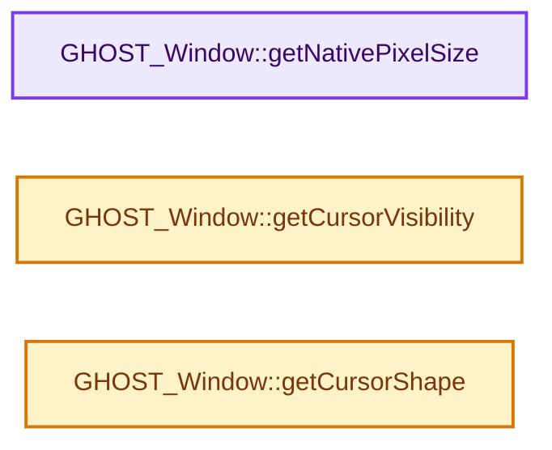
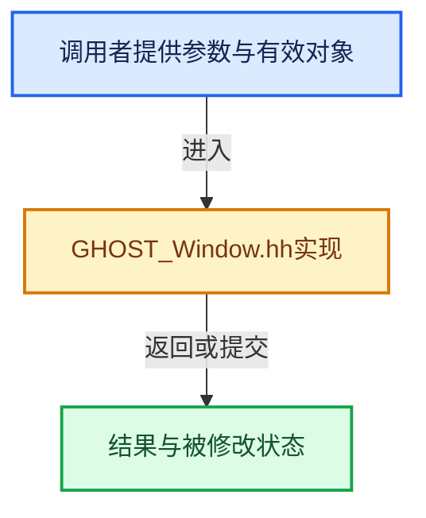

# 实现依赖专题：intern/ghost/intern/GHOST_Window.hh

[方向导航](README.md) · [符号索引](../%E7%AC%A6%E5%8F%B7%E4%BE%9D%E8%B5%96%E4%B8%8E%E5%AE%9E%E7%8E%B0%E7%B4%A2%E5%BC%95.md)

本专题从正文实际调用进入，集中保存共享实现。函数有稳定锚点，可从调用处直接跳到对应完整函数；递归与互相调用通过回链组织。

## 本文件的实现关系






## 完整成员与函数实现

<a id="f-2e3e47958eb26427"></a>

### `GHOST_Window::getNativePixelSize`

实现位置：[intern/ghost/intern/GHOST_Window.hh](../../../../../intern/ghost/intern/GHOST_Window.hh) · L230—L236。

**教学注释版**

<!-- annotated:bfd82b09544c63 -->

```cpp
  float getNativePixelSize() override
  {
    if (native_pixel_size_ > 0.0f) {
      return native_pixel_size_;
    }
    return 1.0f;
  }
```

<details>
<summary>核对原始源码：intern/ghost/intern/GHOST_Window.hh · L230—L236</summary>

<!-- original:bfd82b09544c63:intern/ghost/intern/GHOST_Window.hh:230:236 -->

```cpp
  float getNativePixelSize() override
  {
    if (native_pixel_size_ > 0.0f) {
      return native_pixel_size_;
    }
    return 1.0f;
  }
```

</details>

**结果出口**

- `return native_pixel_size_;`
- `return 1.0f;`

**继续追踪实现**

本实现没有需要继续展开的显式调用；检查返回表达式、对象转换和调用者前置条件。

<a id="f-06d7c551f0b47223"></a>

### `GHOST_Window::getCursorVisibility`

实现位置：[intern/ghost/intern/GHOST_Window.hh](../../../../../intern/ghost/intern/GHOST_Window.hh) · L398—L401。

**教学注释版**

<!-- annotated:14459610c8514e -->

```cpp
inline bool GHOST_Window::getCursorVisibility() const
{
  return cursor_visible_;
}
```

<details>
<summary>核对原始源码：intern/ghost/intern/GHOST_Window.hh · L398—L401</summary>

<!-- original:14459610c8514e:intern/ghost/intern/GHOST_Window.hh:398:401 -->

```cpp
inline bool GHOST_Window::getCursorVisibility() const
{
  return cursor_visible_;
}
```

</details>

**结果出口**

- `return cursor_visible_;`

**继续追踪实现**

本实现没有需要继续展开的显式调用；检查返回表达式、对象转换和调用者前置条件。

<a id="f-b36ec0d0be63c6a4"></a>

### `GHOST_Window::getCursorShape`

实现位置：[intern/ghost/intern/GHOST_Window.hh](../../../../../intern/ghost/intern/GHOST_Window.hh) · L436—L439。

**教学注释版**

<!-- annotated:cdc3d052fe5aa2 -->

```cpp
inline GHOST_TStandardCursor GHOST_Window::getCursorShape() const
{
  return cursor_shape_;
}
```

<details>
<summary>核对原始源码：intern/ghost/intern/GHOST_Window.hh · L436—L439</summary>

<!-- original:cdc3d052fe5aa2:intern/ghost/intern/GHOST_Window.hh:436:439 -->

```cpp
inline GHOST_TStandardCursor GHOST_Window::getCursorShape() const
{
  return cursor_shape_;
}
```

</details>

**结果出口**

- `return cursor_shape_;`

**继续追踪实现**

本实现没有需要继续展开的显式调用；检查返回表达式、对象转换和调用者前置条件。
