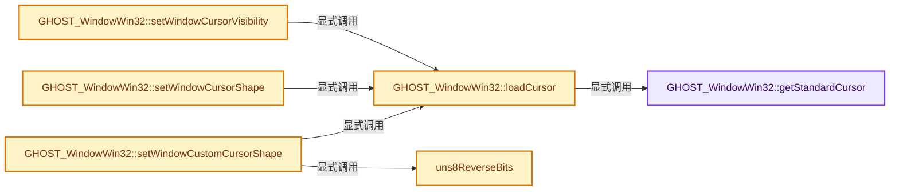
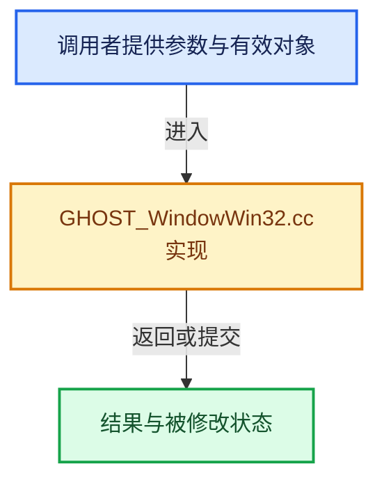

# 实现依赖专题：intern/ghost/intern/GHOST_WindowWin32.cc

[方向导航](README.md) · [符号索引](../%E7%AC%A6%E5%8F%B7%E4%BE%9D%E8%B5%96%E4%B8%8E%E5%AE%9E%E7%8E%B0%E7%B4%A2%E5%BC%95.md)

本专题从正文实际调用进入，集中保存共享实现。函数有稳定锚点，可从调用处直接跳到对应完整函数；递归与互相调用通过回链组织。

## 本文件的实现关系






## 完整成员与函数实现

<a id="f-c443f5371bda0a96"></a>

### `GHOST_WindowWin32::getStandardCursor`

实现位置：[intern/ghost/intern/GHOST_WindowWin32.cc](../../../../../intern/ghost/intern/GHOST_WindowWin32.cc) · L719—L773。

接口参数：

- `GHOST_TStandardCursor shape`

**教学注释版**

<!-- annotated:126b3495022ed2 -->

```cpp
HCURSOR GHOST_WindowWin32::getStandardCursor(GHOST_TStandardCursor shape) const
{
  /* Convert GHOST cursor to Windows OEM cursor. */
  HANDLE cursor = nullptr;
  uint32_t flags = LR_SHARED | LR_DEFAULTSIZE;
  int cx = 0, cy = 0;

  switch (shape) {
    case GHOST_kStandardCursorCustom:
      if (custom_cursor_) {
        return custom_cursor_;
      }
      else {
        return nullptr;
      }
    case GHOST_kStandardCursorMove:
      cursor = ::LoadImage(nullptr, IDC_SIZEALL, IMAGE_CURSOR, cx, cy, flags);
      break;
    case GHOST_kStandardCursorHelp:
      cursor = ::LoadImage(nullptr, IDC_HELP, IMAGE_CURSOR, cx, cy, flags);
      break; /* Arrow and question mark */
    case GHOST_kStandardCursorWait:
      cursor = ::LoadImage(nullptr, IDC_WAIT, IMAGE_CURSOR, cx, cy, flags);
      break; /* Hourglass */
    case GHOST_kStandardCursorText:
      cursor = ::LoadImage(nullptr, IDC_IBEAM, IMAGE_CURSOR, cx, cy, flags);
      break; /* I-beam */
    case GHOST_kStandardCursorTopSide:
      cursor = ::LoadImage(nullptr, IDC_UPARROW, IMAGE_CURSOR, cx, cy, flags);
      break; /* Vertical arrow */
    case GHOST_kStandardCursorTopLeftCorner:
      cursor = ::LoadImage(nullptr, IDC_SIZENWSE, IMAGE_CURSOR, cx, cy, flags);
      break;
    case GHOST_kStandardCursorTopRightCorner:
      cursor = ::LoadImage(nullptr, IDC_SIZENESW, IMAGE_CURSOR, cx, cy, flags);
      break;
    case GHOST_kStandardCursorBottomRightCorner:
      cursor = ::LoadImage(nullptr, IDC_SIZENWSE, IMAGE_CURSOR, cx, cy, flags);
      break;
    case GHOST_kStandardCursorBottomLeftCorner:
      cursor = ::LoadImage(nullptr, IDC_SIZENESW, IMAGE_CURSOR, cx, cy, flags);
      break;
    case GHOST_kStandardCursorDefault:
      cursor = nullptr;
      break;
    default:
      return nullptr;
  }

  if (cursor == nullptr) {
    cursor = ::LoadImage(nullptr, IDC_ARROW, IMAGE_CURSOR, cx, cy, flags);
  }

  return (HCURSOR)cursor;
}
```

<details>
<summary>核对原始源码：intern/ghost/intern/GHOST_WindowWin32.cc · L719—L773</summary>

<!-- original:126b3495022ed2:intern/ghost/intern/GHOST_WindowWin32.cc:719:773 -->

```cpp
HCURSOR GHOST_WindowWin32::getStandardCursor(GHOST_TStandardCursor shape) const
{
  /* Convert GHOST cursor to Windows OEM cursor. */
  HANDLE cursor = nullptr;
  uint32_t flags = LR_SHARED | LR_DEFAULTSIZE;
  int cx = 0, cy = 0;

  switch (shape) {
    case GHOST_kStandardCursorCustom:
      if (custom_cursor_) {
        return custom_cursor_;
      }
      else {
        return nullptr;
      }
    case GHOST_kStandardCursorMove:
      cursor = ::LoadImage(nullptr, IDC_SIZEALL, IMAGE_CURSOR, cx, cy, flags);
      break;
    case GHOST_kStandardCursorHelp:
      cursor = ::LoadImage(nullptr, IDC_HELP, IMAGE_CURSOR, cx, cy, flags);
      break; /* Arrow and question mark */
    case GHOST_kStandardCursorWait:
      cursor = ::LoadImage(nullptr, IDC_WAIT, IMAGE_CURSOR, cx, cy, flags);
      break; /* Hourglass */
    case GHOST_kStandardCursorText:
      cursor = ::LoadImage(nullptr, IDC_IBEAM, IMAGE_CURSOR, cx, cy, flags);
      break; /* I-beam */
    case GHOST_kStandardCursorTopSide:
      cursor = ::LoadImage(nullptr, IDC_UPARROW, IMAGE_CURSOR, cx, cy, flags);
      break; /* Vertical arrow */
    case GHOST_kStandardCursorTopLeftCorner:
      cursor = ::LoadImage(nullptr, IDC_SIZENWSE, IMAGE_CURSOR, cx, cy, flags);
      break;
    case GHOST_kStandardCursorTopRightCorner:
      cursor = ::LoadImage(nullptr, IDC_SIZENESW, IMAGE_CURSOR, cx, cy, flags);
      break;
    case GHOST_kStandardCursorBottomRightCorner:
      cursor = ::LoadImage(nullptr, IDC_SIZENWSE, IMAGE_CURSOR, cx, cy, flags);
      break;
    case GHOST_kStandardCursorBottomLeftCorner:
      cursor = ::LoadImage(nullptr, IDC_SIZENESW, IMAGE_CURSOR, cx, cy, flags);
      break;
    case GHOST_kStandardCursorDefault:
      cursor = nullptr;
      break;
    default:
      return nullptr;
  }

  if (cursor == nullptr) {
    cursor = ::LoadImage(nullptr, IDC_ARROW, IMAGE_CURSOR, cx, cy, flags);
  }

  return (HCURSOR)cursor;
}
```

</details>

**沿实际写入检查状态**

- `cursor = ::LoadImage(nullptr, IDC_SIZEALL, IMAGE_CURSOR, cx, cy, flags);`
- `cursor = ::LoadImage(nullptr, IDC_HELP, IMAGE_CURSOR, cx, cy, flags);`
- `cursor = ::LoadImage(nullptr, IDC_WAIT, IMAGE_CURSOR, cx, cy, flags);`
- `cursor = ::LoadImage(nullptr, IDC_IBEAM, IMAGE_CURSOR, cx, cy, flags);`
- `cursor = ::LoadImage(nullptr, IDC_UPARROW, IMAGE_CURSOR, cx, cy, flags);`
- `cursor = ::LoadImage(nullptr, IDC_SIZENWSE, IMAGE_CURSOR, cx, cy, flags);`
- `cursor = ::LoadImage(nullptr, IDC_SIZENESW, IMAGE_CURSOR, cx, cy, flags);`
- `cursor = nullptr;`
- `cursor = ::LoadImage(nullptr, IDC_ARROW, IMAGE_CURSOR, cx, cy, flags);`

**结果出口**

- `return custom_cursor_;`
- `return nullptr;`
- `return (HCURSOR)cursor;`

**继续追踪实现**

- `::LoadImage` → [调用协议](../%E6%A8%A1%E6%9D%BF%E5%AE%8F%E4%B8%8E%E5%8A%A8%E6%80%81%E5%88%86%E6%B4%BE%E5%8D%8F%E8%AE%AE.md)：函数指针、局部可调用对象或未展开的宏；必须结合调用者环境。调用位置L735。

<a id="f-7ed28892f001dd48"></a>

### `GHOST_WindowWin32::loadCursor`

实现位置：[intern/ghost/intern/GHOST_WindowWin32.cc](../../../../../intern/ghost/intern/GHOST_WindowWin32.cc) · L775—L793。

接口参数：

- `bool visible`
- `GHOST_TStandardCursor shape`

**教学注释版**

<!-- annotated:e5d107c14b41fe -->

```cpp
void GHOST_WindowWin32::loadCursor(bool visible, GHOST_TStandardCursor shape) const
{
  if (!visible) {
    while (::ShowCursor(FALSE) >= 0) {
      /* Pass. */
    }
  }
  else {
    while (::ShowCursor(TRUE) < 0) {
      /* Pass. */
    }
  }

  HCURSOR cursor = getStandardCursor(shape);
  if (cursor == nullptr) {
    cursor = getStandardCursor(GHOST_kStandardCursorDefault);
  }
  ::SetCursor(cursor);
}
```

<details>
<summary>核对原始源码：intern/ghost/intern/GHOST_WindowWin32.cc · L775—L793</summary>

<!-- original:e5d107c14b41fe:intern/ghost/intern/GHOST_WindowWin32.cc:775:793 -->

```cpp
void GHOST_WindowWin32::loadCursor(bool visible, GHOST_TStandardCursor shape) const
{
  if (!visible) {
    while (::ShowCursor(FALSE) >= 0) {
      /* Pass. */
    }
  }
  else {
    while (::ShowCursor(TRUE) < 0) {
      /* Pass. */
    }
  }

  HCURSOR cursor = getStandardCursor(shape);
  if (cursor == nullptr) {
    cursor = getStandardCursor(GHOST_kStandardCursorDefault);
  }
  ::SetCursor(cursor);
}
```

</details>

**沿实际写入检查状态**

- `cursor = getStandardCursor(GHOST_kStandardCursorDefault);`

**继续追踪实现**

- `::ShowCursor` → [调用协议](../%E6%A8%A1%E6%9D%BF%E5%AE%8F%E4%B8%8E%E5%8A%A8%E6%80%81%E5%88%86%E6%B4%BE%E5%8D%8F%E8%AE%AE.md)：函数指针、局部可调用对象或未展开的宏；必须结合调用者环境。调用位置L778。
- `getStandardCursor` → [GHOST_WindowWin32::getStandardCursor · L719](%E4%BE%9D%E8%B5%96-GHOST_WindowWin32-a91c51.md#f-c443f5371bda0a96)。
- `::SetCursor` → [调用协议](../%E6%A8%A1%E6%9D%BF%E5%AE%8F%E4%B8%8E%E5%8A%A8%E6%80%81%E5%88%86%E6%B4%BE%E5%8D%8F%E8%AE%AE.md)：函数指针、局部可调用对象或未展开的宏；必须结合调用者环境。调用位置L792。

<a id="f-52c9d3d6b134a83a"></a>

### `GHOST_WindowWin32::setWindowCursorVisibility`

实现位置：[intern/ghost/intern/GHOST_WindowWin32.cc](../../../../../intern/ghost/intern/GHOST_WindowWin32.cc) · L795—L802。

接口参数：

- `bool visible`

**教学注释版**

<!-- annotated:7a88a39201a61e -->

```cpp
GHOST_TSuccess GHOST_WindowWin32::setWindowCursorVisibility(bool visible)
{
  if (::GetForegroundWindow() == h_wnd_) {
    loadCursor(visible, getCursorShape());
  }

  return GHOST_kSuccess;
}
```

<details>
<summary>核对原始源码：intern/ghost/intern/GHOST_WindowWin32.cc · L795—L802</summary>

<!-- original:7a88a39201a61e:intern/ghost/intern/GHOST_WindowWin32.cc:795:802 -->

```cpp
GHOST_TSuccess GHOST_WindowWin32::setWindowCursorVisibility(bool visible)
{
  if (::GetForegroundWindow() == h_wnd_) {
    loadCursor(visible, getCursorShape());
  }

  return GHOST_kSuccess;
}
```

</details>

**结果出口**

- `return GHOST_kSuccess;`

**继续追踪实现**

- `::GetForegroundWindow` → [调用协议](../%E6%A8%A1%E6%9D%BF%E5%AE%8F%E4%B8%8E%E5%8A%A8%E6%80%81%E5%88%86%E6%B4%BE%E5%8D%8F%E8%AE%AE.md)：函数指针、局部可调用对象或未展开的宏；必须结合调用者环境。调用位置L797。
- `loadCursor` → [GHOST_WindowWin32::loadCursor · L775](%E4%BE%9D%E8%B5%96-GHOST_WindowWin32-a91c51.md#f-7ed28892f001dd48)。
- `getCursorShape` → [GHOST_Window::getCursorShape · L436](%E4%BE%9D%E8%B5%96-GHOST_Window-47becc.md#f-b36ec0d0be63c6a4)。

<a id="f-c75e6e6628e42eca"></a>

### `GHOST_WindowWin32::setWindowCursorShape`

实现位置：[intern/ghost/intern/GHOST_WindowWin32.cc](../../../../../intern/ghost/intern/GHOST_WindowWin32.cc) · L841—L848。

接口参数：

- `GHOST_TStandardCursor cursor_shape`

**教学注释版**

<!-- annotated:3a353f4a372d89 -->

```cpp
GHOST_TSuccess GHOST_WindowWin32::setWindowCursorShape(GHOST_TStandardCursor cursor_shape)
{
  if (::GetForegroundWindow() == h_wnd_) {
    loadCursor(getCursorVisibility(), cursor_shape);
  }

  return GHOST_kSuccess;
}
```

<details>
<summary>核对原始源码：intern/ghost/intern/GHOST_WindowWin32.cc · L841—L848</summary>

<!-- original:3a353f4a372d89:intern/ghost/intern/GHOST_WindowWin32.cc:841:848 -->

```cpp
GHOST_TSuccess GHOST_WindowWin32::setWindowCursorShape(GHOST_TStandardCursor cursor_shape)
{
  if (::GetForegroundWindow() == h_wnd_) {
    loadCursor(getCursorVisibility(), cursor_shape);
  }

  return GHOST_kSuccess;
}
```

</details>

**结果出口**

- `return GHOST_kSuccess;`

**继续追踪实现**

- `::GetForegroundWindow` → [调用协议](../%E6%A8%A1%E6%9D%BF%E5%AE%8F%E4%B8%8E%E5%8A%A8%E6%80%81%E5%88%86%E6%B4%BE%E5%8D%8F%E8%AE%AE.md)：函数指针、局部可调用对象或未展开的宏；必须结合调用者环境。调用位置L843。
- `loadCursor` → [GHOST_WindowWin32::loadCursor · L775](%E4%BE%9D%E8%B5%96-GHOST_WindowWin32-a91c51.md#f-7ed28892f001dd48)。
- `getCursorVisibility` → [GHOST_Window::getCursorVisibility · L398](%E4%BE%9D%E8%B5%96-GHOST_Window-47becc.md#f-06d7c551f0b47223)。

<a id="f-ceccc07fa195e3fb"></a>

### `uns8ReverseBits`

实现位置：[intern/ghost/intern/GHOST_WindowWin32.cc](../../../../../intern/ghost/intern/GHOST_WindowWin32.cc) · L1056—L1062。

接口参数：

- `uint8_t ch`

**教学注释版**

<!-- annotated:1d3151cc37e6ce -->

```cpp
static uint8_t uns8ReverseBits(uint8_t ch)
{
  ch = ((ch >> 1) & 0x55) | ((ch << 1) & 0xAA);
  ch = ((ch >> 2) & 0x33) | ((ch << 2) & 0xCC);
  ch = ((ch >> 4) & 0x0F) | ((ch << 4) & 0xF0);
  return ch;
}
```

<details>
<summary>核对原始源码：intern/ghost/intern/GHOST_WindowWin32.cc · L1056—L1062</summary>

<!-- original:1d3151cc37e6ce:intern/ghost/intern/GHOST_WindowWin32.cc:1056:1062 -->

```cpp
static uint8_t uns8ReverseBits(uint8_t ch)
{
  ch = ((ch >> 1) & 0x55) | ((ch << 1) & 0xAA);
  ch = ((ch >> 2) & 0x33) | ((ch << 2) & 0xCC);
  ch = ((ch >> 4) & 0x0F) | ((ch << 4) & 0xF0);
  return ch;
}
```

</details>

**沿实际写入检查状态**

- `ch = ((ch >> 1) & 0x55) | ((ch << 1) & 0xAA);`
- `ch = ((ch >> 2) & 0x33) | ((ch << 2) & 0xCC);`
- `ch = ((ch >> 4) & 0x0F) | ((ch << 4) & 0xF0);`

**结果出口**

- `return ch;`

**继续追踪实现**

本实现没有需要继续展开的显式调用；检查返回表达式、对象转换和调用者前置条件。

<a id="f-2a191f59548648b9"></a>

### `GHOST_WindowWin32::setWindowCustomCursorShape`

实现位置：[intern/ghost/intern/GHOST_WindowWin32.cc](../../../../../intern/ghost/intern/GHOST_WindowWin32.cc) · L1076—L1194。

接口参数：

- `const uint8_t *bitmap`
- `const uint8_t *mask`
- `const int size[2]`
- `const int hot_spot[2]`
- `bool`

**教学注释版**

<!-- annotated:f2b99cff9272fb -->

```cpp
GHOST_TSuccess GHOST_WindowWin32::setWindowCustomCursorShape(const uint8_t *bitmap,
                                                             const uint8_t *mask,
                                                             const int size[2],
                                                             const int hot_spot[2],
                                                             bool /*can_invert_color*/)
{
  if (mask) {
    /* Old 1bpp XBitMap bitmap and mask. */
    uint32_t andData[32];
    uint32_t xorData[32];
    uint32_t fullBitRow, fullMaskRow;
    int x, y, cols;

    cols = size[0] / 8; /* Number of whole bytes per row (width of bitmap/mask). */
    if (size[0] % 8) {
      cols++;
    }

    HCURSOR previous_cursor = custom_cursor_;

    // [讲解] memset：填充字节，不调用T构造函数，也不保证任意类型的全零表示是合法或期望值。
    memset(&andData, 0xFF, sizeof(andData));
    memset(&xorData, 0, sizeof(xorData));

    for (y = 0; y < size[1]; y++) {
      fullBitRow = 0;
      fullMaskRow = 0;
      for (x = cols - 1; x >= 0; x--) {
        fullBitRow <<= 8;
        fullMaskRow <<= 8;
        fullBitRow |= uns8ReverseBits(bitmap[cols * y + x]);
        fullMaskRow |= uns8ReverseBits(mask[cols * y + x]);
      }
      xorData[y] = fullBitRow & fullMaskRow;
      andData[y] = ~fullMaskRow;
    }

    custom_cursor_ = ::CreateCursor(
        ::GetModuleHandle(0), hot_spot[0], hot_spot[1], 32, 32, andData, xorData);

    if (!custom_cursor_) {
      return GHOST_kFailure;
    }

    if (::GetForegroundWindow() == h_wnd_) {
      loadCursor(getCursorVisibility(), GHOST_kStandardCursorCustom);
    }

    if (previous_cursor) {
      DestroyCursor(previous_cursor);
    }

    return GHOST_kSuccess;
  }

  /* RGBA bitmap, size up to 255x255. This limit may differ on other
   * platforms. Requesting larger does not give an error, just results
   * in a smaller, empty result. */

  BITMAPV5HEADER header;
  memset(&header, 0, sizeof(BITMAPV5HEADER));
  header.bV5Size = sizeof(BITMAPV5HEADER);
  header.bV5Width = (LONG)size[0];
  header.bV5Height = (LONG)size[1];
  header.bV5Planes = 1;
  header.bV5BitCount = 32;
  header.bV5Compression = BI_BITFIELDS;
  header.bV5RedMask = 0x00FF0000;
  header.bV5GreenMask = 0x0000FF00;
  header.bV5BlueMask = 0x000000FF;
  header.bV5AlphaMask = 0xFF000000;

  HDC hdc = GetDC(h_wnd_);
  void *bits = nullptr;
  HBITMAP bmp = CreateDIBSection(
      hdc, (BITMAPINFO *)&header, DIB_RGB_COLORS, (void **)&bits, NULL, (DWORD)0);
  ReleaseDC(NULL, hdc);

  uint32_t *ptr = (uint32_t *)bits;
  char w = size[0];
  char h = size[1];
  for (int y = h - 1; y >= 0; y--) {
    for (int x = 0; x < w; x++) {
      int i = (y * w * 4) + (x * 4);
      uint32_t r = bitmap[i];
      uint32_t g = bitmap[i + 1];
      uint32_t b = bitmap[i + 2];
      uint32_t a = bitmap[i + 3];
      *ptr++ = (a << 24) | (r << 16) | (g << 8) | b;
    }
  }

  HBITMAP empty_mask = CreateBitmap(size[0], size[1], 1, 1, NULL);
  ICONINFO icon_info;
  icon_info.fIcon = FALSE;
  icon_info.xHotspot = (DWORD)hot_spot[0];
  icon_info.yHotspot = (DWORD)hot_spot[1];
  icon_info.hbmMask = empty_mask;
  icon_info.hbmColor = bmp;

  HCURSOR previous_cursor = custom_cursor_;

  custom_cursor_ = CreateIconIndirect(&icon_info);
  DeleteObject(bmp);
  DeleteObject(empty_mask);

  if (!custom_cursor_) {
    return GHOST_kFailure;
  }

  if (::GetForegroundWindow() == h_wnd_) {
    loadCursor(getCursorVisibility(), GHOST_kStandardCursorCustom);
  }

  if (previous_cursor) {
    DestroyCursor(previous_cursor);
  }

  return GHOST_kSuccess;
}
```

<details>
<summary>核对原始源码：intern/ghost/intern/GHOST_WindowWin32.cc · L1076—L1194</summary>

<!-- original:f2b99cff9272fb:intern/ghost/intern/GHOST_WindowWin32.cc:1076:1194 -->

```cpp
GHOST_TSuccess GHOST_WindowWin32::setWindowCustomCursorShape(const uint8_t *bitmap,
                                                             const uint8_t *mask,
                                                             const int size[2],
                                                             const int hot_spot[2],
                                                             bool /*can_invert_color*/)
{
  if (mask) {
    /* Old 1bpp XBitMap bitmap and mask. */
    uint32_t andData[32];
    uint32_t xorData[32];
    uint32_t fullBitRow, fullMaskRow;
    int x, y, cols;

    cols = size[0] / 8; /* Number of whole bytes per row (width of bitmap/mask). */
    if (size[0] % 8) {
      cols++;
    }

    HCURSOR previous_cursor = custom_cursor_;

    memset(&andData, 0xFF, sizeof(andData));
    memset(&xorData, 0, sizeof(xorData));

    for (y = 0; y < size[1]; y++) {
      fullBitRow = 0;
      fullMaskRow = 0;
      for (x = cols - 1; x >= 0; x--) {
        fullBitRow <<= 8;
        fullMaskRow <<= 8;
        fullBitRow |= uns8ReverseBits(bitmap[cols * y + x]);
        fullMaskRow |= uns8ReverseBits(mask[cols * y + x]);
      }
      xorData[y] = fullBitRow & fullMaskRow;
      andData[y] = ~fullMaskRow;
    }

    custom_cursor_ = ::CreateCursor(
        ::GetModuleHandle(0), hot_spot[0], hot_spot[1], 32, 32, andData, xorData);

    if (!custom_cursor_) {
      return GHOST_kFailure;
    }

    if (::GetForegroundWindow() == h_wnd_) {
      loadCursor(getCursorVisibility(), GHOST_kStandardCursorCustom);
    }

    if (previous_cursor) {
      DestroyCursor(previous_cursor);
    }

    return GHOST_kSuccess;
  }

  /* RGBA bitmap, size up to 255x255. This limit may differ on other
   * platforms. Requesting larger does not give an error, just results
   * in a smaller, empty result. */

  BITMAPV5HEADER header;
  memset(&header, 0, sizeof(BITMAPV5HEADER));
  header.bV5Size = sizeof(BITMAPV5HEADER);
  header.bV5Width = (LONG)size[0];
  header.bV5Height = (LONG)size[1];
  header.bV5Planes = 1;
  header.bV5BitCount = 32;
  header.bV5Compression = BI_BITFIELDS;
  header.bV5RedMask = 0x00FF0000;
  header.bV5GreenMask = 0x0000FF00;
  header.bV5BlueMask = 0x000000FF;
  header.bV5AlphaMask = 0xFF000000;

  HDC hdc = GetDC(h_wnd_);
  void *bits = nullptr;
  HBITMAP bmp = CreateDIBSection(
      hdc, (BITMAPINFO *)&header, DIB_RGB_COLORS, (void **)&bits, NULL, (DWORD)0);
  ReleaseDC(NULL, hdc);

  uint32_t *ptr = (uint32_t *)bits;
  char w = size[0];
  char h = size[1];
  for (int y = h - 1; y >= 0; y--) {
    for (int x = 0; x < w; x++) {
      int i = (y * w * 4) + (x * 4);
      uint32_t r = bitmap[i];
      uint32_t g = bitmap[i + 1];
      uint32_t b = bitmap[i + 2];
      uint32_t a = bitmap[i + 3];
      *ptr++ = (a << 24) | (r << 16) | (g << 8) | b;
    }
  }

  HBITMAP empty_mask = CreateBitmap(size[0], size[1], 1, 1, NULL);
  ICONINFO icon_info;
  icon_info.fIcon = FALSE;
  icon_info.xHotspot = (DWORD)hot_spot[0];
  icon_info.yHotspot = (DWORD)hot_spot[1];
  icon_info.hbmMask = empty_mask;
  icon_info.hbmColor = bmp;

  HCURSOR previous_cursor = custom_cursor_;

  custom_cursor_ = CreateIconIndirect(&icon_info);
  DeleteObject(bmp);
  DeleteObject(empty_mask);

  if (!custom_cursor_) {
    return GHOST_kFailure;
  }

  if (::GetForegroundWindow() == h_wnd_) {
    loadCursor(getCursorVisibility(), GHOST_kStandardCursorCustom);
  }

  if (previous_cursor) {
    DestroyCursor(previous_cursor);
  }

  return GHOST_kSuccess;
}
```

</details>

**沿实际写入检查状态**

- `cols = size[0] / 8; /* Number of whole bytes per row (width of bitmap/mask). */`
- `fullBitRow = 0;`
- `fullMaskRow = 0;`
- `fullBitRow |= uns8ReverseBits(bitmap[cols * y + x]);`
- `fullMaskRow |= uns8ReverseBits(mask[cols * y + x]);`
- `xorData[y] = fullBitRow & fullMaskRow;`
- `andData[y] = ~fullMaskRow;`
- `custom_cursor_ = ::CreateCursor(`
- `header.bV5Size = sizeof(BITMAPV5HEADER);`
- `header.bV5Width = (LONG)size[0];`
- `header.bV5Height = (LONG)size[1];`
- `header.bV5Planes = 1;`
- `header.bV5BitCount = 32;`
- `header.bV5Compression = BI_BITFIELDS;`
- `header.bV5RedMask = 0x00FF0000;`
- `header.bV5GreenMask = 0x0000FF00;`
- `header.bV5BlueMask = 0x000000FF;`
- `header.bV5AlphaMask = 0xFF000000;`
- `icon_info.fIcon = FALSE;`
- `icon_info.xHotspot = (DWORD)hot_spot[0];`
- `icon_info.yHotspot = (DWORD)hot_spot[1];`
- `icon_info.hbmMask = empty_mask;`
- `icon_info.hbmColor = bmp;`
- `custom_cursor_ = CreateIconIndirect(&icon_info);`

**结果出口**

- `return GHOST_kFailure;`
- `return GHOST_kSuccess;`

**继续追踪实现**

- `memset` → [外部契约](https://eel.is/c++draft/cstring.syn)：填充字节，不调用T构造函数，也不保证任意类型的全零表示是合法或期望值。
- `uns8ReverseBits` → [uns8ReverseBits · L1056](%E4%BE%9D%E8%B5%96-GHOST_WindowWin32-a91c51.md#f-ceccc07fa195e3fb)。
- `::CreateCursor` → [调用协议](../%E6%A8%A1%E6%9D%BF%E5%AE%8F%E4%B8%8E%E5%8A%A8%E6%80%81%E5%88%86%E6%B4%BE%E5%8D%8F%E8%AE%AE.md)：函数指针、局部可调用对象或未展开的宏；必须结合调用者环境。调用位置L1112。
- `::GetModuleHandle` → [调用协议](../%E6%A8%A1%E6%9D%BF%E5%AE%8F%E4%B8%8E%E5%8A%A8%E6%80%81%E5%88%86%E6%B4%BE%E5%8D%8F%E8%AE%AE.md)：函数指针、局部可调用对象或未展开的宏；必须结合调用者环境。调用位置L1113。
- `::GetForegroundWindow` → [调用协议](../%E6%A8%A1%E6%9D%BF%E5%AE%8F%E4%B8%8E%E5%8A%A8%E6%80%81%E5%88%86%E6%B4%BE%E5%8D%8F%E8%AE%AE.md)：函数指针、局部可调用对象或未展开的宏；必须结合调用者环境。调用位置L1119。
- `loadCursor` → [GHOST_WindowWin32::loadCursor · L775](%E4%BE%9D%E8%B5%96-GHOST_WindowWin32-a91c51.md#f-7ed28892f001dd48)。
- `getCursorVisibility` → [GHOST_Window::getCursorVisibility · L398](%E4%BE%9D%E8%B5%96-GHOST_Window-47becc.md#f-06d7c551f0b47223)。
- `DestroyCursor` → [调用协议](../%E6%A8%A1%E6%9D%BF%E5%AE%8F%E4%B8%8E%E5%8A%A8%E6%80%81%E5%88%86%E6%B4%BE%E5%8D%8F%E8%AE%AE.md)：函数指针、局部可调用对象或未展开的宏；必须结合调用者环境。调用位置L1124。
- `GetDC` → [调用协议](../%E6%A8%A1%E6%9D%BF%E5%AE%8F%E4%B8%8E%E5%8A%A8%E6%80%81%E5%88%86%E6%B4%BE%E5%8D%8F%E8%AE%AE.md)：函数指针、局部可调用对象或未展开的宏；必须结合调用者环境。调用位置L1147。
- `CreateDIBSection` → [调用协议](../%E6%A8%A1%E6%9D%BF%E5%AE%8F%E4%B8%8E%E5%8A%A8%E6%80%81%E5%88%86%E6%B4%BE%E5%8D%8F%E8%AE%AE.md)：函数指针、局部可调用对象或未展开的宏；必须结合调用者环境。调用位置L1149。
- `ReleaseDC` → [调用协议](../%E6%A8%A1%E6%9D%BF%E5%AE%8F%E4%B8%8E%E5%8A%A8%E6%80%81%E5%88%86%E6%B4%BE%E5%8D%8F%E8%AE%AE.md)：函数指针、局部可调用对象或未展开的宏；必须结合调用者环境。调用位置L1151。
- `CreateBitmap` → [调用协议](../%E6%A8%A1%E6%9D%BF%E5%AE%8F%E4%B8%8E%E5%8A%A8%E6%80%81%E5%88%86%E6%B4%BE%E5%8D%8F%E8%AE%AE.md)：函数指针、局部可调用对象或未展开的宏；必须结合调用者环境。调用位置L1167。
- `CreateIconIndirect` → [调用协议](../%E6%A8%A1%E6%9D%BF%E5%AE%8F%E4%B8%8E%E5%8A%A8%E6%80%81%E5%88%86%E6%B4%BE%E5%8D%8F%E8%AE%AE.md)：函数指针、局部可调用对象或未展开的宏；必须结合调用者环境。调用位置L1177。
- `DeleteObject` → [调用协议](../%E6%A8%A1%E6%9D%BF%E5%AE%8F%E4%B8%8E%E5%8A%A8%E6%80%81%E5%88%86%E6%B4%BE%E5%8D%8F%E8%AE%AE.md)：函数指针、局部可调用对象或未展开的宏；必须结合调用者环境。调用位置L1178。
