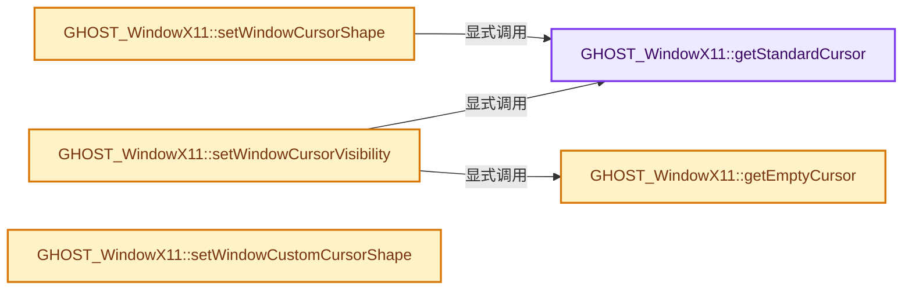
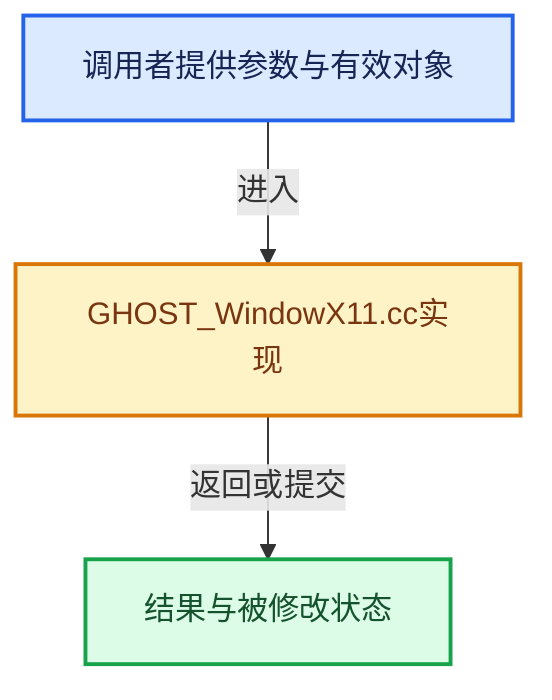

# 实现依赖专题：intern/ghost/intern/GHOST_WindowX11.cc

[方向导航](README.md) · [符号索引](../%E7%AC%A6%E5%8F%B7%E4%BE%9D%E8%B5%96%E4%B8%8E%E5%AE%9E%E7%8E%B0%E7%B4%A2%E5%BC%95.md)

本专题从正文实际调用进入，集中保存共享实现。函数有稳定锚点，可从调用处直接跳到对应完整函数；递归与互相调用通过回链组织。

## 本文件的实现关系






## 完整成员与函数实现

<a id="f-9cc0a75d81e13bdc"></a>

### `GHOST_WindowX11::getStandardCursor`

实现位置：[intern/ghost/intern/GHOST_WindowX11.cc](../../../../../intern/ghost/intern/GHOST_WindowX11.cc) · L1296—L1360。

接口参数：

- `GHOST_TStandardCursor g_cursor`
- `Cursor &xcursor`

**教学注释版**

<!-- annotated:e8c62306cc3665 -->

```cpp
GHOST_TSuccess GHOST_WindowX11::getStandardCursor(GHOST_TStandardCursor g_cursor, Cursor &xcursor)
{
  uint xcursor_id;

  switch (g_cursor) {
    case GHOST_kStandardCursorHelp:
      xcursor_id = XC_question_arrow;
      break;
    case GHOST_kStandardCursorWait:
      xcursor_id = XC_watch;
      break;
    case GHOST_kStandardCursorText:
      xcursor_id = XC_xterm;
      break;
    case GHOST_kStandardCursorCrosshair:
      xcursor_id = XC_crosshair;
      break;
    case GHOST_kStandardCursorUpDown:
      xcursor_id = XC_sb_v_double_arrow;
      break;
    case GHOST_kStandardCursorLeftRight:
      xcursor_id = XC_sb_h_double_arrow;
      break;
    case GHOST_kStandardCursorTopSide:
      xcursor_id = XC_top_side;
      break;
    case GHOST_kStandardCursorBottomSide:
      xcursor_id = XC_bottom_side;
      break;
    case GHOST_kStandardCursorLeftSide:
      xcursor_id = XC_left_side;
      break;
    case GHOST_kStandardCursorRightSide:
      xcursor_id = XC_right_side;
      break;
    case GHOST_kStandardCursorTopLeftCorner:
      xcursor_id = XC_top_left_corner;
      break;
    case GHOST_kStandardCursorTopRightCorner:
      xcursor_id = XC_top_right_corner;
      break;
    case GHOST_kStandardCursorBottomRightCorner:
      xcursor_id = XC_bottom_right_corner;
      break;
    case GHOST_kStandardCursorBottomLeftCorner:
      xcursor_id = XC_bottom_left_corner;
      break;
    case GHOST_kStandardCursorDefault:
      xcursor = None;
      return GHOST_kSuccess;
    default:
      xcursor = None;
      return GHOST_kFailure;
  }

  xcursor = standard_cursors_[xcursor_id];

  if (!xcursor) {
    xcursor = XCreateFontCursor(display_, xcursor_id);

    standard_cursors_[xcursor_id] = xcursor;
  }

  return GHOST_kSuccess;
}
```

<details>
<summary>核对原始源码：intern/ghost/intern/GHOST_WindowX11.cc · L1296—L1360</summary>

<!-- original:e8c62306cc3665:intern/ghost/intern/GHOST_WindowX11.cc:1296:1360 -->

```cpp
GHOST_TSuccess GHOST_WindowX11::getStandardCursor(GHOST_TStandardCursor g_cursor, Cursor &xcursor)
{
  uint xcursor_id;

  switch (g_cursor) {
    case GHOST_kStandardCursorHelp:
      xcursor_id = XC_question_arrow;
      break;
    case GHOST_kStandardCursorWait:
      xcursor_id = XC_watch;
      break;
    case GHOST_kStandardCursorText:
      xcursor_id = XC_xterm;
      break;
    case GHOST_kStandardCursorCrosshair:
      xcursor_id = XC_crosshair;
      break;
    case GHOST_kStandardCursorUpDown:
      xcursor_id = XC_sb_v_double_arrow;
      break;
    case GHOST_kStandardCursorLeftRight:
      xcursor_id = XC_sb_h_double_arrow;
      break;
    case GHOST_kStandardCursorTopSide:
      xcursor_id = XC_top_side;
      break;
    case GHOST_kStandardCursorBottomSide:
      xcursor_id = XC_bottom_side;
      break;
    case GHOST_kStandardCursorLeftSide:
      xcursor_id = XC_left_side;
      break;
    case GHOST_kStandardCursorRightSide:
      xcursor_id = XC_right_side;
      break;
    case GHOST_kStandardCursorTopLeftCorner:
      xcursor_id = XC_top_left_corner;
      break;
    case GHOST_kStandardCursorTopRightCorner:
      xcursor_id = XC_top_right_corner;
      break;
    case GHOST_kStandardCursorBottomRightCorner:
      xcursor_id = XC_bottom_right_corner;
      break;
    case GHOST_kStandardCursorBottomLeftCorner:
      xcursor_id = XC_bottom_left_corner;
      break;
    case GHOST_kStandardCursorDefault:
      xcursor = None;
      return GHOST_kSuccess;
    default:
      xcursor = None;
      return GHOST_kFailure;
  }

  xcursor = standard_cursors_[xcursor_id];

  if (!xcursor) {
    xcursor = XCreateFontCursor(display_, xcursor_id);

    standard_cursors_[xcursor_id] = xcursor;
  }

  return GHOST_kSuccess;
}
```

</details>

**沿实际写入检查状态**

- `xcursor_id = XC_question_arrow;`
- `xcursor_id = XC_watch;`
- `xcursor_id = XC_xterm;`
- `xcursor_id = XC_crosshair;`
- `xcursor_id = XC_sb_v_double_arrow;`
- `xcursor_id = XC_sb_h_double_arrow;`
- `xcursor_id = XC_top_side;`
- `xcursor_id = XC_bottom_side;`
- `xcursor_id = XC_left_side;`
- `xcursor_id = XC_right_side;`
- `xcursor_id = XC_top_left_corner;`
- `xcursor_id = XC_top_right_corner;`
- `xcursor_id = XC_bottom_right_corner;`
- `xcursor_id = XC_bottom_left_corner;`
- `xcursor = None;`
- `xcursor = standard_cursors_[xcursor_id];`
- `xcursor = XCreateFontCursor(display_, xcursor_id);`
- `standard_cursors_[xcursor_id] = xcursor;`

**结果出口**

- `return GHOST_kSuccess;`
- `return GHOST_kFailure;`

**继续追踪实现**

- `XCreateFontCursor` → [调用协议](../%E6%A8%A1%E6%9D%BF%E5%AE%8F%E4%B8%8E%E5%8A%A8%E6%80%81%E5%88%86%E6%B4%BE%E5%8D%8F%E8%AE%AE.md)：函数指针、局部可调用对象或未展开的宏；必须结合调用者环境。调用位置L1354。

<a id="f-997b41960bdc55b2"></a>

### `GHOST_WindowX11::getEmptyCursor`

实现位置：[intern/ghost/intern/GHOST_WindowX11.cc](../../../../../intern/ghost/intern/GHOST_WindowX11.cc) · L1362—L1378。

**教学注释版**

<!-- annotated:d9ec843f143c95 -->

```cpp
Cursor GHOST_WindowX11::getEmptyCursor()
{
  if (!empty_cursor_) {
    Pixmap blank;
    XColor dummy = {0};
    char data[1] = {0};

    /* make a blank cursor */
    blank = XCreateBitmapFromData(
        display_, RootWindow(display_, visual_info_->screen), data, 1, 1);

    empty_cursor_ = XCreatePixmapCursor(display_, blank, blank, &dummy, &dummy, 0, 0);
    XFreePixmap(display_, blank);
  }

  return empty_cursor_;
}
```

<details>
<summary>核对原始源码：intern/ghost/intern/GHOST_WindowX11.cc · L1362—L1378</summary>

<!-- original:d9ec843f143c95:intern/ghost/intern/GHOST_WindowX11.cc:1362:1378 -->

```cpp
Cursor GHOST_WindowX11::getEmptyCursor()
{
  if (!empty_cursor_) {
    Pixmap blank;
    XColor dummy = {0};
    char data[1] = {0};

    /* make a blank cursor */
    blank = XCreateBitmapFromData(
        display_, RootWindow(display_, visual_info_->screen), data, 1, 1);

    empty_cursor_ = XCreatePixmapCursor(display_, blank, blank, &dummy, &dummy, 0, 0);
    XFreePixmap(display_, blank);
  }

  return empty_cursor_;
}
```

</details>

**沿实际写入检查状态**

- `blank = XCreateBitmapFromData(`
- `empty_cursor_ = XCreatePixmapCursor(display_, blank, blank, &dummy, &dummy, 0, 0);`

**结果出口**

- `return empty_cursor_;`

**继续追踪实现**

- `XCreateBitmapFromData` → [调用协议](../%E6%A8%A1%E6%9D%BF%E5%AE%8F%E4%B8%8E%E5%8A%A8%E6%80%81%E5%88%86%E6%B4%BE%E5%8D%8F%E8%AE%AE.md)：函数指针、局部可调用对象或未展开的宏；必须结合调用者环境。调用位置L1370。
- `RootWindow` → [调用协议](../%E6%A8%A1%E6%9D%BF%E5%AE%8F%E4%B8%8E%E5%8A%A8%E6%80%81%E5%88%86%E6%B4%BE%E5%8D%8F%E8%AE%AE.md)：函数指针、局部可调用对象或未展开的宏；必须结合调用者环境。调用位置L1371。
- `XCreatePixmapCursor` → [调用协议](../%E6%A8%A1%E6%9D%BF%E5%AE%8F%E4%B8%8E%E5%8A%A8%E6%80%81%E5%88%86%E6%B4%BE%E5%8D%8F%E8%AE%AE.md)：函数指针、局部可调用对象或未展开的宏；必须结合调用者环境。调用位置L1373。
- `XFreePixmap` → [调用协议](../%E6%A8%A1%E6%9D%BF%E5%AE%8F%E4%B8%8E%E5%8A%A8%E6%80%81%E5%88%86%E6%B4%BE%E5%8D%8F%E8%AE%AE.md)：函数指针、局部可调用对象或未展开的宏；必须结合调用者环境。调用位置L1374。

<a id="f-8cb89809af54155f"></a>

### `GHOST_WindowX11::setWindowCursorVisibility`

实现位置：[intern/ghost/intern/GHOST_WindowX11.cc](../../../../../intern/ghost/intern/GHOST_WindowX11.cc) · L1380—L1400。

接口参数：

- `bool visible`

**教学注释版**

<!-- annotated:9ffb65b9ec8251 -->

```cpp
GHOST_TSuccess GHOST_WindowX11::setWindowCursorVisibility(bool visible)
{
  Cursor xcursor;

  if (visible) {
    if (visible_cursor_) {
      xcursor = visible_cursor_;
    }
    else if (getStandardCursor(getCursorShape(), xcursor) == GHOST_kFailure) {
      getStandardCursor(getCursorShape(), xcursor);
    }
  }
  else {
    xcursor = getEmptyCursor();
  }

  XDefineCursor(display_, window_, xcursor);
  XFlush(display_);

  return GHOST_kSuccess;
}
```

<details>
<summary>核对原始源码：intern/ghost/intern/GHOST_WindowX11.cc · L1380—L1400</summary>

<!-- original:9ffb65b9ec8251:intern/ghost/intern/GHOST_WindowX11.cc:1380:1400 -->

```cpp
GHOST_TSuccess GHOST_WindowX11::setWindowCursorVisibility(bool visible)
{
  Cursor xcursor;

  if (visible) {
    if (visible_cursor_) {
      xcursor = visible_cursor_;
    }
    else if (getStandardCursor(getCursorShape(), xcursor) == GHOST_kFailure) {
      getStandardCursor(getCursorShape(), xcursor);
    }
  }
  else {
    xcursor = getEmptyCursor();
  }

  XDefineCursor(display_, window_, xcursor);
  XFlush(display_);

  return GHOST_kSuccess;
}
```

</details>

**沿实际写入检查状态**

- `xcursor = visible_cursor_;`
- `xcursor = getEmptyCursor();`

**结果出口**

- `return GHOST_kSuccess;`

**继续追踪实现**

- `getStandardCursor` → [GHOST_WindowX11::getStandardCursor · L1296](%E4%BE%9D%E8%B5%96-GHOST_WindowX11-4ac837.md#f-9cc0a75d81e13bdc)。
- `getCursorShape` → [GHOST_Window::getCursorShape · L436](%E4%BE%9D%E8%B5%96-GHOST_Window-47becc.md#f-b36ec0d0be63c6a4)。
- `getEmptyCursor` → [GHOST_WindowX11::getEmptyCursor · L1362](%E4%BE%9D%E8%B5%96-GHOST_WindowX11-4ac837.md#f-997b41960bdc55b2)。
- `XDefineCursor` → [调用协议](../%E6%A8%A1%E6%9D%BF%E5%AE%8F%E4%B8%8E%E5%8A%A8%E6%80%81%E5%88%86%E6%B4%BE%E5%8D%8F%E8%AE%AE.md)：函数指针、局部可调用对象或未展开的宏；必须结合调用者环境。调用位置L1396。
- `XFlush` → [调用协议](../%E6%A8%A1%E6%9D%BF%E5%AE%8F%E4%B8%8E%E5%8A%A8%E6%80%81%E5%88%86%E6%B4%BE%E5%8D%8F%E8%AE%AE.md)：函数指针、局部可调用对象或未展开的宏；必须结合调用者环境。调用位置L1397。

<a id="f-23522fed582b2b9b"></a>

### `GHOST_WindowX11::setWindowCursorShape`

实现位置：[intern/ghost/intern/GHOST_WindowX11.cc](../../../../../intern/ghost/intern/GHOST_WindowX11.cc) · L1468—L1481。

接口参数：

- `GHOST_TStandardCursor shape`

**教学注释版**

<!-- annotated:c44867b6c83439 -->

```cpp
GHOST_TSuccess GHOST_WindowX11::setWindowCursorShape(GHOST_TStandardCursor shape)
{
  Cursor xcursor;
  if (getStandardCursor(shape, xcursor) == GHOST_kFailure) {
    getStandardCursor(GHOST_kStandardCursorDefault, xcursor);
  }

  visible_cursor_ = xcursor;

  XDefineCursor(display_, window_, xcursor);
  XFlush(display_);

  return GHOST_kSuccess;
}
```

<details>
<summary>核对原始源码：intern/ghost/intern/GHOST_WindowX11.cc · L1468—L1481</summary>

<!-- original:c44867b6c83439:intern/ghost/intern/GHOST_WindowX11.cc:1468:1481 -->

```cpp
GHOST_TSuccess GHOST_WindowX11::setWindowCursorShape(GHOST_TStandardCursor shape)
{
  Cursor xcursor;
  if (getStandardCursor(shape, xcursor) == GHOST_kFailure) {
    getStandardCursor(GHOST_kStandardCursorDefault, xcursor);
  }

  visible_cursor_ = xcursor;

  XDefineCursor(display_, window_, xcursor);
  XFlush(display_);

  return GHOST_kSuccess;
}
```

</details>

**沿实际写入检查状态**

- `visible_cursor_ = xcursor;`

**结果出口**

- `return GHOST_kSuccess;`

**继续追踪实现**

- `getStandardCursor` → [GHOST_WindowX11::getStandardCursor · L1296](%E4%BE%9D%E8%B5%96-GHOST_WindowX11-4ac837.md#f-9cc0a75d81e13bdc)。
- `XDefineCursor` → [调用协议](../%E6%A8%A1%E6%9D%BF%E5%AE%8F%E4%B8%8E%E5%8A%A8%E6%80%81%E5%88%86%E6%B4%BE%E5%8D%8F%E8%AE%AE.md)：函数指针、局部可调用对象或未展开的宏；必须结合调用者环境。调用位置L1477。
- `XFlush` → [调用协议](../%E6%A8%A1%E6%9D%BF%E5%AE%8F%E4%B8%8E%E5%8A%A8%E6%80%81%E5%88%86%E6%B4%BE%E5%8D%8F%E8%AE%AE.md)：函数指针、局部可调用对象或未展开的宏；必须结合调用者环境。调用位置L1478。

<a id="f-114b0378ea22b301"></a>

### `GHOST_WindowX11::setWindowCustomCursorShape`

实现位置：[intern/ghost/intern/GHOST_WindowX11.cc](../../../../../intern/ghost/intern/GHOST_WindowX11.cc) · L1489—L1527。

接口参数：

- `const uint8_t *bitmap`
- `const uint8_t *mask`
- `const int size[2]`
- `const int hot_spot[2]`
- `bool`

**教学注释版**

<!-- annotated:d112038c0203c1 -->

```cpp
GHOST_TSuccess GHOST_WindowX11::setWindowCustomCursorShape(const uint8_t *bitmap,
                                                           const uint8_t *mask,
                                                           const int size[2],
                                                           const int hot_spot[2],
                                                           bool /*can_invert_color*/)
{
  Colormap colormap = DefaultColormap(display_, visual_info_->screen);
  Pixmap bitmap_pix, mask_pix;
  XColor fg, bg;

  if (XAllocNamedColor(display_, colormap, "White", &fg, &fg) == 0) {
    return GHOST_kFailure;
  }
  if (XAllocNamedColor(display_, colormap, "Black", &bg, &bg) == 0) {
    return GHOST_kFailure;
  }

  if (custom_cursor_) {
    XFreeCursor(display_, custom_cursor_);
  }

  bitmap_pix = XCreateBitmapFromData(display_, window_, (char *)bitmap, size[0], size[1]);
  mask_pix = XCreateBitmapFromData(display_, window_, (char *)mask, size[0], size[1]);

  custom_cursor_ = XCreatePixmapCursor(
      display_, bitmap_pix, mask_pix, &fg, &bg, hot_spot[0], hot_spot[1]);
  XDefineCursor(display_, window_, custom_cursor_);
  XFlush(display_);

  visible_cursor_ = custom_cursor_;

  XFreePixmap(display_, bitmap_pix);
  XFreePixmap(display_, mask_pix);

  XFreeColors(display_, colormap, &fg.pixel, 1, 0L);
  XFreeColors(display_, colormap, &bg.pixel, 1, 0L);

  return GHOST_kSuccess;
}
```

<details>
<summary>核对原始源码：intern/ghost/intern/GHOST_WindowX11.cc · L1489—L1527</summary>

<!-- original:d112038c0203c1:intern/ghost/intern/GHOST_WindowX11.cc:1489:1527 -->

```cpp
GHOST_TSuccess GHOST_WindowX11::setWindowCustomCursorShape(const uint8_t *bitmap,
                                                           const uint8_t *mask,
                                                           const int size[2],
                                                           const int hot_spot[2],
                                                           bool /*can_invert_color*/)
{
  Colormap colormap = DefaultColormap(display_, visual_info_->screen);
  Pixmap bitmap_pix, mask_pix;
  XColor fg, bg;

  if (XAllocNamedColor(display_, colormap, "White", &fg, &fg) == 0) {
    return GHOST_kFailure;
  }
  if (XAllocNamedColor(display_, colormap, "Black", &bg, &bg) == 0) {
    return GHOST_kFailure;
  }

  if (custom_cursor_) {
    XFreeCursor(display_, custom_cursor_);
  }

  bitmap_pix = XCreateBitmapFromData(display_, window_, (char *)bitmap, size[0], size[1]);
  mask_pix = XCreateBitmapFromData(display_, window_, (char *)mask, size[0], size[1]);

  custom_cursor_ = XCreatePixmapCursor(
      display_, bitmap_pix, mask_pix, &fg, &bg, hot_spot[0], hot_spot[1]);
  XDefineCursor(display_, window_, custom_cursor_);
  XFlush(display_);

  visible_cursor_ = custom_cursor_;

  XFreePixmap(display_, bitmap_pix);
  XFreePixmap(display_, mask_pix);

  XFreeColors(display_, colormap, &fg.pixel, 1, 0L);
  XFreeColors(display_, colormap, &bg.pixel, 1, 0L);

  return GHOST_kSuccess;
}
```

</details>

**沿实际写入检查状态**

- `bitmap_pix = XCreateBitmapFromData(display_, window_, (char *)bitmap, size[0], size[1]);`
- `mask_pix = XCreateBitmapFromData(display_, window_, (char *)mask, size[0], size[1]);`
- `custom_cursor_ = XCreatePixmapCursor(`
- `visible_cursor_ = custom_cursor_;`

**结果出口**

- `return GHOST_kFailure;`
- `return GHOST_kSuccess;`

**继续追踪实现**

- `DefaultColormap` → [调用协议](../%E6%A8%A1%E6%9D%BF%E5%AE%8F%E4%B8%8E%E5%8A%A8%E6%80%81%E5%88%86%E6%B4%BE%E5%8D%8F%E8%AE%AE.md)：函数指针、局部可调用对象或未展开的宏；必须结合调用者环境。调用位置L1495。
- `XAllocNamedColor` → [调用协议](../%E6%A8%A1%E6%9D%BF%E5%AE%8F%E4%B8%8E%E5%8A%A8%E6%80%81%E5%88%86%E6%B4%BE%E5%8D%8F%E8%AE%AE.md)：函数指针、局部可调用对象或未展开的宏；必须结合调用者环境。调用位置L1499。
- `XFreeCursor` → [调用协议](../%E6%A8%A1%E6%9D%BF%E5%AE%8F%E4%B8%8E%E5%8A%A8%E6%80%81%E5%88%86%E6%B4%BE%E5%8D%8F%E8%AE%AE.md)：函数指针、局部可调用对象或未展开的宏；必须结合调用者环境。调用位置L1507。
- `XCreateBitmapFromData` → [调用协议](../%E6%A8%A1%E6%9D%BF%E5%AE%8F%E4%B8%8E%E5%8A%A8%E6%80%81%E5%88%86%E6%B4%BE%E5%8D%8F%E8%AE%AE.md)：函数指针、局部可调用对象或未展开的宏；必须结合调用者环境。调用位置L1510。
- `XCreatePixmapCursor` → [调用协议](../%E6%A8%A1%E6%9D%BF%E5%AE%8F%E4%B8%8E%E5%8A%A8%E6%80%81%E5%88%86%E6%B4%BE%E5%8D%8F%E8%AE%AE.md)：函数指针、局部可调用对象或未展开的宏；必须结合调用者环境。调用位置L1513。
- `XDefineCursor` → [调用协议](../%E6%A8%A1%E6%9D%BF%E5%AE%8F%E4%B8%8E%E5%8A%A8%E6%80%81%E5%88%86%E6%B4%BE%E5%8D%8F%E8%AE%AE.md)：函数指针、局部可调用对象或未展开的宏；必须结合调用者环境。调用位置L1515。
- `XFlush` → [调用协议](../%E6%A8%A1%E6%9D%BF%E5%AE%8F%E4%B8%8E%E5%8A%A8%E6%80%81%E5%88%86%E6%B4%BE%E5%8D%8F%E8%AE%AE.md)：函数指针、局部可调用对象或未展开的宏；必须结合调用者环境。调用位置L1516。
- `XFreePixmap` → [调用协议](../%E6%A8%A1%E6%9D%BF%E5%AE%8F%E4%B8%8E%E5%8A%A8%E6%80%81%E5%88%86%E6%B4%BE%E5%8D%8F%E8%AE%AE.md)：函数指针、局部可调用对象或未展开的宏；必须结合调用者环境。调用位置L1520。
- `XFreeColors` → [调用协议](../%E6%A8%A1%E6%9D%BF%E5%AE%8F%E4%B8%8E%E5%8A%A8%E6%80%81%E5%88%86%E6%B4%BE%E5%8D%8F%E8%AE%AE.md)：函数指针、局部可调用对象或未展开的宏；必须结合调用者环境。调用位置L1523。
