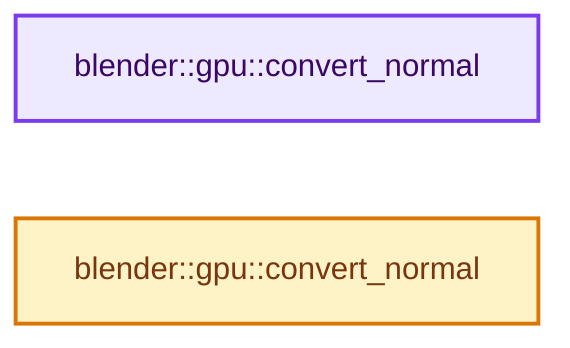
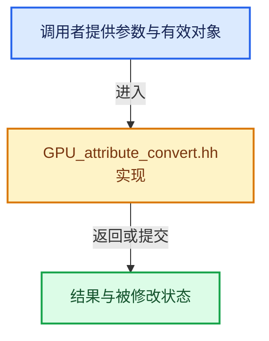

# 实现依赖专题：source/blender/gpu/GPU_attribute_convert.hh

[方向导航](README.md) · [符号索引](../%E7%AC%A6%E5%8F%B7%E4%BE%9D%E8%B5%96%E4%B8%8E%E5%AE%9E%E7%8E%B0%E7%B4%A2%E5%BC%95.md)

本专题从正文实际调用进入，集中保存共享实现。函数有稳定锚点，可从调用处直接跳到对应完整函数；递归与互相调用通过回链组织。

## 本文件的实现关系






## 完整成员与函数实现

<a id="f-d24eef906ebcd8b5"></a>

### `blender::gpu::convert_normal`

实现位置：[source/blender/gpu/GPU_attribute_convert.hh](../../../../../source/blender/gpu/GPU_attribute_convert.hh) · L21—L24。

接口参数：

- `const float3 &src`

**教学注释版**

<!-- annotated:81129587494432 -->

```cpp
template<> inline int1010102_norm convert_normal(const float3 &src)
{
  return int1010102_norm(float4(src, 0.0f));
}
```

<details>
<summary>核对原始源码：source/blender/gpu/GPU_attribute_convert.hh · L21—L24</summary>

<!-- original:81129587494432:source/blender/gpu/GPU_attribute_convert.hh:21:24 -->

```cpp
template<> inline int1010102_norm convert_normal(const float3 &src)
{
  return int1010102_norm(float4(src, 0.0f));
}
```

</details>

**结果出口**

- `return int1010102_norm(float4(src, 0.0f));`

**继续追踪实现**

- `int1010102_norm` → [调用协议](../%E6%A8%A1%E6%9D%BF%E5%AE%8F%E4%B8%8E%E5%8A%A8%E6%80%81%E5%88%86%E6%B4%BE%E5%8D%8F%E8%AE%AE.md)：函数指针、局部可调用对象或未展开的宏；必须结合调用者环境。调用位置L23。
- `float4` → [float4 · L56](%E4%BE%9D%E8%B5%96-radial_tiling_shared-98abf9.md#m-f0908e385c5b)；[float4 · L60](../01-%E5%9F%BA%E7%A1%80%E5%AE%B9%E5%99%A8%E4%B8%8E%E7%8E%B0%E4%BB%A3CPP/%E4%BE%9D%E8%B5%96-radial_tiling_shared-7989a4.md#m-7962dcdc288b)；[float4 · L56](%E4%BE%9D%E8%B5%96-node_radial_tiling_shared-b14bc2.md#m-adb8e9e87775)；[float4 · L642](%E4%BE%9D%E8%B5%96-smaa-b67bc2.md#m-9362daaa821c)。宏定义由构建条件选择。

<a id="f-40f0824f9b7edbbb"></a>

### `blender::gpu::convert_normal`

实现位置：[source/blender/gpu/GPU_attribute_convert.hh](../../../../../source/blender/gpu/GPU_attribute_convert.hh) · L26—L29。

接口参数：

- `const float3 &src`

**教学注释版**

<!-- annotated:1fbc4bf46e028b -->

```cpp
template<> inline short4 convert_normal(const float3 &src)
{
  // [讲解] std::numeric_limits<short>::max：按比较关系选取较大值。本讲解中的增长公式同时满足最低请求和几何增长；若保存返回引用，还需注意实参寿命。
  return short4(src * float(std::numeric_limits<short>::max()), 0);
}
```

<details>
<summary>核对原始源码：source/blender/gpu/GPU_attribute_convert.hh · L26—L29</summary>

<!-- original:1fbc4bf46e028b:source/blender/gpu/GPU_attribute_convert.hh:26:29 -->

```cpp
template<> inline short4 convert_normal(const float3 &src)
{
  return short4(src * float(std::numeric_limits<short>::max()), 0);
}
```

</details>

**结果出口**

- `return short4(src * float(std::numeric_limits<short>::max()), 0);`

**继续追踪实现**

- `short4` → [调用协议](../%E6%A8%A1%E6%9D%BF%E5%AE%8F%E4%B8%8E%E5%8A%A8%E6%80%81%E5%88%86%E6%B4%BE%E5%8D%8F%E8%AE%AE.md)：函数指针、局部可调用对象或未展开的宏；必须结合调用者环境。调用位置L28。
- `std::numeric_limits<short>::max` → [外部契约](https://eel.is/c++draft/alg.min.max)：按比较关系选取较大值。本讲解中的增长公式同时满足最低请求和几何增长；若保存返回引用，还需注意实参寿命。
