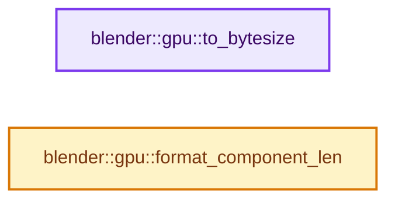
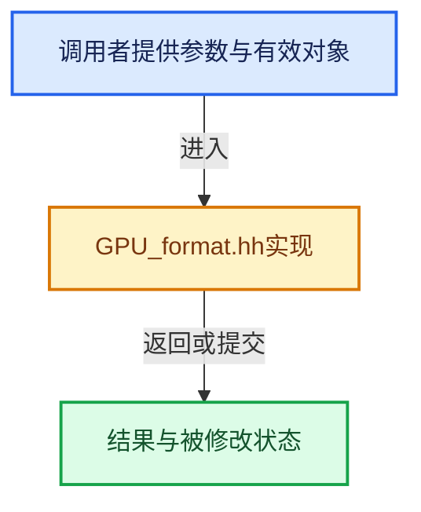

# 实现依赖专题：source/blender/gpu/GPU_format.hh

[方向导航](README.md) · [符号索引](../%E7%AC%A6%E5%8F%B7%E4%BE%9D%E8%B5%96%E4%B8%8E%E5%AE%9E%E7%8E%B0%E7%B4%A2%E5%BC%95.md)

本专题从正文实际调用进入，集中保存共享实现。函数有稳定锚点，可从调用处直接跳到对应完整函数；递归与互相调用通过回链组织。

## 本文件的实现关系






## 完整成员与函数实现

<a id="f-e6ecc4e3bd53a46f"></a>

### `blender::gpu::to_bytesize`

实现位置：[source/blender/gpu/GPU_format.hh](../../../../../source/blender/gpu/GPU_format.hh) · L231—L245。

接口参数：

- `const DataFormat format`

**教学注释版**

<!-- annotated:f5631c0484ba46 -->

```cpp
inline int to_bytesize(const DataFormat format)
{
#define CASE(a, size, c, blender_enum, d, e, f, g, h) \
  case DataFormat::blender_enum: \
    return size;

  switch (format) {
    GPU_DATA_FORMAT_EXPAND(CASE)
    case DataFormat::Invalid:
      break;
  }
#undef CASE
  BLI_assert_unreachable();
  return -1;
}
```

<details>
<summary>核对原始源码：source/blender/gpu/GPU_format.hh · L231—L245</summary>

<!-- original:f5631c0484ba46:source/blender/gpu/GPU_format.hh:231:245 -->

```cpp
inline int to_bytesize(const DataFormat format)
{
#define CASE(a, size, c, blender_enum, d, e, f, g, h) \
  case DataFormat::blender_enum: \
    return size;

  switch (format) {
    GPU_DATA_FORMAT_EXPAND(CASE)
    case DataFormat::Invalid:
      break;
  }
#undef CASE
  BLI_assert_unreachable();
  return -1;
}
```

</details>

**结果出口**

- `return size;`
- `return -1;`

**继续追踪实现**

- `GPU_DATA_FORMAT_EXPAND` → [调用协议](../%E6%A8%A1%E6%9D%BF%E5%AE%8F%E4%B8%8E%E5%8A%A8%E6%80%81%E5%88%86%E6%B4%BE%E5%8D%8F%E8%AE%AE.md)：配置相关检测或外部运行时接口。调用位置L238。
- `BLI_assert_unreachable` → [BLI_assert_unreachable · L77](../01-%E5%9F%BA%E7%A1%80%E5%AE%B9%E5%99%A8%E4%B8%8E%E7%8E%B0%E4%BB%A3CPP/%E4%BE%9D%E8%B5%96-BLI_assert-cc98e8.md#m-7a2d91a67d8e)。宏定义由构建条件选择。

<a id="f-2c4acf6b5d0ae192"></a>

### `blender::gpu::format_component_len`

实现位置：[source/blender/gpu/GPU_format.hh](../../../../../source/blender/gpu/GPU_format.hh) · L247—L261。

接口参数：

- `const DataFormat format`

**教学注释版**

<!-- annotated:ce0d2aa11416fb -->

```cpp
inline int format_component_len(const DataFormat format)
{
#define CASE(a, b, comp, blender_enum, d, e, f, g, h) \
  case DataFormat::blender_enum: \
    return comp;

  switch (format) {
    GPU_DATA_FORMAT_EXPAND(CASE)
    case DataFormat::Invalid:
      break;
  }
#undef CASE
  BLI_assert_unreachable();
  return -1;
}
```

<details>
<summary>核对原始源码：source/blender/gpu/GPU_format.hh · L247—L261</summary>

<!-- original:ce0d2aa11416fb:source/blender/gpu/GPU_format.hh:247:261 -->

```cpp
inline int format_component_len(const DataFormat format)
{
#define CASE(a, b, comp, blender_enum, d, e, f, g, h) \
  case DataFormat::blender_enum: \
    return comp;

  switch (format) {
    GPU_DATA_FORMAT_EXPAND(CASE)
    case DataFormat::Invalid:
      break;
  }
#undef CASE
  BLI_assert_unreachable();
  return -1;
}
```

</details>

**结果出口**

- `return comp;`
- `return -1;`

**继续追踪实现**

- `GPU_DATA_FORMAT_EXPAND` → [调用协议](../%E6%A8%A1%E6%9D%BF%E5%AE%8F%E4%B8%8E%E5%8A%A8%E6%80%81%E5%88%86%E6%B4%BE%E5%8D%8F%E8%AE%AE.md)：配置相关检测或外部运行时接口。调用位置L254。
- `BLI_assert_unreachable` → [BLI_assert_unreachable · L77](../01-%E5%9F%BA%E7%A1%80%E5%AE%B9%E5%99%A8%E4%B8%8E%E7%8E%B0%E4%BB%A3CPP/%E4%BE%9D%E8%B5%96-BLI_assert-cc98e8.md#m-7a2d91a67d8e)。宏定义由构建条件选择。
