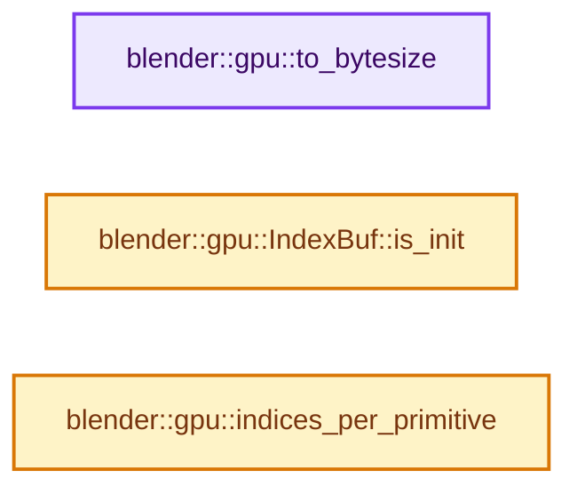
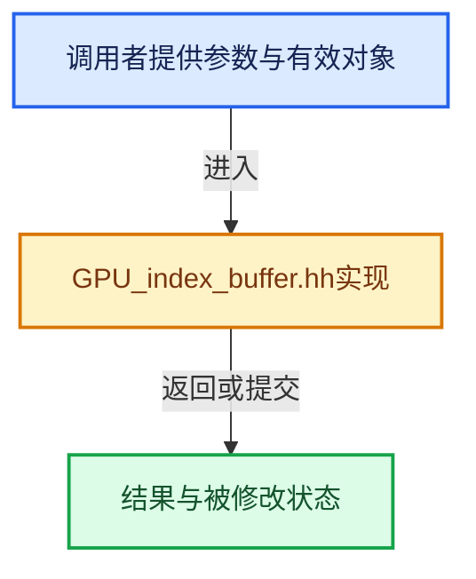

# 实现依赖专题：source/blender/gpu/GPU_index_buffer.hh

[方向导航](README.md) · [符号索引](../%E7%AC%A6%E5%8F%B7%E4%BE%9D%E8%B5%96%E4%B8%8E%E5%AE%9E%E7%8E%B0%E7%B4%A2%E5%BC%95.md)

本专题从正文实际调用进入，集中保存共享实现。函数有稳定锚点，可从调用处直接跳到对应完整函数；递归与互相调用通过回链组织。

## 本文件的实现关系






<a id="m-f3c9c7333ad4"></a>

## 宏 `GPU_INDEXBUF_DISCARD_SAFE`

<!-- annotated:2effbbb44eaad4 -->

```cpp
#define GPU_INDEXBUF_DISCARD_SAFE(elem) \
  do { \
    if (elem != nullptr) { \
      GPU_indexbuf_discard(elem); \
      elem = nullptr; \
    } \
  } while (0)

```

<details>
<summary>核对原始源码：source/blender/gpu/GPU_index_buffer.hh · L299—L306</summary>

<!-- original:2effbbb44eaad4:source/blender/gpu/GPU_index_buffer.hh:299:306 -->

```cpp
#define GPU_INDEXBUF_DISCARD_SAFE(elem) \
  do { \
    if (elem != nullptr) { \
      GPU_indexbuf_discard(elem); \
      elem = nullptr; \
    } \
  } while (0)

```

</details>

宏在预处理阶段展开，参数替换、重复求值和条件编译应直接从该定义检查。与普通函数不同，宏不会自动提供参数类型检查；构建配置选择哪个定义需结合外围条件。

## 完整成员与函数实现

<a id="f-efdc25ce42dc43f3"></a>

### `blender::gpu::to_bytesize`

实现位置：[source/blender/gpu/GPU_index_buffer.hh](../../../../../source/blender/gpu/GPU_index_buffer.hh) · L31—L34。

接口参数：

- `GPUIndexBufType type`

**教学注释版**

<!-- annotated:7a1c3f44ffebce -->

```cpp
inline size_t to_bytesize(GPUIndexBufType type)
{
  return (type == GPU_INDEX_U32) ? sizeof(uint32_t) : sizeof(uint16_t);
}
```

<details>
<summary>核对原始源码：source/blender/gpu/GPU_index_buffer.hh · L31—L34</summary>

<!-- original:7a1c3f44ffebce:source/blender/gpu/GPU_index_buffer.hh:31:34 -->

```cpp
inline size_t to_bytesize(GPUIndexBufType type)
{
  return (type == GPU_INDEX_U32) ? sizeof(uint32_t) : sizeof(uint16_t);
}
```

</details>

**结果出口**

- `return (type == GPU_INDEX_U32) ? sizeof(uint32_t) : sizeof(uint16_t);`

**继续追踪实现**

本实现没有需要继续展开的显式调用；检查返回表达式、对象转换和调用者前置条件。

<a id="f-9ce0bb95d9e9246f"></a>

### `blender::gpu::IndexBuf::is_init`

实现位置：[source/blender/gpu/GPU_index_buffer.hh](../../../../../source/blender/gpu/GPU_index_buffer.hh) · L104—L107。

**教学注释版**

<!-- annotated:1f8b5e3df99e42 -->

```cpp
  bool is_init() const
  {
    return is_init_;
  };
```

<details>
<summary>核对原始源码：source/blender/gpu/GPU_index_buffer.hh · L104—L107</summary>

<!-- original:1f8b5e3df99e42:source/blender/gpu/GPU_index_buffer.hh:104:107 -->

```cpp
  bool is_init() const
  {
    return is_init_;
  };
```

</details>

**结果出口**

- `return is_init_;`

**继续追踪实现**

本实现没有需要继续展开的显式调用；检查返回表达式、对象转换和调用者前置条件。

<a id="f-c4420465b2026f46"></a>

### `blender::gpu::indices_per_primitive`

实现位置：[source/blender/gpu/GPU_index_buffer.hh](../../../../../source/blender/gpu/GPU_index_buffer.hh) · L142—L166。

接口参数：

- `GPUPrimType prim_type`

**教学注释版**

<!-- annotated:b8670b1da36a6c -->

```cpp
inline int indices_per_primitive(GPUPrimType prim_type)
{
  switch (prim_type) {
    case GPU_PRIM_POINTS:
      return 1;
    case GPU_PRIM_LINES:
      return 2;
    case GPU_PRIM_TRIS:
      return 3;
    case GPU_PRIM_LINES_ADJ:
      return 4;
    case GPU_PRIM_TRIS_ADJ:
      return 6;
    /* IMPORTANT: These last two expects no restart primitive.
     * Asserting for this would be too slow. Just don't be stupid.
     * This is needed for polylines but should be deprecated.
     * See GPU_batch_draw_expanded_parameter_get */
    case GPU_PRIM_LINE_STRIP:
      return 1; /* Minus one for the whole length. */
    case GPU_PRIM_LINE_LOOP:
      return 1;
    default:
      return -1;
  }
}
```

<details>
<summary>核对原始源码：source/blender/gpu/GPU_index_buffer.hh · L142—L166</summary>

<!-- original:b8670b1da36a6c:source/blender/gpu/GPU_index_buffer.hh:142:166 -->

```cpp
inline int indices_per_primitive(GPUPrimType prim_type)
{
  switch (prim_type) {
    case GPU_PRIM_POINTS:
      return 1;
    case GPU_PRIM_LINES:
      return 2;
    case GPU_PRIM_TRIS:
      return 3;
    case GPU_PRIM_LINES_ADJ:
      return 4;
    case GPU_PRIM_TRIS_ADJ:
      return 6;
    /* IMPORTANT: These last two expects no restart primitive.
     * Asserting for this would be too slow. Just don't be stupid.
     * This is needed for polylines but should be deprecated.
     * See GPU_batch_draw_expanded_parameter_get */
    case GPU_PRIM_LINE_STRIP:
      return 1; /* Minus one for the whole length. */
    case GPU_PRIM_LINE_LOOP:
      return 1;
    default:
      return -1;
  }
}
```

</details>

**结果出口**

- `return 1;`
- `return 2;`
- `return 3;`
- `return 4;`
- `return 6;`
- `return 1; /* Minus one for the whole length. */`
- `return -1;`

**继续追踪实现**

本实现没有需要继续展开的显式调用；检查返回表达式、对象转换和调用者前置条件。
