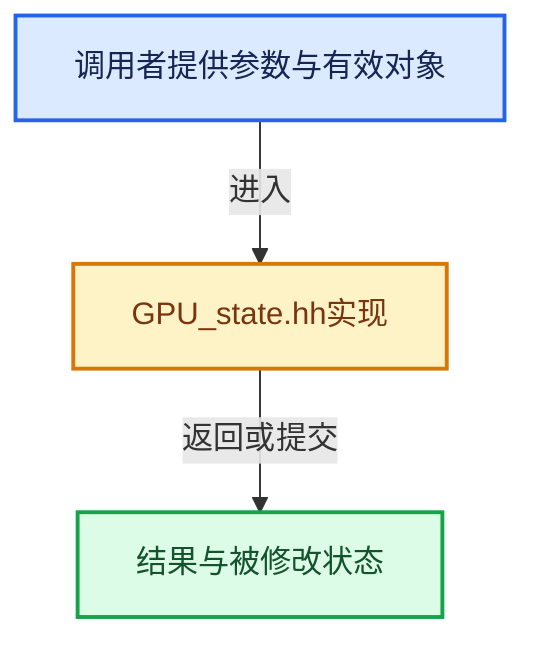

# 实现依赖专题：source/blender/gpu/GPU_state.hh

[方向导航](README.md) · [符号索引](../%E7%AC%A6%E5%8F%B7%E4%BE%9D%E8%B5%96%E4%B8%8E%E5%AE%9E%E7%8E%B0%E7%B4%A2%E5%BC%95.md)

本专题从正文实际调用进入，集中保存共享实现。函数有稳定锚点，可从调用处直接跳到对应完整函数；递归与互相调用通过回链组织。

## 本文件的实现关系





## 相关类型布局与成员入口

<a id="t-a6f5317d93f3"></a>

### `blender::GPUBlend`

原始声明：[source/blender/gpu/GPU_state.hh](../../../../../source/blender/gpu/GPU_state.hh) · L87—L129。

以下保留类的数据声明与编译条件，成员函数实现通过后面的精确链接阅读。

<!-- annotated:33fffca568d6fc -->

```cpp
enum GPUBlend {
  GPU_BLEND_NONE = 0,
  /** Pre-multiply variants will _NOT_ multiply rgb output by alpha. */
  GPU_BLEND_ALPHA,
  GPU_BLEND_ALPHA_PREMULT,
  GPU_BLEND_ADDITIVE,
  GPU_BLEND_ADDITIVE_PREMULT,
  GPU_BLEND_MULTIPLY,
  GPU_BLEND_SUBTRACT,
  /**
   * Replace logic op: SRC * (1 - DST)
   * NOTE: Does not modify alpha.
   */
  GPU_BLEND_INVERT,
  /** Stores min(SRC, DST) per component. */
  GPU_BLEND_MIN,
  /** Stores max(SRC, DST) per component. */
  GPU_BLEND_MAX,
  /**
   * Order independent transparency.
   * NOTE: Cannot be used as is. Needs special setup (frame-buffer, shader ...).
   */
  GPU_BLEND_OIT,
  /** Special blend to add color under and multiply DST color by SRC alpha. */
  GPU_BLEND_BACKGROUND,
  /**
   * Custom blend parameters using dual source blending : SRC0 + SRC1 * DST
   * NOTE: Can only be used with _ONE_ Draw Buffer and shader needs to be specialized.
   */
  GPU_BLEND_CUSTOM,
  GPU_BLEND_ALPHA_UNDER_PREMUL,
  /**
   * Multiplies every channel (alpha included) by `1 - SRC.a`. Used for piercing a hole using an
   * image alpha channel.
   */
  GPU_BLEND_OVERLAY_MASK_FROM_ALPHA,
  /**
   * Alpha channel is interpreted as transmittance (aka transparency) and not alpha.
   * To be used with a frame-buffer with alpha cleared to 1 for full transparency.
   * Equivalent to: `DST.rgba * SRC.a + float4(SRC.rgb, 0.0)`.
   */
  GPU_BLEND_TRANSPARENCY,
};
```

<details>
<summary>核对原始源码：source/blender/gpu/GPU_state.hh · L87—L129</summary>

<!-- original:33fffca568d6fc:source/blender/gpu/GPU_state.hh:87:129 -->

```cpp
enum GPUBlend {
  GPU_BLEND_NONE = 0,
  /** Pre-multiply variants will _NOT_ multiply rgb output by alpha. */
  GPU_BLEND_ALPHA,
  GPU_BLEND_ALPHA_PREMULT,
  GPU_BLEND_ADDITIVE,
  GPU_BLEND_ADDITIVE_PREMULT,
  GPU_BLEND_MULTIPLY,
  GPU_BLEND_SUBTRACT,
  /**
   * Replace logic op: SRC * (1 - DST)
   * NOTE: Does not modify alpha.
   */
  GPU_BLEND_INVERT,
  /** Stores min(SRC, DST) per component. */
  GPU_BLEND_MIN,
  /** Stores max(SRC, DST) per component. */
  GPU_BLEND_MAX,
  /**
   * Order independent transparency.
   * NOTE: Cannot be used as is. Needs special setup (frame-buffer, shader ...).
   */
  GPU_BLEND_OIT,
  /** Special blend to add color under and multiply DST color by SRC alpha. */
  GPU_BLEND_BACKGROUND,
  /**
   * Custom blend parameters using dual source blending : SRC0 + SRC1 * DST
   * NOTE: Can only be used with _ONE_ Draw Buffer and shader needs to be specialized.
   */
  GPU_BLEND_CUSTOM,
  GPU_BLEND_ALPHA_UNDER_PREMUL,
  /**
   * Multiplies every channel (alpha included) by `1 - SRC.a`. Used for piercing a hole using an
   * image alpha channel.
   */
  GPU_BLEND_OVERLAY_MASK_FROM_ALPHA,
  /**
   * Alpha channel is interpreted as transmittance (aka transparency) and not alpha.
   * To be used with a frame-buffer with alpha cleared to 1 for full transparency.
   * Equivalent to: `DST.rgba * SRC.a + float4(SRC.rgb, 0.0)`.
   */
  GPU_BLEND_TRANSPARENCY,
};
```

</details>


## 完整成员与函数实现
