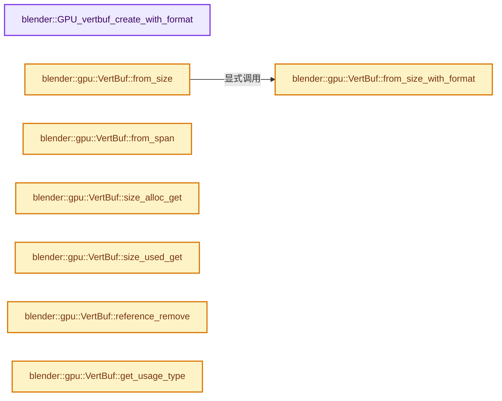
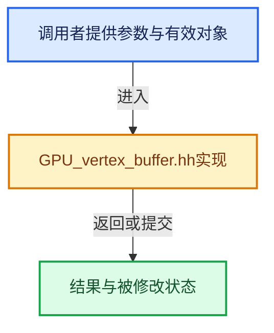

# 实现依赖专题：source/blender/gpu/GPU_vertex_buffer.hh

[方向导航](README.md) · [符号索引](../%E7%AC%A6%E5%8F%B7%E4%BE%9D%E8%B5%96%E4%B8%8E%E5%AE%9E%E7%8E%B0%E7%B4%A2%E5%BC%95.md)

本专题从正文实际调用进入，集中保存共享实现。函数有稳定锚点，可从调用处直接跳到对应完整函数；递归与互相调用通过回链组织。

## 本文件的实现关系






<a id="m-7100390733f1"></a>

## 宏 `GPU_vertbuf_init_with_format`

<!-- annotated:60e51fc630d86c -->

```cpp
#define GPU_vertbuf_init_with_format(verts, format) \
  GPU_vertbuf_init_with_format_ex(verts, format, GPU_USAGE_STATIC)

```

<details>
<summary>核对原始源码：source/blender/gpu/GPU_vertex_buffer.hh · L277—L279</summary>

<!-- original:60e51fc630d86c:source/blender/gpu/GPU_vertex_buffer.hh:277:279 -->

```cpp
#define GPU_vertbuf_init_with_format(verts, format) \
  GPU_vertbuf_init_with_format_ex(verts, format, GPU_USAGE_STATIC)

```

</details>

宏在预处理阶段展开，参数替换、重复求值和条件编译应直接从该定义检查。与普通函数不同，宏不会自动提供参数类型检查；构建配置选择哪个定义需结合外围条件。

<a id="m-6427e4c6901c"></a>

## 宏 `GPU_VERTBUF_DISCARD_SAFE`

<!-- annotated:b25a73bc80cd67 -->

```cpp
#define GPU_VERTBUF_DISCARD_SAFE(verts) \
  do { \
    if (verts != nullptr) { \
      GPU_vertbuf_discard(verts); \
      verts = nullptr; \
    } \
  } while (0)

```

<details>
<summary>核对原始源码：source/blender/gpu/GPU_vertex_buffer.hh · L372—L379</summary>

<!-- original:b25a73bc80cd67:source/blender/gpu/GPU_vertex_buffer.hh:372:379 -->

```cpp
#define GPU_VERTBUF_DISCARD_SAFE(verts) \
  do { \
    if (verts != nullptr) { \
      GPU_vertbuf_discard(verts); \
      verts = nullptr; \
    } \
  } while (0)

```

</details>

宏在预处理阶段展开，参数替换、重复求值和条件编译应直接从该定义检查。与普通函数不同，宏不会自动提供参数类型检查；构建配置选择哪个定义需结合外围条件。

## 完整成员与函数实现

<a id="f-bd43fe034e852138"></a>

### `blender::GPU_vertbuf_create_with_format`

实现位置：[source/blender/gpu/GPU_vertex_buffer.hh](../../../../../source/blender/gpu/GPU_vertex_buffer.hh) · L71—L74。

接口参数：

- `const GPUVertFormat &format`

**教学注释版**

<!-- annotated:815ca40f773824 -->

```cpp
static inline gpu::VertBuf *GPU_vertbuf_create_with_format(const GPUVertFormat &format)
{
  return GPU_vertbuf_create_with_format_ex(format, GPU_USAGE_STATIC);
}
```

<details>
<summary>核对原始源码：source/blender/gpu/GPU_vertex_buffer.hh · L71—L74</summary>

<!-- original:815ca40f773824:source/blender/gpu/GPU_vertex_buffer.hh:71:74 -->

```cpp
static inline gpu::VertBuf *GPU_vertbuf_create_with_format(const GPUVertFormat &format)
{
  return GPU_vertbuf_create_with_format_ex(format, GPU_USAGE_STATIC);
}
```

</details>

**结果出口**

- `return GPU_vertbuf_create_with_format_ex(format, GPU_USAGE_STATIC);`

**继续追踪实现**

- `GPU_vertbuf_create_with_format_ex` → [blender::GPU_vertbuf_create_with_format_ex · L117](%E4%BE%9D%E8%B5%96-gpu_vertex_buffer-eaa662.md#f-3c102ab38514393a)。

<a id="f-20d4ed0fb0d6c4d7"></a>

### `blender::gpu::VertBuf::from_size_with_format`

实现位置：[source/blender/gpu/GPU_vertex_buffer.hh](../../../../../source/blender/gpu/GPU_vertex_buffer.hh) · L124—L132。

接口参数：

- `const int size`
- `GPUUsageType usage = GPU_USAGE_STATIC`

**教学注释版**

<!-- annotated:8b38845ee60131 -->

```cpp
  template<typename FormatT>
  static VertBufPtr from_size_with_format(const int size, GPUUsageType usage = GPU_USAGE_STATIC)
  {
    BLI_assert(size > 0);
    VertBufPtr buf = VertBufPtr(GPU_vertbuf_create_with_format_ex(FormatT::format(), usage));
    /* GPU formats needs to be aligned to 4 bytes. */
    buf->allocate(ceil_to_multiple_u(size * sizeof(FormatT), 4) / sizeof(FormatT));
    return buf;
  }
```

<details>
<summary>核对原始源码：source/blender/gpu/GPU_vertex_buffer.hh · L124—L132</summary>

<!-- original:8b38845ee60131:source/blender/gpu/GPU_vertex_buffer.hh:124:132 -->

```cpp
  template<typename FormatT>
  static VertBufPtr from_size_with_format(const int size, GPUUsageType usage = GPU_USAGE_STATIC)
  {
    BLI_assert(size > 0);
    VertBufPtr buf = VertBufPtr(GPU_vertbuf_create_with_format_ex(FormatT::format(), usage));
    /* GPU formats needs to be aligned to 4 bytes. */
    buf->allocate(ceil_to_multiple_u(size * sizeof(FormatT), 4) / sizeof(FormatT));
    return buf;
  }
```

</details>

**结果出口**

- `return buf;`

**继续追踪实现**

- `BLI_assert` → [BLI_assert · L48](../01-%E5%9F%BA%E7%A1%80%E5%AE%B9%E5%99%A8%E4%B8%8E%E7%8E%B0%E4%BB%A3CPP/%E4%BE%9D%E8%B5%96-BLI_assert-cc98e8.md#m-57a88495704d)；[BLI_assert · L63](../01-%E5%9F%BA%E7%A1%80%E5%AE%B9%E5%99%A8%E4%B8%8E%E7%8E%B0%E4%BB%A3CPP/%E4%BE%9D%E8%B5%96-BLI_assert-cc98e8.md#m-d07050020cb5)。宏定义由构建条件选择。
- `VertBufPtr` → [调用协议](../%E6%A8%A1%E6%9D%BF%E5%AE%8F%E4%B8%8E%E5%8A%A8%E6%80%81%E5%88%86%E6%B4%BE%E5%8D%8F%E8%AE%AE.md)：函数指针、局部可调用对象或未展开的宏；必须结合调用者环境。调用位置L128。
- `GPU_vertbuf_create_with_format_ex` → [blender::GPU_vertbuf_create_with_format_ex · L117](%E4%BE%9D%E8%B5%96-gpu_vertex_buffer-eaa662.md#f-3c102ab38514393a)。
- `FormatT::format` → [bsl::mini_fmt::format · L43](%E4%BE%9D%E8%B5%96-diagnostic-f76547.md#f-8c6ce9cf41894828)。
- `buf->allocate` → [调用协议](../%E6%A8%A1%E6%9D%BF%E5%AE%8F%E4%B8%8E%E5%8A%A8%E6%80%81%E5%88%86%E6%B4%BE%E5%8D%8F%E8%AE%AE.md)：由接收对象具体类型或运行时策略提供实现。调用位置L130。
- `ceil_to_multiple_u` → [blender::ceil_to_multiple_u · L245](../12-%E7%A9%BA%E9%97%B4%E6%95%B0%E6%8D%AE%E7%BB%93%E6%9E%84%E4%B8%8E%E5%87%A0%E4%BD%95%E7%AE%97%E6%B3%95/%E4%BE%9D%E8%B5%96-math_base_inline-546b00.md#f-b6a8b97456313c88)。

<a id="f-9fe47304cc1cfe70"></a>

### `blender::gpu::VertBuf::from_size`

实现位置：[source/blender/gpu/GPU_vertex_buffer.hh](../../../../../source/blender/gpu/GPU_vertex_buffer.hh) · L134—L138。

接口参数：

- `const int size`
- `GPUUsageType usage = GPU_USAGE_STATIC`

**教学注释版**

<!-- annotated:c52650164deb94 -->

```cpp
  template<typename T>
  static VertBufPtr from_size(const int size, GPUUsageType usage = GPU_USAGE_STATIC)
  {
    return from_size_with_format<GenericVertexFormat<T>>(size, usage);
  }
```

<details>
<summary>核对原始源码：source/blender/gpu/GPU_vertex_buffer.hh · L134—L138</summary>

<!-- original:c52650164deb94:source/blender/gpu/GPU_vertex_buffer.hh:134:138 -->

```cpp
  template<typename T>
  static VertBufPtr from_size(const int size, GPUUsageType usage = GPU_USAGE_STATIC)
  {
    return from_size_with_format<GenericVertexFormat<T>>(size, usage);
  }
```

</details>

**结果出口**

- `return from_size_with_format<GenericVertexFormat<T>>(size, usage);`

**继续追踪实现**

- `from_size_with_format<GenericVertexFormat<T>>` → [blender::gpu::VertBuf::from_size_with_format · L124](%E4%BE%9D%E8%B5%96-GPU_vertex_buffer-d7610b.md#f-20d4ed0fb0d6c4d7)。

<a id="f-27ef61a3a7b97287"></a>

### `blender::gpu::VertBuf::from_span`

实现位置：[source/blender/gpu/GPU_vertex_buffer.hh](../../../../../source/blender/gpu/GPU_vertex_buffer.hh) · L140—L149。

接口参数：

- `const Span<T> data`

**教学注释版**

<!-- annotated:5117b09295c86e -->

```cpp
  template<typename T> static VertBufPtr from_span(const Span<T> data)
  {
    // [讲解] data.is_empty：查询视图长度或生成对应有效索引区间。
    BLI_assert(!data.is_empty());
    VertBufPtr buf = VertBufPtr(GPU_vertbuf_create_with_format_ex(
        GenericVertexFormat<T>::format(), GPU_USAGE_STATIC | GPU_USAGE_FLAG_BUFFER_TEXTURE_ONLY));
    /* GPU formats needs to be aligned to 4 bytes. */
    buf->allocate(ceil_to_multiple_u(data.size_in_bytes(), 4) / sizeof(GenericVertexFormat<T>));
    // [讲解] data.size：查询视图长度或生成对应有效索引区间。
    array_utils::copy(data, buf->data<T>().slice(0, data.size()));
    return buf;
  }
```

<details>
<summary>核对原始源码：source/blender/gpu/GPU_vertex_buffer.hh · L140—L149</summary>

<!-- original:5117b09295c86e:source/blender/gpu/GPU_vertex_buffer.hh:140:149 -->

```cpp
  template<typename T> static VertBufPtr from_span(const Span<T> data)
  {
    BLI_assert(!data.is_empty());
    VertBufPtr buf = VertBufPtr(GPU_vertbuf_create_with_format_ex(
        GenericVertexFormat<T>::format(), GPU_USAGE_STATIC | GPU_USAGE_FLAG_BUFFER_TEXTURE_ONLY));
    /* GPU formats needs to be aligned to 4 bytes. */
    buf->allocate(ceil_to_multiple_u(data.size_in_bytes(), 4) / sizeof(GenericVertexFormat<T>));
    array_utils::copy(data, buf->data<T>().slice(0, data.size()));
    return buf;
  }
```

</details>

**结果出口**

- `return buf;`

**继续追踪实现**

- `BLI_assert` → [BLI_assert · L48](../01-%E5%9F%BA%E7%A1%80%E5%AE%B9%E5%99%A8%E4%B8%8E%E7%8E%B0%E4%BB%A3CPP/%E4%BE%9D%E8%B5%96-BLI_assert-cc98e8.md#m-57a88495704d)；[BLI_assert · L63](../01-%E5%9F%BA%E7%A1%80%E5%AE%B9%E5%99%A8%E4%B8%8E%E7%8E%B0%E4%BB%A3CPP/%E4%BE%9D%E8%B5%96-BLI_assert-cc98e8.md#m-d07050020cb5)。宏定义由构建条件选择。
- `data.is_empty` → [blender::Span::is_empty · L264](../01-%E5%9F%BA%E7%A1%80%E5%AE%B9%E5%99%A8%E4%B8%8E%E7%8E%B0%E4%BB%A3CPP/05-Span%E5%8F%AA%E8%AF%BB%E8%BF%9E%E7%BB%AD%E8%A7%86%E5%9B%BE.md#f-8cc1d7ba8feb50e6)。
- `VertBufPtr` → [调用协议](../%E6%A8%A1%E6%9D%BF%E5%AE%8F%E4%B8%8E%E5%8A%A8%E6%80%81%E5%88%86%E6%B4%BE%E5%8D%8F%E8%AE%AE.md)：函数指针、局部可调用对象或未展开的宏；必须结合调用者环境。调用位置L143。
- `GPU_vertbuf_create_with_format_ex` → [blender::GPU_vertbuf_create_with_format_ex · L117](%E4%BE%9D%E8%B5%96-gpu_vertex_buffer-eaa662.md#f-3c102ab38514393a)。
- `GenericVertexFormat<T>::format` → [bsl::mini_fmt::format · L43](%E4%BE%9D%E8%B5%96-diagnostic-f76547.md#f-8c6ce9cf41894828)。
- `buf->allocate` → [调用协议](../%E6%A8%A1%E6%9D%BF%E5%AE%8F%E4%B8%8E%E5%8A%A8%E6%80%81%E5%88%86%E6%B4%BE%E5%8D%8F%E8%AE%AE.md)：由接收对象具体类型或运行时策略提供实现。调用位置L146。
- `ceil_to_multiple_u` → [blender::ceil_to_multiple_u · L245](../12-%E7%A9%BA%E9%97%B4%E6%95%B0%E6%8D%AE%E7%BB%93%E6%9E%84%E4%B8%8E%E5%87%A0%E4%BD%95%E7%AE%97%E6%B3%95/%E4%BE%9D%E8%B5%96-math_base_inline-546b00.md#f-b6a8b97456313c88)。
- `data.size_in_bytes` → [blender::Span::size_in_bytes · L272](../01-%E5%9F%BA%E7%A1%80%E5%AE%B9%E5%99%A8%E4%B8%8E%E7%8E%B0%E4%BB%A3CPP/05-Span%E5%8F%AA%E8%AF%BB%E8%BF%9E%E7%BB%AD%E8%A7%86%E5%9B%BE.md#f-1369fbdcc037fcaf)。
- `array_utils::copy` → [blender::array_utils::copy · L54](../01-%E5%9F%BA%E7%A1%80%E5%AE%B9%E5%99%A8%E4%B8%8E%E7%8E%B0%E4%BB%A3CPP/20-%E5%AE%B9%E5%99%A8%E9%80%89%E6%8B%A9%E4%B8%8E%E7%8B%AC%E7%AB%8B%E5%AE%9E%E7%8E%B0.md#f-82e21acdac93f91c)；[blender::array_utils::copy · L72](../01-%E5%9F%BA%E7%A1%80%E5%AE%B9%E5%99%A8%E4%B8%8E%E7%8E%B0%E4%BB%A3CPP/20-%E5%AE%B9%E5%99%A8%E9%80%89%E6%8B%A9%E4%B8%8E%E7%8B%AC%E7%AB%8B%E5%AE%9E%E7%8E%B0.md#f-ee9c17de026a6c9a)；[blender::array_utils::copy · L98](../01-%E5%9F%BA%E7%A1%80%E5%AE%B9%E5%99%A8%E4%B8%8E%E7%8E%B0%E4%BB%A3CPP/20-%E5%AE%B9%E5%99%A8%E9%80%89%E6%8B%A9%E4%B8%8E%E7%8B%AC%E7%AB%8B%E5%AE%9E%E7%8E%B0.md#f-ec9fd099c7280717)；[blender::array_utils::copy · L27](../01-%E5%9F%BA%E7%A1%80%E5%AE%B9%E5%99%A8%E4%B8%8E%E7%8E%B0%E4%BB%A3CPP/%E4%BE%9D%E8%B5%96-array_utils-cbb70f.md#f-245f7c23437cf35f)；[blender::array_utils::copy · L43](../01-%E5%9F%BA%E7%A1%80%E5%AE%B9%E5%99%A8%E4%B8%8E%E7%8E%B0%E4%BB%A3CPP/%E4%BE%9D%E8%B5%96-array_utils-cbb70f.md#f-6170524934215b36)。同名重载需按实参类型选择。
- `buf->data<T>().slice` → [调用协议](../%E6%A8%A1%E6%9D%BF%E5%AE%8F%E4%B8%8E%E5%8A%A8%E6%80%81%E5%88%86%E6%B4%BE%E5%8D%8F%E8%AE%AE.md)：接收对象类型依赖auto、返回值或模板实例；不按同名猜测目标。调用位置L147。
- `buf->data<T>` → [blender::gpu::VertBuf::data · L220](%E4%BE%9D%E8%B5%96-GPU_vertex_buffer-d7610b.md#f-e72412fdddda8bf5)。
- `data.size` → [blender::Span::size · L256](../01-%E5%9F%BA%E7%A1%80%E5%AE%B9%E5%99%A8%E4%B8%8E%E7%8E%B0%E4%BB%A3CPP/05-Span%E5%8F%AA%E8%AF%BB%E8%BF%9E%E7%BB%AD%E8%A7%86%E5%9B%BE.md#f-5f80fa006089c998)。

<a id="f-e679f152211ac8cf"></a>

### `blender::gpu::VertBuf::size_alloc_get`

实现位置：[source/blender/gpu/GPU_vertex_buffer.hh](../../../../../source/blender/gpu/GPU_vertex_buffer.hh) · L186—L190。

**教学注释版**

<!-- annotated:ae211ca450b716 -->

```cpp
  size_t size_alloc_get() const
  {
    BLI_assert(this->format.packed);
    return size_t(this->vertex_alloc) * this->format.stride;
  }
```

<details>
<summary>核对原始源码：source/blender/gpu/GPU_vertex_buffer.hh · L186—L190</summary>

<!-- original:ae211ca450b716:source/blender/gpu/GPU_vertex_buffer.hh:186:190 -->

```cpp
  size_t size_alloc_get() const
  {
    BLI_assert(this->format.packed);
    return size_t(this->vertex_alloc) * this->format.stride;
  }
```

</details>

**结果出口**

- `return size_t(this->vertex_alloc) * this->format.stride;`

**继续追踪实现**

- `BLI_assert` → [BLI_assert · L48](../01-%E5%9F%BA%E7%A1%80%E5%AE%B9%E5%99%A8%E4%B8%8E%E7%8E%B0%E4%BB%A3CPP/%E4%BE%9D%E8%B5%96-BLI_assert-cc98e8.md#m-57a88495704d)；[BLI_assert · L63](../01-%E5%9F%BA%E7%A1%80%E5%AE%B9%E5%99%A8%E4%B8%8E%E7%8E%B0%E4%BB%A3CPP/%E4%BE%9D%E8%B5%96-BLI_assert-cc98e8.md#m-d07050020cb5)。宏定义由构建条件选择。

<a id="f-fb11c22cfc2ca429"></a>

### `blender::gpu::VertBuf::size_used_get`

实现位置：[source/blender/gpu/GPU_vertex_buffer.hh](../../../../../source/blender/gpu/GPU_vertex_buffer.hh) · L192—L196。

**教学注释版**

<!-- annotated:ccaec28b8a4ccf -->

```cpp
  size_t size_used_get() const
  {
    BLI_assert(format.packed);
    return size_t(this->vertex_len) * this->format.stride;
  }
```

<details>
<summary>核对原始源码：source/blender/gpu/GPU_vertex_buffer.hh · L192—L196</summary>

<!-- original:ccaec28b8a4ccf:source/blender/gpu/GPU_vertex_buffer.hh:192:196 -->

```cpp
  size_t size_used_get() const
  {
    BLI_assert(format.packed);
    return size_t(this->vertex_len) * this->format.stride;
  }
```

</details>

**结果出口**

- `return size_t(this->vertex_len) * this->format.stride;`

**继续追踪实现**

- `BLI_assert` → [BLI_assert · L48](../01-%E5%9F%BA%E7%A1%80%E5%AE%B9%E5%99%A8%E4%B8%8E%E7%8E%B0%E4%BB%A3CPP/%E4%BE%9D%E8%B5%96-BLI_assert-cc98e8.md#m-57a88495704d)；[BLI_assert · L63](../01-%E5%9F%BA%E7%A1%80%E5%AE%B9%E5%99%A8%E4%B8%8E%E7%8E%B0%E4%BB%A3CPP/%E4%BE%9D%E8%B5%96-BLI_assert-cc98e8.md#m-d07050020cb5)。宏定义由构建条件选择。

<a id="f-85bf9acb77c5c26b"></a>

### `blender::gpu::VertBuf::reference_remove`

实现位置：[source/blender/gpu/GPU_vertex_buffer.hh](../../../../../source/blender/gpu/GPU_vertex_buffer.hh) · L202—L209。

**教学注释版**

<!-- annotated:d7ac514ef439c6 -->

```cpp
  void reference_remove()
  {
    BLI_assert(handle_refcount_ > 0);
    handle_refcount_--;
    if (handle_refcount_ == 0) {
      delete this;
    }
  }
```

<details>
<summary>核对原始源码：source/blender/gpu/GPU_vertex_buffer.hh · L202—L209</summary>

<!-- original:d7ac514ef439c6:source/blender/gpu/GPU_vertex_buffer.hh:202:209 -->

```cpp
  void reference_remove()
  {
    BLI_assert(handle_refcount_ > 0);
    handle_refcount_--;
    if (handle_refcount_ == 0) {
      delete this;
    }
  }
```

</details>

**继续追踪实现**

- `BLI_assert` → [BLI_assert · L48](../01-%E5%9F%BA%E7%A1%80%E5%AE%B9%E5%99%A8%E4%B8%8E%E7%8E%B0%E4%BB%A3CPP/%E4%BE%9D%E8%B5%96-BLI_assert-cc98e8.md#m-57a88495704d)；[BLI_assert · L63](../01-%E5%9F%BA%E7%A1%80%E5%AE%B9%E5%99%A8%E4%B8%8E%E7%8E%B0%E4%BB%A3CPP/%E4%BE%9D%E8%B5%96-BLI_assert-cc98e8.md#m-d07050020cb5)。宏定义由构建条件选择。

<a id="f-9526c8580505f308"></a>

### `blender::gpu::VertBuf::get_usage_type`

实现位置：[source/blender/gpu/GPU_vertex_buffer.hh](../../../../../source/blender/gpu/GPU_vertex_buffer.hh) · L211—L214。

**教学注释版**

<!-- annotated:029104cbe666a2 -->

```cpp
  GPUUsageType get_usage_type() const
  {
    return usage_;
  }
```

<details>
<summary>核对原始源码：source/blender/gpu/GPU_vertex_buffer.hh · L211—L214</summary>

<!-- original:029104cbe666a2:source/blender/gpu/GPU_vertex_buffer.hh:211:214 -->

```cpp
  GPUUsageType get_usage_type() const
  {
    return usage_;
  }
```

</details>

**结果出口**

- `return usage_;`

**继续追踪实现**

本实现没有需要继续展开的显式调用；检查返回表达式、对象转换和调用者前置条件。

<a id="f-e72412fdddda8bf5"></a>

### `blender::gpu::VertBuf::data`

实现位置：[source/blender/gpu/GPU_vertex_buffer.hh](../../../../../source/blender/gpu/GPU_vertex_buffer.hh) · L220—L223。

**教学注释版**

<!-- annotated:49a0df7b341c5f -->

```cpp
  template<typename T> MutableSpan<T> data()
  {
    return MutableSpan<uchar>(data_, this->size_alloc_get()).cast<T>();
  }
```

<details>
<summary>核对原始源码：source/blender/gpu/GPU_vertex_buffer.hh · L220—L223</summary>

<!-- original:49a0df7b341c5f:source/blender/gpu/GPU_vertex_buffer.hh:220:223 -->

```cpp
  template<typename T> MutableSpan<T> data()
  {
    return MutableSpan<uchar>(data_, this->size_alloc_get()).cast<T>();
  }
```

</details>

**结果出口**

- `return MutableSpan<uchar>(data_, this->size_alloc_get()).cast<T>();`

**继续追踪实现**

- `MutableSpan<uchar>(data_, this->size_alloc_get()).cast<T>` → [调用协议](../%E6%A8%A1%E6%9D%BF%E5%AE%8F%E4%B8%8E%E5%8A%A8%E6%80%81%E5%88%86%E6%B4%BE%E5%8D%8F%E8%AE%AE.md)：接收对象类型依赖auto、返回值或模板实例；不按同名猜测目标。调用位置L222。
- `MutableSpan<uchar>` → [blender::MutableSpan::MutableSpan · L462](../01-%E5%9F%BA%E7%A1%80%E5%AE%B9%E5%99%A8%E4%B8%8E%E7%8E%B0%E4%BB%A3CPP/06-MutableSpan%E5%8F%AF%E5%86%99%E8%A7%86%E5%9B%BE.md#f-0f07034aaffc3384)；[blender::MutableSpan::MutableSpan · L464](../01-%E5%9F%BA%E7%A1%80%E5%AE%B9%E5%99%A8%E4%B8%8E%E7%8E%B0%E4%BB%A3CPP/06-MutableSpan%E5%8F%AF%E5%86%99%E8%A7%86%E5%9B%BE.md#f-39977234ad0ce192)；[blender::MutableSpan::MutableSpan · L466](../01-%E5%9F%BA%E7%A1%80%E5%AE%B9%E5%99%A8%E4%B8%8E%E7%8E%B0%E4%BB%A3CPP/06-MutableSpan%E5%8F%AF%E5%86%99%E8%A7%86%E5%9B%BE.md#f-ee249b5042dd38aa)；[blender::MutableSpan::MutableSpan · L468](../01-%E5%9F%BA%E7%A1%80%E5%AE%B9%E5%99%A8%E4%B8%8E%E7%8E%B0%E4%BB%A3CPP/06-MutableSpan%E5%8F%AF%E5%86%99%E8%A7%86%E5%9B%BE.md#f-479c5f85921e531f)；[blender::MutableSpan::MutableSpan · L477](../01-%E5%9F%BA%E7%A1%80%E5%AE%B9%E5%99%A8%E4%B8%8E%E7%8E%B0%E4%BB%A3CPP/06-MutableSpan%E5%8F%AF%E5%86%99%E8%A7%86%E5%9B%BE.md#f-afcce5325e6f19e0)。同名重载需按实参类型选择。
- `this->size_alloc_get` → [blender::gpu::VertBuf::size_alloc_get · L186](%E4%BE%9D%E8%B5%96-GPU_vertex_buffer-d7610b.md#f-e679f152211ac8cf)。

<a id="f-a206297b58614393"></a>

### `blender::GPU_vertbuf_raw_step`

实现位置：[source/blender/gpu/GPU_vertex_buffer.hh](../../../../../source/blender/gpu/GPU_vertex_buffer.hh) · L329—L337。

接口参数：

- `GPUVertBufRaw *a`

**教学注释版**

<!-- annotated:af80fe7a043b1d -->

```cpp
GPU_INLINE void *GPU_vertbuf_raw_step(GPUVertBufRaw *a)
{
  unsigned char *data = a->data;
  a->data += a->stride;
#ifndef NDEBUG
  BLI_assert(data < a->_data_end);
#endif
  return static_cast<void *>(data);
}
```

<details>
<summary>核对原始源码：source/blender/gpu/GPU_vertex_buffer.hh · L329—L337</summary>

<!-- original:af80fe7a043b1d:source/blender/gpu/GPU_vertex_buffer.hh:329:337 -->

```cpp
GPU_INLINE void *GPU_vertbuf_raw_step(GPUVertBufRaw *a)
{
  unsigned char *data = a->data;
  a->data += a->stride;
#ifndef NDEBUG
  BLI_assert(data < a->_data_end);
#endif
  return static_cast<void *>(data);
}
```

</details>

**沿实际写入检查状态**

- `a->data += a->stride;`

**结果出口**

- `return static_cast<void *>(data);`

**继续追踪实现**

- `BLI_assert` → [BLI_assert · L48](../01-%E5%9F%BA%E7%A1%80%E5%AE%B9%E5%99%A8%E4%B8%8E%E7%8E%B0%E4%BB%A3CPP/%E4%BE%9D%E8%B5%96-BLI_assert-cc98e8.md#m-57a88495704d)；[BLI_assert · L63](../01-%E5%9F%BA%E7%A1%80%E5%AE%B9%E5%99%A8%E4%B8%8E%E7%8E%B0%E4%BB%A3CPP/%E4%BE%9D%E8%B5%96-BLI_assert-cc98e8.md#m-d07050020cb5)。宏定义由构建条件选择。

<a id="f-b25b1d2990442cfb"></a>

### `blender::GPU_vertbuf_raw_used`

实现位置：[source/blender/gpu/GPU_vertex_buffer.hh](../../../../../source/blender/gpu/GPU_vertex_buffer.hh) · L339—L342。

接口参数：

- `const GPUVertBufRaw *a`

**教学注释版**

<!-- annotated:91898eabb77552 -->

```cpp
GPU_INLINE uint GPU_vertbuf_raw_used(const GPUVertBufRaw *a)
{
  return ((a->data - a->data_init) / a->stride);
}
```

<details>
<summary>核对原始源码：source/blender/gpu/GPU_vertex_buffer.hh · L339—L342</summary>

<!-- original:91898eabb77552:source/blender/gpu/GPU_vertex_buffer.hh:339:342 -->

```cpp
GPU_INLINE uint GPU_vertbuf_raw_used(const GPUVertBufRaw *a)
{
  return ((a->data - a->data_init) / a->stride);
}
```

</details>

**结果出口**

- `return ((a->data - a->data_init) / a->stride);`

**继续追踪实现**

本实现没有需要继续展开的显式调用；检查返回表达式、对象转换和调用者前置条件。
