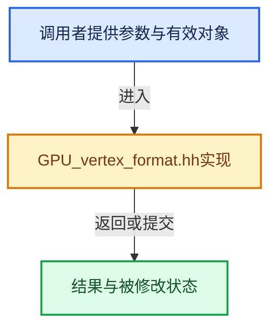

# 实现依赖专题：source/blender/gpu/GPU_vertex_format.hh

[方向导航](README.md) · [符号索引](../%E7%AC%A6%E5%8F%B7%E4%BE%9D%E8%B5%96%E4%B8%8E%E5%AE%9E%E7%8E%B0%E7%B4%A2%E5%BC%95.md)

本专题从正文实际调用进入，集中保存共享实现。函数有稳定锚点，可从调用处直接跳到对应完整函数；递归与互相调用通过回链组织。

## 本文件的实现关系





## 相关类型布局与成员入口

<a id="t-462926d0d19f"></a>

### `GPUVertAttr::Type`

原始声明：[source/blender/gpu/GPU_vertex_format.hh](../../../../../source/blender/gpu/GPU_vertex_format.hh) · L193—L208。

成员布局：

- `gpu::VertAttrType format`
- `GPUVertFetchMode fetch_mode`
- `GPUVertCompType comp_type`

以下保留类的数据声明与编译条件，成员函数实现通过后面的精确链接阅读。

<!-- annotated:f8b6ff549f31a0 -->

```cpp
  struct Type {
    gpu::VertAttrType format;

```

<details>
<summary>核对原始源码：source/blender/gpu/GPU_vertex_format.hh · L193—L195</summary>

<!-- original:f8b6ff549f31a0:source/blender/gpu/GPU_vertex_format.hh:193:195 -->

```cpp
  struct Type {
    gpu::VertAttrType format;

```

</details>

<!-- annotated:25b80ddb7b3ee2 -->

```cpp

```

<details>
<summary>核对原始源码：source/blender/gpu/GPU_vertex_format.hh · L200—L200</summary>

<!-- original:25b80ddb7b3ee2:source/blender/gpu/GPU_vertex_format.hh:200:200 -->

```cpp

```

</details>

<!-- annotated:ba5a83a3d78b42 -->

```cpp

    GPUVertFetchMode fetch_mode() const;
    GPUVertCompType comp_type() const;
  } type;
```

<details>
<summary>核对原始源码：source/blender/gpu/GPU_vertex_format.hh · L205—L208</summary>

<!-- original:ba5a83a3d78b42:source/blender/gpu/GPU_vertex_format.hh:205:208 -->

```cpp

    GPUVertFetchMode fetch_mode() const;
    GPUVertCompType comp_type() const;
  } type;
```

</details>


## 完整成员与函数实现

<a id="f-4e696cf84e31ef7f"></a>

### `GPU_vertformat_attr_name_get`

实现位置：[source/blender/gpu/GPU_vertex_format.hh](../../../../../source/blender/gpu/GPU_vertex_format.hh) · L396—L401。

接口参数：

- `const GPUVertFormat *format`
- `const GPUVertAttr *attr`
- `uint n_idx`

**教学注释版**

<!-- annotated:07d83d932a0de7 -->

```cpp
BLI_INLINE const char *GPU_vertformat_attr_name_get(const GPUVertFormat *format,
                                                    const GPUVertAttr *attr,
                                                    uint n_idx)
{
  return format->names + attr->names[n_idx];
}
```

<details>
<summary>核对原始源码：source/blender/gpu/GPU_vertex_format.hh · L396—L401</summary>

<!-- original:07d83d932a0de7:source/blender/gpu/GPU_vertex_format.hh:396:401 -->

```cpp
BLI_INLINE const char *GPU_vertformat_attr_name_get(const GPUVertFormat *format,
                                                    const GPUVertAttr *attr,
                                                    uint n_idx)
{
  return format->names + attr->names[n_idx];
}
```

</details>

**结果出口**

- `return format->names + attr->names[n_idx];`

**继续追踪实现**

本实现没有需要继续展开的显式调用；检查返回表达式、对象转换和调用者前置条件。
