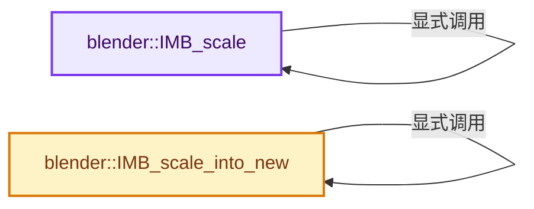
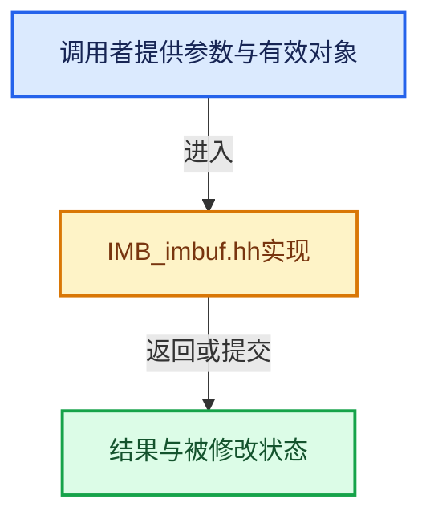

# 实现依赖专题：source/blender/imbuf/IMB_imbuf.hh

[方向导航](README.md) · [符号索引](../%E7%AC%A6%E5%8F%B7%E4%BE%9D%E8%B5%96%E4%B8%8E%E5%AE%9E%E7%8E%B0%E7%B4%A2%E5%BC%95.md)

本专题从正文实际调用进入，集中保存共享实现。函数有稳定锚点，可从调用处直接跳到对应完整函数；递归与互相调用通过回链组织。

## 本文件的实现关系






## 相关类型布局与成员入口

<a id="t-30440e64987b"></a>

### `blender::ImageFormatData`

原始声明：[source/blender/imbuf/IMB_imbuf.hh](../../../../../source/blender/imbuf/IMB_imbuf.hh) · L29—L29。

以下保留类的数据声明与编译条件，成员函数实现通过后面的精确链接阅读。

<!-- annotated:b75a55cb2018e7 -->

```cpp
struct ImageFormatData;
```

<details>
<summary>核对原始源码：source/blender/imbuf/IMB_imbuf.hh · L29—L29</summary>

<!-- original:b75a55cb2018e7:source/blender/imbuf/IMB_imbuf.hh:29:29 -->

```cpp
struct ImageFormatData;
```

</details>


## 完整成员与函数实现

<a id="f-bad6440b9897d364"></a>

### `blender::IMB_scale`

实现位置：[source/blender/imbuf/IMB_imbuf.hh](../../../../../source/blender/imbuf/IMB_imbuf.hh) · L396—L400。

接口参数：

- `ImBuf *ibuf`
- `unsigned int newx`
- `unsigned int newy`
- `IMBScaleFilter filter`
- `bool threaded = true`

**教学注释版**

<!-- annotated:50a9c172e9dc38 -->

```cpp
inline bool IMB_scale(
    ImBuf *ibuf, unsigned int newx, unsigned int newy, IMBScaleFilter filter, bool threaded = true)
{
  return IMB_scale(ibuf, int2(newx, newy), filter, threaded);
}
```

<details>
<summary>核对原始源码：source/blender/imbuf/IMB_imbuf.hh · L396—L400</summary>

<!-- original:50a9c172e9dc38:source/blender/imbuf/IMB_imbuf.hh:396:400 -->

```cpp
inline bool IMB_scale(
    ImBuf *ibuf, unsigned int newx, unsigned int newy, IMBScaleFilter filter, bool threaded = true)
{
  return IMB_scale(ibuf, int2(newx, newy), filter, threaded);
}
```

</details>

**结果出口**

- `return IMB_scale(ibuf, int2(newx, newy), filter, threaded);`

**继续追踪实现**

- `IMB_scale` → [blender::IMB_scale · L396](%E4%BE%9D%E8%B5%96-IMB_imbuf-e70e3a.md#f-bad6440b9897d364)。
- `int2` → [int2 · L643](%E4%BE%9D%E8%B5%96-smaa-b67bc2.md#m-8960c8e6139d)。宏定义由构建条件选择。

<a id="f-78a95ae2b0776130"></a>

### `blender::IMB_scale_into_new`

实现位置：[source/blender/imbuf/IMB_imbuf.hh](../../../../../source/blender/imbuf/IMB_imbuf.hh) · L410—L417。

接口参数：

- `const ImBuf *ibuf`
- `unsigned int newx`
- `unsigned int newy`
- `IMBScaleFilter filter`
- `bool threaded = true`

**教学注释版**

<!-- annotated:a7b999f995331c -->

```cpp
inline ImBuf *IMB_scale_into_new(const ImBuf *ibuf,
                                 unsigned int newx,
                                 unsigned int newy,
                                 IMBScaleFilter filter,
                                 bool threaded = true)
{
  return IMB_scale_into_new(ibuf, int2(newx, newy), filter, threaded);
}
```

<details>
<summary>核对原始源码：source/blender/imbuf/IMB_imbuf.hh · L410—L417</summary>

<!-- original:a7b999f995331c:source/blender/imbuf/IMB_imbuf.hh:410:417 -->

```cpp
inline ImBuf *IMB_scale_into_new(const ImBuf *ibuf,
                                 unsigned int newx,
                                 unsigned int newy,
                                 IMBScaleFilter filter,
                                 bool threaded = true)
{
  return IMB_scale_into_new(ibuf, int2(newx, newy), filter, threaded);
}
```

</details>

**结果出口**

- `return IMB_scale_into_new(ibuf, int2(newx, newy), filter, threaded);`

**继续追踪实现**

- `IMB_scale_into_new` → [blender::IMB_scale_into_new · L410](%E4%BE%9D%E8%B5%96-IMB_imbuf-e70e3a.md#f-78a95ae2b0776130)。
- `int2` → [int2 · L643](%E4%BE%9D%E8%B5%96-smaa-b67bc2.md#m-8960c8e6139d)。宏定义由构建条件选择。
