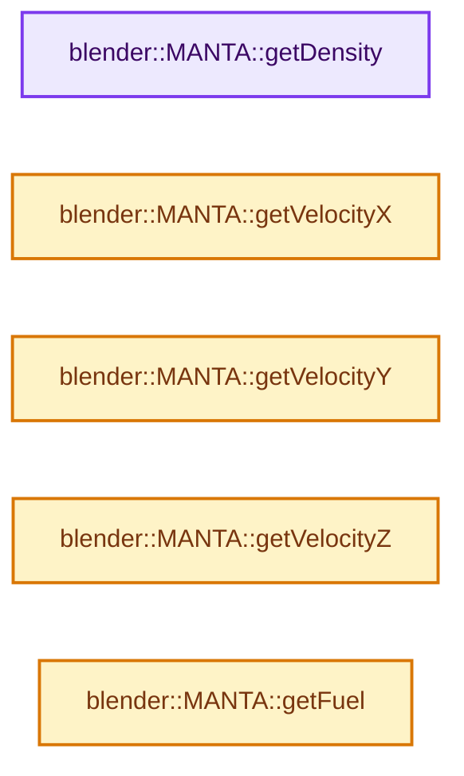
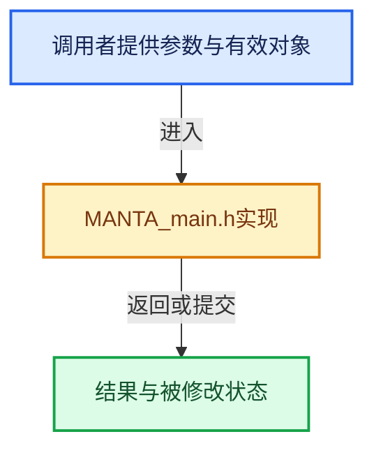

# 实现依赖专题：intern/mantaflow/intern/MANTA_main.h

[方向导航](README.md) · [符号索引](../%E7%AC%A6%E5%8F%B7%E4%BE%9D%E8%B5%96%E4%B8%8E%E5%AE%9E%E7%8E%B0%E7%B4%A2%E5%BC%95.md)

本专题从正文实际调用进入，集中保存共享实现。函数有稳定锚点，可从调用处直接跳到对应完整函数；递归与互相调用通过回链组织。

## 本文件的实现关系






## 完整成员与函数实现

<a id="f-f158ecac233f5e10"></a>

### `blender::MANTA::getDensity`

实现位置：[intern/mantaflow/intern/MANTA_main.h](../../../../../intern/mantaflow/intern/MANTA_main.h) · L175—L178。

**教学注释版**

<!-- annotated:23643144d731ff -->

```cpp
  float *getDensity()
  {
    return mDensity;
  }
```

<details>
<summary>核对原始源码：intern/mantaflow/intern/MANTA_main.h · L175—L178</summary>

<!-- original:23643144d731ff:intern/mantaflow/intern/MANTA_main.h:175:178 -->

```cpp
  float *getDensity()
  {
    return mDensity;
  }
```

</details>

**结果出口**

- `return mDensity;`

**继续追踪实现**

本实现没有需要继续展开的显式调用；检查返回表达式、对象转换和调用者前置条件。

<a id="f-c90647c370fe9e0c"></a>

### `blender::MANTA::getVelocityX`

实现位置：[intern/mantaflow/intern/MANTA_main.h](../../../../../intern/mantaflow/intern/MANTA_main.h) · L183—L186。

**教学注释版**

<!-- annotated:a0667ca784861d -->

```cpp
  float *getVelocityX()
  {
    return mVelocityX;
  }
```

<details>
<summary>核对原始源码：intern/mantaflow/intern/MANTA_main.h · L183—L186</summary>

<!-- original:a0667ca784861d:intern/mantaflow/intern/MANTA_main.h:183:186 -->

```cpp
  float *getVelocityX()
  {
    return mVelocityX;
  }
```

</details>

**结果出口**

- `return mVelocityX;`

**继续追踪实现**

本实现没有需要继续展开的显式调用；检查返回表达式、对象转换和调用者前置条件。

<a id="f-0ff5fb0fb43eebe4"></a>

### `blender::MANTA::getVelocityY`

实现位置：[intern/mantaflow/intern/MANTA_main.h](../../../../../intern/mantaflow/intern/MANTA_main.h) · L187—L190。

**教学注释版**

<!-- annotated:f241da8d648729 -->

```cpp
  float *getVelocityY()
  {
    return mVelocityY;
  }
```

<details>
<summary>核对原始源码：intern/mantaflow/intern/MANTA_main.h · L187—L190</summary>

<!-- original:f241da8d648729:intern/mantaflow/intern/MANTA_main.h:187:190 -->

```cpp
  float *getVelocityY()
  {
    return mVelocityY;
  }
```

</details>

**结果出口**

- `return mVelocityY;`

**继续追踪实现**

本实现没有需要继续展开的显式调用；检查返回表达式、对象转换和调用者前置条件。

<a id="f-c0d5f2d81b9d74e4"></a>

### `blender::MANTA::getVelocityZ`

实现位置：[intern/mantaflow/intern/MANTA_main.h](../../../../../intern/mantaflow/intern/MANTA_main.h) · L191—L194。

**教学注释版**

<!-- annotated:b99300f4df3a94 -->

```cpp
  float *getVelocityZ()
  {
    return mVelocityZ;
  }
```

<details>
<summary>核对原始源码：intern/mantaflow/intern/MANTA_main.h · L191—L194</summary>

<!-- original:b99300f4df3a94:intern/mantaflow/intern/MANTA_main.h:191:194 -->

```cpp
  float *getVelocityZ()
  {
    return mVelocityZ;
  }
```

</details>

**结果出口**

- `return mVelocityZ;`

**继续追踪实现**

本实现没有需要继续展开的显式调用；检查返回表达式、对象转换和调用者前置条件。

<a id="f-373a73d2255bf62e"></a>

### `blender::MANTA::getFuel`

实现位置：[intern/mantaflow/intern/MANTA_main.h](../../../../../intern/mantaflow/intern/MANTA_main.h) · L259—L262。

**教学注释版**

<!-- annotated:b99a6eba7afff4 -->

```cpp
  float *getFuel()
  {
    return mFuel;
  }
```

<details>
<summary>核对原始源码：intern/mantaflow/intern/MANTA_main.h · L259—L262</summary>

<!-- original:b99a6eba7afff4:intern/mantaflow/intern/MANTA_main.h:259:262 -->

```cpp
  float *getFuel()
  {
    return mFuel;
  }
```

</details>

**结果出口**

- `return mFuel;`

**继续追踪实现**

本实现没有需要继续展开的显式调用；检查返回表达式、对象转换和调用者前置条件。
