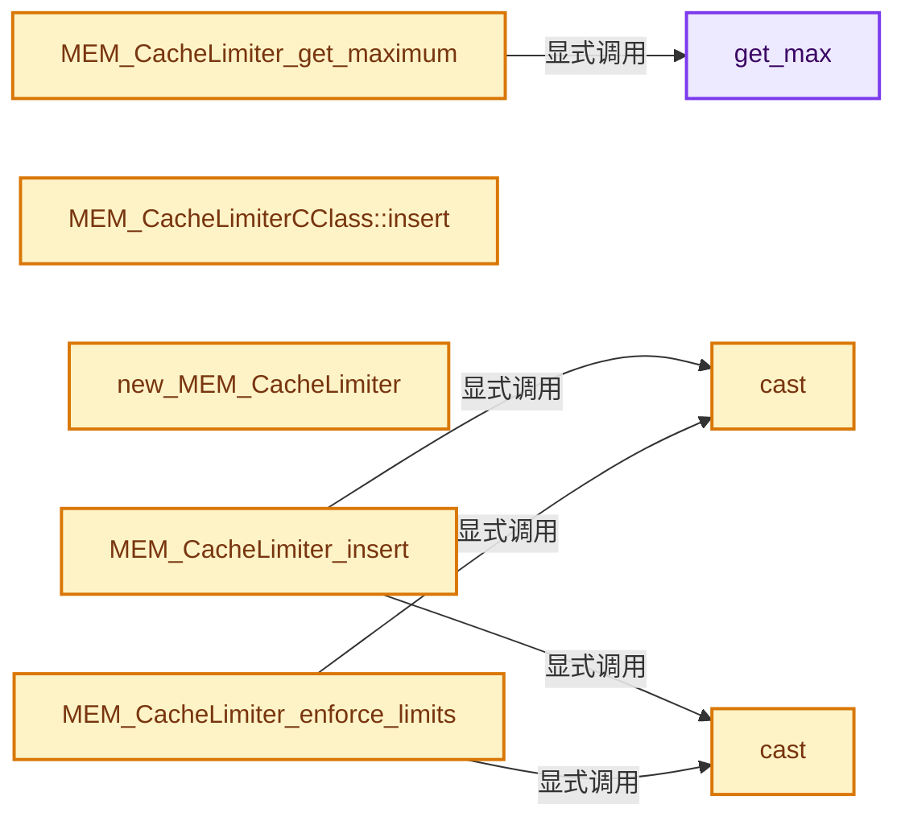
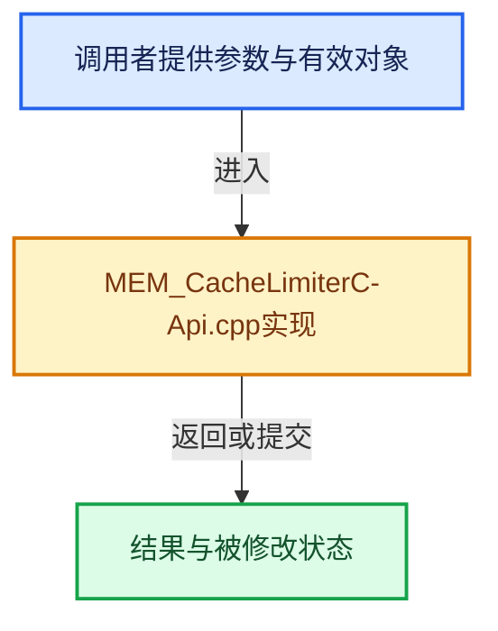

# 实现依赖专题：intern/memutil/intern/MEM_CacheLimiterC-Api.cpp

[方向导航](README.md) · [符号索引](../%E7%AC%A6%E5%8F%B7%E4%BE%9D%E8%B5%96%E4%B8%8E%E5%AE%9E%E7%8E%B0%E7%B4%A2%E5%BC%95.md)

本专题从正文实际调用进入，集中保存共享实现。函数有稳定锚点，可从调用处直接跳到对应完整函数；递归与互相调用通过回链组织。

## 本文件的实现关系






## 完整成员与函数实现

<a id="f-5d5b28ff801c7509"></a>

### `get_max`

实现位置：[intern/memutil/intern/MEM_CacheLimiterC-Api.cpp](../../../../../intern/memutil/intern/MEM_CacheLimiterC-Api.cpp) · L17—L21。

**教学注释版**

<!-- annotated:a7275057afbff5 -->

```cpp
static size_t &get_max()
{
  static size_t m = 32 * 1024 * 1024;
  return m;
}
```

<details>
<summary>核对原始源码：intern/memutil/intern/MEM_CacheLimiterC-Api.cpp · L17—L21</summary>

<!-- original:a7275057afbff5:intern/memutil/intern/MEM_CacheLimiterC-Api.cpp:17:21 -->

```cpp
static size_t &get_max()
{
  static size_t m = 32 * 1024 * 1024;
  return m;
}
```

</details>

**结果出口**

- `return m;`

**继续追踪实现**

本实现没有需要继续展开的显式调用；检查返回表达式、对象转换和调用者前置条件。

<a id="f-7ef72f453ed06110"></a>

### `MEM_CacheLimiter_get_maximum`

实现位置：[intern/memutil/intern/MEM_CacheLimiterC-Api.cpp](../../../../../intern/memutil/intern/MEM_CacheLimiterC-Api.cpp) · L28—L31。

**教学注释版**

<!-- annotated:0e02936908eb4a -->

```cpp
size_t MEM_CacheLimiter_get_maximum()
{
  return get_max();
}
```

<details>
<summary>核对原始源码：intern/memutil/intern/MEM_CacheLimiterC-Api.cpp · L28—L31</summary>

<!-- original:0e02936908eb4a:intern/memutil/intern/MEM_CacheLimiterC-Api.cpp:28:31 -->

```cpp
size_t MEM_CacheLimiter_get_maximum()
{
  return get_max();
}
```

</details>

**结果出口**

- `return get_max();`

**继续追踪实现**

- `get_max` → [get_max · L17](%E4%BE%9D%E8%B5%96-MEM_CacheLimiterC-Api-008d33.md#f-5d5b28ff801c7509)。

<a id="f-798ae83c1514ba41"></a>

### `MEM_CacheLimiterCClass::insert`

实现位置：[intern/memutil/intern/MEM_CacheLimiterC-Api.cpp](../../../../../intern/memutil/intern/MEM_CacheLimiterC-Api.cpp) · L107—L115。

接口参数：

- `void *data`

**教学注释版**

<!-- annotated:9e68842b549681 -->

```cpp
handle_t *MEM_CacheLimiterCClass::insert(void *data)
{
  cclass_list.push_back(new MEM_CacheLimiterHandleCClass(data, this));
  list_t::iterator it = cclass_list.end();
  --it;
  cclass_list.back()->set_iter(it);

  return cache.insert(cclass_list.back());
}
```

<details>
<summary>核对原始源码：intern/memutil/intern/MEM_CacheLimiterC-Api.cpp · L107—L115</summary>

<!-- original:9e68842b549681:intern/memutil/intern/MEM_CacheLimiterC-Api.cpp:107:115 -->

```cpp
handle_t *MEM_CacheLimiterCClass::insert(void *data)
{
  cclass_list.push_back(new MEM_CacheLimiterHandleCClass(data, this));
  list_t::iterator it = cclass_list.end();
  --it;
  cclass_list.back()->set_iter(it);

  return cache.insert(cclass_list.back());
}
```

</details>

**结果出口**

- `return cache.insert(cclass_list.back());`

**继续追踪实现**

- `cclass_list.push_back` → [push_back · L44](%E4%BE%9D%E8%B5%96-unique_ptr_vector-b13772.md#f-0a2bec05306e34a5)。
- `cclass_list.end` → [end · L166](%E4%BE%9D%E8%B5%96-unique_ptr_vector-b13772.md#f-821633e1e75716b0)；[end · L198](%E4%BE%9D%E8%B5%96-unique_ptr_vector-b13772.md#f-d5b287498edefa0c)；[end · L227](%E4%BE%9D%E8%B5%96-array-0b4e3f.md#f-0a7815a247dbb24f)；[end · L232](%E4%BE%9D%E8%B5%96-array-0b4e3f.md#f-2e2d778e188980ab)。同名重载需按实参类型选择。
- `cclass_list.back()->set_iter` → [调用协议](../%E6%A8%A1%E6%9D%BF%E5%AE%8F%E4%B8%8E%E5%8A%A8%E6%80%81%E5%88%86%E6%B4%BE%E5%8D%8F%E8%AE%AE.md)：接收对象类型依赖auto、返回值或模板实例；不按同名猜测目标。调用位置L112。
- `cclass_list.back` → [back · L39](%E4%BE%9D%E8%B5%96-unique_ptr_vector-b13772.md#f-ce755fddac0430d0)。
- `cache.insert` → [MEM_CacheLimiter::insert · L143](%E4%BE%9D%E8%B5%96-MEM_CacheLimiter-f3a9af.md#f-a7e270020593395e)。

<a id="f-bdcb97984dc52972"></a>

### `cast`

实现位置：[intern/memutil/intern/MEM_CacheLimiterC-Api.cpp](../../../../../intern/memutil/intern/MEM_CacheLimiterC-Api.cpp) · L142—L145。

接口参数：

- `MEM_CacheLimiterC *l`

**教学注释版**

<!-- annotated:cd1d5064ca7f7e -->

```cpp
static inline MEM_CacheLimiterCClass *cast(MEM_CacheLimiterC *l)
{
  return (MEM_CacheLimiterCClass *)l;
}
```

<details>
<summary>核对原始源码：intern/memutil/intern/MEM_CacheLimiterC-Api.cpp · L142—L145</summary>

<!-- original:cd1d5064ca7f7e:intern/memutil/intern/MEM_CacheLimiterC-Api.cpp:142:145 -->

```cpp
static inline MEM_CacheLimiterCClass *cast(MEM_CacheLimiterC *l)
{
  return (MEM_CacheLimiterCClass *)l;
}
```

</details>

**结果出口**

- `return (MEM_CacheLimiterCClass *)l;`

**继续追踪实现**

本实现没有需要继续展开的显式调用；检查返回表达式、对象转换和调用者前置条件。

<a id="f-b033ad8ae4bcdb31"></a>

### `cast`

实现位置：[intern/memutil/intern/MEM_CacheLimiterC-Api.cpp](../../../../../intern/memutil/intern/MEM_CacheLimiterC-Api.cpp) · L147—L150。

接口参数：

- `MEM_CacheLimiterHandleC *l`

**教学注释版**

<!-- annotated:c535473c3810bd -->

```cpp
static inline handle_t *cast(MEM_CacheLimiterHandleC *l)
{
  return (handle_t *)l;
}
```

<details>
<summary>核对原始源码：intern/memutil/intern/MEM_CacheLimiterC-Api.cpp · L147—L150</summary>

<!-- original:c535473c3810bd:intern/memutil/intern/MEM_CacheLimiterC-Api.cpp:147:150 -->

```cpp
static inline handle_t *cast(MEM_CacheLimiterHandleC *l)
{
  return (handle_t *)l;
}
```

</details>

**结果出口**

- `return (handle_t *)l;`

**继续追踪实现**

本实现没有需要继续展开的显式调用；检查返回表达式、对象转换和调用者前置条件。

<a id="f-63f7889c2d3316d2"></a>

### `new_MEM_CacheLimiter`

实现位置：[intern/memutil/intern/MEM_CacheLimiterC-Api.cpp](../../../../../intern/memutil/intern/MEM_CacheLimiterC-Api.cpp) · L152—L156。

接口参数：

- `MEM_CacheLimiter_Destruct_Func data_destructor`
- `MEM_CacheLimiter_DataSize_Func data_size`

**教学注释版**

<!-- annotated:a20d084a9e9714 -->

```cpp
MEM_CacheLimiterC *new_MEM_CacheLimiter(MEM_CacheLimiter_Destruct_Func data_destructor,
                                        MEM_CacheLimiter_DataSize_Func data_size)
{
  return (MEM_CacheLimiterC *)new MEM_CacheLimiterCClass(data_destructor, data_size);
}
```

<details>
<summary>核对原始源码：intern/memutil/intern/MEM_CacheLimiterC-Api.cpp · L152—L156</summary>

<!-- original:a20d084a9e9714:intern/memutil/intern/MEM_CacheLimiterC-Api.cpp:152:156 -->

```cpp
MEM_CacheLimiterC *new_MEM_CacheLimiter(MEM_CacheLimiter_Destruct_Func data_destructor,
                                        MEM_CacheLimiter_DataSize_Func data_size)
{
  return (MEM_CacheLimiterC *)new MEM_CacheLimiterCClass(data_destructor, data_size);
}
```

</details>

**结果出口**

- `return (MEM_CacheLimiterC *)new MEM_CacheLimiterCClass(data_destructor, data_size);`

**继续追踪实现**

本实现没有需要继续展开的显式调用；检查返回表达式、对象转换和调用者前置条件。

<a id="f-771146d8821c540f"></a>

### `MEM_CacheLimiter_insert`

实现位置：[intern/memutil/intern/MEM_CacheLimiterC-Api.cpp](../../../../../intern/memutil/intern/MEM_CacheLimiterC-Api.cpp) · L163—L166。

接口参数：

- `MEM_CacheLimiterC *This`
- `void *data`

**教学注释版**

<!-- annotated:57508e820ca59b -->

```cpp
MEM_CacheLimiterHandleC *MEM_CacheLimiter_insert(MEM_CacheLimiterC *This, void *data)
{
  return (MEM_CacheLimiterHandleC *)cast(This)->insert(data);
}
```

<details>
<summary>核对原始源码：intern/memutil/intern/MEM_CacheLimiterC-Api.cpp · L163—L166</summary>

<!-- original:57508e820ca59b:intern/memutil/intern/MEM_CacheLimiterC-Api.cpp:163:166 -->

```cpp
MEM_CacheLimiterHandleC *MEM_CacheLimiter_insert(MEM_CacheLimiterC *This, void *data)
{
  return (MEM_CacheLimiterHandleC *)cast(This)->insert(data);
}
```

</details>

**结果出口**

- `return (MEM_CacheLimiterHandleC *)cast(This)->insert(data);`

**继续追踪实现**

- `cast(This)->insert` → [调用协议](../%E6%A8%A1%E6%9D%BF%E5%AE%8F%E4%B8%8E%E5%8A%A8%E6%80%81%E5%88%86%E6%B4%BE%E5%8D%8F%E8%AE%AE.md)：接收对象类型依赖auto、返回值或模板实例；不按同名猜测目标。调用位置L165。
- `cast` → [cast · L142](%E4%BE%9D%E8%B5%96-MEM_CacheLimiterC-Api-008d33.md#f-bdcb97984dc52972)；[cast · L147](%E4%BE%9D%E8%B5%96-MEM_CacheLimiterC-Api-008d33.md#f-b033ad8ae4bcdb31)。同名重载需按实参类型选择。

<a id="f-d11700c6aeb6b522"></a>

### `MEM_CacheLimiter_enforce_limits`

实现位置：[intern/memutil/intern/MEM_CacheLimiterC-Api.cpp](../../../../../intern/memutil/intern/MEM_CacheLimiterC-Api.cpp) · L168—L171。

接口参数：

- `MEM_CacheLimiterC *This`

**教学注释版**

<!-- annotated:c9b002418a14dd -->

```cpp
void MEM_CacheLimiter_enforce_limits(MEM_CacheLimiterC *This)
{
  cast(This)->get_cache()->enforce_limits();
}
```

<details>
<summary>核对原始源码：intern/memutil/intern/MEM_CacheLimiterC-Api.cpp · L168—L171</summary>

<!-- original:c9b002418a14dd:intern/memutil/intern/MEM_CacheLimiterC-Api.cpp:168:171 -->

```cpp
void MEM_CacheLimiter_enforce_limits(MEM_CacheLimiterC *This)
{
  cast(This)->get_cache()->enforce_limits();
}
```

</details>

**继续追踪实现**

- `cast(This)->get_cache()->enforce_limits` → [调用协议](../%E6%A8%A1%E6%9D%BF%E5%AE%8F%E4%B8%8E%E5%8A%A8%E6%80%81%E5%88%86%E6%B4%BE%E5%8D%8F%E8%AE%AE.md)：接收对象类型依赖auto、返回值或模板实例；不按同名猜测目标。调用位置L170。
- `cast(This)->get_cache` → [调用协议](../%E6%A8%A1%E6%9D%BF%E5%AE%8F%E4%B8%8E%E5%8A%A8%E6%80%81%E5%88%86%E6%B4%BE%E5%8D%8F%E8%AE%AE.md)：接收对象类型依赖auto、返回值或模板实例；不按同名猜测目标。调用位置L170。
- `cast` → [cast · L142](%E4%BE%9D%E8%B5%96-MEM_CacheLimiterC-Api-008d33.md#f-bdcb97984dc52972)；[cast · L147](%E4%BE%9D%E8%B5%96-MEM_CacheLimiterC-Api-008d33.md#f-b033ad8ae4bcdb31)。同名重载需按实参类型选择。

<a id="f-3ed8d260c72fe88e"></a>

### `MEM_CacheLimiter_touch`

实现位置：[intern/memutil/intern/MEM_CacheLimiterC-Api.cpp](../../../../../intern/memutil/intern/MEM_CacheLimiterC-Api.cpp) · L178—L181。

接口参数：

- `MEM_CacheLimiterHandleC *handle`

**教学注释版**

<!-- annotated:13ae55c75c78f4 -->

```cpp
void MEM_CacheLimiter_touch(MEM_CacheLimiterHandleC *handle)
{
  cast(handle)->touch();
}
```

<details>
<summary>核对原始源码：intern/memutil/intern/MEM_CacheLimiterC-Api.cpp · L178—L181</summary>

<!-- original:13ae55c75c78f4:intern/memutil/intern/MEM_CacheLimiterC-Api.cpp:178:181 -->

```cpp
void MEM_CacheLimiter_touch(MEM_CacheLimiterHandleC *handle)
{
  cast(handle)->touch();
}
```

</details>

**继续追踪实现**

- `cast(handle)->touch` → [调用协议](../%E6%A8%A1%E6%9D%BF%E5%AE%8F%E4%B8%8E%E5%8A%A8%E6%80%81%E5%88%86%E6%B4%BE%E5%8D%8F%E8%AE%AE.md)：接收对象类型依赖auto、返回值或模板实例；不按同名猜测目标。调用位置L180。
- `cast` → [cast · L142](%E4%BE%9D%E8%B5%96-MEM_CacheLimiterC-Api-008d33.md#f-bdcb97984dc52972)；[cast · L147](%E4%BE%9D%E8%B5%96-MEM_CacheLimiterC-Api-008d33.md#f-b033ad8ae4bcdb31)。同名重载需按实参类型选择。

<a id="f-47a4ed4213786173"></a>

### `MEM_CacheLimiter_ref`

实现位置：[intern/memutil/intern/MEM_CacheLimiterC-Api.cpp](../../../../../intern/memutil/intern/MEM_CacheLimiterC-Api.cpp) · L183—L186。

接口参数：

- `MEM_CacheLimiterHandleC *handle`

**教学注释版**

<!-- annotated:d4bccadc2f0d1d -->

```cpp
void MEM_CacheLimiter_ref(MEM_CacheLimiterHandleC *handle)
{
  cast(handle)->ref();
}
```

<details>
<summary>核对原始源码：intern/memutil/intern/MEM_CacheLimiterC-Api.cpp · L183—L186</summary>

<!-- original:d4bccadc2f0d1d:intern/memutil/intern/MEM_CacheLimiterC-Api.cpp:183:186 -->

```cpp
void MEM_CacheLimiter_ref(MEM_CacheLimiterHandleC *handle)
{
  cast(handle)->ref();
}
```

</details>

**继续追踪实现**

- `cast(handle)->ref` → [调用协议](../%E6%A8%A1%E6%9D%BF%E5%AE%8F%E4%B8%8E%E5%8A%A8%E6%80%81%E5%88%86%E6%B4%BE%E5%8D%8F%E8%AE%AE.md)：接收对象类型依赖auto、返回值或模板实例；不按同名猜测目标。调用位置L185。
- `cast` → [cast · L142](%E4%BE%9D%E8%B5%96-MEM_CacheLimiterC-Api-008d33.md#f-bdcb97984dc52972)；[cast · L147](%E4%BE%9D%E8%B5%96-MEM_CacheLimiterC-Api-008d33.md#f-b033ad8ae4bcdb31)。同名重载需按实参类型选择。

<a id="f-b0dae1b6bb187812"></a>

### `MEM_CacheLimiter_unref`

实现位置：[intern/memutil/intern/MEM_CacheLimiterC-Api.cpp](../../../../../intern/memutil/intern/MEM_CacheLimiterC-Api.cpp) · L188—L191。

接口参数：

- `MEM_CacheLimiterHandleC *handle`

**教学注释版**

<!-- annotated:08f424ca409849 -->

```cpp
void MEM_CacheLimiter_unref(MEM_CacheLimiterHandleC *handle)
{
  cast(handle)->unref();
}
```

<details>
<summary>核对原始源码：intern/memutil/intern/MEM_CacheLimiterC-Api.cpp · L188—L191</summary>

<!-- original:08f424ca409849:intern/memutil/intern/MEM_CacheLimiterC-Api.cpp:188:191 -->

```cpp
void MEM_CacheLimiter_unref(MEM_CacheLimiterHandleC *handle)
{
  cast(handle)->unref();
}
```

</details>

**继续追踪实现**

- `cast(handle)->unref` → [调用协议](../%E6%A8%A1%E6%9D%BF%E5%AE%8F%E4%B8%8E%E5%8A%A8%E6%80%81%E5%88%86%E6%B4%BE%E5%8D%8F%E8%AE%AE.md)：接收对象类型依赖auto、返回值或模板实例；不按同名猜测目标。调用位置L190。
- `cast` → [cast · L142](%E4%BE%9D%E8%B5%96-MEM_CacheLimiterC-Api-008d33.md#f-bdcb97984dc52972)；[cast · L147](%E4%BE%9D%E8%B5%96-MEM_CacheLimiterC-Api-008d33.md#f-b033ad8ae4bcdb31)。同名重载需按实参类型选择。

<a id="f-fe03099eca12b9c2"></a>

### `MEM_CacheLimiter_ItemPriority_Func_set`

实现位置：[intern/memutil/intern/MEM_CacheLimiterC-Api.cpp](../../../../../intern/memutil/intern/MEM_CacheLimiterC-Api.cpp) · L203—L207。

接口参数：

- `MEM_CacheLimiterC *This`
- `MEM_CacheLimiter_ItemPriority_Func item_priority_func`

**教学注释版**

<!-- annotated:32fbd71df88bc2 -->

```cpp
void MEM_CacheLimiter_ItemPriority_Func_set(MEM_CacheLimiterC *This,
                                            MEM_CacheLimiter_ItemPriority_Func item_priority_func)
{
  cast(This)->get_cache()->set_item_priority_func(item_priority_func);
}
```

<details>
<summary>核对原始源码：intern/memutil/intern/MEM_CacheLimiterC-Api.cpp · L203—L207</summary>

<!-- original:32fbd71df88bc2:intern/memutil/intern/MEM_CacheLimiterC-Api.cpp:203:207 -->

```cpp
void MEM_CacheLimiter_ItemPriority_Func_set(MEM_CacheLimiterC *This,
                                            MEM_CacheLimiter_ItemPriority_Func item_priority_func)
{
  cast(This)->get_cache()->set_item_priority_func(item_priority_func);
}
```

</details>

**继续追踪实现**

- `cast(This)->get_cache()->set_item_priority_func` → [调用协议](../%E6%A8%A1%E6%9D%BF%E5%AE%8F%E4%B8%8E%E5%8A%A8%E6%80%81%E5%88%86%E6%B4%BE%E5%8D%8F%E8%AE%AE.md)：接收对象类型依赖auto、返回值或模板实例；不按同名猜测目标。调用位置L206。
- `cast(This)->get_cache` → [调用协议](../%E6%A8%A1%E6%9D%BF%E5%AE%8F%E4%B8%8E%E5%8A%A8%E6%80%81%E5%88%86%E6%B4%BE%E5%8D%8F%E8%AE%AE.md)：接收对象类型依赖auto、返回值或模板实例；不按同名猜测目标。调用位置L206。
- `cast` → [cast · L142](%E4%BE%9D%E8%B5%96-MEM_CacheLimiterC-Api-008d33.md#f-bdcb97984dc52972)；[cast · L147](%E4%BE%9D%E8%B5%96-MEM_CacheLimiterC-Api-008d33.md#f-b033ad8ae4bcdb31)。同名重载需按实参类型选择。

<a id="f-399b81a8d75c2b89"></a>

### `MEM_CacheLimiter_ItemDestroyable_Func_set`

实现位置：[intern/memutil/intern/MEM_CacheLimiterC-Api.cpp](../../../../../intern/memutil/intern/MEM_CacheLimiterC-Api.cpp) · L209—L213。

接口参数：

- `MEM_CacheLimiterC *This`
- `MEM_CacheLimiter_ItemDestroyable_Func item_destroyable_func`

**教学注释版**

<!-- annotated:b6e328ac328e2f -->

```cpp
void MEM_CacheLimiter_ItemDestroyable_Func_set(
    MEM_CacheLimiterC *This, MEM_CacheLimiter_ItemDestroyable_Func item_destroyable_func)
{
  cast(This)->get_cache()->set_item_destroyable_func(item_destroyable_func);
}
```

<details>
<summary>核对原始源码：intern/memutil/intern/MEM_CacheLimiterC-Api.cpp · L209—L213</summary>

<!-- original:b6e328ac328e2f:intern/memutil/intern/MEM_CacheLimiterC-Api.cpp:209:213 -->

```cpp
void MEM_CacheLimiter_ItemDestroyable_Func_set(
    MEM_CacheLimiterC *This, MEM_CacheLimiter_ItemDestroyable_Func item_destroyable_func)
{
  cast(This)->get_cache()->set_item_destroyable_func(item_destroyable_func);
}
```

</details>

**继续追踪实现**

- `cast(This)->get_cache()->set_item_destroyable_func` → [调用协议](../%E6%A8%A1%E6%9D%BF%E5%AE%8F%E4%B8%8E%E5%8A%A8%E6%80%81%E5%88%86%E6%B4%BE%E5%8D%8F%E8%AE%AE.md)：接收对象类型依赖auto、返回值或模板实例；不按同名猜测目标。调用位置L212。
- `cast(This)->get_cache` → [调用协议](../%E6%A8%A1%E6%9D%BF%E5%AE%8F%E4%B8%8E%E5%8A%A8%E6%80%81%E5%88%86%E6%B4%BE%E5%8D%8F%E8%AE%AE.md)：接收对象类型依赖auto、返回值或模板实例；不按同名猜测目标。调用位置L212。
- `cast` → [cast · L142](%E4%BE%9D%E8%B5%96-MEM_CacheLimiterC-Api-008d33.md#f-bdcb97984dc52972)；[cast · L147](%E4%BE%9D%E8%B5%96-MEM_CacheLimiterC-Api-008d33.md#f-b033ad8ae4bcdb31)。同名重载需按实参类型选择。

<a id="f-00024c3082fd2ac7"></a>

### `MEM_CacheLimiter_get_memory_in_use`

实现位置：[intern/memutil/intern/MEM_CacheLimiterC-Api.cpp](../../../../../intern/memutil/intern/MEM_CacheLimiterC-Api.cpp) · L215—L218。

接口参数：

- `MEM_CacheLimiterC *This`

**教学注释版**

<!-- annotated:3ed16034da2e37 -->

```cpp
size_t MEM_CacheLimiter_get_memory_in_use(MEM_CacheLimiterC *This)
{
  return cast(This)->get_cache()->get_memory_in_use();
}
```

<details>
<summary>核对原始源码：intern/memutil/intern/MEM_CacheLimiterC-Api.cpp · L215—L218</summary>

<!-- original:3ed16034da2e37:intern/memutil/intern/MEM_CacheLimiterC-Api.cpp:215:218 -->

```cpp
size_t MEM_CacheLimiter_get_memory_in_use(MEM_CacheLimiterC *This)
{
  return cast(This)->get_cache()->get_memory_in_use();
}
```

</details>

**结果出口**

- `return cast(This)->get_cache()->get_memory_in_use();`

**继续追踪实现**

- `cast(This)->get_cache()->get_memory_in_use` → [调用协议](../%E6%A8%A1%E6%9D%BF%E5%AE%8F%E4%B8%8E%E5%8A%A8%E6%80%81%E5%88%86%E6%B4%BE%E5%8D%8F%E8%AE%AE.md)：接收对象类型依赖auto、返回值或模板实例；不按同名猜测目标。调用位置L217。
- `cast(This)->get_cache` → [调用协议](../%E6%A8%A1%E6%9D%BF%E5%AE%8F%E4%B8%8E%E5%8A%A8%E6%80%81%E5%88%86%E6%B4%BE%E5%8D%8F%E8%AE%AE.md)：接收对象类型依赖auto、返回值或模板实例；不按同名猜测目标。调用位置L217。
- `cast` → [cast · L142](%E4%BE%9D%E8%B5%96-MEM_CacheLimiterC-Api-008d33.md#f-bdcb97984dc52972)；[cast · L147](%E4%BE%9D%E8%B5%96-MEM_CacheLimiterC-Api-008d33.md#f-b033ad8ae4bcdb31)。同名重载需按实参类型选择。
