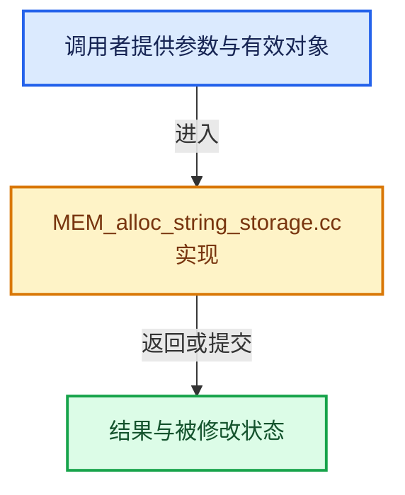

# 实现依赖专题：intern/memutil/intern/MEM_alloc_string_storage.cc

[方向导航](README.md) · [符号索引](../%E7%AC%A6%E5%8F%B7%E4%BE%9D%E8%B5%96%E4%B8%8E%E5%AE%9E%E7%8E%B0%E7%B4%A2%E5%BC%95.md)

本专题从正文实际调用进入，集中保存共享实现。函数有稳定锚点，可从调用处直接跳到对应完整函数；递归与互相调用通过回链组织。

## 本文件的实现关系





## 完整成员与函数实现

<a id="f-5aa55c5eca773126"></a>

### `intern::memutil::internal::ensure_storage_container`

实现位置：[intern/memutil/intern/MEM_alloc_string_storage.cc](../../../../../intern/memutil/intern/MEM_alloc_string_storage.cc) · L14—L19。

**教学注释版**

<!-- annotated:7ab1e004ab67f6 -->

```cpp
AllocStringStorageContainer &ensure_storage_container()
{
  static thread_local AllocStringStorageContainer &storage =
      MEM_construct_leak_detection_data<AllocStringStorageContainer>();
  return storage;
}
```

<details>
<summary>核对原始源码：intern/memutil/intern/MEM_alloc_string_storage.cc · L14—L19</summary>

<!-- original:7ab1e004ab67f6:intern/memutil/intern/MEM_alloc_string_storage.cc:14:19 -->

```cpp
AllocStringStorageContainer &ensure_storage_container()
{
  static thread_local AllocStringStorageContainer &storage =
      MEM_construct_leak_detection_data<AllocStringStorageContainer>();
  return storage;
}
```

</details>

**结果出口**

- `return storage;`

**继续追踪实现**

- `MEM_construct_leak_detection_data<AllocStringStorageContainer>` → [MEM_construct_leak_detection_data · L666](../03-%E5%86%85%E5%AD%98%E5%88%86%E9%85%8D%E4%B8%8E%E8%BF%90%E8%A1%8C%E6%97%B6%E7%B1%BB%E5%9E%8B/%E4%BE%9D%E8%B5%96-MEM_guardedalloc-b54eca.md#f-ac7bcfe6abd24e0b)。
