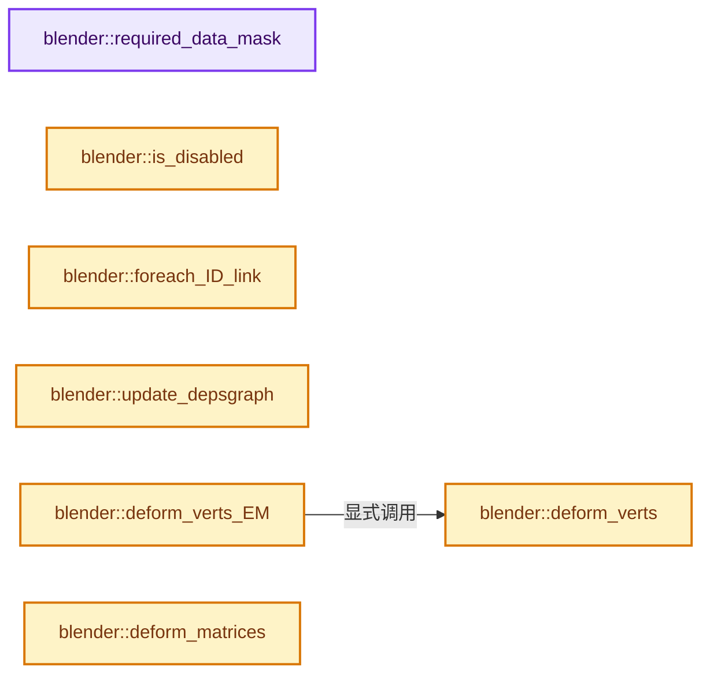

# 实现依赖专题：source/blender/modifiers/intern/MOD_armature.cc

[方向导航](README.md) · [符号索引](../%E7%AC%A6%E5%8F%B7%E4%BE%9D%E8%B5%96%E4%B8%8E%E5%AE%9E%E7%8E%B0%E7%B4%A2%E5%BC%95.md)

本专题从正文实际调用进入，集中保存共享实现。函数有稳定锚点，可从调用处直接跳到对应完整函数；递归与互相调用通过回链组织。

## 本文件的实现关系




## 完整成员与函数实现

<a id="f-5ead046ebad2c1ff"></a>

### `blender::required_data_mask`

实现位置：[source/blender/modifiers/intern/MOD_armature.cc](../../../../../source/blender/modifiers/intern/MOD_armature.cc) · L58—L62。

接口参数：

- `ModifierData *`
- `CustomData_MeshMasks *r_cddata_masks`

**教学注释版**

<!-- annotated:1e711c8cb46f77 -->

```cpp
static void required_data_mask(ModifierData * /*md*/, CustomData_MeshMasks *r_cddata_masks)
{
  /* Ask for vertex-groups. */
  r_cddata_masks->vmask |= CD_MASK_MDEFORMVERT;
}
```

<details>
<summary>核对原始源码：source/blender/modifiers/intern/MOD_armature.cc · L58—L62</summary>

<!-- original:1e711c8cb46f77:source/blender/modifiers/intern/MOD_armature.cc:58:62 -->

```cpp
static void required_data_mask(ModifierData * /*md*/, CustomData_MeshMasks *r_cddata_masks)
{
  /* Ask for vertex-groups. */
  r_cddata_masks->vmask |= CD_MASK_MDEFORMVERT;
}
```

</details>

**沿实际写入检查状态**

- `r_cddata_masks->vmask |= CD_MASK_MDEFORMVERT;`

**继续追踪实现**

本实现没有需要继续展开的显式调用；检查返回表达式、对象转换和调用者前置条件。

<a id="f-3524d00c8f6db35a"></a>

### `blender::is_disabled`

实现位置：[source/blender/modifiers/intern/MOD_armature.cc](../../../../../source/blender/modifiers/intern/MOD_armature.cc) · L64—L74。

接口参数：

- `const Scene *`
- `ModifierData *md`
- `bool`

**教学注释版**

<!-- annotated:036cee4ca90c84 -->

```cpp
static bool is_disabled(const Scene * /*scene*/, ModifierData *md, bool /*use_render_params*/)
{
  ArmatureModifierData *amd = reinterpret_cast<ArmatureModifierData *>(md);

  /* The object type check is only needed here in case we have a placeholder
   * object assigned (because the library containing the armature is missing).
   *
   * In other cases it should be impossible to have a type mismatch.
   */
  return !amd->object || amd->object->type != OB_ARMATURE;
}
```

<details>
<summary>核对原始源码：source/blender/modifiers/intern/MOD_armature.cc · L64—L74</summary>

<!-- original:036cee4ca90c84:source/blender/modifiers/intern/MOD_armature.cc:64:74 -->

```cpp
static bool is_disabled(const Scene * /*scene*/, ModifierData *md, bool /*use_render_params*/)
{
  ArmatureModifierData *amd = reinterpret_cast<ArmatureModifierData *>(md);

  /* The object type check is only needed here in case we have a placeholder
   * object assigned (because the library containing the armature is missing).
   *
   * In other cases it should be impossible to have a type mismatch.
   */
  return !amd->object || amd->object->type != OB_ARMATURE;
}
```

</details>

**结果出口**

- `return !amd->object || amd->object->type != OB_ARMATURE;`

**继续追踪实现**

本实现没有需要继续展开的显式调用；检查返回表达式、对象转换和调用者前置条件。

<a id="f-af1634a00f579e50"></a>

### `blender::foreach_ID_link`

实现位置：[source/blender/modifiers/intern/MOD_armature.cc](../../../../../source/blender/modifiers/intern/MOD_armature.cc) · L76—L81。

接口参数：

- `ModifierData *md`
- `Object *ob`
- `IDWalkFunc walk`
- `void *user_data`

**教学注释版**

<!-- annotated:15a877b29e9629 -->

```cpp
static void foreach_ID_link(ModifierData *md, Object *ob, IDWalkFunc walk, void *user_data)
{
  ArmatureModifierData *amd = reinterpret_cast<ArmatureModifierData *>(md);

  walk(user_data, ob, reinterpret_cast<ID **>(&amd->object), IDWALK_CB_NOP);
}
```

<details>
<summary>核对原始源码：source/blender/modifiers/intern/MOD_armature.cc · L76—L81</summary>

<!-- original:15a877b29e9629:source/blender/modifiers/intern/MOD_armature.cc:76:81 -->

```cpp
static void foreach_ID_link(ModifierData *md, Object *ob, IDWalkFunc walk, void *user_data)
{
  ArmatureModifierData *amd = reinterpret_cast<ArmatureModifierData *>(md);

  walk(user_data, ob, reinterpret_cast<ID **>(&amd->object), IDWALK_CB_NOP);
}
```

</details>

**继续追踪实现**

- `walk` → [调用协议](../%E6%A8%A1%E6%9D%BF%E5%AE%8F%E4%B8%8E%E5%8A%A8%E6%80%81%E5%88%86%E6%B4%BE%E5%8D%8F%E8%AE%AE.md)：局部可调用对象，须结合其初始化与捕获环境。调用位置L80。

<a id="f-7e55879779d93145"></a>

### `blender::update_depsgraph`

实现位置：[source/blender/modifiers/intern/MOD_armature.cc](../../../../../source/blender/modifiers/intern/MOD_armature.cc) · L83—L113。

接口参数：

- `ModifierData *md`
- `const ModifierUpdateDepsgraphContext *ctx`

**教学注释版**

<!-- annotated:5f003594728a51 -->

```cpp
static void update_depsgraph(ModifierData *md, const ModifierUpdateDepsgraphContext *ctx)
{
  ArmatureModifierData *amd = reinterpret_cast<ArmatureModifierData *>(md);
  if (amd->object != nullptr) {
    /* If not using envelopes,
     * create relations to individual bones for more rigging flexibility. */
    if ((amd->deformflag & ARM_DEF_ENVELOPE) == 0 && (amd->object->pose != nullptr) &&
        ELEM(ctx->object->type, OB_MESH, OB_LATTICE))
    {
      /* If neither vertex groups nor envelopes are used, the modifier has no bone dependencies. */
      if ((amd->deformflag & ARM_DEF_VGROUP) != 0) {
        /* Enumerate groups that match existing bones. */
        const ListBaseT<bDeformGroup> *defbase = BKE_object_defgroup_list(ctx->object);
        for (bDeformGroup &dg : *defbase) {
          if (BKE_pose_channel_find_name(amd->object->pose, dg.name) != nullptr) {
            /* Can't check BONE_NO_DEFORM because it can be animated. */
            DEG_add_bone_relation(
                ctx->node, amd->object, dg.name, DEG_OB_COMP_BONE, "Armature Modifier");
          }
        }
      }
    }
    /* Otherwise require the whole pose to be complete. */
    else {
      DEG_add_object_relation(ctx->node, amd->object, DEG_OB_COMP_EVAL_POSE, "Armature Modifier");
    }

    DEG_add_object_relation(ctx->node, amd->object, DEG_OB_COMP_TRANSFORM, "Armature Modifier");
  }
  DEG_add_depends_on_transform_relation(ctx->node, "Armature Modifier");
}
```

<details>
<summary>核对原始源码：source/blender/modifiers/intern/MOD_armature.cc · L83—L113</summary>

<!-- original:5f003594728a51:source/blender/modifiers/intern/MOD_armature.cc:83:113 -->

```cpp
static void update_depsgraph(ModifierData *md, const ModifierUpdateDepsgraphContext *ctx)
{
  ArmatureModifierData *amd = reinterpret_cast<ArmatureModifierData *>(md);
  if (amd->object != nullptr) {
    /* If not using envelopes,
     * create relations to individual bones for more rigging flexibility. */
    if ((amd->deformflag & ARM_DEF_ENVELOPE) == 0 && (amd->object->pose != nullptr) &&
        ELEM(ctx->object->type, OB_MESH, OB_LATTICE))
    {
      /* If neither vertex groups nor envelopes are used, the modifier has no bone dependencies. */
      if ((amd->deformflag & ARM_DEF_VGROUP) != 0) {
        /* Enumerate groups that match existing bones. */
        const ListBaseT<bDeformGroup> *defbase = BKE_object_defgroup_list(ctx->object);
        for (bDeformGroup &dg : *defbase) {
          if (BKE_pose_channel_find_name(amd->object->pose, dg.name) != nullptr) {
            /* Can't check BONE_NO_DEFORM because it can be animated. */
            DEG_add_bone_relation(
                ctx->node, amd->object, dg.name, DEG_OB_COMP_BONE, "Armature Modifier");
          }
        }
      }
    }
    /* Otherwise require the whole pose to be complete. */
    else {
      DEG_add_object_relation(ctx->node, amd->object, DEG_OB_COMP_EVAL_POSE, "Armature Modifier");
    }

    DEG_add_object_relation(ctx->node, amd->object, DEG_OB_COMP_TRANSFORM, "Armature Modifier");
  }
  DEG_add_depends_on_transform_relation(ctx->node, "Armature Modifier");
}
```

</details>

**继续追踪实现**

- `ELEM` → [ELEM · L88](%E4%BE%9D%E8%B5%96-GHOST_utildefines-34b996.md#m-d28724a15928)；[ELEM · L135](../01-%E5%9F%BA%E7%A1%80%E5%AE%B9%E5%99%A8%E4%B8%8E%E7%8E%B0%E4%BB%A3CPP/%E4%BE%9D%E8%B5%96-BLI_utildefines-293a0a.md#m-d6572de7cae0)。宏定义由构建条件选择。
- `BKE_object_defgroup_list` → [blender::BKE_object_defgroup_list · L591](%E4%BE%9D%E8%B5%96-deform-6949f4.md#f-26f2f33daee59e8d)。
- `BKE_pose_channel_find_name` → [blender::BKE_pose_channel_find_name · L895](%E4%BE%9D%E8%B5%96-action-b3a47a.md#f-5997206551bfc9f9)。
- `DEG_add_bone_relation` → [blender::DEG_add_bone_relation · L189](../11-Depsgraph%E4%B8%8E%E5%B9%B6%E8%A1%8C%E4%BB%BB%E5%8A%A1%E7%B3%BB%E7%BB%9F/%E4%BE%9D%E8%B5%96-depsgraph_build-ea2fc8.md#f-39e93b3cc8a9913c)。
- `DEG_add_object_relation` → [blender::DEG_add_object_relation · L123](../11-Depsgraph%E4%B8%8E%E5%B9%B6%E8%A1%8C%E4%BB%BB%E5%8A%A1%E7%B3%BB%E7%BB%9F/%E4%BE%9D%E8%B5%96-depsgraph_build-ea2fc8.md#f-f570cffae97e273c)。
- `DEG_add_depends_on_transform_relation` → [blender::DEG_add_depends_on_transform_relation · L240](../11-Depsgraph%E4%B8%8E%E5%B9%B6%E8%A1%8C%E4%BB%BB%E5%8A%A1%E7%B3%BB%E7%BB%9F/%E4%BE%9D%E8%B5%96-depsgraph_build-ea2fc8.md#f-47c32a354defa20d)。

<a id="f-00659aeadfbf2ac6"></a>

### `blender::deform_verts`

实现位置：[source/blender/modifiers/intern/MOD_armature.cc](../../../../../source/blender/modifiers/intern/MOD_armature.cc) · L115—L140。

接口参数：

- `ModifierData *md`
- `const ModifierEvalContext *ctx`
- `Mesh *mesh`
- `MutableSpan<float3> positions`

**教学注释版**

<!-- annotated:a3e7676504d785 -->

```cpp
static void deform_verts(ModifierData *md,
                         const ModifierEvalContext *ctx,
                         Mesh *mesh,
                         MutableSpan<float3> positions)
{
  ArmatureModifierData *amd = reinterpret_cast<ArmatureModifierData *>(md);
  std::optional<Span<float3>> vert_coords_prev;
  if (amd->vert_coords_prev) {
    // [讲解] positions.size：查询视图长度或生成对应有效索引区间。
    vert_coords_prev = {reinterpret_cast<float3 *>(amd->vert_coords_prev), positions.size()};
  }

  /* if next modifier needs original vertices */
  // [讲解] positions.data：返回借用范围的地址。
  MOD_previous_vcos_store(md, reinterpret_cast<float (*)[3]>(positions.data()));

  BKE_armature_deform_coords_with_mesh(*amd->object,
                                       *ctx->object,
                                       positions,
                                       vert_coords_prev,
                                       std::nullopt,
                                       amd->deformflag,
                                       amd->defgrp_name,
                                       mesh);

  /* free cache */
  MEM_SAFE_DELETE(amd->vert_coords_prev);
}
```

<details>
<summary>核对原始源码：source/blender/modifiers/intern/MOD_armature.cc · L115—L140</summary>

<!-- original:a3e7676504d785:source/blender/modifiers/intern/MOD_armature.cc:115:140 -->

```cpp
static void deform_verts(ModifierData *md,
                         const ModifierEvalContext *ctx,
                         Mesh *mesh,
                         MutableSpan<float3> positions)
{
  ArmatureModifierData *amd = reinterpret_cast<ArmatureModifierData *>(md);
  std::optional<Span<float3>> vert_coords_prev;
  if (amd->vert_coords_prev) {
    vert_coords_prev = {reinterpret_cast<float3 *>(amd->vert_coords_prev), positions.size()};
  }

  /* if next modifier needs original vertices */
  MOD_previous_vcos_store(md, reinterpret_cast<float (*)[3]>(positions.data()));

  BKE_armature_deform_coords_with_mesh(*amd->object,
                                       *ctx->object,
                                       positions,
                                       vert_coords_prev,
                                       std::nullopt,
                                       amd->deformflag,
                                       amd->defgrp_name,
                                       mesh);

  /* free cache */
  MEM_SAFE_DELETE(amd->vert_coords_prev);
}
```

</details>

**沿实际写入检查状态**

- `vert_coords_prev = {reinterpret_cast<float3 *>(amd->vert_coords_prev), positions.size()};`

**继续追踪实现**

- `positions.size` → [blender::MutableSpan::size · L499](../01-%E5%9F%BA%E7%A1%80%E5%AE%B9%E5%99%A8%E4%B8%8E%E7%8E%B0%E4%BB%A3CPP/06-MutableSpan%E5%8F%AF%E5%86%99%E8%A7%86%E5%9B%BE.md#f-1de6a66839c304a8)；[blender::gpu::shader::parser::MutableSpan::size · L87](%E4%BE%9D%E8%B5%96-utils-06433d.md#f-5e684af6ee7990e9)。同名重载需按实参类型选择。
- `MOD_previous_vcos_store` → [blender::MOD_previous_vcos_store · L144](%E4%BE%9D%E8%B5%96-MOD_util-83ca4b.md#f-3c67667357b76b7a)。
- `positions.data` → [blender::MutableSpan::data · L545](../01-%E5%9F%BA%E7%A1%80%E5%AE%B9%E5%99%A8%E4%B8%8E%E7%8E%B0%E4%BB%A3CPP/06-MutableSpan%E5%8F%AF%E5%86%99%E8%A7%86%E5%9B%BE.md#f-eb45a6e4d8211efd)；[blender::gpu::shader::parser::MutableSpan::data · L82](%E4%BE%9D%E8%B5%96-utils-06433d.md#f-ad0a09cec9741c65)。同名重载需按实参类型选择。
- `BKE_armature_deform_coords_with_mesh` → [blender::BKE_armature_deform_coords_with_mesh · L657](%E4%BE%9D%E8%B5%96-armature_deform-1f81ac.md#f-eb8c52b76299642a)。
- `MEM_SAFE_DELETE` → [MEM_SAFE_DELETE · L436](../03-%E5%86%85%E5%AD%98%E5%88%86%E9%85%8D%E4%B8%8E%E8%BF%90%E8%A1%8C%E6%97%B6%E7%B1%BB%E5%9E%8B/%E4%BE%9D%E8%B5%96-MEM_guardedalloc-b54eca.md#m-eadb3bc5b902)。宏定义由构建条件选择。

<a id="f-74bd4b13e2fb3829"></a>

### `blender::deform_verts_EM`

实现位置：[source/blender/modifiers/intern/MOD_armature.cc](../../../../../source/blender/modifiers/intern/MOD_armature.cc) · L142—L172。

接口参数：

- `ModifierData *md`
- `const ModifierEvalContext *ctx`
- `const BMEditMesh *`
- `Mesh *mesh`
- `MutableSpan<float3> positions`

**教学注释版**

<!-- annotated:5cd52f1fad231a -->

```cpp
static void deform_verts_EM(ModifierData *md,
                            const ModifierEvalContext *ctx,
                            const BMEditMesh * /*em*/,
                            Mesh *mesh,
                            MutableSpan<float3> positions)
{
  if (mesh->runtime->wrapper_type == ME_WRAPPER_TYPE_MDATA) {
    deform_verts(md, ctx, mesh, positions);
    return;
  }

  ArmatureModifierData *amd = reinterpret_cast<ArmatureModifierData *>(md);
  std::optional<Span<float3>> vert_coords_prev;
  if (amd->vert_coords_prev) {
    // [讲解] positions.size：查询视图长度或生成对应有效索引区间。
    vert_coords_prev = {reinterpret_cast<float3 *>(amd->vert_coords_prev), positions.size()};
  }

  /* if next modifier needs original vertices */
  // [讲解] positions.data：返回借用范围的地址。
  MOD_previous_vcos_store(md, reinterpret_cast<float (*)[3]>(positions.data()));

  BKE_armature_deform_coords_with_editmesh(*amd->object,
                                           *ctx->object,
                                           positions,
                                           vert_coords_prev,
                                           std::nullopt,
                                           amd->deformflag,
                                           amd->defgrp_name);

  /* free cache */
  MEM_SAFE_DELETE(amd->vert_coords_prev);
}
```

<details>
<summary>核对原始源码：source/blender/modifiers/intern/MOD_armature.cc · L142—L172</summary>

<!-- original:5cd52f1fad231a:source/blender/modifiers/intern/MOD_armature.cc:142:172 -->

```cpp
static void deform_verts_EM(ModifierData *md,
                            const ModifierEvalContext *ctx,
                            const BMEditMesh * /*em*/,
                            Mesh *mesh,
                            MutableSpan<float3> positions)
{
  if (mesh->runtime->wrapper_type == ME_WRAPPER_TYPE_MDATA) {
    deform_verts(md, ctx, mesh, positions);
    return;
  }

  ArmatureModifierData *amd = reinterpret_cast<ArmatureModifierData *>(md);
  std::optional<Span<float3>> vert_coords_prev;
  if (amd->vert_coords_prev) {
    vert_coords_prev = {reinterpret_cast<float3 *>(amd->vert_coords_prev), positions.size()};
  }

  /* if next modifier needs original vertices */
  MOD_previous_vcos_store(md, reinterpret_cast<float (*)[3]>(positions.data()));

  BKE_armature_deform_coords_with_editmesh(*amd->object,
                                           *ctx->object,
                                           positions,
                                           vert_coords_prev,
                                           std::nullopt,
                                           amd->deformflag,
                                           amd->defgrp_name);

  /* free cache */
  MEM_SAFE_DELETE(amd->vert_coords_prev);
}
```

</details>

**沿实际写入检查状态**

- `vert_coords_prev = {reinterpret_cast<float3 *>(amd->vert_coords_prev), positions.size()};`

**继续追踪实现**

- `deform_verts` → [blender::deform_verts · L115](%E4%BE%9D%E8%B5%96-MOD_armature-a4abb0.md#f-00659aeadfbf2ac6)。
- `positions.size` → [blender::MutableSpan::size · L499](../01-%E5%9F%BA%E7%A1%80%E5%AE%B9%E5%99%A8%E4%B8%8E%E7%8E%B0%E4%BB%A3CPP/06-MutableSpan%E5%8F%AF%E5%86%99%E8%A7%86%E5%9B%BE.md#f-1de6a66839c304a8)；[blender::gpu::shader::parser::MutableSpan::size · L87](%E4%BE%9D%E8%B5%96-utils-06433d.md#f-5e684af6ee7990e9)。同名重载需按实参类型选择。
- `MOD_previous_vcos_store` → [blender::MOD_previous_vcos_store · L144](%E4%BE%9D%E8%B5%96-MOD_util-83ca4b.md#f-3c67667357b76b7a)。
- `positions.data` → [blender::MutableSpan::data · L545](../01-%E5%9F%BA%E7%A1%80%E5%AE%B9%E5%99%A8%E4%B8%8E%E7%8E%B0%E4%BB%A3CPP/06-MutableSpan%E5%8F%AF%E5%86%99%E8%A7%86%E5%9B%BE.md#f-eb45a6e4d8211efd)；[blender::gpu::shader::parser::MutableSpan::data · L82](%E4%BE%9D%E8%B5%96-utils-06433d.md#f-ad0a09cec9741c65)。同名重载需按实参类型选择。
- `BKE_armature_deform_coords_with_editmesh` → [blender::BKE_armature_deform_coords_with_editmesh · L715](%E4%BE%9D%E8%B5%96-armature_deform-1f81ac.md#f-3bd9369aa741c352)。
- `MEM_SAFE_DELETE` → [MEM_SAFE_DELETE · L436](../03-%E5%86%85%E5%AD%98%E5%88%86%E9%85%8D%E4%B8%8E%E8%BF%90%E8%A1%8C%E6%97%B6%E7%B1%BB%E5%9E%8B/%E4%BE%9D%E8%B5%96-MEM_guardedalloc-b54eca.md#m-eadb3bc5b902)。宏定义由构建条件选择。

<a id="f-75ae734856c7c55e"></a>

### `blender::deform_matrices`

实现位置：[source/blender/modifiers/intern/MOD_armature.cc](../../../../../source/blender/modifiers/intern/MOD_armature.cc) · L191—L206。

接口参数：

- `ModifierData *md`
- `const ModifierEvalContext *ctx`
- `Mesh *mesh`
- `MutableSpan<float3> positions`
- `MutableSpan<float3x3> matrices`

**教学注释版**

<!-- annotated:35c36f244e2454 -->

```cpp
static void deform_matrices(ModifierData *md,
                            const ModifierEvalContext *ctx,
                            Mesh *mesh,
                            MutableSpan<float3> positions,
                            MutableSpan<float3x3> matrices)
{
  ArmatureModifierData *amd = reinterpret_cast<ArmatureModifierData *>(md);
  BKE_armature_deform_coords_with_mesh(*amd->object,
                                       *ctx->object,
                                       positions,
                                       std::nullopt,
                                       matrices,
                                       amd->deformflag,
                                       amd->defgrp_name,
                                       mesh);
}
```

<details>
<summary>核对原始源码：source/blender/modifiers/intern/MOD_armature.cc · L191—L206</summary>

<!-- original:35c36f244e2454:source/blender/modifiers/intern/MOD_armature.cc:191:206 -->

```cpp
static void deform_matrices(ModifierData *md,
                            const ModifierEvalContext *ctx,
                            Mesh *mesh,
                            MutableSpan<float3> positions,
                            MutableSpan<float3x3> matrices)
{
  ArmatureModifierData *amd = reinterpret_cast<ArmatureModifierData *>(md);
  BKE_armature_deform_coords_with_mesh(*amd->object,
                                       *ctx->object,
                                       positions,
                                       std::nullopt,
                                       matrices,
                                       amd->deformflag,
                                       amd->defgrp_name,
                                       mesh);
}
```

</details>

**继续追踪实现**

- `BKE_armature_deform_coords_with_mesh` → [blender::BKE_armature_deform_coords_with_mesh · L657](%E4%BE%9D%E8%B5%96-armature_deform-1f81ac.md#f-eb8c52b76299642a)。
