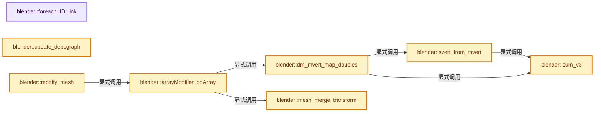
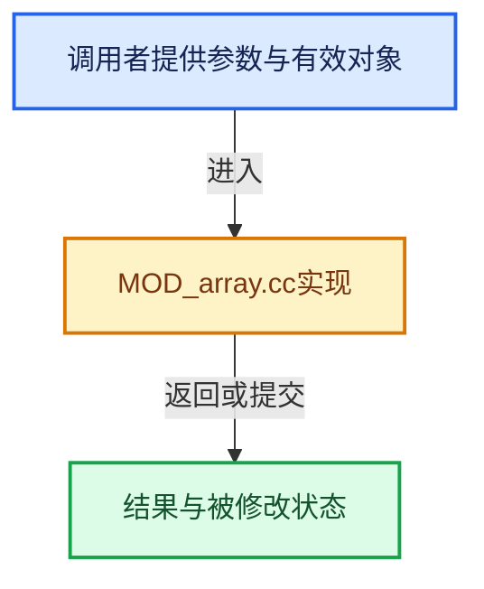

# 实现依赖专题：source/blender/modifiers/intern/MOD_array.cc

[方向导航](README.md) · [符号索引](../%E7%AC%A6%E5%8F%B7%E4%BE%9D%E8%B5%96%E4%B8%8E%E5%AE%9E%E7%8E%B0%E7%B4%A2%E5%BC%95.md)

本专题从正文实际调用进入，集中保存共享实现。函数有稳定锚点，可从调用处直接跳到对应完整函数；递归与互相调用通过回链组织。

## 本文件的实现关系






## 完整成员与函数实现

<a id="f-58bee7f1040012ed"></a>

### `blender::foreach_ID_link`

实现位置：[source/blender/modifiers/intern/MOD_array.cc](../../../../../source/blender/modifiers/intern/MOD_array.cc) · L64—L72。

接口参数：

- `ModifierData *md`
- `Object *ob`
- `IDWalkFunc walk`
- `void *user_data`

**教学注释版**

<!-- annotated:9d30e9306350e0 -->

```cpp
static void foreach_ID_link(ModifierData *md, Object *ob, IDWalkFunc walk, void *user_data)
{
  ArrayModifierData *amd = reinterpret_cast<ArrayModifierData *>(md);

  walk(user_data, ob, reinterpret_cast<ID **>(&amd->start_cap), IDWALK_CB_NOP);
  walk(user_data, ob, reinterpret_cast<ID **>(&amd->end_cap), IDWALK_CB_NOP);
  walk(user_data, ob, reinterpret_cast<ID **>(&amd->curve_ob), IDWALK_CB_NOP);
  walk(user_data, ob, reinterpret_cast<ID **>(&amd->offset_ob), IDWALK_CB_NOP);
}
```

<details>
<summary>核对原始源码：source/blender/modifiers/intern/MOD_array.cc · L64—L72</summary>

<!-- original:9d30e9306350e0:source/blender/modifiers/intern/MOD_array.cc:64:72 -->

```cpp
static void foreach_ID_link(ModifierData *md, Object *ob, IDWalkFunc walk, void *user_data)
{
  ArrayModifierData *amd = reinterpret_cast<ArrayModifierData *>(md);

  walk(user_data, ob, reinterpret_cast<ID **>(&amd->start_cap), IDWALK_CB_NOP);
  walk(user_data, ob, reinterpret_cast<ID **>(&amd->end_cap), IDWALK_CB_NOP);
  walk(user_data, ob, reinterpret_cast<ID **>(&amd->curve_ob), IDWALK_CB_NOP);
  walk(user_data, ob, reinterpret_cast<ID **>(&amd->offset_ob), IDWALK_CB_NOP);
}
```

</details>

**继续追踪实现**

- `walk` → [调用协议](../%E6%A8%A1%E6%9D%BF%E5%AE%8F%E4%B8%8E%E5%8A%A8%E6%80%81%E5%88%86%E6%B4%BE%E5%8D%8F%E8%AE%AE.md)：局部可调用对象，须结合其初始化与捕获环境。调用位置L68。

<a id="f-6bd9444e4b37ed0f"></a>

### `blender::update_depsgraph`

实现位置：[source/blender/modifiers/intern/MOD_array.cc](../../../../../source/blender/modifiers/intern/MOD_array.cc) · L74—L100。

接口参数：

- `ModifierData *md`
- `const ModifierUpdateDepsgraphContext *ctx`

**教学注释版**

<!-- annotated:b883b3747665ae -->

```cpp
static void update_depsgraph(ModifierData *md, const ModifierUpdateDepsgraphContext *ctx)
{
  ArrayModifierData *amd = reinterpret_cast<ArrayModifierData *>(md);
  bool need_transform_dependency = false;
  if (amd->start_cap != nullptr) {
    DEG_add_object_relation(
        ctx->node, amd->start_cap, DEG_OB_COMP_GEOMETRY, "Array Modifier Start Cap");
  }
  if (amd->end_cap != nullptr) {
    DEG_add_object_relation(
        ctx->node, amd->end_cap, DEG_OB_COMP_GEOMETRY, "Array Modifier End Cap");
  }
  if (amd->curve_ob) {
    DEG_add_object_relation(
        ctx->node, amd->curve_ob, DEG_OB_COMP_GEOMETRY, "Array Modifier Curve");
    DEG_add_special_eval_flag(ctx->node, &amd->curve_ob->id, DAG_EVAL_NEED_CURVE_PATH);
  }
  if (amd->offset_ob != nullptr) {
    DEG_add_object_relation(
        ctx->node, amd->offset_ob, DEG_OB_COMP_TRANSFORM, "Array Modifier Offset");
    need_transform_dependency = true;
  }

  if (need_transform_dependency) {
    DEG_add_depends_on_transform_relation(ctx->node, "Array Modifier");
  }
}
```

<details>
<summary>核对原始源码：source/blender/modifiers/intern/MOD_array.cc · L74—L100</summary>

<!-- original:b883b3747665ae:source/blender/modifiers/intern/MOD_array.cc:74:100 -->

```cpp
static void update_depsgraph(ModifierData *md, const ModifierUpdateDepsgraphContext *ctx)
{
  ArrayModifierData *amd = reinterpret_cast<ArrayModifierData *>(md);
  bool need_transform_dependency = false;
  if (amd->start_cap != nullptr) {
    DEG_add_object_relation(
        ctx->node, amd->start_cap, DEG_OB_COMP_GEOMETRY, "Array Modifier Start Cap");
  }
  if (amd->end_cap != nullptr) {
    DEG_add_object_relation(
        ctx->node, amd->end_cap, DEG_OB_COMP_GEOMETRY, "Array Modifier End Cap");
  }
  if (amd->curve_ob) {
    DEG_add_object_relation(
        ctx->node, amd->curve_ob, DEG_OB_COMP_GEOMETRY, "Array Modifier Curve");
    DEG_add_special_eval_flag(ctx->node, &amd->curve_ob->id, DAG_EVAL_NEED_CURVE_PATH);
  }
  if (amd->offset_ob != nullptr) {
    DEG_add_object_relation(
        ctx->node, amd->offset_ob, DEG_OB_COMP_TRANSFORM, "Array Modifier Offset");
    need_transform_dependency = true;
  }

  if (need_transform_dependency) {
    DEG_add_depends_on_transform_relation(ctx->node, "Array Modifier");
  }
}
```

</details>

**沿实际写入检查状态**

- `need_transform_dependency = true;`

**继续追踪实现**

- `DEG_add_object_relation` → [blender::DEG_add_object_relation · L123](../11-Depsgraph%E4%B8%8E%E5%B9%B6%E8%A1%8C%E4%BB%BB%E5%8A%A1%E7%B3%BB%E7%BB%9F/%E4%BE%9D%E8%B5%96-depsgraph_build-ea2fc8.md#f-f570cffae97e273c)。
- `DEG_add_special_eval_flag` → [blender::DEG_add_special_eval_flag · L253](../11-Depsgraph%E4%B8%8E%E5%B9%B6%E8%A1%8C%E4%BB%BB%E5%8A%A1%E7%B3%BB%E7%BB%9F/%E4%BE%9D%E8%B5%96-depsgraph_build-ea2fc8.md#f-d68e9c73ded33dd2)。
- `DEG_add_depends_on_transform_relation` → [blender::DEG_add_depends_on_transform_relation · L240](../11-Depsgraph%E4%B8%8E%E5%B9%B6%E8%A1%8C%E4%BB%BB%E5%8A%A1%E7%B3%BB%E7%BB%9F/%E4%BE%9D%E8%B5%96-depsgraph_build-ea2fc8.md#f-47c32a354defa20d)。

<a id="f-89b98042d9523f0b"></a>

### `blender::sum_v3`

实现位置：[source/blender/modifiers/intern/MOD_array.cc](../../../../../source/blender/modifiers/intern/MOD_array.cc) · L102—L105。

接口参数：

- `const float v[3]`

**教学注释版**

<!-- annotated:6820c631c16feb -->

```cpp
BLI_INLINE float sum_v3(const float v[3])
{
  return v[0] + v[1] + v[2];
}
```

<details>
<summary>核对原始源码：source/blender/modifiers/intern/MOD_array.cc · L102—L105</summary>

<!-- original:6820c631c16feb:source/blender/modifiers/intern/MOD_array.cc:102:105 -->

```cpp
BLI_INLINE float sum_v3(const float v[3])
{
  return v[0] + v[1] + v[2];
}
```

</details>

**结果出口**

- `return v[0] + v[1] + v[2];`

**继续追踪实现**

本实现没有需要继续展开的显式调用；检查返回表达式、对象转换和调用者前置条件。

<a id="f-55335c14fed3d3ee"></a>

### `blender::svert_from_mvert`

实现位置：[source/blender/modifiers/intern/MOD_array.cc](../../../../../source/blender/modifiers/intern/MOD_array.cc) · L129—L140。

接口参数：

- `SortVertsElem *sv`
- `const Span<float3> vert_positions`
- `const int i_begin`
- `const int i_end`

**教学注释版**

<!-- annotated:657613f4add014 -->

```cpp
static void svert_from_mvert(SortVertsElem *sv,
                             const Span<float3> vert_positions,
                             const int i_begin,
                             const int i_end)
{
  int i;
  for (i = i_begin; i < i_end; i++, sv++) {
    sv->vertex_num = i;
    copy_v3_v3(sv->co, vert_positions[i]);
    sv->sum_co = sum_v3(vert_positions[i]);
  }
}
```

<details>
<summary>核对原始源码：source/blender/modifiers/intern/MOD_array.cc · L129—L140</summary>

<!-- original:657613f4add014:source/blender/modifiers/intern/MOD_array.cc:129:140 -->

```cpp
static void svert_from_mvert(SortVertsElem *sv,
                             const Span<float3> vert_positions,
                             const int i_begin,
                             const int i_end)
{
  int i;
  for (i = i_begin; i < i_end; i++, sv++) {
    sv->vertex_num = i;
    copy_v3_v3(sv->co, vert_positions[i]);
    sv->sum_co = sum_v3(vert_positions[i]);
  }
}
```

</details>

**沿实际写入检查状态**

- `sv->vertex_num = i;`
- `sv->sum_co = sum_v3(vert_positions[i]);`

**继续追踪实现**

- `copy_v3_v3` → [blender::copy_v3_v3 · L47](../12-%E7%A9%BA%E9%97%B4%E6%95%B0%E6%8D%AE%E7%BB%93%E6%9E%84%E4%B8%8E%E5%87%A0%E4%BD%95%E7%AE%97%E6%B3%95/%E4%BE%9D%E8%B5%96-math_vector_inline-0c8541.md#f-037a0d5fa5060bd6)。
- `sum_v3` → [blender::sum_v3 · L102](%E4%BE%9D%E8%B5%96-MOD_array-c062b5.md#f-89b98042d9523f0b)。

<a id="f-90f122ccc7b2c3e3"></a>

### `blender::dm_mvert_map_doubles`

实现位置：[source/blender/modifiers/intern/MOD_array.cc](../../../../../source/blender/modifiers/intern/MOD_array.cc) · L149—L266。

接口参数：

- `int *doubles_map`
- `const Span<float3> vert_positions`
- `const int target_start`
- `const int target_verts_num`
- `const int source_start`
- `const int source_verts_num`
- `const float dist`

**教学注释版**

<!-- annotated:a23ee426de0069 -->

```cpp
static void dm_mvert_map_doubles(int *doubles_map,
                                 const Span<float3> vert_positions,
                                 const int target_start,
                                 const int target_verts_num,
                                 const int source_start,
                                 const int source_verts_num,
                                 const float dist)
{
  const float dist3 = (float(M_SQRT3) + 0.00005f) * dist; /* Just above `sqrt(3)`. */
  int i_source, i_target, i_target_low_bound, target_end, source_end;
  SortVertsElem *sve_source, *sve_target, *sve_target_low_bound;
  bool target_scan_completed;

  target_end = target_start + target_verts_num;
  source_end = source_start + source_verts_num;

  /* build array of MVerts to be tested for merging */
  SortVertsElem *sorted_verts_target = MEM_new_array_uninitialized<SortVertsElem>(
      size_t(target_verts_num), __func__);
  SortVertsElem *sorted_verts_source = MEM_new_array_uninitialized<SortVertsElem>(
      size_t(source_verts_num), __func__);

  /* Copy target vertices index and cos into SortVertsElem array */
  svert_from_mvert(sorted_verts_target, vert_positions, target_start, target_end);

  /* Copy source vertices index and cos into SortVertsElem array */
  svert_from_mvert(sorted_verts_source, vert_positions, source_start, source_end);

  /* sort arrays according to sum of vertex coordinates (sumco) */
  qsort(sorted_verts_target, target_verts_num, sizeof(SortVertsElem), svert_sum_cmp);
  qsort(sorted_verts_source, source_verts_num, sizeof(SortVertsElem), svert_sum_cmp);

  sve_target_low_bound = sorted_verts_target;
  i_target_low_bound = 0;
  target_scan_completed = false;

  /* Scan source vertices, in #SortVertsElem sorted array,
   * all the while maintaining the lower bound of possible doubles in target vertices. */
  for (i_source = 0, sve_source = sorted_verts_source; i_source < source_verts_num;
       i_source++, sve_source++)
  {
    int best_target_vertex = -1;
    float best_dist_sq = dist * dist;
    float sve_source_sumco;

    /* If source has already been assigned to a target (in an earlier call, with other chunks) */
    if (doubles_map[sve_source->vertex_num] != -1) {
      continue;
    }

    /* If target fully scanned already, then all remaining source vertices cannot have a double */
    if (target_scan_completed) {
      doubles_map[sve_source->vertex_num] = -1;
      continue;
    }

    sve_source_sumco = sum_v3(sve_source->co);

    /* Skip all target vertices that are more than dist3 lower in terms of sumco */
    /* and advance the overall lower bound, applicable to all remaining vertices as well. */
    while ((i_target_low_bound < target_verts_num) &&
           (sve_target_low_bound->sum_co < sve_source_sumco - dist3))
    {
      i_target_low_bound++;
      sve_target_low_bound++;
    }
    /* If end of target list reached, then no more possible doubles */
    if (i_target_low_bound >= target_verts_num) {
      doubles_map[sve_source->vertex_num] = -1;
      target_scan_completed = true;
      continue;
    }
    /* Test target candidates starting at the low bound of possible doubles,
     * ordered in terms of sumco. */
    i_target = i_target_low_bound;
    sve_target = sve_target_low_bound;

    /* i_target will scan vertices in the
     * [v_source_sumco - dist3;  v_source_sumco + dist3] range */

    while ((i_target < target_verts_num) && (sve_target->sum_co <= sve_source_sumco + dist3)) {
      /* Testing distance for candidate double in target */
      /* v_target is within dist3 of v_source in terms of sumco;  check real distance */
      const float dist_sq = len_squared_v3v3(sve_source->co, sve_target->co);
      if (dist_sq <= best_dist_sq) {
        /* Potential double found */
        best_dist_sq = dist_sq;
        best_target_vertex = sve_target->vertex_num;

        /* If target is already mapped, we only follow that mapping if final target remains
         * close enough from current vert (otherwise no mapping at all).
         * Note that if we later find another target closer than this one, then we check it.
         * But if other potential targets are farther,
         * then there will be no mapping at all for this source. */
        while (best_target_vertex != -1 &&
               !ELEM(doubles_map[best_target_vertex], -1, best_target_vertex))
        {
          if (compare_len_v3v3(vert_positions[sve_source->vertex_num],
                               vert_positions[doubles_map[best_target_vertex]],
                               dist))
          {
            best_target_vertex = doubles_map[best_target_vertex];
          }
          else {
            best_target_vertex = -1;
          }
        }
      }
      i_target++;
      sve_target++;
    }
    /* End of candidate scan: if none found then no doubles */
    doubles_map[sve_source->vertex_num] = best_target_vertex;
  }

  MEM_delete(sorted_verts_source);
  MEM_delete(sorted_verts_target);
}
```

<details>
<summary>核对原始源码：source/blender/modifiers/intern/MOD_array.cc · L149—L266</summary>

<!-- original:a23ee426de0069:source/blender/modifiers/intern/MOD_array.cc:149:266 -->

```cpp
static void dm_mvert_map_doubles(int *doubles_map,
                                 const Span<float3> vert_positions,
                                 const int target_start,
                                 const int target_verts_num,
                                 const int source_start,
                                 const int source_verts_num,
                                 const float dist)
{
  const float dist3 = (float(M_SQRT3) + 0.00005f) * dist; /* Just above `sqrt(3)`. */
  int i_source, i_target, i_target_low_bound, target_end, source_end;
  SortVertsElem *sve_source, *sve_target, *sve_target_low_bound;
  bool target_scan_completed;

  target_end = target_start + target_verts_num;
  source_end = source_start + source_verts_num;

  /* build array of MVerts to be tested for merging */
  SortVertsElem *sorted_verts_target = MEM_new_array_uninitialized<SortVertsElem>(
      size_t(target_verts_num), __func__);
  SortVertsElem *sorted_verts_source = MEM_new_array_uninitialized<SortVertsElem>(
      size_t(source_verts_num), __func__);

  /* Copy target vertices index and cos into SortVertsElem array */
  svert_from_mvert(sorted_verts_target, vert_positions, target_start, target_end);

  /* Copy source vertices index and cos into SortVertsElem array */
  svert_from_mvert(sorted_verts_source, vert_positions, source_start, source_end);

  /* sort arrays according to sum of vertex coordinates (sumco) */
  qsort(sorted_verts_target, target_verts_num, sizeof(SortVertsElem), svert_sum_cmp);
  qsort(sorted_verts_source, source_verts_num, sizeof(SortVertsElem), svert_sum_cmp);

  sve_target_low_bound = sorted_verts_target;
  i_target_low_bound = 0;
  target_scan_completed = false;

  /* Scan source vertices, in #SortVertsElem sorted array,
   * all the while maintaining the lower bound of possible doubles in target vertices. */
  for (i_source = 0, sve_source = sorted_verts_source; i_source < source_verts_num;
       i_source++, sve_source++)
  {
    int best_target_vertex = -1;
    float best_dist_sq = dist * dist;
    float sve_source_sumco;

    /* If source has already been assigned to a target (in an earlier call, with other chunks) */
    if (doubles_map[sve_source->vertex_num] != -1) {
      continue;
    }

    /* If target fully scanned already, then all remaining source vertices cannot have a double */
    if (target_scan_completed) {
      doubles_map[sve_source->vertex_num] = -1;
      continue;
    }

    sve_source_sumco = sum_v3(sve_source->co);

    /* Skip all target vertices that are more than dist3 lower in terms of sumco */
    /* and advance the overall lower bound, applicable to all remaining vertices as well. */
    while ((i_target_low_bound < target_verts_num) &&
           (sve_target_low_bound->sum_co < sve_source_sumco - dist3))
    {
      i_target_low_bound++;
      sve_target_low_bound++;
    }
    /* If end of target list reached, then no more possible doubles */
    if (i_target_low_bound >= target_verts_num) {
      doubles_map[sve_source->vertex_num] = -1;
      target_scan_completed = true;
      continue;
    }
    /* Test target candidates starting at the low bound of possible doubles,
     * ordered in terms of sumco. */
    i_target = i_target_low_bound;
    sve_target = sve_target_low_bound;

    /* i_target will scan vertices in the
     * [v_source_sumco - dist3;  v_source_sumco + dist3] range */

    while ((i_target < target_verts_num) && (sve_target->sum_co <= sve_source_sumco + dist3)) {
      /* Testing distance for candidate double in target */
      /* v_target is within dist3 of v_source in terms of sumco;  check real distance */
      const float dist_sq = len_squared_v3v3(sve_source->co, sve_target->co);
      if (dist_sq <= best_dist_sq) {
        /* Potential double found */
        best_dist_sq = dist_sq;
        best_target_vertex = sve_target->vertex_num;

        /* If target is already mapped, we only follow that mapping if final target remains
         * close enough from current vert (otherwise no mapping at all).
         * Note that if we later find another target closer than this one, then we check it.
         * But if other potential targets are farther,
         * then there will be no mapping at all for this source. */
        while (best_target_vertex != -1 &&
               !ELEM(doubles_map[best_target_vertex], -1, best_target_vertex))
        {
          if (compare_len_v3v3(vert_positions[sve_source->vertex_num],
                               vert_positions[doubles_map[best_target_vertex]],
                               dist))
          {
            best_target_vertex = doubles_map[best_target_vertex];
          }
          else {
            best_target_vertex = -1;
          }
        }
      }
      i_target++;
      sve_target++;
    }
    /* End of candidate scan: if none found then no doubles */
    doubles_map[sve_source->vertex_num] = best_target_vertex;
  }

  MEM_delete(sorted_verts_source);
  MEM_delete(sorted_verts_target);
}
```

</details>

**沿实际写入检查状态**

- `target_end = target_start + target_verts_num;`
- `source_end = source_start + source_verts_num;`
- `sve_target_low_bound = sorted_verts_target;`
- `i_target_low_bound = 0;`
- `target_scan_completed = false;`
- `doubles_map[sve_source->vertex_num] = -1;`
- `sve_source_sumco = sum_v3(sve_source->co);`
- `target_scan_completed = true;`
- `i_target = i_target_low_bound;`
- `sve_target = sve_target_low_bound;`
- `best_dist_sq = dist_sq;`
- `best_target_vertex = sve_target->vertex_num;`
- `best_target_vertex = doubles_map[best_target_vertex];`
- `best_target_vertex = -1;`
- `doubles_map[sve_source->vertex_num] = best_target_vertex;`

**继续追踪实现**

- `MEM_new_array_uninitialized<SortVertsElem>` → [MEM_new_array_uninitialized · L608](../03-%E5%86%85%E5%AD%98%E5%88%86%E9%85%8D%E4%B8%8E%E8%BF%90%E8%A1%8C%E6%97%B6%E7%B1%BB%E5%9E%8B/%E4%BE%9D%E8%B5%96-MEM_guardedalloc-b54eca.md#f-b7103eae8eb57b05)；[MEM_new_array_uninitialized · L129](../03-%E5%86%85%E5%AD%98%E5%88%86%E9%85%8D%E4%B8%8E%E8%BF%90%E8%A1%8C%E6%97%B6%E7%B1%BB%E5%9E%8B/%E4%BE%9D%E8%B5%96-mallocn-afdcd4.md#f-bf6ef4ddcfb6e5df)。同名重载需按实参类型选择。
- `svert_from_mvert` → [blender::svert_from_mvert · L129](%E4%BE%9D%E8%B5%96-MOD_array-c062b5.md#f-55335c14fed3d3ee)。
- `qsort` → [调用协议](../%E6%A8%A1%E6%9D%BF%E5%AE%8F%E4%B8%8E%E5%8A%A8%E6%80%81%E5%88%86%E6%B4%BE%E5%8D%8F%E8%AE%AE.md)：函数指针、局部可调用对象或未展开的宏；必须结合调用者环境。调用位置L178。
- `sum_v3` → [blender::sum_v3 · L102](%E4%BE%9D%E8%B5%96-MOD_array-c062b5.md#f-89b98042d9523f0b)。
- `len_squared_v3v3` → [blender::len_squared_v3v3 · L794](../12-%E7%A9%BA%E9%97%B4%E6%95%B0%E6%8D%AE%E7%BB%93%E6%9E%84%E4%B8%8E%E5%87%A0%E4%BD%95%E7%AE%97%E6%B3%95/%E4%BE%9D%E8%B5%96-math_vector_inline-0c8541.md#f-ae487ac3ef64aa87)。
- `ELEM` → [ELEM · L88](%E4%BE%9D%E8%B5%96-GHOST_utildefines-34b996.md#m-d28724a15928)；[ELEM · L135](../01-%E5%9F%BA%E7%A1%80%E5%AE%B9%E5%99%A8%E4%B8%8E%E7%8E%B0%E4%BB%A3CPP/%E4%BE%9D%E8%B5%96-BLI_utildefines-293a0a.md#m-d6572de7cae0)。宏定义由构建条件选择。
- `compare_len_v3v3` → [blender::compare_len_v3v3 · L1038](../12-%E7%A9%BA%E9%97%B4%E6%95%B0%E6%8D%AE%E7%BB%93%E6%9E%84%E4%B8%8E%E5%87%A0%E4%BD%95%E7%AE%97%E6%B3%95/%E4%BE%9D%E8%B5%96-math_vector_inline-0c8541.md#f-8d2afb191c0a24e7)。
- `MEM_delete` → [MEM_delete · L400](../03-%E5%86%85%E5%AD%98%E5%88%86%E9%85%8D%E4%B8%8E%E8%BF%90%E8%A1%8C%E6%97%B6%E7%B1%BB%E5%9E%8B/%E4%BE%9D%E8%B5%96-MEM_guardedalloc-b54eca.md#f-9049ffdd1682887c)。

<a id="f-c0a397fcfb958407"></a>

### `blender::mesh_merge_transform`

实现位置：[source/blender/modifiers/intern/MOD_array.cc](../../../../../source/blender/modifiers/intern/MOD_array.cc) · L268—L375。

接口参数：

- `Mesh *result`
- `Mesh *cap_mesh`
- `const float cap_offset[4][4]`
- `uint cap_verts_index`
- `uint cap_edges_index`
- `int cap_loops_index`
- `int cap_faces_index`
- `int cap_nverts`
- `int cap_nedges`
- `int cap_nloops`
- `int cap_nfaces`
- `int *remap`
- `int remap_len`
- `MutableSpan<float3> dst_vert_normals`

**教学注释版**

<!-- annotated:6b21c105958225 -->

```cpp
static void mesh_merge_transform(Mesh *result,
                                 Mesh *cap_mesh,
                                 const float cap_offset[4][4],
                                 uint cap_verts_index,
                                 uint cap_edges_index,
                                 int cap_loops_index,
                                 int cap_faces_index,
                                 int cap_nverts,
                                 int cap_nedges,
                                 int cap_nloops,
                                 int cap_nfaces,
                                 int *remap,
                                 int remap_len,
                                 MutableSpan<float3> dst_vert_normals)
{
  int *index_orig;
  int i;
  int2 *edge;
  const Span<int> cap_face_offsets = cap_mesh->face_offsets();
  MutableSpan<float3> result_positions = result->vert_positions_for_write();
  MutableSpan<int2> result_edges = result->edges_for_write();
  MutableSpan<int> result_face_offsets = result->face_offsets_for_write();
  MutableSpan<int> result_corner_verts = result->corner_verts_for_write();
  MutableSpan<int> result_corner_edges = result->corner_edges_for_write();
  bke::MutableAttributeAccessor result_attributes = result->attributes_for_write();

  bke::LegacyMeshInterpolator vert_interp(*cap_mesh, *result, bke::AttrDomain::Point);
  bke::LegacyMeshInterpolator edge_interp(*cap_mesh, *result, bke::AttrDomain::Edge);
  bke::LegacyMeshInterpolator face_interp(*cap_mesh, *result, bke::AttrDomain::Face);
  bke::LegacyMeshInterpolator corner_interp(*cap_mesh, *result, bke::AttrDomain::Corner);

  vert_interp.copy(0, cap_verts_index, cap_nverts);
  edge_interp.copy(0, cap_edges_index, cap_nedges);
  face_interp.copy(0, cap_faces_index, cap_nfaces);
  corner_interp.copy(0, cap_loops_index, cap_nloops);

  for (i = 0; i < cap_nverts; i++) {
    mul_m4_v3(cap_offset, result_positions[cap_verts_index + i]);
  }

  /* We have to correct normals too, if we do not tag them as dirty later! */
  // [讲解] dst_vert_normals.is_empty：查询视图长度或生成对应有效索引区间。
  if (!dst_vert_normals.is_empty()) {
    for (i = 0; i < cap_nverts; i++) {
      mul_mat3_m4_v3(cap_offset, dst_vert_normals[cap_verts_index + i]);
      normalize_v3(dst_vert_normals[cap_verts_index + i]);
    }
  }

  /* remap the vertex groups if necessary */
  if (!result->deform_verts().is_empty()) {
    MDeformVert *dvert = result->deform_verts_for_write().data();
    BKE_object_defgroup_index_map_apply(&dvert[cap_verts_index], cap_nverts, remap, remap_len);
  }

  /* adjust cap edge vertex indices */
  edge = &result_edges[cap_edges_index];
  for (i = 0; i < cap_nedges; i++, edge++) {
    (*edge) += cap_verts_index;
  }

  /* Adjust cap face loop-start indices. */
  for (i = 0; i < cap_nfaces; i++) {
    result_face_offsets[cap_faces_index + i] = cap_face_offsets[i] + cap_loops_index;
  }

  /* adjust cap loop vertex and edge indices */
  for (i = 0; i < cap_nloops; i++) {
    result_corner_verts[cap_loops_index + i] += cap_verts_index;
    result_corner_edges[cap_loops_index + i] += cap_edges_index;
  }

  const bke::AttributeAccessor cap_attributes = cap_mesh->attributes();
  if (const VArray cap_material_indices = *cap_attributes.lookup<int>("material_index",
                                                                      bke::AttrDomain::Face))
  {
    bke::SpanAttributeWriter<int> result_material_indices =
        result_attributes.lookup_or_add_for_write_span<int>("material_index",
                                                            bke::AttrDomain::Face);
    cap_material_indices.materialize(
        result_material_indices.span.slice(cap_faces_index, cap_nfaces));
    result_material_indices.finish();
  }

  /* Set #CD_ORIGINDEX. */
  index_orig = static_cast<int *>(
      CustomData_get_layer_for_write(&result->vert_data, CD_ORIGINDEX, result->verts_num));
  if (index_orig) {
    std::fill_n(index_orig + cap_verts_index, cap_nverts, ORIGINDEX_NONE);
  }

  index_orig = static_cast<int *>(
      CustomData_get_layer_for_write(&result->edge_data, CD_ORIGINDEX, result->edges_num));
  if (index_orig) {
    std::fill_n(index_orig + cap_edges_index, cap_nedges, ORIGINDEX_NONE);
  }

  index_orig = static_cast<int *>(
      CustomData_get_layer_for_write(&result->face_data, CD_ORIGINDEX, result->faces_num));
  if (index_orig) {
    std::fill_n(index_orig + cap_faces_index, cap_nfaces, ORIGINDEX_NONE);
  }

  index_orig = static_cast<int *>(
      CustomData_get_layer_for_write(&result->corner_data, CD_ORIGINDEX, result->corners_num));
  if (index_orig) {
    std::fill_n(index_orig + cap_loops_index, cap_nloops, ORIGINDEX_NONE);
  }
}
```

<details>
<summary>核对原始源码：source/blender/modifiers/intern/MOD_array.cc · L268—L375</summary>

<!-- original:6b21c105958225:source/blender/modifiers/intern/MOD_array.cc:268:375 -->

```cpp
static void mesh_merge_transform(Mesh *result,
                                 Mesh *cap_mesh,
                                 const float cap_offset[4][4],
                                 uint cap_verts_index,
                                 uint cap_edges_index,
                                 int cap_loops_index,
                                 int cap_faces_index,
                                 int cap_nverts,
                                 int cap_nedges,
                                 int cap_nloops,
                                 int cap_nfaces,
                                 int *remap,
                                 int remap_len,
                                 MutableSpan<float3> dst_vert_normals)
{
  int *index_orig;
  int i;
  int2 *edge;
  const Span<int> cap_face_offsets = cap_mesh->face_offsets();
  MutableSpan<float3> result_positions = result->vert_positions_for_write();
  MutableSpan<int2> result_edges = result->edges_for_write();
  MutableSpan<int> result_face_offsets = result->face_offsets_for_write();
  MutableSpan<int> result_corner_verts = result->corner_verts_for_write();
  MutableSpan<int> result_corner_edges = result->corner_edges_for_write();
  bke::MutableAttributeAccessor result_attributes = result->attributes_for_write();

  bke::LegacyMeshInterpolator vert_interp(*cap_mesh, *result, bke::AttrDomain::Point);
  bke::LegacyMeshInterpolator edge_interp(*cap_mesh, *result, bke::AttrDomain::Edge);
  bke::LegacyMeshInterpolator face_interp(*cap_mesh, *result, bke::AttrDomain::Face);
  bke::LegacyMeshInterpolator corner_interp(*cap_mesh, *result, bke::AttrDomain::Corner);

  vert_interp.copy(0, cap_verts_index, cap_nverts);
  edge_interp.copy(0, cap_edges_index, cap_nedges);
  face_interp.copy(0, cap_faces_index, cap_nfaces);
  corner_interp.copy(0, cap_loops_index, cap_nloops);

  for (i = 0; i < cap_nverts; i++) {
    mul_m4_v3(cap_offset, result_positions[cap_verts_index + i]);
  }

  /* We have to correct normals too, if we do not tag them as dirty later! */
  if (!dst_vert_normals.is_empty()) {
    for (i = 0; i < cap_nverts; i++) {
      mul_mat3_m4_v3(cap_offset, dst_vert_normals[cap_verts_index + i]);
      normalize_v3(dst_vert_normals[cap_verts_index + i]);
    }
  }

  /* remap the vertex groups if necessary */
  if (!result->deform_verts().is_empty()) {
    MDeformVert *dvert = result->deform_verts_for_write().data();
    BKE_object_defgroup_index_map_apply(&dvert[cap_verts_index], cap_nverts, remap, remap_len);
  }

  /* adjust cap edge vertex indices */
  edge = &result_edges[cap_edges_index];
  for (i = 0; i < cap_nedges; i++, edge++) {
    (*edge) += cap_verts_index;
  }

  /* Adjust cap face loop-start indices. */
  for (i = 0; i < cap_nfaces; i++) {
    result_face_offsets[cap_faces_index + i] = cap_face_offsets[i] + cap_loops_index;
  }

  /* adjust cap loop vertex and edge indices */
  for (i = 0; i < cap_nloops; i++) {
    result_corner_verts[cap_loops_index + i] += cap_verts_index;
    result_corner_edges[cap_loops_index + i] += cap_edges_index;
  }

  const bke::AttributeAccessor cap_attributes = cap_mesh->attributes();
  if (const VArray cap_material_indices = *cap_attributes.lookup<int>("material_index",
                                                                      bke::AttrDomain::Face))
  {
    bke::SpanAttributeWriter<int> result_material_indices =
        result_attributes.lookup_or_add_for_write_span<int>("material_index",
                                                            bke::AttrDomain::Face);
    cap_material_indices.materialize(
        result_material_indices.span.slice(cap_faces_index, cap_nfaces));
    result_material_indices.finish();
  }

  /* Set #CD_ORIGINDEX. */
  index_orig = static_cast<int *>(
      CustomData_get_layer_for_write(&result->vert_data, CD_ORIGINDEX, result->verts_num));
  if (index_orig) {
    std::fill_n(index_orig + cap_verts_index, cap_nverts, ORIGINDEX_NONE);
  }

  index_orig = static_cast<int *>(
      CustomData_get_layer_for_write(&result->edge_data, CD_ORIGINDEX, result->edges_num));
  if (index_orig) {
    std::fill_n(index_orig + cap_edges_index, cap_nedges, ORIGINDEX_NONE);
  }

  index_orig = static_cast<int *>(
      CustomData_get_layer_for_write(&result->face_data, CD_ORIGINDEX, result->faces_num));
  if (index_orig) {
    std::fill_n(index_orig + cap_faces_index, cap_nfaces, ORIGINDEX_NONE);
  }

  index_orig = static_cast<int *>(
      CustomData_get_layer_for_write(&result->corner_data, CD_ORIGINDEX, result->corners_num));
  if (index_orig) {
    std::fill_n(index_orig + cap_loops_index, cap_nloops, ORIGINDEX_NONE);
  }
}
```

</details>

**沿实际写入检查状态**

- `edge = &result_edges[cap_edges_index];`
- `index_orig = static_cast<int *>(`

**继续追踪实现**

- `cap_mesh->face_offsets` → [Mesh::face_offsets · L1221](03-MPoly%E8%BF%81%E7%A7%BB%E4%B8%8E%E5%85%BC%E5%AE%B9.md#f-49a5e24b1b5e8989)。
- `result->vert_positions_for_write` → [Mesh::vert_positions_for_write · L1199](03-MPoly%E8%BF%81%E7%A7%BB%E4%B8%8E%E5%85%BC%E5%AE%B9.md#f-ae8d77205112d843)。
- `result->edges_for_write` → [Mesh::edges_for_write · L1211](03-MPoly%E8%BF%81%E7%A7%BB%E4%B8%8E%E5%85%BC%E5%AE%B9.md#f-a4c919c44eeede7c)。
- `result->face_offsets_for_write` → [Mesh::face_offsets_for_write · L1228](03-MPoly%E8%BF%81%E7%A7%BB%E4%B8%8E%E5%85%BC%E5%AE%B9.md#f-483f42747ab436a2)。
- `result->corner_verts_for_write` → [Mesh::corner_verts_for_write · L1246](03-MPoly%E8%BF%81%E7%A7%BB%E4%B8%8E%E5%85%BC%E5%AE%B9.md#f-6dfaf316a81ba215)。
- `result->corner_edges_for_write` → [Mesh::corner_edges_for_write · L1260](03-MPoly%E8%BF%81%E7%A7%BB%E4%B8%8E%E5%85%BC%E5%AE%B9.md#f-51e939a4353adb83)。
- `result->attributes_for_write` → [Mesh::attributes_for_write · L1303](03-MPoly%E8%BF%81%E7%A7%BB%E4%B8%8E%E5%85%BC%E5%AE%B9.md#f-ca7af2f1a15f0bc4)。
- `vert_interp.copy` → [blender::bke::LegacyMeshInterpolator::copy · L348](%E4%BE%9D%E8%B5%96-attribute_legacy_convert-5c03a1.md#f-4e462b4a9febc9f7)。
- `edge_interp.copy` → [blender::bke::LegacyMeshInterpolator::copy · L348](%E4%BE%9D%E8%B5%96-attribute_legacy_convert-5c03a1.md#f-4e462b4a9febc9f7)。
- `face_interp.copy` → [blender::bke::LegacyMeshInterpolator::copy · L348](%E4%BE%9D%E8%B5%96-attribute_legacy_convert-5c03a1.md#f-4e462b4a9febc9f7)。
- `corner_interp.copy` → [blender::bke::LegacyMeshInterpolator::copy · L348](%E4%BE%9D%E8%B5%96-attribute_legacy_convert-5c03a1.md#f-4e462b4a9febc9f7)。
- `mul_m4_v3` → [blender::mul_m4_v3 · L677](../12-%E7%A9%BA%E9%97%B4%E6%95%B0%E6%8D%AE%E7%BB%93%E6%9E%84%E4%B8%8E%E5%87%A0%E4%BD%95%E7%AE%97%E6%B3%95/%E4%BE%9D%E8%B5%96-math_matrix_c-004123.md#f-14a8c267710d47a3)。
- `dst_vert_normals.is_empty` → [blender::MutableSpan::is_empty · L515](../01-%E5%9F%BA%E7%A1%80%E5%AE%B9%E5%99%A8%E4%B8%8E%E7%8E%B0%E4%BB%A3CPP/06-MutableSpan%E5%8F%AF%E5%86%99%E8%A7%86%E5%9B%BE.md#f-be88df1422757437)。
- `mul_mat3_m4_v3` → [blender::mul_mat3_m4_v3 · L738](../12-%E7%A9%BA%E9%97%B4%E6%95%B0%E6%8D%AE%E7%BB%93%E6%9E%84%E4%B8%8E%E5%87%A0%E4%BD%95%E7%AE%97%E6%B3%95/%E4%BE%9D%E8%B5%96-math_matrix_c-004123.md#f-85a92f87ede557ca)。
- `normalize_v3` → [blender::normalize_v3 · L933](../12-%E7%A9%BA%E9%97%B4%E6%95%B0%E6%8D%AE%E7%BB%93%E6%9E%84%E4%B8%8E%E5%87%A0%E4%BD%95%E7%AE%97%E6%B3%95/%E4%BE%9D%E8%B5%96-math_vector_inline-0c8541.md#f-5f3257e657ef732c)。
- `result->deform_verts().is_empty` → [调用协议](../%E6%A8%A1%E6%9D%BF%E5%AE%8F%E4%B8%8E%E5%8A%A8%E6%80%81%E5%88%86%E6%B4%BE%E5%8D%8F%E8%AE%AE.md)：接收对象类型依赖auto、返回值或模板实例；不按同名猜测目标。调用位置L317。
- `result->deform_verts` → [Mesh::deform_verts · L1266](03-MPoly%E8%BF%81%E7%A7%BB%E4%B8%8E%E5%85%BC%E5%AE%B9.md#f-4c0433aad24aa301)。
- `result->deform_verts_for_write().data` → [调用协议](../%E6%A8%A1%E6%9D%BF%E5%AE%8F%E4%B8%8E%E5%8A%A8%E6%80%81%E5%88%86%E6%B4%BE%E5%8D%8F%E8%AE%AE.md)：接收对象类型依赖auto、返回值或模板实例；不按同名猜测目标。调用位置L318。
- `result->deform_verts_for_write` → [Mesh::deform_verts_for_write · L1275](03-MPoly%E8%BF%81%E7%A7%BB%E4%B8%8E%E5%85%BC%E5%AE%B9.md#f-7f671db4897482dc)。
- `BKE_object_defgroup_index_map_apply` → [blender::BKE_object_defgroup_index_map_apply · L473](%E4%BE%9D%E8%B5%96-object_deform-506d0f.md#f-290b27a58cc9efac)。
- `cap_mesh->attributes` → [Mesh::attributes · L1298](03-MPoly%E8%BF%81%E7%A7%BB%E4%B8%8E%E5%85%BC%E5%AE%B9.md#f-607bbfe3e57cfc7f)。
- `cap_attributes.lookup<int>` → [blender::bke::AttributeAccessor::lookup · L401](%E4%BE%9D%E8%B5%96-attribute_access-bceef3.md#f-4673351b7bb3b651)；[blender::bke::AttributeAccessor::lookup · L585](08-AttributeAccessor%E6%8E%A5%E5%8F%A3.md#f-432b90c796a80893)；[blender::bke::AttributeAccessor::lookup · L602](08-AttributeAccessor%E6%8E%A5%E5%8F%A3.md#f-a60c1a45b85155d9)；[blender::bke::AttributeAccessor::lookup · L611](08-AttributeAccessor%E6%8E%A5%E5%8F%A3.md#f-16ca459803fc30a6)；[blender::bke::AttributeAccessor::lookup · L620](08-AttributeAccessor%E6%8E%A5%E5%8F%A3.md#f-403fd8a9d1a16c6d)。同名重载需按实参类型选择。
- `result_attributes.lookup_or_add_for_write_span<int>` → [blender::bke::MutableAttributeAccessor::lookup_or_add_for_write_span · L533](%E4%BE%9D%E8%B5%96-attribute_access-bceef3.md#f-c533eff1b9a4973e)；[blender::bke::MutableAttributeAccessor::lookup_or_add_for_write_span · L861](08-AttributeAccessor%E6%8E%A5%E5%8F%A3.md#f-aa4c0d5a61437381)。同名重载需按实参类型选择。
- `cap_material_indices.materialize` → [blender::GVArrayImpl::materialize · L19](../04-%E8%99%9A%E6%8B%9F%E6%95%B0%E7%BB%84%E4%B8%8E%E7%B4%A2%E5%BC%95%E9%80%89%E6%8B%A9/05-GVArray%E8%BF%90%E8%A1%8C%E6%97%B6%E7%B1%BB%E5%9E%8B.md#f-8056e4a3c4fa3885)；[blender::GVArrayImpl_For_GSpan::materialize · L158](../04-%E8%99%9A%E6%8B%9F%E6%95%B0%E7%BB%84%E4%B8%8E%E7%B4%A2%E5%BC%95%E9%80%89%E6%8B%A9/05-GVArray%E8%BF%90%E8%A1%8C%E6%97%B6%E7%B1%BB%E5%9E%8B.md#f-de62223d780ae37a)；[blender::GVArrayImpl_For_SingleValueRef::materialize · L205](../04-%E8%99%9A%E6%8B%9F%E6%95%B0%E7%BB%84%E4%B8%8E%E7%B4%A2%E5%BC%95%E9%80%89%E6%8B%A9/05-GVArray%E8%BF%90%E8%A1%8C%E6%97%B6%E7%B1%BB%E5%9E%8B.md#f-8867a7c873b3f753)；[blender::GVArrayCommon::materialize · L552](../04-%E8%99%9A%E6%8B%9F%E6%95%B0%E7%BB%84%E4%B8%8E%E7%B4%A2%E5%BC%95%E9%80%89%E6%8B%A9/05-GVArray%E8%BF%90%E8%A1%8C%E6%97%B6%E7%B1%BB%E5%9E%8B.md#f-17121b3b54df2314)；[blender::GVArrayCommon::materialize · L557](../04-%E8%99%9A%E6%8B%9F%E6%95%B0%E7%BB%84%E4%B8%8E%E7%B4%A2%E5%BC%95%E9%80%89%E6%8B%A9/05-GVArray%E8%BF%90%E8%A1%8C%E6%97%B6%E7%B1%BB%E5%9E%8B.md#f-5327fee1c9a8f46d)。同名重载需按实参类型选择。
- `result_material_indices.span.slice` → [调用协议](../%E6%A8%A1%E6%9D%BF%E5%AE%8F%E4%B8%8E%E5%8A%A8%E6%80%81%E5%88%86%E6%B4%BE%E5%8D%8F%E8%AE%AE.md)：接收对象类型依赖auto、返回值或模板实例；不按同名猜测目标。调用位置L347。
- `result_material_indices.finish` → [blender::bke::SpanAttributeWriter::finish · L279](08-AttributeAccessor%E6%8E%A5%E5%8F%A3.md#f-585970a3b1bd4da4)。
- `CustomData_get_layer_for_write` → [blender::CustomData_get_layer_for_write · L3318](%E4%BE%9D%E8%B5%96-customdata-2eef81.md#f-6af158905e2c1274)。
- `std::fill_n` → [外部契约](https://eel.is/c++draft/)：这个边界按实际表达式及所属类型核对参数、返回值、寿命与失败行为。这里提供接口入口，不声称已解释该第三方版本的内部实现。

<a id="f-99b5dba6a5296733"></a>

### `blender::arrayModifier_doArray`

实现位置：[source/blender/modifiers/intern/MOD_array.cc](../../../../../source/blender/modifiers/intern/MOD_array.cc) · L377—L871。

接口参数：

- `ArrayModifierData *amd`
- `const ModifierEvalContext *ctx`
- `Mesh *mesh`

**教学注释版**

<!-- annotated:950ae2f7fc8a19 -->

```cpp
static Mesh *arrayModifier_doArray(ArrayModifierData *amd,
                                   const ModifierEvalContext *ctx,
                                   Mesh *mesh)
{
  /* NOTE(@ideasman4): the `mesh` may be empty, the following code must account for this,
   * merging start/end caps into the empty mesh. Avoid an early return here as it can cause
   * problems if the expected custom-data layers don't exist in the resulting mesh,
   * see: #107353, #132991. */

  int2 *edge;
  int i, j, c, count;
  float length = amd->length;
  /* offset matrix */
  float offset[4][4];
  float scale[3];
  bool offset_has_scale;
  float current_offset[4][4];
  float final_offset[4][4];
  int *full_doubles_map = nullptr;
  int tot_doubles;

  const bool use_merge = (amd->flags & MOD_ARR_MERGE) != 0;
  const bool use_recalc_normals = BKE_mesh_vert_normals_are_dirty(mesh) || use_merge;
  const bool use_offset_ob = ((amd->offset_type & MOD_ARR_OFF_OBJ) && amd->offset_ob != nullptr);

  int start_cap_nverts = 0, start_cap_nedges = 0, start_cap_nfaces = 0, start_cap_nloops = 0;
  int end_cap_nverts = 0, end_cap_nedges = 0, end_cap_nfaces = 0, end_cap_nloops = 0;
  int result_nverts = 0, result_nedges = 0, result_nfaces = 0, result_nloops = 0;
  int chunk_nverts, chunk_nedges, chunk_nloops, chunk_nfaces;
  int first_chunk_start, first_chunk_nverts, last_chunk_start, last_chunk_nverts;

  Mesh *result, *start_cap_mesh = nullptr, *end_cap_mesh = nullptr;

  int *vgroup_start_cap_remap = nullptr;
  int vgroup_start_cap_remap_len = 0;
  int *vgroup_end_cap_remap = nullptr;
  int vgroup_end_cap_remap_len = 0;

  chunk_nverts = mesh->verts_num;
  chunk_nedges = mesh->edges_num;
  chunk_nloops = mesh->corners_num;
  chunk_nfaces = mesh->faces_num;

  count = amd->count;

  Object *start_cap_ob = amd->start_cap;
  if (start_cap_ob && start_cap_ob != ctx->object) {
    if (start_cap_ob->type == OB_MESH && ctx->object->type == OB_MESH) {
      vgroup_start_cap_remap = BKE_object_defgroup_index_map_create(
          start_cap_ob, ctx->object, &vgroup_start_cap_remap_len);
    }

    start_cap_mesh = BKE_modifier_get_evaluated_mesh_from_evaluated_object(start_cap_ob);
    if (start_cap_mesh) {
      BKE_mesh_wrapper_ensure_mdata(start_cap_mesh);
      start_cap_nverts = start_cap_mesh->verts_num;
      start_cap_nedges = start_cap_mesh->edges_num;
      start_cap_nloops = start_cap_mesh->corners_num;
      start_cap_nfaces = start_cap_mesh->faces_num;
    }
  }
  Object *end_cap_ob = amd->end_cap;
  if (end_cap_ob && end_cap_ob != ctx->object) {
    if (end_cap_ob->type == OB_MESH && ctx->object->type == OB_MESH) {
      vgroup_end_cap_remap = BKE_object_defgroup_index_map_create(
          end_cap_ob, ctx->object, &vgroup_end_cap_remap_len);
    }

    end_cap_mesh = BKE_modifier_get_evaluated_mesh_from_evaluated_object(end_cap_ob);
    if (end_cap_mesh) {
      BKE_mesh_wrapper_ensure_mdata(end_cap_mesh);
      end_cap_nverts = end_cap_mesh->verts_num;
      end_cap_nedges = end_cap_mesh->edges_num;
      end_cap_nloops = end_cap_mesh->corners_num;
      end_cap_nfaces = end_cap_mesh->faces_num;
    }
  }

  /* Build up offset array, accumulating all settings options. */

  unit_m4(offset);

  if (amd->offset_type & MOD_ARR_OFF_CONST) {
    add_v3_v3(offset[3], amd->offset);
  }

  if (amd->offset_type & MOD_ARR_OFF_RELATIVE) {
    if (const std::optional<Bounds<float3>> bounds = mesh->bounds_min_max()) {
      for (j = 3; j--;) {
        offset[3][j] += amd->scale[j] * (bounds->max[j] - bounds->min[j]);
      }
    }
  }

  if (use_offset_ob) {
    float obinv[4][4];
    float result_mat[4][4];

    if (ctx->object) {
      invert_m4_m4(obinv, ctx->object->object_to_world().ptr());
    }
    else {
      unit_m4(obinv);
    }

    mul_m4_series(result_mat, offset, obinv, amd->offset_ob->object_to_world().ptr());
    copy_m4_m4(offset, result_mat);
  }

  /* Check if there is some scaling. If scaling, then we will not translate mapping */
  mat4_to_size(scale, offset);
  offset_has_scale = !is_one_v3(scale);

  if (amd->fit_type == MOD_ARR_FITCURVE && amd->curve_ob != nullptr) {
    Object *curve_ob = amd->curve_ob;
    CurveCache *curve_cache = curve_ob->runtime->curve_cache;
    if (curve_cache != nullptr && curve_cache->anim_path_accum_length != nullptr) {
      float scale_fac = mat4_to_scale(curve_ob->object_to_world().ptr());
      length = scale_fac * BKE_anim_path_get_length(curve_cache);
    }
  }

  /* About 67 million vertices max seems a decent limit for now. */
  const size_t max_verts_num = 1 << 26;

  /* calculate the maximum number of copies which will fit within the
   * prescribed length */
  if (ELEM(amd->fit_type, MOD_ARR_FITLENGTH, MOD_ARR_FITCURVE)) {
    const float float_epsilon = 1e-6f;
    bool offset_is_too_small = false;
    float dist = len_v3(offset[3]);

    if (dist > float_epsilon) {
      /* this gives length = first copy start to last copy end
       * add a tiny offset for floating point rounding errors */
      count = (length + float_epsilon) / dist + 1;

      /* Ensure we keep things to a reasonable level, in terms of rough total amount of generated
       * vertices.
       */
      if ((size_t(count) * size_t(chunk_nverts) + size_t(start_cap_nverts) +
           size_t(end_cap_nverts)) > max_verts_num)
      {
        count = 1;
        offset_is_too_small = true;
      }
    }
    else {
      /* if the offset has no translation, just make one copy */
      count = 1;
      offset_is_too_small = true;
    }

    if (offset_is_too_small) {
      BKE_modifier_set_error(
          ctx->object,
          &amd->modifier,
          "The offset is too small, we cannot generate the amount of geometry it would require");
    }
  }
  /* Ensure we keep things to a reasonable level, in terms of rough total amount of generated
   * vertices.
   */
  else if ((size_t(count) * size_t(chunk_nverts) + size_t(start_cap_nverts) +
            size_t(end_cap_nverts)) > max_verts_num)
  {
    count = 1;
    BKE_modifier_set_error(ctx->object,
                           &amd->modifier,
                           "The amount of copies is too high, we cannot generate the amount of "
                           "geometry it would require");
  }

  // [讲解] std::max：按比较关系选取较大值。本讲解中的增长公式同时满足最低请求和几何增长；若保存返回引用，还需注意实参寿命。
  count = std::max(count, 1);

  /* The number of verts, edges, loops, faces, before eventually merging doubles */
  result_nverts = chunk_nverts * count + start_cap_nverts + end_cap_nverts;
  result_nedges = chunk_nedges * count + start_cap_nedges + end_cap_nedges;
  result_nloops = chunk_nloops * count + start_cap_nloops + end_cap_nloops;
  result_nfaces = chunk_nfaces * count + start_cap_nfaces + end_cap_nfaces;

  /* Initialize a result dm */
  result = BKE_mesh_new_nomain_from_template(
      mesh, result_nverts, result_nedges, result_nfaces, result_nloops);
  MutableSpan<float3> result_positions = result->vert_positions_for_write();
  MutableSpan<int2> result_edges = result->edges_for_write();
  MutableSpan<int> result_face_offsets = result->face_offsets_for_write();
  MutableSpan<int> result_corner_verts = result->corner_verts_for_write();
  MutableSpan<int> result_corner_edges = result->corner_edges_for_write();
  bke::MutableAttributeAccessor result_attributes = result->attributes_for_write();

  if (use_merge) {
    /* Will need full_doubles_map for handling merge */
    full_doubles_map = MEM_new_array_uninitialized<int>(size_t(result_nverts), __func__);
    std::fill_n(full_doubles_map, result_nverts, -1);
  }

  /* copy customdata to original geometry */
  bke::LegacyMeshInterpolator vert_interp(*mesh, *result, bke::AttrDomain::Point);
  bke::LegacyMeshInterpolator edge_interp(*mesh, *result, bke::AttrDomain::Edge);
  bke::LegacyMeshInterpolator face_interp(*mesh, *result, bke::AttrDomain::Face);
  bke::LegacyMeshInterpolator corner_interp(*mesh, *result, bke::AttrDomain::Corner);
  vert_interp.copy(0, 0, chunk_nverts);
  edge_interp.copy(0, 0, chunk_nedges);
  face_interp.copy(0, 0, chunk_nfaces);
  corner_interp.copy(0, 0, chunk_nloops);

  // [讲解] result_face_offsets.take_front：从两端裁去或选取一定数量元素形成新视图。
  result_face_offsets.take_front(mesh->faces_num).copy_from(mesh->face_offsets().drop_back(1));

  /* Remember first chunk, in case of cap merge */
  first_chunk_start = 0;
  first_chunk_nverts = chunk_nverts;

  unit_m4(current_offset);
  Span<float3> src_vert_normals;
  Vector<float3> dst_vert_normals;
  if (!use_recalc_normals) {
    src_vert_normals = mesh->vert_normals();
    // [讲解] dst_vert_normals.reinitialize：先销毁全部旧元素，再按新长度重新构造；旧元素不参与扩容迁移。
    dst_vert_normals.reinitialize(result->verts_num);
    // [讲解] dst_vert_normals.as_mutable_span：构造对当前有效元素区间的借用视图。
    dst_vert_normals.as_mutable_span()
        // [讲解] src_vert_normals.size：查询视图长度或生成对应有效索引区间。
        .take_front(src_vert_normals.size())
        .copy_from(src_vert_normals);
  }

  for (c = 1; c < count; c++) {
    /* copy customdata to new geometry */
    vert_interp.copy(0, c * chunk_nverts, chunk_nverts);
    edge_interp.copy(0, c * chunk_nedges, chunk_nedges);
    face_interp.copy(0, c * chunk_nfaces, chunk_nfaces);
    corner_interp.copy(0, c * chunk_nloops, chunk_nloops);

    /* recalculate cumulative offset here */
    mul_m4_m4m4(current_offset, current_offset, offset);

    if (chunk_nverts) {
      /* Apply offset to all new verts. */
      const int vert_offset = c * chunk_nverts;
      for (i = 0; i < chunk_nverts; i++) {
        const int i_dst = vert_offset + i;
        mul_m4_v3(current_offset, result_positions[i_dst]);

        /* We have to correct normals too, if we do not tag them as dirty! */
        if (!dst_vert_normals.is_empty()) {
          copy_v3_v3(dst_vert_normals[i_dst], src_vert_normals[i]);
          mul_mat3_m4_v3(current_offset, dst_vert_normals[i_dst]);
          normalize_v3(dst_vert_normals[i_dst]);
        }
      }
    }

    if (chunk_nedges) {
      /* Adjust edge vertex indices. */
      edge = &result_edges[c * chunk_nedges];
      for (i = 0; i < chunk_nedges; i++, edge++) {
        (*edge) += c * chunk_nverts;
      }
    }

    if (chunk_nfaces) {
      for (i = 0; i < chunk_nfaces; i++) {
        result_face_offsets[c * chunk_nfaces + i] = result_face_offsets[i] + c * chunk_nloops;
      }
    }

    if (chunk_nloops) {
      /* Adjust loop vertex and edge indices. */
      const int chunk_corner_start = c * chunk_nloops;
      for (i = 0; i < chunk_nloops; i++) {
        result_corner_verts[chunk_corner_start + i] += c * chunk_nverts;
        result_corner_edges[chunk_corner_start + i] += c * chunk_nedges;
      }
    }

    /* Handle merge between chunk n and n-1 */
    if (use_merge && (c >= 1)) {
      if (!offset_has_scale && (c >= 2)) {
        /* Mapping chunk 3 to chunk 2 is a translation of mapping 2 to 1
         * ... that is except if scaling makes the distance grow */
        int k;
        int this_chunk_index = c * chunk_nverts;
        int prev_chunk_index = (c - 1) * chunk_nverts;
        for (k = 0; k < chunk_nverts; k++, this_chunk_index++, prev_chunk_index++) {
          int target = full_doubles_map[prev_chunk_index];
          if (target != -1) {
            target += chunk_nverts; /* translate mapping */
            while (target != -1 && !ELEM(full_doubles_map[target], -1, target)) {
              /* If target is already mapped, we only follow that mapping if final target remains
               * close enough from current vert (otherwise no mapping at all). */
              if (compare_len_v3v3(result_positions[this_chunk_index],
                                   result_positions[full_doubles_map[target]],
                                   amd->merge_dist))
              {
                target = full_doubles_map[target];
              }
              else {
                target = -1;
              }
            }
          }
          full_doubles_map[this_chunk_index] = target;
        }
      }
      else {
        dm_mvert_map_doubles(full_doubles_map,
                             result_positions,
                             (c - 1) * chunk_nverts,
                             chunk_nverts,
                             c * chunk_nverts,
                             chunk_nverts,
                             amd->merge_dist);
      }
    }
  }

  /* handle UVs */
  if (chunk_nloops > 0 && is_zero_v2(amd->uv_offset) == false) {
    const VectorSet<StringRefNull> uv_map_names = result->uv_map_names();
    for (i = 0; i < uv_map_names.size(); i++) {
      bke::SpanAttributeWriter uv_map_attr = result_attributes.lookup_for_write_span<float2>(
          uv_map_names[i]);
      float2 *uv_map = uv_map_attr.span.data();
      uv_map += chunk_nloops;
      for (c = 1; c < count; c++) {
        const float uv_offset[2] = {
            amd->uv_offset[0] * float(c),
            amd->uv_offset[1] * float(c),
        };
        int l_index = chunk_nloops;
        for (; l_index-- != 0; uv_map++) {
          (*uv_map)[0] += uv_offset[0];
          (*uv_map)[1] += uv_offset[1];
        }
      }
      uv_map_attr.finish();
    }
  }

  if (!use_merge && !mesh->runtime->subsurf_optimal_display_edges.is_empty()) {
    const BoundedBitSpan src = mesh->runtime->subsurf_optimal_display_edges;

    result->runtime->subsurf_optimal_display_edges.resize(result->edges_num);
    MutableBoundedBitSpan dst = result->runtime->subsurf_optimal_display_edges;
    for (const int i : IndexRange(count)) {
      dst.slice({i * mesh->edges_num, mesh->edges_num}).copy_from(src);
    }

    if (start_cap_mesh) {
      MutableBitSpan cap_bits = dst.slice(
          {result_nedges - start_cap_nedges - end_cap_nedges, start_cap_mesh->edges_num});
      if (start_cap_mesh->runtime->subsurf_optimal_display_edges.is_empty()) {
        cap_bits.set_all(true);
      }
      else {
        cap_bits.copy_from(start_cap_mesh->runtime->subsurf_optimal_display_edges);
      }
    }
    if (end_cap_mesh) {
      MutableBitSpan cap_bits = dst.slice(
          {result_nedges - end_cap_nedges, end_cap_mesh->edges_num});
      if (end_cap_mesh->runtime->subsurf_optimal_display_edges.is_empty()) {
        cap_bits.set_all(true);
      }
      else {
        cap_bits.copy_from(end_cap_mesh->runtime->subsurf_optimal_display_edges);
      }
    }
  }

  last_chunk_start = (count - 1) * chunk_nverts;
  last_chunk_nverts = chunk_nverts;

  copy_m4_m4(final_offset, current_offset);

  if (use_merge && (amd->flags & MOD_ARR_MERGEFINAL) && (count > 1)) {
    /* Merge first and last copies */
    dm_mvert_map_doubles(full_doubles_map,
                         result_positions,
                         last_chunk_start,
                         last_chunk_nverts,
                         first_chunk_start,
                         first_chunk_nverts,
                         amd->merge_dist);
  }

  /* start capping */
  if (start_cap_mesh) {
    float start_offset[4][4];
    int start_cap_start = result_nverts - start_cap_nverts - end_cap_nverts;
    invert_m4_m4(start_offset, offset);
    mesh_merge_transform(result,
                         start_cap_mesh,
                         start_offset,
                         result_nverts - start_cap_nverts - end_cap_nverts,
                         result_nedges - start_cap_nedges - end_cap_nedges,
                         result_nloops - start_cap_nloops - end_cap_nloops,
                         result_nfaces - start_cap_nfaces - end_cap_nfaces,
                         start_cap_nverts,
                         start_cap_nedges,
                         start_cap_nloops,
                         start_cap_nfaces,
                         vgroup_start_cap_remap,
                         vgroup_start_cap_remap_len,
                         dst_vert_normals);
    /* Identify doubles with first chunk */
    if (use_merge) {
      dm_mvert_map_doubles(full_doubles_map,
                           result_positions,
                           first_chunk_start,
                           first_chunk_nverts,
                           start_cap_start,
                           start_cap_nverts,
                           amd->merge_dist);
    }
  }

  if (end_cap_mesh) {
    float end_offset[4][4];
    int end_cap_start = result_nverts - end_cap_nverts;
    mul_m4_m4m4(end_offset, current_offset, offset);
    mesh_merge_transform(result,
                         end_cap_mesh,
                         end_offset,
                         result_nverts - end_cap_nverts,
                         result_nedges - end_cap_nedges,
                         result_nloops - end_cap_nloops,
                         result_nfaces - end_cap_nfaces,
                         end_cap_nverts,
                         end_cap_nedges,
                         end_cap_nloops,
                         end_cap_nfaces,
                         vgroup_end_cap_remap,
                         vgroup_end_cap_remap_len,
                         dst_vert_normals);
    /* Identify doubles with last chunk */
    if (use_merge) {
      dm_mvert_map_doubles(full_doubles_map,
                           result_positions,
                           last_chunk_start,
                           last_chunk_nverts,
                           end_cap_start,
                           end_cap_nverts,
                           amd->merge_dist);
    }
  }
  /* done capping */

  if (!dst_vert_normals.is_empty()) {
    // [讲解] std::move：把表达式转换成可供移动重载选择的值类别；不保证真的移动，不结束源对象寿命，对const值可能选择复制。
    bke::mesh_vert_normals_assign(*result, std::move(dst_vert_normals));
  }

  /* Handle merging */
  tot_doubles = 0;
  if (use_merge) {
    for (i = 0; i < result_nverts; i++) {
      int new_i = full_doubles_map[i];
      if (new_i != -1) {
        /* We have to follow chains of doubles
         * (merge start/end especially is likely to create some),
         * those are not supported at all by `geometry::mesh_merge_verts`! */
        while (!ELEM(full_doubles_map[new_i], -1, new_i)) {
          new_i = full_doubles_map[new_i];
        }
        if (i == new_i) {
          full_doubles_map[i] = -1;
        }
        else {
          full_doubles_map[i] = new_i;
          tot_doubles++;
        }
      }
    }
    if (tot_doubles > 0) {
      /* Vertex merging expects un-merged vertices to point at themselves rather than being -1. */
      for (i = 0; i < result_nverts; i++) {
        if (full_doubles_map[i] == -1) {
          full_doubles_map[i] = i;
        }
      }
      Mesh *tmp = result;
      result = geometry::mesh_merge_verts(
          *tmp, Span<int>{full_doubles_map, result->verts_num}, tot_doubles, false);
      BKE_id_free(nullptr, tmp);
    }
    MEM_delete(full_doubles_map);
  }

  if (vgroup_start_cap_remap) {
    MEM_delete(vgroup_start_cap_remap);
  }
  if (vgroup_end_cap_remap) {
    MEM_delete(vgroup_end_cap_remap);
  }

  return result;
}
```

<details>
<summary>核对原始源码：source/blender/modifiers/intern/MOD_array.cc · L377—L871</summary>

<!-- original:950ae2f7fc8a19:source/blender/modifiers/intern/MOD_array.cc:377:871 -->

```cpp
static Mesh *arrayModifier_doArray(ArrayModifierData *amd,
                                   const ModifierEvalContext *ctx,
                                   Mesh *mesh)
{
  /* NOTE(@ideasman4): the `mesh` may be empty, the following code must account for this,
   * merging start/end caps into the empty mesh. Avoid an early return here as it can cause
   * problems if the expected custom-data layers don't exist in the resulting mesh,
   * see: #107353, #132991. */

  int2 *edge;
  int i, j, c, count;
  float length = amd->length;
  /* offset matrix */
  float offset[4][4];
  float scale[3];
  bool offset_has_scale;
  float current_offset[4][4];
  float final_offset[4][4];
  int *full_doubles_map = nullptr;
  int tot_doubles;

  const bool use_merge = (amd->flags & MOD_ARR_MERGE) != 0;
  const bool use_recalc_normals = BKE_mesh_vert_normals_are_dirty(mesh) || use_merge;
  const bool use_offset_ob = ((amd->offset_type & MOD_ARR_OFF_OBJ) && amd->offset_ob != nullptr);

  int start_cap_nverts = 0, start_cap_nedges = 0, start_cap_nfaces = 0, start_cap_nloops = 0;
  int end_cap_nverts = 0, end_cap_nedges = 0, end_cap_nfaces = 0, end_cap_nloops = 0;
  int result_nverts = 0, result_nedges = 0, result_nfaces = 0, result_nloops = 0;
  int chunk_nverts, chunk_nedges, chunk_nloops, chunk_nfaces;
  int first_chunk_start, first_chunk_nverts, last_chunk_start, last_chunk_nverts;

  Mesh *result, *start_cap_mesh = nullptr, *end_cap_mesh = nullptr;

  int *vgroup_start_cap_remap = nullptr;
  int vgroup_start_cap_remap_len = 0;
  int *vgroup_end_cap_remap = nullptr;
  int vgroup_end_cap_remap_len = 0;

  chunk_nverts = mesh->verts_num;
  chunk_nedges = mesh->edges_num;
  chunk_nloops = mesh->corners_num;
  chunk_nfaces = mesh->faces_num;

  count = amd->count;

  Object *start_cap_ob = amd->start_cap;
  if (start_cap_ob && start_cap_ob != ctx->object) {
    if (start_cap_ob->type == OB_MESH && ctx->object->type == OB_MESH) {
      vgroup_start_cap_remap = BKE_object_defgroup_index_map_create(
          start_cap_ob, ctx->object, &vgroup_start_cap_remap_len);
    }

    start_cap_mesh = BKE_modifier_get_evaluated_mesh_from_evaluated_object(start_cap_ob);
    if (start_cap_mesh) {
      BKE_mesh_wrapper_ensure_mdata(start_cap_mesh);
      start_cap_nverts = start_cap_mesh->verts_num;
      start_cap_nedges = start_cap_mesh->edges_num;
      start_cap_nloops = start_cap_mesh->corners_num;
      start_cap_nfaces = start_cap_mesh->faces_num;
    }
  }
  Object *end_cap_ob = amd->end_cap;
  if (end_cap_ob && end_cap_ob != ctx->object) {
    if (end_cap_ob->type == OB_MESH && ctx->object->type == OB_MESH) {
      vgroup_end_cap_remap = BKE_object_defgroup_index_map_create(
          end_cap_ob, ctx->object, &vgroup_end_cap_remap_len);
    }

    end_cap_mesh = BKE_modifier_get_evaluated_mesh_from_evaluated_object(end_cap_ob);
    if (end_cap_mesh) {
      BKE_mesh_wrapper_ensure_mdata(end_cap_mesh);
      end_cap_nverts = end_cap_mesh->verts_num;
      end_cap_nedges = end_cap_mesh->edges_num;
      end_cap_nloops = end_cap_mesh->corners_num;
      end_cap_nfaces = end_cap_mesh->faces_num;
    }
  }

  /* Build up offset array, accumulating all settings options. */

  unit_m4(offset);

  if (amd->offset_type & MOD_ARR_OFF_CONST) {
    add_v3_v3(offset[3], amd->offset);
  }

  if (amd->offset_type & MOD_ARR_OFF_RELATIVE) {
    if (const std::optional<Bounds<float3>> bounds = mesh->bounds_min_max()) {
      for (j = 3; j--;) {
        offset[3][j] += amd->scale[j] * (bounds->max[j] - bounds->min[j]);
      }
    }
  }

  if (use_offset_ob) {
    float obinv[4][4];
    float result_mat[4][4];

    if (ctx->object) {
      invert_m4_m4(obinv, ctx->object->object_to_world().ptr());
    }
    else {
      unit_m4(obinv);
    }

    mul_m4_series(result_mat, offset, obinv, amd->offset_ob->object_to_world().ptr());
    copy_m4_m4(offset, result_mat);
  }

  /* Check if there is some scaling. If scaling, then we will not translate mapping */
  mat4_to_size(scale, offset);
  offset_has_scale = !is_one_v3(scale);

  if (amd->fit_type == MOD_ARR_FITCURVE && amd->curve_ob != nullptr) {
    Object *curve_ob = amd->curve_ob;
    CurveCache *curve_cache = curve_ob->runtime->curve_cache;
    if (curve_cache != nullptr && curve_cache->anim_path_accum_length != nullptr) {
      float scale_fac = mat4_to_scale(curve_ob->object_to_world().ptr());
      length = scale_fac * BKE_anim_path_get_length(curve_cache);
    }
  }

  /* About 67 million vertices max seems a decent limit for now. */
  const size_t max_verts_num = 1 << 26;

  /* calculate the maximum number of copies which will fit within the
   * prescribed length */
  if (ELEM(amd->fit_type, MOD_ARR_FITLENGTH, MOD_ARR_FITCURVE)) {
    const float float_epsilon = 1e-6f;
    bool offset_is_too_small = false;
    float dist = len_v3(offset[3]);

    if (dist > float_epsilon) {
      /* this gives length = first copy start to last copy end
       * add a tiny offset for floating point rounding errors */
      count = (length + float_epsilon) / dist + 1;

      /* Ensure we keep things to a reasonable level, in terms of rough total amount of generated
       * vertices.
       */
      if ((size_t(count) * size_t(chunk_nverts) + size_t(start_cap_nverts) +
           size_t(end_cap_nverts)) > max_verts_num)
      {
        count = 1;
        offset_is_too_small = true;
      }
    }
    else {
      /* if the offset has no translation, just make one copy */
      count = 1;
      offset_is_too_small = true;
    }

    if (offset_is_too_small) {
      BKE_modifier_set_error(
          ctx->object,
          &amd->modifier,
          "The offset is too small, we cannot generate the amount of geometry it would require");
    }
  }
  /* Ensure we keep things to a reasonable level, in terms of rough total amount of generated
   * vertices.
   */
  else if ((size_t(count) * size_t(chunk_nverts) + size_t(start_cap_nverts) +
            size_t(end_cap_nverts)) > max_verts_num)
  {
    count = 1;
    BKE_modifier_set_error(ctx->object,
                           &amd->modifier,
                           "The amount of copies is too high, we cannot generate the amount of "
                           "geometry it would require");
  }

  count = std::max(count, 1);

  /* The number of verts, edges, loops, faces, before eventually merging doubles */
  result_nverts = chunk_nverts * count + start_cap_nverts + end_cap_nverts;
  result_nedges = chunk_nedges * count + start_cap_nedges + end_cap_nedges;
  result_nloops = chunk_nloops * count + start_cap_nloops + end_cap_nloops;
  result_nfaces = chunk_nfaces * count + start_cap_nfaces + end_cap_nfaces;

  /* Initialize a result dm */
  result = BKE_mesh_new_nomain_from_template(
      mesh, result_nverts, result_nedges, result_nfaces, result_nloops);
  MutableSpan<float3> result_positions = result->vert_positions_for_write();
  MutableSpan<int2> result_edges = result->edges_for_write();
  MutableSpan<int> result_face_offsets = result->face_offsets_for_write();
  MutableSpan<int> result_corner_verts = result->corner_verts_for_write();
  MutableSpan<int> result_corner_edges = result->corner_edges_for_write();
  bke::MutableAttributeAccessor result_attributes = result->attributes_for_write();

  if (use_merge) {
    /* Will need full_doubles_map for handling merge */
    full_doubles_map = MEM_new_array_uninitialized<int>(size_t(result_nverts), __func__);
    std::fill_n(full_doubles_map, result_nverts, -1);
  }

  /* copy customdata to original geometry */
  bke::LegacyMeshInterpolator vert_interp(*mesh, *result, bke::AttrDomain::Point);
  bke::LegacyMeshInterpolator edge_interp(*mesh, *result, bke::AttrDomain::Edge);
  bke::LegacyMeshInterpolator face_interp(*mesh, *result, bke::AttrDomain::Face);
  bke::LegacyMeshInterpolator corner_interp(*mesh, *result, bke::AttrDomain::Corner);
  vert_interp.copy(0, 0, chunk_nverts);
  edge_interp.copy(0, 0, chunk_nedges);
  face_interp.copy(0, 0, chunk_nfaces);
  corner_interp.copy(0, 0, chunk_nloops);

  result_face_offsets.take_front(mesh->faces_num).copy_from(mesh->face_offsets().drop_back(1));

  /* Remember first chunk, in case of cap merge */
  first_chunk_start = 0;
  first_chunk_nverts = chunk_nverts;

  unit_m4(current_offset);
  Span<float3> src_vert_normals;
  Vector<float3> dst_vert_normals;
  if (!use_recalc_normals) {
    src_vert_normals = mesh->vert_normals();
    dst_vert_normals.reinitialize(result->verts_num);
    dst_vert_normals.as_mutable_span()
        .take_front(src_vert_normals.size())
        .copy_from(src_vert_normals);
  }

  for (c = 1; c < count; c++) {
    /* copy customdata to new geometry */
    vert_interp.copy(0, c * chunk_nverts, chunk_nverts);
    edge_interp.copy(0, c * chunk_nedges, chunk_nedges);
    face_interp.copy(0, c * chunk_nfaces, chunk_nfaces);
    corner_interp.copy(0, c * chunk_nloops, chunk_nloops);

    /* recalculate cumulative offset here */
    mul_m4_m4m4(current_offset, current_offset, offset);

    if (chunk_nverts) {
      /* Apply offset to all new verts. */
      const int vert_offset = c * chunk_nverts;
      for (i = 0; i < chunk_nverts; i++) {
        const int i_dst = vert_offset + i;
        mul_m4_v3(current_offset, result_positions[i_dst]);

        /* We have to correct normals too, if we do not tag them as dirty! */
        if (!dst_vert_normals.is_empty()) {
          copy_v3_v3(dst_vert_normals[i_dst], src_vert_normals[i]);
          mul_mat3_m4_v3(current_offset, dst_vert_normals[i_dst]);
          normalize_v3(dst_vert_normals[i_dst]);
        }
      }
    }

    if (chunk_nedges) {
      /* Adjust edge vertex indices. */
      edge = &result_edges[c * chunk_nedges];
      for (i = 0; i < chunk_nedges; i++, edge++) {
        (*edge) += c * chunk_nverts;
      }
    }

    if (chunk_nfaces) {
      for (i = 0; i < chunk_nfaces; i++) {
        result_face_offsets[c * chunk_nfaces + i] = result_face_offsets[i] + c * chunk_nloops;
      }
    }

    if (chunk_nloops) {
      /* Adjust loop vertex and edge indices. */
      const int chunk_corner_start = c * chunk_nloops;
      for (i = 0; i < chunk_nloops; i++) {
        result_corner_verts[chunk_corner_start + i] += c * chunk_nverts;
        result_corner_edges[chunk_corner_start + i] += c * chunk_nedges;
      }
    }

    /* Handle merge between chunk n and n-1 */
    if (use_merge && (c >= 1)) {
      if (!offset_has_scale && (c >= 2)) {
        /* Mapping chunk 3 to chunk 2 is a translation of mapping 2 to 1
         * ... that is except if scaling makes the distance grow */
        int k;
        int this_chunk_index = c * chunk_nverts;
        int prev_chunk_index = (c - 1) * chunk_nverts;
        for (k = 0; k < chunk_nverts; k++, this_chunk_index++, prev_chunk_index++) {
          int target = full_doubles_map[prev_chunk_index];
          if (target != -1) {
            target += chunk_nverts; /* translate mapping */
            while (target != -1 && !ELEM(full_doubles_map[target], -1, target)) {
              /* If target is already mapped, we only follow that mapping if final target remains
               * close enough from current vert (otherwise no mapping at all). */
              if (compare_len_v3v3(result_positions[this_chunk_index],
                                   result_positions[full_doubles_map[target]],
                                   amd->merge_dist))
              {
                target = full_doubles_map[target];
              }
              else {
                target = -1;
              }
            }
          }
          full_doubles_map[this_chunk_index] = target;
        }
      }
      else {
        dm_mvert_map_doubles(full_doubles_map,
                             result_positions,
                             (c - 1) * chunk_nverts,
                             chunk_nverts,
                             c * chunk_nverts,
                             chunk_nverts,
                             amd->merge_dist);
      }
    }
  }

  /* handle UVs */
  if (chunk_nloops > 0 && is_zero_v2(amd->uv_offset) == false) {
    const VectorSet<StringRefNull> uv_map_names = result->uv_map_names();
    for (i = 0; i < uv_map_names.size(); i++) {
      bke::SpanAttributeWriter uv_map_attr = result_attributes.lookup_for_write_span<float2>(
          uv_map_names[i]);
      float2 *uv_map = uv_map_attr.span.data();
      uv_map += chunk_nloops;
      for (c = 1; c < count; c++) {
        const float uv_offset[2] = {
            amd->uv_offset[0] * float(c),
            amd->uv_offset[1] * float(c),
        };
        int l_index = chunk_nloops;
        for (; l_index-- != 0; uv_map++) {
          (*uv_map)[0] += uv_offset[0];
          (*uv_map)[1] += uv_offset[1];
        }
      }
      uv_map_attr.finish();
    }
  }

  if (!use_merge && !mesh->runtime->subsurf_optimal_display_edges.is_empty()) {
    const BoundedBitSpan src = mesh->runtime->subsurf_optimal_display_edges;

    result->runtime->subsurf_optimal_display_edges.resize(result->edges_num);
    MutableBoundedBitSpan dst = result->runtime->subsurf_optimal_display_edges;
    for (const int i : IndexRange(count)) {
      dst.slice({i * mesh->edges_num, mesh->edges_num}).copy_from(src);
    }

    if (start_cap_mesh) {
      MutableBitSpan cap_bits = dst.slice(
          {result_nedges - start_cap_nedges - end_cap_nedges, start_cap_mesh->edges_num});
      if (start_cap_mesh->runtime->subsurf_optimal_display_edges.is_empty()) {
        cap_bits.set_all(true);
      }
      else {
        cap_bits.copy_from(start_cap_mesh->runtime->subsurf_optimal_display_edges);
      }
    }
    if (end_cap_mesh) {
      MutableBitSpan cap_bits = dst.slice(
          {result_nedges - end_cap_nedges, end_cap_mesh->edges_num});
      if (end_cap_mesh->runtime->subsurf_optimal_display_edges.is_empty()) {
        cap_bits.set_all(true);
      }
      else {
        cap_bits.copy_from(end_cap_mesh->runtime->subsurf_optimal_display_edges);
      }
    }
  }

  last_chunk_start = (count - 1) * chunk_nverts;
  last_chunk_nverts = chunk_nverts;

  copy_m4_m4(final_offset, current_offset);

  if (use_merge && (amd->flags & MOD_ARR_MERGEFINAL) && (count > 1)) {
    /* Merge first and last copies */
    dm_mvert_map_doubles(full_doubles_map,
                         result_positions,
                         last_chunk_start,
                         last_chunk_nverts,
                         first_chunk_start,
                         first_chunk_nverts,
                         amd->merge_dist);
  }

  /* start capping */
  if (start_cap_mesh) {
    float start_offset[4][4];
    int start_cap_start = result_nverts - start_cap_nverts - end_cap_nverts;
    invert_m4_m4(start_offset, offset);
    mesh_merge_transform(result,
                         start_cap_mesh,
                         start_offset,
                         result_nverts - start_cap_nverts - end_cap_nverts,
                         result_nedges - start_cap_nedges - end_cap_nedges,
                         result_nloops - start_cap_nloops - end_cap_nloops,
                         result_nfaces - start_cap_nfaces - end_cap_nfaces,
                         start_cap_nverts,
                         start_cap_nedges,
                         start_cap_nloops,
                         start_cap_nfaces,
                         vgroup_start_cap_remap,
                         vgroup_start_cap_remap_len,
                         dst_vert_normals);
    /* Identify doubles with first chunk */
    if (use_merge) {
      dm_mvert_map_doubles(full_doubles_map,
                           result_positions,
                           first_chunk_start,
                           first_chunk_nverts,
                           start_cap_start,
                           start_cap_nverts,
                           amd->merge_dist);
    }
  }

  if (end_cap_mesh) {
    float end_offset[4][4];
    int end_cap_start = result_nverts - end_cap_nverts;
    mul_m4_m4m4(end_offset, current_offset, offset);
    mesh_merge_transform(result,
                         end_cap_mesh,
                         end_offset,
                         result_nverts - end_cap_nverts,
                         result_nedges - end_cap_nedges,
                         result_nloops - end_cap_nloops,
                         result_nfaces - end_cap_nfaces,
                         end_cap_nverts,
                         end_cap_nedges,
                         end_cap_nloops,
                         end_cap_nfaces,
                         vgroup_end_cap_remap,
                         vgroup_end_cap_remap_len,
                         dst_vert_normals);
    /* Identify doubles with last chunk */
    if (use_merge) {
      dm_mvert_map_doubles(full_doubles_map,
                           result_positions,
                           last_chunk_start,
                           last_chunk_nverts,
                           end_cap_start,
                           end_cap_nverts,
                           amd->merge_dist);
    }
  }
  /* done capping */

  if (!dst_vert_normals.is_empty()) {
    bke::mesh_vert_normals_assign(*result, std::move(dst_vert_normals));
  }

  /* Handle merging */
  tot_doubles = 0;
  if (use_merge) {
    for (i = 0; i < result_nverts; i++) {
      int new_i = full_doubles_map[i];
      if (new_i != -1) {
        /* We have to follow chains of doubles
         * (merge start/end especially is likely to create some),
         * those are not supported at all by `geometry::mesh_merge_verts`! */
        while (!ELEM(full_doubles_map[new_i], -1, new_i)) {
          new_i = full_doubles_map[new_i];
        }
        if (i == new_i) {
          full_doubles_map[i] = -1;
        }
        else {
          full_doubles_map[i] = new_i;
          tot_doubles++;
        }
      }
    }
    if (tot_doubles > 0) {
      /* Vertex merging expects un-merged vertices to point at themselves rather than being -1. */
      for (i = 0; i < result_nverts; i++) {
        if (full_doubles_map[i] == -1) {
          full_doubles_map[i] = i;
        }
      }
      Mesh *tmp = result;
      result = geometry::mesh_merge_verts(
          *tmp, Span<int>{full_doubles_map, result->verts_num}, tot_doubles, false);
      BKE_id_free(nullptr, tmp);
    }
    MEM_delete(full_doubles_map);
  }

  if (vgroup_start_cap_remap) {
    MEM_delete(vgroup_start_cap_remap);
  }
  if (vgroup_end_cap_remap) {
    MEM_delete(vgroup_end_cap_remap);
  }

  return result;
}
```

</details>

**沿实际写入检查状态**

- `chunk_nverts = mesh->verts_num;`
- `chunk_nedges = mesh->edges_num;`
- `chunk_nloops = mesh->corners_num;`
- `chunk_nfaces = mesh->faces_num;`
- `count = amd->count;`
- `vgroup_start_cap_remap = BKE_object_defgroup_index_map_create(`
- `start_cap_mesh = BKE_modifier_get_evaluated_mesh_from_evaluated_object(start_cap_ob);`
- `start_cap_nverts = start_cap_mesh->verts_num;`
- `start_cap_nedges = start_cap_mesh->edges_num;`
- `start_cap_nloops = start_cap_mesh->corners_num;`
- `start_cap_nfaces = start_cap_mesh->faces_num;`
- `vgroup_end_cap_remap = BKE_object_defgroup_index_map_create(`
- `end_cap_mesh = BKE_modifier_get_evaluated_mesh_from_evaluated_object(end_cap_ob);`
- `end_cap_nverts = end_cap_mesh->verts_num;`
- `end_cap_nedges = end_cap_mesh->edges_num;`
- `end_cap_nloops = end_cap_mesh->corners_num;`
- `end_cap_nfaces = end_cap_mesh->faces_num;`
- `offset[3][j] += amd->scale[j] * (bounds->max[j] - bounds->min[j]);`
- `offset_has_scale = !is_one_v3(scale);`
- `length = scale_fac * BKE_anim_path_get_length(curve_cache);`
- `count = (length + float_epsilon) / dist + 1;`
- `count = 1;`
- `offset_is_too_small = true;`
- `count = std::max(count, 1);`
- `result_nverts = chunk_nverts * count + start_cap_nverts + end_cap_nverts;`
- `result_nedges = chunk_nedges * count + start_cap_nedges + end_cap_nedges;`
- `result_nloops = chunk_nloops * count + start_cap_nloops + end_cap_nloops;`
- `result_nfaces = chunk_nfaces * count + start_cap_nfaces + end_cap_nfaces;`
- `result = BKE_mesh_new_nomain_from_template(`
- `full_doubles_map = MEM_new_array_uninitialized<int>(size_t(result_nverts), __func__);`
- `first_chunk_start = 0;`
- `first_chunk_nverts = chunk_nverts;`
- `src_vert_normals = mesh->vert_normals();`
- `edge = &result_edges[c * chunk_nedges];`
- `target += chunk_nverts; /* translate mapping */`
- `target = full_doubles_map[target];`
- `target = -1;`
- `full_doubles_map[this_chunk_index] = target;`
- `uv_map += chunk_nloops;`
- `last_chunk_start = (count - 1) * chunk_nverts;`
- `last_chunk_nverts = chunk_nverts;`
- `tot_doubles = 0;`
- `new_i = full_doubles_map[new_i];`
- `full_doubles_map[i] = -1;`
- `full_doubles_map[i] = new_i;`
- `full_doubles_map[i] = i;`
- `result = geometry::mesh_merge_verts(`

**结果出口**

- `return result;`

**继续追踪实现**

- `BKE_mesh_vert_normals_are_dirty` → [blender::BKE_mesh_vert_normals_are_dirty · L98](../06-%E9%9A%90%E5%BC%8F%E5%85%B1%E4%BA%AB%E4%B8%8E%E7%BC%93%E5%AD%98%E7%B3%BB%E7%BB%9F/08-%E6%B3%95%E7%BA%BF%E7%BC%93%E5%AD%98%E7%9A%84%E7%9C%9F%E5%AE%9E%E4%BE%9D%E8%B5%96.md#f-9288deb067058754)。
- `BKE_object_defgroup_index_map_create` → [blender::BKE_object_defgroup_index_map_create · L441](%E4%BE%9D%E8%B5%96-object_deform-506d0f.md#f-3aa7ebe215ef103d)。
- `BKE_modifier_get_evaluated_mesh_from_evaluated_object` → [blender::BKE_modifier_get_evaluated_mesh_from_evaluated_object · L1041](%E4%BE%9D%E8%B5%96-modifier-ab0273.md#f-75729c35b147b115)。
- `BKE_mesh_wrapper_ensure_mdata` → [blender::BKE_mesh_wrapper_ensure_mdata · L79](%E4%BE%9D%E8%B5%96-mesh_wrapper-33fdae.md#f-391cdba59bba6a12)。
- `unit_m4` → [blender::unit_m4 · L55](../12-%E7%A9%BA%E9%97%B4%E6%95%B0%E6%8D%AE%E7%BB%93%E6%9E%84%E4%B8%8E%E5%87%A0%E4%BD%95%E7%AE%97%E6%B3%95/%E4%BE%9D%E8%B5%96-math_matrix_c-004123.md#f-e6cd812aae119176)。
- `add_v3_v3` → [blender::add_v3_v3 · L286](../12-%E7%A9%BA%E9%97%B4%E6%95%B0%E6%8D%AE%E7%BB%93%E6%9E%84%E4%B8%8E%E5%87%A0%E4%BD%95%E7%AE%97%E6%B3%95/%E4%BE%9D%E8%B5%96-math_vector_inline-0c8541.md#f-e7930c6fdefe462c)。
- `mesh->bounds_min_max` → [Mesh::bounds_min_max · L1942](03-MPoly%E8%BF%81%E7%A7%BB%E4%B8%8E%E5%85%BC%E5%AE%B9.md#f-1a7c466d855d52a6)。
- `invert_m4_m4` → [blender::invert_m4_m4 · L1150](../12-%E7%A9%BA%E9%97%B4%E6%95%B0%E6%8D%AE%E7%BB%93%E6%9E%84%E4%B8%8E%E5%87%A0%E4%BD%95%E7%AE%97%E6%B3%95/%E4%BE%9D%E8%B5%96-math_matrix_c-004123.md#f-c75789f10cdd5b92)。
- `ctx->object->object_to_world().ptr` → [调用协议](../%E6%A8%A1%E6%9D%BF%E5%AE%8F%E4%B8%8E%E5%8A%A8%E6%80%81%E5%88%86%E6%B4%BE%E5%8D%8F%E8%AE%AE.md)：接收对象类型依赖auto、返回值或模板实例；不按同名猜测目标。调用位置L476。
- `ctx->object->object_to_world` → [调用协议](../%E6%A8%A1%E6%9D%BF%E5%AE%8F%E4%B8%8E%E5%8A%A8%E6%80%81%E5%88%86%E6%B4%BE%E5%8D%8F%E8%AE%AE.md)：接收对象类型依赖auto、返回值或模板实例；不按同名猜测目标。调用位置L476。
- `mul_m4_series` → [mul_m4_series · L175](../12-%E7%A9%BA%E9%97%B4%E6%95%B0%E6%8D%AE%E7%BB%93%E6%9E%84%E4%B8%8E%E5%87%A0%E4%BD%95%E7%AE%97%E6%B3%95/%E4%BE%9D%E8%B5%96-BLI_math_matrix_c-8ca9e4.md#m-5c76fa91d8c7)。宏定义由构建条件选择。
- `amd->offset_ob->object_to_world().ptr` → [调用协议](../%E6%A8%A1%E6%9D%BF%E5%AE%8F%E4%B8%8E%E5%8A%A8%E6%80%81%E5%88%86%E6%B4%BE%E5%8D%8F%E8%AE%AE.md)：接收对象类型依赖auto、返回值或模板实例；不按同名猜测目标。调用位置L482。
- `amd->offset_ob->object_to_world` → [调用协议](../%E6%A8%A1%E6%9D%BF%E5%AE%8F%E4%B8%8E%E5%8A%A8%E6%80%81%E5%88%86%E6%B4%BE%E5%8D%8F%E8%AE%AE.md)：接收对象类型依赖auto、返回值或模板实例；不按同名猜测目标。调用位置L482。
- `copy_m4_m4` → [blender::copy_m4_m4 · L84](../12-%E7%A9%BA%E9%97%B4%E6%95%B0%E6%8D%AE%E7%BB%93%E6%9E%84%E4%B8%8E%E5%87%A0%E4%BD%95%E7%AE%97%E6%B3%95/%E4%BE%9D%E8%B5%96-math_matrix_c-004123.md#f-b4390cf8c94710f5)。
- `mat4_to_size` → [blender::mat4_to_size · L1973](../12-%E7%A9%BA%E9%97%B4%E6%95%B0%E6%8D%AE%E7%BB%93%E6%9E%84%E4%B8%8E%E5%87%A0%E4%BD%95%E7%AE%97%E6%B3%95/%E4%BE%9D%E8%B5%96-math_matrix_c-004123.md#f-1a66af933c403533)。
- `is_one_v3` → [blender::is_one_v3 · L988](../12-%E7%A9%BA%E9%97%B4%E6%95%B0%E6%8D%AE%E7%BB%93%E6%9E%84%E4%B8%8E%E5%87%A0%E4%BD%95%E7%AE%97%E6%B3%95/%E4%BE%9D%E8%B5%96-math_vector_inline-0c8541.md#f-ac0d1114b783ebe3)。
- `mat4_to_scale` → [blender::mat4_to_scale · L2010](../12-%E7%A9%BA%E9%97%B4%E6%95%B0%E6%8D%AE%E7%BB%93%E6%9E%84%E4%B8%8E%E5%87%A0%E4%BD%95%E7%AE%97%E6%B3%95/%E4%BE%9D%E8%B5%96-math_matrix_c-004123.md#f-f3b0ab6283aee20c)。
- `curve_ob->object_to_world().ptr` → [调用协议](../%E6%A8%A1%E6%9D%BF%E5%AE%8F%E4%B8%8E%E5%8A%A8%E6%80%81%E5%88%86%E6%B4%BE%E5%8D%8F%E8%AE%AE.md)：接收对象类型依赖auto、返回值或模板实例；不按同名猜测目标。调用位置L494。
- `curve_ob->object_to_world` → [blender::Object::object_to_world · L5761](%E4%BE%9D%E8%B5%96-object-843689.md#f-12fc20026327d50c)。
- `BKE_anim_path_get_length` → [blender::BKE_anim_path_get_length · L55](%E4%BE%9D%E8%B5%96-anim_path-3d7dfa.md#f-123116e571c61db7)。
- `ELEM` → [ELEM · L88](%E4%BE%9D%E8%B5%96-GHOST_utildefines-34b996.md#m-d28724a15928)；[ELEM · L135](../01-%E5%9F%BA%E7%A1%80%E5%AE%B9%E5%99%A8%E4%B8%8E%E7%8E%B0%E4%BB%A3CPP/%E4%BE%9D%E8%B5%96-BLI_utildefines-293a0a.md#m-d6572de7cae0)。宏定义由构建条件选择。
- `len_v3` → [blender::len_v3 · L781](../12-%E7%A9%BA%E9%97%B4%E6%95%B0%E6%8D%AE%E7%BB%93%E6%9E%84%E4%B8%8E%E5%87%A0%E4%BD%95%E7%AE%97%E6%B3%95/%E4%BE%9D%E8%B5%96-math_vector_inline-0c8541.md#f-4ad88eb0aa8d70ab)。
- `BKE_modifier_set_error` → [blender::BKE_modifier_set_error · L416](%E4%BE%9D%E8%B5%96-modifier-ab0273.md#f-6241829f21c08456)。
- `std::max` → [外部契约](https://eel.is/c++draft/alg.min.max)：按比较关系选取较大值。本讲解中的增长公式同时满足最低请求和几何增长；若保存返回引用，还需注意实参寿命。
- `BKE_mesh_new_nomain_from_template` → [BKE_mesh_new_nomain_from_template · L1567](03-MPoly%E8%BF%81%E7%A7%BB%E4%B8%8E%E5%85%BC%E5%AE%B9.md#f-ec9d18994432323b)。
- `result->vert_positions_for_write` → [Mesh::vert_positions_for_write · L1199](03-MPoly%E8%BF%81%E7%A7%BB%E4%B8%8E%E5%85%BC%E5%AE%B9.md#f-ae8d77205112d843)。
- `result->edges_for_write` → [Mesh::edges_for_write · L1211](03-MPoly%E8%BF%81%E7%A7%BB%E4%B8%8E%E5%85%BC%E5%AE%B9.md#f-a4c919c44eeede7c)。
- `result->face_offsets_for_write` → [Mesh::face_offsets_for_write · L1228](03-MPoly%E8%BF%81%E7%A7%BB%E4%B8%8E%E5%85%BC%E5%AE%B9.md#f-483f42747ab436a2)。
- `result->corner_verts_for_write` → [Mesh::corner_verts_for_write · L1246](03-MPoly%E8%BF%81%E7%A7%BB%E4%B8%8E%E5%85%BC%E5%AE%B9.md#f-6dfaf316a81ba215)。
- `result->corner_edges_for_write` → [Mesh::corner_edges_for_write · L1260](03-MPoly%E8%BF%81%E7%A7%BB%E4%B8%8E%E5%85%BC%E5%AE%B9.md#f-51e939a4353adb83)。
- `result->attributes_for_write` → [Mesh::attributes_for_write · L1303](03-MPoly%E8%BF%81%E7%A7%BB%E4%B8%8E%E5%85%BC%E5%AE%B9.md#f-ca7af2f1a15f0bc4)。
- `MEM_new_array_uninitialized<int>` → [MEM_new_array_uninitialized · L608](../03-%E5%86%85%E5%AD%98%E5%88%86%E9%85%8D%E4%B8%8E%E8%BF%90%E8%A1%8C%E6%97%B6%E7%B1%BB%E5%9E%8B/%E4%BE%9D%E8%B5%96-MEM_guardedalloc-b54eca.md#f-b7103eae8eb57b05)；[MEM_new_array_uninitialized · L129](../03-%E5%86%85%E5%AD%98%E5%88%86%E9%85%8D%E4%B8%8E%E8%BF%90%E8%A1%8C%E6%97%B6%E7%B1%BB%E5%9E%8B/%E4%BE%9D%E8%B5%96-mallocn-afdcd4.md#f-bf6ef4ddcfb6e5df)。同名重载需按实参类型选择。
- `std::fill_n` → [外部契约](https://eel.is/c++draft/)：这个边界按实际表达式及所属类型核对参数、返回值、寿命与失败行为。这里提供接口入口，不声称已解释该第三方版本的内部实现。
- `vert_interp.copy` → [blender::bke::LegacyMeshInterpolator::copy · L348](%E4%BE%9D%E8%B5%96-attribute_legacy_convert-5c03a1.md#f-4e462b4a9febc9f7)。
- `edge_interp.copy` → [blender::bke::LegacyMeshInterpolator::copy · L348](%E4%BE%9D%E8%B5%96-attribute_legacy_convert-5c03a1.md#f-4e462b4a9febc9f7)。
- `face_interp.copy` → [blender::bke::LegacyMeshInterpolator::copy · L348](%E4%BE%9D%E8%B5%96-attribute_legacy_convert-5c03a1.md#f-4e462b4a9febc9f7)。
- `corner_interp.copy` → [blender::bke::LegacyMeshInterpolator::copy · L348](%E4%BE%9D%E8%B5%96-attribute_legacy_convert-5c03a1.md#f-4e462b4a9febc9f7)。
- `result_face_offsets.take_front(mesh->faces_num).copy_from` → [调用协议](../%E6%A8%A1%E6%9D%BF%E5%AE%8F%E4%B8%8E%E5%8A%A8%E6%80%81%E5%88%86%E6%B4%BE%E5%8D%8F%E8%AE%AE.md)：接收对象类型依赖auto、返回值或模板实例；不按同名猜测目标。调用位置L584。
- `result_face_offsets.take_front` → [blender::MutableSpan::take_front · L635](../01-%E5%9F%BA%E7%A1%80%E5%AE%B9%E5%99%A8%E4%B8%8E%E7%8E%B0%E4%BB%A3CPP/06-MutableSpan%E5%8F%AF%E5%86%99%E8%A7%86%E5%9B%BE.md#f-0a0235d84ddc265d)。
- `mesh->face_offsets().drop_back` → [调用协议](../%E6%A8%A1%E6%9D%BF%E5%AE%8F%E4%B8%8E%E5%8A%A8%E6%80%81%E5%88%86%E6%B4%BE%E5%8D%8F%E8%AE%AE.md)：接收对象类型依赖auto、返回值或模板实例；不按同名猜测目标。调用位置L584。
- `mesh->face_offsets` → [Mesh::face_offsets · L1221](03-MPoly%E8%BF%81%E7%A7%BB%E4%B8%8E%E5%85%BC%E5%AE%B9.md#f-49a5e24b1b5e8989)。
- `mesh->vert_normals` → [blender::Mesh::vert_normals · L349](../06-%E9%9A%90%E5%BC%8F%E5%85%B1%E4%BA%AB%E4%B8%8E%E7%BC%93%E5%AD%98%E7%B3%BB%E7%BB%9F/08-%E6%B3%95%E7%BA%BF%E7%BC%93%E5%AD%98%E7%9A%84%E7%9C%9F%E5%AE%9E%E4%BE%9D%E8%B5%96.md#f-e9a9d50dc8e15fba)。
- `dst_vert_normals.reinitialize` → [blender::Vector::reinitialize · L458](../01-%E5%9F%BA%E7%A1%80%E5%AE%B9%E5%99%A8%E4%B8%8E%E7%8E%B0%E4%BB%A3CPP/10-Vector%E6%89%A9%E5%AE%B9%E4%B8%8E%E5%A2%9E%E9%95%BF.md#f-9249cd61747c1405)。
- `dst_vert_normals.as_mutable_span() .take_front(src_vert_normals.size()) .copy_from` → [调用协议](../%E6%A8%A1%E6%9D%BF%E5%AE%8F%E4%B8%8E%E5%8A%A8%E6%80%81%E5%88%86%E6%B4%BE%E5%8D%8F%E8%AE%AE.md)：接收对象类型依赖auto、返回值或模板实例；不按同名猜测目标。调用位置L596。
- `dst_vert_normals.as_mutable_span() .take_front` → [调用协议](../%E6%A8%A1%E6%9D%BF%E5%AE%8F%E4%B8%8E%E5%8A%A8%E6%80%81%E5%88%86%E6%B4%BE%E5%8D%8F%E8%AE%AE.md)：接收对象类型依赖auto、返回值或模板实例；不按同名猜测目标。调用位置L596。
- `dst_vert_normals.as_mutable_span` → [blender::Vector::as_mutable_span · L395](../01-%E5%9F%BA%E7%A1%80%E5%AE%B9%E5%99%A8%E4%B8%8E%E7%8E%B0%E4%BB%A3CPP/10-Vector%E6%89%A9%E5%AE%B9%E4%B8%8E%E5%A2%9E%E9%95%BF.md#f-98b7994c0b2e3bae)。
- `src_vert_normals.size` → [blender::Span::size · L256](../01-%E5%9F%BA%E7%A1%80%E5%AE%B9%E5%99%A8%E4%B8%8E%E7%8E%B0%E4%BB%A3CPP/05-Span%E5%8F%AA%E8%AF%BB%E8%BF%9E%E7%BB%AD%E8%A7%86%E5%9B%BE.md#f-5f80fa006089c998)。
- `mul_m4_m4m4` → [blender::mul_m4_m4m4 · L217](../12-%E7%A9%BA%E9%97%B4%E6%95%B0%E6%8D%AE%E7%BB%93%E6%9E%84%E4%B8%8E%E5%87%A0%E4%BD%95%E7%AE%97%E6%B3%95/%E4%BE%9D%E8%B5%96-math_matrix_c-004123.md#f-b5272136b543b73b)。
- `mul_m4_v3` → [blender::mul_m4_v3 · L677](../12-%E7%A9%BA%E9%97%B4%E6%95%B0%E6%8D%AE%E7%BB%93%E6%9E%84%E4%B8%8E%E5%87%A0%E4%BD%95%E7%AE%97%E6%B3%95/%E4%BE%9D%E8%B5%96-math_matrix_c-004123.md#f-14a8c267710d47a3)。
- `dst_vert_normals.is_empty` → [blender::Vector::is_empty · L792](../01-%E5%9F%BA%E7%A1%80%E5%AE%B9%E5%99%A8%E4%B8%8E%E7%8E%B0%E4%BB%A3CPP/11-Vector%E6%8F%92%E5%85%A5%E5%88%A0%E9%99%A4%E4%B8%8E%E9%87%8D%E6%8E%92.md#f-937bbd9cb80bdcc8)。
- `copy_v3_v3` → [blender::copy_v3_v3 · L47](../12-%E7%A9%BA%E9%97%B4%E6%95%B0%E6%8D%AE%E7%BB%93%E6%9E%84%E4%B8%8E%E5%87%A0%E4%BD%95%E7%AE%97%E6%B3%95/%E4%BE%9D%E8%B5%96-math_vector_inline-0c8541.md#f-037a0d5fa5060bd6)。
- `mul_mat3_m4_v3` → [blender::mul_mat3_m4_v3 · L738](../12-%E7%A9%BA%E9%97%B4%E6%95%B0%E6%8D%AE%E7%BB%93%E6%9E%84%E4%B8%8E%E5%87%A0%E4%BD%95%E7%AE%97%E6%B3%95/%E4%BE%9D%E8%B5%96-math_matrix_c-004123.md#f-85a92f87ede557ca)。
- `normalize_v3` → [blender::normalize_v3 · L933](../12-%E7%A9%BA%E9%97%B4%E6%95%B0%E6%8D%AE%E7%BB%93%E6%9E%84%E4%B8%8E%E5%87%A0%E4%BD%95%E7%AE%97%E6%B3%95/%E4%BE%9D%E8%B5%96-math_vector_inline-0c8541.md#f-5f3257e657ef732c)。
- `compare_len_v3v3` → [blender::compare_len_v3v3 · L1038](../12-%E7%A9%BA%E9%97%B4%E6%95%B0%E6%8D%AE%E7%BB%93%E6%9E%84%E4%B8%8E%E5%87%A0%E4%BD%95%E7%AE%97%E6%B3%95/%E4%BE%9D%E8%B5%96-math_vector_inline-0c8541.md#f-8d2afb191c0a24e7)。
- `dm_mvert_map_doubles` → [blender::dm_mvert_map_doubles · L149](%E4%BE%9D%E8%B5%96-MOD_array-c062b5.md#f-90f122ccc7b2c3e3)。
- `is_zero_v2` → [blender::is_zero_v2 · L958](../12-%E7%A9%BA%E9%97%B4%E6%95%B0%E6%8D%AE%E7%BB%93%E6%9E%84%E4%B8%8E%E5%87%A0%E4%BD%95%E7%AE%97%E6%B3%95/%E4%BE%9D%E8%B5%96-math_vector_inline-0c8541.md#f-bf045935d051b884)。
- `result->uv_map_names` → [Mesh::uv_map_names · L1308](03-MPoly%E8%BF%81%E7%A7%BB%E4%B8%8E%E5%85%BC%E5%AE%B9.md#f-6f71b15466566fad)。
- `uv_map_names.size` → [blender::VectorSet::size · L611](../01-%E5%9F%BA%E7%A1%80%E5%AE%B9%E5%99%A8%E4%B8%8E%E7%8E%B0%E4%BB%A3CPP/14-VectorSet%E7%A8%B3%E5%AE%9A%E7%B4%A2%E5%BC%95%E4%B8%8E%E5%8E%BB%E9%87%8D.md#f-f42667f4f31e3349)。
- `result_attributes.lookup_for_write_span<float2>` → [blender::bke::MutableAttributeAccessor::lookup_for_write_span · L505](%E4%BE%9D%E8%B5%96-attribute_access-bceef3.md#f-eac5b5d8814ff900)；[blender::bke::MutableAttributeAccessor::lookup_for_write_span · L744](08-AttributeAccessor%E6%8E%A5%E5%8F%A3.md#f-4ace458d74222bb4)。同名重载需按实参类型选择。
- `uv_map_attr.span.data` → [调用协议](../%E6%A8%A1%E6%9D%BF%E5%AE%8F%E4%B8%8E%E5%8A%A8%E6%80%81%E5%88%86%E6%B4%BE%E5%8D%8F%E8%AE%AE.md)：接收对象类型依赖auto、返回值或模板实例；不按同名猜测目标。调用位置L697。
- `uv_map_attr.finish` → [blender::bke::SpanAttributeWriter::finish · L279](08-AttributeAccessor%E6%8E%A5%E5%8F%A3.md#f-585970a3b1bd4da4)。
- `mesh->runtime->subsurf_optimal_display_edges.is_empty` → [调用协议](../%E6%A8%A1%E6%9D%BF%E5%AE%8F%E4%B8%8E%E5%8A%A8%E6%80%81%E5%88%86%E6%B4%BE%E5%8D%8F%E8%AE%AE.md)：接收对象类型依赖auto、返回值或模板实例；不按同名猜测目标。调用位置L714。
- `result->runtime->subsurf_optimal_display_edges.resize` → [调用协议](../%E6%A8%A1%E6%9D%BF%E5%AE%8F%E4%B8%8E%E5%8A%A8%E6%80%81%E5%88%86%E6%B4%BE%E5%8D%8F%E8%AE%AE.md)：接收对象类型依赖auto、返回值或模板实例；不按同名猜测目标。调用位置L717。
- `IndexRange` → [blender::IndexRange](../01-%E5%9F%BA%E7%A1%80%E5%AE%B9%E5%99%A8%E4%B8%8E%E7%8E%B0%E4%BB%A3CPP/%E4%BE%9D%E8%B5%96-BLI_index_range-7d7cc5.md#t-caa3466d6776)；[blender::gpu::shader::parser::IndexRange](%E4%BE%9D%E8%B5%96-utils-06433d.md#t-82d2bd4ea71c)；[blender::IndexRange](%E4%BE%9D%E8%B5%96-DNA_node_types-6708b9.md#t-0448cc889d39)。
- `dst.slice({i * mesh->edges_num, mesh->edges_num}).copy_from` → [调用协议](../%E6%A8%A1%E6%9D%BF%E5%AE%8F%E4%B8%8E%E5%8A%A8%E6%80%81%E5%88%86%E6%B4%BE%E5%8D%8F%E8%AE%AE.md)：接收对象类型依赖auto、返回值或模板实例；不按同名猜测目标。调用位置L720。
- `dst.slice` → [blender::GVArray::slice · L652](../04-%E8%99%9A%E6%8B%9F%E6%95%B0%E7%BB%84%E4%B8%8E%E7%B4%A2%E5%BC%95%E9%80%89%E6%8B%A9/05-GVArray%E8%BF%90%E8%A1%8C%E6%97%B6%E7%B1%BB%E5%9E%8B.md#f-78ff2fe92b17a34c)。
- `start_cap_mesh->runtime->subsurf_optimal_display_edges.is_empty` → [调用协议](../%E6%A8%A1%E6%9D%BF%E5%AE%8F%E4%B8%8E%E5%8A%A8%E6%80%81%E5%88%86%E6%B4%BE%E5%8D%8F%E8%AE%AE.md)：接收对象类型依赖auto、返回值或模板实例；不按同名猜测目标。调用位置L726。
- `cap_bits.set_all` → [blender::bits::MutableBitSpan::set_all · L375](../01-%E5%9F%BA%E7%A1%80%E5%AE%B9%E5%99%A8%E4%B8%8E%E7%8E%B0%E4%BB%A3CPP/19-BitSpan%E4%B8%8EBitVector.md#f-c716291e63f0f992)；[blender::bits::MutableBitSpan::set_all · L16](../01-%E5%9F%BA%E7%A1%80%E5%AE%B9%E5%99%A8%E4%B8%8E%E7%8E%B0%E4%BB%A3CPP/%E4%BE%9D%E8%B5%96-bit_span-6f3ef8.md#f-3419fe1866a43f41)。同名重载需按实参类型选择。
- `cap_bits.copy_from` → [blender::bits::MutableBitSpan::copy_from · L66](../01-%E5%9F%BA%E7%A1%80%E5%AE%B9%E5%99%A8%E4%B8%8E%E7%8E%B0%E4%BB%A3CPP/%E4%BE%9D%E8%B5%96-bit_span-6f3ef8.md#f-4db1555ea817e479)；[blender::bits::MutableBitSpan::copy_from · L72](../01-%E5%9F%BA%E7%A1%80%E5%AE%B9%E5%99%A8%E4%B8%8E%E7%8E%B0%E4%BB%A3CPP/%E4%BE%9D%E8%B5%96-bit_span-6f3ef8.md#f-a4a9e178cb3c407f)。同名重载需按实参类型选择。
- `end_cap_mesh->runtime->subsurf_optimal_display_edges.is_empty` → [调用协议](../%E6%A8%A1%E6%9D%BF%E5%AE%8F%E4%B8%8E%E5%8A%A8%E6%80%81%E5%88%86%E6%B4%BE%E5%8D%8F%E8%AE%AE.md)：接收对象类型依赖auto、返回值或模板实例；不按同名猜测目标。调用位置L736。
- `mesh_merge_transform` → [blender::mesh_merge_transform · L268](%E4%BE%9D%E8%B5%96-MOD_array-c062b5.md#f-c0a397fcfb958407)。
- `bke::mesh_vert_normals_assign` → [blender::bke::mesh_vert_normals_assign · L50](../06-%E9%9A%90%E5%BC%8F%E5%85%B1%E4%BA%AB%E4%B8%8E%E7%BC%93%E5%AD%98%E7%B3%BB%E7%BB%9F/08-%E6%B3%95%E7%BA%BF%E7%BC%93%E5%AD%98%E7%9A%84%E7%9C%9F%E5%AE%9E%E4%BE%9D%E8%B5%96.md#f-8b1f54645380b8f0)；[blender::bke::mesh_vert_normals_assign · L56](../06-%E9%9A%90%E5%BC%8F%E5%85%B1%E4%BA%AB%E4%B8%8E%E7%BC%93%E5%AD%98%E7%B3%BB%E7%BB%9F/08-%E6%B3%95%E7%BA%BF%E7%BC%93%E5%AD%98%E7%9A%84%E7%9C%9F%E5%AE%9E%E4%BE%9D%E8%B5%96.md#f-aacbc38a0e8cd621)。同名重载需按实参类型选择。
- `std::move` → [外部契约](https://eel.is/c++draft/utility.forward)：把表达式转换成可供移动重载选择的值类别；不保证真的移动，不结束源对象寿命，对const值可能选择复制。
- `geometry::mesh_merge_verts` → [blender::geometry::mesh_merge_verts · L1398](%E4%BE%9D%E8%B5%96-mesh_merge_verts-bfe93a.md#f-cd3db9879af9f268)；[blender::geometry::mesh_merge_verts · L1413](%E4%BE%9D%E8%B5%96-mesh_merge_verts-bfe93a.md#f-445656c1402c090c)。同名重载需按实参类型选择。
- `BKE_id_free` → [blender::BKE_id_free · L224](%E4%BE%9D%E8%B5%96-lib_id_delete-0cb33f.md#f-28ed02c41d0f2d5b)。
- `MEM_delete` → [MEM_delete · L400](../03-%E5%86%85%E5%AD%98%E5%88%86%E9%85%8D%E4%B8%8E%E8%BF%90%E8%A1%8C%E6%97%B6%E7%B1%BB%E5%9E%8B/%E4%BE%9D%E8%B5%96-MEM_guardedalloc-b54eca.md#f-9049ffdd1682887c)。

<a id="f-627d0c886ccc4f9c"></a>

### `blender::modify_mesh`

实现位置：[source/blender/modifiers/intern/MOD_array.cc](../../../../../source/blender/modifiers/intern/MOD_array.cc) · L873—L877。

接口参数：

- `ModifierData *md`
- `const ModifierEvalContext *ctx`
- `Mesh *mesh`

**教学注释版**

<!-- annotated:d20ffbe5e159cf -->

```cpp
static Mesh *modify_mesh(ModifierData *md, const ModifierEvalContext *ctx, Mesh *mesh)
{
  ArrayModifierData *amd = reinterpret_cast<ArrayModifierData *>(md);
  return arrayModifier_doArray(amd, ctx, mesh);
}
```

<details>
<summary>核对原始源码：source/blender/modifiers/intern/MOD_array.cc · L873—L877</summary>

<!-- original:d20ffbe5e159cf:source/blender/modifiers/intern/MOD_array.cc:873:877 -->

```cpp
static Mesh *modify_mesh(ModifierData *md, const ModifierEvalContext *ctx, Mesh *mesh)
{
  ArrayModifierData *amd = reinterpret_cast<ArrayModifierData *>(md);
  return arrayModifier_doArray(amd, ctx, mesh);
}
```

</details>

**结果出口**

- `return arrayModifier_doArray(amd, ctx, mesh);`

**继续追踪实现**

- `arrayModifier_doArray` → [blender::arrayModifier_doArray · L377](%E4%BE%9D%E8%B5%96-MOD_array-c062b5.md#f-99b5dba6a5296733)。

<a id="f-545946d8f3ef90b7"></a>

### `blender::is_disabled`

实现位置：[source/blender/modifiers/intern/MOD_array.cc](../../../../../source/blender/modifiers/intern/MOD_array.cc) · L879—L900。

接口参数：

- `const Scene *`
- `ModifierData *md`
- `bool`

**教学注释版**

<!-- annotated:088ddd89855f09 -->

```cpp
static bool is_disabled(const Scene * /*scene*/, ModifierData *md, bool /*use_render_params*/)
{
  ArrayModifierData *amd = reinterpret_cast<ArrayModifierData *>(md);

  /* The object type check is only needed here in case we have a placeholder
   * object assigned (because the library containing the curve/mesh is missing).
   *
   * In other cases it should be impossible to have a type mismatch.
   */

  if (amd->curve_ob && amd->curve_ob->type != OB_CURVES_LEGACY) {
    return true;
  }
  if (amd->start_cap && amd->start_cap->type != OB_MESH) {
    return true;
  }
  if (amd->end_cap && amd->end_cap->type != OB_MESH) {
    return true;
  }

  return false;
}
```

<details>
<summary>核对原始源码：source/blender/modifiers/intern/MOD_array.cc · L879—L900</summary>

<!-- original:088ddd89855f09:source/blender/modifiers/intern/MOD_array.cc:879:900 -->

```cpp
static bool is_disabled(const Scene * /*scene*/, ModifierData *md, bool /*use_render_params*/)
{
  ArrayModifierData *amd = reinterpret_cast<ArrayModifierData *>(md);

  /* The object type check is only needed here in case we have a placeholder
   * object assigned (because the library containing the curve/mesh is missing).
   *
   * In other cases it should be impossible to have a type mismatch.
   */

  if (amd->curve_ob && amd->curve_ob->type != OB_CURVES_LEGACY) {
    return true;
  }
  if (amd->start_cap && amd->start_cap->type != OB_MESH) {
    return true;
  }
  if (amd->end_cap && amd->end_cap->type != OB_MESH) {
    return true;
  }

  return false;
}
```

</details>

**结果出口**

- `return true;`
- `return false;`

**继续追踪实现**

本实现没有需要继续展开的显式调用；检查返回表达式、对象转换和调用者前置条件。
