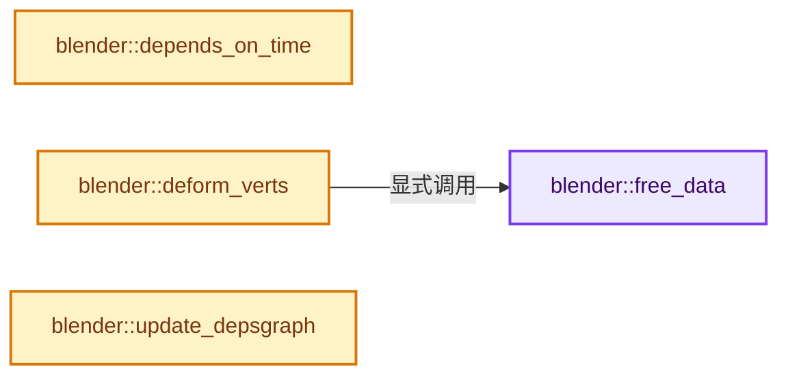
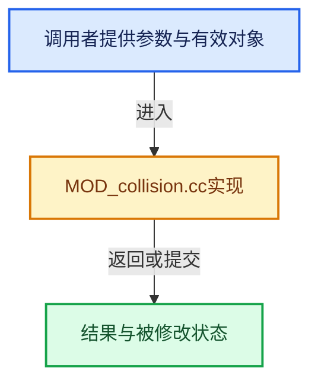

# 实现依赖专题：source/blender/modifiers/intern/MOD_collision.cc

[方向导航](README.md) · [符号索引](../%E7%AC%A6%E5%8F%B7%E4%BE%9D%E8%B5%96%E4%B8%8E%E5%AE%9E%E7%8E%B0%E7%B4%A2%E5%BC%95.md)

本专题从正文实际调用进入，集中保存共享实现。函数有稳定锚点，可从调用处直接跳到对应完整函数；递归与互相调用通过回链组织。

## 本文件的实现关系






## 完整成员与函数实现

<a id="f-fcbe875a78191865"></a>

### `blender::free_data`

实现位置：[source/blender/modifiers/intern/MOD_collision.cc](../../../../../source/blender/modifiers/intern/MOD_collision.cc) · L45—L68。

接口参数：

- `ModifierData *md`

**教学注释版**

<!-- annotated:e5621d344a525c -->

```cpp
static void free_data(ModifierData *md)
{
  CollisionModifierData *collmd = reinterpret_cast<CollisionModifierData *>(md);

  if (collmd) { /* Seriously? */
    if (collmd->bvhtree) {
      BLI_bvhtree_free(collmd->bvhtree);
      collmd->bvhtree = nullptr;
    }

    MEM_SAFE_DELETE(collmd->x);
    MEM_SAFE_DELETE(collmd->xnew);
    MEM_SAFE_DELETE(collmd->current_x);
    MEM_SAFE_DELETE(collmd->current_xnew);
    MEM_SAFE_DELETE(collmd->current_v);

    MEM_SAFE_DELETE(collmd->vert_tris);

    collmd->time_x = collmd->time_xnew = -1000;
    collmd->mvert_num = 0;
    collmd->tri_num = 0;
    collmd->is_static = false;
  }
}
```

<details>
<summary>核对原始源码：source/blender/modifiers/intern/MOD_collision.cc · L45—L68</summary>

<!-- original:e5621d344a525c:source/blender/modifiers/intern/MOD_collision.cc:45:68 -->

```cpp
static void free_data(ModifierData *md)
{
  CollisionModifierData *collmd = reinterpret_cast<CollisionModifierData *>(md);

  if (collmd) { /* Seriously? */
    if (collmd->bvhtree) {
      BLI_bvhtree_free(collmd->bvhtree);
      collmd->bvhtree = nullptr;
    }

    MEM_SAFE_DELETE(collmd->x);
    MEM_SAFE_DELETE(collmd->xnew);
    MEM_SAFE_DELETE(collmd->current_x);
    MEM_SAFE_DELETE(collmd->current_xnew);
    MEM_SAFE_DELETE(collmd->current_v);

    MEM_SAFE_DELETE(collmd->vert_tris);

    collmd->time_x = collmd->time_xnew = -1000;
    collmd->mvert_num = 0;
    collmd->tri_num = 0;
    collmd->is_static = false;
  }
}
```

</details>

**沿实际写入检查状态**

- `collmd->bvhtree = nullptr;`
- `collmd->time_x = collmd->time_xnew = -1000;`
- `collmd->mvert_num = 0;`
- `collmd->tri_num = 0;`
- `collmd->is_static = false;`

**继续追踪实现**

- `BLI_bvhtree_free` → [blender::BLI_bvhtree_free · L935](../12-%E7%A9%BA%E9%97%B4%E6%95%B0%E6%8D%AE%E7%BB%93%E6%9E%84%E4%B8%8E%E5%87%A0%E4%BD%95%E7%AE%97%E6%B3%95/%E4%BE%9D%E8%B5%96-BLI_kdopbvh-9f4bb8.md#f-7dcbdb0a7d2476fe)。
- `MEM_SAFE_DELETE` → [MEM_SAFE_DELETE · L436](../03-%E5%86%85%E5%AD%98%E5%88%86%E9%85%8D%E4%B8%8E%E8%BF%90%E8%A1%8C%E6%97%B6%E7%B1%BB%E5%9E%8B/%E4%BE%9D%E8%B5%96-MEM_guardedalloc-b54eca.md#m-eadb3bc5b902)。宏定义由构建条件选择。

<a id="f-65a0ea2aa8dfffe3"></a>

### `blender::depends_on_time`

实现位置：[source/blender/modifiers/intern/MOD_collision.cc](../../../../../source/blender/modifiers/intern/MOD_collision.cc) · L70—L73。

接口参数：

- `Scene *`
- `ModifierData *`

**教学注释版**

<!-- annotated:644eeecbc98d7d -->

```cpp
static bool depends_on_time(Scene * /*scene*/, ModifierData * /*md*/)
{
  return true;
}
```

<details>
<summary>核对原始源码：source/blender/modifiers/intern/MOD_collision.cc · L70—L73</summary>

<!-- original:644eeecbc98d7d:source/blender/modifiers/intern/MOD_collision.cc:70:73 -->

```cpp
static bool depends_on_time(Scene * /*scene*/, ModifierData * /*md*/)
{
  return true;
}
```

</details>

**结果出口**

- `return true;`

**继续追踪实现**

本实现没有需要继续展开的显式调用；检查返回表达式、对象转换和调用者前置条件。

<a id="f-cef5b0b08bece31a"></a>

### `blender::deform_verts`

实现位置：[source/blender/modifiers/intern/MOD_collision.cc](../../../../../source/blender/modifiers/intern/MOD_collision.cc) · L75—L220。

接口参数：

- `ModifierData *md`
- `const ModifierEvalContext *ctx`
- `Mesh *mesh`
- `MutableSpan<float3> positions`

**教学注释版**

<!-- annotated:0d7cdf1ad65363 -->

```cpp
static void deform_verts(ModifierData *md,
                         const ModifierEvalContext *ctx,
                         Mesh *mesh,
                         MutableSpan<float3> positions)
{
  CollisionModifierData *collmd = reinterpret_cast<CollisionModifierData *>(md);
  Object *ob = ctx->object;

  /* If collision is disabled, free the stale data and exit. */
  if (!ob->pd || !ob->pd->deflect) {
    if (!ob->pd) {
      printf("CollisionModifier: collision settings are missing!\n");
    }

    free_data(md);
    return;
  }

  if (mesh) {
    float current_time = 0;
    int mvert_num = 0;

    mesh->vert_positions_for_write().copy_from(positions);
    mesh->tag_positions_changed();

    current_time = DEG_get_ctime(ctx->depsgraph);

    if (G.debug & G_DEBUG_SIMDATA) {
      printf("current_time %f, collmd->time_xnew %f\n", current_time, collmd->time_xnew);
    }

    mvert_num = mesh->verts_num;

    if (current_time < collmd->time_xnew) {
      free_data(reinterpret_cast<ModifierData *>(collmd));
    }
    else if (current_time == collmd->time_xnew) {
      if (mvert_num != collmd->mvert_num) {
        free_data(reinterpret_cast<ModifierData *>(collmd));
      }
    }

    /* check if mesh has changed */
    if (collmd->x && (mvert_num != collmd->mvert_num)) {
      free_data(reinterpret_cast<ModifierData *>(collmd));
    }

    if (collmd->time_xnew == -1000) { /* first time */

      mvert_num = mesh->verts_num;
      collmd->x = MEM_new_array_uninitialized<float[3]>(size_t(mvert_num), __func__);
      MutableSpan(reinterpret_cast<float3 *>(collmd->x), mvert_num)
          .copy_from(mesh->vert_positions());

      for (uint i = 0; i < mvert_num; i++) {
        /* we save global positions */
        mul_m4_v3(ob->object_to_world().ptr(), collmd->x[i]);
      }

      collmd->xnew = MEM_dupalloc(collmd->x);         /* Frame end position. */
      collmd->current_x = MEM_dupalloc(collmd->x);    /* Inter-frame. */
      collmd->current_xnew = MEM_dupalloc(collmd->x); /* Inter-frame. */
      collmd->current_v = MEM_dupalloc(collmd->x);    /* Inter-frame. */

      collmd->mvert_num = mvert_num;

      {
        const Span<int3> corner_tris = mesh->corner_tris();
        // [讲解] corner_tris.size：查询视图长度或生成对应有效索引区间。
        collmd->tri_num = corner_tris.size();
        int (*vert_tris)[3] = MEM_new_array_uninitialized<int[3]>(collmd->tri_num, __func__);
        bke::mesh::vert_tris_from_corner_tris(
            mesh->corner_verts(),
            corner_tris,
            {reinterpret_cast<int3 *>(vert_tris), collmd->tri_num});
        collmd->vert_tris = vert_tris;
      }

      /* create bounding box hierarchy */
      collmd->bvhtree = bvhtree_build_from_mvert(collmd->x,
                                                 reinterpret_cast<int3 *>(collmd->vert_tris),
                                                 collmd->tri_num,
                                                 ob->pd->pdef_sboft);

      collmd->time_x = collmd->time_xnew = current_time;
      collmd->is_static = true;
    }
    else if (mvert_num == collmd->mvert_num) {
      /* put positions to old positions */
      float (*temp)[3] = collmd->x;
      collmd->x = collmd->xnew;
      collmd->xnew = temp;
      collmd->time_x = collmd->time_xnew;

      // [讲解] memcpy：复制字节，源与目标不应重叠。类型生命周期、对齐和可复制表示须由调用者证明，不是任意对象的复制构造。
      memcpy(collmd->xnew, mesh->vert_positions().data(), mvert_num * sizeof(float[3]));

      bool is_static = true;

      for (uint i = 0; i < mvert_num; i++) {
        /* we save global positions */
        mul_m4_v3(ob->object_to_world().ptr(), collmd->xnew[i]);

        /* detect motion */
        is_static = is_static && equals_v3v3(collmd->x[i], collmd->xnew[i]);
      }

      memcpy(collmd->current_xnew, collmd->x, mvert_num * sizeof(float[3]));
      memcpy(collmd->current_x, collmd->x, mvert_num * sizeof(float[3]));

      /* check if GUI setting has changed for bvh */
      if (collmd->bvhtree) {
        if (ob->pd->pdef_sboft != BLI_bvhtree_get_epsilon(collmd->bvhtree)) {
          BLI_bvhtree_free(collmd->bvhtree);
          collmd->bvhtree = bvhtree_build_from_mvert(
              collmd->current_x,
              reinterpret_cast<const int3 *>(collmd->vert_tris),
              collmd->tri_num,
              ob->pd->pdef_sboft);
        }
      }

      /* Happens on file load (ONLY when I un-comment changes in `readfile.cc`). */
      if (!collmd->bvhtree) {
        collmd->bvhtree = bvhtree_build_from_mvert(
            collmd->current_x,
            reinterpret_cast<const int3 *>(collmd->vert_tris),
            collmd->tri_num,
            ob->pd->pdef_sboft);
      }
      else if (!collmd->is_static || !is_static) {
        /* recalc static bounding boxes */
        bvhtree_update_from_mvert(collmd->bvhtree,
                                  collmd->current_x,
                                  collmd->current_xnew,
                                  reinterpret_cast<const int3 *>(collmd->vert_tris),
                                  collmd->tri_num,
                                  true);
      }

      collmd->is_static = is_static;
      collmd->time_xnew = current_time;
    }
    else if (mvert_num != collmd->mvert_num) {
      free_data(reinterpret_cast<ModifierData *>(collmd));
    }
  }
}
```

<details>
<summary>核对原始源码：source/blender/modifiers/intern/MOD_collision.cc · L75—L220</summary>

<!-- original:0d7cdf1ad65363:source/blender/modifiers/intern/MOD_collision.cc:75:220 -->

```cpp
static void deform_verts(ModifierData *md,
                         const ModifierEvalContext *ctx,
                         Mesh *mesh,
                         MutableSpan<float3> positions)
{
  CollisionModifierData *collmd = reinterpret_cast<CollisionModifierData *>(md);
  Object *ob = ctx->object;

  /* If collision is disabled, free the stale data and exit. */
  if (!ob->pd || !ob->pd->deflect) {
    if (!ob->pd) {
      printf("CollisionModifier: collision settings are missing!\n");
    }

    free_data(md);
    return;
  }

  if (mesh) {
    float current_time = 0;
    int mvert_num = 0;

    mesh->vert_positions_for_write().copy_from(positions);
    mesh->tag_positions_changed();

    current_time = DEG_get_ctime(ctx->depsgraph);

    if (G.debug & G_DEBUG_SIMDATA) {
      printf("current_time %f, collmd->time_xnew %f\n", current_time, collmd->time_xnew);
    }

    mvert_num = mesh->verts_num;

    if (current_time < collmd->time_xnew) {
      free_data(reinterpret_cast<ModifierData *>(collmd));
    }
    else if (current_time == collmd->time_xnew) {
      if (mvert_num != collmd->mvert_num) {
        free_data(reinterpret_cast<ModifierData *>(collmd));
      }
    }

    /* check if mesh has changed */
    if (collmd->x && (mvert_num != collmd->mvert_num)) {
      free_data(reinterpret_cast<ModifierData *>(collmd));
    }

    if (collmd->time_xnew == -1000) { /* first time */

      mvert_num = mesh->verts_num;
      collmd->x = MEM_new_array_uninitialized<float[3]>(size_t(mvert_num), __func__);
      MutableSpan(reinterpret_cast<float3 *>(collmd->x), mvert_num)
          .copy_from(mesh->vert_positions());

      for (uint i = 0; i < mvert_num; i++) {
        /* we save global positions */
        mul_m4_v3(ob->object_to_world().ptr(), collmd->x[i]);
      }

      collmd->xnew = MEM_dupalloc(collmd->x);         /* Frame end position. */
      collmd->current_x = MEM_dupalloc(collmd->x);    /* Inter-frame. */
      collmd->current_xnew = MEM_dupalloc(collmd->x); /* Inter-frame. */
      collmd->current_v = MEM_dupalloc(collmd->x);    /* Inter-frame. */

      collmd->mvert_num = mvert_num;

      {
        const Span<int3> corner_tris = mesh->corner_tris();
        collmd->tri_num = corner_tris.size();
        int (*vert_tris)[3] = MEM_new_array_uninitialized<int[3]>(collmd->tri_num, __func__);
        bke::mesh::vert_tris_from_corner_tris(
            mesh->corner_verts(),
            corner_tris,
            {reinterpret_cast<int3 *>(vert_tris), collmd->tri_num});
        collmd->vert_tris = vert_tris;
      }

      /* create bounding box hierarchy */
      collmd->bvhtree = bvhtree_build_from_mvert(collmd->x,
                                                 reinterpret_cast<int3 *>(collmd->vert_tris),
                                                 collmd->tri_num,
                                                 ob->pd->pdef_sboft);

      collmd->time_x = collmd->time_xnew = current_time;
      collmd->is_static = true;
    }
    else if (mvert_num == collmd->mvert_num) {
      /* put positions to old positions */
      float (*temp)[3] = collmd->x;
      collmd->x = collmd->xnew;
      collmd->xnew = temp;
      collmd->time_x = collmd->time_xnew;

      memcpy(collmd->xnew, mesh->vert_positions().data(), mvert_num * sizeof(float[3]));

      bool is_static = true;

      for (uint i = 0; i < mvert_num; i++) {
        /* we save global positions */
        mul_m4_v3(ob->object_to_world().ptr(), collmd->xnew[i]);

        /* detect motion */
        is_static = is_static && equals_v3v3(collmd->x[i], collmd->xnew[i]);
      }

      memcpy(collmd->current_xnew, collmd->x, mvert_num * sizeof(float[3]));
      memcpy(collmd->current_x, collmd->x, mvert_num * sizeof(float[3]));

      /* check if GUI setting has changed for bvh */
      if (collmd->bvhtree) {
        if (ob->pd->pdef_sboft != BLI_bvhtree_get_epsilon(collmd->bvhtree)) {
          BLI_bvhtree_free(collmd->bvhtree);
          collmd->bvhtree = bvhtree_build_from_mvert(
              collmd->current_x,
              reinterpret_cast<const int3 *>(collmd->vert_tris),
              collmd->tri_num,
              ob->pd->pdef_sboft);
        }
      }

      /* Happens on file load (ONLY when I un-comment changes in `readfile.cc`). */
      if (!collmd->bvhtree) {
        collmd->bvhtree = bvhtree_build_from_mvert(
            collmd->current_x,
            reinterpret_cast<const int3 *>(collmd->vert_tris),
            collmd->tri_num,
            ob->pd->pdef_sboft);
      }
      else if (!collmd->is_static || !is_static) {
        /* recalc static bounding boxes */
        bvhtree_update_from_mvert(collmd->bvhtree,
                                  collmd->current_x,
                                  collmd->current_xnew,
                                  reinterpret_cast<const int3 *>(collmd->vert_tris),
                                  collmd->tri_num,
                                  true);
      }

      collmd->is_static = is_static;
      collmd->time_xnew = current_time;
    }
    else if (mvert_num != collmd->mvert_num) {
      free_data(reinterpret_cast<ModifierData *>(collmd));
    }
  }
}
```

</details>

**沿实际写入检查状态**

- `current_time = DEG_get_ctime(ctx->depsgraph);`
- `mvert_num = mesh->verts_num;`
- `collmd->x = MEM_new_array_uninitialized<float[3]>(size_t(mvert_num), __func__);`
- `collmd->xnew = MEM_dupalloc(collmd->x);         /* Frame end position. */`
- `collmd->current_x = MEM_dupalloc(collmd->x);    /* Inter-frame. */`
- `collmd->current_xnew = MEM_dupalloc(collmd->x); /* Inter-frame. */`
- `collmd->current_v = MEM_dupalloc(collmd->x);    /* Inter-frame. */`
- `collmd->mvert_num = mvert_num;`
- `collmd->tri_num = corner_tris.size();`
- `collmd->vert_tris = vert_tris;`
- `collmd->bvhtree = bvhtree_build_from_mvert(collmd->x,`
- `collmd->time_x = collmd->time_xnew = current_time;`
- `collmd->is_static = true;`
- `collmd->x = collmd->xnew;`
- `collmd->xnew = temp;`
- `collmd->time_x = collmd->time_xnew;`
- `is_static = is_static && equals_v3v3(collmd->x[i], collmd->xnew[i]);`
- `collmd->bvhtree = bvhtree_build_from_mvert(`
- `collmd->is_static = is_static;`
- `collmd->time_xnew = current_time;`

**继续追踪实现**

- `printf` → [外部契约](https://eel.is/c++draft/)：这个边界按实际表达式及所属类型核对参数、返回值、寿命与失败行为。这里提供接口入口，不声称已解释该第三方版本的内部实现。
- `free_data` → [blender::free_data · L45](%E4%BE%9D%E8%B5%96-MOD_collision-49ad1c.md#f-fcbe875a78191865)。
- `mesh->vert_positions_for_write().copy_from` → [调用协议](../%E6%A8%A1%E6%9D%BF%E5%AE%8F%E4%B8%8E%E5%8A%A8%E6%80%81%E5%88%86%E6%B4%BE%E5%8D%8F%E8%AE%AE.md)：接收对象类型依赖auto、返回值或模板实例；不按同名猜测目标。调用位置L97。
- `mesh->vert_positions_for_write` → [Mesh::vert_positions_for_write · L1199](03-MPoly%E8%BF%81%E7%A7%BB%E4%B8%8E%E5%85%BC%E5%AE%B9.md#f-ae8d77205112d843)。
- `mesh->tag_positions_changed` → [blender::Mesh::tag_positions_changed · L407](../06-%E9%9A%90%E5%BC%8F%E5%85%B1%E4%BA%AB%E4%B8%8E%E7%BC%93%E5%AD%98%E7%B3%BB%E7%BB%9F/10-%E5%B1%80%E9%83%A8%E6%9B%B4%E6%96%B0%E4%B8%8E%E5%A4%B1%E6%95%88%E4%BF%AE%E5%A4%8D.md#f-90e852663d44ad53)。
- `DEG_get_ctime` → [blender::DEG_get_ctime · L105](../11-Depsgraph%E4%B8%8E%E5%B9%B6%E8%A1%8C%E4%BB%BB%E5%8A%A1%E7%B3%BB%E7%BB%9F/%E4%BE%9D%E8%B5%96-depsgraph_query-e8b1e4.md#f-156dee0918a22f2f)。
- `MEM_new_array_uninitialized<float[3]>` → [MEM_new_array_uninitialized · L608](../03-%E5%86%85%E5%AD%98%E5%88%86%E9%85%8D%E4%B8%8E%E8%BF%90%E8%A1%8C%E6%97%B6%E7%B1%BB%E5%9E%8B/%E4%BE%9D%E8%B5%96-MEM_guardedalloc-b54eca.md#f-b7103eae8eb57b05)；[MEM_new_array_uninitialized · L129](../03-%E5%86%85%E5%AD%98%E5%88%86%E9%85%8D%E4%B8%8E%E8%BF%90%E8%A1%8C%E6%97%B6%E7%B1%BB%E5%9E%8B/%E4%BE%9D%E8%B5%96-mallocn-afdcd4.md#f-bf6ef4ddcfb6e5df)。同名重载需按实参类型选择。
- `MutableSpan(reinterpret_cast<float3 *>(collmd->x), mvert_num) .copy_from` → [调用协议](../%E6%A8%A1%E6%9D%BF%E5%AE%8F%E4%B8%8E%E5%8A%A8%E6%80%81%E5%88%86%E6%B4%BE%E5%8D%8F%E8%AE%AE.md)：接收对象类型依赖auto、返回值或模板实例；不按同名猜测目标。调用位置L126。
- `MutableSpan` → [blender::MutableSpan::MutableSpan · L462](../01-%E5%9F%BA%E7%A1%80%E5%AE%B9%E5%99%A8%E4%B8%8E%E7%8E%B0%E4%BB%A3CPP/06-MutableSpan%E5%8F%AF%E5%86%99%E8%A7%86%E5%9B%BE.md#f-0f07034aaffc3384)；[blender::MutableSpan::MutableSpan · L464](../01-%E5%9F%BA%E7%A1%80%E5%AE%B9%E5%99%A8%E4%B8%8E%E7%8E%B0%E4%BB%A3CPP/06-MutableSpan%E5%8F%AF%E5%86%99%E8%A7%86%E5%9B%BE.md#f-39977234ad0ce192)；[blender::MutableSpan::MutableSpan · L466](../01-%E5%9F%BA%E7%A1%80%E5%AE%B9%E5%99%A8%E4%B8%8E%E7%8E%B0%E4%BB%A3CPP/06-MutableSpan%E5%8F%AF%E5%86%99%E8%A7%86%E5%9B%BE.md#f-ee249b5042dd38aa)；[blender::MutableSpan::MutableSpan · L468](../01-%E5%9F%BA%E7%A1%80%E5%AE%B9%E5%99%A8%E4%B8%8E%E7%8E%B0%E4%BB%A3CPP/06-MutableSpan%E5%8F%AF%E5%86%99%E8%A7%86%E5%9B%BE.md#f-479c5f85921e531f)；[blender::MutableSpan::MutableSpan · L477](../01-%E5%9F%BA%E7%A1%80%E5%AE%B9%E5%99%A8%E4%B8%8E%E7%8E%B0%E4%BB%A3CPP/06-MutableSpan%E5%8F%AF%E5%86%99%E8%A7%86%E5%9B%BE.md#f-afcce5325e6f19e0)。同名重载需按实参类型选择。
- `mesh->vert_positions` → [Mesh::vert_positions · L1193](03-MPoly%E8%BF%81%E7%A7%BB%E4%B8%8E%E5%85%BC%E5%AE%B9.md#f-ae4177e5c5f2b371)。
- `mul_m4_v3` → [blender::mul_m4_v3 · L677](../12-%E7%A9%BA%E9%97%B4%E6%95%B0%E6%8D%AE%E7%BB%93%E6%9E%84%E4%B8%8E%E5%87%A0%E4%BD%95%E7%AE%97%E6%B3%95/%E4%BE%9D%E8%B5%96-math_matrix_c-004123.md#f-14a8c267710d47a3)。
- `ob->object_to_world().ptr` → [调用协议](../%E6%A8%A1%E6%9D%BF%E5%AE%8F%E4%B8%8E%E5%8A%A8%E6%80%81%E5%88%86%E6%B4%BE%E5%8D%8F%E8%AE%AE.md)：接收对象类型依赖auto、返回值或模板实例；不按同名猜测目标。调用位置L131。
- `ob->object_to_world` → [blender::Object::object_to_world · L5761](%E4%BE%9D%E8%B5%96-object-843689.md#f-12fc20026327d50c)。
- `MEM_dupalloc` → [MEM_dupalloc · L627](../03-%E5%86%85%E5%AD%98%E5%88%86%E9%85%8D%E4%B8%8E%E8%BF%90%E8%A1%8C%E6%97%B6%E7%B1%BB%E5%9E%8B/%E4%BE%9D%E8%B5%96-MEM_guardedalloc-b54eca.md#f-78a72b71e3c57010)。
- `mesh->corner_tris` → [blender::Mesh::corner_tris · L264](../06-%E9%9A%90%E5%BC%8F%E5%85%B1%E4%BA%AB%E4%B8%8E%E7%BC%93%E5%AD%98%E7%B3%BB%E7%BB%9F/10-%E5%B1%80%E9%83%A8%E6%9B%B4%E6%96%B0%E4%B8%8E%E5%A4%B1%E6%95%88%E4%BF%AE%E5%A4%8D.md#f-9bb421790000fc20)。
- `corner_tris.size` → [blender::Span::size · L256](../01-%E5%9F%BA%E7%A1%80%E5%AE%B9%E5%99%A8%E4%B8%8E%E7%8E%B0%E4%BB%A3CPP/05-Span%E5%8F%AA%E8%AF%BB%E8%BF%9E%E7%BB%AD%E8%A7%86%E5%9B%BE.md#f-5f80fa006089c998)。
- `MEM_new_array_uninitialized<int[3]>` → [MEM_new_array_uninitialized · L608](../03-%E5%86%85%E5%AD%98%E5%88%86%E9%85%8D%E4%B8%8E%E8%BF%90%E8%A1%8C%E6%97%B6%E7%B1%BB%E5%9E%8B/%E4%BE%9D%E8%B5%96-MEM_guardedalloc-b54eca.md#f-b7103eae8eb57b05)；[MEM_new_array_uninitialized · L129](../03-%E5%86%85%E5%AD%98%E5%88%86%E9%85%8D%E4%B8%8E%E8%BF%90%E8%A1%8C%E6%97%B6%E7%B1%BB%E5%9E%8B/%E4%BE%9D%E8%B5%96-mallocn-afdcd4.md#f-bf6ef4ddcfb6e5df)。同名重载需按实参类型选择。
- `bke::mesh::vert_tris_from_corner_tris` → [blender::bke::mesh::vert_tris_from_corner_tris · L238](%E4%BE%9D%E8%B5%96-mesh_tessellate-a0d323.md#f-148011c2040a8b1e)。
- `mesh->corner_verts` → [Mesh::corner_verts · L1238](03-MPoly%E8%BF%81%E7%A7%BB%E4%B8%8E%E5%85%BC%E5%AE%B9.md#f-a59c61f583b64bc4)。
- `bvhtree_build_from_mvert` → [blender::bvhtree_build_from_mvert · L92](%E4%BE%9D%E8%B5%96-collision-f2e5c0.md#f-22a69c1c8a174747)。
- `memcpy` → [外部契约](https://eel.is/c++draft/cstring.syn)：复制字节，源与目标不应重叠。类型生命周期、对齐和可复制表示须由调用者证明，不是任意对象的复制构造。
- `mesh->vert_positions().data` → [调用协议](../%E6%A8%A1%E6%9D%BF%E5%AE%8F%E4%B8%8E%E5%8A%A8%E6%80%81%E5%88%86%E6%B4%BE%E5%8D%8F%E8%AE%AE.md)：接收对象类型依赖auto、返回值或模板实例；不按同名猜测目标。调用位置L168。
- `equals_v3v3` → [blender::equals_v3v3 · L1006](../12-%E7%A9%BA%E9%97%B4%E6%95%B0%E6%8D%AE%E7%BB%93%E6%9E%84%E4%B8%8E%E5%87%A0%E4%BD%95%E7%AE%97%E6%B3%95/%E4%BE%9D%E8%B5%96-math_vector_inline-0c8541.md#f-f49aac9436333b4a)。
- `BLI_bvhtree_get_epsilon` → [blender::BLI_bvhtree_get_epsilon · L1053](../12-%E7%A9%BA%E9%97%B4%E6%95%B0%E6%8D%AE%E7%BB%93%E6%9E%84%E4%B8%8E%E5%87%A0%E4%BD%95%E7%AE%97%E6%B3%95/%E4%BE%9D%E8%B5%96-BLI_kdopbvh-9f4bb8.md#f-65fb6578a78d4c5b)。
- `BLI_bvhtree_free` → [blender::BLI_bvhtree_free · L935](../12-%E7%A9%BA%E9%97%B4%E6%95%B0%E6%8D%AE%E7%BB%93%E6%9E%84%E4%B8%8E%E5%87%A0%E4%BD%95%E7%AE%97%E6%B3%95/%E4%BE%9D%E8%B5%96-BLI_kdopbvh-9f4bb8.md#f-7dcbdb0a7d2476fe)。
- `bvhtree_update_from_mvert` → [blender::bvhtree_update_from_mvert · L116](%E4%BE%9D%E8%B5%96-collision-f2e5c0.md#f-6ac2b21f6e781ee3)。

<a id="f-9ccfa258531f3b93"></a>

### `blender::update_depsgraph`

实现位置：[source/blender/modifiers/intern/MOD_collision.cc](../../../../../source/blender/modifiers/intern/MOD_collision.cc) · L222—L225。

接口参数：

- `ModifierData *`
- `const ModifierUpdateDepsgraphContext *ctx`

**教学注释版**

<!-- annotated:bc1d6eb04e6343 -->

```cpp
static void update_depsgraph(ModifierData * /*md*/, const ModifierUpdateDepsgraphContext *ctx)
{
  DEG_add_depends_on_transform_relation(ctx->node, "Collision Modifier");
}
```

<details>
<summary>核对原始源码：source/blender/modifiers/intern/MOD_collision.cc · L222—L225</summary>

<!-- original:bc1d6eb04e6343:source/blender/modifiers/intern/MOD_collision.cc:222:225 -->

```cpp
static void update_depsgraph(ModifierData * /*md*/, const ModifierUpdateDepsgraphContext *ctx)
{
  DEG_add_depends_on_transform_relation(ctx->node, "Collision Modifier");
}
```

</details>

**继续追踪实现**

- `DEG_add_depends_on_transform_relation` → [blender::DEG_add_depends_on_transform_relation · L240](../11-Depsgraph%E4%B8%8E%E5%B9%B6%E8%A1%8C%E4%BB%BB%E5%8A%A1%E7%B3%BB%E7%BB%9F/%E4%BE%9D%E8%B5%96-depsgraph_build-ea2fc8.md#f-47c32a354defa20d)。
