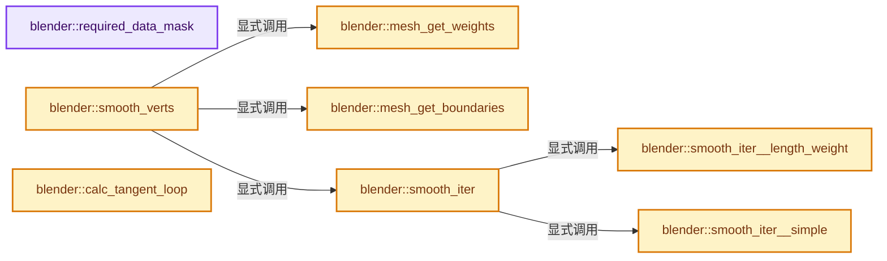
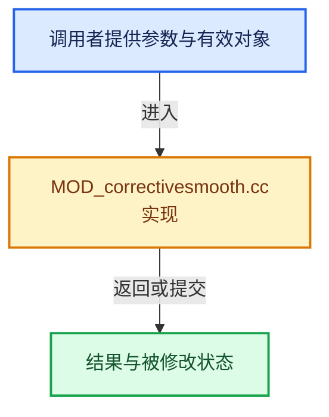

# 实现依赖专题：source/blender/modifiers/intern/MOD_correctivesmooth.cc

[方向导航](README.md) · [符号索引](../%E7%AC%A6%E5%8F%B7%E4%BE%9D%E8%B5%96%E4%B8%8E%E5%AE%9E%E7%8E%B0%E7%B4%A2%E5%BC%95.md)

本专题从正文实际调用进入，集中保存共享实现。函数有稳定锚点，可从调用处直接跳到对应完整函数；递归与互相调用通过回链组织。

## 本文件的实现关系






## 完整成员与函数实现

<a id="f-7c6295d211715e0d"></a>

### `blender::required_data_mask`

实现位置：[source/blender/modifiers/intern/MOD_correctivesmooth.cc](../../../../../source/blender/modifiers/intern/MOD_correctivesmooth.cc) · L95—L103。

接口参数：

- `ModifierData *md`
- `CustomData_MeshMasks *r_cddata_masks`

**教学注释版**

<!-- annotated:371cec6f228182 -->

```cpp
static void required_data_mask(ModifierData *md, CustomData_MeshMasks *r_cddata_masks)
{
  CorrectiveSmoothModifierData *csmd = reinterpret_cast<CorrectiveSmoothModifierData *>(md);

  /* ask for vertex groups if we need them */
  if (csmd->defgrp_name[0] != '\0') {
    r_cddata_masks->vmask |= CD_MASK_MDEFORMVERT;
  }
}
```

<details>
<summary>核对原始源码：source/blender/modifiers/intern/MOD_correctivesmooth.cc · L95—L103</summary>

<!-- original:371cec6f228182:source/blender/modifiers/intern/MOD_correctivesmooth.cc:95:103 -->

```cpp
static void required_data_mask(ModifierData *md, CustomData_MeshMasks *r_cddata_masks)
{
  CorrectiveSmoothModifierData *csmd = reinterpret_cast<CorrectiveSmoothModifierData *>(md);

  /* ask for vertex groups if we need them */
  if (csmd->defgrp_name[0] != '\0') {
    r_cddata_masks->vmask |= CD_MASK_MDEFORMVERT;
  }
}
```

</details>

**沿实际写入检查状态**

- `r_cddata_masks->vmask |= CD_MASK_MDEFORMVERT;`

**继续追踪实现**

本实现没有需要继续展开的显式调用；检查返回表达式、对象转换和调用者前置条件。

<a id="f-46bae8998e142946"></a>

### `blender::mesh_get_weights`

实现位置：[source/blender/modifiers/intern/MOD_correctivesmooth.cc](../../../../../source/blender/modifiers/intern/MOD_correctivesmooth.cc) · L106—L124。

接口参数：

- `const MDeformVert *dvert`
- `const int defgrp_index`
- `const uint verts_num`
- `const bool use_invert_vgroup`
- `float *smooth_weights`

**教学注释版**

<!-- annotated:c708d726f4296a -->

```cpp
static void mesh_get_weights(const MDeformVert *dvert,
                             const int defgrp_index,
                             const uint verts_num,
                             const bool use_invert_vgroup,
                             float *smooth_weights)
{
  uint i;

  for (i = 0; i < verts_num; i++, dvert++) {
    const float w = BKE_defvert_find_weight(dvert, defgrp_index);

    if (use_invert_vgroup == false) {
      smooth_weights[i] = w;
    }
    else {
      smooth_weights[i] = 1.0f - w;
    }
  }
}
```

<details>
<summary>核对原始源码：source/blender/modifiers/intern/MOD_correctivesmooth.cc · L106—L124</summary>

<!-- original:c708d726f4296a:source/blender/modifiers/intern/MOD_correctivesmooth.cc:106:124 -->

```cpp
static void mesh_get_weights(const MDeformVert *dvert,
                             const int defgrp_index,
                             const uint verts_num,
                             const bool use_invert_vgroup,
                             float *smooth_weights)
{
  uint i;

  for (i = 0; i < verts_num; i++, dvert++) {
    const float w = BKE_defvert_find_weight(dvert, defgrp_index);

    if (use_invert_vgroup == false) {
      smooth_weights[i] = w;
    }
    else {
      smooth_weights[i] = 1.0f - w;
    }
  }
}
```

</details>

**沿实际写入检查状态**

- `smooth_weights[i] = w;`
- `smooth_weights[i] = 1.0f - w;`

**继续追踪实现**

- `BKE_defvert_find_weight` → [blender::BKE_defvert_find_weight · L779](%E4%BE%9D%E8%B5%96-deform-6949f4.md#f-c117fcd05c4fd453)。

<a id="f-55fb58c42c080a19"></a>

### `blender::mesh_get_boundaries`

实现位置：[source/blender/modifiers/intern/MOD_correctivesmooth.cc](../../../../../source/blender/modifiers/intern/MOD_correctivesmooth.cc) · L126—L150。

接口参数：

- `Mesh *mesh`
- `float *smooth_weights`

**教学注释版**

<!-- annotated:4ed70f6b6e630e -->

```cpp
static void mesh_get_boundaries(Mesh *mesh, float *smooth_weights)
{
  const Span<int2> edges = mesh->edges();
  const OffsetIndices faces = mesh->faces();
  const Span<int> corner_edges = mesh->corner_edges();

  /* Flag boundary edges so only boundaries are set to 1. */
  // [讲解] edges.size：查询视图长度或生成对应有效索引区间。
  uint8_t *boundaries = MEM_new_array_zeroed<uint8_t>(size_t(edges.size()), __func__);

  for (const int64_t i : faces.index_range()) {
    // [讲解] corner_edges.slice：建立原连续范围的子视图。
    for (const int edge : corner_edges.slice(faces[i])) {
      uint8_t *e_value = &boundaries[edge];
      *e_value |= uint8_t((*e_value) + 1);
    }
  }

  // [讲解] edges.index_range：查询视图长度或生成对应有效索引区间。
  for (const int64_t i : edges.index_range()) {
    if (boundaries[i] == 1) {
      smooth_weights[edges[i][0]] = 0.0f;
      smooth_weights[edges[i][1]] = 0.0f;
    }
  }

  MEM_delete(boundaries);
}
```

<details>
<summary>核对原始源码：source/blender/modifiers/intern/MOD_correctivesmooth.cc · L126—L150</summary>

<!-- original:4ed70f6b6e630e:source/blender/modifiers/intern/MOD_correctivesmooth.cc:126:150 -->

```cpp
static void mesh_get_boundaries(Mesh *mesh, float *smooth_weights)
{
  const Span<int2> edges = mesh->edges();
  const OffsetIndices faces = mesh->faces();
  const Span<int> corner_edges = mesh->corner_edges();

  /* Flag boundary edges so only boundaries are set to 1. */
  uint8_t *boundaries = MEM_new_array_zeroed<uint8_t>(size_t(edges.size()), __func__);

  for (const int64_t i : faces.index_range()) {
    for (const int edge : corner_edges.slice(faces[i])) {
      uint8_t *e_value = &boundaries[edge];
      *e_value |= uint8_t((*e_value) + 1);
    }
  }

  for (const int64_t i : edges.index_range()) {
    if (boundaries[i] == 1) {
      smooth_weights[edges[i][0]] = 0.0f;
      smooth_weights[edges[i][1]] = 0.0f;
    }
  }

  MEM_delete(boundaries);
}
```

</details>

**沿实际写入检查状态**

- `smooth_weights[edges[i][0]] = 0.0f;`
- `smooth_weights[edges[i][1]] = 0.0f;`

**继续追踪实现**

- `mesh->edges` → [Mesh::edges · L1205](03-MPoly%E8%BF%81%E7%A7%BB%E4%B8%8E%E5%85%BC%E5%AE%B9.md#f-7232f6756b674d12)。
- `mesh->faces` → [Mesh::faces · L1217](03-MPoly%E8%BF%81%E7%A7%BB%E4%B8%8E%E5%85%BC%E5%AE%B9.md#f-ea444760154e17b2)。
- `mesh->corner_edges` → [Mesh::corner_edges · L1252](03-MPoly%E8%BF%81%E7%A7%BB%E4%B8%8E%E5%85%BC%E5%AE%B9.md#f-687b790868e7f257)。
- `MEM_new_array_zeroed<uint8_t>` → [MEM_new_array_zeroed · L566](../03-%E5%86%85%E5%AD%98%E5%88%86%E9%85%8D%E4%B8%8E%E8%BF%90%E8%A1%8C%E6%97%B6%E7%B1%BB%E5%9E%8B/%E4%BE%9D%E8%B5%96-MEM_guardedalloc-b54eca.md#f-3a0cf63fb5216500)；[MEM_new_array_zeroed · L119](../03-%E5%86%85%E5%AD%98%E5%88%86%E9%85%8D%E4%B8%8E%E8%BF%90%E8%A1%8C%E6%97%B6%E7%B1%BB%E5%9E%8B/%E4%BE%9D%E8%B5%96-mallocn-afdcd4.md#f-6825557da566fdbe)。同名重载需按实参类型选择。
- `edges.size` → [blender::Span::size · L256](../01-%E5%9F%BA%E7%A1%80%E5%AE%B9%E5%99%A8%E4%B8%8E%E7%8E%B0%E4%BB%A3CPP/05-Span%E5%8F%AA%E8%AF%BB%E8%BF%9E%E7%BB%AD%E8%A7%86%E5%9B%BE.md#f-5f80fa006089c998)。
- `faces.index_range` → [blender::offset_indices::OffsetIndices::index_range · L77](02-OffsetIndices%E5%AE%8C%E6%95%B4%E6%8E%A5%E5%8F%A3.md#f-19b5ca1456de007d)。
- `corner_edges.slice` → [blender::Span::slice · L141](../01-%E5%9F%BA%E7%A1%80%E5%AE%B9%E5%99%A8%E4%B8%8E%E7%8E%B0%E4%BB%A3CPP/05-Span%E5%8F%AA%E8%AF%BB%E8%BF%9E%E7%BB%AD%E8%A7%86%E5%9B%BE.md#f-380a0e8fdcbd53cc)；[blender::Span::slice · L149](../01-%E5%9F%BA%E7%A1%80%E5%AE%B9%E5%99%A8%E4%B8%8E%E7%8E%B0%E4%BB%A3CPP/05-Span%E5%8F%AA%E8%AF%BB%E8%BF%9E%E7%BB%AD%E8%A7%86%E5%9B%BE.md#f-9b9c15e78dd54eec)。同名重载需按实参类型选择。
- `edges.index_range` → [blender::Span::index_range · L405](../01-%E5%9F%BA%E7%A1%80%E5%AE%B9%E5%99%A8%E4%B8%8E%E7%8E%B0%E4%BB%A3CPP/05-Span%E5%8F%AA%E8%AF%BB%E8%BF%9E%E7%BB%AD%E8%A7%86%E5%9B%BE.md#f-caaa9b06e13e53e0)。
- `MEM_delete` → [MEM_delete · L400](../03-%E5%86%85%E5%AD%98%E5%88%86%E9%85%8D%E4%B8%8E%E8%BF%90%E8%A1%8C%E6%97%B6%E7%B1%BB%E5%9E%8B/%E4%BE%9D%E8%B5%96-MEM_guardedalloc-b54eca.md#f-9049ffdd1682887c)。

<a id="f-64e49754125c2e5c"></a>

### `blender::smooth_iter__simple`

实现位置：[source/blender/modifiers/intern/MOD_correctivesmooth.cc](../../../../../source/blender/modifiers/intern/MOD_correctivesmooth.cc) · L157—L228。

接口参数：

- `CorrectiveSmoothModifierData *csmd`
- `Mesh *mesh`
- `MutableSpan<float3> vertexCos`
- `const float *smooth_weights`
- `uint iterations`

**教学注释版**

<!-- annotated:b1baf459959aaf -->

```cpp
static void smooth_iter__simple(CorrectiveSmoothModifierData *csmd,
                                Mesh *mesh,
                                MutableSpan<float3> vertexCos,
                                const float *smooth_weights,
                                uint iterations)
{
  const float lambda = csmd->lambda;
  int i;

  const int edges_num = mesh->edges_num;
  const Span<int2> edges = mesh->edges();

  struct SmoothingData_Simple {
    float delta[3];
  };
  SmoothingData_Simple *smooth_data = MEM_new_array_zeroed<SmoothingData_Simple>(
      // [讲解] vertexCos.size：查询视图长度或生成对应有效索引区间。
      size_t(vertexCos.size()), __func__);

  float *vertex_edge_count_div = MEM_new_array_zeroed<float>(size_t(vertexCos.size()), __func__);

  /* calculate as floats to avoid int->float conversion in #smooth_iter */
  for (i = 0; i < edges_num; i++) {
    vertex_edge_count_div[edges[i][0]] += 1.0f;
    vertex_edge_count_div[edges[i][1]] += 1.0f;
  }

  /* a little confusing, but we can include 'lambda' and smoothing weight
   * here to avoid multiplying for every iteration */
  if (smooth_weights == nullptr) {
    for (i = 0; i < vertexCos.size(); i++) {
      vertex_edge_count_div[i] = lambda * (vertex_edge_count_div[i] ?
                                               (1.0f / vertex_edge_count_div[i]) :
                                               1.0f);
    }
  }
  else {
    for (i = 0; i < vertexCos.size(); i++) {
      vertex_edge_count_div[i] = smooth_weights[i] * lambda *
                                 (vertex_edge_count_div[i] ? (1.0f / vertex_edge_count_div[i]) :
                                                             1.0f);
    }
  }

  /* -------------------------------------------------------------------- */
  /* Main Smoothing Loop */

  while (iterations--) {
    for (i = 0; i < edges_num; i++) {
      SmoothingData_Simple *sd_v1;
      SmoothingData_Simple *sd_v2;
      float edge_dir[3];

      sub_v3_v3v3(edge_dir, vertexCos[edges[i][1]], vertexCos[edges[i][0]]);

      sd_v1 = &smooth_data[edges[i][0]];
      sd_v2 = &smooth_data[edges[i][1]];

      add_v3_v3(sd_v1->delta, edge_dir);
      sub_v3_v3(sd_v2->delta, edge_dir);
    }

    for (i = 0; i < vertexCos.size(); i++) {
      SmoothingData_Simple *sd = &smooth_data[i];
      madd_v3_v3fl(vertexCos[i], sd->delta, vertex_edge_count_div[i]);
      /* zero for the next iteration (saves memset on entire array) */
      // [讲解] memset：填充字节，不调用T构造函数，也不保证任意类型的全零表示是合法或期望值。
      memset(sd, 0, sizeof(*sd));
    }
  }

  MEM_delete(vertex_edge_count_div);
  MEM_delete(smooth_data);
}
```

<details>
<summary>核对原始源码：source/blender/modifiers/intern/MOD_correctivesmooth.cc · L157—L228</summary>

<!-- original:b1baf459959aaf:source/blender/modifiers/intern/MOD_correctivesmooth.cc:157:228 -->

```cpp
static void smooth_iter__simple(CorrectiveSmoothModifierData *csmd,
                                Mesh *mesh,
                                MutableSpan<float3> vertexCos,
                                const float *smooth_weights,
                                uint iterations)
{
  const float lambda = csmd->lambda;
  int i;

  const int edges_num = mesh->edges_num;
  const Span<int2> edges = mesh->edges();

  struct SmoothingData_Simple {
    float delta[3];
  };
  SmoothingData_Simple *smooth_data = MEM_new_array_zeroed<SmoothingData_Simple>(
      size_t(vertexCos.size()), __func__);

  float *vertex_edge_count_div = MEM_new_array_zeroed<float>(size_t(vertexCos.size()), __func__);

  /* calculate as floats to avoid int->float conversion in #smooth_iter */
  for (i = 0; i < edges_num; i++) {
    vertex_edge_count_div[edges[i][0]] += 1.0f;
    vertex_edge_count_div[edges[i][1]] += 1.0f;
  }

  /* a little confusing, but we can include 'lambda' and smoothing weight
   * here to avoid multiplying for every iteration */
  if (smooth_weights == nullptr) {
    for (i = 0; i < vertexCos.size(); i++) {
      vertex_edge_count_div[i] = lambda * (vertex_edge_count_div[i] ?
                                               (1.0f / vertex_edge_count_div[i]) :
                                               1.0f);
    }
  }
  else {
    for (i = 0; i < vertexCos.size(); i++) {
      vertex_edge_count_div[i] = smooth_weights[i] * lambda *
                                 (vertex_edge_count_div[i] ? (1.0f / vertex_edge_count_div[i]) :
                                                             1.0f);
    }
  }

  /* -------------------------------------------------------------------- */
  /* Main Smoothing Loop */

  while (iterations--) {
    for (i = 0; i < edges_num; i++) {
      SmoothingData_Simple *sd_v1;
      SmoothingData_Simple *sd_v2;
      float edge_dir[3];

      sub_v3_v3v3(edge_dir, vertexCos[edges[i][1]], vertexCos[edges[i][0]]);

      sd_v1 = &smooth_data[edges[i][0]];
      sd_v2 = &smooth_data[edges[i][1]];

      add_v3_v3(sd_v1->delta, edge_dir);
      sub_v3_v3(sd_v2->delta, edge_dir);
    }

    for (i = 0; i < vertexCos.size(); i++) {
      SmoothingData_Simple *sd = &smooth_data[i];
      madd_v3_v3fl(vertexCos[i], sd->delta, vertex_edge_count_div[i]);
      /* zero for the next iteration (saves memset on entire array) */
      memset(sd, 0, sizeof(*sd));
    }
  }

  MEM_delete(vertex_edge_count_div);
  MEM_delete(smooth_data);
}
```

</details>

**沿实际写入检查状态**

- `vertex_edge_count_div[edges[i][0]] += 1.0f;`
- `vertex_edge_count_div[edges[i][1]] += 1.0f;`
- `vertex_edge_count_div[i] = lambda * (vertex_edge_count_div[i] ?`
- `vertex_edge_count_div[i] = smooth_weights[i] * lambda *`
- `sd_v1 = &smooth_data[edges[i][0]];`
- `sd_v2 = &smooth_data[edges[i][1]];`

**继续追踪实现**

- `mesh->edges` → [Mesh::edges · L1205](03-MPoly%E8%BF%81%E7%A7%BB%E4%B8%8E%E5%85%BC%E5%AE%B9.md#f-7232f6756b674d12)。
- `MEM_new_array_zeroed<SmoothingData_Simple>` → [MEM_new_array_zeroed · L566](../03-%E5%86%85%E5%AD%98%E5%88%86%E9%85%8D%E4%B8%8E%E8%BF%90%E8%A1%8C%E6%97%B6%E7%B1%BB%E5%9E%8B/%E4%BE%9D%E8%B5%96-MEM_guardedalloc-b54eca.md#f-3a0cf63fb5216500)；[MEM_new_array_zeroed · L119](../03-%E5%86%85%E5%AD%98%E5%88%86%E9%85%8D%E4%B8%8E%E8%BF%90%E8%A1%8C%E6%97%B6%E7%B1%BB%E5%9E%8B/%E4%BE%9D%E8%B5%96-mallocn-afdcd4.md#f-6825557da566fdbe)。同名重载需按实参类型选择。
- `vertexCos.size` → [blender::MutableSpan::size · L499](../01-%E5%9F%BA%E7%A1%80%E5%AE%B9%E5%99%A8%E4%B8%8E%E7%8E%B0%E4%BB%A3CPP/06-MutableSpan%E5%8F%AF%E5%86%99%E8%A7%86%E5%9B%BE.md#f-1de6a66839c304a8)；[blender::gpu::shader::parser::MutableSpan::size · L87](%E4%BE%9D%E8%B5%96-utils-06433d.md#f-5e684af6ee7990e9)。同名重载需按实参类型选择。
- `MEM_new_array_zeroed<float>` → [MEM_new_array_zeroed · L566](../03-%E5%86%85%E5%AD%98%E5%88%86%E9%85%8D%E4%B8%8E%E8%BF%90%E8%A1%8C%E6%97%B6%E7%B1%BB%E5%9E%8B/%E4%BE%9D%E8%B5%96-MEM_guardedalloc-b54eca.md#f-3a0cf63fb5216500)；[MEM_new_array_zeroed · L119](../03-%E5%86%85%E5%AD%98%E5%88%86%E9%85%8D%E4%B8%8E%E8%BF%90%E8%A1%8C%E6%97%B6%E7%B1%BB%E5%9E%8B/%E4%BE%9D%E8%B5%96-mallocn-afdcd4.md#f-6825557da566fdbe)。同名重载需按实参类型选择。
- `sub_v3_v3v3` → [blender::sub_v3_v3v3 · L360](../12-%E7%A9%BA%E9%97%B4%E6%95%B0%E6%8D%AE%E7%BB%93%E6%9E%84%E4%B8%8E%E5%87%A0%E4%BD%95%E7%AE%97%E6%B3%95/%E4%BE%9D%E8%B5%96-math_vector_inline-0c8541.md#f-23781c252db8b30c)。
- `add_v3_v3` → [blender::add_v3_v3 · L286](../12-%E7%A9%BA%E9%97%B4%E6%95%B0%E6%8D%AE%E7%BB%93%E6%9E%84%E4%B8%8E%E5%87%A0%E4%BD%95%E7%AE%97%E6%B3%95/%E4%BE%9D%E8%B5%96-math_vector_inline-0c8541.md#f-e7930c6fdefe462c)。
- `sub_v3_v3` → [blender::sub_v3_v3 · L353](../12-%E7%A9%BA%E9%97%B4%E6%95%B0%E6%8D%AE%E7%BB%93%E6%9E%84%E4%B8%8E%E5%87%A0%E4%BD%95%E7%AE%97%E6%B3%95/%E4%BE%9D%E8%B5%96-math_vector_inline-0c8541.md#f-da39d7342c417f4b)。
- `madd_v3_v3fl` → [blender::madd_v3_v3fl · L501](../12-%E7%A9%BA%E9%97%B4%E6%95%B0%E6%8D%AE%E7%BB%93%E6%9E%84%E4%B8%8E%E5%87%A0%E4%BD%95%E7%AE%97%E6%B3%95/%E4%BE%9D%E8%B5%96-math_vector_inline-0c8541.md#f-4f81667c5d595c80)。
- `memset` → [外部契约](https://eel.is/c++draft/cstring.syn)：填充字节，不调用T构造函数，也不保证任意类型的全零表示是合法或期望值。
- `MEM_delete` → [MEM_delete · L400](../03-%E5%86%85%E5%AD%98%E5%88%86%E9%85%8D%E4%B8%8E%E8%BF%90%E8%A1%8C%E6%97%B6%E7%B1%BB%E5%9E%8B/%E4%BE%9D%E8%B5%96-MEM_guardedalloc-b54eca.md#f-9049ffdd1682887c)。

<a id="f-4b0268d9d9709bec"></a>

### `blender::smooth_iter__length_weight`

实现位置：[source/blender/modifiers/intern/MOD_correctivesmooth.cc](../../../../../source/blender/modifiers/intern/MOD_correctivesmooth.cc) · L233—L325。

接口参数：

- `CorrectiveSmoothModifierData *csmd`
- `Mesh *mesh`
- `MutableSpan<float3> vertexCos`
- `const float *smooth_weights`
- `uint iterations`

**教学注释版**

<!-- annotated:88f205afef6371 -->

```cpp
static void smooth_iter__length_weight(CorrectiveSmoothModifierData *csmd,
                                       Mesh *mesh,
                                       MutableSpan<float3> vertexCos,
                                       const float *smooth_weights,
                                       uint iterations)
{
  const float eps = FLT_EPSILON * 10.0f;
  const uint edges_num = uint(mesh->edges_num);
  /* NOTE: the way this smoothing method works, its approx half as strong as the simple-smooth,
   * and 2.0 rarely spikes, double the value for consistent behavior. */
  const float lambda = csmd->lambda * 2.0f;
  const Span<int2> edges = mesh->edges();
  uint i;

  struct SmoothingData_Weighted {
    float delta[3];
    float edge_length_sum;
  };
  SmoothingData_Weighted *smooth_data = MEM_new_array_zeroed<SmoothingData_Weighted>(
      // [讲解] vertexCos.size：查询视图长度或生成对应有效索引区间。
      size_t(vertexCos.size()), __func__);

  /* calculate as floats to avoid int->float conversion in #smooth_iter */
  float *vertex_edge_count = MEM_new_array_zeroed<float>(size_t(vertexCos.size()), __func__);
  for (i = 0; i < edges_num; i++) {
    vertex_edge_count[edges[i][0]] += 1.0f;
    vertex_edge_count[edges[i][1]] += 1.0f;
  }

  /* -------------------------------------------------------------------- */
  /* Main Smoothing Loop */

  while (iterations--) {
    for (i = 0; i < edges_num; i++) {
      SmoothingData_Weighted *sd_v1;
      SmoothingData_Weighted *sd_v2;
      float edge_dir[3];
      float edge_dist;

      sub_v3_v3v3(edge_dir, vertexCos[edges[i][1]], vertexCos[edges[i][0]]);
      edge_dist = len_v3(edge_dir);

      /* weight by distance */
      mul_v3_fl(edge_dir, edge_dist);

      sd_v1 = &smooth_data[edges[i][0]];
      sd_v2 = &smooth_data[edges[i][1]];

      add_v3_v3(sd_v1->delta, edge_dir);
      sub_v3_v3(sd_v2->delta, edge_dir);

      sd_v1->edge_length_sum += edge_dist;
      sd_v2->edge_length_sum += edge_dist;
    }

    if (smooth_weights == nullptr) {
      /* fast-path */
      for (i = 0; i < vertexCos.size(); i++) {
        SmoothingData_Weighted *sd = &smooth_data[i];
        /* Divide by sum of all neighbor distances (weighted) and amount of neighbors,
         * (mean average). */
        const float div = sd->edge_length_sum * vertex_edge_count[i];
        if (div > eps) {
#if 0
          /* first calculate the new location */
          mul_v3_fl(sd->delta, 1.0f / div);
          /* then interpolate */
          madd_v3_v3fl(vertexCos[i], sd->delta, lambda);
#else
          /* do this in one step */
          madd_v3_v3fl(vertexCos[i], sd->delta, lambda / div);
#endif
        }
        /* zero for the next iteration (saves memset on entire array) */
        // [讲解] memset：填充字节，不调用T构造函数，也不保证任意类型的全零表示是合法或期望值。
        memset(sd, 0, sizeof(*sd));
      }
    }
    else {
      for (i = 0; i < vertexCos.size(); i++) {
        SmoothingData_Weighted *sd = &smooth_data[i];
        const float div = sd->edge_length_sum * vertex_edge_count[i];
        if (div > eps) {
          const float lambda_w = lambda * smooth_weights[i];
          madd_v3_v3fl(vertexCos[i], sd->delta, lambda_w / div);
        }

        memset(sd, 0, sizeof(*sd));
      }
    }
  }

  MEM_delete(vertex_edge_count);
  MEM_delete(smooth_data);
}
```

<details>
<summary>核对原始源码：source/blender/modifiers/intern/MOD_correctivesmooth.cc · L233—L325</summary>

<!-- original:88f205afef6371:source/blender/modifiers/intern/MOD_correctivesmooth.cc:233:325 -->

```cpp
static void smooth_iter__length_weight(CorrectiveSmoothModifierData *csmd,
                                       Mesh *mesh,
                                       MutableSpan<float3> vertexCos,
                                       const float *smooth_weights,
                                       uint iterations)
{
  const float eps = FLT_EPSILON * 10.0f;
  const uint edges_num = uint(mesh->edges_num);
  /* NOTE: the way this smoothing method works, its approx half as strong as the simple-smooth,
   * and 2.0 rarely spikes, double the value for consistent behavior. */
  const float lambda = csmd->lambda * 2.0f;
  const Span<int2> edges = mesh->edges();
  uint i;

  struct SmoothingData_Weighted {
    float delta[3];
    float edge_length_sum;
  };
  SmoothingData_Weighted *smooth_data = MEM_new_array_zeroed<SmoothingData_Weighted>(
      size_t(vertexCos.size()), __func__);

  /* calculate as floats to avoid int->float conversion in #smooth_iter */
  float *vertex_edge_count = MEM_new_array_zeroed<float>(size_t(vertexCos.size()), __func__);
  for (i = 0; i < edges_num; i++) {
    vertex_edge_count[edges[i][0]] += 1.0f;
    vertex_edge_count[edges[i][1]] += 1.0f;
  }

  /* -------------------------------------------------------------------- */
  /* Main Smoothing Loop */

  while (iterations--) {
    for (i = 0; i < edges_num; i++) {
      SmoothingData_Weighted *sd_v1;
      SmoothingData_Weighted *sd_v2;
      float edge_dir[3];
      float edge_dist;

      sub_v3_v3v3(edge_dir, vertexCos[edges[i][1]], vertexCos[edges[i][0]]);
      edge_dist = len_v3(edge_dir);

      /* weight by distance */
      mul_v3_fl(edge_dir, edge_dist);

      sd_v1 = &smooth_data[edges[i][0]];
      sd_v2 = &smooth_data[edges[i][1]];

      add_v3_v3(sd_v1->delta, edge_dir);
      sub_v3_v3(sd_v2->delta, edge_dir);

      sd_v1->edge_length_sum += edge_dist;
      sd_v2->edge_length_sum += edge_dist;
    }

    if (smooth_weights == nullptr) {
      /* fast-path */
      for (i = 0; i < vertexCos.size(); i++) {
        SmoothingData_Weighted *sd = &smooth_data[i];
        /* Divide by sum of all neighbor distances (weighted) and amount of neighbors,
         * (mean average). */
        const float div = sd->edge_length_sum * vertex_edge_count[i];
        if (div > eps) {
#if 0
          /* first calculate the new location */
          mul_v3_fl(sd->delta, 1.0f / div);
          /* then interpolate */
          madd_v3_v3fl(vertexCos[i], sd->delta, lambda);
#else
          /* do this in one step */
          madd_v3_v3fl(vertexCos[i], sd->delta, lambda / div);
#endif
        }
        /* zero for the next iteration (saves memset on entire array) */
        memset(sd, 0, sizeof(*sd));
      }
    }
    else {
      for (i = 0; i < vertexCos.size(); i++) {
        SmoothingData_Weighted *sd = &smooth_data[i];
        const float div = sd->edge_length_sum * vertex_edge_count[i];
        if (div > eps) {
          const float lambda_w = lambda * smooth_weights[i];
          madd_v3_v3fl(vertexCos[i], sd->delta, lambda_w / div);
        }

        memset(sd, 0, sizeof(*sd));
      }
    }
  }

  MEM_delete(vertex_edge_count);
  MEM_delete(smooth_data);
}
```

</details>

**沿实际写入检查状态**

- `vertex_edge_count[edges[i][0]] += 1.0f;`
- `vertex_edge_count[edges[i][1]] += 1.0f;`
- `edge_dist = len_v3(edge_dir);`
- `sd_v1 = &smooth_data[edges[i][0]];`
- `sd_v2 = &smooth_data[edges[i][1]];`
- `sd_v1->edge_length_sum += edge_dist;`
- `sd_v2->edge_length_sum += edge_dist;`

**继续追踪实现**

- `mesh->edges` → [Mesh::edges · L1205](03-MPoly%E8%BF%81%E7%A7%BB%E4%B8%8E%E5%85%BC%E5%AE%B9.md#f-7232f6756b674d12)。
- `MEM_new_array_zeroed<SmoothingData_Weighted>` → [MEM_new_array_zeroed · L566](../03-%E5%86%85%E5%AD%98%E5%88%86%E9%85%8D%E4%B8%8E%E8%BF%90%E8%A1%8C%E6%97%B6%E7%B1%BB%E5%9E%8B/%E4%BE%9D%E8%B5%96-MEM_guardedalloc-b54eca.md#f-3a0cf63fb5216500)；[MEM_new_array_zeroed · L119](../03-%E5%86%85%E5%AD%98%E5%88%86%E9%85%8D%E4%B8%8E%E8%BF%90%E8%A1%8C%E6%97%B6%E7%B1%BB%E5%9E%8B/%E4%BE%9D%E8%B5%96-mallocn-afdcd4.md#f-6825557da566fdbe)。同名重载需按实参类型选择。
- `vertexCos.size` → [blender::MutableSpan::size · L499](../01-%E5%9F%BA%E7%A1%80%E5%AE%B9%E5%99%A8%E4%B8%8E%E7%8E%B0%E4%BB%A3CPP/06-MutableSpan%E5%8F%AF%E5%86%99%E8%A7%86%E5%9B%BE.md#f-1de6a66839c304a8)；[blender::gpu::shader::parser::MutableSpan::size · L87](%E4%BE%9D%E8%B5%96-utils-06433d.md#f-5e684af6ee7990e9)。同名重载需按实参类型选择。
- `MEM_new_array_zeroed<float>` → [MEM_new_array_zeroed · L566](../03-%E5%86%85%E5%AD%98%E5%88%86%E9%85%8D%E4%B8%8E%E8%BF%90%E8%A1%8C%E6%97%B6%E7%B1%BB%E5%9E%8B/%E4%BE%9D%E8%B5%96-MEM_guardedalloc-b54eca.md#f-3a0cf63fb5216500)；[MEM_new_array_zeroed · L119](../03-%E5%86%85%E5%AD%98%E5%88%86%E9%85%8D%E4%B8%8E%E8%BF%90%E8%A1%8C%E6%97%B6%E7%B1%BB%E5%9E%8B/%E4%BE%9D%E8%B5%96-mallocn-afdcd4.md#f-6825557da566fdbe)。同名重载需按实参类型选择。
- `sub_v3_v3v3` → [blender::sub_v3_v3v3 · L360](../12-%E7%A9%BA%E9%97%B4%E6%95%B0%E6%8D%AE%E7%BB%93%E6%9E%84%E4%B8%8E%E5%87%A0%E4%BD%95%E7%AE%97%E6%B3%95/%E4%BE%9D%E8%B5%96-math_vector_inline-0c8541.md#f-23781c252db8b30c)。
- `len_v3` → [blender::len_v3 · L781](../12-%E7%A9%BA%E9%97%B4%E6%95%B0%E6%8D%AE%E7%BB%93%E6%9E%84%E4%B8%8E%E5%87%A0%E4%BD%95%E7%AE%97%E6%B3%95/%E4%BE%9D%E8%B5%96-math_vector_inline-0c8541.md#f-4ad88eb0aa8d70ab)。
- `mul_v3_fl` → [blender::mul_v3_fl · L414](../12-%E7%A9%BA%E9%97%B4%E6%95%B0%E6%8D%AE%E7%BB%93%E6%9E%84%E4%B8%8E%E5%87%A0%E4%BD%95%E7%AE%97%E6%B3%95/%E4%BE%9D%E8%B5%96-math_vector_inline-0c8541.md#f-00165156a06d1224)。
- `add_v3_v3` → [blender::add_v3_v3 · L286](../12-%E7%A9%BA%E9%97%B4%E6%95%B0%E6%8D%AE%E7%BB%93%E6%9E%84%E4%B8%8E%E5%87%A0%E4%BD%95%E7%AE%97%E6%B3%95/%E4%BE%9D%E8%B5%96-math_vector_inline-0c8541.md#f-e7930c6fdefe462c)。
- `sub_v3_v3` → [blender::sub_v3_v3 · L353](../12-%E7%A9%BA%E9%97%B4%E6%95%B0%E6%8D%AE%E7%BB%93%E6%9E%84%E4%B8%8E%E5%87%A0%E4%BD%95%E7%AE%97%E6%B3%95/%E4%BE%9D%E8%B5%96-math_vector_inline-0c8541.md#f-da39d7342c417f4b)。
- `madd_v3_v3fl` → [blender::madd_v3_v3fl · L501](../12-%E7%A9%BA%E9%97%B4%E6%95%B0%E6%8D%AE%E7%BB%93%E6%9E%84%E4%B8%8E%E5%87%A0%E4%BD%95%E7%AE%97%E6%B3%95/%E4%BE%9D%E8%B5%96-math_vector_inline-0c8541.md#f-4f81667c5d595c80)。
- `memset` → [外部契约](https://eel.is/c++draft/cstring.syn)：填充字节，不调用T构造函数，也不保证任意类型的全零表示是合法或期望值。
- `MEM_delete` → [MEM_delete · L400](../03-%E5%86%85%E5%AD%98%E5%88%86%E9%85%8D%E4%B8%8E%E8%BF%90%E8%A1%8C%E6%97%B6%E7%B1%BB%E5%9E%8B/%E4%BE%9D%E8%B5%96-MEM_guardedalloc-b54eca.md#f-9049ffdd1682887c)。

<a id="f-1a30d55a057f0047"></a>

### `blender::smooth_iter`

实现位置：[source/blender/modifiers/intern/MOD_correctivesmooth.cc](../../../../../source/blender/modifiers/intern/MOD_correctivesmooth.cc) · L327—L343。

接口参数：

- `CorrectiveSmoothModifierData *csmd`
- `Mesh *mesh`
- `MutableSpan<float3> vertexCos`
- `const float *smooth_weights`
- `uint iterations`

**教学注释版**

<!-- annotated:2d2482e1d433f7 -->

```cpp
static void smooth_iter(CorrectiveSmoothModifierData *csmd,
                        Mesh *mesh,
                        MutableSpan<float3> vertexCos,
                        const float *smooth_weights,
                        uint iterations)
{
  switch (csmd->smooth_type) {
    case MOD_CORRECTIVESMOOTH_SMOOTH_LENGTH_WEIGHT:
      smooth_iter__length_weight(csmd, mesh, vertexCos, smooth_weights, iterations);
      break;

    /* case MOD_CORRECTIVESMOOTH_SMOOTH_SIMPLE: */
    default:
      smooth_iter__simple(csmd, mesh, vertexCos, smooth_weights, iterations);
      break;
  }
}
```

<details>
<summary>核对原始源码：source/blender/modifiers/intern/MOD_correctivesmooth.cc · L327—L343</summary>

<!-- original:2d2482e1d433f7:source/blender/modifiers/intern/MOD_correctivesmooth.cc:327:343 -->

```cpp
static void smooth_iter(CorrectiveSmoothModifierData *csmd,
                        Mesh *mesh,
                        MutableSpan<float3> vertexCos,
                        const float *smooth_weights,
                        uint iterations)
{
  switch (csmd->smooth_type) {
    case MOD_CORRECTIVESMOOTH_SMOOTH_LENGTH_WEIGHT:
      smooth_iter__length_weight(csmd, mesh, vertexCos, smooth_weights, iterations);
      break;

    /* case MOD_CORRECTIVESMOOTH_SMOOTH_SIMPLE: */
    default:
      smooth_iter__simple(csmd, mesh, vertexCos, smooth_weights, iterations);
      break;
  }
}
```

</details>

**继续追踪实现**

- `smooth_iter__length_weight` → [blender::smooth_iter__length_weight · L233](%E4%BE%9D%E8%B5%96-MOD_correctivesmooth-01d5fb.md#f-4b0268d9d9709bec)。
- `smooth_iter__simple` → [blender::smooth_iter__simple · L157](%E4%BE%9D%E8%B5%96-MOD_correctivesmooth-01d5fb.md#f-64e49754125c2e5c)。

<a id="f-85ce7274e74629f4"></a>

### `blender::smooth_verts`

实现位置：[source/blender/modifiers/intern/MOD_correctivesmooth.cc](../../../../../source/blender/modifiers/intern/MOD_correctivesmooth.cc) · L345—L378。

接口参数：

- `CorrectiveSmoothModifierData *csmd`
- `Mesh *mesh`
- `const MDeformVert *dvert`
- `const int defgrp_index`
- `MutableSpan<float3> vertexCos`

**教学注释版**

<!-- annotated:99815b6774321b -->

```cpp
static void smooth_verts(CorrectiveSmoothModifierData *csmd,
                         Mesh *mesh,
                         const MDeformVert *dvert,
                         const int defgrp_index,
                         MutableSpan<float3> vertexCos)
{
  float *smooth_weights = nullptr;

  if (dvert || (csmd->flag & MOD_CORRECTIVESMOOTH_PIN_BOUNDARY)) {

    // [讲解] vertexCos.size：查询视图长度或生成对应有效索引区间。
    smooth_weights = MEM_new_array_uninitialized<float>(size_t(vertexCos.size()), __func__);

    if (dvert) {
      mesh_get_weights(dvert,
                       defgrp_index,
                       uint(vertexCos.size()),
                       (csmd->flag & MOD_CORRECTIVESMOOTH_INVERT_VGROUP) != 0,
                       smooth_weights);
    }
    else {
      std::fill_n(smooth_weights, int(vertexCos.size()), 1.0f);
    }

    if (csmd->flag & MOD_CORRECTIVESMOOTH_PIN_BOUNDARY) {
      mesh_get_boundaries(mesh, smooth_weights);
    }
  }

  smooth_iter(csmd, mesh, vertexCos, smooth_weights, uint(csmd->repeat));

  if (smooth_weights) {
    MEM_delete(smooth_weights);
  }
}
```

<details>
<summary>核对原始源码：source/blender/modifiers/intern/MOD_correctivesmooth.cc · L345—L378</summary>

<!-- original:99815b6774321b:source/blender/modifiers/intern/MOD_correctivesmooth.cc:345:378 -->

```cpp
static void smooth_verts(CorrectiveSmoothModifierData *csmd,
                         Mesh *mesh,
                         const MDeformVert *dvert,
                         const int defgrp_index,
                         MutableSpan<float3> vertexCos)
{
  float *smooth_weights = nullptr;

  if (dvert || (csmd->flag & MOD_CORRECTIVESMOOTH_PIN_BOUNDARY)) {

    smooth_weights = MEM_new_array_uninitialized<float>(size_t(vertexCos.size()), __func__);

    if (dvert) {
      mesh_get_weights(dvert,
                       defgrp_index,
                       uint(vertexCos.size()),
                       (csmd->flag & MOD_CORRECTIVESMOOTH_INVERT_VGROUP) != 0,
                       smooth_weights);
    }
    else {
      std::fill_n(smooth_weights, int(vertexCos.size()), 1.0f);
    }

    if (csmd->flag & MOD_CORRECTIVESMOOTH_PIN_BOUNDARY) {
      mesh_get_boundaries(mesh, smooth_weights);
    }
  }

  smooth_iter(csmd, mesh, vertexCos, smooth_weights, uint(csmd->repeat));

  if (smooth_weights) {
    MEM_delete(smooth_weights);
  }
}
```

</details>

**沿实际写入检查状态**

- `smooth_weights = MEM_new_array_uninitialized<float>(size_t(vertexCos.size()), __func__);`

**继续追踪实现**

- `MEM_new_array_uninitialized<float>` → [MEM_new_array_uninitialized · L608](../03-%E5%86%85%E5%AD%98%E5%88%86%E9%85%8D%E4%B8%8E%E8%BF%90%E8%A1%8C%E6%97%B6%E7%B1%BB%E5%9E%8B/%E4%BE%9D%E8%B5%96-MEM_guardedalloc-b54eca.md#f-b7103eae8eb57b05)；[MEM_new_array_uninitialized · L129](../03-%E5%86%85%E5%AD%98%E5%88%86%E9%85%8D%E4%B8%8E%E8%BF%90%E8%A1%8C%E6%97%B6%E7%B1%BB%E5%9E%8B/%E4%BE%9D%E8%B5%96-mallocn-afdcd4.md#f-bf6ef4ddcfb6e5df)。同名重载需按实参类型选择。
- `vertexCos.size` → [blender::MutableSpan::size · L499](../01-%E5%9F%BA%E7%A1%80%E5%AE%B9%E5%99%A8%E4%B8%8E%E7%8E%B0%E4%BB%A3CPP/06-MutableSpan%E5%8F%AF%E5%86%99%E8%A7%86%E5%9B%BE.md#f-1de6a66839c304a8)；[blender::gpu::shader::parser::MutableSpan::size · L87](%E4%BE%9D%E8%B5%96-utils-06433d.md#f-5e684af6ee7990e9)。同名重载需按实参类型选择。
- `mesh_get_weights` → [blender::mesh_get_weights · L106](%E4%BE%9D%E8%B5%96-MOD_correctivesmooth-01d5fb.md#f-46bae8998e142946)。
- `std::fill_n` → [外部契约](https://eel.is/c++draft/)：这个边界按实际表达式及所属类型核对参数、返回值、寿命与失败行为。这里提供接口入口，不声称已解释该第三方版本的内部实现。
- `mesh_get_boundaries` → [blender::mesh_get_boundaries · L126](%E4%BE%9D%E8%B5%96-MOD_correctivesmooth-01d5fb.md#f-55fb58c42c080a19)。
- `smooth_iter` → [blender::smooth_iter · L327](%E4%BE%9D%E8%B5%96-MOD_correctivesmooth-01d5fb.md#f-1a30d55a057f0047)。
- `MEM_delete` → [MEM_delete · L400](../03-%E5%86%85%E5%AD%98%E5%88%86%E9%85%8D%E4%B8%8E%E8%BF%90%E8%A1%8C%E6%97%B6%E7%B1%BB%E5%9E%8B/%E4%BE%9D%E8%B5%96-MEM_guardedalloc-b54eca.md#f-9049ffdd1682887c)。

<a id="f-d721eca929de6c43"></a>

### `blender::calc_tangent_loop`

实现位置：[source/blender/modifiers/intern/MOD_correctivesmooth.cc](../../../../../source/blender/modifiers/intern/MOD_correctivesmooth.cc) · L384—L412。

接口参数：

- `const float v_dir_prev[3]`
- `const float v_dir_next[3]`
- `float r_tspace[3][3]`

**教学注释版**

<!-- annotated:a96e0266baf2b4 -->

```cpp
static bool calc_tangent_loop(const float v_dir_prev[3],
                              const float v_dir_next[3],
                              float r_tspace[3][3])
{
  if (compare_v3v3(v_dir_prev, v_dir_next, FLT_EPSILON * 10.0f)) [[unlikely]] {
    /* As there are no weights, the value doesn't matter just initialize it. */
    unit_m3(r_tspace);
    return false;
  }

  copy_v3_v3(r_tspace[0], v_dir_prev);
  copy_v3_v3(r_tspace[1], v_dir_next);

  cross_v3_v3v3(r_tspace[2], v_dir_prev, v_dir_next);
  normalize_v3(r_tspace[2]);

  /* Make orthogonal using `r_tspace[2]` as a basis.
   *
   * NOTE: while it seems more logical to use `v_dir_prev` & `v_dir_next` as separate X/Y axis
   * (instead of combining them as is done here). It's not necessary as the directions of the
   * axis aren't important as long as the difference between tangent matrices is equivalent.
   * Some computations can be skipped by combining the two directions,
   * using the cross product for the 3rd axes. */
  add_v3_v3(r_tspace[0], r_tspace[1]);
  normalize_v3(r_tspace[0]);
  cross_v3_v3v3(r_tspace[1], r_tspace[2], r_tspace[0]);

  return true;
}
```

<details>
<summary>核对原始源码：source/blender/modifiers/intern/MOD_correctivesmooth.cc · L384—L412</summary>

<!-- original:a96e0266baf2b4:source/blender/modifiers/intern/MOD_correctivesmooth.cc:384:412 -->

```cpp
static bool calc_tangent_loop(const float v_dir_prev[3],
                              const float v_dir_next[3],
                              float r_tspace[3][3])
{
  if (compare_v3v3(v_dir_prev, v_dir_next, FLT_EPSILON * 10.0f)) [[unlikely]] {
    /* As there are no weights, the value doesn't matter just initialize it. */
    unit_m3(r_tspace);
    return false;
  }

  copy_v3_v3(r_tspace[0], v_dir_prev);
  copy_v3_v3(r_tspace[1], v_dir_next);

  cross_v3_v3v3(r_tspace[2], v_dir_prev, v_dir_next);
  normalize_v3(r_tspace[2]);

  /* Make orthogonal using `r_tspace[2]` as a basis.
   *
   * NOTE: while it seems more logical to use `v_dir_prev` & `v_dir_next` as separate X/Y axis
   * (instead of combining them as is done here). It's not necessary as the directions of the
   * axis aren't important as long as the difference between tangent matrices is equivalent.
   * Some computations can be skipped by combining the two directions,
   * using the cross product for the 3rd axes. */
  add_v3_v3(r_tspace[0], r_tspace[1]);
  normalize_v3(r_tspace[0]);
  cross_v3_v3v3(r_tspace[1], r_tspace[2], r_tspace[0]);

  return true;
}
```

</details>

**结果出口**

- `return false;`
- `return true;`

**继续追踪实现**

- `compare_v3v3` → [blender::compare_v3v3 · L1026](../12-%E7%A9%BA%E9%97%B4%E6%95%B0%E6%8D%AE%E7%BB%93%E6%9E%84%E4%B8%8E%E5%87%A0%E4%BD%95%E7%AE%97%E6%B3%95/%E4%BE%9D%E8%B5%96-math_vector_inline-0c8541.md#f-201177e3ff1f8b64)。
- `unit_m3` → [blender::unit_m3 · L47](../12-%E7%A9%BA%E9%97%B4%E6%95%B0%E6%8D%AE%E7%BB%93%E6%9E%84%E4%B8%8E%E5%87%A0%E4%BD%95%E7%AE%97%E6%B3%95/%E4%BE%9D%E8%B5%96-math_matrix_c-004123.md#f-85e0073adca4ccff)。
- `copy_v3_v3` → [blender::copy_v3_v3 · L47](../12-%E7%A9%BA%E9%97%B4%E6%95%B0%E6%8D%AE%E7%BB%93%E6%9E%84%E4%B8%8E%E5%87%A0%E4%BD%95%E7%AE%97%E6%B3%95/%E4%BE%9D%E8%B5%96-math_vector_inline-0c8541.md#f-037a0d5fa5060bd6)。
- `cross_v3_v3v3` → [blender::cross_v3_v3v3 · L690](../12-%E7%A9%BA%E9%97%B4%E6%95%B0%E6%8D%AE%E7%BB%93%E6%9E%84%E4%B8%8E%E5%87%A0%E4%BD%95%E7%AE%97%E6%B3%95/%E4%BE%9D%E8%B5%96-math_vector_inline-0c8541.md#f-ac8d04405fb5dad4)。
- `normalize_v3` → [blender::normalize_v3 · L933](../12-%E7%A9%BA%E9%97%B4%E6%95%B0%E6%8D%AE%E7%BB%93%E6%9E%84%E4%B8%8E%E5%87%A0%E4%BD%95%E7%AE%97%E6%B3%95/%E4%BE%9D%E8%B5%96-math_vector_inline-0c8541.md#f-5f3257e657ef732c)。
- `add_v3_v3` → [blender::add_v3_v3 · L286](../12-%E7%A9%BA%E9%97%B4%E6%95%B0%E6%8D%AE%E7%BB%93%E6%9E%84%E4%B8%8E%E5%87%A0%E4%BD%95%E7%AE%97%E6%B3%95/%E4%BE%9D%E8%B5%96-math_vector_inline-0c8541.md#f-e7930c6fdefe462c)。

<a id="f-bc6048572b5121f5"></a>

### `blender::calc_tangent_spaces`

实现位置：[source/blender/modifiers/intern/MOD_correctivesmooth.cc](../../../../../source/blender/modifiers/intern/MOD_correctivesmooth.cc) · L420—L480。

接口参数：

- `const Mesh *mesh`
- `Span<float3> vertexCos`
- `float (*r_tangent_spaces)[3][3]`
- `float *r_tangent_weights`
- `float *r_tangent_weights_per_vertex`

**教学注释版**

<!-- annotated:216803786ba71a -->

```cpp
static void calc_tangent_spaces(const Mesh *mesh,
                                Span<float3> vertexCos,
                                float (*r_tangent_spaces)[3][3],
                                float *r_tangent_weights,
                                float *r_tangent_weights_per_vertex)
{
  const uint mvert_num = uint(mesh->verts_num);
  const OffsetIndices faces = mesh->faces();
  Span<int> corner_verts = mesh->corner_verts();

  if (r_tangent_weights_per_vertex != nullptr) {
    std::fill_n(r_tangent_weights_per_vertex, int(mvert_num), 0.0f);
  }

  for (const int64_t i : faces.index_range()) {
    const IndexRange face = faces[i];
    // [讲解] face.start：读取连续区间或分组的边界信息。
    int next_corner = int(face.start());
    // [讲解] face.size：读取连续区间或分组的边界信息。
    int term_corner = next_corner + int(face.size());
    int prev_corner = term_corner - 2;
    int curr_corner = term_corner - 1;

    /* loop directions */
    float v_dir_prev[3], v_dir_next[3];

    /* needed entering the loop */
    sub_v3_v3v3(
        v_dir_prev, vertexCos[corner_verts[prev_corner]], vertexCos[corner_verts[curr_corner]]);
    normalize_v3(v_dir_prev);

    for (; next_corner != term_corner;
         prev_corner = curr_corner, curr_corner = next_corner, next_corner++)
    {
      float (*ts)[3] = r_tangent_spaces[curr_corner];

      /* re-use the previous value */
#if 0
      sub_v3_v3v3(
          v_dir_prev, vertexCos[corner_verts[prev_corner]], vertexCos[corner_verts[curr_corner]]);
      normalize_v3(v_dir_prev);
#endif
      sub_v3_v3v3(
          v_dir_next, vertexCos[corner_verts[curr_corner]], vertexCos[corner_verts[next_corner]]);
      normalize_v3(v_dir_next);

      if (calc_tangent_loop(v_dir_prev, v_dir_next, ts)) {
        if (r_tangent_weights != nullptr) {
          const float weight = fabsf(math::safe_acos_approx(dot_v3v3(v_dir_next, v_dir_prev)));
          r_tangent_weights[curr_corner] = weight;
          r_tangent_weights_per_vertex[corner_verts[curr_corner]] += weight;
        }
      }
      else {
        if (r_tangent_weights != nullptr) {
          r_tangent_weights[curr_corner] = 0;
        }
      }

      copy_v3_v3(v_dir_prev, v_dir_next);
    }
  }
}
```

<details>
<summary>核对原始源码：source/blender/modifiers/intern/MOD_correctivesmooth.cc · L420—L480</summary>

<!-- original:216803786ba71a:source/blender/modifiers/intern/MOD_correctivesmooth.cc:420:480 -->

```cpp
static void calc_tangent_spaces(const Mesh *mesh,
                                Span<float3> vertexCos,
                                float (*r_tangent_spaces)[3][3],
                                float *r_tangent_weights,
                                float *r_tangent_weights_per_vertex)
{
  const uint mvert_num = uint(mesh->verts_num);
  const OffsetIndices faces = mesh->faces();
  Span<int> corner_verts = mesh->corner_verts();

  if (r_tangent_weights_per_vertex != nullptr) {
    std::fill_n(r_tangent_weights_per_vertex, int(mvert_num), 0.0f);
  }

  for (const int64_t i : faces.index_range()) {
    const IndexRange face = faces[i];
    int next_corner = int(face.start());
    int term_corner = next_corner + int(face.size());
    int prev_corner = term_corner - 2;
    int curr_corner = term_corner - 1;

    /* loop directions */
    float v_dir_prev[3], v_dir_next[3];

    /* needed entering the loop */
    sub_v3_v3v3(
        v_dir_prev, vertexCos[corner_verts[prev_corner]], vertexCos[corner_verts[curr_corner]]);
    normalize_v3(v_dir_prev);

    for (; next_corner != term_corner;
         prev_corner = curr_corner, curr_corner = next_corner, next_corner++)
    {
      float (*ts)[3] = r_tangent_spaces[curr_corner];

      /* re-use the previous value */
#if 0
      sub_v3_v3v3(
          v_dir_prev, vertexCos[corner_verts[prev_corner]], vertexCos[corner_verts[curr_corner]]);
      normalize_v3(v_dir_prev);
#endif
      sub_v3_v3v3(
          v_dir_next, vertexCos[corner_verts[curr_corner]], vertexCos[corner_verts[next_corner]]);
      normalize_v3(v_dir_next);

      if (calc_tangent_loop(v_dir_prev, v_dir_next, ts)) {
        if (r_tangent_weights != nullptr) {
          const float weight = fabsf(math::safe_acos_approx(dot_v3v3(v_dir_next, v_dir_prev)));
          r_tangent_weights[curr_corner] = weight;
          r_tangent_weights_per_vertex[corner_verts[curr_corner]] += weight;
        }
      }
      else {
        if (r_tangent_weights != nullptr) {
          r_tangent_weights[curr_corner] = 0;
        }
      }

      copy_v3_v3(v_dir_prev, v_dir_next);
    }
  }
}
```

</details>

**沿实际写入检查状态**

- `prev_corner = curr_corner, curr_corner = next_corner, next_corner++)`
- `r_tangent_weights[curr_corner] = weight;`
- `r_tangent_weights_per_vertex[corner_verts[curr_corner]] += weight;`
- `r_tangent_weights[curr_corner] = 0;`

**继续追踪实现**

- `mesh->faces` → [Mesh::faces · L1217](03-MPoly%E8%BF%81%E7%A7%BB%E4%B8%8E%E5%85%BC%E5%AE%B9.md#f-ea444760154e17b2)。
- `mesh->corner_verts` → [Mesh::corner_verts · L1238](03-MPoly%E8%BF%81%E7%A7%BB%E4%B8%8E%E5%85%BC%E5%AE%B9.md#f-a59c61f583b64bc4)。
- `std::fill_n` → [外部契约](https://eel.is/c++draft/)：这个边界按实际表达式及所属类型核对参数、返回值、寿命与失败行为。这里提供接口入口，不声称已解释该第三方版本的内部实现。
- `faces.index_range` → [blender::offset_indices::OffsetIndices::index_range · L77](02-OffsetIndices%E5%AE%8C%E6%95%B4%E6%8E%A5%E5%8F%A3.md#f-19b5ca1456de007d)。
- `face.start` → [blender::IndexRange::start · L243](../01-%E5%9F%BA%E7%A1%80%E5%AE%B9%E5%99%A8%E4%B8%8E%E7%8E%B0%E4%BB%A3CPP/04-IndexRange%E8%BF%9E%E7%BB%AD%E6%95%B4%E6%95%B0%E5%8C%BA%E9%97%B4.md#f-99d2195bd9cfd1f0)。
- `face.size` → [blender::IndexRange::size · L156](../01-%E5%9F%BA%E7%A1%80%E5%AE%B9%E5%99%A8%E4%B8%8E%E7%8E%B0%E4%BB%A3CPP/04-IndexRange%E8%BF%9E%E7%BB%AD%E6%95%B4%E6%95%B0%E5%8C%BA%E9%97%B4.md#f-05f66c3ebb2fdfec)。
- `sub_v3_v3v3` → [blender::sub_v3_v3v3 · L360](../12-%E7%A9%BA%E9%97%B4%E6%95%B0%E6%8D%AE%E7%BB%93%E6%9E%84%E4%B8%8E%E5%87%A0%E4%BD%95%E7%AE%97%E6%B3%95/%E4%BE%9D%E8%B5%96-math_vector_inline-0c8541.md#f-23781c252db8b30c)。
- `normalize_v3` → [blender::normalize_v3 · L933](../12-%E7%A9%BA%E9%97%B4%E6%95%B0%E6%8D%AE%E7%BB%93%E6%9E%84%E4%B8%8E%E5%87%A0%E4%BD%95%E7%AE%97%E6%B3%95/%E4%BE%9D%E8%B5%96-math_vector_inline-0c8541.md#f-5f3257e657ef732c)。
- `calc_tangent_loop` → [blender::calc_tangent_loop · L384](%E4%BE%9D%E8%B5%96-MOD_correctivesmooth-01d5fb.md#f-d721eca929de6c43)。
- `fabsf` → [fabsf · L21](%E4%BE%9D%E8%B5%96-radial_tiling_shared-98abf9.md#m-02cc4c69cfb3)；[fabsf · L43](%E4%BE%9D%E8%B5%96-radial_tiling_shared-98abf9.md#m-04effe61803b)；[fabsf · L74](%E4%BE%9D%E8%B5%96-radial_tiling_shared-98abf9.md#m-927dd4eba7dc)；[fabsf · L25](../01-%E5%9F%BA%E7%A1%80%E5%AE%B9%E5%99%A8%E4%B8%8E%E7%8E%B0%E4%BB%A3CPP/%E4%BE%9D%E8%B5%96-radial_tiling_shared-7989a4.md#m-8348d6b3d08f)；[fabsf · L47](../01-%E5%9F%BA%E7%A1%80%E5%AE%B9%E5%99%A8%E4%B8%8E%E7%8E%B0%E4%BB%A3CPP/%E4%BE%9D%E8%B5%96-radial_tiling_shared-7989a4.md#m-13b7e0b6d84f)；[fabsf · L78](../01-%E5%9F%BA%E7%A1%80%E5%AE%B9%E5%99%A8%E4%B8%8E%E7%8E%B0%E4%BB%A3CPP/%E4%BE%9D%E8%B5%96-radial_tiling_shared-7989a4.md#m-326c83464a0d)；[fabsf · L21](%E4%BE%9D%E8%B5%96-node_radial_tiling_shared-b14bc2.md#m-7c3ee12fc119)；[fabsf · L43](%E4%BE%9D%E8%B5%96-node_radial_tiling_shared-b14bc2.md#m-9112db0e2dd1)；[fabsf · L74](%E4%BE%9D%E8%B5%96-node_radial_tiling_shared-b14bc2.md#m-ee4e61908a6f)；[fabsf · L167](%E4%BE%9D%E8%B5%96-compat-56205c.md#m-b039ee6c1601)；[fabsf · L265](%E4%BE%9D%E8%B5%96-compat-efe0e9.md#m-6b21869e9f3f)。宏定义由构建条件选择。
- `math::safe_acos_approx` → [blender::math::safe_acos_approx · L241](../12-%E7%A9%BA%E9%97%B4%E6%95%B0%E6%8D%AE%E7%BB%93%E6%9E%84%E4%B8%8E%E5%87%A0%E4%BD%95%E7%AE%97%E6%B3%95/%E4%BE%9D%E8%B5%96-BLI_math_base-0728eb.md#f-1f29eb306de0b3f7)。
- `dot_v3v3` → [blender::dot_v3v3 · L646](../12-%E7%A9%BA%E9%97%B4%E6%95%B0%E6%8D%AE%E7%BB%93%E6%9E%84%E4%B8%8E%E5%87%A0%E4%BD%95%E7%AE%97%E6%B3%95/%E4%BE%9D%E8%B5%96-math_vector_inline-0c8541.md#f-c88befa67d07591a)。
- `copy_v3_v3` → [blender::copy_v3_v3 · L47](../12-%E7%A9%BA%E9%97%B4%E6%95%B0%E6%8D%AE%E7%BB%93%E6%9E%84%E4%B8%8E%E5%87%A0%E4%BD%95%E7%AE%97%E6%B3%95/%E4%BE%9D%E8%B5%96-math_vector_inline-0c8541.md#f-037a0d5fa5060bd6)。

<a id="f-9d4da664bee3e475"></a>

### `blender::store_cache_settings`

实现位置：[source/blender/modifiers/intern/MOD_correctivesmooth.cc](../../../../../source/blender/modifiers/intern/MOD_correctivesmooth.cc) · L482—L489。

接口参数：

- `CorrectiveSmoothModifierData *csmd`

**教学注释版**

<!-- annotated:ff6756aecd7bd3 -->

```cpp
static void store_cache_settings(CorrectiveSmoothModifierData *csmd)
{
  csmd->delta_cache.lambda = csmd->lambda;
  csmd->delta_cache.repeat = csmd->repeat;
  csmd->delta_cache.flag = csmd->flag;
  csmd->delta_cache.smooth_type = csmd->smooth_type;
  csmd->delta_cache.rest_source = csmd->rest_source;
}
```

<details>
<summary>核对原始源码：source/blender/modifiers/intern/MOD_correctivesmooth.cc · L482—L489</summary>

<!-- original:ff6756aecd7bd3:source/blender/modifiers/intern/MOD_correctivesmooth.cc:482:489 -->

```cpp
static void store_cache_settings(CorrectiveSmoothModifierData *csmd)
{
  csmd->delta_cache.lambda = csmd->lambda;
  csmd->delta_cache.repeat = csmd->repeat;
  csmd->delta_cache.flag = csmd->flag;
  csmd->delta_cache.smooth_type = csmd->smooth_type;
  csmd->delta_cache.rest_source = csmd->rest_source;
}
```

</details>

**沿实际写入检查状态**

- `csmd->delta_cache.lambda = csmd->lambda;`
- `csmd->delta_cache.repeat = csmd->repeat;`
- `csmd->delta_cache.flag = csmd->flag;`
- `csmd->delta_cache.smooth_type = csmd->smooth_type;`
- `csmd->delta_cache.rest_source = csmd->rest_source;`

**继续追踪实现**

本实现没有需要继续展开的显式调用；检查返回表达式、对象转换和调用者前置条件。

<a id="f-63589aec573cc71a"></a>

### `blender::cache_settings_equal`

实现位置：[source/blender/modifiers/intern/MOD_correctivesmooth.cc](../../../../../source/blender/modifiers/intern/MOD_correctivesmooth.cc) · L491—L497。

接口参数：

- `CorrectiveSmoothModifierData *csmd`

**教学注释版**

<!-- annotated:8be1249c100cff -->

```cpp
static bool cache_settings_equal(CorrectiveSmoothModifierData *csmd)
{
  return (csmd->delta_cache.lambda == csmd->lambda && csmd->delta_cache.repeat == csmd->repeat &&
          csmd->delta_cache.flag == csmd->flag &&
          csmd->delta_cache.smooth_type == csmd->smooth_type &&
          csmd->delta_cache.rest_source == csmd->rest_source);
}
```

<details>
<summary>核对原始源码：source/blender/modifiers/intern/MOD_correctivesmooth.cc · L491—L497</summary>

<!-- original:8be1249c100cff:source/blender/modifiers/intern/MOD_correctivesmooth.cc:491:497 -->

```cpp
static bool cache_settings_equal(CorrectiveSmoothModifierData *csmd)
{
  return (csmd->delta_cache.lambda == csmd->lambda && csmd->delta_cache.repeat == csmd->repeat &&
          csmd->delta_cache.flag == csmd->flag &&
          csmd->delta_cache.smooth_type == csmd->smooth_type &&
          csmd->delta_cache.rest_source == csmd->rest_source);
}
```

</details>

**结果出口**

- `return (csmd->delta_cache.lambda == csmd->lambda && csmd->delta_cache.repeat == csmd->repeat &&`

**继续追踪实现**

本实现没有需要继续展开的显式调用；检查返回表达式、对象转换和调用者前置条件。

<a id="f-3b5d88b0a53f2dad"></a>

### `blender::calc_deltas`

实现位置：[source/blender/modifiers/intern/MOD_correctivesmooth.cc](../../../../../source/blender/modifiers/intern/MOD_correctivesmooth.cc) · L503—L548。

接口参数：

- `CorrectiveSmoothModifierData *csmd`
- `Mesh *mesh`
- `const MDeformVert *dvert`
- `const int defgrp_index`
- `const Span<float3> rest_coords`

**教学注释版**

<!-- annotated:edabe90f0e1cd5 -->

```cpp
static void calc_deltas(CorrectiveSmoothModifierData *csmd,
                        Mesh *mesh,
                        const MDeformVert *dvert,
                        const int defgrp_index,
                        const Span<float3> rest_coords)
{
  const Span<int> corner_verts = mesh->corner_verts();

  Array<float3> smooth_vertex_coords(rest_coords);

  uint l_index;

  float (*tangent_spaces)[3][3] = MEM_new_array_uninitialized<float[3][3]>(
      // [讲解] corner_verts.size：查询视图长度或生成对应有效索引区间。
      size_t(corner_verts.size()), __func__);

  if (csmd->delta_cache.deltas_num != uint(corner_verts.size())) {
    MEM_SAFE_DELETE(csmd->delta_cache.deltas);
  }

  /* allocate deltas if they have not yet been allocated, otherwise we will just write over them */
  if (!csmd->delta_cache.deltas) {
    csmd->delta_cache.deltas_num = uint(corner_verts.size());
    csmd->delta_cache.deltas = MEM_new_array_uninitialized<float[3]>(size_t(corner_verts.size()),
                                                                     __func__);
  }

  smooth_verts(csmd, mesh, dvert, defgrp_index, smooth_vertex_coords);

  calc_tangent_spaces(mesh, smooth_vertex_coords, tangent_spaces, nullptr, nullptr);

  std::fill_n(&csmd->delta_cache.deltas[0][0], int(corner_verts.size()) * 3, 0.0f);

  for (l_index = 0; l_index < corner_verts.size(); l_index++) {
    const int v_index = corner_verts[l_index];
    float delta[3];
    sub_v3_v3v3(delta, rest_coords[v_index], smooth_vertex_coords[v_index]);

    float imat[3][3];
    if (!invert_m3_m3(imat, tangent_spaces[l_index])) [[unlikely]] {
      transpose_m3_m3(imat, tangent_spaces[l_index]);
    }
    mul_v3_m3v3(csmd->delta_cache.deltas[l_index], imat, delta);
  }

  MEM_SAFE_DELETE(tangent_spaces);
}
```

<details>
<summary>核对原始源码：source/blender/modifiers/intern/MOD_correctivesmooth.cc · L503—L548</summary>

<!-- original:edabe90f0e1cd5:source/blender/modifiers/intern/MOD_correctivesmooth.cc:503:548 -->

```cpp
static void calc_deltas(CorrectiveSmoothModifierData *csmd,
                        Mesh *mesh,
                        const MDeformVert *dvert,
                        const int defgrp_index,
                        const Span<float3> rest_coords)
{
  const Span<int> corner_verts = mesh->corner_verts();

  Array<float3> smooth_vertex_coords(rest_coords);

  uint l_index;

  float (*tangent_spaces)[3][3] = MEM_new_array_uninitialized<float[3][3]>(
      size_t(corner_verts.size()), __func__);

  if (csmd->delta_cache.deltas_num != uint(corner_verts.size())) {
    MEM_SAFE_DELETE(csmd->delta_cache.deltas);
  }

  /* allocate deltas if they have not yet been allocated, otherwise we will just write over them */
  if (!csmd->delta_cache.deltas) {
    csmd->delta_cache.deltas_num = uint(corner_verts.size());
    csmd->delta_cache.deltas = MEM_new_array_uninitialized<float[3]>(size_t(corner_verts.size()),
                                                                     __func__);
  }

  smooth_verts(csmd, mesh, dvert, defgrp_index, smooth_vertex_coords);

  calc_tangent_spaces(mesh, smooth_vertex_coords, tangent_spaces, nullptr, nullptr);

  std::fill_n(&csmd->delta_cache.deltas[0][0], int(corner_verts.size()) * 3, 0.0f);

  for (l_index = 0; l_index < corner_verts.size(); l_index++) {
    const int v_index = corner_verts[l_index];
    float delta[3];
    sub_v3_v3v3(delta, rest_coords[v_index], smooth_vertex_coords[v_index]);

    float imat[3][3];
    if (!invert_m3_m3(imat, tangent_spaces[l_index])) [[unlikely]] {
      transpose_m3_m3(imat, tangent_spaces[l_index]);
    }
    mul_v3_m3v3(csmd->delta_cache.deltas[l_index], imat, delta);
  }

  MEM_SAFE_DELETE(tangent_spaces);
}
```

</details>

**沿实际写入检查状态**

- `csmd->delta_cache.deltas_num = uint(corner_verts.size());`
- `csmd->delta_cache.deltas = MEM_new_array_uninitialized<float[3]>(size_t(corner_verts.size()),`

**继续追踪实现**

- `mesh->corner_verts` → [Mesh::corner_verts · L1238](03-MPoly%E8%BF%81%E7%A7%BB%E4%B8%8E%E5%85%BC%E5%AE%B9.md#f-a59c61f583b64bc4)。
- `MEM_new_array_uninitialized<float[3][3]>` → [MEM_new_array_uninitialized · L608](../03-%E5%86%85%E5%AD%98%E5%88%86%E9%85%8D%E4%B8%8E%E8%BF%90%E8%A1%8C%E6%97%B6%E7%B1%BB%E5%9E%8B/%E4%BE%9D%E8%B5%96-MEM_guardedalloc-b54eca.md#f-b7103eae8eb57b05)；[MEM_new_array_uninitialized · L129](../03-%E5%86%85%E5%AD%98%E5%88%86%E9%85%8D%E4%B8%8E%E8%BF%90%E8%A1%8C%E6%97%B6%E7%B1%BB%E5%9E%8B/%E4%BE%9D%E8%B5%96-mallocn-afdcd4.md#f-bf6ef4ddcfb6e5df)。同名重载需按实参类型选择。
- `corner_verts.size` → [blender::Span::size · L256](../01-%E5%9F%BA%E7%A1%80%E5%AE%B9%E5%99%A8%E4%B8%8E%E7%8E%B0%E4%BB%A3CPP/05-Span%E5%8F%AA%E8%AF%BB%E8%BF%9E%E7%BB%AD%E8%A7%86%E5%9B%BE.md#f-5f80fa006089c998)。
- `MEM_SAFE_DELETE` → [MEM_SAFE_DELETE · L436](../03-%E5%86%85%E5%AD%98%E5%88%86%E9%85%8D%E4%B8%8E%E8%BF%90%E8%A1%8C%E6%97%B6%E7%B1%BB%E5%9E%8B/%E4%BE%9D%E8%B5%96-MEM_guardedalloc-b54eca.md#m-eadb3bc5b902)。宏定义由构建条件选择。
- `MEM_new_array_uninitialized<float[3]>` → [MEM_new_array_uninitialized · L608](../03-%E5%86%85%E5%AD%98%E5%88%86%E9%85%8D%E4%B8%8E%E8%BF%90%E8%A1%8C%E6%97%B6%E7%B1%BB%E5%9E%8B/%E4%BE%9D%E8%B5%96-MEM_guardedalloc-b54eca.md#f-b7103eae8eb57b05)；[MEM_new_array_uninitialized · L129](../03-%E5%86%85%E5%AD%98%E5%88%86%E9%85%8D%E4%B8%8E%E8%BF%90%E8%A1%8C%E6%97%B6%E7%B1%BB%E5%9E%8B/%E4%BE%9D%E8%B5%96-mallocn-afdcd4.md#f-bf6ef4ddcfb6e5df)。同名重载需按实参类型选择。
- `smooth_verts` → [blender::smooth_verts · L345](%E4%BE%9D%E8%B5%96-MOD_correctivesmooth-01d5fb.md#f-85ce7274e74629f4)。
- `calc_tangent_spaces` → [blender::calc_tangent_spaces · L420](%E4%BE%9D%E8%B5%96-MOD_correctivesmooth-01d5fb.md#f-bc6048572b5121f5)。
- `std::fill_n` → [外部契约](https://eel.is/c++draft/)：这个边界按实际表达式及所属类型核对参数、返回值、寿命与失败行为。这里提供接口入口，不声称已解释该第三方版本的内部实现。
- `sub_v3_v3v3` → [blender::sub_v3_v3v3 · L360](../12-%E7%A9%BA%E9%97%B4%E6%95%B0%E6%8D%AE%E7%BB%93%E6%9E%84%E4%B8%8E%E5%87%A0%E4%BD%95%E7%AE%97%E6%B3%95/%E4%BE%9D%E8%B5%96-math_vector_inline-0c8541.md#f-23781c252db8b30c)。
- `invert_m3_m3` → [blender::invert_m3_m3 · L1043](../12-%E7%A9%BA%E9%97%B4%E6%95%B0%E6%8D%AE%E7%BB%93%E6%9E%84%E4%B8%8E%E5%87%A0%E4%BD%95%E7%AE%97%E6%B3%95/%E4%BE%9D%E8%B5%96-math_matrix_c-004123.md#f-3807bacd2e4afbad)。
- `transpose_m3_m3` → [blender::transpose_m3_m3 · L1214](../12-%E7%A9%BA%E9%97%B4%E6%95%B0%E6%8D%AE%E7%BB%93%E6%9E%84%E4%B8%8E%E5%87%A0%E4%BD%95%E7%AE%97%E6%B3%95/%E4%BE%9D%E8%B5%96-math_matrix_c-004123.md#f-0a641cc000391e70)。
- `mul_v3_m3v3` → [blender::mul_v3_m3v3 · L824](../12-%E7%A9%BA%E9%97%B4%E6%95%B0%E6%8D%AE%E7%BB%93%E6%9E%84%E4%B8%8E%E5%87%A0%E4%BD%95%E7%AE%97%E6%B3%95/%E4%BE%9D%E8%B5%96-math_matrix_c-004123.md#f-4cc9cde9f14287de)。

<a id="f-d55897257cf31f21"></a>

### `blender::correctivesmooth_modifier_do`

实现位置：[source/blender/modifiers/intern/MOD_correctivesmooth.cc](../../../../../source/blender/modifiers/intern/MOD_correctivesmooth.cc) · L550—L737。

接口参数：

- `ModifierData *md`
- `Depsgraph *depsgraph`
- `Object *ob`
- `Mesh *mesh`
- `MutableSpan<float3> vertexCos`
- `BMEditMesh *em`

**教学注释版**

<!-- annotated:e353dc0d36a07a -->

```cpp
static void correctivesmooth_modifier_do(ModifierData *md,
                                         Depsgraph *depsgraph,
                                         Object *ob,
                                         Mesh *mesh,
                                         MutableSpan<float3> vertexCos,
                                         BMEditMesh *em)
{
  CorrectiveSmoothModifierData *csmd = reinterpret_cast<CorrectiveSmoothModifierData *>(md);

  const bool force_delta_cache_update =
      /* XXX, take care! if mesh data itself changes we need to forcefully recalculate deltas */
      !cache_settings_equal(csmd) ||
      ((csmd->rest_source == MOD_CORRECTIVESMOOTH_RESTSOURCE_ORCO) &&
       (ob->data->recalc & ID_RECALC_ALL));

  Span<int> corner_verts = mesh->corner_verts();

  bool use_only_smooth = (csmd->flag & MOD_CORRECTIVESMOOTH_ONLY_SMOOTH) != 0;
  const MDeformVert *dvert = nullptr;
  int defgrp_index;

  MOD_get_vgroup(ob, mesh, csmd->defgrp_name, &dvert, &defgrp_index);

  /* if rest bind_coords not are defined, set them (only run during bind) */
  if ((csmd->rest_source == MOD_CORRECTIVESMOOTH_RESTSOURCE_BIND) &&
      /* signal to recalculate, whoever sets MUST also free bind coords */
      (csmd->bind_coords_num == uint(-1)))
  {
    if (DEG_is_active(depsgraph)) {
      BLI_assert(csmd->bind_coords == nullptr);
      // [讲解] vertexCos.size：查询视图长度或生成对应有效索引区间。
      csmd->bind_coords = MEM_new_array_uninitialized<float[3]>(size_t(vertexCos.size()),
                                                                __func__);
      csmd->bind_coords_sharing_info = implicit_sharing::info_for_mem_free(csmd->bind_coords);
      // [讲解] memcpy：复制字节，源与目标不应重叠。类型生命周期、对齐和可复制表示须由调用者证明，不是任意对象的复制构造。
      memcpy(csmd->bind_coords, vertexCos.data(), size_t(vertexCos.size_in_bytes()));
      csmd->bind_coords_num = uint(vertexCos.size());
      BLI_assert(csmd->bind_coords != nullptr);

      /* Copy bound data to the original modifier. */
      CorrectiveSmoothModifierData *csmd_orig = reinterpret_cast<CorrectiveSmoothModifierData *>(
          BKE_modifier_get_original(ob, &csmd->modifier));
      implicit_sharing::copy_shared_pointer(csmd->bind_coords,
                                            csmd->bind_coords_sharing_info,
                                            &csmd_orig->bind_coords,
                                            &csmd_orig->bind_coords_sharing_info);

      csmd_orig->bind_coords_num = csmd->bind_coords_num;
    }
    else {
      BKE_modifier_set_error(ob, md, "Attempt to bind from inactive dependency graph");
    }
  }

  if (use_only_smooth) [[unlikely]] {
    smooth_verts(csmd, mesh, dvert, defgrp_index, vertexCos);
    return;
  }

  if ((csmd->rest_source == MOD_CORRECTIVESMOOTH_RESTSOURCE_BIND) &&
      (csmd->bind_coords == nullptr))
  {
    BKE_modifier_set_error(ob, md, "Bind data required");
    goto error;
  }

  /* If the number of verts has changed, the bind is invalid, so we do nothing */
  if (csmd->rest_source == MOD_CORRECTIVESMOOTH_RESTSOURCE_BIND) {
    if (csmd->bind_coords_num != vertexCos.size()) {
      BKE_modifier_set_error(ob,
                             md,
                             "Bind vertex count mismatch: %u to %u",
                             csmd->bind_coords_num,
                             uint(vertexCos.size()));
      goto error;
    }
  }
  else {
    /* MOD_CORRECTIVESMOOTH_RESTSOURCE_ORCO */
    if (ob->type != OB_MESH) {
      BKE_modifier_set_error(ob, md, "Object is not a mesh");
      goto error;
    }
    else {
      const int me_numVerts = BKE_mesh_wrapper_vert_len(mesh);

      if (me_numVerts != vertexCos.size()) {
        BKE_modifier_set_error(ob,
                               md,
                               "Original vertex count mismatch: %u to %u",
                               uint(me_numVerts),
                               uint(vertexCos.size()));
        goto error;
      }
    }
  }

  /* check to see if our deltas are still valid */
  if (!csmd->delta_cache.deltas || (csmd->delta_cache.deltas_num != corner_verts.size()) ||
      force_delta_cache_update)
  {
    Array<float3> rest_coords_alloc;
    Span<float3> rest_coords;

    store_cache_settings(csmd);

    if (csmd->rest_source == MOD_CORRECTIVESMOOTH_RESTSOURCE_BIND) {
      /* caller needs to do sanity check here */
      csmd->bind_coords_num = uint(vertexCos.size());
      rest_coords = {reinterpret_cast<const float3 *>(csmd->bind_coords), csmd->bind_coords_num};
    }
    else {
      if (em) {
        const BMesh *bm = BKE_editmesh_bmesh_get(mesh);
        rest_coords_alloc = BKE_editmesh_vert_coords_alloc_orco(bm);
        rest_coords = rest_coords_alloc;
      }
      else {
        const Mesh *object_mesh = id_cast<const Mesh *>(ob->data);
        rest_coords = object_mesh->vert_positions();
      }
    }

#ifdef DEBUG_TIME
    TIMEIT_START(corrective_smooth_deltas);
#endif

    calc_deltas(csmd, mesh, dvert, defgrp_index, rest_coords);

#ifdef DEBUG_TIME
    TIMEIT_END(corrective_smooth_deltas);
#endif
  }

  if (csmd->rest_source == MOD_CORRECTIVESMOOTH_RESTSOURCE_BIND) {
    /* this could be a check, but at this point it _must_ be valid */
    BLI_assert(csmd->bind_coords_num == vertexCos.size() && csmd->delta_cache.deltas);
  }

#ifdef DEBUG_TIME
  TIMEIT_START(corrective_smooth);
#endif

  /* do the actual delta mush */
  smooth_verts(csmd, mesh, dvert, defgrp_index, vertexCos);

  {

    const float scale = csmd->scale;

    float (*tangent_spaces)[3][3] = MEM_new_array_uninitialized<float[3][3]>(
        size_t(corner_verts.size()), __func__);
    float *tangent_weights = MEM_new_array_uninitialized<float>(size_t(corner_verts.size()),
                                                                __func__);
    float *tangent_weights_per_vertex = MEM_new_array_uninitialized<float>(
        size_t(vertexCos.size()), __func__);

    calc_tangent_spaces(
        mesh, vertexCos, tangent_spaces, tangent_weights, tangent_weights_per_vertex);

    // [讲解] corner_verts.index_range：查询视图长度或生成对应有效索引区间。
    for (const int64_t l_index : corner_verts.index_range()) {
      const int v_index = corner_verts[l_index];
      const float weight = tangent_weights[l_index] / tangent_weights_per_vertex[v_index];
      if (!(weight > 0.0f)) [[unlikely]] {
        /* Catches zero & divide by zero. */
        continue;
      }

      float delta[3];
      mul_v3_m3v3(delta, tangent_spaces[l_index], csmd->delta_cache.deltas[l_index]);
      mul_v3_fl(delta, weight);
      madd_v3_v3fl(vertexCos[v_index], delta, scale);
    }

    MEM_delete(tangent_spaces);
    MEM_delete(tangent_weights);
    MEM_delete(tangent_weights_per_vertex);
  }

#ifdef DEBUG_TIME
  TIMEIT_END(corrective_smooth);
#endif

  return;

  /* when the modifier fails to execute */
error:
  MEM_SAFE_DELETE(csmd->delta_cache.deltas);
  csmd->delta_cache.deltas_num = 0;
}
```

<details>
<summary>核对原始源码：source/blender/modifiers/intern/MOD_correctivesmooth.cc · L550—L737</summary>

<!-- original:e353dc0d36a07a:source/blender/modifiers/intern/MOD_correctivesmooth.cc:550:737 -->

```cpp
static void correctivesmooth_modifier_do(ModifierData *md,
                                         Depsgraph *depsgraph,
                                         Object *ob,
                                         Mesh *mesh,
                                         MutableSpan<float3> vertexCos,
                                         BMEditMesh *em)
{
  CorrectiveSmoothModifierData *csmd = reinterpret_cast<CorrectiveSmoothModifierData *>(md);

  const bool force_delta_cache_update =
      /* XXX, take care! if mesh data itself changes we need to forcefully recalculate deltas */
      !cache_settings_equal(csmd) ||
      ((csmd->rest_source == MOD_CORRECTIVESMOOTH_RESTSOURCE_ORCO) &&
       (ob->data->recalc & ID_RECALC_ALL));

  Span<int> corner_verts = mesh->corner_verts();

  bool use_only_smooth = (csmd->flag & MOD_CORRECTIVESMOOTH_ONLY_SMOOTH) != 0;
  const MDeformVert *dvert = nullptr;
  int defgrp_index;

  MOD_get_vgroup(ob, mesh, csmd->defgrp_name, &dvert, &defgrp_index);

  /* if rest bind_coords not are defined, set them (only run during bind) */
  if ((csmd->rest_source == MOD_CORRECTIVESMOOTH_RESTSOURCE_BIND) &&
      /* signal to recalculate, whoever sets MUST also free bind coords */
      (csmd->bind_coords_num == uint(-1)))
  {
    if (DEG_is_active(depsgraph)) {
      BLI_assert(csmd->bind_coords == nullptr);
      csmd->bind_coords = MEM_new_array_uninitialized<float[3]>(size_t(vertexCos.size()),
                                                                __func__);
      csmd->bind_coords_sharing_info = implicit_sharing::info_for_mem_free(csmd->bind_coords);
      memcpy(csmd->bind_coords, vertexCos.data(), size_t(vertexCos.size_in_bytes()));
      csmd->bind_coords_num = uint(vertexCos.size());
      BLI_assert(csmd->bind_coords != nullptr);

      /* Copy bound data to the original modifier. */
      CorrectiveSmoothModifierData *csmd_orig = reinterpret_cast<CorrectiveSmoothModifierData *>(
          BKE_modifier_get_original(ob, &csmd->modifier));
      implicit_sharing::copy_shared_pointer(csmd->bind_coords,
                                            csmd->bind_coords_sharing_info,
                                            &csmd_orig->bind_coords,
                                            &csmd_orig->bind_coords_sharing_info);

      csmd_orig->bind_coords_num = csmd->bind_coords_num;
    }
    else {
      BKE_modifier_set_error(ob, md, "Attempt to bind from inactive dependency graph");
    }
  }

  if (use_only_smooth) [[unlikely]] {
    smooth_verts(csmd, mesh, dvert, defgrp_index, vertexCos);
    return;
  }

  if ((csmd->rest_source == MOD_CORRECTIVESMOOTH_RESTSOURCE_BIND) &&
      (csmd->bind_coords == nullptr))
  {
    BKE_modifier_set_error(ob, md, "Bind data required");
    goto error;
  }

  /* If the number of verts has changed, the bind is invalid, so we do nothing */
  if (csmd->rest_source == MOD_CORRECTIVESMOOTH_RESTSOURCE_BIND) {
    if (csmd->bind_coords_num != vertexCos.size()) {
      BKE_modifier_set_error(ob,
                             md,
                             "Bind vertex count mismatch: %u to %u",
                             csmd->bind_coords_num,
                             uint(vertexCos.size()));
      goto error;
    }
  }
  else {
    /* MOD_CORRECTIVESMOOTH_RESTSOURCE_ORCO */
    if (ob->type != OB_MESH) {
      BKE_modifier_set_error(ob, md, "Object is not a mesh");
      goto error;
    }
    else {
      const int me_numVerts = BKE_mesh_wrapper_vert_len(mesh);

      if (me_numVerts != vertexCos.size()) {
        BKE_modifier_set_error(ob,
                               md,
                               "Original vertex count mismatch: %u to %u",
                               uint(me_numVerts),
                               uint(vertexCos.size()));
        goto error;
      }
    }
  }

  /* check to see if our deltas are still valid */
  if (!csmd->delta_cache.deltas || (csmd->delta_cache.deltas_num != corner_verts.size()) ||
      force_delta_cache_update)
  {
    Array<float3> rest_coords_alloc;
    Span<float3> rest_coords;

    store_cache_settings(csmd);

    if (csmd->rest_source == MOD_CORRECTIVESMOOTH_RESTSOURCE_BIND) {
      /* caller needs to do sanity check here */
      csmd->bind_coords_num = uint(vertexCos.size());
      rest_coords = {reinterpret_cast<const float3 *>(csmd->bind_coords), csmd->bind_coords_num};
    }
    else {
      if (em) {
        const BMesh *bm = BKE_editmesh_bmesh_get(mesh);
        rest_coords_alloc = BKE_editmesh_vert_coords_alloc_orco(bm);
        rest_coords = rest_coords_alloc;
      }
      else {
        const Mesh *object_mesh = id_cast<const Mesh *>(ob->data);
        rest_coords = object_mesh->vert_positions();
      }
    }

#ifdef DEBUG_TIME
    TIMEIT_START(corrective_smooth_deltas);
#endif

    calc_deltas(csmd, mesh, dvert, defgrp_index, rest_coords);

#ifdef DEBUG_TIME
    TIMEIT_END(corrective_smooth_deltas);
#endif
  }

  if (csmd->rest_source == MOD_CORRECTIVESMOOTH_RESTSOURCE_BIND) {
    /* this could be a check, but at this point it _must_ be valid */
    BLI_assert(csmd->bind_coords_num == vertexCos.size() && csmd->delta_cache.deltas);
  }

#ifdef DEBUG_TIME
  TIMEIT_START(corrective_smooth);
#endif

  /* do the actual delta mush */
  smooth_verts(csmd, mesh, dvert, defgrp_index, vertexCos);

  {

    const float scale = csmd->scale;

    float (*tangent_spaces)[3][3] = MEM_new_array_uninitialized<float[3][3]>(
        size_t(corner_verts.size()), __func__);
    float *tangent_weights = MEM_new_array_uninitialized<float>(size_t(corner_verts.size()),
                                                                __func__);
    float *tangent_weights_per_vertex = MEM_new_array_uninitialized<float>(
        size_t(vertexCos.size()), __func__);

    calc_tangent_spaces(
        mesh, vertexCos, tangent_spaces, tangent_weights, tangent_weights_per_vertex);

    for (const int64_t l_index : corner_verts.index_range()) {
      const int v_index = corner_verts[l_index];
      const float weight = tangent_weights[l_index] / tangent_weights_per_vertex[v_index];
      if (!(weight > 0.0f)) [[unlikely]] {
        /* Catches zero & divide by zero. */
        continue;
      }

      float delta[3];
      mul_v3_m3v3(delta, tangent_spaces[l_index], csmd->delta_cache.deltas[l_index]);
      mul_v3_fl(delta, weight);
      madd_v3_v3fl(vertexCos[v_index], delta, scale);
    }

    MEM_delete(tangent_spaces);
    MEM_delete(tangent_weights);
    MEM_delete(tangent_weights_per_vertex);
  }

#ifdef DEBUG_TIME
  TIMEIT_END(corrective_smooth);
#endif

  return;

  /* when the modifier fails to execute */
error:
  MEM_SAFE_DELETE(csmd->delta_cache.deltas);
  csmd->delta_cache.deltas_num = 0;
}
```

</details>

**沿实际写入检查状态**

- `csmd->bind_coords = MEM_new_array_uninitialized<float[3]>(size_t(vertexCos.size()),`
- `csmd->bind_coords_sharing_info = implicit_sharing::info_for_mem_free(csmd->bind_coords);`
- `csmd->bind_coords_num = uint(vertexCos.size());`
- `csmd_orig->bind_coords_num = csmd->bind_coords_num;`
- `rest_coords = {reinterpret_cast<const float3 *>(csmd->bind_coords), csmd->bind_coords_num};`
- `rest_coords_alloc = BKE_editmesh_vert_coords_alloc_orco(bm);`
- `rest_coords = rest_coords_alloc;`
- `rest_coords = object_mesh->vert_positions();`
- `csmd->delta_cache.deltas_num = 0;`

**继续追踪实现**

- `cache_settings_equal` → [blender::cache_settings_equal · L491](%E4%BE%9D%E8%B5%96-MOD_correctivesmooth-01d5fb.md#f-63589aec573cc71a)。
- `mesh->corner_verts` → [Mesh::corner_verts · L1238](03-MPoly%E8%BF%81%E7%A7%BB%E4%B8%8E%E5%85%BC%E5%AE%B9.md#f-a59c61f583b64bc4)。
- `MOD_get_vgroup` → [blender::MOD_get_vgroup · L158](%E4%BE%9D%E8%B5%96-MOD_util-83ca4b.md#f-f461611d86b94405)。
- `DEG_is_active` → [blender::DEG_is_active · L324](../11-Depsgraph%E4%B8%8E%E5%B9%B6%E8%A1%8C%E4%BB%BB%E5%8A%A1%E7%B3%BB%E7%BB%9F/%E4%BE%9D%E8%B5%96-depsgraph-177fcb.md#f-d561ff15ce03c64a)。
- `BLI_assert` → [BLI_assert · L48](../01-%E5%9F%BA%E7%A1%80%E5%AE%B9%E5%99%A8%E4%B8%8E%E7%8E%B0%E4%BB%A3CPP/%E4%BE%9D%E8%B5%96-BLI_assert-cc98e8.md#m-57a88495704d)；[BLI_assert · L63](../01-%E5%9F%BA%E7%A1%80%E5%AE%B9%E5%99%A8%E4%B8%8E%E7%8E%B0%E4%BB%A3CPP/%E4%BE%9D%E8%B5%96-BLI_assert-cc98e8.md#m-d07050020cb5)。宏定义由构建条件选择。
- `MEM_new_array_uninitialized<float[3]>` → [MEM_new_array_uninitialized · L608](../03-%E5%86%85%E5%AD%98%E5%88%86%E9%85%8D%E4%B8%8E%E8%BF%90%E8%A1%8C%E6%97%B6%E7%B1%BB%E5%9E%8B/%E4%BE%9D%E8%B5%96-MEM_guardedalloc-b54eca.md#f-b7103eae8eb57b05)；[MEM_new_array_uninitialized · L129](../03-%E5%86%85%E5%AD%98%E5%88%86%E9%85%8D%E4%B8%8E%E8%BF%90%E8%A1%8C%E6%97%B6%E7%B1%BB%E5%9E%8B/%E4%BE%9D%E8%B5%96-mallocn-afdcd4.md#f-bf6ef4ddcfb6e5df)。同名重载需按实参类型选择。
- `vertexCos.size` → [blender::MutableSpan::size · L499](../01-%E5%9F%BA%E7%A1%80%E5%AE%B9%E5%99%A8%E4%B8%8E%E7%8E%B0%E4%BB%A3CPP/06-MutableSpan%E5%8F%AF%E5%86%99%E8%A7%86%E5%9B%BE.md#f-1de6a66839c304a8)；[blender::gpu::shader::parser::MutableSpan::size · L87](%E4%BE%9D%E8%B5%96-utils-06433d.md#f-5e684af6ee7990e9)。同名重载需按实参类型选择。
- `implicit_sharing::info_for_mem_free` → [blender::implicit_sharing::info_for_mem_free · L301](../06-%E9%9A%90%E5%BC%8F%E5%85%B1%E4%BA%AB%E4%B8%8E%E7%BC%93%E5%AD%98%E7%B3%BB%E7%BB%9F/02-ImplicitSharingInfo%E8%AE%A1%E6%95%B0.md#f-7ad95caa930eb54d)。
- `memcpy` → [外部契约](https://eel.is/c++draft/cstring.syn)：复制字节，源与目标不应重叠。类型生命周期、对齐和可复制表示须由调用者证明，不是任意对象的复制构造。
- `vertexCos.data` → [blender::MutableSpan::data · L545](../01-%E5%9F%BA%E7%A1%80%E5%AE%B9%E5%99%A8%E4%B8%8E%E7%8E%B0%E4%BB%A3CPP/06-MutableSpan%E5%8F%AF%E5%86%99%E8%A7%86%E5%9B%BE.md#f-eb45a6e4d8211efd)；[blender::gpu::shader::parser::MutableSpan::data · L82](%E4%BE%9D%E8%B5%96-utils-06433d.md#f-ad0a09cec9741c65)。同名重载需按实参类型选择。
- `vertexCos.size_in_bytes` → [blender::MutableSpan::size_in_bytes · L507](../01-%E5%9F%BA%E7%A1%80%E5%AE%B9%E5%99%A8%E4%B8%8E%E7%8E%B0%E4%BB%A3CPP/06-MutableSpan%E5%8F%AF%E5%86%99%E8%A7%86%E5%9B%BE.md#f-2e42823b970a8406)。
- `BKE_modifier_get_original` → [blender::BKE_modifier_get_original · L1067](%E4%BE%9D%E8%B5%96-modifier-ab0273.md#f-83d2aac14ba56a30)。
- `implicit_sharing::copy_shared_pointer` → [blender::implicit_sharing::copy_shared_pointer · L270](../06-%E9%9A%90%E5%BC%8F%E5%85%B1%E4%BA%AB%E4%B8%8E%E7%BC%93%E5%AD%98%E7%B3%BB%E7%BB%9F/02-ImplicitSharingInfo%E8%AE%A1%E6%95%B0.md#f-6888195eb0e306f7)。
- `BKE_modifier_set_error` → [blender::BKE_modifier_set_error · L416](%E4%BE%9D%E8%B5%96-modifier-ab0273.md#f-6241829f21c08456)。
- `smooth_verts` → [blender::smooth_verts · L345](%E4%BE%9D%E8%B5%96-MOD_correctivesmooth-01d5fb.md#f-85ce7274e74629f4)。
- `BKE_mesh_wrapper_vert_len` → [blender::BKE_mesh_wrapper_vert_len · L253](%E4%BE%9D%E8%B5%96-mesh_wrapper-33fdae.md#f-386380c15d2cf0cb)。
- `corner_verts.size` → [blender::Span::size · L256](../01-%E5%9F%BA%E7%A1%80%E5%AE%B9%E5%99%A8%E4%B8%8E%E7%8E%B0%E4%BB%A3CPP/05-Span%E5%8F%AA%E8%AF%BB%E8%BF%9E%E7%BB%AD%E8%A7%86%E5%9B%BE.md#f-5f80fa006089c998)。
- `store_cache_settings` → [blender::store_cache_settings · L482](%E4%BE%9D%E8%B5%96-MOD_correctivesmooth-01d5fb.md#f-9d4da664bee3e475)。
- `BKE_editmesh_bmesh_get` → [blender::BKE_editmesh_bmesh_get · L65](%E4%BE%9D%E8%B5%96-editmesh-1ee56f.md#f-2afdd2773d3f0d88)；[blender::BKE_editmesh_bmesh_get · L71](%E4%BE%9D%E8%B5%96-editmesh-1ee56f.md#f-80631d704a7e9947)。同名重载需按实参类型选择。
- `BKE_editmesh_vert_coords_alloc_orco` → [blender::BKE_editmesh_vert_coords_alloc_orco · L248](%E4%BE%9D%E8%B5%96-editmesh-1ee56f.md#f-14093a8eb37db829)。
- `id_cast<const Mesh *>` → [blender::id_cast · L1417](%E4%BE%9D%E8%B5%96-DNA_ID-3eb091.md#f-6c8ac6412850ac5a)。
- `object_mesh->vert_positions` → [Mesh::vert_positions · L1193](03-MPoly%E8%BF%81%E7%A7%BB%E4%B8%8E%E5%85%BC%E5%AE%B9.md#f-ae4177e5c5f2b371)。
- `TIMEIT_START` → [TIMEIT_START · L15](../01-%E5%9F%BA%E7%A1%80%E5%AE%B9%E5%99%A8%E4%B8%8E%E7%8E%B0%E4%BB%A3CPP/%E4%BE%9D%E8%B5%96-BLI_time_utildefines-9e60b7.md#m-646b4fe09e37)。宏定义由构建条件选择。
- `calc_deltas` → [blender::calc_deltas · L503](%E4%BE%9D%E8%B5%96-MOD_correctivesmooth-01d5fb.md#f-3b5d88b0a53f2dad)。
- `TIMEIT_END` → [TIMEIT_END · L38](../01-%E5%9F%BA%E7%A1%80%E5%AE%B9%E5%99%A8%E4%B8%8E%E7%8E%B0%E4%BB%A3CPP/%E4%BE%9D%E8%B5%96-BLI_time_utildefines-9e60b7.md#m-6e76ec35c4d4)。宏定义由构建条件选择。
- `MEM_new_array_uninitialized<float[3][3]>` → [MEM_new_array_uninitialized · L608](../03-%E5%86%85%E5%AD%98%E5%88%86%E9%85%8D%E4%B8%8E%E8%BF%90%E8%A1%8C%E6%97%B6%E7%B1%BB%E5%9E%8B/%E4%BE%9D%E8%B5%96-MEM_guardedalloc-b54eca.md#f-b7103eae8eb57b05)；[MEM_new_array_uninitialized · L129](../03-%E5%86%85%E5%AD%98%E5%88%86%E9%85%8D%E4%B8%8E%E8%BF%90%E8%A1%8C%E6%97%B6%E7%B1%BB%E5%9E%8B/%E4%BE%9D%E8%B5%96-mallocn-afdcd4.md#f-bf6ef4ddcfb6e5df)。同名重载需按实参类型选择。
- `MEM_new_array_uninitialized<float>` → [MEM_new_array_uninitialized · L608](../03-%E5%86%85%E5%AD%98%E5%88%86%E9%85%8D%E4%B8%8E%E8%BF%90%E8%A1%8C%E6%97%B6%E7%B1%BB%E5%9E%8B/%E4%BE%9D%E8%B5%96-MEM_guardedalloc-b54eca.md#f-b7103eae8eb57b05)；[MEM_new_array_uninitialized · L129](../03-%E5%86%85%E5%AD%98%E5%88%86%E9%85%8D%E4%B8%8E%E8%BF%90%E8%A1%8C%E6%97%B6%E7%B1%BB%E5%9E%8B/%E4%BE%9D%E8%B5%96-mallocn-afdcd4.md#f-bf6ef4ddcfb6e5df)。同名重载需按实参类型选择。
- `calc_tangent_spaces` → [blender::calc_tangent_spaces · L420](%E4%BE%9D%E8%B5%96-MOD_correctivesmooth-01d5fb.md#f-bc6048572b5121f5)。
- `corner_verts.index_range` → [blender::Span::index_range · L405](../01-%E5%9F%BA%E7%A1%80%E5%AE%B9%E5%99%A8%E4%B8%8E%E7%8E%B0%E4%BB%A3CPP/05-Span%E5%8F%AA%E8%AF%BB%E8%BF%9E%E7%BB%AD%E8%A7%86%E5%9B%BE.md#f-caaa9b06e13e53e0)。
- `mul_v3_m3v3` → [blender::mul_v3_m3v3 · L824](../12-%E7%A9%BA%E9%97%B4%E6%95%B0%E6%8D%AE%E7%BB%93%E6%9E%84%E4%B8%8E%E5%87%A0%E4%BD%95%E7%AE%97%E6%B3%95/%E4%BE%9D%E8%B5%96-math_matrix_c-004123.md#f-4cc9cde9f14287de)。
- `mul_v3_fl` → [blender::mul_v3_fl · L414](../12-%E7%A9%BA%E9%97%B4%E6%95%B0%E6%8D%AE%E7%BB%93%E6%9E%84%E4%B8%8E%E5%87%A0%E4%BD%95%E7%AE%97%E6%B3%95/%E4%BE%9D%E8%B5%96-math_vector_inline-0c8541.md#f-00165156a06d1224)。
- `madd_v3_v3fl` → [blender::madd_v3_v3fl · L501](../12-%E7%A9%BA%E9%97%B4%E6%95%B0%E6%8D%AE%E7%BB%93%E6%9E%84%E4%B8%8E%E5%87%A0%E4%BD%95%E7%AE%97%E6%B3%95/%E4%BE%9D%E8%B5%96-math_vector_inline-0c8541.md#f-4f81667c5d595c80)。
- `MEM_delete` → [MEM_delete · L400](../03-%E5%86%85%E5%AD%98%E5%88%86%E9%85%8D%E4%B8%8E%E8%BF%90%E8%A1%8C%E6%97%B6%E7%B1%BB%E5%9E%8B/%E4%BE%9D%E8%B5%96-MEM_guardedalloc-b54eca.md#f-9049ffdd1682887c)。
- `MEM_SAFE_DELETE` → [MEM_SAFE_DELETE · L436](../03-%E5%86%85%E5%AD%98%E5%88%86%E9%85%8D%E4%B8%8E%E8%BF%90%E8%A1%8C%E6%97%B6%E7%B1%BB%E5%9E%8B/%E4%BE%9D%E8%B5%96-MEM_guardedalloc-b54eca.md#m-eadb3bc5b902)。宏定义由构建条件选择。

<a id="f-08b18fb3793bd32b"></a>

### `blender::deform_verts`

实现位置：[source/blender/modifiers/intern/MOD_correctivesmooth.cc](../../../../../source/blender/modifiers/intern/MOD_correctivesmooth.cc) · L739—L745。

接口参数：

- `ModifierData *md`
- `const ModifierEvalContext *ctx`
- `Mesh *mesh`
- `MutableSpan<float3> positions`

**教学注释版**

<!-- annotated:550f41e639a08d -->

```cpp
static void deform_verts(ModifierData *md,
                         const ModifierEvalContext *ctx,
                         Mesh *mesh,
                         MutableSpan<float3> positions)
{
  correctivesmooth_modifier_do(md, ctx->depsgraph, ctx->object, mesh, positions, nullptr);
}
```

<details>
<summary>核对原始源码：source/blender/modifiers/intern/MOD_correctivesmooth.cc · L739—L745</summary>

<!-- original:550f41e639a08d:source/blender/modifiers/intern/MOD_correctivesmooth.cc:739:745 -->

```cpp
static void deform_verts(ModifierData *md,
                         const ModifierEvalContext *ctx,
                         Mesh *mesh,
                         MutableSpan<float3> positions)
{
  correctivesmooth_modifier_do(md, ctx->depsgraph, ctx->object, mesh, positions, nullptr);
}
```

</details>

**继续追踪实现**

- `correctivesmooth_modifier_do` → [blender::correctivesmooth_modifier_do · L550](%E4%BE%9D%E8%B5%96-MOD_correctivesmooth-01d5fb.md#f-d55897257cf31f21)。
