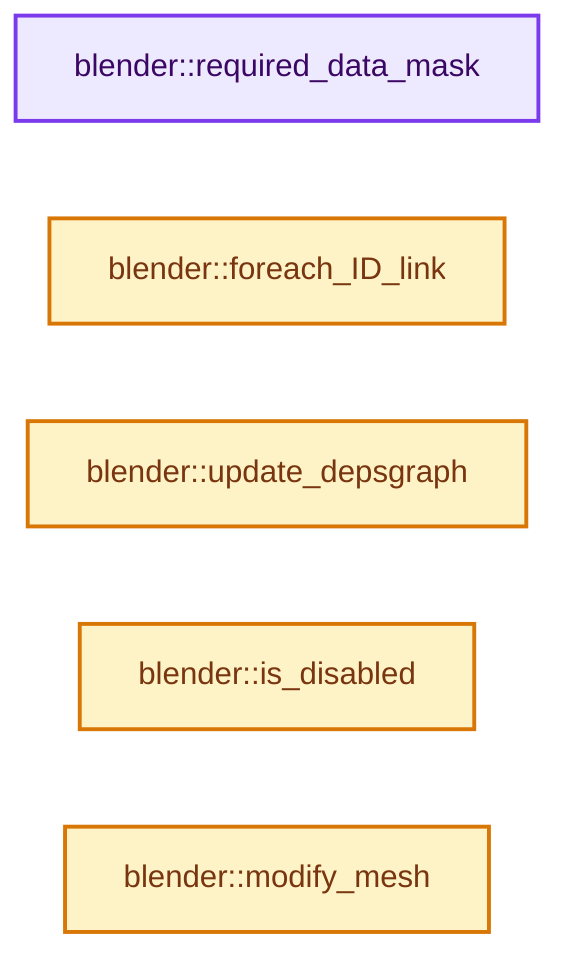

# 实现依赖专题：source/blender/modifiers/intern/MOD_datatransfer.cc

[方向导航](README.md) · [符号索引](../%E7%AC%A6%E5%8F%B7%E4%BE%9D%E8%B5%96%E4%B8%8E%E5%AE%9E%E7%8E%B0%E7%B4%A2%E5%BC%95.md)

本专题从正文实际调用进入，集中保存共享实现。函数有稳定锚点，可从调用处直接跳到对应完整函数；递归与互相调用通过回链组织。

## 本文件的实现关系




## 完整成员与函数实现

<a id="f-629f764b1f6f2ccb"></a>

### `blender::required_data_mask`

实现位置：[source/blender/modifiers/intern/MOD_datatransfer.cc](../../../../../source/blender/modifiers/intern/MOD_datatransfer.cc) · L72—L82。

接口参数：

- `ModifierData *md`
- `CustomData_MeshMasks *r_cddata_masks`

**教学注释版**

<!-- annotated:5baed818f2f073 -->

```cpp
static void required_data_mask(ModifierData *md, CustomData_MeshMasks *r_cddata_masks)
{
  DataTransferModifierData *dtmd = reinterpret_cast<DataTransferModifierData *>(md);

  if (dtmd->defgrp_name[0] != '\0') {
    /* We need vertex groups! */
    r_cddata_masks->vmask |= CD_MASK_MDEFORMVERT;
  }

  BKE_object_data_transfer_dttypes_to_cdmask(dtmd->data_types, r_cddata_masks);
}
```

<details>
<summary>核对原始源码：source/blender/modifiers/intern/MOD_datatransfer.cc · L72—L82</summary>

<!-- original:5baed818f2f073:source/blender/modifiers/intern/MOD_datatransfer.cc:72:82 -->

```cpp
static void required_data_mask(ModifierData *md, CustomData_MeshMasks *r_cddata_masks)
{
  DataTransferModifierData *dtmd = reinterpret_cast<DataTransferModifierData *>(md);

  if (dtmd->defgrp_name[0] != '\0') {
    /* We need vertex groups! */
    r_cddata_masks->vmask |= CD_MASK_MDEFORMVERT;
  }

  BKE_object_data_transfer_dttypes_to_cdmask(dtmd->data_types, r_cddata_masks);
}
```

</details>

**沿实际写入检查状态**

- `r_cddata_masks->vmask |= CD_MASK_MDEFORMVERT;`

**继续追踪实现**

- `BKE_object_data_transfer_dttypes_to_cdmask` → [blender::BKE_object_data_transfer_dttypes_to_cdmask · L42](%E4%BE%9D%E8%B5%96-data_transfer-8584e8.md#f-b98dbf4c24e0f972)。

<a id="f-166e1359e1a66ac1"></a>

### `blender::foreach_ID_link`

实现位置：[source/blender/modifiers/intern/MOD_datatransfer.cc](../../../../../source/blender/modifiers/intern/MOD_datatransfer.cc) · L84—L88。

接口参数：

- `ModifierData *md`
- `Object *ob`
- `IDWalkFunc walk`
- `void *user_data`

**教学注释版**

<!-- annotated:19ce2c91024b6d -->

```cpp
static void foreach_ID_link(ModifierData *md, Object *ob, IDWalkFunc walk, void *user_data)
{
  DataTransferModifierData *dtmd = reinterpret_cast<DataTransferModifierData *>(md);
  walk(user_data, ob, reinterpret_cast<ID **>(&dtmd->ob_source), IDWALK_CB_NOP);
}
```

<details>
<summary>核对原始源码：source/blender/modifiers/intern/MOD_datatransfer.cc · L84—L88</summary>

<!-- original:19ce2c91024b6d:source/blender/modifiers/intern/MOD_datatransfer.cc:84:88 -->

```cpp
static void foreach_ID_link(ModifierData *md, Object *ob, IDWalkFunc walk, void *user_data)
{
  DataTransferModifierData *dtmd = reinterpret_cast<DataTransferModifierData *>(md);
  walk(user_data, ob, reinterpret_cast<ID **>(&dtmd->ob_source), IDWALK_CB_NOP);
}
```

</details>

**继续追踪实现**

- `walk` → [调用协议](../%E6%A8%A1%E6%9D%BF%E5%AE%8F%E4%B8%8E%E5%8A%A8%E6%80%81%E5%88%86%E6%B4%BE%E5%8D%8F%E8%AE%AE.md)：局部可调用对象，须结合其初始化与捕获环境。调用位置L87。

<a id="f-01c6ea57393b7ca5"></a>

### `blender::update_depsgraph`

实现位置：[source/blender/modifiers/intern/MOD_datatransfer.cc](../../../../../source/blender/modifiers/intern/MOD_datatransfer.cc) · L90—L107。

接口参数：

- `ModifierData *md`
- `const ModifierUpdateDepsgraphContext *ctx`

**教学注释版**

<!-- annotated:30dd0942923b65 -->

```cpp
static void update_depsgraph(ModifierData *md, const ModifierUpdateDepsgraphContext *ctx)
{
  DataTransferModifierData *dtmd = reinterpret_cast<DataTransferModifierData *>(md);
  if (dtmd->ob_source != nullptr) {
    CustomData_MeshMasks cddata_masks = {0};
    BKE_object_data_transfer_dttypes_to_cdmask(dtmd->data_types, &cddata_masks);

    DEG_add_object_relation(
        ctx->node, dtmd->ob_source, DEG_OB_COMP_GEOMETRY, "DataTransfer Modifier");
    DEG_add_customdata_mask(ctx->node, dtmd->ob_source, &cddata_masks);

    if (dtmd->flags & MOD_DATATRANSFER_OBSRC_TRANSFORM) {
      DEG_add_object_relation(
          ctx->node, dtmd->ob_source, DEG_OB_COMP_TRANSFORM, "DataTransfer Modifier");
      DEG_add_depends_on_transform_relation(ctx->node, "DataTransfer Modifier");
    }
  }
}
```

<details>
<summary>核对原始源码：source/blender/modifiers/intern/MOD_datatransfer.cc · L90—L107</summary>

<!-- original:30dd0942923b65:source/blender/modifiers/intern/MOD_datatransfer.cc:90:107 -->

```cpp
static void update_depsgraph(ModifierData *md, const ModifierUpdateDepsgraphContext *ctx)
{
  DataTransferModifierData *dtmd = reinterpret_cast<DataTransferModifierData *>(md);
  if (dtmd->ob_source != nullptr) {
    CustomData_MeshMasks cddata_masks = {0};
    BKE_object_data_transfer_dttypes_to_cdmask(dtmd->data_types, &cddata_masks);

    DEG_add_object_relation(
        ctx->node, dtmd->ob_source, DEG_OB_COMP_GEOMETRY, "DataTransfer Modifier");
    DEG_add_customdata_mask(ctx->node, dtmd->ob_source, &cddata_masks);

    if (dtmd->flags & MOD_DATATRANSFER_OBSRC_TRANSFORM) {
      DEG_add_object_relation(
          ctx->node, dtmd->ob_source, DEG_OB_COMP_TRANSFORM, "DataTransfer Modifier");
      DEG_add_depends_on_transform_relation(ctx->node, "DataTransfer Modifier");
    }
  }
}
```

</details>

**继续追踪实现**

- `BKE_object_data_transfer_dttypes_to_cdmask` → [blender::BKE_object_data_transfer_dttypes_to_cdmask · L42](%E4%BE%9D%E8%B5%96-data_transfer-8584e8.md#f-b98dbf4c24e0f972)。
- `DEG_add_object_relation` → [blender::DEG_add_object_relation · L123](../11-Depsgraph%E4%B8%8E%E5%B9%B6%E8%A1%8C%E4%BB%BB%E5%8A%A1%E7%B3%BB%E7%BB%9F/%E4%BE%9D%E8%B5%96-depsgraph_build-ea2fc8.md#f-f570cffae97e273c)。
- `DEG_add_customdata_mask` → [blender::DEG_add_customdata_mask · L259](../11-Depsgraph%E4%B8%8E%E5%B9%B6%E8%A1%8C%E4%BB%BB%E5%8A%A1%E7%B3%BB%E7%BB%9F/%E4%BE%9D%E8%B5%96-depsgraph_build-ea2fc8.md#f-7ae1eb4c4326d38d)。
- `DEG_add_depends_on_transform_relation` → [blender::DEG_add_depends_on_transform_relation · L240](../11-Depsgraph%E4%B8%8E%E5%B9%B6%E8%A1%8C%E4%BB%BB%E5%8A%A1%E7%B3%BB%E7%BB%9F/%E4%BE%9D%E8%B5%96-depsgraph_build-ea2fc8.md#f-47c32a354defa20d)。

<a id="f-1462741eb790d5d3"></a>

### `blender::is_disabled`

实现位置：[source/blender/modifiers/intern/MOD_datatransfer.cc](../../../../../source/blender/modifiers/intern/MOD_datatransfer.cc) · L109—L119。

接口参数：

- `const Scene *`
- `ModifierData *md`
- `bool`

**教学注释版**

<!-- annotated:5875ceb58ef3f9 -->

```cpp
static bool is_disabled(const Scene * /*scene*/, ModifierData *md, bool /*use_render_params*/)
{
  /* If no source object, bypass. */
  DataTransferModifierData *dtmd = reinterpret_cast<DataTransferModifierData *>(md);
  /* The object type check is only needed here in case we have a placeholder
   * object assigned (because the library containing the mesh is missing).
   *
   * In other cases it should be impossible to have a type mismatch.
   */
  return !dtmd->ob_source || dtmd->ob_source->type != OB_MESH;
}
```

<details>
<summary>核对原始源码：source/blender/modifiers/intern/MOD_datatransfer.cc · L109—L119</summary>

<!-- original:5875ceb58ef3f9:source/blender/modifiers/intern/MOD_datatransfer.cc:109:119 -->

```cpp
static bool is_disabled(const Scene * /*scene*/, ModifierData *md, bool /*use_render_params*/)
{
  /* If no source object, bypass. */
  DataTransferModifierData *dtmd = reinterpret_cast<DataTransferModifierData *>(md);
  /* The object type check is only needed here in case we have a placeholder
   * object assigned (because the library containing the mesh is missing).
   *
   * In other cases it should be impossible to have a type mismatch.
   */
  return !dtmd->ob_source || dtmd->ob_source->type != OB_MESH;
}
```

</details>

**结果出口**

- `return !dtmd->ob_source || dtmd->ob_source->type != OB_MESH;`

**继续追踪实现**

本实现没有需要继续展开的显式调用；检查返回表达式、对象转换和调用者前置条件。

<a id="f-d2d7e2e53627726b"></a>

### `blender::modify_mesh`

实现位置：[source/blender/modifiers/intern/MOD_datatransfer.cc](../../../../../source/blender/modifiers/intern/MOD_datatransfer.cc) · L125—L203。

接口参数：

- `ModifierData *md`
- `const ModifierEvalContext *ctx`
- `Mesh *me_mod`

**教学注释版**

<!-- annotated:6788caeff044ef -->

```cpp
static Mesh *modify_mesh(ModifierData *md, const ModifierEvalContext *ctx, Mesh *me_mod)
{
  DataTransferModifierData *dtmd = reinterpret_cast<DataTransferModifierData *>(md);
  Mesh *result = me_mod;
  ReportList reports;

  /* Only used to check whether we are operating on org data or not... */
  const Mesh *mesh = id_cast<const Mesh *>(ctx->object->data);

  Object *ob_source = dtmd->ob_source;

  const bool invert_vgroup = (dtmd->flags & MOD_DATATRANSFER_INVERT_VGROUP) != 0;

  const float max_dist = (dtmd->flags & MOD_DATATRANSFER_MAP_MAXDIST) ? dtmd->map_max_distance :
                                                                        FLT_MAX;

  SpaceTransform space_transform_data;
  SpaceTransform *space_transform = (dtmd->flags & MOD_DATATRANSFER_OBSRC_TRANSFORM) ?
                                        &space_transform_data :
                                        nullptr;

  if (space_transform) {
    BLI_SPACE_TRANSFORM_SETUP(space_transform, ctx->object, ob_source);
  }

  const Span<float3> me_positions = mesh->vert_positions();
  const Span<int2> me_edges = mesh->edges();
  const Span<float3> result_positions = result->vert_positions();

  const Span<int2> result_edges = result->edges();

  // [讲解] me_positions.data：返回借用范围的地址。
  if (((result == mesh) || (me_positions.data() == result_positions.data()) ||
       (me_edges.data() == result_edges.data())) &&
      (dtmd->data_types & DT_TYPES_AFFECT_MESH))
  {
    /* We need to duplicate data here, otherwise setting custom normals, edges' sharpness, etc.,
     * could modify org mesh, see #43671. */
    result = id_cast<Mesh *>(BKE_id_copy_ex(nullptr, &me_mod->id, nullptr, LIB_ID_COPY_LOCALIZE));
  }

  BKE_reports_init(&reports, RPT_STORE);

  /* NOTE: no islands precision for now here. */
  if (BKE_object_data_transfer_ex(ctx->depsgraph,
                                  ob_source,
                                  ctx->object,
                                  result,
                                  dtmd->data_types,
                                  false,
                                  dtmd->vmap_mode,
                                  dtmd->emap_mode,
                                  dtmd->lmap_mode,
                                  dtmd->pmap_mode,
                                  space_transform,
                                  false,
                                  max_dist,
                                  dtmd->map_ray_radius,
                                  0.0f,
                                  dtmd->layers_select_src,
                                  dtmd->layers_select_dst,
                                  dtmd->mix_mode,
                                  dtmd->mix_factor,
                                  dtmd->defgrp_name,
                                  invert_vgroup,
                                  &reports))
  {
    result->runtime->is_original_bmesh = false;
  }

  if (BKE_reports_contain(&reports, RPT_ERROR)) {
    const char *report_str = BKE_reports_string(&reports, RPT_ERROR);
    BKE_modifier_set_error(ctx->object, md, "%s", report_str);
    MEM_delete(report_str);
  }

  BKE_reports_free(&reports);

  return result;
}
```

<details>
<summary>核对原始源码：source/blender/modifiers/intern/MOD_datatransfer.cc · L125—L203</summary>

<!-- original:6788caeff044ef:source/blender/modifiers/intern/MOD_datatransfer.cc:125:203 -->

```cpp
static Mesh *modify_mesh(ModifierData *md, const ModifierEvalContext *ctx, Mesh *me_mod)
{
  DataTransferModifierData *dtmd = reinterpret_cast<DataTransferModifierData *>(md);
  Mesh *result = me_mod;
  ReportList reports;

  /* Only used to check whether we are operating on org data or not... */
  const Mesh *mesh = id_cast<const Mesh *>(ctx->object->data);

  Object *ob_source = dtmd->ob_source;

  const bool invert_vgroup = (dtmd->flags & MOD_DATATRANSFER_INVERT_VGROUP) != 0;

  const float max_dist = (dtmd->flags & MOD_DATATRANSFER_MAP_MAXDIST) ? dtmd->map_max_distance :
                                                                        FLT_MAX;

  SpaceTransform space_transform_data;
  SpaceTransform *space_transform = (dtmd->flags & MOD_DATATRANSFER_OBSRC_TRANSFORM) ?
                                        &space_transform_data :
                                        nullptr;

  if (space_transform) {
    BLI_SPACE_TRANSFORM_SETUP(space_transform, ctx->object, ob_source);
  }

  const Span<float3> me_positions = mesh->vert_positions();
  const Span<int2> me_edges = mesh->edges();
  const Span<float3> result_positions = result->vert_positions();

  const Span<int2> result_edges = result->edges();

  if (((result == mesh) || (me_positions.data() == result_positions.data()) ||
       (me_edges.data() == result_edges.data())) &&
      (dtmd->data_types & DT_TYPES_AFFECT_MESH))
  {
    /* We need to duplicate data here, otherwise setting custom normals, edges' sharpness, etc.,
     * could modify org mesh, see #43671. */
    result = id_cast<Mesh *>(BKE_id_copy_ex(nullptr, &me_mod->id, nullptr, LIB_ID_COPY_LOCALIZE));
  }

  BKE_reports_init(&reports, RPT_STORE);

  /* NOTE: no islands precision for now here. */
  if (BKE_object_data_transfer_ex(ctx->depsgraph,
                                  ob_source,
                                  ctx->object,
                                  result,
                                  dtmd->data_types,
                                  false,
                                  dtmd->vmap_mode,
                                  dtmd->emap_mode,
                                  dtmd->lmap_mode,
                                  dtmd->pmap_mode,
                                  space_transform,
                                  false,
                                  max_dist,
                                  dtmd->map_ray_radius,
                                  0.0f,
                                  dtmd->layers_select_src,
                                  dtmd->layers_select_dst,
                                  dtmd->mix_mode,
                                  dtmd->mix_factor,
                                  dtmd->defgrp_name,
                                  invert_vgroup,
                                  &reports))
  {
    result->runtime->is_original_bmesh = false;
  }

  if (BKE_reports_contain(&reports, RPT_ERROR)) {
    const char *report_str = BKE_reports_string(&reports, RPT_ERROR);
    BKE_modifier_set_error(ctx->object, md, "%s", report_str);
    MEM_delete(report_str);
  }

  BKE_reports_free(&reports);

  return result;
}
```

</details>

**沿实际写入检查状态**

- `result = id_cast<Mesh *>(BKE_id_copy_ex(nullptr, &me_mod->id, nullptr, LIB_ID_COPY_LOCALIZE));`
- `result->runtime->is_original_bmesh = false;`

**结果出口**

- `return result;`

**继续追踪实现**

- `id_cast<const Mesh *>` → [blender::id_cast · L1417](%E4%BE%9D%E8%B5%96-DNA_ID-3eb091.md#f-6c8ac6412850ac5a)。
- `BLI_SPACE_TRANSFORM_SETUP` → [BLI_SPACE_TRANSFORM_SETUP · L571](../12-%E7%A9%BA%E9%97%B4%E6%95%B0%E6%8D%AE%E7%BB%93%E6%9E%84%E4%B8%8E%E5%87%A0%E4%BD%95%E7%AE%97%E6%B3%95/%E4%BE%9D%E8%B5%96-BLI_math_matrix_c-8ca9e4.md#m-19c543923357)。宏定义由构建条件选择。
- `mesh->vert_positions` → [Mesh::vert_positions · L1193](03-MPoly%E8%BF%81%E7%A7%BB%E4%B8%8E%E5%85%BC%E5%AE%B9.md#f-ae4177e5c5f2b371)。
- `mesh->edges` → [Mesh::edges · L1205](03-MPoly%E8%BF%81%E7%A7%BB%E4%B8%8E%E5%85%BC%E5%AE%B9.md#f-7232f6756b674d12)。
- `result->vert_positions` → [Mesh::vert_positions · L1193](03-MPoly%E8%BF%81%E7%A7%BB%E4%B8%8E%E5%85%BC%E5%AE%B9.md#f-ae4177e5c5f2b371)。
- `result->edges` → [Mesh::edges · L1205](03-MPoly%E8%BF%81%E7%A7%BB%E4%B8%8E%E5%85%BC%E5%AE%B9.md#f-7232f6756b674d12)。
- `me_positions.data` → [blender::Span::data · L219](../01-%E5%9F%BA%E7%A1%80%E5%AE%B9%E5%99%A8%E4%B8%8E%E7%8E%B0%E4%BB%A3CPP/05-Span%E5%8F%AA%E8%AF%BB%E8%BF%9E%E7%BB%AD%E8%A7%86%E5%9B%BE.md#f-10c5889198935800)。
- `result_positions.data` → [blender::Span::data · L219](../01-%E5%9F%BA%E7%A1%80%E5%AE%B9%E5%99%A8%E4%B8%8E%E7%8E%B0%E4%BB%A3CPP/05-Span%E5%8F%AA%E8%AF%BB%E8%BF%9E%E7%BB%AD%E8%A7%86%E5%9B%BE.md#f-10c5889198935800)。
- `me_edges.data` → [blender::Span::data · L219](../01-%E5%9F%BA%E7%A1%80%E5%AE%B9%E5%99%A8%E4%B8%8E%E7%8E%B0%E4%BB%A3CPP/05-Span%E5%8F%AA%E8%AF%BB%E8%BF%9E%E7%BB%AD%E8%A7%86%E5%9B%BE.md#f-10c5889198935800)。
- `result_edges.data` → [blender::Span::data · L219](../01-%E5%9F%BA%E7%A1%80%E5%AE%B9%E5%99%A8%E4%B8%8E%E7%8E%B0%E4%BB%A3CPP/05-Span%E5%8F%AA%E8%AF%BB%E8%BF%9E%E7%BB%AD%E8%A7%86%E5%9B%BE.md#f-10c5889198935800)。
- `id_cast<Mesh *>` → [blender::id_cast · L1417](%E4%BE%9D%E8%B5%96-DNA_ID-3eb091.md#f-6c8ac6412850ac5a)。
- `BKE_id_copy_ex` → [blender::BKE_id_copy_ex · L851](%E4%BE%9D%E8%B5%96-lib_id-d4e6bd.md#f-24272170c95f49fb)。
- `BKE_reports_init` → [blender::BKE_reports_init · L91](%E4%BE%9D%E8%B5%96-report-f916fd.md#f-b8685fdb2b35bb7d)。
- `BKE_object_data_transfer_ex` → [blender::BKE_object_data_transfer_ex · L1396](%E4%BE%9D%E8%B5%96-data_transfer-8584e8.md#f-197a03e302904e20)。
- `BKE_reports_contain` → [blender::BKE_reports_contain · L394](%E4%BE%9D%E8%B5%96-report-f916fd.md#f-1284522d0eafd19e)。
- `BKE_reports_string` → [blender::BKE_reports_string · L307](%E4%BE%9D%E8%B5%96-report-f916fd.md#f-fe8d0d4202fa9120)。
- `BKE_modifier_set_error` → [blender::BKE_modifier_set_error · L416](%E4%BE%9D%E8%B5%96-modifier-ab0273.md#f-6241829f21c08456)。
- `MEM_delete` → [MEM_delete · L400](../03-%E5%86%85%E5%AD%98%E5%88%86%E9%85%8D%E4%B8%8E%E8%BF%90%E8%A1%8C%E6%97%B6%E7%B1%BB%E5%9E%8B/%E4%BE%9D%E8%B5%96-MEM_guardedalloc-b54eca.md#f-9049ffdd1682887c)。
- `BKE_reports_free` → [blender::BKE_reports_free · L106](%E4%BE%9D%E8%B5%96-report-f916fd.md#f-14b48393664f8c21)。
