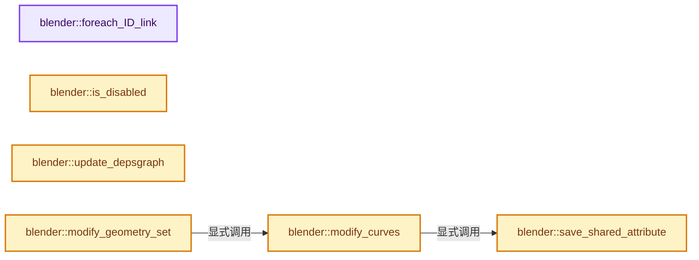
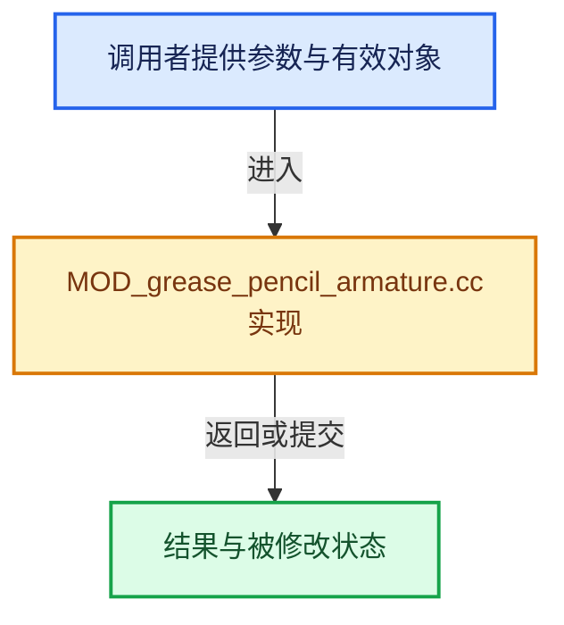

# 实现依赖专题：source/blender/modifiers/intern/MOD_grease_pencil_armature.cc

[方向导航](README.md) · [符号索引](../%E7%AC%A6%E5%8F%B7%E4%BE%9D%E8%B5%96%E4%B8%8E%E5%AE%9E%E7%8E%B0%E7%B4%A2%E5%BC%95.md)

本专题从正文实际调用进入，集中保存共享实现。函数有稳定锚点，可从调用处直接跳到对应完整函数；递归与互相调用通过回链组织。

## 本文件的实现关系






## 完整成员与函数实现

<a id="f-6d967cb3cfbfe21e"></a>

### `blender::foreach_ID_link`

实现位置：[source/blender/modifiers/intern/MOD_grease_pencil_armature.cc](../../../../../source/blender/modifiers/intern/MOD_grease_pencil_armature.cc) · L69—L74。

接口参数：

- `ModifierData *md`
- `Object *ob`
- `IDWalkFunc walk`
- `void *user_data`

**教学注释版**

<!-- annotated:681b14f63a03f3 -->

```cpp
static void foreach_ID_link(ModifierData *md, Object *ob, IDWalkFunc walk, void *user_data)
{
  auto *amd = reinterpret_cast<GreasePencilArmatureModifierData *>(md);
  modifier::greasepencil::foreach_influence_ID_link(&amd->influence, ob, walk, user_data);
  walk(user_data, ob, reinterpret_cast<ID **>(&amd->object), IDWALK_CB_NOP);
}
```

<details>
<summary>核对原始源码：source/blender/modifiers/intern/MOD_grease_pencil_armature.cc · L69—L74</summary>

<!-- original:681b14f63a03f3:source/blender/modifiers/intern/MOD_grease_pencil_armature.cc:69:74 -->

```cpp
static void foreach_ID_link(ModifierData *md, Object *ob, IDWalkFunc walk, void *user_data)
{
  auto *amd = reinterpret_cast<GreasePencilArmatureModifierData *>(md);
  modifier::greasepencil::foreach_influence_ID_link(&amd->influence, ob, walk, user_data);
  walk(user_data, ob, reinterpret_cast<ID **>(&amd->object), IDWALK_CB_NOP);
}
```

</details>

**继续追踪实现**

- `modifier::greasepencil::foreach_influence_ID_link` → [blender::modifier::greasepencil::foreach_influence_ID_link · L69](%E4%BE%9D%E8%B5%96-MOD_grease_pencil_util-d0b437.md#f-247ba56fa4c4e56f)。
- `walk` → [调用协议](../%E6%A8%A1%E6%9D%BF%E5%AE%8F%E4%B8%8E%E5%8A%A8%E6%80%81%E5%88%86%E6%B4%BE%E5%8D%8F%E8%AE%AE.md)：局部可调用对象，须结合其初始化与捕获环境。调用位置L73。

<a id="f-daf48a379166dc1d"></a>

### `blender::is_disabled`

实现位置：[source/blender/modifiers/intern/MOD_grease_pencil_armature.cc](../../../../../source/blender/modifiers/intern/MOD_grease_pencil_armature.cc) · L76—L85。

接口参数：

- `const Scene *`
- `ModifierData *md`
- `bool`

**教学注释版**

<!-- annotated:b354a56c960ce9 -->

```cpp
static bool is_disabled(const Scene * /*scene*/, ModifierData *md, bool /*use_render_params*/)
{
  auto *amd = reinterpret_cast<GreasePencilArmatureModifierData *>(md);

  /* The object type check is only needed here in case we have a placeholder
   * object assigned (because the library containing the armature is missing).
   *
   * In other cases it should be impossible to have a type mismatch. */
  return !amd->object || amd->object->type != OB_ARMATURE;
}
```

<details>
<summary>核对原始源码：source/blender/modifiers/intern/MOD_grease_pencil_armature.cc · L76—L85</summary>

<!-- original:b354a56c960ce9:source/blender/modifiers/intern/MOD_grease_pencil_armature.cc:76:85 -->

```cpp
static bool is_disabled(const Scene * /*scene*/, ModifierData *md, bool /*use_render_params*/)
{
  auto *amd = reinterpret_cast<GreasePencilArmatureModifierData *>(md);

  /* The object type check is only needed here in case we have a placeholder
   * object assigned (because the library containing the armature is missing).
   *
   * In other cases it should be impossible to have a type mismatch. */
  return !amd->object || amd->object->type != OB_ARMATURE;
}
```

</details>

**结果出口**

- `return !amd->object || amd->object->type != OB_ARMATURE;`

**继续追踪实现**

本实现没有需要继续展开的显式调用；检查返回表达式、对象转换和调用者前置条件。

<a id="f-f8171cf1666d3beb"></a>

### `blender::update_depsgraph`

实现位置：[source/blender/modifiers/intern/MOD_grease_pencil_armature.cc](../../../../../source/blender/modifiers/intern/MOD_grease_pencil_armature.cc) · L87—L95。

接口参数：

- `ModifierData *md`
- `const ModifierUpdateDepsgraphContext *ctx`

**教学注释版**

<!-- annotated:fd894d16a9215d -->

```cpp
static void update_depsgraph(ModifierData *md, const ModifierUpdateDepsgraphContext *ctx)
{
  auto *amd = reinterpret_cast<GreasePencilArmatureModifierData *>(md);
  if (amd->object != nullptr) {
    DEG_add_object_relation(ctx->node, amd->object, DEG_OB_COMP_EVAL_POSE, "Armature Modifier");
    DEG_add_object_relation(ctx->node, amd->object, DEG_OB_COMP_TRANSFORM, "Armature Modifier");
  }
  DEG_add_object_relation(ctx->node, ctx->object, DEG_OB_COMP_TRANSFORM, "Armature Modifier");
}
```

<details>
<summary>核对原始源码：source/blender/modifiers/intern/MOD_grease_pencil_armature.cc · L87—L95</summary>

<!-- original:fd894d16a9215d:source/blender/modifiers/intern/MOD_grease_pencil_armature.cc:87:95 -->

```cpp
static void update_depsgraph(ModifierData *md, const ModifierUpdateDepsgraphContext *ctx)
{
  auto *amd = reinterpret_cast<GreasePencilArmatureModifierData *>(md);
  if (amd->object != nullptr) {
    DEG_add_object_relation(ctx->node, amd->object, DEG_OB_COMP_EVAL_POSE, "Armature Modifier");
    DEG_add_object_relation(ctx->node, amd->object, DEG_OB_COMP_TRANSFORM, "Armature Modifier");
  }
  DEG_add_object_relation(ctx->node, ctx->object, DEG_OB_COMP_TRANSFORM, "Armature Modifier");
}
```

</details>

**继续追踪实现**

- `DEG_add_object_relation` → [blender::DEG_add_object_relation · L123](../11-Depsgraph%E4%B8%8E%E5%B9%B6%E8%A1%8C%E4%BB%BB%E5%8A%A1%E7%B3%BB%E7%BB%9F/%E4%BE%9D%E8%B5%96-depsgraph_build-ea2fc8.md#f-f570cffae97e273c)。

<a id="f-2fc41906834bb341"></a>

### `blender::save_shared_attribute`

实现位置：[source/blender/modifiers/intern/MOD_grease_pencil_armature.cc](../../../../../source/blender/modifiers/intern/MOD_grease_pencil_armature.cc) · L97—L107。

接口参数：

- `const bke::GAttributeReader &attribute`

**教学注释版**

<!-- annotated:5be245c9a19965 -->

```cpp
static ImplicitSharingPtrAndData save_shared_attribute(const bke::GAttributeReader &attribute)
{
  if (attribute.sharing_info && attribute.varray.is_span()) {
    const void *data = attribute.varray.get_internal_span().data();
    attribute.sharing_info->add_user();
    return {ImplicitSharingPtr(attribute.sharing_info), data};
  }
  auto *data = new ImplicitSharedValue<GArray<>>(attribute.varray.type(), attribute.varray.size());
  attribute.varray.materialize(data->data.data());
  return {ImplicitSharingPtr<>(data), data->data.data()};
}
```

<details>
<summary>核对原始源码：source/blender/modifiers/intern/MOD_grease_pencil_armature.cc · L97—L107</summary>

<!-- original:5be245c9a19965:source/blender/modifiers/intern/MOD_grease_pencil_armature.cc:97:107 -->

```cpp
static ImplicitSharingPtrAndData save_shared_attribute(const bke::GAttributeReader &attribute)
{
  if (attribute.sharing_info && attribute.varray.is_span()) {
    const void *data = attribute.varray.get_internal_span().data();
    attribute.sharing_info->add_user();
    return {ImplicitSharingPtr(attribute.sharing_info), data};
  }
  auto *data = new ImplicitSharedValue<GArray<>>(attribute.varray.type(), attribute.varray.size());
  attribute.varray.materialize(data->data.data());
  return {ImplicitSharingPtr<>(data), data->data.data()};
}
```

</details>

**结果出口**

- `return {ImplicitSharingPtr(attribute.sharing_info), data};`
- `return {ImplicitSharingPtr<>(data), data->data.data()};`

**继续追踪实现**

- `attribute.varray.is_span` → [调用协议](../%E6%A8%A1%E6%9D%BF%E5%AE%8F%E4%B8%8E%E5%8A%A8%E6%80%81%E5%88%86%E6%B4%BE%E5%8D%8F%E8%AE%AE.md)：接收对象类型依赖auto、返回值或模板实例；不按同名猜测目标。调用位置L99。
- `attribute.varray.get_internal_span().data` → [调用协议](../%E6%A8%A1%E6%9D%BF%E5%AE%8F%E4%B8%8E%E5%8A%A8%E6%80%81%E5%88%86%E6%B4%BE%E5%8D%8F%E8%AE%AE.md)：接收对象类型依赖auto、返回值或模板实例；不按同名猜测目标。调用位置L100。
- `attribute.varray.get_internal_span` → [调用协议](../%E6%A8%A1%E6%9D%BF%E5%AE%8F%E4%B8%8E%E5%8A%A8%E6%80%81%E5%88%86%E6%B4%BE%E5%8D%8F%E8%AE%AE.md)：接收对象类型依赖auto、返回值或模板实例；不按同名猜测目标。调用位置L100。
- `attribute.sharing_info->add_user` → [调用协议](../%E6%A8%A1%E6%9D%BF%E5%AE%8F%E4%B8%8E%E5%8A%A8%E6%80%81%E5%88%86%E6%B4%BE%E5%8D%8F%E8%AE%AE.md)：接收对象类型依赖auto、返回值或模板实例；不按同名猜测目标。调用位置L101。
- `ImplicitSharingPtr` → [blender::ImplicitSharingPtr::ImplicitSharingPtr · L32](../06-%E9%9A%90%E5%BC%8F%E5%85%B1%E4%BA%AB%E4%B8%8E%E7%BC%93%E5%AD%98%E7%B3%BB%E7%BB%9F/03-Mixin%E4%B8%8E%E5%85%B1%E4%BA%AB%E6%8C%87%E9%92%88%E5%B0%81%E8%A3%85.md#f-d28a43dbb5ed8c05)；[blender::ImplicitSharingPtr::ImplicitSharingPtr · L34](../06-%E9%9A%90%E5%BC%8F%E5%85%B1%E4%BA%AB%E4%B8%8E%E7%BC%93%E5%AD%98%E7%B3%BB%E7%BB%9F/03-Mixin%E4%B8%8E%E5%85%B1%E4%BA%AB%E6%8C%87%E9%92%88%E5%B0%81%E8%A3%85.md#f-d27d5ebf676e244a)；[blender::ImplicitSharingPtr::ImplicitSharingPtr · L37](../06-%E9%9A%90%E5%BC%8F%E5%85%B1%E4%BA%AB%E4%B8%8E%E7%BC%93%E5%AD%98%E7%B3%BB%E7%BB%9F/03-Mixin%E4%B8%8E%E5%85%B1%E4%BA%AB%E6%8C%87%E9%92%88%E5%B0%81%E8%A3%85.md#f-17d0c5fe2b03a664)；[blender::ImplicitSharingPtr::ImplicitSharingPtr · L39](../06-%E9%9A%90%E5%BC%8F%E5%85%B1%E4%BA%AB%E4%B8%8E%E7%BC%93%E5%AD%98%E7%B3%BB%E7%BB%9F/03-Mixin%E4%B8%8E%E5%85%B1%E4%BA%AB%E6%8C%87%E9%92%88%E5%B0%81%E8%A3%85.md#f-1c8729ae57532370)；[blender::ImplicitSharingPtr::ImplicitSharingPtr · L44](../06-%E9%9A%90%E5%BC%8F%E5%85%B1%E4%BA%AB%E4%B8%8E%E7%BC%93%E5%AD%98%E7%B3%BB%E7%BB%9F/03-Mixin%E4%B8%8E%E5%85%B1%E4%BA%AB%E6%8C%87%E9%92%88%E5%B0%81%E8%A3%85.md#f-0b6be0142b98009e)；[blender::ImplicitSharingPtr::ImplicitSharingPtr · L49](../06-%E9%9A%90%E5%BC%8F%E5%85%B1%E4%BA%AB%E4%B8%8E%E7%BC%93%E5%AD%98%E7%B3%BB%E7%BB%9F/03-Mixin%E4%B8%8E%E5%85%B1%E4%BA%AB%E6%8C%87%E9%92%88%E5%B0%81%E8%A3%85.md#f-90c601ed9ed99045)；[blender::ImplicitSharingPtr::ImplicitSharingPtr · L57](../06-%E9%9A%90%E5%BC%8F%E5%85%B1%E4%BA%AB%E4%B8%8E%E7%BC%93%E5%AD%98%E7%B3%BB%E7%BB%9F/03-Mixin%E4%B8%8E%E5%85%B1%E4%BA%AB%E6%8C%87%E9%92%88%E5%B0%81%E8%A3%85.md#f-1625179ceae7a66d)。同名重载需按实参类型选择。
- `attribute.varray.type` → [调用协议](../%E6%A8%A1%E6%9D%BF%E5%AE%8F%E4%B8%8E%E5%8A%A8%E6%80%81%E5%88%86%E6%B4%BE%E5%8D%8F%E8%AE%AE.md)：接收对象类型依赖auto、返回值或模板实例；不按同名猜测目标。调用位置L104。
- `attribute.varray.size` → [调用协议](../%E6%A8%A1%E6%9D%BF%E5%AE%8F%E4%B8%8E%E5%8A%A8%E6%80%81%E5%88%86%E6%B4%BE%E5%8D%8F%E8%AE%AE.md)：接收对象类型依赖auto、返回值或模板实例；不按同名猜测目标。调用位置L104。
- `attribute.varray.materialize` → [调用协议](../%E6%A8%A1%E6%9D%BF%E5%AE%8F%E4%B8%8E%E5%8A%A8%E6%80%81%E5%88%86%E6%B4%BE%E5%8D%8F%E8%AE%AE.md)：接收对象类型依赖auto、返回值或模板实例；不按同名猜测目标。调用位置L105。
- `data->data.data` → [调用协议](../%E6%A8%A1%E6%9D%BF%E5%AE%8F%E4%B8%8E%E5%8A%A8%E6%80%81%E5%88%86%E6%B4%BE%E5%8D%8F%E8%AE%AE.md)：接收对象类型依赖auto、返回值或模板实例；不按同名猜测目标。调用位置L105。
- `ImplicitSharingPtr<>` → [blender::ImplicitSharingPtr::ImplicitSharingPtr · L32](../06-%E9%9A%90%E5%BC%8F%E5%85%B1%E4%BA%AB%E4%B8%8E%E7%BC%93%E5%AD%98%E7%B3%BB%E7%BB%9F/03-Mixin%E4%B8%8E%E5%85%B1%E4%BA%AB%E6%8C%87%E9%92%88%E5%B0%81%E8%A3%85.md#f-d28a43dbb5ed8c05)；[blender::ImplicitSharingPtr::ImplicitSharingPtr · L34](../06-%E9%9A%90%E5%BC%8F%E5%85%B1%E4%BA%AB%E4%B8%8E%E7%BC%93%E5%AD%98%E7%B3%BB%E7%BB%9F/03-Mixin%E4%B8%8E%E5%85%B1%E4%BA%AB%E6%8C%87%E9%92%88%E5%B0%81%E8%A3%85.md#f-d27d5ebf676e244a)；[blender::ImplicitSharingPtr::ImplicitSharingPtr · L37](../06-%E9%9A%90%E5%BC%8F%E5%85%B1%E4%BA%AB%E4%B8%8E%E7%BC%93%E5%AD%98%E7%B3%BB%E7%BB%9F/03-Mixin%E4%B8%8E%E5%85%B1%E4%BA%AB%E6%8C%87%E9%92%88%E5%B0%81%E8%A3%85.md#f-17d0c5fe2b03a664)；[blender::ImplicitSharingPtr::ImplicitSharingPtr · L39](../06-%E9%9A%90%E5%BC%8F%E5%85%B1%E4%BA%AB%E4%B8%8E%E7%BC%93%E5%AD%98%E7%B3%BB%E7%BB%9F/03-Mixin%E4%B8%8E%E5%85%B1%E4%BA%AB%E6%8C%87%E9%92%88%E5%B0%81%E8%A3%85.md#f-1c8729ae57532370)；[blender::ImplicitSharingPtr::ImplicitSharingPtr · L44](../06-%E9%9A%90%E5%BC%8F%E5%85%B1%E4%BA%AB%E4%B8%8E%E7%BC%93%E5%AD%98%E7%B3%BB%E7%BB%9F/03-Mixin%E4%B8%8E%E5%85%B1%E4%BA%AB%E6%8C%87%E9%92%88%E5%B0%81%E8%A3%85.md#f-0b6be0142b98009e)；[blender::ImplicitSharingPtr::ImplicitSharingPtr · L49](../06-%E9%9A%90%E5%BC%8F%E5%85%B1%E4%BA%AB%E4%B8%8E%E7%BC%93%E5%AD%98%E7%B3%BB%E7%BB%9F/03-Mixin%E4%B8%8E%E5%85%B1%E4%BA%AB%E6%8C%87%E9%92%88%E5%B0%81%E8%A3%85.md#f-90c601ed9ed99045)；[blender::ImplicitSharingPtr::ImplicitSharingPtr · L57](../06-%E9%9A%90%E5%BC%8F%E5%85%B1%E4%BA%AB%E4%B8%8E%E7%BC%93%E5%AD%98%E7%B3%BB%E7%BB%9F/03-Mixin%E4%B8%8E%E5%85%B1%E4%BA%AB%E6%8C%87%E9%92%88%E5%B0%81%E8%A3%85.md#f-1625179ceae7a66d)。同名重载需按实参类型选择。

<a id="f-91d0392218c418ac"></a>

### `blender::modify_curves`

实现位置：[source/blender/modifiers/intern/MOD_grease_pencil_armature.cc](../../../../../source/blender/modifiers/intern/MOD_grease_pencil_armature.cc) · L109—L226。

接口参数：

- `ModifierData &md`
- `const ModifierEvalContext &ctx`
- `Drawing &drawing`
- `bke::GreasePencilDrawingEditHints *edit_hints`

**教学注释版**

<!-- annotated:67d6641c0dbde7 -->

```cpp
static void modify_curves(ModifierData &md,
                          const ModifierEvalContext &ctx,
                          Drawing &drawing,
                          bke::GreasePencilDrawingEditHints *edit_hints)
{
  const auto &amd = reinterpret_cast<GreasePencilArmatureModifierData &>(md);
  /* The influence flag is where the "invert" flag is stored,
   * but armature functions expect `deformflag` to have the flag set as well.
   * Copy to `deformflag` here to keep old functions happy. */
  const int deformflag = amd.deformflag |
                         (amd.influence.flag & GREASE_PENCIL_INFLUENCE_INVERT_VERTEX_GROUP ?
                              ARM_DEF_INVERT_VGROUP :
                              0);

  if (drawing.strokes().deform_verts().is_empty()) {
    return;
  }

  IndexMaskMemory mask_memory;
  const IndexMask curves_mask = modifier::greasepencil::get_filtered_stroke_mask(
      ctx.object, drawing.strokes(), amd.influence, mask_memory);

  auto deform_curves = [&](MutableSpan<float3> positions,
                           std::optional<Span<float3>> old_positions,
                           std::optional<MutableSpan<float3x3>> deform_mats,
                           Span<MDeformVert> dverts,
                           const OffsetIndices<int> points_by_curve) {
    /* Deform verts attribute can be empty after converting Bezier curves (#152102). */
    // [讲解] dverts.is_empty：查询视图长度或生成对应有效索引区间。
    if (dverts.is_empty()) {
      return;
    }
    curves_mask.foreach_index(
        [&](const int curve_i) {
          const IndexRange points = points_by_curve[curve_i];
          std::optional<Span<float3>> old_positions_for_curve;
          if (old_positions) {
            // [讲解] old_positions->slice：建立原连续范围的子视图。
            old_positions_for_curve = old_positions->slice(points);
          }
          std::optional<MutableSpan<float3x3>> deform_mats_for_curve;
          if (deform_mats) {
            deform_mats_for_curve = deform_mats->slice(points);
          }
          BKE_armature_deform_coords_with_curves(*amd.object,
                                                 *ctx.object,
                                                 &drawing.strokes().vertex_group_names,
                                                 positions.slice(points),
                                                 old_positions_for_curve,
                                                 deform_mats_for_curve,
                                                 dverts.slice(points),
                                                 deformflag,
                                                 amd.influence.vertex_group_name);
        },
        exec_mode::grain_size(128));
  };

  /* Cached position data for supporting the multi-modifier feature. This data is only valid as
   * long as topology does not change, don't use this after converting Bezier curves! */
  const ImplicitSharingPtrAndData old_positions_data = save_shared_attribute(
      drawing.strokes().attributes().lookup("position", bke::AttrType::Float3));
  const Span<float3> old_positions = {static_cast<const float3 *>(old_positions_data.data),
                                      drawing.strokes().points_num()};

  const bool has_bezier_curves = drawing.strokes().has_curve_with_type(
      CurveType::CURVE_TYPE_BEZIER);
  if (has_bezier_curves) {
    /* Update deformation data in edit hints related to original points.
     * Do this before converting Bezier curves because that changes the topology.
     * The multi-modifier feature is not supported in this case (no "old_positions" argument). */
    if (edit_hints && edit_hints->positions()) {
      const bke::CurvesGeometry &curves = drawing.strokes();
      std::optional<MutableSpan<float3x3>> deform_mats =
          edit_hints->deform_mats ?
              edit_hints->deform_mats->as_mutable_span() :
              edit_hints->deform_mats.emplace(curves.points_num(), float3x3::identity());
      deform_curves(*edit_hints->positions_for_write(),
                    std::nullopt,
                    deform_mats,
                    curves.deform_verts(),
                    curves.points_by_curve());
    }

    /* Convert Bezier curves since these are not supported in armature deformation. */
    modifier::greasepencil::ensure_no_bezier_curves(drawing);

    /* Deform curve data without changes to edit hints. */
    {
      bke::CurvesGeometry &curves = drawing.strokes_for_write();
      deform_curves(curves.positions_for_write(),
                    std::nullopt,
                    std::nullopt,
                    curves.deform_verts(),
                    curves.points_by_curve());
    }
  }
  else {
    /* Deform curve data and edit hints at the same time. */
    bke::CurvesGeometry &curves = drawing.strokes_for_write();
    std::optional<MutableSpan<float3x3>> deform_mats;
    if (edit_hints) {
      deform_mats = edit_hints->deform_mats ?
                        edit_hints->deform_mats->as_mutable_span() :
                        edit_hints->deform_mats.emplace(curves.points_num(), float3x3::identity());
    }
    deform_curves(curves.positions_for_write(),
                  old_positions,
                  deform_mats,
                  curves.deform_verts(),
                  curves.points_by_curve());
    /* Copy deformed positions to edit hints if necessary. */
    if (edit_hints && edit_hints->positions() &&
        edit_hints->positions()->data() != curves.positions().data())
    {
      edit_hints->positions_for_write()->copy_from(curves.positions());
    }
  }

  drawing.tag_positions_changed();
}
```

<details>
<summary>核对原始源码：source/blender/modifiers/intern/MOD_grease_pencil_armature.cc · L109—L226</summary>

<!-- original:67d6641c0dbde7:source/blender/modifiers/intern/MOD_grease_pencil_armature.cc:109:226 -->

```cpp
static void modify_curves(ModifierData &md,
                          const ModifierEvalContext &ctx,
                          Drawing &drawing,
                          bke::GreasePencilDrawingEditHints *edit_hints)
{
  const auto &amd = reinterpret_cast<GreasePencilArmatureModifierData &>(md);
  /* The influence flag is where the "invert" flag is stored,
   * but armature functions expect `deformflag` to have the flag set as well.
   * Copy to `deformflag` here to keep old functions happy. */
  const int deformflag = amd.deformflag |
                         (amd.influence.flag & GREASE_PENCIL_INFLUENCE_INVERT_VERTEX_GROUP ?
                              ARM_DEF_INVERT_VGROUP :
                              0);

  if (drawing.strokes().deform_verts().is_empty()) {
    return;
  }

  IndexMaskMemory mask_memory;
  const IndexMask curves_mask = modifier::greasepencil::get_filtered_stroke_mask(
      ctx.object, drawing.strokes(), amd.influence, mask_memory);

  auto deform_curves = [&](MutableSpan<float3> positions,
                           std::optional<Span<float3>> old_positions,
                           std::optional<MutableSpan<float3x3>> deform_mats,
                           Span<MDeformVert> dverts,
                           const OffsetIndices<int> points_by_curve) {
    /* Deform verts attribute can be empty after converting Bezier curves (#152102). */
    if (dverts.is_empty()) {
      return;
    }
    curves_mask.foreach_index(
        [&](const int curve_i) {
          const IndexRange points = points_by_curve[curve_i];
          std::optional<Span<float3>> old_positions_for_curve;
          if (old_positions) {
            old_positions_for_curve = old_positions->slice(points);
          }
          std::optional<MutableSpan<float3x3>> deform_mats_for_curve;
          if (deform_mats) {
            deform_mats_for_curve = deform_mats->slice(points);
          }
          BKE_armature_deform_coords_with_curves(*amd.object,
                                                 *ctx.object,
                                                 &drawing.strokes().vertex_group_names,
                                                 positions.slice(points),
                                                 old_positions_for_curve,
                                                 deform_mats_for_curve,
                                                 dverts.slice(points),
                                                 deformflag,
                                                 amd.influence.vertex_group_name);
        },
        exec_mode::grain_size(128));
  };

  /* Cached position data for supporting the multi-modifier feature. This data is only valid as
   * long as topology does not change, don't use this after converting Bezier curves! */
  const ImplicitSharingPtrAndData old_positions_data = save_shared_attribute(
      drawing.strokes().attributes().lookup("position", bke::AttrType::Float3));
  const Span<float3> old_positions = {static_cast<const float3 *>(old_positions_data.data),
                                      drawing.strokes().points_num()};

  const bool has_bezier_curves = drawing.strokes().has_curve_with_type(
      CurveType::CURVE_TYPE_BEZIER);
  if (has_bezier_curves) {
    /* Update deformation data in edit hints related to original points.
     * Do this before converting Bezier curves because that changes the topology.
     * The multi-modifier feature is not supported in this case (no "old_positions" argument). */
    if (edit_hints && edit_hints->positions()) {
      const bke::CurvesGeometry &curves = drawing.strokes();
      std::optional<MutableSpan<float3x3>> deform_mats =
          edit_hints->deform_mats ?
              edit_hints->deform_mats->as_mutable_span() :
              edit_hints->deform_mats.emplace(curves.points_num(), float3x3::identity());
      deform_curves(*edit_hints->positions_for_write(),
                    std::nullopt,
                    deform_mats,
                    curves.deform_verts(),
                    curves.points_by_curve());
    }

    /* Convert Bezier curves since these are not supported in armature deformation. */
    modifier::greasepencil::ensure_no_bezier_curves(drawing);

    /* Deform curve data without changes to edit hints. */
    {
      bke::CurvesGeometry &curves = drawing.strokes_for_write();
      deform_curves(curves.positions_for_write(),
                    std::nullopt,
                    std::nullopt,
                    curves.deform_verts(),
                    curves.points_by_curve());
    }
  }
  else {
    /* Deform curve data and edit hints at the same time. */
    bke::CurvesGeometry &curves = drawing.strokes_for_write();
    std::optional<MutableSpan<float3x3>> deform_mats;
    if (edit_hints) {
      deform_mats = edit_hints->deform_mats ?
                        edit_hints->deform_mats->as_mutable_span() :
                        edit_hints->deform_mats.emplace(curves.points_num(), float3x3::identity());
    }
    deform_curves(curves.positions_for_write(),
                  old_positions,
                  deform_mats,
                  curves.deform_verts(),
                  curves.points_by_curve());
    /* Copy deformed positions to edit hints if necessary. */
    if (edit_hints && edit_hints->positions() &&
        edit_hints->positions()->data() != curves.positions().data())
    {
      edit_hints->positions_for_write()->copy_from(curves.positions());
    }
  }

  drawing.tag_positions_changed();
}
```

</details>

**沿实际写入检查状态**

- `old_positions_for_curve = old_positions->slice(points);`
- `deform_mats_for_curve = deform_mats->slice(points);`
- `deform_mats = edit_hints->deform_mats ?`

**继续追踪实现**

- `drawing.strokes().deform_verts().is_empty` → [调用协议](../%E6%A8%A1%E6%9D%BF%E5%AE%8F%E4%B8%8E%E5%8A%A8%E6%80%81%E5%88%86%E6%B4%BE%E5%8D%8F%E8%AE%AE.md)：接收对象类型依赖auto、返回值或模板实例；不按同名猜测目标。调用位置L123。
- `drawing.strokes().deform_verts` → [调用协议](../%E6%A8%A1%E6%9D%BF%E5%AE%8F%E4%B8%8E%E5%8A%A8%E6%80%81%E5%88%86%E6%B4%BE%E5%8D%8F%E8%AE%AE.md)：接收对象类型依赖auto、返回值或模板实例；不按同名猜测目标。调用位置L123。
- `drawing.strokes` → [blender::bke::greasepencil::Drawing::strokes · L1007](%E4%BE%9D%E8%B5%96-grease_pencil-f750d6.md#f-59e6522a8e8ac409)。
- `modifier::greasepencil::get_filtered_stroke_mask` → [blender::modifier::greasepencil::get_filtered_stroke_mask · L285](%E4%BE%9D%E8%B5%96-MOD_grease_pencil_util-d0b437.md#f-30c219d04de7dec3)；[blender::modifier::greasepencil::get_filtered_stroke_mask · L326](%E4%BE%9D%E8%B5%96-MOD_grease_pencil_util-d0b437.md#f-970c3bc880e4f350)。同名重载需按实参类型选择。
- `dverts.is_empty` → [blender::Span::is_empty · L264](../01-%E5%9F%BA%E7%A1%80%E5%AE%B9%E5%99%A8%E4%B8%8E%E7%8E%B0%E4%BB%A3CPP/05-Span%E5%8F%AA%E8%AF%BB%E8%BF%9E%E7%BB%AD%E8%A7%86%E5%9B%BE.md#f-8cc1d7ba8feb50e6)。
- `curves_mask.foreach_index` → [blender::index_mask::IndexMask::foreach_index · L855](../04-%E8%99%9A%E6%8B%9F%E6%95%B0%E7%BB%84%E4%B8%8E%E7%B4%A2%E5%BC%95%E9%80%89%E6%8B%A9/09-%E5%88%86%E6%AE%B5%E5%AD%98%E5%82%A8%E4%B8%8E%E9%81%8D%E5%8E%86.md#f-cd6cd317e2e2812c)。
- `old_positions->slice` → [blender::Span::slice · L141](../01-%E5%9F%BA%E7%A1%80%E5%AE%B9%E5%99%A8%E4%B8%8E%E7%8E%B0%E4%BB%A3CPP/05-Span%E5%8F%AA%E8%AF%BB%E8%BF%9E%E7%BB%AD%E8%A7%86%E5%9B%BE.md#f-380a0e8fdcbd53cc)；[blender::Span::slice · L149](../01-%E5%9F%BA%E7%A1%80%E5%AE%B9%E5%99%A8%E4%B8%8E%E7%8E%B0%E4%BB%A3CPP/05-Span%E5%8F%AA%E8%AF%BB%E8%BF%9E%E7%BB%AD%E8%A7%86%E5%9B%BE.md#f-9b9c15e78dd54eec)。同名重载需按实参类型选择。
- `deform_mats->slice` → [外部契约](https://eel.is/c++draft/)：这个边界按实际表达式及所属类型核对参数、返回值、寿命与失败行为。这里提供接口入口，不声称已解释该第三方版本的内部实现。
- `BKE_armature_deform_coords_with_curves` → [blender::BKE_armature_deform_coords_with_curves · L627](%E4%BE%9D%E8%B5%96-armature_deform-1f81ac.md#f-5f99c966e15e60bf)。
- `positions.slice` → [blender::MutableSpan::slice · L579](../01-%E5%9F%BA%E7%A1%80%E5%AE%B9%E5%99%A8%E4%B8%8E%E7%8E%B0%E4%BB%A3CPP/06-MutableSpan%E5%8F%AF%E5%86%99%E8%A7%86%E5%9B%BE.md#f-6808b4aefbf58808)；[blender::MutableSpan::slice · L587](../01-%E5%9F%BA%E7%A1%80%E5%AE%B9%E5%99%A8%E4%B8%8E%E7%8E%B0%E4%BB%A3CPP/06-MutableSpan%E5%8F%AF%E5%86%99%E8%A7%86%E5%9B%BE.md#f-c05b010821861e4f)。同名重载需按实参类型选择。
- `dverts.slice` → [blender::Span::slice · L141](../01-%E5%9F%BA%E7%A1%80%E5%AE%B9%E5%99%A8%E4%B8%8E%E7%8E%B0%E4%BB%A3CPP/05-Span%E5%8F%AA%E8%AF%BB%E8%BF%9E%E7%BB%AD%E8%A7%86%E5%9B%BE.md#f-380a0e8fdcbd53cc)；[blender::Span::slice · L149](../01-%E5%9F%BA%E7%A1%80%E5%AE%B9%E5%99%A8%E4%B8%8E%E7%8E%B0%E4%BB%A3CPP/05-Span%E5%8F%AA%E8%AF%BB%E8%BF%9E%E7%BB%AD%E8%A7%86%E5%9B%BE.md#f-9b9c15e78dd54eec)。同名重载需按实参类型选择。
- `exec_mode::grain_size` → [blender::exec_mode::grain_size · L79](../01-%E5%9F%BA%E7%A1%80%E5%AE%B9%E5%99%A8%E4%B8%8E%E7%8E%B0%E4%BB%A3CPP/%E4%BE%9D%E8%B5%96-BLI_execution_mode-1528fb.md#f-0b4fc2f9fa6e66e7)。
- `save_shared_attribute` → [blender::save_shared_attribute · L97](%E4%BE%9D%E8%B5%96-MOD_grease_pencil_armature-b733ac.md#f-2fc41906834bb341)。
- `drawing.strokes().attributes().lookup` → [调用协议](../%E6%A8%A1%E6%9D%BF%E5%AE%8F%E4%B8%8E%E5%8A%A8%E6%80%81%E5%88%86%E6%B4%BE%E5%8D%8F%E8%AE%AE.md)：接收对象类型依赖auto、返回值或模板实例；不按同名猜测目标。调用位置L167。
- `drawing.strokes().attributes` → [调用协议](../%E6%A8%A1%E6%9D%BF%E5%AE%8F%E4%B8%8E%E5%8A%A8%E6%80%81%E5%88%86%E6%B4%BE%E5%8D%8F%E8%AE%AE.md)：接收对象类型依赖auto、返回值或模板实例；不按同名猜测目标。调用位置L167。
- `drawing.strokes().points_num` → [调用协议](../%E6%A8%A1%E6%9D%BF%E5%AE%8F%E4%B8%8E%E5%8A%A8%E6%80%81%E5%88%86%E6%B4%BE%E5%8D%8F%E8%AE%AE.md)：接收对象类型依赖auto、返回值或模板实例；不按同名猜测目标。调用位置L169。
- `drawing.strokes().has_curve_with_type` → [调用协议](../%E6%A8%A1%E6%9D%BF%E5%AE%8F%E4%B8%8E%E5%8A%A8%E6%80%81%E5%88%86%E6%B4%BE%E5%8D%8F%E8%AE%AE.md)：接收对象类型依赖auto、返回值或模板实例；不按同名猜测目标。调用位置L171。
- `edit_hints->positions` → [blender::bke::GreasePencilDrawingEditHints::positions · L2383](%E4%BE%9D%E8%B5%96-grease_pencil-f750d6.md#f-4845c6763bc6390a)。
- `edit_hints->deform_mats->as_mutable_span` → [调用协议](../%E6%A8%A1%E6%9D%BF%E5%AE%8F%E4%B8%8E%E5%8A%A8%E6%80%81%E5%88%86%E6%B4%BE%E5%8D%8F%E8%AE%AE.md)：接收对象类型依赖auto、返回值或模板实例；不按同名猜测目标。调用位置L181。
- `edit_hints->deform_mats.emplace` → [调用协议](../%E6%A8%A1%E6%9D%BF%E5%AE%8F%E4%B8%8E%E5%8A%A8%E6%80%81%E5%88%86%E6%B4%BE%E5%8D%8F%E8%AE%AE.md)：接收对象类型依赖auto、返回值或模板实例；不按同名猜测目标。调用位置L182。
- `curves.points_num` → [blender::bke::CurvesGeometry::points_num · L1001](04-CurvesGeometry%E5%AD%98%E5%82%A8.md#f-049421b1f643c700)。
- `float3x3::identity` → [调用协议](../%E6%A8%A1%E6%9D%BF%E5%AE%8F%E4%B8%8E%E5%8A%A8%E6%80%81%E5%88%86%E6%B4%BE%E5%8D%8F%E8%AE%AE.md)：函数指针、局部可调用对象或未展开的宏；必须结合调用者环境。调用位置L182。
- `deform_curves` → [调用协议](../%E6%A8%A1%E6%9D%BF%E5%AE%8F%E4%B8%8E%E5%8A%A8%E6%80%81%E5%88%86%E6%B4%BE%E5%8D%8F%E8%AE%AE.md)：局部可调用对象，须结合其初始化与捕获环境。调用位置L183。
- `edit_hints->positions_for_write` → [blender::bke::GreasePencilDrawingEditHints::positions_for_write · L2392](%E4%BE%9D%E8%B5%96-grease_pencil-f750d6.md#f-67cd922245e3402f)。
- `curves.deform_verts` → [blender::bke::CurvesGeometry::deform_verts · L611](%E4%BE%9D%E8%B5%96-curves_geometry-ad7f9f.md#f-45589948eb3850fc)。
- `curves.points_by_curve` → [blender::bke::CurvesGeometry::points_by_curve · L1058](04-CurvesGeometry%E5%AD%98%E5%82%A8.md#f-a0416697e10ec205)。
- `modifier::greasepencil::ensure_no_bezier_curves` → [blender::modifier::greasepencil::ensure_no_bezier_curves · L432](%E4%BE%9D%E8%B5%96-MOD_grease_pencil_util-d0b437.md#f-1fde6483ac30d59b)。
- `drawing.strokes_for_write` → [blender::bke::greasepencil::Drawing::strokes_for_write · L1012](%E4%BE%9D%E8%B5%96-grease_pencil-f750d6.md#f-0649333785d0aa95)。
- `curves.positions_for_write` → [blender::bke::CurvesGeometry::positions_for_write · L328](%E4%BE%9D%E8%B5%96-curves_geometry-ad7f9f.md#f-30e013e651e830c3)。
- `edit_hints->positions()->data` → [调用协议](../%E6%A8%A1%E6%9D%BF%E5%AE%8F%E4%B8%8E%E5%8A%A8%E6%80%81%E5%88%86%E6%B4%BE%E5%8D%8F%E8%AE%AE.md)：接收对象类型依赖auto、返回值或模板实例；不按同名猜测目标。调用位置L219。
- `curves.positions().data` → [调用协议](../%E6%A8%A1%E6%9D%BF%E5%AE%8F%E4%B8%8E%E5%8A%A8%E6%80%81%E5%88%86%E6%B4%BE%E5%8D%8F%E8%AE%AE.md)：接收对象类型依赖auto、返回值或模板实例；不按同名猜测目标。调用位置L219。
- `curves.positions` → [blender::bke::CurvesGeometry::positions · L323](%E4%BE%9D%E8%B5%96-curves_geometry-ad7f9f.md#f-42ba586557e8ff18)。
- `edit_hints->positions_for_write()->copy_from` → [调用协议](../%E6%A8%A1%E6%9D%BF%E5%AE%8F%E4%B8%8E%E5%8A%A8%E6%80%81%E5%88%86%E6%B4%BE%E5%8D%8F%E8%AE%AE.md)：接收对象类型依赖auto、返回值或模板实例；不按同名猜测目标。调用位置L221。
- `drawing.tag_positions_changed` → [blender::bke::greasepencil::Drawing::tag_positions_changed · L1095](%E4%BE%9D%E8%B5%96-grease_pencil-f750d6.md#f-cc348dc1ca18c109)；[blender::bke::greasepencil::Drawing::tag_positions_changed · L1229](%E4%BE%9D%E8%B5%96-grease_pencil-f750d6.md#f-36aaac52033b03bf)。同名重载需按实参类型选择。

<a id="f-aa0222d18ac7bd5e"></a>

### `blender::modify_geometry_set`

实现位置：[source/blender/modifiers/intern/MOD_grease_pencil_armature.cc](../../../../../source/blender/modifiers/intern/MOD_grease_pencil_armature.cc) · L228—L268。

接口参数：

- `ModifierData *md`
- `const ModifierEvalContext *ctx`
- `bke::GeometrySet *geometry_set`

**教学注释版**

<!-- annotated:2c2b03af9d3b81 -->

```cpp
static void modify_geometry_set(ModifierData *md,
                                const ModifierEvalContext *ctx,
                                bke::GeometrySet *geometry_set)
{
  using namespace modifier::greasepencil;

  const auto *amd = reinterpret_cast<GreasePencilArmatureModifierData *>(md);

  if (!geometry_set->has_grease_pencil()) {
    return;
  }
  bke::GeometryComponentEditData::remember_deformed_positions_if_necessary(*geometry_set);

  GreasePencil &grease_pencil = *geometry_set->get_grease_pencil_for_write();
  const int frame = grease_pencil.runtime->eval_frame;

  MutableSpan<bke::GreasePencilDrawingEditHints> edit_hints = {};
  if (geometry_set->has_component<bke::GeometryComponentEditData>()) {
    bke::GeometryComponentEditData &edit_component =
        geometry_set->get_component_for_write<bke::GeometryComponentEditData>();
    if (auto &hints = edit_component.grease_pencil_edit_hints_) {
      if (!hints->drawing_hints) {
        hints->drawing_hints.emplace(hints->grease_pencil_id_orig.layers().size());
      }
      edit_hints = *hints->drawing_hints;
    }
  }

  IndexMaskMemory mask_memory;
  const IndexMask layer_mask = get_filtered_layer_mask(grease_pencil, amd->influence, mask_memory);
  const Vector<LayerDrawingInfo> drawings = get_drawing_infos_by_layer(
      grease_pencil, layer_mask, frame);
  threading::parallel_for_each(drawings, [&](const LayerDrawingInfo &info) {
    // [讲解] edit_hints.is_empty：查询视图长度或生成对应有效索引区间。
    if (edit_hints.is_empty()) {
      modify_curves(*md, *ctx, *info.drawing, nullptr);
    }
    else {
      modify_curves(*md, *ctx, *info.drawing, &edit_hints[info.layer_index]);
    }
  });
}
```

<details>
<summary>核对原始源码：source/blender/modifiers/intern/MOD_grease_pencil_armature.cc · L228—L268</summary>

<!-- original:2c2b03af9d3b81:source/blender/modifiers/intern/MOD_grease_pencil_armature.cc:228:268 -->

```cpp
static void modify_geometry_set(ModifierData *md,
                                const ModifierEvalContext *ctx,
                                bke::GeometrySet *geometry_set)
{
  using namespace modifier::greasepencil;

  const auto *amd = reinterpret_cast<GreasePencilArmatureModifierData *>(md);

  if (!geometry_set->has_grease_pencil()) {
    return;
  }
  bke::GeometryComponentEditData::remember_deformed_positions_if_necessary(*geometry_set);

  GreasePencil &grease_pencil = *geometry_set->get_grease_pencil_for_write();
  const int frame = grease_pencil.runtime->eval_frame;

  MutableSpan<bke::GreasePencilDrawingEditHints> edit_hints = {};
  if (geometry_set->has_component<bke::GeometryComponentEditData>()) {
    bke::GeometryComponentEditData &edit_component =
        geometry_set->get_component_for_write<bke::GeometryComponentEditData>();
    if (auto &hints = edit_component.grease_pencil_edit_hints_) {
      if (!hints->drawing_hints) {
        hints->drawing_hints.emplace(hints->grease_pencil_id_orig.layers().size());
      }
      edit_hints = *hints->drawing_hints;
    }
  }

  IndexMaskMemory mask_memory;
  const IndexMask layer_mask = get_filtered_layer_mask(grease_pencil, amd->influence, mask_memory);
  const Vector<LayerDrawingInfo> drawings = get_drawing_infos_by_layer(
      grease_pencil, layer_mask, frame);
  threading::parallel_for_each(drawings, [&](const LayerDrawingInfo &info) {
    if (edit_hints.is_empty()) {
      modify_curves(*md, *ctx, *info.drawing, nullptr);
    }
    else {
      modify_curves(*md, *ctx, *info.drawing, &edit_hints[info.layer_index]);
    }
  });
}
```

</details>

**沿实际写入检查状态**

- `edit_hints = *hints->drawing_hints;`

**继续追踪实现**

- `geometry_set->has_grease_pencil` → [blender::bke::GeometrySet::has_grease_pencil · L415](../06-%E9%9A%90%E5%BC%8F%E5%85%B1%E4%BA%AB%E4%B8%8E%E7%BC%93%E5%AD%98%E7%B3%BB%E7%BB%9F/05-GeometrySet%E8%AF%BB%E5%86%99%E4%B8%8E%E5%A4%8D%E5%88%B6.md#f-357bcb62da7a8afd)。
- `bke::GeometryComponentEditData::remember_deformed_positions_if_necessary` → [blender::bke::GeometryComponentEditData::remember_deformed_positions_if_necessary · L134](%E4%BE%9D%E8%B5%96-geometry_component_edit_data-c26582.md#f-4f493e4950b51cf2)。
- `geometry_set->get_grease_pencil_for_write` → [blender::bke::GeometrySet::get_grease_pencil_for_write · L622](../06-%E9%9A%90%E5%BC%8F%E5%85%B1%E4%BA%AB%E4%B8%8E%E7%BC%93%E5%AD%98%E7%B3%BB%E7%BB%9F/05-GeometrySet%E8%AF%BB%E5%86%99%E4%B8%8E%E5%A4%8D%E5%88%B6.md#f-bfc5e891a352651b)。
- `geometry_set->has_component<bke::GeometryComponentEditData>` → [blender::bke::GeometrySet::has_component · L208](../06-%E9%9A%90%E5%BC%8F%E5%85%B1%E4%BA%AB%E4%B8%8E%E7%BC%93%E5%AD%98%E7%B3%BB%E7%BB%9F/04-GeometryComponent%E5%85%B1%E4%BA%AB.md#f-b8d4ee0c445a53ad)。
- `geometry_set->get_component_for_write<bke::GeometryComponentEditData>` → [blender::bke::GeometrySet::get_component_for_write · L119](../06-%E9%9A%90%E5%BC%8F%E5%85%B1%E4%BA%AB%E4%B8%8E%E7%BC%93%E5%AD%98%E7%B3%BB%E7%BB%9F/05-GeometrySet%E8%AF%BB%E5%86%99%E4%B8%8E%E5%A4%8D%E5%88%B6.md#f-21eccb196f5b9a78)；[blender::bke::GeometrySet::get_component_for_write · L180](../06-%E9%9A%90%E5%BC%8F%E5%85%B1%E4%BA%AB%E4%B8%8E%E7%BC%93%E5%AD%98%E7%B3%BB%E7%BB%9F/04-GeometryComponent%E5%85%B1%E4%BA%AB.md#f-496855aef114a782)。同名重载需按实参类型选择。
- `hints->drawing_hints.emplace` → [调用协议](../%E6%A8%A1%E6%9D%BF%E5%AE%8F%E4%B8%8E%E5%8A%A8%E6%80%81%E5%88%86%E6%B4%BE%E5%8D%8F%E8%AE%AE.md)：接收对象类型依赖auto、返回值或模板实例；不按同名猜测目标。调用位置L250。
- `hints->grease_pencil_id_orig.layers().size` → [调用协议](../%E6%A8%A1%E6%9D%BF%E5%AE%8F%E4%B8%8E%E5%8A%A8%E6%80%81%E5%88%86%E6%B4%BE%E5%8D%8F%E8%AE%AE.md)：接收对象类型依赖auto、返回值或模板实例；不按同名猜测目标。调用位置L250。
- `hints->grease_pencil_id_orig.layers` → [调用协议](../%E6%A8%A1%E6%9D%BF%E5%AE%8F%E4%B8%8E%E5%8A%A8%E6%80%81%E5%88%86%E6%B4%BE%E5%8D%8F%E8%AE%AE.md)：接收对象类型依赖auto、返回值或模板实例；不按同名猜测目标。调用位置L250。
- `get_filtered_layer_mask` → [blender::modifier::greasepencil::get_filtered_layer_mask · L213](%E4%BE%9D%E8%B5%96-MOD_grease_pencil_util-d0b437.md#f-6438bea51141f9db)；[blender::modifier::greasepencil::get_filtered_layer_mask · L268](%E4%BE%9D%E8%B5%96-MOD_grease_pencil_util-d0b437.md#f-e3d0f9748ecdf34b)。同名重载需按实参类型选择。
- `get_drawing_infos_by_layer` → [blender::modifier::greasepencil::get_drawing_infos_by_layer · L384](%E4%BE%9D%E8%B5%96-MOD_grease_pencil_util-d0b437.md#f-ec5c582e82a4d4fb)。
- `threading::parallel_for_each` → [blender::threading::parallel_for_each · L30](../11-Depsgraph%E4%B8%8E%E5%B9%B6%E8%A1%8C%E4%BB%BB%E5%8A%A1%E7%B3%BB%E7%BB%9F/07-%E4%BB%BB%E5%8A%A1%E6%B1%A0%E4%B8%8ETBB%E6%8E%A5%E5%85%A5.md#f-d5604027445ef0f5)。
- `edit_hints.is_empty` → [blender::MutableSpan::is_empty · L515](../01-%E5%9F%BA%E7%A1%80%E5%AE%B9%E5%99%A8%E4%B8%8E%E7%8E%B0%E4%BB%A3CPP/06-MutableSpan%E5%8F%AF%E5%86%99%E8%A7%86%E5%9B%BE.md#f-be88df1422757437)。
- `modify_curves` → [blender::modify_curves · L109](%E4%BE%9D%E8%B5%96-MOD_grease_pencil_armature-b733ac.md#f-91d0392218c418ac)。
