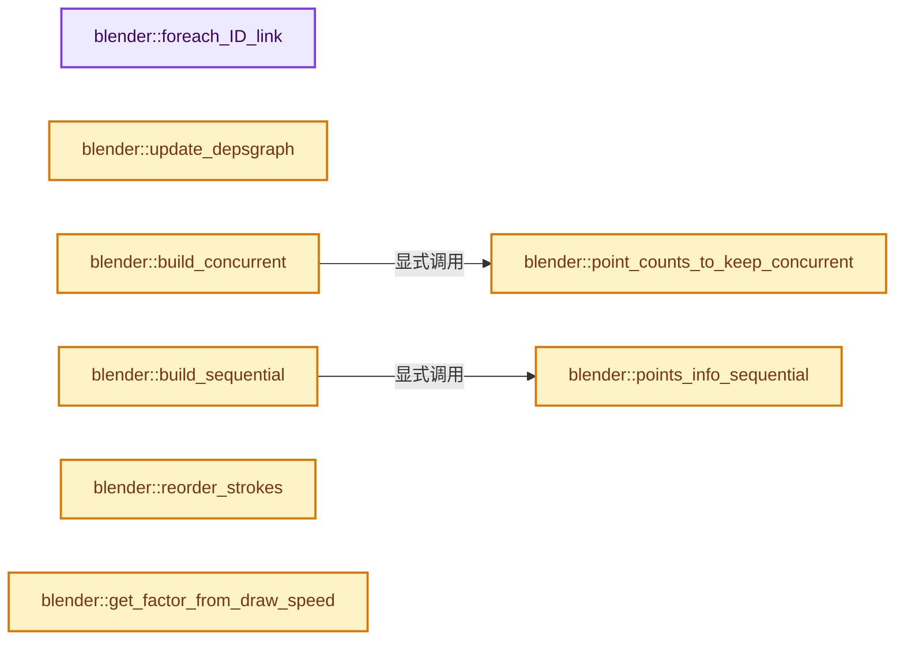
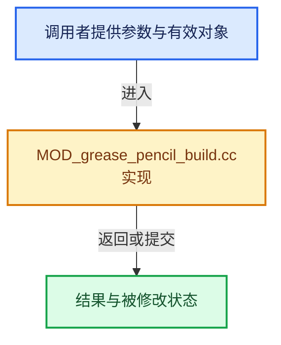

# 实现依赖专题：source/blender/modifiers/intern/MOD_grease_pencil_build.cc

[方向导航](README.md) · [符号索引](../%E7%AC%A6%E5%8F%B7%E4%BE%9D%E8%B5%96%E4%B8%8E%E5%AE%9E%E7%8E%B0%E7%B4%A2%E5%BC%95.md)

本专题从正文实际调用进入，集中保存共享实现。函数有稳定锚点，可从调用处直接跳到对应完整函数；递归与互相调用通过回链组织。

## 本文件的实现关系






## 完整成员与函数实现

<a id="f-9efcf4d9f0ea9e7a"></a>

### `blender::foreach_ID_link`

实现位置：[source/blender/modifiers/intern/MOD_grease_pencil_build.cc](../../../../../source/blender/modifiers/intern/MOD_grease_pencil_build.cc) · L69—L74。

接口参数：

- `ModifierData *md`
- `Object *ob`
- `IDWalkFunc walk`
- `void *user_data`

**教学注释版**

<!-- annotated:682f92248d38d3 -->

```cpp
static void foreach_ID_link(ModifierData *md, Object *ob, IDWalkFunc walk, void *user_data)
{
  auto *omd = reinterpret_cast<GreasePencilBuildModifierData *>(md);
  modifier::greasepencil::foreach_influence_ID_link(&omd->influence, ob, walk, user_data);
  walk(user_data, ob, reinterpret_cast<ID **>(&omd->object), IDWALK_CB_NOP);
}
```

<details>
<summary>核对原始源码：source/blender/modifiers/intern/MOD_grease_pencil_build.cc · L69—L74</summary>

<!-- original:682f92248d38d3:source/blender/modifiers/intern/MOD_grease_pencil_build.cc:69:74 -->

```cpp
static void foreach_ID_link(ModifierData *md, Object *ob, IDWalkFunc walk, void *user_data)
{
  auto *omd = reinterpret_cast<GreasePencilBuildModifierData *>(md);
  modifier::greasepencil::foreach_influence_ID_link(&omd->influence, ob, walk, user_data);
  walk(user_data, ob, reinterpret_cast<ID **>(&omd->object), IDWALK_CB_NOP);
}
```

</details>

**继续追踪实现**

- `modifier::greasepencil::foreach_influence_ID_link` → [blender::modifier::greasepencil::foreach_influence_ID_link · L69](%E4%BE%9D%E8%B5%96-MOD_grease_pencil_util-d0b437.md#f-247ba56fa4c4e56f)。
- `walk` → [调用协议](../%E6%A8%A1%E6%9D%BF%E5%AE%8F%E4%B8%8E%E5%8A%A8%E6%80%81%E5%88%86%E6%B4%BE%E5%8D%8F%E8%AE%AE.md)：局部可调用对象，须结合其初始化与捕获环境。调用位置L73。

<a id="f-8abd85f3e6452100"></a>

### `blender::update_depsgraph`

实现位置：[source/blender/modifiers/intern/MOD_grease_pencil_build.cc](../../../../../source/blender/modifiers/intern/MOD_grease_pencil_build.cc) · L76—L83。

接口参数：

- `ModifierData *md`
- `const ModifierUpdateDepsgraphContext *ctx`

**教学注释版**

<!-- annotated:8e9a09f7daebf9 -->

```cpp
static void update_depsgraph(ModifierData *md, const ModifierUpdateDepsgraphContext *ctx)
{
  auto *mmd = reinterpret_cast<GreasePencilBuildModifierData *>(md);
  if (mmd->object != nullptr) {
    DEG_add_object_relation(ctx->node, mmd->object, DEG_OB_COMP_TRANSFORM, "Build Modifier");
  }
  DEG_add_object_relation(ctx->node, ctx->object, DEG_OB_COMP_TRANSFORM, "Build Modifier");
}
```

<details>
<summary>核对原始源码：source/blender/modifiers/intern/MOD_grease_pencil_build.cc · L76—L83</summary>

<!-- original:8e9a09f7daebf9:source/blender/modifiers/intern/MOD_grease_pencil_build.cc:76:83 -->

```cpp
static void update_depsgraph(ModifierData *md, const ModifierUpdateDepsgraphContext *ctx)
{
  auto *mmd = reinterpret_cast<GreasePencilBuildModifierData *>(md);
  if (mmd->object != nullptr) {
    DEG_add_object_relation(ctx->node, mmd->object, DEG_OB_COMP_TRANSFORM, "Build Modifier");
  }
  DEG_add_object_relation(ctx->node, ctx->object, DEG_OB_COMP_TRANSFORM, "Build Modifier");
}
```

</details>

**继续追踪实现**

- `DEG_add_object_relation` → [blender::DEG_add_object_relation · L123](../11-Depsgraph%E4%B8%8E%E5%B9%B6%E8%A1%8C%E4%BB%BB%E5%8A%A1%E7%B3%BB%E7%BB%9F/%E4%BE%9D%E8%B5%96-depsgraph_build-ea2fc8.md#f-f570cffae97e273c)。

<a id="f-646fdaad9792f104"></a>

### `blender::point_counts_to_keep_concurrent`

实现位置：[source/blender/modifiers/intern/MOD_grease_pencil_build.cc](../../../../../source/blender/modifiers/intern/MOD_grease_pencil_build.cc) · L100—L168。

接口参数：

- `const bke::CurvesGeometry &curves`
- `const IndexMask &selection`
- `const GreasePencilBuildTimeAlignment time_alignment`
- `const GreasePencilBuildTransition transition`
- `const float factor`
- `const bool clamp_points`
- `int &r_curves_num`
- `int &r_points_num`

**教学注释版**

<!-- annotated:215efad22221a2 -->

```cpp
static Array<int> point_counts_to_keep_concurrent(
    const bke::CurvesGeometry &curves,
    const IndexMask &selection,
    const GreasePencilBuildTimeAlignment time_alignment,
    const GreasePencilBuildTransition transition,
    const float factor,
    const bool clamp_points,
    int &r_curves_num,
    int &r_points_num)
{
  const int stroke_count = curves.curves_num();
  const OffsetIndices<int> points_by_curve = curves.points_by_curve();
  const VArray<bool> cyclic = curves.cyclic();

  curves.ensure_evaluated_lengths();
  float max_length = 0;
  for (const int stroke : curves.curves_range()) {
    const bool stroke_cyclic = cyclic[stroke];
    const float len = curves.evaluated_length_total_for_curve(stroke, stroke_cyclic);
    max_length = math::max(max_length, len);
  }

  float factor_to_keep = transition == MOD_GREASE_PENCIL_BUILD_TRANSITION_GROW ? factor :
                                                                                 1.0f - factor;
  if (clamp_points) {
    r_curves_num = r_points_num = 0;
    factor_to_keep = std::clamp(factor_to_keep, 0.0f, 1.0f);
  }

  auto get_stroke_factor = [&](const float factor, const int index) {
    const bool stroke_cyclic = cyclic[index];
    const float total_length = curves.evaluated_length_total_for_curve(index, stroke_cyclic);
    if (total_length == 0) {
      return factor > 0.5f ? 1.0f : 0.0f;
    }
    const float max_factor = max_length / total_length;
    if (time_alignment == MOD_GREASE_PENCIL_BUILD_TIMEALIGN_START) {
      if (clamp_points) {
        return std::clamp(factor * max_factor, 0.0f, 1.0f);
      }
      return factor * max_factor;
    }
    if (time_alignment == MOD_GREASE_PENCIL_BUILD_TIMEALIGN_END) {
      const float min_factor = max_factor - 1.0f;
      const float use_factor = factor * max_factor;
      if (clamp_points) {
        return std::clamp(use_factor - min_factor, 0.0f, 1.0f);
      }
      return use_factor - min_factor;
    }
    return 0.0f;
  };

  Array<bool> select(stroke_count);
  // [讲解] select.as_mutable_span：提供数组的借用访问入口。
  selection.to_bools(select.as_mutable_span());
  Array<int> result(stroke_count);
  for (const int curve : curves.curves_range()) {
    const float local_factor = select[curve] ? get_stroke_factor(factor_to_keep, curve) : 1.0f;
    const int num_points = points_by_curve[curve].size() * local_factor;
    result[curve] = num_points;
    if (clamp_points) {
      r_points_num += num_points;
      if (num_points > 0) {
        r_curves_num++;
      }
    }
  }
  return result;
}
```

<details>
<summary>核对原始源码：source/blender/modifiers/intern/MOD_grease_pencil_build.cc · L100—L168</summary>

<!-- original:215efad22221a2:source/blender/modifiers/intern/MOD_grease_pencil_build.cc:100:168 -->

```cpp
static Array<int> point_counts_to_keep_concurrent(
    const bke::CurvesGeometry &curves,
    const IndexMask &selection,
    const GreasePencilBuildTimeAlignment time_alignment,
    const GreasePencilBuildTransition transition,
    const float factor,
    const bool clamp_points,
    int &r_curves_num,
    int &r_points_num)
{
  const int stroke_count = curves.curves_num();
  const OffsetIndices<int> points_by_curve = curves.points_by_curve();
  const VArray<bool> cyclic = curves.cyclic();

  curves.ensure_evaluated_lengths();
  float max_length = 0;
  for (const int stroke : curves.curves_range()) {
    const bool stroke_cyclic = cyclic[stroke];
    const float len = curves.evaluated_length_total_for_curve(stroke, stroke_cyclic);
    max_length = math::max(max_length, len);
  }

  float factor_to_keep = transition == MOD_GREASE_PENCIL_BUILD_TRANSITION_GROW ? factor :
                                                                                 1.0f - factor;
  if (clamp_points) {
    r_curves_num = r_points_num = 0;
    factor_to_keep = std::clamp(factor_to_keep, 0.0f, 1.0f);
  }

  auto get_stroke_factor = [&](const float factor, const int index) {
    const bool stroke_cyclic = cyclic[index];
    const float total_length = curves.evaluated_length_total_for_curve(index, stroke_cyclic);
    if (total_length == 0) {
      return factor > 0.5f ? 1.0f : 0.0f;
    }
    const float max_factor = max_length / total_length;
    if (time_alignment == MOD_GREASE_PENCIL_BUILD_TIMEALIGN_START) {
      if (clamp_points) {
        return std::clamp(factor * max_factor, 0.0f, 1.0f);
      }
      return factor * max_factor;
    }
    if (time_alignment == MOD_GREASE_PENCIL_BUILD_TIMEALIGN_END) {
      const float min_factor = max_factor - 1.0f;
      const float use_factor = factor * max_factor;
      if (clamp_points) {
        return std::clamp(use_factor - min_factor, 0.0f, 1.0f);
      }
      return use_factor - min_factor;
    }
    return 0.0f;
  };

  Array<bool> select(stroke_count);
  selection.to_bools(select.as_mutable_span());
  Array<int> result(stroke_count);
  for (const int curve : curves.curves_range()) {
    const float local_factor = select[curve] ? get_stroke_factor(factor_to_keep, curve) : 1.0f;
    const int num_points = points_by_curve[curve].size() * local_factor;
    result[curve] = num_points;
    if (clamp_points) {
      r_points_num += num_points;
      if (num_points > 0) {
        r_curves_num++;
      }
    }
  }
  return result;
}
```

</details>

**沿实际写入检查状态**

- `max_length = math::max(max_length, len);`
- `r_curves_num = r_points_num = 0;`
- `factor_to_keep = std::clamp(factor_to_keep, 0.0f, 1.0f);`
- `result[curve] = num_points;`
- `r_points_num += num_points;`

**结果出口**

- `return factor > 0.5f ? 1.0f : 0.0f;`
- `return std::clamp(factor * max_factor, 0.0f, 1.0f);`
- `return factor * max_factor;`
- `return std::clamp(use_factor - min_factor, 0.0f, 1.0f);`
- `return use_factor - min_factor;`
- `return 0.0f;`
- `return result;`

**继续追踪实现**

- `curves.curves_num` → [blender::bke::CurvesGeometry::curves_num · L1005](04-CurvesGeometry%E5%AD%98%E5%82%A8.md#f-eabb3f0e5d3c57be)。
- `curves.points_by_curve` → [blender::bke::CurvesGeometry::points_by_curve · L1058](04-CurvesGeometry%E5%AD%98%E5%82%A8.md#f-a0416697e10ec205)。
- `curves.cyclic` → [blender::bke::CurvesGeometry::cyclic · L362](%E4%BE%9D%E8%B5%96-curves_geometry-ad7f9f.md#f-ec08c2a1d6f3bfea)。
- `curves.ensure_evaluated_lengths` → [blender::bke::CurvesGeometry::ensure_evaluated_lengths · L1183](%E4%BE%9D%E8%B5%96-curves_geometry-ad7f9f.md#f-2e6e98abd3c59b14)。
- `curves.curves_range` → [blender::bke::CurvesGeometry::curves_range · L1023](04-CurvesGeometry%E5%AD%98%E5%82%A8.md#f-9aedfb1afc5ebcfb)。
- `curves.evaluated_length_total_for_curve` → [blender::bke::CurvesGeometry::evaluated_length_total_for_curve · L1095](04-CurvesGeometry%E5%AD%98%E5%82%A8.md#f-e26e35a431ece56a)。
- `math::max` → [blender::math::max · L87](../12-%E7%A9%BA%E9%97%B4%E6%95%B0%E6%8D%AE%E7%BB%93%E6%9E%84%E4%B8%8E%E5%87%A0%E4%BD%95%E7%AE%97%E6%B3%95/%E4%BE%9D%E8%B5%96-BLI_math_vector-906a87.md#f-9be564a293777d6b)；[blender::math::max · L96](../12-%E7%A9%BA%E9%97%B4%E6%95%B0%E6%8D%AE%E7%BB%93%E6%9E%84%E4%B8%8E%E5%87%A0%E4%BD%95%E7%AE%97%E6%B3%95/%E4%BE%9D%E8%B5%96-BLI_math_vector-906a87.md#f-ce32dff37d0af3bc)；[blender::math::max · L112](../12-%E7%A9%BA%E9%97%B4%E6%95%B0%E6%8D%AE%E7%BB%93%E6%9E%84%E4%B8%8E%E5%87%A0%E4%BD%95%E7%AE%97%E6%B3%95/%E4%BE%9D%E8%B5%96-BLI_math_vector-906a87.md#f-668eb1fcf1fa8292)；[blender::math::max · L49](../12-%E7%A9%BA%E9%97%B4%E6%95%B0%E6%8D%AE%E7%BB%93%E6%9E%84%E4%B8%8E%E5%87%A0%E4%BD%95%E7%AE%97%E6%B3%95/%E4%BE%9D%E8%B5%96-BLI_math_base-0728eb.md#f-a6991ca3d12937e1)。同名重载需按实参类型选择。
- `std::clamp` → [外部契约](https://eel.is/c++draft/)：这个边界按实际表达式及所属类型核对参数、返回值、寿命与失败行为。这里提供接口入口，不声称已解释该第三方版本的内部实现。
- `selection.to_bools` → [blender::index_mask::IndexMask::to_bools · L802](../04-%E8%99%9A%E6%8B%9F%E6%95%B0%E7%BB%84%E4%B8%8E%E7%B4%A2%E5%BC%95%E9%80%89%E6%8B%A9/10-IndexMask%E6%9E%84%E5%BB%BA%E4%B8%8E%E5%B9%B6%E8%A1%8C.md#f-006b4104971dea55)。
- `select.as_mutable_span` → [blender::Array::as_mutable_span · L259](../01-%E5%9F%BA%E7%A1%80%E5%AE%B9%E5%99%A8%E4%B8%8E%E7%8E%B0%E4%BB%A3CPP/08-Array%E5%A4%8D%E5%88%B6%E7%A7%BB%E5%8A%A8%E4%B8%8E%E9%94%80%E6%AF%81.md#f-4e91de9f1337c144)。
- `get_stroke_factor` → [调用协议](../%E6%A8%A1%E6%9D%BF%E5%AE%8F%E4%B8%8E%E5%8A%A8%E6%80%81%E5%88%86%E6%B4%BE%E5%8D%8F%E8%AE%AE.md)：局部可调用对象，须结合其初始化与捕获环境。调用位置L157。
- `points_by_curve[curve].size` → [调用协议](../%E6%A8%A1%E6%9D%BF%E5%AE%8F%E4%B8%8E%E5%8A%A8%E6%80%81%E5%88%86%E6%B4%BE%E5%8D%8F%E8%AE%AE.md)：接收对象类型依赖auto、返回值或模板实例；不按同名猜测目标。调用位置L158。

<a id="f-7fca5a5409610945"></a>

### `blender::build_concurrent`

实现位置：[source/blender/modifiers/intern/MOD_grease_pencil_build.cc](../../../../../source/blender/modifiers/intern/MOD_grease_pencil_build.cc) · L170—L282。

接口参数：

- `bke::greasepencil::Drawing &drawing`
- `bke::CurvesGeometry &curves`
- `const IndexMask &selection`
- `const GreasePencilBuildTimeAlignment time_alignment`
- `const GreasePencilBuildTransition transition`
- `const float factor`
- `const float factor_start`
- `const float factor_opacity`
- `const float factor_radii`
- `StringRefNull target_vgname`

**教学注释版**

<!-- annotated:c3205be00869f0 -->

```cpp
static bke::CurvesGeometry build_concurrent(bke::greasepencil::Drawing &drawing,
                                            bke::CurvesGeometry &curves,
                                            const IndexMask &selection,
                                            const GreasePencilBuildTimeAlignment time_alignment,
                                            const GreasePencilBuildTransition transition,
                                            const float factor,
                                            const float factor_start,
                                            const float factor_opacity,
                                            const float factor_radii,
                                            StringRefNull target_vgname)
{
  int dst_curves_num, dst_points_num;
  const bool has_fade = factor_start != factor;
  const Array<int> point_counts_to_keep = point_counts_to_keep_concurrent(
      curves, selection, time_alignment, transition, factor, true, dst_curves_num, dst_points_num);
  if (dst_curves_num == 0) {
    return {};
  }
  const Array<int> starts_per_curve = has_fade ? point_counts_to_keep_concurrent(curves,
                                                                                 selection,
                                                                                 time_alignment,
                                                                                 transition,
                                                                                 factor_start,
                                                                                 false,
                                                                                 dst_curves_num,
                                                                                 dst_points_num) :
                                                 Array<int>(0);
  const Array<int> ends_per_curve = has_fade ? point_counts_to_keep_concurrent(curves,
                                                                               selection,
                                                                               time_alignment,
                                                                               transition,
                                                                               factor,
                                                                               false,
                                                                               dst_curves_num,
                                                                               dst_points_num) :
                                               Array<int>(0);

  const OffsetIndices<int> points_by_curve = curves.points_by_curve();
  MutableSpan<float> opacities = drawing.opacities_for_write();
  MutableSpan<float> radii = drawing.radii_for_write();
  bke::MutableAttributeAccessor attributes = curves.attributes_for_write();
  bke::SpanAttributeWriter<float> weights = attributes.lookup_for_write_span<float>(target_vgname);

  const bool is_vanishing = transition == MOD_GREASE_PENCIL_BUILD_TRANSITION_VANISH;

  bke::CurvesGeometry dst_curves(dst_points_num, dst_curves_num);
  Array<int> dst_to_src_point(dst_points_num);
  Array<int> dst_to_src_curve(dst_curves_num);
  MutableSpan<int> dst_offsets = dst_curves.offsets_for_write();
  dst_offsets[0] = 0;

  int next_curve = 0;
  int next_point = 0;
  for (const int curve : curves.curves_range()) {
    if (!point_counts_to_keep[curve]) {
      continue;
    }
    const IndexRange points = points_by_curve[curve];
    dst_offsets[next_curve] = point_counts_to_keep[curve];
    // [讲解] points.size：读取连续区间或分组的边界信息。
    const int curve_size = points.size();

    auto get_fade_weight = [&](const int local_index) {
      const float fade_range = std::abs(ends_per_curve[curve] - starts_per_curve[curve]);
      if (is_vanishing) {
        const float factor_from_start = local_index - curve_size + ends_per_curve[curve];
        return 1.0f - std::clamp(factor_from_start / fade_range, 0.0f, 1.0f);
      }
      const float factor_from_start = local_index - starts_per_curve[curve];
      return std::clamp(factor_from_start / fade_range, 0.0f, 1.0f);
    };

    const int extra_offset = is_vanishing ? points.size() - point_counts_to_keep[curve] : 0;
    for (const int stroke_point : IndexRange(point_counts_to_keep[curve])) {
      // [讲解] points.first：读取范围两端的有效索引或值。
      const int src_point_index = points.first() + extra_offset + stroke_point;
      if (has_fade) {
        const float fade_weight = get_fade_weight(extra_offset + stroke_point);
        opacities[src_point_index] = opacities[src_point_index] *
                                     (1.0f - fade_weight * factor_opacity);
        radii[src_point_index] = radii[src_point_index] * (1.0f - fade_weight * factor_radii);
        if (!weights.span.is_empty()) {
          weights.span[src_point_index] = fade_weight;
        }
      }
      dst_to_src_point[next_point] = src_point_index;
      next_point++;
    }
    dst_to_src_curve[next_curve] = curve;
    next_curve++;
  }
  weights.finish();

  offset_indices::accumulate_counts_to_offsets(dst_offsets);

  const bke::AttributeAccessor src_attributes = curves.attributes();
  bke::MutableAttributeAccessor dst_attributes = dst_curves.attributes_for_write();

  gather_attributes(src_attributes,
                    bke::AttrDomain::Point,
                    bke::AttrDomain::Point,
                    {},
                    dst_to_src_point,
                    dst_attributes);
  gather_attributes(src_attributes,
                    bke::AttrDomain::Curve,
                    bke::AttrDomain::Curve,
                    {},
                    dst_to_src_curve,
                    dst_attributes);

  dst_curves.update_curve_types();

  return dst_curves;
}
```

<details>
<summary>核对原始源码：source/blender/modifiers/intern/MOD_grease_pencil_build.cc · L170—L282</summary>

<!-- original:c3205be00869f0:source/blender/modifiers/intern/MOD_grease_pencil_build.cc:170:282 -->

```cpp
static bke::CurvesGeometry build_concurrent(bke::greasepencil::Drawing &drawing,
                                            bke::CurvesGeometry &curves,
                                            const IndexMask &selection,
                                            const GreasePencilBuildTimeAlignment time_alignment,
                                            const GreasePencilBuildTransition transition,
                                            const float factor,
                                            const float factor_start,
                                            const float factor_opacity,
                                            const float factor_radii,
                                            StringRefNull target_vgname)
{
  int dst_curves_num, dst_points_num;
  const bool has_fade = factor_start != factor;
  const Array<int> point_counts_to_keep = point_counts_to_keep_concurrent(
      curves, selection, time_alignment, transition, factor, true, dst_curves_num, dst_points_num);
  if (dst_curves_num == 0) {
    return {};
  }
  const Array<int> starts_per_curve = has_fade ? point_counts_to_keep_concurrent(curves,
                                                                                 selection,
                                                                                 time_alignment,
                                                                                 transition,
                                                                                 factor_start,
                                                                                 false,
                                                                                 dst_curves_num,
                                                                                 dst_points_num) :
                                                 Array<int>(0);
  const Array<int> ends_per_curve = has_fade ? point_counts_to_keep_concurrent(curves,
                                                                               selection,
                                                                               time_alignment,
                                                                               transition,
                                                                               factor,
                                                                               false,
                                                                               dst_curves_num,
                                                                               dst_points_num) :
                                               Array<int>(0);

  const OffsetIndices<int> points_by_curve = curves.points_by_curve();
  MutableSpan<float> opacities = drawing.opacities_for_write();
  MutableSpan<float> radii = drawing.radii_for_write();
  bke::MutableAttributeAccessor attributes = curves.attributes_for_write();
  bke::SpanAttributeWriter<float> weights = attributes.lookup_for_write_span<float>(target_vgname);

  const bool is_vanishing = transition == MOD_GREASE_PENCIL_BUILD_TRANSITION_VANISH;

  bke::CurvesGeometry dst_curves(dst_points_num, dst_curves_num);
  Array<int> dst_to_src_point(dst_points_num);
  Array<int> dst_to_src_curve(dst_curves_num);
  MutableSpan<int> dst_offsets = dst_curves.offsets_for_write();
  dst_offsets[0] = 0;

  int next_curve = 0;
  int next_point = 0;
  for (const int curve : curves.curves_range()) {
    if (!point_counts_to_keep[curve]) {
      continue;
    }
    const IndexRange points = points_by_curve[curve];
    dst_offsets[next_curve] = point_counts_to_keep[curve];
    const int curve_size = points.size();

    auto get_fade_weight = [&](const int local_index) {
      const float fade_range = std::abs(ends_per_curve[curve] - starts_per_curve[curve]);
      if (is_vanishing) {
        const float factor_from_start = local_index - curve_size + ends_per_curve[curve];
        return 1.0f - std::clamp(factor_from_start / fade_range, 0.0f, 1.0f);
      }
      const float factor_from_start = local_index - starts_per_curve[curve];
      return std::clamp(factor_from_start / fade_range, 0.0f, 1.0f);
    };

    const int extra_offset = is_vanishing ? points.size() - point_counts_to_keep[curve] : 0;
    for (const int stroke_point : IndexRange(point_counts_to_keep[curve])) {
      const int src_point_index = points.first() + extra_offset + stroke_point;
      if (has_fade) {
        const float fade_weight = get_fade_weight(extra_offset + stroke_point);
        opacities[src_point_index] = opacities[src_point_index] *
                                     (1.0f - fade_weight * factor_opacity);
        radii[src_point_index] = radii[src_point_index] * (1.0f - fade_weight * factor_radii);
        if (!weights.span.is_empty()) {
          weights.span[src_point_index] = fade_weight;
        }
      }
      dst_to_src_point[next_point] = src_point_index;
      next_point++;
    }
    dst_to_src_curve[next_curve] = curve;
    next_curve++;
  }
  weights.finish();

  offset_indices::accumulate_counts_to_offsets(dst_offsets);

  const bke::AttributeAccessor src_attributes = curves.attributes();
  bke::MutableAttributeAccessor dst_attributes = dst_curves.attributes_for_write();

  gather_attributes(src_attributes,
                    bke::AttrDomain::Point,
                    bke::AttrDomain::Point,
                    {},
                    dst_to_src_point,
                    dst_attributes);
  gather_attributes(src_attributes,
                    bke::AttrDomain::Curve,
                    bke::AttrDomain::Curve,
                    {},
                    dst_to_src_curve,
                    dst_attributes);

  dst_curves.update_curve_types();

  return dst_curves;
}
```

</details>

**沿实际写入检查状态**

- `dst_offsets[0] = 0;`
- `dst_offsets[next_curve] = point_counts_to_keep[curve];`
- `opacities[src_point_index] = opacities[src_point_index] *`
- `radii[src_point_index] = radii[src_point_index] * (1.0f - fade_weight * factor_radii);`
- `weights.span[src_point_index] = fade_weight;`
- `dst_to_src_point[next_point] = src_point_index;`
- `dst_to_src_curve[next_curve] = curve;`

**结果出口**

- `return {};`
- `return 1.0f - std::clamp(factor_from_start / fade_range, 0.0f, 1.0f);`
- `return std::clamp(factor_from_start / fade_range, 0.0f, 1.0f);`
- `return dst_curves;`

**继续追踪实现**

- `point_counts_to_keep_concurrent` → [blender::point_counts_to_keep_concurrent · L100](%E4%BE%9D%E8%B5%96-MOD_grease_pencil_build-c03219.md#f-646fdaad9792f104)。
- `Array<int>` → [blender::Array::Array · L78](../01-%E5%9F%BA%E7%A1%80%E5%AE%B9%E5%99%A8%E4%B8%8E%E7%8E%B0%E4%BB%A3CPP/07-Array%E6%9E%84%E9%80%A0%E4%B8%8E%E5%AD%98%E5%82%A8.md#f-001fd5eb3c658238)；[blender::Array::Array · L84](../01-%E5%9F%BA%E7%A1%80%E5%AE%B9%E5%99%A8%E4%B8%8E%E7%8E%B0%E4%BB%A3CPP/07-Array%E6%9E%84%E9%80%A0%E4%B8%8E%E5%AD%98%E5%82%A8.md#f-674e2f10361a462b)；[blender::Array::Array · L89](../01-%E5%9F%BA%E7%A1%80%E5%AE%B9%E5%99%A8%E4%B8%8E%E7%8E%B0%E4%BB%A3CPP/07-Array%E6%9E%84%E9%80%A0%E4%B8%8E%E5%AD%98%E5%82%A8.md#f-aa1e5908a9b67557)；[blender::Array::Array · L103](../01-%E5%9F%BA%E7%A1%80%E5%AE%B9%E5%99%A8%E4%B8%8E%E7%8E%B0%E4%BB%A3CPP/07-Array%E6%9E%84%E9%80%A0%E4%B8%8E%E5%AD%98%E5%82%A8.md#f-b141be39084346f3)；[blender::Array::Array · L110](../01-%E5%9F%BA%E7%A1%80%E5%AE%B9%E5%99%A8%E4%B8%8E%E7%8E%B0%E4%BB%A3CPP/07-Array%E6%9E%84%E9%80%A0%E4%B8%8E%E5%AD%98%E5%82%A8.md#f-452e276f39e81a2a)；[blender::Array::Array · L123](../01-%E5%9F%BA%E7%A1%80%E5%AE%B9%E5%99%A8%E4%B8%8E%E7%8E%B0%E4%BB%A3CPP/07-Array%E6%9E%84%E9%80%A0%E4%B8%8E%E5%AD%98%E5%82%A8.md#f-646aa58152ec44f6)；[blender::Array::Array · L135](../01-%E5%9F%BA%E7%A1%80%E5%AE%B9%E5%99%A8%E4%B8%8E%E7%8E%B0%E4%BB%A3CPP/07-Array%E6%9E%84%E9%80%A0%E4%B8%8E%E5%AD%98%E5%82%A8.md#f-0a9de4a549125f99)；[blender::Array::Array · L168](../01-%E5%9F%BA%E7%A1%80%E5%AE%B9%E5%99%A8%E4%B8%8E%E7%8E%B0%E4%BB%A3CPP/07-Array%E6%9E%84%E9%80%A0%E4%B8%8E%E5%AD%98%E5%82%A8.md#f-31f001eb92069e9d)；[blender::Array::Array · L176](../01-%E5%9F%BA%E7%A1%80%E5%AE%B9%E5%99%A8%E4%B8%8E%E7%8E%B0%E4%BB%A3CPP/07-Array%E6%9E%84%E9%80%A0%E4%B8%8E%E5%AD%98%E5%82%A8.md#f-cf8148f06fc6747a)；[blender::Array::Array · L178](../01-%E5%9F%BA%E7%A1%80%E5%AE%B9%E5%99%A8%E4%B8%8E%E7%8E%B0%E4%BB%A3CPP/07-Array%E6%9E%84%E9%80%A0%E4%B8%8E%E5%AD%98%E5%82%A8.md#f-2ddca2fb9dd964b3)。同名重载需按实参类型选择。
- `curves.points_by_curve` → [blender::bke::CurvesGeometry::points_by_curve · L1058](04-CurvesGeometry%E5%AD%98%E5%82%A8.md#f-a0416697e10ec205)。
- `drawing.opacities_for_write` → [blender::bke::greasepencil::Drawing::opacities_for_write · L1038](%E4%BE%9D%E8%B5%96-grease_pencil-f750d6.md#f-e9418de3657dd416)。
- `drawing.radii_for_write` → [blender::bke::greasepencil::Drawing::radii_for_write · L1023](%E4%BE%9D%E8%B5%96-grease_pencil-f750d6.md#f-53b2a01d6a3079c0)。
- `curves.attributes_for_write` → [blender::bke::CurvesGeometry::attributes_for_write · L1913](%E4%BE%9D%E8%B5%96-curves_geometry-ad7f9f.md#f-4930091b34fa9663)。
- `attributes.lookup_for_write_span<float>` → [blender::bke::MutableAttributeAccessor::lookup_for_write_span · L505](%E4%BE%9D%E8%B5%96-attribute_access-bceef3.md#f-eac5b5d8814ff900)；[blender::bke::MutableAttributeAccessor::lookup_for_write_span · L744](08-AttributeAccessor%E6%8E%A5%E5%8F%A3.md#f-4ace458d74222bb4)。同名重载需按实参类型选择。
- `dst_curves.offsets_for_write` → [blender::bke::CurvesGeometry::offsets_for_write · L352](%E4%BE%9D%E8%B5%96-curves_geometry-ad7f9f.md#f-9ea1e4f36b216dd0)。
- `curves.curves_range` → [blender::bke::CurvesGeometry::curves_range · L1023](04-CurvesGeometry%E5%AD%98%E5%82%A8.md#f-9aedfb1afc5ebcfb)。
- `points.size` → [blender::IndexRange::size · L156](../01-%E5%9F%BA%E7%A1%80%E5%AE%B9%E5%99%A8%E4%B8%8E%E7%8E%B0%E4%BB%A3CPP/04-IndexRange%E8%BF%9E%E7%BB%AD%E6%95%B4%E6%95%B0%E5%8C%BA%E9%97%B4.md#f-05f66c3ebb2fdfec)。
- `std::abs` → [外部契约](https://eel.is/c++draft/)：这个边界按实际表达式及所属类型核对参数、返回值、寿命与失败行为。这里提供接口入口，不声称已解释该第三方版本的内部实现。
- `std::clamp` → [外部契约](https://eel.is/c++draft/)：这个边界按实际表达式及所属类型核对参数、返回值、寿命与失败行为。这里提供接口入口，不声称已解释该第三方版本的内部实现。
- `IndexRange` → [blender::IndexRange](../01-%E5%9F%BA%E7%A1%80%E5%AE%B9%E5%99%A8%E4%B8%8E%E7%8E%B0%E4%BB%A3CPP/%E4%BE%9D%E8%B5%96-BLI_index_range-7d7cc5.md#t-caa3466d6776)；[blender::gpu::shader::parser::IndexRange](%E4%BE%9D%E8%B5%96-utils-06433d.md#t-82d2bd4ea71c)；[blender::IndexRange](%E4%BE%9D%E8%B5%96-DNA_node_types-6708b9.md#t-0448cc889d39)。
- `points.first` → [blender::IndexRange::first · L204](../01-%E5%9F%BA%E7%A1%80%E5%AE%B9%E5%99%A8%E4%B8%8E%E7%8E%B0%E4%BB%A3CPP/04-IndexRange%E8%BF%9E%E7%BB%AD%E6%95%B4%E6%95%B0%E5%8C%BA%E9%97%B4.md#f-ab443c94e531befa)。
- `get_fade_weight` → [调用协议](../%E6%A8%A1%E6%9D%BF%E5%AE%8F%E4%B8%8E%E5%8A%A8%E6%80%81%E5%88%86%E6%B4%BE%E5%8D%8F%E8%AE%AE.md)：局部可调用对象，须结合其初始化与捕获环境。调用位置L245。
- `weights.span.is_empty` → [调用协议](../%E6%A8%A1%E6%9D%BF%E5%AE%8F%E4%B8%8E%E5%8A%A8%E6%80%81%E5%88%86%E6%B4%BE%E5%8D%8F%E8%AE%AE.md)：接收对象类型依赖auto、返回值或模板实例；不按同名猜测目标。调用位置L249。
- `weights.finish` → [blender::bke::SpanAttributeWriter::finish · L279](08-AttributeAccessor%E6%8E%A5%E5%8F%A3.md#f-585970a3b1bd4da4)。
- `offset_indices::accumulate_counts_to_offsets` → [blender::offset_indices::accumulate_counts_to_offsets · L24](05-%E9%82%BB%E6%8E%A5%E5%85%B3%E7%B3%BB%E4%B8%8E%E5%89%8D%E7%BC%80%E5%92%8C.md#f-cfa9fbd186afcdd5)。
- `curves.attributes` → [blender::bke::CurvesGeometry::attributes · L1908](%E4%BE%9D%E8%B5%96-curves_geometry-ad7f9f.md#f-8e24fbf758862a22)。
- `dst_curves.attributes_for_write` → [blender::bke::CurvesGeometry::attributes_for_write · L1913](%E4%BE%9D%E8%B5%96-curves_geometry-ad7f9f.md#f-4930091b34fa9663)。
- `gather_attributes` → [调用协议](../%E6%A8%A1%E6%9D%BF%E5%AE%8F%E4%B8%8E%E5%8A%A8%E6%80%81%E5%88%86%E6%B4%BE%E5%8D%8F%E8%AE%AE.md)：函数指针、局部可调用对象或未展开的宏；必须结合调用者环境。调用位置L266。
- `dst_curves.update_curve_types` → [blender::bke::CurvesGeometry::update_curve_types · L318](%E4%BE%9D%E8%B5%96-curves_geometry-ad7f9f.md#f-f7155d4f5776d2ad)。

<a id="f-3939c217a98ced7d"></a>

### `blender::points_info_sequential`

实现位置：[source/blender/modifiers/intern/MOD_grease_pencil_build.cc](../../../../../source/blender/modifiers/intern/MOD_grease_pencil_build.cc) · L284—L324。

接口参数：

- `const bke::CurvesGeometry &curves`
- `const IndexMask &selection`
- `const GreasePencilBuildTransition transition`
- `const float factor`
- `const bool clamp_points`
- `int &r_curves_num`
- `int &r_points_num`

**教学注释版**

<!-- annotated:366f053e04d8f1 -->

```cpp
static void points_info_sequential(const bke::CurvesGeometry &curves,
                                   const IndexMask &selection,
                                   const GreasePencilBuildTransition transition,
                                   const float factor,
                                   const bool clamp_points,
                                   int &r_curves_num,
                                   int &r_points_num)
{
  const int stroke_count = curves.curves_num();
  const OffsetIndices<int> points_by_curve = curves.points_by_curve();

  float factor_to_keep = transition == MOD_GREASE_PENCIL_BUILD_TRANSITION_GROW ? factor :
                                                                                 (1.0f - factor);
  if (clamp_points) {
    factor_to_keep = std::clamp(factor_to_keep, 0.0f, 1.0f);
  }

  const bool is_vanishing = transition == MOD_GREASE_PENCIL_BUILD_TRANSITION_VANISH;

  int effective_points_num = offset_indices::sum_group_sizes(points_by_curve, selection);

  const int untouched_points_num = points_by_curve.total_size() - effective_points_num;
  effective_points_num *= factor_to_keep;
  effective_points_num += untouched_points_num;

  r_points_num = effective_points_num;
  r_curves_num = 0;

  Array<bool> select(stroke_count);
  // [讲解] select.as_mutable_span：提供数组的借用访问入口。
  selection.to_bools(select.as_mutable_span());

  int counted_points_num = 0;
  for (const int i : curves.curves_range()) {
    const int stroke = is_vanishing ? stroke_count - i - 1 : i;
    if (select[stroke] && counted_points_num >= effective_points_num) {
      continue;
    }
    counted_points_num += points_by_curve[stroke].size();
    r_curves_num++;
  }
}
```

<details>
<summary>核对原始源码：source/blender/modifiers/intern/MOD_grease_pencil_build.cc · L284—L324</summary>

<!-- original:366f053e04d8f1:source/blender/modifiers/intern/MOD_grease_pencil_build.cc:284:324 -->

```cpp
static void points_info_sequential(const bke::CurvesGeometry &curves,
                                   const IndexMask &selection,
                                   const GreasePencilBuildTransition transition,
                                   const float factor,
                                   const bool clamp_points,
                                   int &r_curves_num,
                                   int &r_points_num)
{
  const int stroke_count = curves.curves_num();
  const OffsetIndices<int> points_by_curve = curves.points_by_curve();

  float factor_to_keep = transition == MOD_GREASE_PENCIL_BUILD_TRANSITION_GROW ? factor :
                                                                                 (1.0f - factor);
  if (clamp_points) {
    factor_to_keep = std::clamp(factor_to_keep, 0.0f, 1.0f);
  }

  const bool is_vanishing = transition == MOD_GREASE_PENCIL_BUILD_TRANSITION_VANISH;

  int effective_points_num = offset_indices::sum_group_sizes(points_by_curve, selection);

  const int untouched_points_num = points_by_curve.total_size() - effective_points_num;
  effective_points_num *= factor_to_keep;
  effective_points_num += untouched_points_num;

  r_points_num = effective_points_num;
  r_curves_num = 0;

  Array<bool> select(stroke_count);
  selection.to_bools(select.as_mutable_span());

  int counted_points_num = 0;
  for (const int i : curves.curves_range()) {
    const int stroke = is_vanishing ? stroke_count - i - 1 : i;
    if (select[stroke] && counted_points_num >= effective_points_num) {
      continue;
    }
    counted_points_num += points_by_curve[stroke].size();
    r_curves_num++;
  }
}
```

</details>

**沿实际写入检查状态**

- `factor_to_keep = std::clamp(factor_to_keep, 0.0f, 1.0f);`
- `effective_points_num *= factor_to_keep;`
- `effective_points_num += untouched_points_num;`
- `r_points_num = effective_points_num;`
- `r_curves_num = 0;`
- `counted_points_num += points_by_curve[stroke].size();`

**继续追踪实现**

- `curves.curves_num` → [blender::bke::CurvesGeometry::curves_num · L1005](04-CurvesGeometry%E5%AD%98%E5%82%A8.md#f-eabb3f0e5d3c57be)。
- `curves.points_by_curve` → [blender::bke::CurvesGeometry::points_by_curve · L1058](04-CurvesGeometry%E5%AD%98%E5%82%A8.md#f-a0416697e10ec205)。
- `std::clamp` → [外部契约](https://eel.is/c++draft/)：这个边界按实际表达式及所属类型核对参数、返回值、寿命与失败行为。这里提供接口入口，不声称已解释该第三方版本的内部实现。
- `offset_indices::sum_group_sizes` → [blender::offset_indices::sum_group_sizes · L110](05-%E9%82%BB%E6%8E%A5%E5%85%B3%E7%B3%BB%E4%B8%8E%E5%89%8D%E7%BC%80%E5%92%8C.md#f-89e81645a99e1102)；[blender::offset_indices::sum_group_sizes · L119](05-%E9%82%BB%E6%8E%A5%E5%85%B3%E7%B3%BB%E4%B8%8E%E5%89%8D%E7%BC%80%E5%92%8C.md#f-2d8c42ca6d454833)。同名重载需按实参类型选择。
- `points_by_curve.total_size` → [blender::offset_indices::OffsetIndices::total_size · L58](02-OffsetIndices%E5%AE%8C%E6%95%B4%E6%8E%A5%E5%8F%A3.md#f-c111ffdac7a19248)。
- `selection.to_bools` → [blender::index_mask::IndexMask::to_bools · L802](../04-%E8%99%9A%E6%8B%9F%E6%95%B0%E7%BB%84%E4%B8%8E%E7%B4%A2%E5%BC%95%E9%80%89%E6%8B%A9/10-IndexMask%E6%9E%84%E5%BB%BA%E4%B8%8E%E5%B9%B6%E8%A1%8C.md#f-006b4104971dea55)。
- `select.as_mutable_span` → [blender::Array::as_mutable_span · L259](../01-%E5%9F%BA%E7%A1%80%E5%AE%B9%E5%99%A8%E4%B8%8E%E7%8E%B0%E4%BB%A3CPP/08-Array%E5%A4%8D%E5%88%B6%E7%A7%BB%E5%8A%A8%E4%B8%8E%E9%94%80%E6%AF%81.md#f-4e91de9f1337c144)。
- `curves.curves_range` → [blender::bke::CurvesGeometry::curves_range · L1023](04-CurvesGeometry%E5%AD%98%E5%82%A8.md#f-9aedfb1afc5ebcfb)。
- `points_by_curve[stroke].size` → [调用协议](../%E6%A8%A1%E6%9D%BF%E5%AE%8F%E4%B8%8E%E5%8A%A8%E6%80%81%E5%88%86%E6%B4%BE%E5%8D%8F%E8%AE%AE.md)：接收对象类型依赖auto、返回值或模板实例；不按同名猜测目标。调用位置L321。

<a id="f-a737c865d5243114"></a>

### `blender::build_sequential`

实现位置：[source/blender/modifiers/intern/MOD_grease_pencil_build.cc](../../../../../source/blender/modifiers/intern/MOD_grease_pencil_build.cc) · L326—L444。

接口参数：

- `bke::greasepencil::Drawing &drawing`
- `bke::CurvesGeometry &curves`
- `const IndexMask &selection`
- `const GreasePencilBuildTransition transition`
- `const float factor`
- `const float factor_start`
- `const float factor_opacity`
- `const float factor_radii`
- `StringRefNull target_vgname`

**教学注释版**

<!-- annotated:7028607752aa34 -->

```cpp
static bke::CurvesGeometry build_sequential(bke::greasepencil::Drawing &drawing,
                                            bke::CurvesGeometry &curves,
                                            const IndexMask &selection,
                                            const GreasePencilBuildTransition transition,
                                            const float factor,
                                            const float factor_start,
                                            const float factor_opacity,
                                            const float factor_radii,
                                            StringRefNull target_vgname)
{
  const bool has_fade = factor_start != factor;
  int dst_curves_num, dst_points_num;
  int start_points_num, end_points_num, dummy_curves_num;
  points_info_sequential(
      curves, selection, transition, factor, true, dst_curves_num, dst_points_num);

  if (dst_curves_num == 0) {
    return {};
  }

  points_info_sequential(
      curves, selection, transition, factor_start, false, dummy_curves_num, start_points_num);
  points_info_sequential(
      curves, selection, transition, factor, false, dummy_curves_num, end_points_num);

  const OffsetIndices<int> points_by_curve = curves.points_by_curve();
  MutableSpan<float> opacities = drawing.opacities_for_write();
  MutableSpan<float> radii = drawing.radii_for_write();
  bke::MutableAttributeAccessor attributes = curves.attributes_for_write();
  bke::SpanAttributeWriter<float> weights = attributes.lookup_for_write_span<float>(target_vgname);

  const bool is_vanishing = transition == MOD_GREASE_PENCIL_BUILD_TRANSITION_VANISH;

  bke::CurvesGeometry dst_curves(dst_points_num, dst_curves_num);
  MutableSpan<int> dst_offsets = dst_curves.offsets_for_write();
  Array<int> dst_to_src_point(dst_points_num);
  Array<int> dst_to_src_curve(dst_curves_num);

  dst_offsets[0] = 0;

  int next_curve = 1, next_point = 0;
  IndexMaskMemory memory;
  selection.complement(curves.curves_range(), memory).foreach_index([&](const int stroke) {
    for (const int point : points_by_curve[stroke]) {
      dst_to_src_point[next_point] = point;
      next_point++;
    }
    dst_to_src_curve[next_curve - 1] = stroke;
    dst_offsets[next_curve] = next_point;
    next_curve++;
  });

  const int stroke_count = curves.curves_num();
  bool done_scanning = false;
  selection.foreach_index([&](const int i) {
    const int stroke = is_vanishing ? stroke_count - i - 1 : i;
    if (done_scanning || next_point >= dst_points_num) {
      done_scanning = true;
      return;
    }

    auto get_fade_weight = [&](const int next_point_count) {
      return std::clamp(float(next_point_count - start_points_num) /
                            float(abs(end_points_num - start_points_num)),
                        0.0f,
                        1.0f);
    };

    const IndexRange points = points_by_curve[stroke];
    for (const int point : points) {
      // [讲解] points.first：读取范围两端的有效索引或值。
      const int local_index = point - points.first();
      // [讲解] points.last：读取范围两端的有效索引或值。
      const int src_point_index = is_vanishing ? points.last() - local_index : point;
      dst_to_src_point[next_point] = src_point_index;

      if (has_fade) {
        const float fade_weight = get_fade_weight(next_point);
        opacities[src_point_index] = opacities[src_point_index] *
                                     (1.0f - fade_weight * factor_opacity);
        radii[src_point_index] = radii[src_point_index] * (1.0f - fade_weight * factor_radii);
        if (!weights.span.is_empty()) {
          weights.span[src_point_index] = fade_weight;
        }
      }

      next_point++;
      if (next_point >= dst_points_num) {
        done_scanning = true;
        break;
      }
    }
    dst_offsets[next_curve] = next_point;
    dst_to_src_curve[next_curve - 1] = i;
    next_curve++;
  });
  weights.finish();

  BLI_assert(next_curve == (dst_curves_num + 1));
  BLI_assert(next_point == dst_points_num);

  const bke::AttributeAccessor src_attributes = curves.attributes();
  bke::MutableAttributeAccessor dst_attributes = dst_curves.attributes_for_write();

  gather_attributes(src_attributes,
                    bke::AttrDomain::Point,
                    bke::AttrDomain::Point,
                    {},
                    dst_to_src_point,
                    dst_attributes);
  gather_attributes(src_attributes,
                    bke::AttrDomain::Curve,
                    bke::AttrDomain::Curve,
                    {},
                    dst_to_src_curve,
                    dst_attributes);

  dst_curves.update_curve_types();

  return dst_curves;
}
```

<details>
<summary>核对原始源码：source/blender/modifiers/intern/MOD_grease_pencil_build.cc · L326—L444</summary>

<!-- original:7028607752aa34:source/blender/modifiers/intern/MOD_grease_pencil_build.cc:326:444 -->

```cpp
static bke::CurvesGeometry build_sequential(bke::greasepencil::Drawing &drawing,
                                            bke::CurvesGeometry &curves,
                                            const IndexMask &selection,
                                            const GreasePencilBuildTransition transition,
                                            const float factor,
                                            const float factor_start,
                                            const float factor_opacity,
                                            const float factor_radii,
                                            StringRefNull target_vgname)
{
  const bool has_fade = factor_start != factor;
  int dst_curves_num, dst_points_num;
  int start_points_num, end_points_num, dummy_curves_num;
  points_info_sequential(
      curves, selection, transition, factor, true, dst_curves_num, dst_points_num);

  if (dst_curves_num == 0) {
    return {};
  }

  points_info_sequential(
      curves, selection, transition, factor_start, false, dummy_curves_num, start_points_num);
  points_info_sequential(
      curves, selection, transition, factor, false, dummy_curves_num, end_points_num);

  const OffsetIndices<int> points_by_curve = curves.points_by_curve();
  MutableSpan<float> opacities = drawing.opacities_for_write();
  MutableSpan<float> radii = drawing.radii_for_write();
  bke::MutableAttributeAccessor attributes = curves.attributes_for_write();
  bke::SpanAttributeWriter<float> weights = attributes.lookup_for_write_span<float>(target_vgname);

  const bool is_vanishing = transition == MOD_GREASE_PENCIL_BUILD_TRANSITION_VANISH;

  bke::CurvesGeometry dst_curves(dst_points_num, dst_curves_num);
  MutableSpan<int> dst_offsets = dst_curves.offsets_for_write();
  Array<int> dst_to_src_point(dst_points_num);
  Array<int> dst_to_src_curve(dst_curves_num);

  dst_offsets[0] = 0;

  int next_curve = 1, next_point = 0;
  IndexMaskMemory memory;
  selection.complement(curves.curves_range(), memory).foreach_index([&](const int stroke) {
    for (const int point : points_by_curve[stroke]) {
      dst_to_src_point[next_point] = point;
      next_point++;
    }
    dst_to_src_curve[next_curve - 1] = stroke;
    dst_offsets[next_curve] = next_point;
    next_curve++;
  });

  const int stroke_count = curves.curves_num();
  bool done_scanning = false;
  selection.foreach_index([&](const int i) {
    const int stroke = is_vanishing ? stroke_count - i - 1 : i;
    if (done_scanning || next_point >= dst_points_num) {
      done_scanning = true;
      return;
    }

    auto get_fade_weight = [&](const int next_point_count) {
      return std::clamp(float(next_point_count - start_points_num) /
                            float(abs(end_points_num - start_points_num)),
                        0.0f,
                        1.0f);
    };

    const IndexRange points = points_by_curve[stroke];
    for (const int point : points) {
      const int local_index = point - points.first();
      const int src_point_index = is_vanishing ? points.last() - local_index : point;
      dst_to_src_point[next_point] = src_point_index;

      if (has_fade) {
        const float fade_weight = get_fade_weight(next_point);
        opacities[src_point_index] = opacities[src_point_index] *
                                     (1.0f - fade_weight * factor_opacity);
        radii[src_point_index] = radii[src_point_index] * (1.0f - fade_weight * factor_radii);
        if (!weights.span.is_empty()) {
          weights.span[src_point_index] = fade_weight;
        }
      }

      next_point++;
      if (next_point >= dst_points_num) {
        done_scanning = true;
        break;
      }
    }
    dst_offsets[next_curve] = next_point;
    dst_to_src_curve[next_curve - 1] = i;
    next_curve++;
  });
  weights.finish();

  BLI_assert(next_curve == (dst_curves_num + 1));
  BLI_assert(next_point == dst_points_num);

  const bke::AttributeAccessor src_attributes = curves.attributes();
  bke::MutableAttributeAccessor dst_attributes = dst_curves.attributes_for_write();

  gather_attributes(src_attributes,
                    bke::AttrDomain::Point,
                    bke::AttrDomain::Point,
                    {},
                    dst_to_src_point,
                    dst_attributes);
  gather_attributes(src_attributes,
                    bke::AttrDomain::Curve,
                    bke::AttrDomain::Curve,
                    {},
                    dst_to_src_curve,
                    dst_attributes);

  dst_curves.update_curve_types();

  return dst_curves;
}
```

</details>

**沿实际写入检查状态**

- `dst_offsets[0] = 0;`
- `dst_to_src_point[next_point] = point;`
- `dst_offsets[next_curve] = next_point;`
- `done_scanning = true;`
- `dst_to_src_point[next_point] = src_point_index;`
- `opacities[src_point_index] = opacities[src_point_index] *`
- `radii[src_point_index] = radii[src_point_index] * (1.0f - fade_weight * factor_radii);`
- `weights.span[src_point_index] = fade_weight;`

**结果出口**

- `return {};`
- `return std::clamp(float(next_point_count - start_points_num) /`
- `return dst_curves;`

**继续追踪实现**

- `points_info_sequential` → [blender::points_info_sequential · L284](%E4%BE%9D%E8%B5%96-MOD_grease_pencil_build-c03219.md#f-3939c217a98ced7d)。
- `curves.points_by_curve` → [blender::bke::CurvesGeometry::points_by_curve · L1058](04-CurvesGeometry%E5%AD%98%E5%82%A8.md#f-a0416697e10ec205)。
- `drawing.opacities_for_write` → [blender::bke::greasepencil::Drawing::opacities_for_write · L1038](%E4%BE%9D%E8%B5%96-grease_pencil-f750d6.md#f-e9418de3657dd416)。
- `drawing.radii_for_write` → [blender::bke::greasepencil::Drawing::radii_for_write · L1023](%E4%BE%9D%E8%B5%96-grease_pencil-f750d6.md#f-53b2a01d6a3079c0)。
- `curves.attributes_for_write` → [blender::bke::CurvesGeometry::attributes_for_write · L1913](%E4%BE%9D%E8%B5%96-curves_geometry-ad7f9f.md#f-4930091b34fa9663)。
- `attributes.lookup_for_write_span<float>` → [blender::bke::MutableAttributeAccessor::lookup_for_write_span · L505](%E4%BE%9D%E8%B5%96-attribute_access-bceef3.md#f-eac5b5d8814ff900)；[blender::bke::MutableAttributeAccessor::lookup_for_write_span · L744](08-AttributeAccessor%E6%8E%A5%E5%8F%A3.md#f-4ace458d74222bb4)。同名重载需按实参类型选择。
- `dst_curves.offsets_for_write` → [blender::bke::CurvesGeometry::offsets_for_write · L352](%E4%BE%9D%E8%B5%96-curves_geometry-ad7f9f.md#f-9ea1e4f36b216dd0)。
- `selection.complement(curves.curves_range(), memory).foreach_index` → [调用协议](../%E6%A8%A1%E6%9D%BF%E5%AE%8F%E4%B8%8E%E5%8A%A8%E6%80%81%E5%88%86%E6%B4%BE%E5%8D%8F%E8%AE%AE.md)：接收对象类型依赖auto、返回值或模板实例；不按同名猜测目标。调用位置L368。
- `selection.complement` → [blender::index_mask::IndexMask::complement · L407](../04-%E8%99%9A%E6%8B%9F%E6%95%B0%E7%BB%84%E4%B8%8E%E7%B4%A2%E5%BC%95%E9%80%89%E6%8B%A9/10-IndexMask%E6%9E%84%E5%BB%BA%E4%B8%8E%E5%B9%B6%E8%A1%8C.md#f-1e9932d5baa6f719)。
- `curves.curves_range` → [blender::bke::CurvesGeometry::curves_range · L1023](04-CurvesGeometry%E5%AD%98%E5%82%A8.md#f-9aedfb1afc5ebcfb)。
- `curves.curves_num` → [blender::bke::CurvesGeometry::curves_num · L1005](04-CurvesGeometry%E5%AD%98%E5%82%A8.md#f-eabb3f0e5d3c57be)。
- `selection.foreach_index` → [blender::index_mask::IndexMask::foreach_index · L855](../04-%E8%99%9A%E6%8B%9F%E6%95%B0%E7%BB%84%E4%B8%8E%E7%B4%A2%E5%BC%95%E9%80%89%E6%8B%A9/09-%E5%88%86%E6%AE%B5%E5%AD%98%E5%82%A8%E4%B8%8E%E9%81%8D%E5%8E%86.md#f-cd6cd317e2e2812c)。
- `std::clamp` → [外部契约](https://eel.is/c++draft/)：这个边界按实际表达式及所属类型核对参数、返回值、寿命与失败行为。这里提供接口入口，不声称已解释该第三方版本的内部实现。
- `abs` → [abs · L104](%E4%BE%9D%E8%B5%96-gpu_shader_cxx_builtin-8ae191.md#m-14b5712612c4)。宏定义由构建条件选择。
- `points.first` → [blender::IndexRange::first · L204](../01-%E5%9F%BA%E7%A1%80%E5%AE%B9%E5%99%A8%E4%B8%8E%E7%8E%B0%E4%BB%A3CPP/04-IndexRange%E8%BF%9E%E7%BB%AD%E6%95%B4%E6%95%B0%E5%8C%BA%E9%97%B4.md#f-ab443c94e531befa)。
- `points.last` → [blender::IndexRange::last · L214](../01-%E5%9F%BA%E7%A1%80%E5%AE%B9%E5%99%A8%E4%B8%8E%E7%8E%B0%E4%BB%A3CPP/04-IndexRange%E8%BF%9E%E7%BB%AD%E6%95%B4%E6%95%B0%E5%8C%BA%E9%97%B4.md#f-66896c6351a40de1)；[blender::gpu::shader::parser::IndexRange::last · L62](%E4%BE%9D%E8%B5%96-utils-06433d.md#f-373501206569c3b3)。同名重载需按实参类型选择。
- `get_fade_weight` → [调用协议](../%E6%A8%A1%E6%9D%BF%E5%AE%8F%E4%B8%8E%E5%8A%A8%E6%80%81%E5%88%86%E6%B4%BE%E5%8D%8F%E8%AE%AE.md)：局部可调用对象，须结合其初始化与捕获环境。调用位置L401。
- `weights.span.is_empty` → [调用协议](../%E6%A8%A1%E6%9D%BF%E5%AE%8F%E4%B8%8E%E5%8A%A8%E6%80%81%E5%88%86%E6%B4%BE%E5%8D%8F%E8%AE%AE.md)：接收对象类型依赖auto、返回值或模板实例；不按同名猜测目标。调用位置L405。
- `weights.finish` → [blender::bke::SpanAttributeWriter::finish · L279](08-AttributeAccessor%E6%8E%A5%E5%8F%A3.md#f-585970a3b1bd4da4)。
- `BLI_assert` → [BLI_assert · L48](../01-%E5%9F%BA%E7%A1%80%E5%AE%B9%E5%99%A8%E4%B8%8E%E7%8E%B0%E4%BB%A3CPP/%E4%BE%9D%E8%B5%96-BLI_assert-cc98e8.md#m-57a88495704d)；[BLI_assert · L63](../01-%E5%9F%BA%E7%A1%80%E5%AE%B9%E5%99%A8%E4%B8%8E%E7%8E%B0%E4%BB%A3CPP/%E4%BE%9D%E8%B5%96-BLI_assert-cc98e8.md#m-d07050020cb5)。宏定义由构建条件选择。
- `curves.attributes` → [blender::bke::CurvesGeometry::attributes · L1908](%E4%BE%9D%E8%B5%96-curves_geometry-ad7f9f.md#f-8e24fbf758862a22)。
- `dst_curves.attributes_for_write` → [blender::bke::CurvesGeometry::attributes_for_write · L1913](%E4%BE%9D%E8%B5%96-curves_geometry-ad7f9f.md#f-4930091b34fa9663)。
- `gather_attributes` → [调用协议](../%E6%A8%A1%E6%9D%BF%E5%AE%8F%E4%B8%8E%E5%8A%A8%E6%80%81%E5%88%86%E6%B4%BE%E5%8D%8F%E8%AE%AE.md)：函数指针、局部可调用对象或未展开的宏；必须结合调用者环境。调用位置L428。
- `dst_curves.update_curve_types` → [blender::bke::CurvesGeometry::update_curve_types · L318](%E4%BE%9D%E8%B5%96-curves_geometry-ad7f9f.md#f-f7155d4f5776d2ad)。

<a id="f-0ff9c4383a612fd2"></a>

### `blender::reorder_strokes`

实现位置：[source/blender/modifiers/intern/MOD_grease_pencil_build.cc](../../../../../source/blender/modifiers/intern/MOD_grease_pencil_build.cc) · L446—L481。

接口参数：

- `const bke::CurvesGeometry &curves`
- `const Span<bool> select`
- `const Object &object`
- `MutableSpan<bool> r_selection`

**教学注释版**

<!-- annotated:71de7cf55ed216 -->

```cpp
static bke::CurvesGeometry reorder_strokes(const bke::CurvesGeometry &curves,
                                           const Span<bool> select,
                                           const Object &object,
                                           MutableSpan<bool> r_selection)
{
  const OffsetIndices<int> points_by_curve = curves.points_by_curve();
  const Span<float3> positions = curves.positions();
  const float3 center = object.object_to_world().location();

  struct Pair {
    float value;
    int index;
    bool selected;
  };

  Array<Pair> distances(curves.curves_num());
  for (const int stroke : curves.curves_range()) {
    const IndexRange points = points_by_curve[stroke];
    // [讲解] points.first：读取范围两端的有效索引或值。
    const float3 p1 = positions[points.first()];
    // [讲解] points.last：读取范围两端的有效索引或值。
    const float3 p2 = positions[points.last()];
    distances[stroke].value = math::max(math::distance(p1, center), math::distance(p2, center));
    distances[stroke].index = stroke;
    distances[stroke].selected = select[stroke];
  }

  parallel_sort(
      // [讲解] distances.begin：提供数组的借用访问入口。
      distances.begin(), distances.end(), [](Pair &a, Pair &b) { return a.value < b.value; });

  Array<int> new_order(curves.curves_num());
  for (const int i : curves.curves_range()) {
    new_order[i] = distances[i].index;
    r_selection[i] = distances[i].selected;
  }

  // [讲解] new_order.as_span：提供数组的借用访问入口。
  return geometry::reorder_curves_geometry(curves, new_order.as_span(), {});
}
```

<details>
<summary>核对原始源码：source/blender/modifiers/intern/MOD_grease_pencil_build.cc · L446—L481</summary>

<!-- original:71de7cf55ed216:source/blender/modifiers/intern/MOD_grease_pencil_build.cc:446:481 -->

```cpp
static bke::CurvesGeometry reorder_strokes(const bke::CurvesGeometry &curves,
                                           const Span<bool> select,
                                           const Object &object,
                                           MutableSpan<bool> r_selection)
{
  const OffsetIndices<int> points_by_curve = curves.points_by_curve();
  const Span<float3> positions = curves.positions();
  const float3 center = object.object_to_world().location();

  struct Pair {
    float value;
    int index;
    bool selected;
  };

  Array<Pair> distances(curves.curves_num());
  for (const int stroke : curves.curves_range()) {
    const IndexRange points = points_by_curve[stroke];
    const float3 p1 = positions[points.first()];
    const float3 p2 = positions[points.last()];
    distances[stroke].value = math::max(math::distance(p1, center), math::distance(p2, center));
    distances[stroke].index = stroke;
    distances[stroke].selected = select[stroke];
  }

  parallel_sort(
      distances.begin(), distances.end(), [](Pair &a, Pair &b) { return a.value < b.value; });

  Array<int> new_order(curves.curves_num());
  for (const int i : curves.curves_range()) {
    new_order[i] = distances[i].index;
    r_selection[i] = distances[i].selected;
  }

  return geometry::reorder_curves_geometry(curves, new_order.as_span(), {});
}
```

</details>

**沿实际写入检查状态**

- `distances[stroke].value = math::max(math::distance(p1, center), math::distance(p2, center));`
- `distances[stroke].index = stroke;`
- `distances[stroke].selected = select[stroke];`
- `new_order[i] = distances[i].index;`
- `r_selection[i] = distances[i].selected;`

**结果出口**

- `return geometry::reorder_curves_geometry(curves, new_order.as_span(), {});`

**继续追踪实现**

- `curves.points_by_curve` → [blender::bke::CurvesGeometry::points_by_curve · L1058](04-CurvesGeometry%E5%AD%98%E5%82%A8.md#f-a0416697e10ec205)。
- `curves.positions` → [blender::bke::CurvesGeometry::positions · L323](%E4%BE%9D%E8%B5%96-curves_geometry-ad7f9f.md#f-42ba586557e8ff18)。
- `object.object_to_world().location` → [调用协议](../%E6%A8%A1%E6%9D%BF%E5%AE%8F%E4%B8%8E%E5%8A%A8%E6%80%81%E5%88%86%E6%B4%BE%E5%8D%8F%E8%AE%AE.md)：接收对象类型依赖auto、返回值或模板实例；不按同名猜测目标。调用位置L453。
- `object.object_to_world` → [blender::Object::object_to_world · L5761](%E4%BE%9D%E8%B5%96-object-843689.md#f-12fc20026327d50c)。
- `curves.curves_num` → [blender::bke::CurvesGeometry::curves_num · L1005](04-CurvesGeometry%E5%AD%98%E5%82%A8.md#f-eabb3f0e5d3c57be)。
- `curves.curves_range` → [blender::bke::CurvesGeometry::curves_range · L1023](04-CurvesGeometry%E5%AD%98%E5%82%A8.md#f-9aedfb1afc5ebcfb)。
- `points.first` → [blender::IndexRange::first · L204](../01-%E5%9F%BA%E7%A1%80%E5%AE%B9%E5%99%A8%E4%B8%8E%E7%8E%B0%E4%BB%A3CPP/04-IndexRange%E8%BF%9E%E7%BB%AD%E6%95%B4%E6%95%B0%E5%8C%BA%E9%97%B4.md#f-ab443c94e531befa)。
- `points.last` → [blender::IndexRange::last · L214](../01-%E5%9F%BA%E7%A1%80%E5%AE%B9%E5%99%A8%E4%B8%8E%E7%8E%B0%E4%BB%A3CPP/04-IndexRange%E8%BF%9E%E7%BB%AD%E6%95%B4%E6%95%B0%E5%8C%BA%E9%97%B4.md#f-66896c6351a40de1)；[blender::gpu::shader::parser::IndexRange::last · L62](%E4%BE%9D%E8%B5%96-utils-06433d.md#f-373501206569c3b3)。同名重载需按实参类型选择。
- `math::max` → [blender::math::max · L87](../12-%E7%A9%BA%E9%97%B4%E6%95%B0%E6%8D%AE%E7%BB%93%E6%9E%84%E4%B8%8E%E5%87%A0%E4%BD%95%E7%AE%97%E6%B3%95/%E4%BE%9D%E8%B5%96-BLI_math_vector-906a87.md#f-9be564a293777d6b)；[blender::math::max · L96](../12-%E7%A9%BA%E9%97%B4%E6%95%B0%E6%8D%AE%E7%BB%93%E6%9E%84%E4%B8%8E%E5%87%A0%E4%BD%95%E7%AE%97%E6%B3%95/%E4%BE%9D%E8%B5%96-BLI_math_vector-906a87.md#f-ce32dff37d0af3bc)；[blender::math::max · L112](../12-%E7%A9%BA%E9%97%B4%E6%95%B0%E6%8D%AE%E7%BB%93%E6%9E%84%E4%B8%8E%E5%87%A0%E4%BD%95%E7%AE%97%E6%B3%95/%E4%BE%9D%E8%B5%96-BLI_math_vector-906a87.md#f-668eb1fcf1fa8292)；[blender::math::max · L49](../12-%E7%A9%BA%E9%97%B4%E6%95%B0%E6%8D%AE%E7%BB%93%E6%9E%84%E4%B8%8E%E5%87%A0%E4%BD%95%E7%AE%97%E6%B3%95/%E4%BE%9D%E8%B5%96-BLI_math_base-0728eb.md#f-a6991ca3d12937e1)。同名重载需按实参类型选择。
- `math::distance` → [blender::math::distance · L485](../12-%E7%A9%BA%E9%97%B4%E6%95%B0%E6%8D%AE%E7%BB%93%E6%9E%84%E4%B8%8E%E5%87%A0%E4%BD%95%E7%AE%97%E6%B3%95/%E4%BE%9D%E8%B5%96-BLI_math_vector-906a87.md#f-0a0df9b41ececd7b)；[blender::math::distance · L143](../12-%E7%A9%BA%E9%97%B4%E6%95%B0%E6%8D%AE%E7%BB%93%E6%9E%84%E4%B8%8E%E5%87%A0%E4%BD%95%E7%AE%97%E6%B3%95/%E4%BE%9D%E8%B5%96-BLI_math_base-0728eb.md#f-45db793191057701)。同名重载需按实参类型选择。
- `parallel_sort` → [blender::parallel_sort · L36](../01-%E5%9F%BA%E7%A1%80%E5%AE%B9%E5%99%A8%E4%B8%8E%E7%8E%B0%E4%BB%A3CPP/%E4%BE%9D%E8%B5%96-BLI_sort-1e6ad7.md#f-c7bb69e225bb6ec0)；[blender::parallel_sort · L41](../01-%E5%9F%BA%E7%A1%80%E5%AE%B9%E5%99%A8%E4%B8%8E%E7%8E%B0%E4%BB%A3CPP/%E4%BE%9D%E8%B5%96-BLI_sort-1e6ad7.md#f-c4cdce306be83899)；[blender::parallel_sort · L46](../01-%E5%9F%BA%E7%A1%80%E5%AE%B9%E5%99%A8%E4%B8%8E%E7%8E%B0%E4%BB%A3CPP/%E4%BE%9D%E8%B5%96-BLI_sort-1e6ad7.md#f-7cdbab466f203f4f)；[blender::parallel_sort · L50](../01-%E5%9F%BA%E7%A1%80%E5%AE%B9%E5%99%A8%E4%B8%8E%E7%8E%B0%E4%BB%A3CPP/%E4%BE%9D%E8%B5%96-BLI_sort-1e6ad7.md#f-e8a3491a7ba9b37f)。同名重载需按实参类型选择。
- `distances.begin` → [blender::Array::begin · L332](../01-%E5%9F%BA%E7%A1%80%E5%AE%B9%E5%99%A8%E4%B8%8E%E7%8E%B0%E4%BB%A3CPP/08-Array%E5%A4%8D%E5%88%B6%E7%A7%BB%E5%8A%A8%E4%B8%8E%E9%94%80%E6%AF%81.md#f-c8883b490929edac)；[blender::Array::begin · L341](../01-%E5%9F%BA%E7%A1%80%E5%AE%B9%E5%99%A8%E4%B8%8E%E7%8E%B0%E4%BB%A3CPP/08-Array%E5%A4%8D%E5%88%B6%E7%A7%BB%E5%8A%A8%E4%B8%8E%E9%94%80%E6%AF%81.md#f-62d7e9ae6a7826e8)。同名重载需按实参类型选择。
- `distances.end` → [blender::Array::end · L336](../01-%E5%9F%BA%E7%A1%80%E5%AE%B9%E5%99%A8%E4%B8%8E%E7%8E%B0%E4%BB%A3CPP/08-Array%E5%A4%8D%E5%88%B6%E7%A7%BB%E5%8A%A8%E4%B8%8E%E9%94%80%E6%AF%81.md#f-3b7a7433862ab426)；[blender::Array::end · L345](../01-%E5%9F%BA%E7%A1%80%E5%AE%B9%E5%99%A8%E4%B8%8E%E7%8E%B0%E4%BB%A3CPP/08-Array%E5%A4%8D%E5%88%B6%E7%A7%BB%E5%8A%A8%E4%B8%8E%E9%94%80%E6%AF%81.md#f-c97b06b19f45e8ec)。同名重载需按实参类型选择。
- `geometry::reorder_curves_geometry` → [blender::geometry::reorder_curves_geometry · L368](%E4%BE%9D%E8%B5%96-reorder-ead4ba.md#f-1f2e805b170f51d9)。
- `new_order.as_span` → [blender::Array::as_span · L254](../01-%E5%9F%BA%E7%A1%80%E5%AE%B9%E5%99%A8%E4%B8%8E%E7%8E%B0%E4%BB%A3CPP/08-Array%E5%A4%8D%E5%88%B6%E7%A7%BB%E5%8A%A8%E4%B8%8E%E9%94%80%E6%AF%81.md#f-05fc77056a242032)。

<a id="f-5f3f3281770e00ed"></a>

### `blender::get_factor_from_draw_speed`

实现位置：[source/blender/modifiers/intern/MOD_grease_pencil_build.cc](../../../../../source/blender/modifiers/intern/MOD_grease_pencil_build.cc) · L483—L566。

接口参数：

- `const bke::CurvesGeometry &curves`
- `const float time_elapsed`
- `const float speed_fac`
- `const float max_gap`
- `const float frame_duration`

**教学注释版**

<!-- annotated:f49bfb1fae6f46 -->

```cpp
static float get_factor_from_draw_speed(const bke::CurvesGeometry &curves,
                                        const float time_elapsed,
                                        const float speed_fac,
                                        const float max_gap,
                                        const float frame_duration)
{
  const OffsetIndices<int> points_by_curve = curves.points_by_curve();
  const bke::AttributeAccessor attributes = curves.attributes();
  const VArray<float> init_times = *attributes.lookup_or_default<float>(
      "init_time", bke::AttrDomain::Curve, 0.0f);
  const VArray<float> src_delta_times = *attributes.lookup_or_default<float>(
      "delta_time", bke::AttrDomain::Point, 0.0f);

  Array<float> delta_times(curves.points_num());

  if (const std::optional<float> src_delta_time = src_delta_times.get_if_single()) {
    // [讲解] delta_times.fill：对现有元素赋同一个值。
    delta_times.fill(*src_delta_time);
  }
  else {
    // [讲解] delta_times.as_mutable_span：提供数组的借用访问入口。
    array_utils::copy(src_delta_times, delta_times.as_mutable_span());
  }

  /**
   * Make any strokes that completes in zero seconds to instead take
   * `GP_BUILD_TIME_DEFAULT_STROKES` seconds.
   */
  for (const int curve : curves.curves_range()) {
    const IndexRange points = points_by_curve[curve];
    // [讲解] points.last：读取范围两端的有效索引或值。
    if (delta_times[points.last()] == 0.0f && points.size() != 1) {
      for (const int point_id : points.index_range()) {
        const int point_i = points[point_id];
        delta_times[point_i] = GP_BUILD_TIME_DEFAULT_STROKES * float(point_id) /
                               // [讲解] points.size：读取连续区间或分组的边界信息。
                               float(points.size() - 1);
      }
    }
  }

  Array<float> start_times(curves.curves_num());
  start_times[0] = 0;
  float accumulated_shift_delta_time = init_times[0];
  for (const int curve : curves.curves_range().drop_front(1)) {
    const float previous_start_time = start_times[curve - 1];
    const float init_time = init_times[curve];
    const float previous_delta_time = delta_times[points_by_curve[curve - 1].last()];
    const float previous_end_time = previous_start_time + previous_delta_time;
    float shifted_start_time = init_time - accumulated_shift_delta_time;

    /* Make each stroke have no gap, if the `init_time` is at the default. */
    if (init_time == 0.0f) {
      shifted_start_time = previous_end_time;
    }

    const float gap_delta_time = math::min(math::abs(shifted_start_time - previous_end_time),
                                           max_gap);

    start_times[curve] = previous_end_time + gap_delta_time;
    accumulated_shift_delta_time += math::max(shifted_start_time - start_times[curve], 0.0f);
  }

  /* Calculates the maximum time of this frame, which is the time between the beginning of the
   * first stroke and the end of the last stroke. `start_times.last()` gives the starting time of
   * the last stroke related to frame beginning, and `delta_time.last()` gives how long that stroke
   * lasted. */
  const float max_time = start_times.last() + delta_times.last();

  /* If the time needed for building the frame is shorter than frame length, this gives the
   * percentage of time it needs to be compared to original drawing time. `max_time/speed_fac`
   * gives time after speed scaling, then divided by `frame_duration` gives the percentage. */
  const float time_compress_factor = math::max(max_time / speed_fac / frame_duration, 1.0f);

  /* Finally actual building limit is then scaled with speed factor and time compress factor. */
  const float limit = time_elapsed * speed_fac * time_compress_factor;

  for (const int curve : curves.curves_range()) {
    const float start_time = start_times[curve];
    for (const int point : points_by_curve[curve]) {
      if (start_time + delta_times[point] >= limit) {
        return math::clamp(float(point) / float(curves.points_num()), 0.0f, 1.0f);
      }
    }
  }

  return 1.0f;
}
```

<details>
<summary>核对原始源码：source/blender/modifiers/intern/MOD_grease_pencil_build.cc · L483—L566</summary>

<!-- original:f49bfb1fae6f46:source/blender/modifiers/intern/MOD_grease_pencil_build.cc:483:566 -->

```cpp
static float get_factor_from_draw_speed(const bke::CurvesGeometry &curves,
                                        const float time_elapsed,
                                        const float speed_fac,
                                        const float max_gap,
                                        const float frame_duration)
{
  const OffsetIndices<int> points_by_curve = curves.points_by_curve();
  const bke::AttributeAccessor attributes = curves.attributes();
  const VArray<float> init_times = *attributes.lookup_or_default<float>(
      "init_time", bke::AttrDomain::Curve, 0.0f);
  const VArray<float> src_delta_times = *attributes.lookup_or_default<float>(
      "delta_time", bke::AttrDomain::Point, 0.0f);

  Array<float> delta_times(curves.points_num());

  if (const std::optional<float> src_delta_time = src_delta_times.get_if_single()) {
    delta_times.fill(*src_delta_time);
  }
  else {
    array_utils::copy(src_delta_times, delta_times.as_mutable_span());
  }

  /**
   * Make any strokes that completes in zero seconds to instead take
   * `GP_BUILD_TIME_DEFAULT_STROKES` seconds.
   */
  for (const int curve : curves.curves_range()) {
    const IndexRange points = points_by_curve[curve];
    if (delta_times[points.last()] == 0.0f && points.size() != 1) {
      for (const int point_id : points.index_range()) {
        const int point_i = points[point_id];
        delta_times[point_i] = GP_BUILD_TIME_DEFAULT_STROKES * float(point_id) /
                               float(points.size() - 1);
      }
    }
  }

  Array<float> start_times(curves.curves_num());
  start_times[0] = 0;
  float accumulated_shift_delta_time = init_times[0];
  for (const int curve : curves.curves_range().drop_front(1)) {
    const float previous_start_time = start_times[curve - 1];
    const float init_time = init_times[curve];
    const float previous_delta_time = delta_times[points_by_curve[curve - 1].last()];
    const float previous_end_time = previous_start_time + previous_delta_time;
    float shifted_start_time = init_time - accumulated_shift_delta_time;

    /* Make each stroke have no gap, if the `init_time` is at the default. */
    if (init_time == 0.0f) {
      shifted_start_time = previous_end_time;
    }

    const float gap_delta_time = math::min(math::abs(shifted_start_time - previous_end_time),
                                           max_gap);

    start_times[curve] = previous_end_time + gap_delta_time;
    accumulated_shift_delta_time += math::max(shifted_start_time - start_times[curve], 0.0f);
  }

  /* Calculates the maximum time of this frame, which is the time between the beginning of the
   * first stroke and the end of the last stroke. `start_times.last()` gives the starting time of
   * the last stroke related to frame beginning, and `delta_time.last()` gives how long that stroke
   * lasted. */
  const float max_time = start_times.last() + delta_times.last();

  /* If the time needed for building the frame is shorter than frame length, this gives the
   * percentage of time it needs to be compared to original drawing time. `max_time/speed_fac`
   * gives time after speed scaling, then divided by `frame_duration` gives the percentage. */
  const float time_compress_factor = math::max(max_time / speed_fac / frame_duration, 1.0f);

  /* Finally actual building limit is then scaled with speed factor and time compress factor. */
  const float limit = time_elapsed * speed_fac * time_compress_factor;

  for (const int curve : curves.curves_range()) {
    const float start_time = start_times[curve];
    for (const int point : points_by_curve[curve]) {
      if (start_time + delta_times[point] >= limit) {
        return math::clamp(float(point) / float(curves.points_num()), 0.0f, 1.0f);
      }
    }
  }

  return 1.0f;
}
```

</details>

**沿实际写入检查状态**

- `delta_times[point_i] = GP_BUILD_TIME_DEFAULT_STROKES * float(point_id) /`
- `start_times[0] = 0;`
- `shifted_start_time = previous_end_time;`
- `start_times[curve] = previous_end_time + gap_delta_time;`
- `accumulated_shift_delta_time += math::max(shifted_start_time - start_times[curve], 0.0f);`

**结果出口**

- `return math::clamp(float(point) / float(curves.points_num()), 0.0f, 1.0f);`
- `return 1.0f;`

**继续追踪实现**

- `curves.points_by_curve` → [blender::bke::CurvesGeometry::points_by_curve · L1058](04-CurvesGeometry%E5%AD%98%E5%82%A8.md#f-a0416697e10ec205)。
- `curves.attributes` → [blender::bke::CurvesGeometry::attributes · L1908](%E4%BE%9D%E8%B5%96-curves_geometry-ad7f9f.md#f-8e24fbf758862a22)。
- `attributes.lookup_or_default<float>` → [blender::bke::AttributeAccessor::lookup_or_default · L415](%E4%BE%9D%E8%B5%96-attribute_access-bceef3.md#f-a0cc3e316f1da4bd)；[blender::bke::AttributeAccessor::lookup_or_default · L643](08-AttributeAccessor%E6%8E%A5%E5%8F%A3.md#f-e3d2ed81ebe0af61)。同名重载需按实参类型选择。
- `curves.points_num` → [blender::bke::CurvesGeometry::points_num · L1001](04-CurvesGeometry%E5%AD%98%E5%82%A8.md#f-049421b1f643c700)。
- `src_delta_times.get_if_single` → [blender::VArrayCommon::get_if_single · L649](../04-%E8%99%9A%E6%8B%9F%E6%95%B0%E7%BB%84%E4%B8%8E%E7%B4%A2%E5%BC%95%E9%80%89%E6%8B%A9/03-%E5%8D%95%E5%80%BC%E4%B8%8ESpan%E8%A1%A8%E7%A4%BA.md#f-779c11c4fd8e6ac3)。
- `delta_times.fill` → [blender::Array::fill · L283](../01-%E5%9F%BA%E7%A1%80%E5%AE%B9%E5%99%A8%E4%B8%8E%E7%8E%B0%E4%BB%A3CPP/08-Array%E5%A4%8D%E5%88%B6%E7%A7%BB%E5%8A%A8%E4%B8%8E%E9%94%80%E6%AF%81.md#f-7c4a16a0c445ca41)。
- `array_utils::copy` → [blender::array_utils::copy · L54](../01-%E5%9F%BA%E7%A1%80%E5%AE%B9%E5%99%A8%E4%B8%8E%E7%8E%B0%E4%BB%A3CPP/20-%E5%AE%B9%E5%99%A8%E9%80%89%E6%8B%A9%E4%B8%8E%E7%8B%AC%E7%AB%8B%E5%AE%9E%E7%8E%B0.md#f-82e21acdac93f91c)；[blender::array_utils::copy · L72](../01-%E5%9F%BA%E7%A1%80%E5%AE%B9%E5%99%A8%E4%B8%8E%E7%8E%B0%E4%BB%A3CPP/20-%E5%AE%B9%E5%99%A8%E9%80%89%E6%8B%A9%E4%B8%8E%E7%8B%AC%E7%AB%8B%E5%AE%9E%E7%8E%B0.md#f-ee9c17de026a6c9a)；[blender::array_utils::copy · L98](../01-%E5%9F%BA%E7%A1%80%E5%AE%B9%E5%99%A8%E4%B8%8E%E7%8E%B0%E4%BB%A3CPP/20-%E5%AE%B9%E5%99%A8%E9%80%89%E6%8B%A9%E4%B8%8E%E7%8B%AC%E7%AB%8B%E5%AE%9E%E7%8E%B0.md#f-ec9fd099c7280717)；[blender::array_utils::copy · L27](../01-%E5%9F%BA%E7%A1%80%E5%AE%B9%E5%99%A8%E4%B8%8E%E7%8E%B0%E4%BB%A3CPP/%E4%BE%9D%E8%B5%96-array_utils-cbb70f.md#f-245f7c23437cf35f)；[blender::array_utils::copy · L43](../01-%E5%9F%BA%E7%A1%80%E5%AE%B9%E5%99%A8%E4%B8%8E%E7%8E%B0%E4%BB%A3CPP/%E4%BE%9D%E8%B5%96-array_utils-cbb70f.md#f-6170524934215b36)。同名重载需按实参类型选择。
- `delta_times.as_mutable_span` → [blender::Array::as_mutable_span · L259](../01-%E5%9F%BA%E7%A1%80%E5%AE%B9%E5%99%A8%E4%B8%8E%E7%8E%B0%E4%BB%A3CPP/08-Array%E5%A4%8D%E5%88%B6%E7%A7%BB%E5%8A%A8%E4%B8%8E%E9%94%80%E6%AF%81.md#f-4e91de9f1337c144)。
- `curves.curves_range` → [blender::bke::CurvesGeometry::curves_range · L1023](04-CurvesGeometry%E5%AD%98%E5%82%A8.md#f-9aedfb1afc5ebcfb)。
- `points.last` → [blender::IndexRange::last · L214](../01-%E5%9F%BA%E7%A1%80%E5%AE%B9%E5%99%A8%E4%B8%8E%E7%8E%B0%E4%BB%A3CPP/04-IndexRange%E8%BF%9E%E7%BB%AD%E6%95%B4%E6%95%B0%E5%8C%BA%E9%97%B4.md#f-66896c6351a40de1)；[blender::gpu::shader::parser::IndexRange::last · L62](%E4%BE%9D%E8%B5%96-utils-06433d.md#f-373501206569c3b3)。同名重载需按实参类型选择。
- `points.size` → [blender::IndexRange::size · L156](../01-%E5%9F%BA%E7%A1%80%E5%AE%B9%E5%99%A8%E4%B8%8E%E7%8E%B0%E4%BB%A3CPP/04-IndexRange%E8%BF%9E%E7%BB%AD%E6%95%B4%E6%95%B0%E5%8C%BA%E9%97%B4.md#f-05f66c3ebb2fdfec)。
- `points.index_range` → [blender::IndexRange::index_range · L161](../01-%E5%9F%BA%E7%A1%80%E5%AE%B9%E5%99%A8%E4%B8%8E%E7%8E%B0%E4%BB%A3CPP/04-IndexRange%E8%BF%9E%E7%BB%AD%E6%95%B4%E6%95%B0%E5%8C%BA%E9%97%B4.md#f-fd83072b4b81bce5)。
- `curves.curves_num` → [blender::bke::CurvesGeometry::curves_num · L1005](04-CurvesGeometry%E5%AD%98%E5%82%A8.md#f-eabb3f0e5d3c57be)。
- `curves.curves_range().drop_front` → [调用协议](../%E6%A8%A1%E6%9D%BF%E5%AE%8F%E4%B8%8E%E5%8A%A8%E6%80%81%E5%88%86%E6%B4%BE%E5%8D%8F%E8%AE%AE.md)：接收对象类型依赖auto、返回值或模板实例；不按同名猜测目标。调用位置L523。
- `points_by_curve[curve - 1].last` → [调用协议](../%E6%A8%A1%E6%9D%BF%E5%AE%8F%E4%B8%8E%E5%8A%A8%E6%80%81%E5%88%86%E6%B4%BE%E5%8D%8F%E8%AE%AE.md)：接收对象类型依赖auto、返回值或模板实例；不按同名猜测目标。调用位置L526。
- `math::min` → [blender::math::min · L56](../12-%E7%A9%BA%E9%97%B4%E6%95%B0%E6%8D%AE%E7%BB%93%E6%9E%84%E4%B8%8E%E5%87%A0%E4%BD%95%E7%AE%97%E6%B3%95/%E4%BE%9D%E8%B5%96-BLI_math_vector-906a87.md#f-ee6ead51e4bb3364)；[blender::math::min · L65](../12-%E7%A9%BA%E9%97%B4%E6%95%B0%E6%8D%AE%E7%BB%93%E6%9E%84%E4%B8%8E%E5%87%A0%E4%BD%95%E7%AE%97%E6%B3%95/%E4%BE%9D%E8%B5%96-BLI_math_vector-906a87.md#f-f65ce48b3051cce3)；[blender::math::min · L81](../12-%E7%A9%BA%E9%97%B4%E6%95%B0%E6%8D%AE%E7%BB%93%E6%9E%84%E4%B8%8E%E5%87%A0%E4%BD%95%E7%AE%97%E6%B3%95/%E4%BE%9D%E8%B5%96-BLI_math_vector-906a87.md#f-9c602d29fab41795)；[blender::math::min · L43](../12-%E7%A9%BA%E9%97%B4%E6%95%B0%E6%8D%AE%E7%BB%93%E6%9E%84%E4%B8%8E%E5%87%A0%E4%BD%95%E7%AE%97%E6%B3%95/%E4%BE%9D%E8%B5%96-BLI_math_base-0728eb.md#f-72ff0c229e6c09b0)。同名重载需按实参类型选择。
- `math::abs` → [blender::math::abs · L38](../12-%E7%A9%BA%E9%97%B4%E6%95%B0%E6%8D%AE%E7%BB%93%E6%9E%84%E4%B8%8E%E5%87%A0%E4%BD%95%E7%AE%97%E6%B3%95/%E4%BE%9D%E8%B5%96-BLI_math_vector-906a87.md#f-e755530125bc2198)；[blender::math::abs · L201](../12-%E7%A9%BA%E9%97%B4%E6%95%B0%E6%8D%AE%E7%BB%93%E6%9E%84%E4%B8%8E%E5%87%A0%E4%BD%95%E7%AE%97%E6%B3%95/%E4%BE%9D%E8%B5%96-BLI_math_basis_types-fc7090.md#f-a137ffce39989ffc)；[blender::math::abs · L33](../12-%E7%A9%BA%E9%97%B4%E6%95%B0%E6%8D%AE%E7%BB%93%E6%9E%84%E4%B8%8E%E5%87%A0%E4%BD%95%E7%AE%97%E6%B3%95/%E4%BE%9D%E8%B5%96-BLI_math_base-0728eb.md#f-a2c9c981f4e8420c)。同名重载需按实参类型选择。
- `math::max` → [blender::math::max · L87](../12-%E7%A9%BA%E9%97%B4%E6%95%B0%E6%8D%AE%E7%BB%93%E6%9E%84%E4%B8%8E%E5%87%A0%E4%BD%95%E7%AE%97%E6%B3%95/%E4%BE%9D%E8%B5%96-BLI_math_vector-906a87.md#f-9be564a293777d6b)；[blender::math::max · L96](../12-%E7%A9%BA%E9%97%B4%E6%95%B0%E6%8D%AE%E7%BB%93%E6%9E%84%E4%B8%8E%E5%87%A0%E4%BD%95%E7%AE%97%E6%B3%95/%E4%BE%9D%E8%B5%96-BLI_math_vector-906a87.md#f-ce32dff37d0af3bc)；[blender::math::max · L112](../12-%E7%A9%BA%E9%97%B4%E6%95%B0%E6%8D%AE%E7%BB%93%E6%9E%84%E4%B8%8E%E5%87%A0%E4%BD%95%E7%AE%97%E6%B3%95/%E4%BE%9D%E8%B5%96-BLI_math_vector-906a87.md#f-668eb1fcf1fa8292)；[blender::math::max · L49](../12-%E7%A9%BA%E9%97%B4%E6%95%B0%E6%8D%AE%E7%BB%93%E6%9E%84%E4%B8%8E%E5%87%A0%E4%BD%95%E7%AE%97%E6%B3%95/%E4%BE%9D%E8%B5%96-BLI_math_base-0728eb.md#f-a6991ca3d12937e1)。同名重载需按实参类型选择。
- `start_times.last` → [blender::Array::last · L307](../01-%E5%9F%BA%E7%A1%80%E5%AE%B9%E5%99%A8%E4%B8%8E%E7%8E%B0%E4%BB%A3CPP/08-Array%E5%A4%8D%E5%88%B6%E7%A7%BB%E5%8A%A8%E4%B8%8E%E9%94%80%E6%AF%81.md#f-022e4eec5e52edfe)；[blender::Array::last · L313](../01-%E5%9F%BA%E7%A1%80%E5%AE%B9%E5%99%A8%E4%B8%8E%E7%8E%B0%E4%BB%A3CPP/08-Array%E5%A4%8D%E5%88%B6%E7%A7%BB%E5%8A%A8%E4%B8%8E%E9%94%80%E6%AF%81.md#f-5026b1478e15b195)。同名重载需按实参类型选择。
- `delta_times.last` → [blender::Array::last · L307](../01-%E5%9F%BA%E7%A1%80%E5%AE%B9%E5%99%A8%E4%B8%8E%E7%8E%B0%E4%BB%A3CPP/08-Array%E5%A4%8D%E5%88%B6%E7%A7%BB%E5%8A%A8%E4%B8%8E%E9%94%80%E6%AF%81.md#f-022e4eec5e52edfe)；[blender::Array::last · L313](../01-%E5%9F%BA%E7%A1%80%E5%AE%B9%E5%99%A8%E4%B8%8E%E7%8E%B0%E4%BB%A3CPP/08-Array%E5%A4%8D%E5%88%B6%E7%A7%BB%E5%8A%A8%E4%B8%8E%E9%94%80%E6%AF%81.md#f-5026b1478e15b195)。同名重载需按实参类型选择。
- `math::clamp` → [blender::math::clamp · L118](../12-%E7%A9%BA%E9%97%B4%E6%95%B0%E6%8D%AE%E7%BB%93%E6%9E%84%E4%B8%8E%E5%87%A0%E4%BD%95%E7%AE%97%E6%B3%95/%E4%BE%9D%E8%B5%96-BLI_math_vector-906a87.md#f-65702e97e59fc41e)；[blender::math::clamp · L130](../12-%E7%A9%BA%E9%97%B4%E6%95%B0%E6%8D%AE%E7%BB%93%E6%9E%84%E4%B8%8E%E5%87%A0%E4%BD%95%E7%AE%97%E6%B3%95/%E4%BE%9D%E8%B5%96-BLI_math_vector-906a87.md#f-0365873940e23a11)；[blender::math::clamp · L69](../12-%E7%A9%BA%E9%97%B4%E6%95%B0%E6%8D%AE%E7%BB%93%E6%9E%84%E4%B8%8E%E5%87%A0%E4%BD%95%E7%AE%97%E6%B3%95/%E4%BE%9D%E8%B5%96-BLI_math_base-0728eb.md#f-9282cf5d06fa3723)。同名重载需按实参类型选择。

<a id="f-92226c3d43cd5326"></a>

### `blender::get_build_factor`

实现位置：[source/blender/modifiers/intern/MOD_grease_pencil_build.cc](../../../../../source/blender/modifiers/intern/MOD_grease_pencil_build.cc) · L568—L600。

接口参数：

- `const GreasePencilBuildTimeMode time_mode`
- `const int current_frame`
- `const int start_frame`
- `const int frame_duration`
- `const int length`
- `const float percentage`
- `const bke::CurvesGeometry &curves`
- `const float scene_fps`
- `const float speed_fac`
- `const float max_gap`
- `const float fade`

**教学注释版**

<!-- annotated:229c00af57780d -->

```cpp
static float get_build_factor(const GreasePencilBuildTimeMode time_mode,
                              const int current_frame,
                              const int start_frame,
                              const int frame_duration,
                              const int length,
                              const float percentage,
                              const bke::CurvesGeometry &curves,
                              const float scene_fps,
                              const float speed_fac,
                              const float max_gap,
                              const float fade)
{
  const float use_time = math::round(float(current_frame) /
                                     float(math::min(frame_duration, length)) * float(length));
  const float build_factor_frames = math::clamp(
                                        float(use_time - start_frame) / length, 0.0f, 1.0f) *
                                    (1.0f + fade);
  switch (time_mode) {
    case MOD_GREASE_PENCIL_BUILD_TIMEMODE_FRAMES:
      return build_factor_frames;
    case MOD_GREASE_PENCIL_BUILD_TIMEMODE_PERCENTAGE:
      return percentage * (1.0f + fade);
    case MOD_GREASE_PENCIL_BUILD_TIMEMODE_DRAWSPEED:
      return get_factor_from_draw_speed(curves,
                                        float(current_frame) / scene_fps,
                                        speed_fac,
                                        max_gap,
                                        float(frame_duration) / scene_fps) *
             (1.0f + fade);
  }
  BLI_assert_unreachable();
  return 0.0f;
}
```

<details>
<summary>核对原始源码：source/blender/modifiers/intern/MOD_grease_pencil_build.cc · L568—L600</summary>

<!-- original:229c00af57780d:source/blender/modifiers/intern/MOD_grease_pencil_build.cc:568:600 -->

```cpp
static float get_build_factor(const GreasePencilBuildTimeMode time_mode,
                              const int current_frame,
                              const int start_frame,
                              const int frame_duration,
                              const int length,
                              const float percentage,
                              const bke::CurvesGeometry &curves,
                              const float scene_fps,
                              const float speed_fac,
                              const float max_gap,
                              const float fade)
{
  const float use_time = math::round(float(current_frame) /
                                     float(math::min(frame_duration, length)) * float(length));
  const float build_factor_frames = math::clamp(
                                        float(use_time - start_frame) / length, 0.0f, 1.0f) *
                                    (1.0f + fade);
  switch (time_mode) {
    case MOD_GREASE_PENCIL_BUILD_TIMEMODE_FRAMES:
      return build_factor_frames;
    case MOD_GREASE_PENCIL_BUILD_TIMEMODE_PERCENTAGE:
      return percentage * (1.0f + fade);
    case MOD_GREASE_PENCIL_BUILD_TIMEMODE_DRAWSPEED:
      return get_factor_from_draw_speed(curves,
                                        float(current_frame) / scene_fps,
                                        speed_fac,
                                        max_gap,
                                        float(frame_duration) / scene_fps) *
             (1.0f + fade);
  }
  BLI_assert_unreachable();
  return 0.0f;
}
```

</details>

**结果出口**

- `return build_factor_frames;`
- `return percentage * (1.0f + fade);`
- `return get_factor_from_draw_speed(curves,`
- `return 0.0f;`

**继续追踪实现**

- `math::round` → [blender::math::round · L363](../12-%E7%A9%BA%E9%97%B4%E6%95%B0%E6%8D%AE%E7%BB%93%E6%9E%84%E4%B8%8E%E5%87%A0%E4%BD%95%E7%AE%97%E6%B3%95/%E4%BE%9D%E8%B5%96-BLI_math_vector-906a87.md#f-1bcb65cf7579edc2)；[blender::math::round · L117](../12-%E7%A9%BA%E9%97%B4%E6%95%B0%E6%8D%AE%E7%BB%93%E6%9E%84%E4%B8%8E%E5%87%A0%E4%BD%95%E7%AE%97%E6%B3%95/%E4%BE%9D%E8%B5%96-BLI_math_base-0728eb.md#f-b17df878cb46bc94)。同名重载需按实参类型选择。
- `math::min` → [blender::math::min · L56](../12-%E7%A9%BA%E9%97%B4%E6%95%B0%E6%8D%AE%E7%BB%93%E6%9E%84%E4%B8%8E%E5%87%A0%E4%BD%95%E7%AE%97%E6%B3%95/%E4%BE%9D%E8%B5%96-BLI_math_vector-906a87.md#f-ee6ead51e4bb3364)；[blender::math::min · L65](../12-%E7%A9%BA%E9%97%B4%E6%95%B0%E6%8D%AE%E7%BB%93%E6%9E%84%E4%B8%8E%E5%87%A0%E4%BD%95%E7%AE%97%E6%B3%95/%E4%BE%9D%E8%B5%96-BLI_math_vector-906a87.md#f-f65ce48b3051cce3)；[blender::math::min · L81](../12-%E7%A9%BA%E9%97%B4%E6%95%B0%E6%8D%AE%E7%BB%93%E6%9E%84%E4%B8%8E%E5%87%A0%E4%BD%95%E7%AE%97%E6%B3%95/%E4%BE%9D%E8%B5%96-BLI_math_vector-906a87.md#f-9c602d29fab41795)；[blender::math::min · L43](../12-%E7%A9%BA%E9%97%B4%E6%95%B0%E6%8D%AE%E7%BB%93%E6%9E%84%E4%B8%8E%E5%87%A0%E4%BD%95%E7%AE%97%E6%B3%95/%E4%BE%9D%E8%B5%96-BLI_math_base-0728eb.md#f-72ff0c229e6c09b0)。同名重载需按实参类型选择。
- `math::clamp` → [blender::math::clamp · L118](../12-%E7%A9%BA%E9%97%B4%E6%95%B0%E6%8D%AE%E7%BB%93%E6%9E%84%E4%B8%8E%E5%87%A0%E4%BD%95%E7%AE%97%E6%B3%95/%E4%BE%9D%E8%B5%96-BLI_math_vector-906a87.md#f-65702e97e59fc41e)；[blender::math::clamp · L130](../12-%E7%A9%BA%E9%97%B4%E6%95%B0%E6%8D%AE%E7%BB%93%E6%9E%84%E4%B8%8E%E5%87%A0%E4%BD%95%E7%AE%97%E6%B3%95/%E4%BE%9D%E8%B5%96-BLI_math_vector-906a87.md#f-0365873940e23a11)；[blender::math::clamp · L69](../12-%E7%A9%BA%E9%97%B4%E6%95%B0%E6%8D%AE%E7%BB%93%E6%9E%84%E4%B8%8E%E5%87%A0%E4%BD%95%E7%AE%97%E6%B3%95/%E4%BE%9D%E8%B5%96-BLI_math_base-0728eb.md#f-9282cf5d06fa3723)。同名重载需按实参类型选择。
- `get_factor_from_draw_speed` → [blender::get_factor_from_draw_speed · L483](%E4%BE%9D%E8%B5%96-MOD_grease_pencil_build-c03219.md#f-5f3f3281770e00ed)。
- `BLI_assert_unreachable` → [BLI_assert_unreachable · L77](../01-%E5%9F%BA%E7%A1%80%E5%AE%B9%E5%99%A8%E4%B8%8E%E7%8E%B0%E4%BB%A3CPP/%E4%BE%9D%E8%B5%96-BLI_assert-cc98e8.md#m-7a2d91a67d8e)。宏定义由构建条件选择。

<a id="f-9f3dfe2c87040db0"></a>

### `blender::build_drawing`

实现位置：[source/blender/modifiers/intern/MOD_grease_pencil_build.cc](../../../../../source/blender/modifiers/intern/MOD_grease_pencil_build.cc) · L602—L706。

接口参数：

- `const GreasePencilBuildModifierData &mmd`
- `const Object &ob`
- `bke::greasepencil::Drawing &drawing`
- `const bke::greasepencil::Drawing *previous_drawing`
- `const int current_time`
- `const int frame_duration`
- `const float scene_fps`

**教学注释版**

<!-- annotated:1ba64ab1ddbc1f -->

```cpp
static void build_drawing(const GreasePencilBuildModifierData &mmd,
                          const Object &ob,
                          bke::greasepencil::Drawing &drawing,
                          const bke::greasepencil::Drawing *previous_drawing,
                          const int current_time,
                          const int frame_duration,
                          const float scene_fps)
{
  modifier::greasepencil::ensure_no_bezier_curves(drawing);
  bke::CurvesGeometry &curves = drawing.strokes_for_write();

  if (curves.is_empty()) {
    return;
  }

  IndexMaskMemory memory;
  IndexMask selection = modifier::greasepencil::get_filtered_stroke_mask(
      &ob, curves, mmd.influence, memory);

  /* Remove a count of #prev_strokes. */
  if (mmd.mode == MOD_GREASE_PENCIL_BUILD_MODE_ADDITIVE && previous_drawing != nullptr) {
    const bke::CurvesGeometry &prev_curves = previous_drawing->strokes();
    const int prev_strokes = prev_curves.curves_num();
    const int added_strokes = curves.curves_num() - prev_strokes;
    if (added_strokes > 0) {
      Array<bool> work_on_select(curves.curves_num());
      // [讲解] work_on_select.as_mutable_span：提供数组的借用访问入口。
      selection.to_bools(work_on_select.as_mutable_span());
      work_on_select.as_mutable_span().take_front(prev_strokes).fill(false);
      selection = IndexMask::from_bools(work_on_select, memory);
    }
  }

  if (mmd.object) {
    const int curves_num = curves.curves_num();
    Array<bool> select(curves_num), reordered_select(curves_num);
    selection.to_bools(select);
    curves = reorder_strokes(
        // [讲解] select.as_span：提供数组的借用访问入口。
        curves, select.as_span(), *mmd.object, reordered_select.as_mutable_span());
    selection = IndexMask::from_bools(reordered_select, memory);
  }

  const float fade_factor = ((mmd.flag & MOD_GREASE_PENCIL_BUILD_USE_FADING) != 0) ? mmd.fade_fac :
                                                                                     0.0f;
  float factor = get_build_factor(GreasePencilBuildTimeMode(mmd.time_mode),
                                  current_time,
                                  mmd.start_delay,
                                  frame_duration,
                                  mmd.length,
                                  mmd.percentage_fac,
                                  curves,
                                  scene_fps,
                                  mmd.speed_fac,
                                  mmd.speed_maxgap,
                                  fade_factor);
  float factor_start = factor - fade_factor;
  if (mmd.transition != MOD_GREASE_PENCIL_BUILD_TRANSITION_GROW) {
    std::swap(factor, factor_start);
  }

  const GreasePencilBuildTimeAlignment use_time_alignment =
      mmd.transition != MOD_GREASE_PENCIL_BUILD_TRANSITION_GROW ?
          ((mmd.time_alignment == MOD_GREASE_PENCIL_BUILD_TIMEALIGN_START) ?
               MOD_GREASE_PENCIL_BUILD_TIMEALIGN_END :
               MOD_GREASE_PENCIL_BUILD_TIMEALIGN_START) :
          mmd.time_alignment;
  switch (mmd.mode) {
    default:
    case MOD_GREASE_PENCIL_BUILD_MODE_SEQUENTIAL:
      curves = build_sequential(drawing,
                                curves,
                                selection,
                                mmd.transition,
                                factor,
                                factor_start,
                                mmd.fade_opacity_strength,
                                mmd.fade_thickness_strength,
                                mmd.target_vgname);
      break;
    case MOD_GREASE_PENCIL_BUILD_MODE_CONCURRENT:
      curves = build_concurrent(drawing,
                                curves,
                                selection,
                                use_time_alignment,
                                mmd.transition,
                                factor,
                                factor_start,
                                mmd.fade_opacity_strength,
                                mmd.fade_thickness_strength,
                                mmd.target_vgname);
      break;
    case MOD_GREASE_PENCIL_BUILD_MODE_ADDITIVE:
      curves = build_sequential(drawing,
                                curves,
                                selection,
                                mmd.transition,
                                factor,
                                factor_start,
                                mmd.fade_opacity_strength,
                                mmd.fade_thickness_strength,
                                mmd.target_vgname);
      break;
  }

  drawing.tag_topology_changed();
}
```

<details>
<summary>核对原始源码：source/blender/modifiers/intern/MOD_grease_pencil_build.cc · L602—L706</summary>

<!-- original:1ba64ab1ddbc1f:source/blender/modifiers/intern/MOD_grease_pencil_build.cc:602:706 -->

```cpp
static void build_drawing(const GreasePencilBuildModifierData &mmd,
                          const Object &ob,
                          bke::greasepencil::Drawing &drawing,
                          const bke::greasepencil::Drawing *previous_drawing,
                          const int current_time,
                          const int frame_duration,
                          const float scene_fps)
{
  modifier::greasepencil::ensure_no_bezier_curves(drawing);
  bke::CurvesGeometry &curves = drawing.strokes_for_write();

  if (curves.is_empty()) {
    return;
  }

  IndexMaskMemory memory;
  IndexMask selection = modifier::greasepencil::get_filtered_stroke_mask(
      &ob, curves, mmd.influence, memory);

  /* Remove a count of #prev_strokes. */
  if (mmd.mode == MOD_GREASE_PENCIL_BUILD_MODE_ADDITIVE && previous_drawing != nullptr) {
    const bke::CurvesGeometry &prev_curves = previous_drawing->strokes();
    const int prev_strokes = prev_curves.curves_num();
    const int added_strokes = curves.curves_num() - prev_strokes;
    if (added_strokes > 0) {
      Array<bool> work_on_select(curves.curves_num());
      selection.to_bools(work_on_select.as_mutable_span());
      work_on_select.as_mutable_span().take_front(prev_strokes).fill(false);
      selection = IndexMask::from_bools(work_on_select, memory);
    }
  }

  if (mmd.object) {
    const int curves_num = curves.curves_num();
    Array<bool> select(curves_num), reordered_select(curves_num);
    selection.to_bools(select);
    curves = reorder_strokes(
        curves, select.as_span(), *mmd.object, reordered_select.as_mutable_span());
    selection = IndexMask::from_bools(reordered_select, memory);
  }

  const float fade_factor = ((mmd.flag & MOD_GREASE_PENCIL_BUILD_USE_FADING) != 0) ? mmd.fade_fac :
                                                                                     0.0f;
  float factor = get_build_factor(GreasePencilBuildTimeMode(mmd.time_mode),
                                  current_time,
                                  mmd.start_delay,
                                  frame_duration,
                                  mmd.length,
                                  mmd.percentage_fac,
                                  curves,
                                  scene_fps,
                                  mmd.speed_fac,
                                  mmd.speed_maxgap,
                                  fade_factor);
  float factor_start = factor - fade_factor;
  if (mmd.transition != MOD_GREASE_PENCIL_BUILD_TRANSITION_GROW) {
    std::swap(factor, factor_start);
  }

  const GreasePencilBuildTimeAlignment use_time_alignment =
      mmd.transition != MOD_GREASE_PENCIL_BUILD_TRANSITION_GROW ?
          ((mmd.time_alignment == MOD_GREASE_PENCIL_BUILD_TIMEALIGN_START) ?
               MOD_GREASE_PENCIL_BUILD_TIMEALIGN_END :
               MOD_GREASE_PENCIL_BUILD_TIMEALIGN_START) :
          mmd.time_alignment;
  switch (mmd.mode) {
    default:
    case MOD_GREASE_PENCIL_BUILD_MODE_SEQUENTIAL:
      curves = build_sequential(drawing,
                                curves,
                                selection,
                                mmd.transition,
                                factor,
                                factor_start,
                                mmd.fade_opacity_strength,
                                mmd.fade_thickness_strength,
                                mmd.target_vgname);
      break;
    case MOD_GREASE_PENCIL_BUILD_MODE_CONCURRENT:
      curves = build_concurrent(drawing,
                                curves,
                                selection,
                                use_time_alignment,
                                mmd.transition,
                                factor,
                                factor_start,
                                mmd.fade_opacity_strength,
                                mmd.fade_thickness_strength,
                                mmd.target_vgname);
      break;
    case MOD_GREASE_PENCIL_BUILD_MODE_ADDITIVE:
      curves = build_sequential(drawing,
                                curves,
                                selection,
                                mmd.transition,
                                factor,
                                factor_start,
                                mmd.fade_opacity_strength,
                                mmd.fade_thickness_strength,
                                mmd.target_vgname);
      break;
  }

  drawing.tag_topology_changed();
}
```

</details>

**沿实际写入检查状态**

- `selection = IndexMask::from_bools(work_on_select, memory);`
- `curves = reorder_strokes(`
- `selection = IndexMask::from_bools(reordered_select, memory);`
- `curves = build_sequential(drawing,`
- `curves = build_concurrent(drawing,`

**继续追踪实现**

- `modifier::greasepencil::ensure_no_bezier_curves` → [blender::modifier::greasepencil::ensure_no_bezier_curves · L432](%E4%BE%9D%E8%B5%96-MOD_grease_pencil_util-d0b437.md#f-1fde6483ac30d59b)。
- `drawing.strokes_for_write` → [blender::bke::greasepencil::Drawing::strokes_for_write · L1012](%E4%BE%9D%E8%B5%96-grease_pencil-f750d6.md#f-0649333785d0aa95)。
- `curves.is_empty` → [blender::bke::CurvesGeometry::is_empty · L1013](04-CurvesGeometry%E5%AD%98%E5%82%A8.md#f-4c323ef62c4b64ab)。
- `modifier::greasepencil::get_filtered_stroke_mask` → [blender::modifier::greasepencil::get_filtered_stroke_mask · L285](%E4%BE%9D%E8%B5%96-MOD_grease_pencil_util-d0b437.md#f-30c219d04de7dec3)；[blender::modifier::greasepencil::get_filtered_stroke_mask · L326](%E4%BE%9D%E8%B5%96-MOD_grease_pencil_util-d0b437.md#f-970c3bc880e4f350)。同名重载需按实参类型选择。
- `previous_drawing->strokes` → [blender::bke::greasepencil::Drawing::strokes · L1007](%E4%BE%9D%E8%B5%96-grease_pencil-f750d6.md#f-59e6522a8e8ac409)。
- `prev_curves.curves_num` → [blender::bke::CurvesGeometry::curves_num · L1005](04-CurvesGeometry%E5%AD%98%E5%82%A8.md#f-eabb3f0e5d3c57be)。
- `curves.curves_num` → [blender::bke::CurvesGeometry::curves_num · L1005](04-CurvesGeometry%E5%AD%98%E5%82%A8.md#f-eabb3f0e5d3c57be)。
- `selection.to_bools` → [blender::index_mask::IndexMask::to_bools · L802](../04-%E8%99%9A%E6%8B%9F%E6%95%B0%E7%BB%84%E4%B8%8E%E7%B4%A2%E5%BC%95%E9%80%89%E6%8B%A9/10-IndexMask%E6%9E%84%E5%BB%BA%E4%B8%8E%E5%B9%B6%E8%A1%8C.md#f-006b4104971dea55)。
- `work_on_select.as_mutable_span` → [blender::Array::as_mutable_span · L259](../01-%E5%9F%BA%E7%A1%80%E5%AE%B9%E5%99%A8%E4%B8%8E%E7%8E%B0%E4%BB%A3CPP/08-Array%E5%A4%8D%E5%88%B6%E7%A7%BB%E5%8A%A8%E4%B8%8E%E9%94%80%E6%AF%81.md#f-4e91de9f1337c144)。
- `work_on_select.as_mutable_span().take_front(prev_strokes).fill` → [调用协议](../%E6%A8%A1%E6%9D%BF%E5%AE%8F%E4%B8%8E%E5%8A%A8%E6%80%81%E5%88%86%E6%B4%BE%E5%8D%8F%E8%AE%AE.md)：接收对象类型依赖auto、返回值或模板实例；不按同名猜测目标。调用位置L629。
- `work_on_select.as_mutable_span().take_front` → [调用协议](../%E6%A8%A1%E6%9D%BF%E5%AE%8F%E4%B8%8E%E5%8A%A8%E6%80%81%E5%88%86%E6%B4%BE%E5%8D%8F%E8%AE%AE.md)：接收对象类型依赖auto、返回值或模板实例；不按同名猜测目标。调用位置L629。
- `IndexMask::from_bools` → [blender::index_mask::IndexMask::from_bools · L593](../04-%E8%99%9A%E6%8B%9F%E6%95%B0%E7%BB%84%E4%B8%8E%E7%B4%A2%E5%BC%95%E9%80%89%E6%8B%A9/10-IndexMask%E6%9E%84%E5%BB%BA%E4%B8%8E%E5%B9%B6%E8%A1%8C.md#f-1eccbfd39b11c6bc)；[blender::index_mask::IndexMask::from_bools · L598](../04-%E8%99%9A%E6%8B%9F%E6%95%B0%E7%BB%84%E4%B8%8E%E7%B4%A2%E5%BC%95%E9%80%89%E6%8B%A9/10-IndexMask%E6%9E%84%E5%BB%BA%E4%B8%8E%E5%B9%B6%E8%A1%8C.md#f-3962fd5fd5aee616)；[blender::index_mask::IndexMask::from_bools · L613](../04-%E8%99%9A%E6%8B%9F%E6%95%B0%E7%BB%84%E4%B8%8E%E7%B4%A2%E5%BC%95%E9%80%89%E6%8B%A9/10-IndexMask%E6%9E%84%E5%BB%BA%E4%B8%8E%E5%B9%B6%E8%A1%8C.md#f-5f32581e6bbdca9e)；[blender::index_mask::IndexMask::from_bools · L649](../04-%E8%99%9A%E6%8B%9F%E6%95%B0%E7%BB%84%E4%B8%8E%E7%B4%A2%E5%BC%95%E9%80%89%E6%8B%A9/10-IndexMask%E6%9E%84%E5%BB%BA%E4%B8%8E%E5%B9%B6%E8%A1%8C.md#f-89ee3d007144c267)。同名重载需按实参类型选择。
- `reorder_strokes` → [blender::reorder_strokes · L446](%E4%BE%9D%E8%B5%96-MOD_grease_pencil_build-c03219.md#f-0ff9c4383a612fd2)。
- `select.as_span` → [blender::Array::as_span · L254](../01-%E5%9F%BA%E7%A1%80%E5%AE%B9%E5%99%A8%E4%B8%8E%E7%8E%B0%E4%BB%A3CPP/08-Array%E5%A4%8D%E5%88%B6%E7%A7%BB%E5%8A%A8%E4%B8%8E%E9%94%80%E6%AF%81.md#f-05fc77056a242032)。
- `reordered_select.as_mutable_span` → [调用协议](../%E6%A8%A1%E6%9D%BF%E5%AE%8F%E4%B8%8E%E5%8A%A8%E6%80%81%E5%88%86%E6%B4%BE%E5%8D%8F%E8%AE%AE.md)：接收对象类型依赖auto、返回值或模板实例；不按同名猜测目标。调用位置L639。
- `get_build_factor` → [blender::get_build_factor · L568](%E4%BE%9D%E8%B5%96-MOD_grease_pencil_build-c03219.md#f-92226c3d43cd5326)。
- `GreasePencilBuildTimeMode` → [blender::GreasePencilBuildTimeMode](%E4%BE%9D%E8%B5%96-DNA_modifier_types-56a227.md#t-462976413070)。
- `std::swap` → [外部契约](https://eel.is/c++draft/)：这个边界按实际表达式及所属类型核对参数、返回值、寿命与失败行为。这里提供接口入口，不声称已解释该第三方版本的内部实现。
- `build_sequential` → [blender::build_sequential · L326](%E4%BE%9D%E8%B5%96-MOD_grease_pencil_build-c03219.md#f-a737c865d5243114)。
- `build_concurrent` → [blender::build_concurrent · L170](%E4%BE%9D%E8%B5%96-MOD_grease_pencil_build-c03219.md#f-7fca5a5409610945)。
- `drawing.tag_topology_changed` → [blender::bke::greasepencil::Drawing::tag_topology_changed · L1304](%E4%BE%9D%E8%B5%96-grease_pencil-f750d6.md#f-6eefbf46d05d944b)；[blender::bke::greasepencil::Drawing::tag_topology_changed · L1311](%E4%BE%9D%E8%B5%96-grease_pencil-f750d6.md#f-dbd37d071b845a58)。同名重载需按实参类型选择。

<a id="f-5dd5fbb27a45198a"></a>

### `blender::modify_geometry_set`

实现位置：[source/blender/modifiers/intern/MOD_grease_pencil_build.cc](../../../../../source/blender/modifiers/intern/MOD_grease_pencil_build.cc) · L708—L768。

接口参数：

- `ModifierData *md`
- `const ModifierEvalContext *ctx`
- `bke::GeometrySet *geometry_set`

**教学注释版**

<!-- annotated:754537d56adeff -->

```cpp
static void modify_geometry_set(ModifierData *md,
                                const ModifierEvalContext *ctx,
                                bke::GeometrySet *geometry_set)
{
  const auto *mmd = reinterpret_cast<GreasePencilBuildModifierData *>(md);

  if (!geometry_set->has_grease_pencil()) {
    return;
  }

  GreasePencil &grease_pencil = *geometry_set->get_grease_pencil_for_write();
  const int eval_frame = grease_pencil.runtime->eval_frame;

  IndexMaskMemory mask_memory;
  const IndexMask layer_mask = modifier::greasepencil::get_filtered_layer_mask(
      grease_pencil, mmd->influence, mask_memory);
  const Vector<modifier::greasepencil::LayerDrawingInfo> drawing_infos =
      modifier::greasepencil::get_drawing_infos_by_layer(grease_pencil, layer_mask, eval_frame);

  if (mmd->flag & MOD_GREASE_PENCIL_BUILD_RESTRICT_TIME) {
    if (eval_frame < mmd->start_frame || eval_frame > mmd->end_frame) {
      return;
    }
  }

  const Scene &scene = *DEG_get_evaluated_scene(ctx->depsgraph);
  const float scene_fps = float(scene.r.frs_sec) / scene.r.frs_sec_base;
  const Span<const bke::greasepencil::Layer *> layers = grease_pencil.layers();

  threading::parallel_for_each(
      drawing_infos, [&](modifier::greasepencil::LayerDrawingInfo drawing_info) {
        const bke::greasepencil::Layer &layer = *layers[drawing_info.layer_index];

        /* This will always return a valid start frame because we're iterating over the valid
         * drawings on `eval_frame`. Each drawing will have a start frame. */
        const int start_frame = *layer.start_frame_at(eval_frame);
        BLI_assert(start_frame <= eval_frame);

        const bke::greasepencil::Drawing *prev_drawing = grease_pencil.get_drawing_at(
            layer, start_frame - 1);

        const int relative_start_frame = eval_frame - start_frame;

        const int frame_index = layer.sorted_keys_index_at(eval_frame);
        BLI_assert(frame_index != -1);

        int frame_duration = INT_MAX;
        if (frame_index != layer.sorted_keys().index_range().last()) {
          const int next_frame = layer.sorted_keys()[frame_index + 1];
          frame_duration = math::distance(start_frame, next_frame);
        }

        build_drawing(*mmd,
                      *ctx->object,
                      *drawing_info.drawing,
                      prev_drawing,
                      relative_start_frame,
                      frame_duration,
                      scene_fps);
      });
}
```

<details>
<summary>核对原始源码：source/blender/modifiers/intern/MOD_grease_pencil_build.cc · L708—L768</summary>

<!-- original:754537d56adeff:source/blender/modifiers/intern/MOD_grease_pencil_build.cc:708:768 -->

```cpp
static void modify_geometry_set(ModifierData *md,
                                const ModifierEvalContext *ctx,
                                bke::GeometrySet *geometry_set)
{
  const auto *mmd = reinterpret_cast<GreasePencilBuildModifierData *>(md);

  if (!geometry_set->has_grease_pencil()) {
    return;
  }

  GreasePencil &grease_pencil = *geometry_set->get_grease_pencil_for_write();
  const int eval_frame = grease_pencil.runtime->eval_frame;

  IndexMaskMemory mask_memory;
  const IndexMask layer_mask = modifier::greasepencil::get_filtered_layer_mask(
      grease_pencil, mmd->influence, mask_memory);
  const Vector<modifier::greasepencil::LayerDrawingInfo> drawing_infos =
      modifier::greasepencil::get_drawing_infos_by_layer(grease_pencil, layer_mask, eval_frame);

  if (mmd->flag & MOD_GREASE_PENCIL_BUILD_RESTRICT_TIME) {
    if (eval_frame < mmd->start_frame || eval_frame > mmd->end_frame) {
      return;
    }
  }

  const Scene &scene = *DEG_get_evaluated_scene(ctx->depsgraph);
  const float scene_fps = float(scene.r.frs_sec) / scene.r.frs_sec_base;
  const Span<const bke::greasepencil::Layer *> layers = grease_pencil.layers();

  threading::parallel_for_each(
      drawing_infos, [&](modifier::greasepencil::LayerDrawingInfo drawing_info) {
        const bke::greasepencil::Layer &layer = *layers[drawing_info.layer_index];

        /* This will always return a valid start frame because we're iterating over the valid
         * drawings on `eval_frame`. Each drawing will have a start frame. */
        const int start_frame = *layer.start_frame_at(eval_frame);
        BLI_assert(start_frame <= eval_frame);

        const bke::greasepencil::Drawing *prev_drawing = grease_pencil.get_drawing_at(
            layer, start_frame - 1);

        const int relative_start_frame = eval_frame - start_frame;

        const int frame_index = layer.sorted_keys_index_at(eval_frame);
        BLI_assert(frame_index != -1);

        int frame_duration = INT_MAX;
        if (frame_index != layer.sorted_keys().index_range().last()) {
          const int next_frame = layer.sorted_keys()[frame_index + 1];
          frame_duration = math::distance(start_frame, next_frame);
        }

        build_drawing(*mmd,
                      *ctx->object,
                      *drawing_info.drawing,
                      prev_drawing,
                      relative_start_frame,
                      frame_duration,
                      scene_fps);
      });
}
```

</details>

**沿实际写入检查状态**

- `frame_duration = math::distance(start_frame, next_frame);`

**继续追踪实现**

- `geometry_set->has_grease_pencil` → [blender::bke::GeometrySet::has_grease_pencil · L415](../06-%E9%9A%90%E5%BC%8F%E5%85%B1%E4%BA%AB%E4%B8%8E%E7%BC%93%E5%AD%98%E7%B3%BB%E7%BB%9F/05-GeometrySet%E8%AF%BB%E5%86%99%E4%B8%8E%E5%A4%8D%E5%88%B6.md#f-357bcb62da7a8afd)。
- `geometry_set->get_grease_pencil_for_write` → [blender::bke::GeometrySet::get_grease_pencil_for_write · L622](../06-%E9%9A%90%E5%BC%8F%E5%85%B1%E4%BA%AB%E4%B8%8E%E7%BC%93%E5%AD%98%E7%B3%BB%E7%BB%9F/05-GeometrySet%E8%AF%BB%E5%86%99%E4%B8%8E%E5%A4%8D%E5%88%B6.md#f-bfc5e891a352651b)。
- `modifier::greasepencil::get_filtered_layer_mask` → [blender::modifier::greasepencil::get_filtered_layer_mask · L213](%E4%BE%9D%E8%B5%96-MOD_grease_pencil_util-d0b437.md#f-6438bea51141f9db)；[blender::modifier::greasepencil::get_filtered_layer_mask · L268](%E4%BE%9D%E8%B5%96-MOD_grease_pencil_util-d0b437.md#f-e3d0f9748ecdf34b)。同名重载需按实参类型选择。
- `modifier::greasepencil::get_drawing_infos_by_layer` → [blender::modifier::greasepencil::get_drawing_infos_by_layer · L384](%E4%BE%9D%E8%B5%96-MOD_grease_pencil_util-d0b437.md#f-ec5c582e82a4d4fb)。
- `DEG_get_evaluated_scene` → [blender::DEG_get_evaluated_scene · L212](../11-Depsgraph%E4%B8%8E%E5%B9%B6%E8%A1%8C%E4%BB%BB%E5%8A%A1%E7%B3%BB%E7%BB%9F/%E4%BE%9D%E8%B5%96-depsgraph_query-e8b1e4.md#f-be7729d26a71d3fd)。
- `grease_pencil.layers` → [blender::GreasePencil::layers · L3983](%E4%BE%9D%E8%B5%96-grease_pencil-f750d6.md#f-15d64ed11a2babc0)。
- `threading::parallel_for_each` → [blender::threading::parallel_for_each · L30](../11-Depsgraph%E4%B8%8E%E5%B9%B6%E8%A1%8C%E4%BB%BB%E5%8A%A1%E7%B3%BB%E7%BB%9F/07-%E4%BB%BB%E5%8A%A1%E6%B1%A0%E4%B8%8ETBB%E6%8E%A5%E5%85%A5.md#f-d5604027445ef0f5)。
- `layer.start_frame_at` → [blender::bke::greasepencil::Layer::start_frame_at · L1786](%E4%BE%9D%E8%B5%96-grease_pencil-f750d6.md#f-570e107fb286ae92)。
- `BLI_assert` → [BLI_assert · L48](../01-%E5%9F%BA%E7%A1%80%E5%AE%B9%E5%99%A8%E4%B8%8E%E7%8E%B0%E4%BB%A3CPP/%E4%BE%9D%E8%B5%96-BLI_assert-cc98e8.md#m-57a88495704d)；[BLI_assert · L63](../01-%E5%9F%BA%E7%A1%80%E5%AE%B9%E5%99%A8%E4%B8%8E%E7%8E%B0%E4%BB%A3CPP/%E4%BE%9D%E8%B5%96-BLI_assert-cc98e8.md#m-d07050020cb5)。宏定义由构建条件选择。
- `grease_pencil.get_drawing_at` → [blender::GreasePencil::get_drawing_at · L3814](%E4%BE%9D%E8%B5%96-grease_pencil-f750d6.md#f-c38643507419f9ee)；[blender::GreasePencil::get_drawing_at · L3834](%E4%BE%9D%E8%B5%96-grease_pencil-f750d6.md#f-42398964c13c6abb)。同名重载需按实参类型选择。
- `layer.sorted_keys_index_at` → [blender::bke::greasepencil::Layer::sorted_keys_index_at · L1796](%E4%BE%9D%E8%B5%96-grease_pencil-f750d6.md#f-882573ea927b4af0)。
- `layer.sorted_keys().index_range().last` → [调用协议](../%E6%A8%A1%E6%9D%BF%E5%AE%8F%E4%B8%8E%E5%8A%A8%E6%80%81%E5%88%86%E6%B4%BE%E5%8D%8F%E8%AE%AE.md)：接收对象类型依赖auto、返回值或模板实例；不按同名猜测目标。调用位置L755。
- `layer.sorted_keys().index_range` → [调用协议](../%E6%A8%A1%E6%9D%BF%E5%AE%8F%E4%B8%8E%E5%8A%A8%E6%80%81%E5%88%86%E6%B4%BE%E5%8D%8F%E8%AE%AE.md)：接收对象类型依赖auto、返回值或模板实例；不按同名猜测目标。调用位置L755。
- `layer.sorted_keys` → [blender::bke::greasepencil::Layer::sorted_keys · L1741](%E4%BE%9D%E8%B5%96-grease_pencil-f750d6.md#f-5e00c8774e32ca6c)。
- `math::distance` → [blender::math::distance · L485](../12-%E7%A9%BA%E9%97%B4%E6%95%B0%E6%8D%AE%E7%BB%93%E6%9E%84%E4%B8%8E%E5%87%A0%E4%BD%95%E7%AE%97%E6%B3%95/%E4%BE%9D%E8%B5%96-BLI_math_vector-906a87.md#f-0a0df9b41ececd7b)；[blender::math::distance · L143](../12-%E7%A9%BA%E9%97%B4%E6%95%B0%E6%8D%AE%E7%BB%93%E6%9E%84%E4%B8%8E%E5%87%A0%E4%BD%95%E7%AE%97%E6%B3%95/%E4%BE%9D%E8%B5%96-BLI_math_base-0728eb.md#f-45db793191057701)。同名重载需按实参类型选择。
- `build_drawing` → [blender::build_drawing · L602](%E4%BE%9D%E8%B5%96-MOD_grease_pencil_build-c03219.md#f-9f3dfe2c87040db0)。
