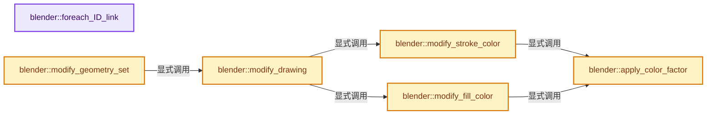
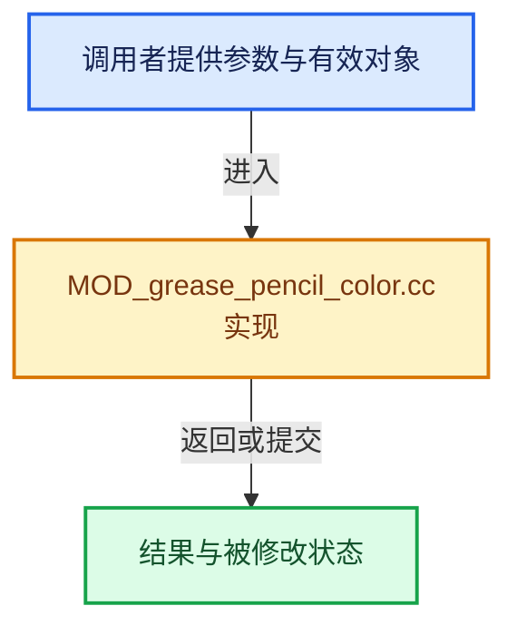

# 实现依赖专题：source/blender/modifiers/intern/MOD_grease_pencil_color.cc

[方向导航](README.md) · [符号索引](../%E7%AC%A6%E5%8F%B7%E4%BE%9D%E8%B5%96%E4%B8%8E%E5%AE%9E%E7%8E%B0%E7%B4%A2%E5%BC%95.md)

本专题从正文实际调用进入，集中保存共享实现。函数有稳定锚点，可从调用处直接跳到对应完整函数；递归与互相调用通过回链组织。

## 本文件的实现关系






## 完整成员与函数实现

<a id="f-405e731e4b9631e3"></a>

### `blender::foreach_ID_link`

实现位置：[source/blender/modifiers/intern/MOD_grease_pencil_color.cc](../../../../../source/blender/modifiers/intern/MOD_grease_pencil_color.cc) · L69—L73。

接口参数：

- `ModifierData *md`
- `Object *ob`
- `IDWalkFunc walk`
- `void *user_data`

**教学注释版**

<!-- annotated:a4c65e44ba1586 -->

```cpp
static void foreach_ID_link(ModifierData *md, Object *ob, IDWalkFunc walk, void *user_data)
{
  auto *cmd = reinterpret_cast<GreasePencilColorModifierData *>(md);
  modifier::greasepencil::foreach_influence_ID_link(&cmd->influence, ob, walk, user_data);
}
```

<details>
<summary>核对原始源码：source/blender/modifiers/intern/MOD_grease_pencil_color.cc · L69—L73</summary>

<!-- original:a4c65e44ba1586:source/blender/modifiers/intern/MOD_grease_pencil_color.cc:69:73 -->

```cpp
static void foreach_ID_link(ModifierData *md, Object *ob, IDWalkFunc walk, void *user_data)
{
  auto *cmd = reinterpret_cast<GreasePencilColorModifierData *>(md);
  modifier::greasepencil::foreach_influence_ID_link(&cmd->influence, ob, walk, user_data);
}
```

</details>

**继续追踪实现**

- `modifier::greasepencil::foreach_influence_ID_link` → [blender::modifier::greasepencil::foreach_influence_ID_link · L69](%E4%BE%9D%E8%B5%96-MOD_grease_pencil_util-d0b437.md#f-247ba56fa4c4e56f)。

<a id="f-e9cdec3421bc238f"></a>

### `blender::apply_color_factor`

实现位置：[source/blender/modifiers/intern/MOD_grease_pencil_color.cc](../../../../../source/blender/modifiers/intern/MOD_grease_pencil_color.cc) · L75—L92。

接口参数：

- `ColorGeometry4f &color`
- `const ColorGeometry4f &material_color`
- `const float3 factor`

**教学注释版**

<!-- annotated:7e859c85006269 -->

```cpp
static void apply_color_factor(ColorGeometry4f &color,
                               const ColorGeometry4f &material_color,
                               const float3 factor)
{
  float3 hsv;
  /* When input alpha is zero, replace with material color. */
  if (color.a == 0.0f && material_color.a > 0.0f) {
    color.a = 1.0f;
    rgb_to_hsv_v(material_color, hsv);
  }
  else {
    rgb_to_hsv_v(color, hsv);
  }
  hsv[0] = fractf(hsv[0] + factor[0] + 0.5f);
  hsv[1] = clamp_f(hsv[1] * factor[1], 0.0f, 1.0f);
  hsv[2] = hsv[2] * factor[2];
  hsv_to_rgb_v(hsv, color);
}
```

<details>
<summary>核对原始源码：source/blender/modifiers/intern/MOD_grease_pencil_color.cc · L75—L92</summary>

<!-- original:7e859c85006269:source/blender/modifiers/intern/MOD_grease_pencil_color.cc:75:92 -->

```cpp
static void apply_color_factor(ColorGeometry4f &color,
                               const ColorGeometry4f &material_color,
                               const float3 factor)
{
  float3 hsv;
  /* When input alpha is zero, replace with material color. */
  if (color.a == 0.0f && material_color.a > 0.0f) {
    color.a = 1.0f;
    rgb_to_hsv_v(material_color, hsv);
  }
  else {
    rgb_to_hsv_v(color, hsv);
  }
  hsv[0] = fractf(hsv[0] + factor[0] + 0.5f);
  hsv[1] = clamp_f(hsv[1] * factor[1], 0.0f, 1.0f);
  hsv[2] = hsv[2] * factor[2];
  hsv_to_rgb_v(hsv, color);
}
```

</details>

**沿实际写入检查状态**

- `color.a = 1.0f;`
- `hsv[0] = fractf(hsv[0] + factor[0] + 0.5f);`
- `hsv[1] = clamp_f(hsv[1] * factor[1], 0.0f, 1.0f);`
- `hsv[2] = hsv[2] * factor[2];`

**继续追踪实现**

- `rgb_to_hsv_v` → [blender::rgb_to_hsv_v · L322](../12-%E7%A9%BA%E9%97%B4%E6%95%B0%E6%8D%AE%E7%BB%93%E6%9E%84%E4%B8%8E%E5%87%A0%E4%BD%95%E7%AE%97%E6%B3%95/%E4%BE%9D%E8%B5%96-math_color-98507f.md#f-7312a69cee7c11bb)。
- `fractf` → [blender::fractf · L265](../12-%E7%A9%BA%E9%97%B4%E6%95%B0%E6%8D%AE%E7%BB%93%E6%9E%84%E4%B8%8E%E5%87%A0%E4%BD%95%E7%AE%97%E6%B3%95/%E4%BE%9D%E8%B5%96-math_base_inline-546b00.md#f-0442cd3af22fc915)。
- `clamp_f` → [blender::clamp_f · L405](../12-%E7%A9%BA%E9%97%B4%E6%95%B0%E6%8D%AE%E7%BB%93%E6%9E%84%E4%B8%8E%E5%87%A0%E4%BD%95%E7%AE%97%E6%B3%95/%E4%BE%9D%E8%B5%96-math_base_inline-546b00.md#f-abaf19ee32d97de2)。
- `hsv_to_rgb_v` → [blender::hsv_to_rgb_v · L61](../12-%E7%A9%BA%E9%97%B4%E6%95%B0%E6%8D%AE%E7%BB%93%E6%9E%84%E4%B8%8E%E5%87%A0%E4%BD%95%E7%AE%97%E6%B3%95/%E4%BE%9D%E8%B5%96-math_color-98507f.md#f-d78b8d5b93aafd9e)。

<a id="f-39bf15b531511a28"></a>

### `blender::modify_stroke_color`

实现位置：[source/blender/modifiers/intern/MOD_grease_pencil_color.cc](../../../../../source/blender/modifiers/intern/MOD_grease_pencil_color.cc) · L94—L131。

接口参数：

- `Object &ob`
- `const GreasePencilColorModifierData &cmd`
- `bke::CurvesGeometry &curves`
- `const IndexMask &curves_mask`
- `const MutableSpan<ColorGeometry4f> vertex_colors`

**教学注释版**

<!-- annotated:9118e6d046fdd8 -->

```cpp
static void modify_stroke_color(Object &ob,
                                const GreasePencilColorModifierData &cmd,
                                bke::CurvesGeometry &curves,
                                const IndexMask &curves_mask,
                                const MutableSpan<ColorGeometry4f> vertex_colors)
{
  const bool use_curve = (cmd.influence.flag & GREASE_PENCIL_INFLUENCE_USE_CUSTOM_CURVE);
  const OffsetIndices<int> points_by_curve = curves.points_by_curve();

  bke::AttributeAccessor attributes = curves.attributes();
  const VArray<int> stroke_materials = *attributes.lookup_or_default<int>(
      "material_index", bke::AttrDomain::Curve, 0);

  curves_mask.foreach_index(
      [&](const int64_t curve_i) {
        const Material *ma = BKE_object_material_get(&ob, stroke_materials[curve_i] + 1);
        const MaterialGPencilStyle *gp_style = ma ? ma->gp_style : nullptr;
        const ColorGeometry4f material_color = (gp_style ?
                                                    ColorGeometry4f(gp_style->stroke_rgba) :
                                                    ColorGeometry4f(0.0f, 0.0f, 0.0f, 0.0f));

        const IndexRange points = points_by_curve[curve_i];
        for (const int64_t i : points.index_range()) {
          const int64_t point_i = points[i];
          float3 factor = cmd.hsv;
          if (use_curve) {
            // [讲解] points.size：读取连续区间或分组的边界信息。
            const float curve_input = points.size() >= 2 ? (float(i) / float(points.size() - 1)) :
                                                           0.0f;
            const float curve_factor = BKE_curvemapping_evaluateF(
                cmd.influence.custom_curve, 0, curve_input);
            factor *= curve_factor;
          }

          apply_color_factor(vertex_colors[point_i], material_color, factor);
        }
      },
      exec_mode::grain_size(512));
}
```

<details>
<summary>核对原始源码：source/blender/modifiers/intern/MOD_grease_pencil_color.cc · L94—L131</summary>

<!-- original:9118e6d046fdd8:source/blender/modifiers/intern/MOD_grease_pencil_color.cc:94:131 -->

```cpp
static void modify_stroke_color(Object &ob,
                                const GreasePencilColorModifierData &cmd,
                                bke::CurvesGeometry &curves,
                                const IndexMask &curves_mask,
                                const MutableSpan<ColorGeometry4f> vertex_colors)
{
  const bool use_curve = (cmd.influence.flag & GREASE_PENCIL_INFLUENCE_USE_CUSTOM_CURVE);
  const OffsetIndices<int> points_by_curve = curves.points_by_curve();

  bke::AttributeAccessor attributes = curves.attributes();
  const VArray<int> stroke_materials = *attributes.lookup_or_default<int>(
      "material_index", bke::AttrDomain::Curve, 0);

  curves_mask.foreach_index(
      [&](const int64_t curve_i) {
        const Material *ma = BKE_object_material_get(&ob, stroke_materials[curve_i] + 1);
        const MaterialGPencilStyle *gp_style = ma ? ma->gp_style : nullptr;
        const ColorGeometry4f material_color = (gp_style ?
                                                    ColorGeometry4f(gp_style->stroke_rgba) :
                                                    ColorGeometry4f(0.0f, 0.0f, 0.0f, 0.0f));

        const IndexRange points = points_by_curve[curve_i];
        for (const int64_t i : points.index_range()) {
          const int64_t point_i = points[i];
          float3 factor = cmd.hsv;
          if (use_curve) {
            const float curve_input = points.size() >= 2 ? (float(i) / float(points.size() - 1)) :
                                                           0.0f;
            const float curve_factor = BKE_curvemapping_evaluateF(
                cmd.influence.custom_curve, 0, curve_input);
            factor *= curve_factor;
          }

          apply_color_factor(vertex_colors[point_i], material_color, factor);
        }
      },
      exec_mode::grain_size(512));
}
```

</details>

**沿实际写入检查状态**

- `factor *= curve_factor;`

**继续追踪实现**

- `curves.points_by_curve` → [blender::bke::CurvesGeometry::points_by_curve · L1058](04-CurvesGeometry%E5%AD%98%E5%82%A8.md#f-a0416697e10ec205)。
- `curves.attributes` → [blender::bke::CurvesGeometry::attributes · L1908](%E4%BE%9D%E8%B5%96-curves_geometry-ad7f9f.md#f-8e24fbf758862a22)。
- `attributes.lookup_or_default<int>` → [blender::bke::AttributeAccessor::lookup_or_default · L415](%E4%BE%9D%E8%B5%96-attribute_access-bceef3.md#f-a0cc3e316f1da4bd)；[blender::bke::AttributeAccessor::lookup_or_default · L643](08-AttributeAccessor%E6%8E%A5%E5%8F%A3.md#f-e3d2ed81ebe0af61)。同名重载需按实参类型选择。
- `curves_mask.foreach_index` → [blender::index_mask::IndexMask::foreach_index · L855](../04-%E8%99%9A%E6%8B%9F%E6%95%B0%E7%BB%84%E4%B8%8E%E7%B4%A2%E5%BC%95%E9%80%89%E6%8B%A9/09-%E5%88%86%E6%AE%B5%E5%AD%98%E5%82%A8%E4%B8%8E%E9%81%8D%E5%8E%86.md#f-cd6cd317e2e2812c)。
- `BKE_object_material_get` → [blender::BKE_object_material_get · L759](%E4%BE%9D%E8%B5%96-material-aea8ec.md#f-9e9ad276ccef84b3)。
- `ColorGeometry4f` → [调用协议](../%E6%A8%A1%E6%9D%BF%E5%AE%8F%E4%B8%8E%E5%8A%A8%E6%80%81%E5%88%86%E6%B4%BE%E5%8D%8F%E8%AE%AE.md)：函数指针、局部可调用对象或未展开的宏；必须结合调用者环境。调用位置L112。
- `points.index_range` → [blender::IndexRange::index_range · L161](../01-%E5%9F%BA%E7%A1%80%E5%AE%B9%E5%99%A8%E4%B8%8E%E7%8E%B0%E4%BB%A3CPP/04-IndexRange%E8%BF%9E%E7%BB%AD%E6%95%B4%E6%95%B0%E5%8C%BA%E9%97%B4.md#f-fd83072b4b81bce5)。
- `points.size` → [blender::IndexRange::size · L156](../01-%E5%9F%BA%E7%A1%80%E5%AE%B9%E5%99%A8%E4%B8%8E%E7%8E%B0%E4%BB%A3CPP/04-IndexRange%E8%BF%9E%E7%BB%AD%E6%95%B4%E6%95%B0%E5%8C%BA%E9%97%B4.md#f-05f66c3ebb2fdfec)。
- `BKE_curvemapping_evaluateF` → [blender::BKE_curvemapping_evaluateF · L1177](%E4%BE%9D%E8%B5%96-colortools-8bc37a.md#f-014584e04eeb1392)。
- `apply_color_factor` → [blender::apply_color_factor · L75](%E4%BE%9D%E8%B5%96-MOD_grease_pencil_color-247c5a.md#f-e9cdec3421bc238f)。
- `exec_mode::grain_size` → [blender::exec_mode::grain_size · L79](../01-%E5%9F%BA%E7%A1%80%E5%AE%B9%E5%99%A8%E4%B8%8E%E7%8E%B0%E4%BB%A3CPP/%E4%BE%9D%E8%B5%96-BLI_execution_mode-1528fb.md#f-0b4fc2f9fa6e66e7)。

<a id="f-49cb2ea24f6de985"></a>

### `blender::modify_fill_color`

实现位置：[source/blender/modifiers/intern/MOD_grease_pencil_color.cc](../../../../../source/blender/modifiers/intern/MOD_grease_pencil_color.cc) · L133—L156。

接口参数：

- `Object &ob`
- `const GreasePencilColorModifierData &cmd`
- `Drawing &drawing`
- `const IndexMask &curves_mask`

**教学注释版**

<!-- annotated:0a5eb6c92f9ea2 -->

```cpp
static void modify_fill_color(Object &ob,
                              const GreasePencilColorModifierData &cmd,
                              Drawing &drawing,
                              const IndexMask &curves_mask)
{
  const bke::CurvesGeometry &curves = drawing.strokes();
  const bke::AttributeAccessor attributes = curves.attributes();
  /* Fill color per stroke. */
  MutableSpan<ColorGeometry4f> fill_colors = drawing.fill_colors_for_write();
  const VArray<int> stroke_materials = *attributes.lookup_or_default<int>(
      "material_index", bke::AttrDomain::Curve, 0);

  curves_mask.foreach_index(
      [&](int64_t curve_i) {
        const Material *ma = BKE_object_material_get(&ob, stroke_materials[curve_i] + 1);
        const MaterialGPencilStyle *gp_style = ma ? ma->gp_style : nullptr;
        const ColorGeometry4f material_color = (gp_style ?
                                                    ColorGeometry4f(gp_style->fill_rgba) :
                                                    ColorGeometry4f(0.0f, 0.0f, 0.0f, 0.0f));

        apply_color_factor(fill_colors[curve_i], material_color, cmd.hsv);
      },
      exec_mode::grain_size(512));
}
```

<details>
<summary>核对原始源码：source/blender/modifiers/intern/MOD_grease_pencil_color.cc · L133—L156</summary>

<!-- original:0a5eb6c92f9ea2:source/blender/modifiers/intern/MOD_grease_pencil_color.cc:133:156 -->

```cpp
static void modify_fill_color(Object &ob,
                              const GreasePencilColorModifierData &cmd,
                              Drawing &drawing,
                              const IndexMask &curves_mask)
{
  const bke::CurvesGeometry &curves = drawing.strokes();
  const bke::AttributeAccessor attributes = curves.attributes();
  /* Fill color per stroke. */
  MutableSpan<ColorGeometry4f> fill_colors = drawing.fill_colors_for_write();
  const VArray<int> stroke_materials = *attributes.lookup_or_default<int>(
      "material_index", bke::AttrDomain::Curve, 0);

  curves_mask.foreach_index(
      [&](int64_t curve_i) {
        const Material *ma = BKE_object_material_get(&ob, stroke_materials[curve_i] + 1);
        const MaterialGPencilStyle *gp_style = ma ? ma->gp_style : nullptr;
        const ColorGeometry4f material_color = (gp_style ?
                                                    ColorGeometry4f(gp_style->fill_rgba) :
                                                    ColorGeometry4f(0.0f, 0.0f, 0.0f, 0.0f));

        apply_color_factor(fill_colors[curve_i], material_color, cmd.hsv);
      },
      exec_mode::grain_size(512));
}
```

</details>

**继续追踪实现**

- `drawing.strokes` → [blender::bke::greasepencil::Drawing::strokes · L1007](%E4%BE%9D%E8%B5%96-grease_pencil-f750d6.md#f-59e6522a8e8ac409)。
- `curves.attributes` → [blender::bke::CurvesGeometry::attributes · L1908](%E4%BE%9D%E8%B5%96-curves_geometry-ad7f9f.md#f-8e24fbf758862a22)。
- `drawing.fill_colors_for_write` → [blender::bke::greasepencil::Drawing::fill_colors_for_write · L1069](%E4%BE%9D%E8%B5%96-grease_pencil-f750d6.md#f-c1670c8b77b029fa)。
- `attributes.lookup_or_default<int>` → [blender::bke::AttributeAccessor::lookup_or_default · L415](%E4%BE%9D%E8%B5%96-attribute_access-bceef3.md#f-a0cc3e316f1da4bd)；[blender::bke::AttributeAccessor::lookup_or_default · L643](08-AttributeAccessor%E6%8E%A5%E5%8F%A3.md#f-e3d2ed81ebe0af61)。同名重载需按实参类型选择。
- `curves_mask.foreach_index` → [blender::index_mask::IndexMask::foreach_index · L855](../04-%E8%99%9A%E6%8B%9F%E6%95%B0%E7%BB%84%E4%B8%8E%E7%B4%A2%E5%BC%95%E9%80%89%E6%8B%A9/09-%E5%88%86%E6%AE%B5%E5%AD%98%E5%82%A8%E4%B8%8E%E9%81%8D%E5%8E%86.md#f-cd6cd317e2e2812c)。
- `BKE_object_material_get` → [blender::BKE_object_material_get · L759](%E4%BE%9D%E8%B5%96-material-aea8ec.md#f-9e9ad276ccef84b3)。
- `ColorGeometry4f` → [调用协议](../%E6%A8%A1%E6%9D%BF%E5%AE%8F%E4%B8%8E%E5%8A%A8%E6%80%81%E5%88%86%E6%B4%BE%E5%8D%8F%E8%AE%AE.md)：函数指针、局部可调用对象或未展开的宏；必须结合调用者环境。调用位置L150。
- `apply_color_factor` → [blender::apply_color_factor · L75](%E4%BE%9D%E8%B5%96-MOD_grease_pencil_color-247c5a.md#f-e9cdec3421bc238f)。
- `exec_mode::grain_size` → [blender::exec_mode::grain_size · L79](../01-%E5%9F%BA%E7%A1%80%E5%AE%B9%E5%99%A8%E4%B8%8E%E7%8E%B0%E4%BB%A3CPP/%E4%BE%9D%E8%B5%96-BLI_execution_mode-1528fb.md#f-0b4fc2f9fa6e66e7)。

<a id="f-8560cf47c9d501b1"></a>

### `blender::modify_drawing`

实现位置：[source/blender/modifiers/intern/MOD_grease_pencil_color.cc](../../../../../source/blender/modifiers/intern/MOD_grease_pencil_color.cc) · L158—L184。

接口参数：

- `ModifierData &md`
- `const ModifierEvalContext &ctx`
- `Drawing &drawing`

**教学注释版**

<!-- annotated:5fd3003c83c4d6 -->

```cpp
static void modify_drawing(ModifierData &md, const ModifierEvalContext &ctx, Drawing &drawing)
{
  auto &cmd = reinterpret_cast<GreasePencilColorModifierData &>(md);

  bke::CurvesGeometry &curves = drawing.strokes_for_write();
  IndexMaskMemory mask_memory;
  const IndexMask curves_mask = modifier::greasepencil::get_filtered_stroke_mask(
      ctx.object, curves, cmd.influence, mask_memory);

  switch (cmd.color_mode) {
    case MOD_GREASE_PENCIL_COLOR_STROKE:
      modify_stroke_color(
          *ctx.object, cmd, curves, curves_mask, drawing.vertex_colors_for_write());
      break;
    case MOD_GREASE_PENCIL_COLOR_FILL:
      modify_fill_color(*ctx.object, cmd, drawing, curves_mask);
      break;
    case MOD_GREASE_PENCIL_COLOR_BOTH:
      modify_stroke_color(
          *ctx.object, cmd, curves, curves_mask, drawing.vertex_colors_for_write());
      modify_fill_color(*ctx.object, cmd, drawing, curves_mask);
      break;
    case MOD_GREASE_PENCIL_COLOR_HARDNESS:
      BLI_assert_unreachable();
      break;
  }
}
```

<details>
<summary>核对原始源码：source/blender/modifiers/intern/MOD_grease_pencil_color.cc · L158—L184</summary>

<!-- original:5fd3003c83c4d6:source/blender/modifiers/intern/MOD_grease_pencil_color.cc:158:184 -->

```cpp
static void modify_drawing(ModifierData &md, const ModifierEvalContext &ctx, Drawing &drawing)
{
  auto &cmd = reinterpret_cast<GreasePencilColorModifierData &>(md);

  bke::CurvesGeometry &curves = drawing.strokes_for_write();
  IndexMaskMemory mask_memory;
  const IndexMask curves_mask = modifier::greasepencil::get_filtered_stroke_mask(
      ctx.object, curves, cmd.influence, mask_memory);

  switch (cmd.color_mode) {
    case MOD_GREASE_PENCIL_COLOR_STROKE:
      modify_stroke_color(
          *ctx.object, cmd, curves, curves_mask, drawing.vertex_colors_for_write());
      break;
    case MOD_GREASE_PENCIL_COLOR_FILL:
      modify_fill_color(*ctx.object, cmd, drawing, curves_mask);
      break;
    case MOD_GREASE_PENCIL_COLOR_BOTH:
      modify_stroke_color(
          *ctx.object, cmd, curves, curves_mask, drawing.vertex_colors_for_write());
      modify_fill_color(*ctx.object, cmd, drawing, curves_mask);
      break;
    case MOD_GREASE_PENCIL_COLOR_HARDNESS:
      BLI_assert_unreachable();
      break;
  }
}
```

</details>

**继续追踪实现**

- `drawing.strokes_for_write` → [blender::bke::greasepencil::Drawing::strokes_for_write · L1012](%E4%BE%9D%E8%B5%96-grease_pencil-f750d6.md#f-0649333785d0aa95)。
- `modifier::greasepencil::get_filtered_stroke_mask` → [blender::modifier::greasepencil::get_filtered_stroke_mask · L285](%E4%BE%9D%E8%B5%96-MOD_grease_pencil_util-d0b437.md#f-30c219d04de7dec3)；[blender::modifier::greasepencil::get_filtered_stroke_mask · L326](%E4%BE%9D%E8%B5%96-MOD_grease_pencil_util-d0b437.md#f-970c3bc880e4f350)。同名重载需按实参类型选择。
- `modify_stroke_color` → [blender::modify_stroke_color · L94](%E4%BE%9D%E8%B5%96-MOD_grease_pencil_color-247c5a.md#f-39bf15b531511a28)。
- `drawing.vertex_colors_for_write` → [blender::bke::greasepencil::Drawing::vertex_colors_for_write · L1053](%E4%BE%9D%E8%B5%96-grease_pencil-f750d6.md#f-2d24b72934b99ac2)。
- `modify_fill_color` → [blender::modify_fill_color · L133](%E4%BE%9D%E8%B5%96-MOD_grease_pencil_color-247c5a.md#f-49cb2ea24f6de985)。
- `BLI_assert_unreachable` → [BLI_assert_unreachable · L77](../01-%E5%9F%BA%E7%A1%80%E5%AE%B9%E5%99%A8%E4%B8%8E%E7%8E%B0%E4%BB%A3CPP/%E4%BE%9D%E8%B5%96-BLI_assert-cc98e8.md#m-7a2d91a67d8e)。宏定义由构建条件选择。

<a id="f-b7d9cea51cff81d7"></a>

### `blender::modify_geometry_set`

实现位置：[source/blender/modifiers/intern/MOD_grease_pencil_color.cc](../../../../../source/blender/modifiers/intern/MOD_grease_pencil_color.cc) · L186—L205。

接口参数：

- `ModifierData *md`
- `const ModifierEvalContext *ctx`
- `bke::GeometrySet *geometry_set`

**教学注释版**

<!-- annotated:31eed5e9b1f901 -->

```cpp
static void modify_geometry_set(ModifierData *md,
                                const ModifierEvalContext *ctx,
                                bke::GeometrySet *geometry_set)
{
  auto *cmd = reinterpret_cast<GreasePencilColorModifierData *>(md);

  if (!geometry_set->has_grease_pencil()) {
    return;
  }
  GreasePencil &grease_pencil = *geometry_set->get_grease_pencil_for_write();
  const int frame = grease_pencil.runtime->eval_frame;

  IndexMaskMemory mask_memory;
  const IndexMask layer_mask = modifier::greasepencil::get_filtered_layer_mask(
      grease_pencil, cmd->influence, mask_memory);
  const Vector<Drawing *> drawings = modifier::greasepencil::get_drawings_for_write(
      grease_pencil, layer_mask, frame);
  threading::parallel_for_each(drawings,
                               [&](Drawing *drawing) { modify_drawing(*md, *ctx, *drawing); });
}
```

<details>
<summary>核对原始源码：source/blender/modifiers/intern/MOD_grease_pencil_color.cc · L186—L205</summary>

<!-- original:31eed5e9b1f901:source/blender/modifiers/intern/MOD_grease_pencil_color.cc:186:205 -->

```cpp
static void modify_geometry_set(ModifierData *md,
                                const ModifierEvalContext *ctx,
                                bke::GeometrySet *geometry_set)
{
  auto *cmd = reinterpret_cast<GreasePencilColorModifierData *>(md);

  if (!geometry_set->has_grease_pencil()) {
    return;
  }
  GreasePencil &grease_pencil = *geometry_set->get_grease_pencil_for_write();
  const int frame = grease_pencil.runtime->eval_frame;

  IndexMaskMemory mask_memory;
  const IndexMask layer_mask = modifier::greasepencil::get_filtered_layer_mask(
      grease_pencil, cmd->influence, mask_memory);
  const Vector<Drawing *> drawings = modifier::greasepencil::get_drawings_for_write(
      grease_pencil, layer_mask, frame);
  threading::parallel_for_each(drawings,
                               [&](Drawing *drawing) { modify_drawing(*md, *ctx, *drawing); });
}
```

</details>

**继续追踪实现**

- `geometry_set->has_grease_pencil` → [blender::bke::GeometrySet::has_grease_pencil · L415](../06-%E9%9A%90%E5%BC%8F%E5%85%B1%E4%BA%AB%E4%B8%8E%E7%BC%93%E5%AD%98%E7%B3%BB%E7%BB%9F/05-GeometrySet%E8%AF%BB%E5%86%99%E4%B8%8E%E5%A4%8D%E5%88%B6.md#f-357bcb62da7a8afd)。
- `geometry_set->get_grease_pencil_for_write` → [blender::bke::GeometrySet::get_grease_pencil_for_write · L622](../06-%E9%9A%90%E5%BC%8F%E5%85%B1%E4%BA%AB%E4%B8%8E%E7%BC%93%E5%AD%98%E7%B3%BB%E7%BB%9F/05-GeometrySet%E8%AF%BB%E5%86%99%E4%B8%8E%E5%A4%8D%E5%88%B6.md#f-bfc5e891a352651b)。
- `modifier::greasepencil::get_filtered_layer_mask` → [blender::modifier::greasepencil::get_filtered_layer_mask · L213](%E4%BE%9D%E8%B5%96-MOD_grease_pencil_util-d0b437.md#f-6438bea51141f9db)；[blender::modifier::greasepencil::get_filtered_layer_mask · L268](%E4%BE%9D%E8%B5%96-MOD_grease_pencil_util-d0b437.md#f-e3d0f9748ecdf34b)。同名重载需按实参类型选择。
- `modifier::greasepencil::get_drawings_for_write` → [blender::modifier::greasepencil::get_drawings_for_write · L368](%E4%BE%9D%E8%B5%96-MOD_grease_pencil_util-d0b437.md#f-cef3871c31259376)。
- `threading::parallel_for_each` → [blender::threading::parallel_for_each · L30](../11-Depsgraph%E4%B8%8E%E5%B9%B6%E8%A1%8C%E4%BB%BB%E5%8A%A1%E7%B3%BB%E7%BB%9F/07-%E4%BB%BB%E5%8A%A1%E6%B1%A0%E4%B8%8ETBB%E6%8E%A5%E5%85%A5.md#f-d5604027445ef0f5)。
- `modify_drawing` → [blender::modify_drawing · L158](%E4%BE%9D%E8%B5%96-MOD_grease_pencil_color-247c5a.md#f-8560cf47c9d501b1)。
