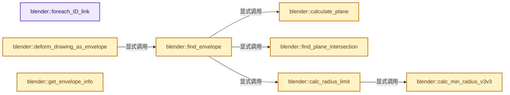
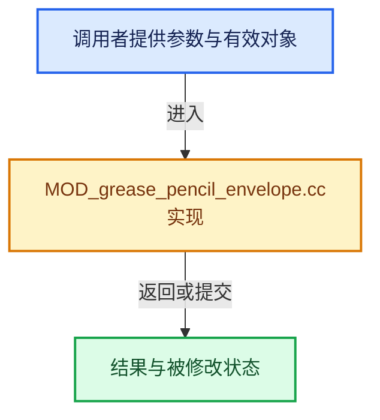

# 实现依赖专题：source/blender/modifiers/intern/MOD_grease_pencil_envelope.cc

[方向导航](README.md) · [符号索引](../%E7%AC%A6%E5%8F%B7%E4%BE%9D%E8%B5%96%E4%B8%8E%E5%AE%9E%E7%8E%B0%E7%B4%A2%E5%BC%95.md)

本专题从正文实际调用进入，集中保存共享实现。函数有稳定锚点，可从调用处直接跳到对应完整函数；递归与互相调用通过回链组织。

## 本文件的实现关系






## 完整成员与函数实现

<a id="f-4e59b89eafdc3d8a"></a>

### `blender::foreach_ID_link`

实现位置：[source/blender/modifiers/intern/MOD_grease_pencil_envelope.cc](../../../../../source/blender/modifiers/intern/MOD_grease_pencil_envelope.cc) · L64—L68。

接口参数：

- `ModifierData *md`
- `Object *ob`
- `IDWalkFunc walk`
- `void *user_data`

**教学注释版**

<!-- annotated:561b4fde891de1 -->

```cpp
static void foreach_ID_link(ModifierData *md, Object *ob, IDWalkFunc walk, void *user_data)
{
  auto *emd = reinterpret_cast<GreasePencilEnvelopeModifierData *>(md);
  modifier::greasepencil::foreach_influence_ID_link(&emd->influence, ob, walk, user_data);
}
```

<details>
<summary>核对原始源码：source/blender/modifiers/intern/MOD_grease_pencil_envelope.cc · L64—L68</summary>

<!-- original:561b4fde891de1:source/blender/modifiers/intern/MOD_grease_pencil_envelope.cc:64:68 -->

```cpp
static void foreach_ID_link(ModifierData *md, Object *ob, IDWalkFunc walk, void *user_data)
{
  auto *emd = reinterpret_cast<GreasePencilEnvelopeModifierData *>(md);
  modifier::greasepencil::foreach_influence_ID_link(&emd->influence, ob, walk, user_data);
}
```

</details>

**继续追踪实现**

- `modifier::greasepencil::foreach_influence_ID_link` → [blender::modifier::greasepencil::foreach_influence_ID_link · L69](%E4%BE%9D%E8%B5%96-MOD_grease_pencil_util-d0b437.md#f-247ba56fa4c4e56f)。

<a id="f-3f62b352d7197c02"></a>

### `blender::calculate_plane`

实现位置：[source/blender/modifiers/intern/MOD_grease_pencil_envelope.cc](../../../../../source/blender/modifiers/intern/MOD_grease_pencil_envelope.cc) · L70—L75。

接口参数：

- `const float3 &center`
- `const float3 &prev`
- `const float3 &next`

**教学注释版**

<!-- annotated:4cb4c069e8890a -->

```cpp
static inline float3 calculate_plane(const float3 &center, const float3 &prev, const float3 &next)
{
  const float3 v1 = math::normalize(prev - center);
  const float3 v2 = math::normalize(next - center);
  return math::normalize(v1 - v2);
}
```

<details>
<summary>核对原始源码：source/blender/modifiers/intern/MOD_grease_pencil_envelope.cc · L70—L75</summary>

<!-- original:4cb4c069e8890a:source/blender/modifiers/intern/MOD_grease_pencil_envelope.cc:70:75 -->

```cpp
static inline float3 calculate_plane(const float3 &center, const float3 &prev, const float3 &next)
{
  const float3 v1 = math::normalize(prev - center);
  const float3 v2 = math::normalize(next - center);
  return math::normalize(v1 - v2);
}
```

</details>

**结果出口**

- `return math::normalize(v1 - v2);`

**继续追踪实现**

- `math::normalize` → [blender::math::normalize · L542](../12-%E7%A9%BA%E9%97%B4%E6%95%B0%E6%8D%AE%E7%BB%93%E6%9E%84%E4%B8%8E%E5%87%A0%E4%BD%95%E7%AE%97%E6%B3%95/%E4%BE%9D%E8%B5%96-BLI_math_vector-906a87.md#f-5bea914457e11f7f)；[blender::math::normalize · L258](../12-%E7%A9%BA%E9%97%B4%E6%95%B0%E6%8D%AE%E7%BB%93%E6%9E%84%E4%B8%8E%E5%87%A0%E4%BD%95%E7%AE%97%E6%B3%95/%E4%BE%9D%E8%B5%96-BLI_math_quaternion-cf105d.md#f-5bf6b351333e4054)；[blender::math::normalize · L450](../12-%E7%A9%BA%E9%97%B4%E6%95%B0%E6%8D%AE%E7%BB%93%E6%9E%84%E4%B8%8E%E5%87%A0%E4%BD%95%E7%AE%97%E6%B3%95/%E4%BE%9D%E8%B5%96-BLI_math_quaternion-cf105d.md#f-b852cee8f0cc9b6a)；[blender::math::normalize · L745](../12-%E7%A9%BA%E9%97%B4%E6%95%B0%E6%8D%AE%E7%BB%93%E6%9E%84%E4%B8%8E%E5%87%A0%E4%BD%95%E7%AE%97%E6%B3%95/%E4%BE%9D%E8%B5%96-BLI_math_matrix-b7b2b4.md#f-2235cb6f5ec7ff18)；[blender::math::normalize · L783](../12-%E7%A9%BA%E9%97%B4%E6%95%B0%E6%8D%AE%E7%BB%93%E6%9E%84%E4%B8%8E%E5%87%A0%E4%BD%95%E7%AE%97%E6%B3%95/%E4%BE%9D%E8%B5%96-BLI_math_matrix-b7b2b4.md#f-0386bc4ee9ac7425)。同名重载需按实参类型选择。

<a id="f-a9b187234ae7a1bd"></a>

### `blender::find_plane_intersection`

实现位置：[source/blender/modifiers/intern/MOD_grease_pencil_envelope.cc](../../../../../source/blender/modifiers/intern/MOD_grease_pencil_envelope.cc) · L77—L87。

接口参数：

- `const float3 &plane_point`
- `const float3 &plane_normal`
- `const float3 &from`
- `const float3 &to`

**教学注释版**

<!-- annotated:82fef241360627 -->

```cpp
static inline std::optional<float3> find_plane_intersection(const float3 &plane_point,
                                                            const float3 &plane_normal,
                                                            const float3 &from,
                                                            const float3 &to)
{
  const float lambda = line_plane_factor_v3(plane_point, plane_normal, from, to);
  if (lambda <= 0.0f || lambda >= 1.0f) {
    return std::nullopt;
  }
  return math::interpolate(from, to, lambda);
}
```

<details>
<summary>核对原始源码：source/blender/modifiers/intern/MOD_grease_pencil_envelope.cc · L77—L87</summary>

<!-- original:82fef241360627:source/blender/modifiers/intern/MOD_grease_pencil_envelope.cc:77:87 -->

```cpp
static inline std::optional<float3> find_plane_intersection(const float3 &plane_point,
                                                            const float3 &plane_normal,
                                                            const float3 &from,
                                                            const float3 &to)
{
  const float lambda = line_plane_factor_v3(plane_point, plane_normal, from, to);
  if (lambda <= 0.0f || lambda >= 1.0f) {
    return std::nullopt;
  }
  return math::interpolate(from, to, lambda);
}
```

</details>

**结果出口**

- `return std::nullopt;`
- `return math::interpolate(from, to, lambda);`

**继续追踪实现**

- `line_plane_factor_v3` → [blender::line_plane_factor_v3 · L3450](../12-%E7%A9%BA%E9%97%B4%E6%95%B0%E6%8D%AE%E7%BB%93%E6%9E%84%E4%B8%8E%E5%87%A0%E4%BD%95%E7%AE%97%E6%B3%95/%E4%BE%9D%E8%B5%96-math_geom-8d91a3.md#f-dfa815f80cc8087b)。
- `math::interpolate` → [blender::math::interpolate · L335](../12-%E7%A9%BA%E9%97%B4%E6%95%B0%E6%8D%AE%E7%BB%93%E6%9E%84%E4%B8%8E%E5%87%A0%E4%BD%95%E7%AE%97%E6%B3%95/%E4%BE%9D%E8%B5%96-math_matrix-d7d8ee.md#f-91e7f517ebd72fb5)；[blender::math::interpolate · L379](../12-%E7%A9%BA%E9%97%B4%E6%95%B0%E6%8D%AE%E7%BB%93%E6%9E%84%E4%B8%8E%E5%87%A0%E4%BD%95%E7%AE%97%E6%B3%95/%E4%BE%9D%E8%B5%96-math_matrix-d7d8ee.md#f-a1be14e86ce595c2)；[blender::math::interpolate · L636](../12-%E7%A9%BA%E9%97%B4%E6%95%B0%E6%8D%AE%E7%BB%93%E6%9E%84%E4%B8%8E%E5%87%A0%E4%BD%95%E7%AE%97%E6%B3%95/%E4%BE%9D%E8%B5%96-BLI_math_vector-906a87.md#f-d612b6d6ab1b6e7c)；[blender::math::interpolate · L303](../12-%E7%A9%BA%E9%97%B4%E6%95%B0%E6%8D%AE%E7%BB%93%E6%9E%84%E4%B8%8E%E5%87%A0%E4%BD%95%E7%AE%97%E6%B3%95/%E4%BE%9D%E8%B5%96-BLI_math_quaternion-cf105d.md#f-48b9ace2a9c6185c)；[blender::math::interpolate · L17](../12-%E7%A9%BA%E9%97%B4%E6%95%B0%E6%8D%AE%E7%BB%93%E6%9E%84%E4%B8%8E%E5%87%A0%E4%BD%95%E7%AE%97%E6%B3%95/%E4%BE%9D%E8%B5%96-BLI_math_color-f3a6ea.md#f-eb5ef92b0f8c0926)；[blender::math::interpolate · L28](../12-%E7%A9%BA%E9%97%B4%E6%95%B0%E6%8D%AE%E7%BB%93%E6%9E%84%E4%B8%8E%E5%87%A0%E4%BD%95%E7%AE%97%E6%B3%95/%E4%BE%9D%E8%B5%96-BLI_math_color-f3a6ea.md#f-2a9e33ec55979ab6)；[blender::math::interpolate · L278](../12-%E7%A9%BA%E9%97%B4%E6%95%B0%E6%8D%AE%E7%BB%93%E6%9E%84%E4%B8%8E%E5%87%A0%E4%BD%95%E7%AE%97%E6%B3%95/%E4%BE%9D%E8%B5%96-BLI_math_base-0728eb.md#f-2629b871528f6528)。同名重载需按实参类型选择。

<a id="f-d4faa218d6b3df40"></a>

### `blender::calc_min_radius_v3v3`

实现位置：[source/blender/modifiers/intern/MOD_grease_pencil_envelope.cc](../../../../../source/blender/modifiers/intern/MOD_grease_pencil_envelope.cc) · L107—L141。

接口参数：

- `const float3 &p1`
- `const float3 &p2`
- `const float3 &dir`

**教学注释版**

<!-- annotated:4cbd80182733d8 -->

```cpp
static float calc_min_radius_v3v3(const float3 &p1, const float3 &p2, const float3 &dir)
{
  const float p1_dir = math::dot(p1, dir);
  const float p2_dir = math::dot(p2, dir);
  const float p2_sqr = math::length_squared(p2);
  const float diff_dir = p1_dir - p2_dir;

  const float u = [=]() {
    if (diff_dir == 0.0f) {
      const float p1_sqr = math::length_squared(p1);
      return p1_sqr < p2_sqr ? 1.0f : 0.0f;
    }

    const float p = p2_dir / diff_dir;
    const float3 diff = p1 - p2;
    const float diff_sqr = math::length_squared(diff);
    const float diff_p2 = math::dot(diff, p2);
    const float q = (2 * diff_p2 * p2_dir - p2_sqr * diff_dir) / (diff_dir * diff_sqr);
    if (p * p - q < 0) {
      return 0.5f - std::copysign(0.5f, p);
    }

    return math::clamp(-p - math::sqrt(p * p - q) * std::copysign(1.0f, p), 0.0f, 1.0f);
  }();

  /* v is the determined minimal radius. In case p1 and p2 are the same, there is a
   * simple proof for the following formula using the geometric mean theorem and Thales theorem. */
  const float v = math::length_squared(math::interpolate(p2, p1, u)) /
                  (2 * math::interpolate(p2_dir, p1_dir, u));
  if (v < 0 || !isfinite(v)) {
    /* No limit to the radius from this segment. */
    return unlimited_radius;
  }
  return v;
}
```

<details>
<summary>核对原始源码：source/blender/modifiers/intern/MOD_grease_pencil_envelope.cc · L107—L141</summary>

<!-- original:4cbd80182733d8:source/blender/modifiers/intern/MOD_grease_pencil_envelope.cc:107:141 -->

```cpp
static float calc_min_radius_v3v3(const float3 &p1, const float3 &p2, const float3 &dir)
{
  const float p1_dir = math::dot(p1, dir);
  const float p2_dir = math::dot(p2, dir);
  const float p2_sqr = math::length_squared(p2);
  const float diff_dir = p1_dir - p2_dir;

  const float u = [=]() {
    if (diff_dir == 0.0f) {
      const float p1_sqr = math::length_squared(p1);
      return p1_sqr < p2_sqr ? 1.0f : 0.0f;
    }

    const float p = p2_dir / diff_dir;
    const float3 diff = p1 - p2;
    const float diff_sqr = math::length_squared(diff);
    const float diff_p2 = math::dot(diff, p2);
    const float q = (2 * diff_p2 * p2_dir - p2_sqr * diff_dir) / (diff_dir * diff_sqr);
    if (p * p - q < 0) {
      return 0.5f - std::copysign(0.5f, p);
    }

    return math::clamp(-p - math::sqrt(p * p - q) * std::copysign(1.0f, p), 0.0f, 1.0f);
  }();

  /* v is the determined minimal radius. In case p1 and p2 are the same, there is a
   * simple proof for the following formula using the geometric mean theorem and Thales theorem. */
  const float v = math::length_squared(math::interpolate(p2, p1, u)) /
                  (2 * math::interpolate(p2_dir, p1_dir, u));
  if (v < 0 || !isfinite(v)) {
    /* No limit to the radius from this segment. */
    return unlimited_radius;
  }
  return v;
}
```

</details>

**结果出口**

- `return p1_sqr < p2_sqr ? 1.0f : 0.0f;`
- `return 0.5f - std::copysign(0.5f, p);`
- `return math::clamp(-p - math::sqrt(p * p - q) * std::copysign(1.0f, p), 0.0f, 1.0f);`
- `return unlimited_radius;`
- `return v;`

**继续追踪实现**

- `math::dot` → [blender::math::dot · L430](../12-%E7%A9%BA%E9%97%B4%E6%95%B0%E6%8D%AE%E7%BB%93%E6%9E%84%E4%B8%8E%E5%87%A0%E4%BD%95%E7%AE%97%E6%B3%95/%E4%BE%9D%E8%B5%96-BLI_math_vector-906a87.md#f-6f0c6a081b107428)；[blender::math::dot · L198](../12-%E7%A9%BA%E9%97%B4%E6%95%B0%E6%8D%AE%E7%BB%93%E6%9E%84%E4%B8%8E%E5%87%A0%E4%BD%95%E7%AE%97%E6%B3%95/%E4%BE%9D%E8%B5%96-BLI_math_quaternion-cf105d.md#f-5b1ef457981dbc76)。同名重载需按实参类型选择。
- `math::length_squared` → [blender::math::length_squared · L452](../12-%E7%A9%BA%E9%97%B4%E6%95%B0%E6%8D%AE%E7%BB%93%E6%9E%84%E4%B8%8E%E5%87%A0%E4%BD%95%E7%AE%97%E6%B3%95/%E4%BE%9D%E8%B5%96-BLI_math_vector-906a87.md#f-b1e1749f57230265)。
- `[=]() { if (diff_dir == 0.0f) { const float p1_sqr = math::length_squared(p1); return p1_sqr < p2_sqr ? 1.0f : 0.0f; } const float p = p2_dir / diff_dir; const float3 diff = p1 - p …（完整表达式见本函数源码）` → [blender::() · L390](../12-%E7%A9%BA%E9%97%B4%E6%95%B0%E6%8D%AE%E7%BB%93%E6%9E%84%E4%B8%8E%E5%87%A0%E4%BD%95%E7%AE%97%E6%B3%95/%E4%BE%9D%E8%B5%96-BLI_math_vector_types-5b9874.md#f-26f597afed18e002)。
- `std::copysign` → [外部契约](https://eel.is/c++draft/)：这个边界按实际表达式及所属类型核对参数、返回值、寿命与失败行为。这里提供接口入口，不声称已解释该第三方版本的内部实现。
- `math::clamp` → [blender::math::clamp · L118](../12-%E7%A9%BA%E9%97%B4%E6%95%B0%E6%8D%AE%E7%BB%93%E6%9E%84%E4%B8%8E%E5%87%A0%E4%BD%95%E7%AE%97%E6%B3%95/%E4%BE%9D%E8%B5%96-BLI_math_vector-906a87.md#f-65702e97e59fc41e)；[blender::math::clamp · L130](../12-%E7%A9%BA%E9%97%B4%E6%95%B0%E6%8D%AE%E7%BB%93%E6%9E%84%E4%B8%8E%E5%87%A0%E4%BD%95%E7%AE%97%E6%B3%95/%E4%BE%9D%E8%B5%96-BLI_math_vector-906a87.md#f-0365873940e23a11)；[blender::math::clamp · L69](../12-%E7%A9%BA%E9%97%B4%E6%95%B0%E6%8D%AE%E7%BB%93%E6%9E%84%E4%B8%8E%E5%87%A0%E4%BD%95%E7%AE%97%E6%B3%95/%E4%BE%9D%E8%B5%96-BLI_math_base-0728eb.md#f-9282cf5d06fa3723)。同名重载需按实参类型选择。
- `math::sqrt` → [外部契约](https://eel.is/c++draft/)：这个边界按实际表达式及所属类型核对参数、返回值、寿命与失败行为。这里提供接口入口，不声称已解释该第三方版本的内部实现。
- `math::interpolate` → [blender::math::interpolate · L335](../12-%E7%A9%BA%E9%97%B4%E6%95%B0%E6%8D%AE%E7%BB%93%E6%9E%84%E4%B8%8E%E5%87%A0%E4%BD%95%E7%AE%97%E6%B3%95/%E4%BE%9D%E8%B5%96-math_matrix-d7d8ee.md#f-91e7f517ebd72fb5)；[blender::math::interpolate · L379](../12-%E7%A9%BA%E9%97%B4%E6%95%B0%E6%8D%AE%E7%BB%93%E6%9E%84%E4%B8%8E%E5%87%A0%E4%BD%95%E7%AE%97%E6%B3%95/%E4%BE%9D%E8%B5%96-math_matrix-d7d8ee.md#f-a1be14e86ce595c2)；[blender::math::interpolate · L636](../12-%E7%A9%BA%E9%97%B4%E6%95%B0%E6%8D%AE%E7%BB%93%E6%9E%84%E4%B8%8E%E5%87%A0%E4%BD%95%E7%AE%97%E6%B3%95/%E4%BE%9D%E8%B5%96-BLI_math_vector-906a87.md#f-d612b6d6ab1b6e7c)；[blender::math::interpolate · L303](../12-%E7%A9%BA%E9%97%B4%E6%95%B0%E6%8D%AE%E7%BB%93%E6%9E%84%E4%B8%8E%E5%87%A0%E4%BD%95%E7%AE%97%E6%B3%95/%E4%BE%9D%E8%B5%96-BLI_math_quaternion-cf105d.md#f-48b9ace2a9c6185c)；[blender::math::interpolate · L17](../12-%E7%A9%BA%E9%97%B4%E6%95%B0%E6%8D%AE%E7%BB%93%E6%9E%84%E4%B8%8E%E5%87%A0%E4%BD%95%E7%AE%97%E6%B3%95/%E4%BE%9D%E8%B5%96-BLI_math_color-f3a6ea.md#f-eb5ef92b0f8c0926)；[blender::math::interpolate · L28](../12-%E7%A9%BA%E9%97%B4%E6%95%B0%E6%8D%AE%E7%BB%93%E6%9E%84%E4%B8%8E%E5%87%A0%E4%BD%95%E7%AE%97%E6%B3%95/%E4%BE%9D%E8%B5%96-BLI_math_color-f3a6ea.md#f-2a9e33ec55979ab6)；[blender::math::interpolate · L278](../12-%E7%A9%BA%E9%97%B4%E6%95%B0%E6%8D%AE%E7%BB%93%E6%9E%84%E4%B8%8E%E5%87%A0%E4%BD%95%E7%AE%97%E6%B3%95/%E4%BE%9D%E8%B5%96-BLI_math_base-0728eb.md#f-2629b871528f6528)。同名重载需按实参类型选择。
- `isfinite` → [isfinite · L125](%E4%BE%9D%E8%B5%96-math_base-b01ba9.md#m-ec002db2e0ff)。宏定义由构建条件选择。

<a id="f-dc2661d7d5878454"></a>

### `blender::calc_radius_limit`

实现位置：[source/blender/modifiers/intern/MOD_grease_pencil_envelope.cc](../../../../../source/blender/modifiers/intern/MOD_grease_pencil_envelope.cc) · L143—L201。

接口参数：

- `const Span<float3> positions`
- `const bool is_cyclic`
- `const int spread`
- `const int point`
- `const float3 &direction`

**教学注释版**

<!-- annotated:027e87d341af21 -->

```cpp
static float calc_radius_limit(const Span<float3> positions,
                               const bool is_cyclic,
                               const int spread,
                               const int point,
                               const float3 &direction)
{
  if (math::is_zero(direction)) {
    return unlimited_radius;
  }

  // [讲解] positions.size：查询视图长度或生成对应有效索引区间。
  const int point_num = positions.size();
  const float3 &center = positions[point];

  float result = unlimited_radius;
  if (is_cyclic) {
    /* Spread should be limited to half the points in the cyclic case. */
    BLI_assert(spread <= point_num / 2);
    /* Left side. */
    for (const int line_i : IndexRange(spread)) {
      const int from_i = (point - line_i - 2 + point_num) % point_num;
      const int to_i = (point - line_i - 1 + point_num) % point_num;
      const float limit = calc_min_radius_v3v3(
          positions[from_i] - center, positions[to_i] - center, direction);
      // [讲解] std::min：按比较关系选取较小值；截断范围时还需先满足非负和可表示范围，min本身不会证明边界安全。
      result = std::min(result, limit);
    }
    /* Right side. */
    for (const int line_i : IndexRange(spread)) {
      const int from_i = (point + line_i + 1 + point_num) % point_num;
      const int to_i = (point + line_i + 2 + point_num) % point_num;
      const float limit = calc_min_radius_v3v3(
          positions[from_i] - center, positions[to_i] - center, direction);
      result = std::min(result, limit);
    }
  }
  else {
    if (point == 0 || point >= point_num - 1) {
      return unlimited_radius;
    }
    /* Left side. */
    // [讲解] std::max：按比较关系选取较大值。本讲解中的增长公式同时满足最低请求和几何增长；若保存返回引用，还需注意实参寿命。
    const int spread_left = std::min(spread, std::max(point - 2, 0));
    for (const int line_i : IndexRange(spread_left)) {
      const int from_i = std::max(point - line_i - 2, 0);
      const int to_i = std::max(point - line_i - 1, 0);
      const float limit = calc_min_radius_v3v3(
          positions[from_i] - center, positions[to_i] - center, direction);
      result = std::min(result, limit);
    }
    /* Right side. */
    const int spread_right = std::min(spread, std::max(point_num - point - 2, 0));
    for (const int line_i : IndexRange(spread_right)) {
      const int from_i = std::min(point + line_i + 1, point_num - 1);
      const int to_i = std::min(point + line_i + 2, point_num - 1);
      const float limit = calc_min_radius_v3v3(
          positions[from_i] - center, positions[to_i] - center, direction);
      result = std::min(result, limit);
    }
  }
  return result;
}
```

<details>
<summary>核对原始源码：source/blender/modifiers/intern/MOD_grease_pencil_envelope.cc · L143—L201</summary>

<!-- original:027e87d341af21:source/blender/modifiers/intern/MOD_grease_pencil_envelope.cc:143:201 -->

```cpp
static float calc_radius_limit(const Span<float3> positions,
                               const bool is_cyclic,
                               const int spread,
                               const int point,
                               const float3 &direction)
{
  if (math::is_zero(direction)) {
    return unlimited_radius;
  }

  const int point_num = positions.size();
  const float3 &center = positions[point];

  float result = unlimited_radius;
  if (is_cyclic) {
    /* Spread should be limited to half the points in the cyclic case. */
    BLI_assert(spread <= point_num / 2);
    /* Left side. */
    for (const int line_i : IndexRange(spread)) {
      const int from_i = (point - line_i - 2 + point_num) % point_num;
      const int to_i = (point - line_i - 1 + point_num) % point_num;
      const float limit = calc_min_radius_v3v3(
          positions[from_i] - center, positions[to_i] - center, direction);
      result = std::min(result, limit);
    }
    /* Right side. */
    for (const int line_i : IndexRange(spread)) {
      const int from_i = (point + line_i + 1 + point_num) % point_num;
      const int to_i = (point + line_i + 2 + point_num) % point_num;
      const float limit = calc_min_radius_v3v3(
          positions[from_i] - center, positions[to_i] - center, direction);
      result = std::min(result, limit);
    }
  }
  else {
    if (point == 0 || point >= point_num - 1) {
      return unlimited_radius;
    }
    /* Left side. */
    const int spread_left = std::min(spread, std::max(point - 2, 0));
    for (const int line_i : IndexRange(spread_left)) {
      const int from_i = std::max(point - line_i - 2, 0);
      const int to_i = std::max(point - line_i - 1, 0);
      const float limit = calc_min_radius_v3v3(
          positions[from_i] - center, positions[to_i] - center, direction);
      result = std::min(result, limit);
    }
    /* Right side. */
    const int spread_right = std::min(spread, std::max(point_num - point - 2, 0));
    for (const int line_i : IndexRange(spread_right)) {
      const int from_i = std::min(point + line_i + 1, point_num - 1);
      const int to_i = std::min(point + line_i + 2, point_num - 1);
      const float limit = calc_min_radius_v3v3(
          positions[from_i] - center, positions[to_i] - center, direction);
      result = std::min(result, limit);
    }
  }
  return result;
}
```

</details>

**沿实际写入检查状态**

- `result = std::min(result, limit);`

**结果出口**

- `return unlimited_radius;`
- `return result;`

**继续追踪实现**

- `math::is_zero` → [blender::math::is_zero · L784](../12-%E7%A9%BA%E9%97%B4%E6%95%B0%E6%8D%AE%E7%BB%93%E6%9E%84%E4%B8%8E%E5%87%A0%E4%BD%95%E7%AE%97%E6%B3%95/%E4%BE%9D%E8%B5%96-BLI_math_vector-906a87.md#f-b05b3db842a9f17e)；[blender::math::is_zero · L108](../12-%E7%A9%BA%E9%97%B4%E6%95%B0%E6%8D%AE%E7%BB%93%E6%9E%84%E4%B8%8E%E5%87%A0%E4%BD%95%E7%AE%97%E6%B3%95/%E4%BE%9D%E8%B5%96-BLI_math_quaternion-cf105d.md#f-b97bee3fbc328c0d)；[blender::math::is_zero · L593](../12-%E7%A9%BA%E9%97%B4%E6%95%B0%E6%8D%AE%E7%BB%93%E6%9E%84%E4%B8%8E%E5%87%A0%E4%BD%95%E7%AE%97%E6%B3%95/%E4%BE%9D%E8%B5%96-BLI_math_matrix-b7b2b4.md#f-b879ac524126b464)；[blender::math::is_zero · L23](../12-%E7%A9%BA%E9%97%B4%E6%95%B0%E6%8D%AE%E7%BB%93%E6%9E%84%E4%B8%8E%E5%87%A0%E4%BD%95%E7%AE%97%E6%B3%95/%E4%BE%9D%E8%B5%96-BLI_math_base-0728eb.md#f-6fdcc74ca7338838)。同名重载需按实参类型选择。
- `positions.size` → [blender::Span::size · L256](../01-%E5%9F%BA%E7%A1%80%E5%AE%B9%E5%99%A8%E4%B8%8E%E7%8E%B0%E4%BB%A3CPP/05-Span%E5%8F%AA%E8%AF%BB%E8%BF%9E%E7%BB%AD%E8%A7%86%E5%9B%BE.md#f-5f80fa006089c998)。
- `BLI_assert` → [BLI_assert · L48](../01-%E5%9F%BA%E7%A1%80%E5%AE%B9%E5%99%A8%E4%B8%8E%E7%8E%B0%E4%BB%A3CPP/%E4%BE%9D%E8%B5%96-BLI_assert-cc98e8.md#m-57a88495704d)；[BLI_assert · L63](../01-%E5%9F%BA%E7%A1%80%E5%AE%B9%E5%99%A8%E4%B8%8E%E7%8E%B0%E4%BB%A3CPP/%E4%BE%9D%E8%B5%96-BLI_assert-cc98e8.md#m-d07050020cb5)。宏定义由构建条件选择。
- `IndexRange` → [blender::IndexRange](../01-%E5%9F%BA%E7%A1%80%E5%AE%B9%E5%99%A8%E4%B8%8E%E7%8E%B0%E4%BB%A3CPP/%E4%BE%9D%E8%B5%96-BLI_index_range-7d7cc5.md#t-caa3466d6776)；[blender::gpu::shader::parser::IndexRange](%E4%BE%9D%E8%B5%96-utils-06433d.md#t-82d2bd4ea71c)；[blender::IndexRange](%E4%BE%9D%E8%B5%96-DNA_node_types-6708b9.md#t-0448cc889d39)。
- `calc_min_radius_v3v3` → [blender::calc_min_radius_v3v3 · L107](%E4%BE%9D%E8%B5%96-MOD_grease_pencil_envelope-fe9b70.md#f-d4faa218d6b3df40)。
- `std::min` → [外部契约](https://eel.is/c++draft/alg.min.max)：按比较关系选取较小值；截断范围时还需先满足非负和可表示范围，min本身不会证明边界安全。
- `std::max` → [外部契约](https://eel.is/c++draft/alg.min.max)：按比较关系选取较大值。本讲解中的增长公式同时满足最低请求和几何增长；若保存返回引用，还需注意实参寿命。

<a id="f-da00725b60ac0178"></a>

### `blender::find_envelope`

实现位置：[source/blender/modifiers/intern/MOD_grease_pencil_envelope.cc](../../../../../source/blender/modifiers/intern/MOD_grease_pencil_envelope.cc) · L206—L290。

接口参数：

- `const Span<float3> positions`
- `const bool is_cyclic`
- `const int spread`
- `const int point`
- `float3 &r_center`
- `float &r_radius`

**教学注释版**

<!-- annotated:c474cea2597721 -->

```cpp
static bool find_envelope(const Span<float3> positions,
                          const bool is_cyclic,
                          const int spread,
                          const int point,
                          float3 &r_center,
                          float &r_radius)
{
  /* Compute a plane normal for intersections. */
  // [讲解] positions.index_range：查询视图长度或生成对应有效索引区间。
  const IndexRange points = positions.index_range();
  const float3 &pos = positions[point];
  const float3 &prev_pos =
      // [讲解] points.last：读取范围两端的有效索引或值。
      positions[points.contains(point - 1) ? point - 1 : (is_cyclic ? points.last() : point)];
  const float3 &next_pos =
      // [讲解] points.first：读取范围两端的有效索引或值。
      positions[points.contains(point + 1) ? point + 1 : (is_cyclic ? points.first() : point)];
  const float3 plane_normal = calculate_plane(pos, prev_pos, next_pos);
  if (math::is_zero(plane_normal)) {
    return false;
  }

  /* Find two intersections with maximal radii. */
  float max_distance1 = 0.0f;
  float max_distance2 = 0.0f;
  float3 intersect1 = pos;
  float3 intersect2 = pos;
  for (const int line_i : IndexRange(spread + 2)) {
    /* Raw indices, can be out of range. */
    const int from_spread_i = point - spread - 1 + line_i;
    const int to_spread_i = point + line_i;
    /* Clamp or wrap to valid indices. */
    // [讲解] points.size：读取连续区间或分组的边界信息。
    const int from_i = is_cyclic ? (from_spread_i + points.size()) % points.size() :
                                   // [讲解] std::max：按比较关系选取较大值。本讲解中的增长公式同时满足最低请求和几何增长；若保存返回引用，还需注意实参寿命。
                                   std::max(from_spread_i, int(points.first()));
    const int to_i = is_cyclic ? (to_spread_i + points.size()) % points.size() :
                                 // [讲解] std::min：按比较关系选取较小值；截断范围时还需先满足非负和可表示范围，min本身不会证明边界安全。
                                 std::min(to_spread_i, int(points.last()));
    const float3 &from_pos = positions[from_i];
    const float3 &to_pos = positions[to_i];
    const float3 line_delta = to_pos - from_pos;

    const std::optional<float3> line_intersect = find_plane_intersection(
        pos, plane_normal, from_pos, to_pos);
    if (!line_intersect) {
      continue;
    }
    const float3 line_direction = line_intersect.value() - pos;
    const float line_distance = math::length(line_direction);

    /* Diameter of a sphere centered in the plane, touching both #pos and the intersection line. */
    const float cos_angle = math::abs(math::dot(plane_normal, line_delta)) /
                            math::length(line_delta);
    const float diameter = line_distance * 2.0f * cos_angle / (1 + cos_angle);

    if (line_i == 0) {
      max_distance1 = diameter;
      intersect1 = line_intersect.value();
      continue;
    }
    /* Use as vector 1 or 2 based on primary direction. */
    if (math::dot(intersect1 - pos, line_direction) >= 0.0f) {
      if (diameter > max_distance1) {
        intersect1 = line_intersect.value();
        max_distance1 = diameter;
      }
    }
    else {
      if (diameter > max_distance2) {
        intersect2 = line_intersect.value();
        max_distance2 = diameter;
      }
    }
  }

  r_radius = 0.5f * (max_distance1 + max_distance2);
  if (r_radius < FLT_EPSILON) {
    return false;
  }

  const float3 new_center = 0.5f * (intersect1 + intersect2);
  /* Apply radius limiting to not cross existing lines. */
  const float3 dir = math::normalize(new_center - pos);
  r_radius = std::min(r_radius, calc_radius_limit(positions, is_cyclic, spread, point, dir));

  r_center = math::interpolate(
      pos, new_center, 2.0f * r_radius / math::distance(intersect1, intersect2));

  return true;
}
```

<details>
<summary>核对原始源码：source/blender/modifiers/intern/MOD_grease_pencil_envelope.cc · L206—L290</summary>

<!-- original:c474cea2597721:source/blender/modifiers/intern/MOD_grease_pencil_envelope.cc:206:290 -->

```cpp
static bool find_envelope(const Span<float3> positions,
                          const bool is_cyclic,
                          const int spread,
                          const int point,
                          float3 &r_center,
                          float &r_radius)
{
  /* Compute a plane normal for intersections. */
  const IndexRange points = positions.index_range();
  const float3 &pos = positions[point];
  const float3 &prev_pos =
      positions[points.contains(point - 1) ? point - 1 : (is_cyclic ? points.last() : point)];
  const float3 &next_pos =
      positions[points.contains(point + 1) ? point + 1 : (is_cyclic ? points.first() : point)];
  const float3 plane_normal = calculate_plane(pos, prev_pos, next_pos);
  if (math::is_zero(plane_normal)) {
    return false;
  }

  /* Find two intersections with maximal radii. */
  float max_distance1 = 0.0f;
  float max_distance2 = 0.0f;
  float3 intersect1 = pos;
  float3 intersect2 = pos;
  for (const int line_i : IndexRange(spread + 2)) {
    /* Raw indices, can be out of range. */
    const int from_spread_i = point - spread - 1 + line_i;
    const int to_spread_i = point + line_i;
    /* Clamp or wrap to valid indices. */
    const int from_i = is_cyclic ? (from_spread_i + points.size()) % points.size() :
                                   std::max(from_spread_i, int(points.first()));
    const int to_i = is_cyclic ? (to_spread_i + points.size()) % points.size() :
                                 std::min(to_spread_i, int(points.last()));
    const float3 &from_pos = positions[from_i];
    const float3 &to_pos = positions[to_i];
    const float3 line_delta = to_pos - from_pos;

    const std::optional<float3> line_intersect = find_plane_intersection(
        pos, plane_normal, from_pos, to_pos);
    if (!line_intersect) {
      continue;
    }
    const float3 line_direction = line_intersect.value() - pos;
    const float line_distance = math::length(line_direction);

    /* Diameter of a sphere centered in the plane, touching both #pos and the intersection line. */
    const float cos_angle = math::abs(math::dot(plane_normal, line_delta)) /
                            math::length(line_delta);
    const float diameter = line_distance * 2.0f * cos_angle / (1 + cos_angle);

    if (line_i == 0) {
      max_distance1 = diameter;
      intersect1 = line_intersect.value();
      continue;
    }
    /* Use as vector 1 or 2 based on primary direction. */
    if (math::dot(intersect1 - pos, line_direction) >= 0.0f) {
      if (diameter > max_distance1) {
        intersect1 = line_intersect.value();
        max_distance1 = diameter;
      }
    }
    else {
      if (diameter > max_distance2) {
        intersect2 = line_intersect.value();
        max_distance2 = diameter;
      }
    }
  }

  r_radius = 0.5f * (max_distance1 + max_distance2);
  if (r_radius < FLT_EPSILON) {
    return false;
  }

  const float3 new_center = 0.5f * (intersect1 + intersect2);
  /* Apply radius limiting to not cross existing lines. */
  const float3 dir = math::normalize(new_center - pos);
  r_radius = std::min(r_radius, calc_radius_limit(positions, is_cyclic, spread, point, dir));

  r_center = math::interpolate(
      pos, new_center, 2.0f * r_radius / math::distance(intersect1, intersect2));

  return true;
}
```

</details>

**沿实际写入检查状态**

- `max_distance1 = diameter;`
- `intersect1 = line_intersect.value();`
- `intersect2 = line_intersect.value();`
- `max_distance2 = diameter;`
- `r_radius = 0.5f * (max_distance1 + max_distance2);`
- `r_radius = std::min(r_radius, calc_radius_limit(positions, is_cyclic, spread, point, dir));`
- `r_center = math::interpolate(`

**结果出口**

- `return false;`
- `return true;`

**继续追踪实现**

- `positions.index_range` → [blender::Span::index_range · L405](../01-%E5%9F%BA%E7%A1%80%E5%AE%B9%E5%99%A8%E4%B8%8E%E7%8E%B0%E4%BB%A3CPP/05-Span%E5%8F%AA%E8%AF%BB%E8%BF%9E%E7%BB%AD%E8%A7%86%E5%9B%BE.md#f-caaa9b06e13e53e0)。
- `points.contains` → [blender::IndexRange::contains · L251](../01-%E5%9F%BA%E7%A1%80%E5%AE%B9%E5%99%A8%E4%B8%8E%E7%8E%B0%E4%BB%A3CPP/04-IndexRange%E8%BF%9E%E7%BB%AD%E6%95%B4%E6%95%B0%E5%8C%BA%E9%97%B4.md#f-1a01eaa28eaecd5c)；[blender::IndexRange::contains · L259](../01-%E5%9F%BA%E7%A1%80%E5%AE%B9%E5%99%A8%E4%B8%8E%E7%8E%B0%E4%BB%A3CPP/04-IndexRange%E8%BF%9E%E7%BB%AD%E6%95%B4%E6%95%B0%E5%8C%BA%E9%97%B4.md#f-8eb195a52f17a51f)。同名重载需按实参类型选择。
- `points.last` → [blender::IndexRange::last · L214](../01-%E5%9F%BA%E7%A1%80%E5%AE%B9%E5%99%A8%E4%B8%8E%E7%8E%B0%E4%BB%A3CPP/04-IndexRange%E8%BF%9E%E7%BB%AD%E6%95%B4%E6%95%B0%E5%8C%BA%E9%97%B4.md#f-66896c6351a40de1)；[blender::gpu::shader::parser::IndexRange::last · L62](%E4%BE%9D%E8%B5%96-utils-06433d.md#f-373501206569c3b3)。同名重载需按实参类型选择。
- `points.first` → [blender::IndexRange::first · L204](../01-%E5%9F%BA%E7%A1%80%E5%AE%B9%E5%99%A8%E4%B8%8E%E7%8E%B0%E4%BB%A3CPP/04-IndexRange%E8%BF%9E%E7%BB%AD%E6%95%B4%E6%95%B0%E5%8C%BA%E9%97%B4.md#f-ab443c94e531befa)。
- `calculate_plane` → [blender::calculate_plane · L70](%E4%BE%9D%E8%B5%96-MOD_grease_pencil_envelope-fe9b70.md#f-3f62b352d7197c02)。
- `math::is_zero` → [blender::math::is_zero · L784](../12-%E7%A9%BA%E9%97%B4%E6%95%B0%E6%8D%AE%E7%BB%93%E6%9E%84%E4%B8%8E%E5%87%A0%E4%BD%95%E7%AE%97%E6%B3%95/%E4%BE%9D%E8%B5%96-BLI_math_vector-906a87.md#f-b05b3db842a9f17e)；[blender::math::is_zero · L108](../12-%E7%A9%BA%E9%97%B4%E6%95%B0%E6%8D%AE%E7%BB%93%E6%9E%84%E4%B8%8E%E5%87%A0%E4%BD%95%E7%AE%97%E6%B3%95/%E4%BE%9D%E8%B5%96-BLI_math_quaternion-cf105d.md#f-b97bee3fbc328c0d)；[blender::math::is_zero · L593](../12-%E7%A9%BA%E9%97%B4%E6%95%B0%E6%8D%AE%E7%BB%93%E6%9E%84%E4%B8%8E%E5%87%A0%E4%BD%95%E7%AE%97%E6%B3%95/%E4%BE%9D%E8%B5%96-BLI_math_matrix-b7b2b4.md#f-b879ac524126b464)；[blender::math::is_zero · L23](../12-%E7%A9%BA%E9%97%B4%E6%95%B0%E6%8D%AE%E7%BB%93%E6%9E%84%E4%B8%8E%E5%87%A0%E4%BD%95%E7%AE%97%E6%B3%95/%E4%BE%9D%E8%B5%96-BLI_math_base-0728eb.md#f-6fdcc74ca7338838)。同名重载需按实参类型选择。
- `IndexRange` → [blender::IndexRange](../01-%E5%9F%BA%E7%A1%80%E5%AE%B9%E5%99%A8%E4%B8%8E%E7%8E%B0%E4%BB%A3CPP/%E4%BE%9D%E8%B5%96-BLI_index_range-7d7cc5.md#t-caa3466d6776)；[blender::gpu::shader::parser::IndexRange](%E4%BE%9D%E8%B5%96-utils-06433d.md#t-82d2bd4ea71c)；[blender::IndexRange](%E4%BE%9D%E8%B5%96-DNA_node_types-6708b9.md#t-0448cc889d39)。
- `points.size` → [blender::IndexRange::size · L156](../01-%E5%9F%BA%E7%A1%80%E5%AE%B9%E5%99%A8%E4%B8%8E%E7%8E%B0%E4%BB%A3CPP/04-IndexRange%E8%BF%9E%E7%BB%AD%E6%95%B4%E6%95%B0%E5%8C%BA%E9%97%B4.md#f-05f66c3ebb2fdfec)。
- `std::max` → [外部契约](https://eel.is/c++draft/alg.min.max)：按比较关系选取较大值。本讲解中的增长公式同时满足最低请求和几何增长；若保存返回引用，还需注意实参寿命。
- `std::min` → [外部契约](https://eel.is/c++draft/alg.min.max)：按比较关系选取较小值；截断范围时还需先满足非负和可表示范围，min本身不会证明边界安全。
- `find_plane_intersection` → [blender::find_plane_intersection · L77](%E4%BE%9D%E8%B5%96-MOD_grease_pencil_envelope-fe9b70.md#f-a9b187234ae7a1bd)。
- `line_intersect.value` → [外部契约](https://eel.is/c++draft/)：这个边界按实际表达式及所属类型核对参数、返回值、寿命与失败行为。这里提供接口入口，不声称已解释该第三方版本的内部实现。
- `math::length` → [blender::math::length · L40](../12-%E7%A9%BA%E9%97%B4%E6%95%B0%E6%8D%AE%E7%BB%93%E6%9E%84%E4%B8%8E%E5%87%A0%E4%BD%95%E7%AE%97%E6%B3%95/%E4%BE%9D%E8%B5%96-BLI_math_vector_mpq_types-faeefa.md#f-16c31b0e3391026f)；[blender::math::length · L49](../12-%E7%A9%BA%E9%97%B4%E6%95%B0%E6%8D%AE%E7%BB%93%E6%9E%84%E4%B8%8E%E5%87%A0%E4%BD%95%E7%AE%97%E6%B3%95/%E4%BE%9D%E8%B5%96-BLI_math_vector_mpq_types-faeefa.md#f-82d5aa193c621065)；[blender::math::length · L457](../12-%E7%A9%BA%E9%97%B4%E6%95%B0%E6%8D%AE%E7%BB%93%E6%9E%84%E4%B8%8E%E5%87%A0%E4%BD%95%E7%AE%97%E6%B3%95/%E4%BE%9D%E8%B5%96-BLI_math_vector-906a87.md#f-2c7dceafa898907c)。同名重载需按实参类型选择。
- `math::abs` → [blender::math::abs · L38](../12-%E7%A9%BA%E9%97%B4%E6%95%B0%E6%8D%AE%E7%BB%93%E6%9E%84%E4%B8%8E%E5%87%A0%E4%BD%95%E7%AE%97%E6%B3%95/%E4%BE%9D%E8%B5%96-BLI_math_vector-906a87.md#f-e755530125bc2198)；[blender::math::abs · L201](../12-%E7%A9%BA%E9%97%B4%E6%95%B0%E6%8D%AE%E7%BB%93%E6%9E%84%E4%B8%8E%E5%87%A0%E4%BD%95%E7%AE%97%E6%B3%95/%E4%BE%9D%E8%B5%96-BLI_math_basis_types-fc7090.md#f-a137ffce39989ffc)；[blender::math::abs · L33](../12-%E7%A9%BA%E9%97%B4%E6%95%B0%E6%8D%AE%E7%BB%93%E6%9E%84%E4%B8%8E%E5%87%A0%E4%BD%95%E7%AE%97%E6%B3%95/%E4%BE%9D%E8%B5%96-BLI_math_base-0728eb.md#f-a2c9c981f4e8420c)。同名重载需按实参类型选择。
- `math::dot` → [blender::math::dot · L430](../12-%E7%A9%BA%E9%97%B4%E6%95%B0%E6%8D%AE%E7%BB%93%E6%9E%84%E4%B8%8E%E5%87%A0%E4%BD%95%E7%AE%97%E6%B3%95/%E4%BE%9D%E8%B5%96-BLI_math_vector-906a87.md#f-6f0c6a081b107428)；[blender::math::dot · L198](../12-%E7%A9%BA%E9%97%B4%E6%95%B0%E6%8D%AE%E7%BB%93%E6%9E%84%E4%B8%8E%E5%87%A0%E4%BD%95%E7%AE%97%E6%B3%95/%E4%BE%9D%E8%B5%96-BLI_math_quaternion-cf105d.md#f-5b1ef457981dbc76)。同名重载需按实参类型选择。
- `math::normalize` → [blender::math::normalize · L542](../12-%E7%A9%BA%E9%97%B4%E6%95%B0%E6%8D%AE%E7%BB%93%E6%9E%84%E4%B8%8E%E5%87%A0%E4%BD%95%E7%AE%97%E6%B3%95/%E4%BE%9D%E8%B5%96-BLI_math_vector-906a87.md#f-5bea914457e11f7f)；[blender::math::normalize · L258](../12-%E7%A9%BA%E9%97%B4%E6%95%B0%E6%8D%AE%E7%BB%93%E6%9E%84%E4%B8%8E%E5%87%A0%E4%BD%95%E7%AE%97%E6%B3%95/%E4%BE%9D%E8%B5%96-BLI_math_quaternion-cf105d.md#f-5bf6b351333e4054)；[blender::math::normalize · L450](../12-%E7%A9%BA%E9%97%B4%E6%95%B0%E6%8D%AE%E7%BB%93%E6%9E%84%E4%B8%8E%E5%87%A0%E4%BD%95%E7%AE%97%E6%B3%95/%E4%BE%9D%E8%B5%96-BLI_math_quaternion-cf105d.md#f-b852cee8f0cc9b6a)；[blender::math::normalize · L745](../12-%E7%A9%BA%E9%97%B4%E6%95%B0%E6%8D%AE%E7%BB%93%E6%9E%84%E4%B8%8E%E5%87%A0%E4%BD%95%E7%AE%97%E6%B3%95/%E4%BE%9D%E8%B5%96-BLI_math_matrix-b7b2b4.md#f-2235cb6f5ec7ff18)；[blender::math::normalize · L783](../12-%E7%A9%BA%E9%97%B4%E6%95%B0%E6%8D%AE%E7%BB%93%E6%9E%84%E4%B8%8E%E5%87%A0%E4%BD%95%E7%AE%97%E6%B3%95/%E4%BE%9D%E8%B5%96-BLI_math_matrix-b7b2b4.md#f-0386bc4ee9ac7425)。同名重载需按实参类型选择。
- `calc_radius_limit` → [blender::calc_radius_limit · L143](%E4%BE%9D%E8%B5%96-MOD_grease_pencil_envelope-fe9b70.md#f-dc2661d7d5878454)。
- `math::interpolate` → [blender::math::interpolate · L335](../12-%E7%A9%BA%E9%97%B4%E6%95%B0%E6%8D%AE%E7%BB%93%E6%9E%84%E4%B8%8E%E5%87%A0%E4%BD%95%E7%AE%97%E6%B3%95/%E4%BE%9D%E8%B5%96-math_matrix-d7d8ee.md#f-91e7f517ebd72fb5)；[blender::math::interpolate · L379](../12-%E7%A9%BA%E9%97%B4%E6%95%B0%E6%8D%AE%E7%BB%93%E6%9E%84%E4%B8%8E%E5%87%A0%E4%BD%95%E7%AE%97%E6%B3%95/%E4%BE%9D%E8%B5%96-math_matrix-d7d8ee.md#f-a1be14e86ce595c2)；[blender::math::interpolate · L636](../12-%E7%A9%BA%E9%97%B4%E6%95%B0%E6%8D%AE%E7%BB%93%E6%9E%84%E4%B8%8E%E5%87%A0%E4%BD%95%E7%AE%97%E6%B3%95/%E4%BE%9D%E8%B5%96-BLI_math_vector-906a87.md#f-d612b6d6ab1b6e7c)；[blender::math::interpolate · L303](../12-%E7%A9%BA%E9%97%B4%E6%95%B0%E6%8D%AE%E7%BB%93%E6%9E%84%E4%B8%8E%E5%87%A0%E4%BD%95%E7%AE%97%E6%B3%95/%E4%BE%9D%E8%B5%96-BLI_math_quaternion-cf105d.md#f-48b9ace2a9c6185c)；[blender::math::interpolate · L17](../12-%E7%A9%BA%E9%97%B4%E6%95%B0%E6%8D%AE%E7%BB%93%E6%9E%84%E4%B8%8E%E5%87%A0%E4%BD%95%E7%AE%97%E6%B3%95/%E4%BE%9D%E8%B5%96-BLI_math_color-f3a6ea.md#f-eb5ef92b0f8c0926)；[blender::math::interpolate · L28](../12-%E7%A9%BA%E9%97%B4%E6%95%B0%E6%8D%AE%E7%BB%93%E6%9E%84%E4%B8%8E%E5%87%A0%E4%BD%95%E7%AE%97%E6%B3%95/%E4%BE%9D%E8%B5%96-BLI_math_color-f3a6ea.md#f-2a9e33ec55979ab6)；[blender::math::interpolate · L278](../12-%E7%A9%BA%E9%97%B4%E6%95%B0%E6%8D%AE%E7%BB%93%E6%9E%84%E4%B8%8E%E5%87%A0%E4%BD%95%E7%AE%97%E6%B3%95/%E4%BE%9D%E8%B5%96-BLI_math_base-0728eb.md#f-2629b871528f6528)。同名重载需按实参类型选择。
- `math::distance` → [blender::math::distance · L485](../12-%E7%A9%BA%E9%97%B4%E6%95%B0%E6%8D%AE%E7%BB%93%E6%9E%84%E4%B8%8E%E5%87%A0%E4%BD%95%E7%AE%97%E6%B3%95/%E4%BE%9D%E8%B5%96-BLI_math_vector-906a87.md#f-0a0df9b41ececd7b)；[blender::math::distance · L143](../12-%E7%A9%BA%E9%97%B4%E6%95%B0%E6%8D%AE%E7%BB%93%E6%9E%84%E4%B8%8E%E5%87%A0%E4%BD%95%E7%AE%97%E6%B3%95/%E4%BE%9D%E8%B5%96-BLI_math_base-0728eb.md#f-45db793191057701)。同名重载需按实参类型选择。

<a id="f-4180c50e4f655a57"></a>

### `blender::deform_drawing_as_envelope`

实现位置：[source/blender/modifiers/intern/MOD_grease_pencil_envelope.cc](../../../../../source/blender/modifiers/intern/MOD_grease_pencil_envelope.cc) · L292—L343。

接口参数：

- `const GreasePencilEnvelopeModifierData &emd`
- `bke::greasepencil::Drawing &drawing`
- `const IndexMask &curves_mask`

**教学注释版**

<!-- annotated:e3c4dcd3671988 -->

```cpp
static void deform_drawing_as_envelope(const GreasePencilEnvelopeModifierData &emd,
                                       bke::greasepencil::Drawing &drawing,
                                       const IndexMask &curves_mask)
{
  bke::CurvesGeometry &curves = drawing.strokes_for_write();
  const bke::AttributeAccessor attributes = curves.attributes();
  const MutableSpan<float3> positions = curves.positions_for_write();
  const MutableSpan<float> radii = drawing.radii_for_write();
  const OffsetIndices<int> points_by_curve = curves.points_by_curve();
  const VArray<float> vgroup_weights = modifier::greasepencil::get_influence_vertex_weights(
      curves, emd.influence);
  const VArray<bool> cyclic_flags = *attributes.lookup_or_default(
      "cyclic", bke::AttrDomain::Curve, false);

  /* Cache to avoid affecting neighboring point results when updating positions. */
  const Array<float3> old_positions(positions.as_span());

  curves_mask.foreach_index(
      [&](const int64_t curve_i) {
        const IndexRange points = points_by_curve[curve_i];
        const bool cyclic = cyclic_flags[curve_i];
        // [讲解] points.size：读取连续区间或分组的边界信息。
        const int point_num = points.size();
        const int spread = cyclic ? math::abs(((emd.spread + point_num / 2) % point_num) -
                                              point_num / 2) :
                                    // [讲解] std::min：按比较关系选取较小值；截断范围时还需先满足非负和可表示范围，min本身不会证明边界安全。
                                    std::min(emd.spread, point_num - 1);

        for (const int64_t i : points.index_range()) {
          const int64_t point_i = points[i];
          const float weight = vgroup_weights[point_i];

          float3 envelope_center;
          float envelope_radius;
          // [讲解] old_positions.as_span：提供数组的借用访问入口。
          if (!find_envelope(old_positions.as_span().slice(points),
                             cyclic,
                             spread,
                             i,
                             envelope_center,
                             envelope_radius))
          {
            continue;
          }

          const float target_radius = radii[point_i] * emd.thickness + envelope_radius;
          radii[point_i] = math::interpolate(radii[point_i], target_radius, weight);
          positions[point_i] = math::interpolate(old_positions[point_i], envelope_center, weight);
        }
      },
      exec_mode::grain_size(512));

  drawing.tag_positions_changed();
  curves.tag_radii_changed();
}
```

<details>
<summary>核对原始源码：source/blender/modifiers/intern/MOD_grease_pencil_envelope.cc · L292—L343</summary>

<!-- original:e3c4dcd3671988:source/blender/modifiers/intern/MOD_grease_pencil_envelope.cc:292:343 -->

```cpp
static void deform_drawing_as_envelope(const GreasePencilEnvelopeModifierData &emd,
                                       bke::greasepencil::Drawing &drawing,
                                       const IndexMask &curves_mask)
{
  bke::CurvesGeometry &curves = drawing.strokes_for_write();
  const bke::AttributeAccessor attributes = curves.attributes();
  const MutableSpan<float3> positions = curves.positions_for_write();
  const MutableSpan<float> radii = drawing.radii_for_write();
  const OffsetIndices<int> points_by_curve = curves.points_by_curve();
  const VArray<float> vgroup_weights = modifier::greasepencil::get_influence_vertex_weights(
      curves, emd.influence);
  const VArray<bool> cyclic_flags = *attributes.lookup_or_default(
      "cyclic", bke::AttrDomain::Curve, false);

  /* Cache to avoid affecting neighboring point results when updating positions. */
  const Array<float3> old_positions(positions.as_span());

  curves_mask.foreach_index(
      [&](const int64_t curve_i) {
        const IndexRange points = points_by_curve[curve_i];
        const bool cyclic = cyclic_flags[curve_i];
        const int point_num = points.size();
        const int spread = cyclic ? math::abs(((emd.spread + point_num / 2) % point_num) -
                                              point_num / 2) :
                                    std::min(emd.spread, point_num - 1);

        for (const int64_t i : points.index_range()) {
          const int64_t point_i = points[i];
          const float weight = vgroup_weights[point_i];

          float3 envelope_center;
          float envelope_radius;
          if (!find_envelope(old_positions.as_span().slice(points),
                             cyclic,
                             spread,
                             i,
                             envelope_center,
                             envelope_radius))
          {
            continue;
          }

          const float target_radius = radii[point_i] * emd.thickness + envelope_radius;
          radii[point_i] = math::interpolate(radii[point_i], target_radius, weight);
          positions[point_i] = math::interpolate(old_positions[point_i], envelope_center, weight);
        }
      },
      exec_mode::grain_size(512));

  drawing.tag_positions_changed();
  curves.tag_radii_changed();
}
```

</details>

**沿实际写入检查状态**

- `radii[point_i] = math::interpolate(radii[point_i], target_radius, weight);`
- `positions[point_i] = math::interpolate(old_positions[point_i], envelope_center, weight);`

**继续追踪实现**

- `drawing.strokes_for_write` → [blender::bke::greasepencil::Drawing::strokes_for_write · L1012](%E4%BE%9D%E8%B5%96-grease_pencil-f750d6.md#f-0649333785d0aa95)。
- `curves.attributes` → [blender::bke::CurvesGeometry::attributes · L1908](%E4%BE%9D%E8%B5%96-curves_geometry-ad7f9f.md#f-8e24fbf758862a22)。
- `curves.positions_for_write` → [blender::bke::CurvesGeometry::positions_for_write · L328](%E4%BE%9D%E8%B5%96-curves_geometry-ad7f9f.md#f-30e013e651e830c3)。
- `drawing.radii_for_write` → [blender::bke::greasepencil::Drawing::radii_for_write · L1023](%E4%BE%9D%E8%B5%96-grease_pencil-f750d6.md#f-53b2a01d6a3079c0)。
- `curves.points_by_curve` → [blender::bke::CurvesGeometry::points_by_curve · L1058](04-CurvesGeometry%E5%AD%98%E5%82%A8.md#f-a0416697e10ec205)。
- `modifier::greasepencil::get_influence_vertex_weights` → [blender::modifier::greasepencil::get_influence_vertex_weights · L343](%E4%BE%9D%E8%B5%96-MOD_grease_pencil_util-d0b437.md#f-6f4fdb5693985db9)。
- `attributes.lookup_or_default` → [blender::bke::AttributeAccessor::lookup_or_default · L415](%E4%BE%9D%E8%B5%96-attribute_access-bceef3.md#f-a0cc3e316f1da4bd)；[blender::bke::AttributeAccessor::lookup_or_default · L643](08-AttributeAccessor%E6%8E%A5%E5%8F%A3.md#f-e3d2ed81ebe0af61)。同名重载需按实参类型选择。
- `positions.as_span` → [blender::MutableSpan::as_span · L667](../01-%E5%9F%BA%E7%A1%80%E5%AE%B9%E5%99%A8%E4%B8%8E%E7%8E%B0%E4%BB%A3CPP/06-MutableSpan%E5%8F%AF%E5%86%99%E8%A7%86%E5%9B%BE.md#f-d0c35de0cfb9761e)。
- `curves_mask.foreach_index` → [blender::index_mask::IndexMask::foreach_index · L855](../04-%E8%99%9A%E6%8B%9F%E6%95%B0%E7%BB%84%E4%B8%8E%E7%B4%A2%E5%BC%95%E9%80%89%E6%8B%A9/09-%E5%88%86%E6%AE%B5%E5%AD%98%E5%82%A8%E4%B8%8E%E9%81%8D%E5%8E%86.md#f-cd6cd317e2e2812c)。
- `points.size` → [blender::IndexRange::size · L156](../01-%E5%9F%BA%E7%A1%80%E5%AE%B9%E5%99%A8%E4%B8%8E%E7%8E%B0%E4%BB%A3CPP/04-IndexRange%E8%BF%9E%E7%BB%AD%E6%95%B4%E6%95%B0%E5%8C%BA%E9%97%B4.md#f-05f66c3ebb2fdfec)。
- `math::abs` → [blender::math::abs · L38](../12-%E7%A9%BA%E9%97%B4%E6%95%B0%E6%8D%AE%E7%BB%93%E6%9E%84%E4%B8%8E%E5%87%A0%E4%BD%95%E7%AE%97%E6%B3%95/%E4%BE%9D%E8%B5%96-BLI_math_vector-906a87.md#f-e755530125bc2198)；[blender::math::abs · L201](../12-%E7%A9%BA%E9%97%B4%E6%95%B0%E6%8D%AE%E7%BB%93%E6%9E%84%E4%B8%8E%E5%87%A0%E4%BD%95%E7%AE%97%E6%B3%95/%E4%BE%9D%E8%B5%96-BLI_math_basis_types-fc7090.md#f-a137ffce39989ffc)；[blender::math::abs · L33](../12-%E7%A9%BA%E9%97%B4%E6%95%B0%E6%8D%AE%E7%BB%93%E6%9E%84%E4%B8%8E%E5%87%A0%E4%BD%95%E7%AE%97%E6%B3%95/%E4%BE%9D%E8%B5%96-BLI_math_base-0728eb.md#f-a2c9c981f4e8420c)。同名重载需按实参类型选择。
- `std::min` → [外部契约](https://eel.is/c++draft/alg.min.max)：按比较关系选取较小值；截断范围时还需先满足非负和可表示范围，min本身不会证明边界安全。
- `points.index_range` → [blender::IndexRange::index_range · L161](../01-%E5%9F%BA%E7%A1%80%E5%AE%B9%E5%99%A8%E4%B8%8E%E7%8E%B0%E4%BB%A3CPP/04-IndexRange%E8%BF%9E%E7%BB%AD%E6%95%B4%E6%95%B0%E5%8C%BA%E9%97%B4.md#f-fd83072b4b81bce5)。
- `find_envelope` → [blender::find_envelope · L206](%E4%BE%9D%E8%B5%96-MOD_grease_pencil_envelope-fe9b70.md#f-da00725b60ac0178)。
- `old_positions.as_span().slice` → [调用协议](../%E6%A8%A1%E6%9D%BF%E5%AE%8F%E4%B8%8E%E5%8A%A8%E6%80%81%E5%88%86%E6%B4%BE%E5%8D%8F%E8%AE%AE.md)：接收对象类型依赖auto、返回值或模板实例；不按同名猜测目标。调用位置L324。
- `old_positions.as_span` → [blender::Array::as_span · L254](../01-%E5%9F%BA%E7%A1%80%E5%AE%B9%E5%99%A8%E4%B8%8E%E7%8E%B0%E4%BB%A3CPP/08-Array%E5%A4%8D%E5%88%B6%E7%A7%BB%E5%8A%A8%E4%B8%8E%E9%94%80%E6%AF%81.md#f-05fc77056a242032)。
- `math::interpolate` → [blender::math::interpolate · L335](../12-%E7%A9%BA%E9%97%B4%E6%95%B0%E6%8D%AE%E7%BB%93%E6%9E%84%E4%B8%8E%E5%87%A0%E4%BD%95%E7%AE%97%E6%B3%95/%E4%BE%9D%E8%B5%96-math_matrix-d7d8ee.md#f-91e7f517ebd72fb5)；[blender::math::interpolate · L379](../12-%E7%A9%BA%E9%97%B4%E6%95%B0%E6%8D%AE%E7%BB%93%E6%9E%84%E4%B8%8E%E5%87%A0%E4%BD%95%E7%AE%97%E6%B3%95/%E4%BE%9D%E8%B5%96-math_matrix-d7d8ee.md#f-a1be14e86ce595c2)；[blender::math::interpolate · L636](../12-%E7%A9%BA%E9%97%B4%E6%95%B0%E6%8D%AE%E7%BB%93%E6%9E%84%E4%B8%8E%E5%87%A0%E4%BD%95%E7%AE%97%E6%B3%95/%E4%BE%9D%E8%B5%96-BLI_math_vector-906a87.md#f-d612b6d6ab1b6e7c)；[blender::math::interpolate · L303](../12-%E7%A9%BA%E9%97%B4%E6%95%B0%E6%8D%AE%E7%BB%93%E6%9E%84%E4%B8%8E%E5%87%A0%E4%BD%95%E7%AE%97%E6%B3%95/%E4%BE%9D%E8%B5%96-BLI_math_quaternion-cf105d.md#f-48b9ace2a9c6185c)；[blender::math::interpolate · L17](../12-%E7%A9%BA%E9%97%B4%E6%95%B0%E6%8D%AE%E7%BB%93%E6%9E%84%E4%B8%8E%E5%87%A0%E4%BD%95%E7%AE%97%E6%B3%95/%E4%BE%9D%E8%B5%96-BLI_math_color-f3a6ea.md#f-eb5ef92b0f8c0926)；[blender::math::interpolate · L28](../12-%E7%A9%BA%E9%97%B4%E6%95%B0%E6%8D%AE%E7%BB%93%E6%9E%84%E4%B8%8E%E5%87%A0%E4%BD%95%E7%AE%97%E6%B3%95/%E4%BE%9D%E8%B5%96-BLI_math_color-f3a6ea.md#f-2a9e33ec55979ab6)；[blender::math::interpolate · L278](../12-%E7%A9%BA%E9%97%B4%E6%95%B0%E6%8D%AE%E7%BB%93%E6%9E%84%E4%B8%8E%E5%87%A0%E4%BD%95%E7%AE%97%E6%B3%95/%E4%BE%9D%E8%B5%96-BLI_math_base-0728eb.md#f-2629b871528f6528)。同名重载需按实参类型选择。
- `exec_mode::grain_size` → [blender::exec_mode::grain_size · L79](../01-%E5%9F%BA%E7%A1%80%E5%AE%B9%E5%99%A8%E4%B8%8E%E7%8E%B0%E4%BB%A3CPP/%E4%BE%9D%E8%B5%96-BLI_execution_mode-1528fb.md#f-0b4fc2f9fa6e66e7)。
- `drawing.tag_positions_changed` → [blender::bke::greasepencil::Drawing::tag_positions_changed · L1095](%E4%BE%9D%E8%B5%96-grease_pencil-f750d6.md#f-cc348dc1ca18c109)；[blender::bke::greasepencil::Drawing::tag_positions_changed · L1229](%E4%BE%9D%E8%B5%96-grease_pencil-f750d6.md#f-36aaac52033b03bf)。同名重载需按实参类型选择。
- `curves.tag_radii_changed` → [blender::bke::CurvesGeometry::tag_radii_changed · L1270](%E4%BE%9D%E8%B5%96-curves_geometry-ad7f9f.md#f-bbcebd8ca8815535)。

<a id="f-0acc787848e21f21"></a>

### `blender::get_envelope_info`

实现位置：[source/blender/modifiers/intern/MOD_grease_pencil_envelope.cc](../../../../../source/blender/modifiers/intern/MOD_grease_pencil_envelope.cc) · L358—L379。

接口参数：

- `const GreasePencilEnvelopeModifierData &emd`
- `const ModifierEvalContext &ctx`

**教学注释版**

<!-- annotated:198d7e7a143de1 -->

```cpp
static EnvelopeInfo get_envelope_info(const GreasePencilEnvelopeModifierData &emd,
                                      const ModifierEvalContext &ctx)
{
  EnvelopeInfo info;
  info.spread = emd.spread;
  info.skip = emd.skip;
  switch (GreasePencilEnvelopeModifierMode(emd.mode)) {
    case MOD_GREASE_PENCIL_ENVELOPE_DEFORM:
      info.points_per_curve = 0;
      break;
    case MOD_GREASE_PENCIL_ENVELOPE_SEGMENTS:
      info.points_per_curve = 2;
      break;
    case MOD_GREASE_PENCIL_ENVELOPE_FILLS:
      info.points_per_curve = 2 * (2 + emd.skip);
      break;
  }
  // [讲解] std::min：按比较关系选取较小值；截断范围时还需先满足非负和可表示范围，min本身不会证明边界安全。
  info.material_index = std::min(emd.mat_nr, ctx.object->totcol - 1);
  info.thickness = emd.thickness;
  info.strength = emd.strength;
  return info;
}
```

<details>
<summary>核对原始源码：source/blender/modifiers/intern/MOD_grease_pencil_envelope.cc · L358—L379</summary>

<!-- original:198d7e7a143de1:source/blender/modifiers/intern/MOD_grease_pencil_envelope.cc:358:379 -->

```cpp
static EnvelopeInfo get_envelope_info(const GreasePencilEnvelopeModifierData &emd,
                                      const ModifierEvalContext &ctx)
{
  EnvelopeInfo info;
  info.spread = emd.spread;
  info.skip = emd.skip;
  switch (GreasePencilEnvelopeModifierMode(emd.mode)) {
    case MOD_GREASE_PENCIL_ENVELOPE_DEFORM:
      info.points_per_curve = 0;
      break;
    case MOD_GREASE_PENCIL_ENVELOPE_SEGMENTS:
      info.points_per_curve = 2;
      break;
    case MOD_GREASE_PENCIL_ENVELOPE_FILLS:
      info.points_per_curve = 2 * (2 + emd.skip);
      break;
  }
  info.material_index = std::min(emd.mat_nr, ctx.object->totcol - 1);
  info.thickness = emd.thickness;
  info.strength = emd.strength;
  return info;
}
```

</details>

**沿实际写入检查状态**

- `info.spread = emd.spread;`
- `info.skip = emd.skip;`
- `info.points_per_curve = 0;`
- `info.points_per_curve = 2;`
- `info.points_per_curve = 2 * (2 + emd.skip);`
- `info.material_index = std::min(emd.mat_nr, ctx.object->totcol - 1);`
- `info.thickness = emd.thickness;`
- `info.strength = emd.strength;`

**结果出口**

- `return info;`

**继续追踪实现**

- `GreasePencilEnvelopeModifierMode` → [blender::GreasePencilEnvelopeModifierMode](%E4%BE%9D%E8%B5%96-DNA_modifier_types-56a227.md#t-1d07948ed9d1)。
- `std::min` → [外部契约](https://eel.is/c++draft/alg.min.max)：按比较关系选取较小值；截断范围时还需先满足非负和可表示范围，min本身不会证明边界安全。

<a id="f-53762807dcc34a1e"></a>

### `blender::curve_spread`

实现位置：[source/blender/modifiers/intern/MOD_grease_pencil_envelope.cc](../../../../../source/blender/modifiers/intern/MOD_grease_pencil_envelope.cc) · L381—L385。

接口参数：

- `const EnvelopeInfo &info`
- `const int point_num`
- `const bool is_cyclic_curve`

**教学注释版**

<!-- annotated:99fcaee265a802 -->

```cpp
static int curve_spread(const EnvelopeInfo &info, const int point_num, const bool is_cyclic_curve)
{
  /* Clamp spread in the cyclic case to half the curve size. */
  // [讲解] std::min：按比较关系选取较小值；截断范围时还需先满足非负和可表示范围，min本身不会证明边界安全。
  return is_cyclic_curve ? std::min(info.spread, point_num / 2) : info.spread;
}
```

<details>
<summary>核对原始源码：source/blender/modifiers/intern/MOD_grease_pencil_envelope.cc · L381—L385</summary>

<!-- original:99fcaee265a802:source/blender/modifiers/intern/MOD_grease_pencil_envelope.cc:381:385 -->

```cpp
static int curve_spread(const EnvelopeInfo &info, const int point_num, const bool is_cyclic_curve)
{
  /* Clamp spread in the cyclic case to half the curve size. */
  return is_cyclic_curve ? std::min(info.spread, point_num / 2) : info.spread;
}
```

</details>

**结果出口**

- `return is_cyclic_curve ? std::min(info.spread, point_num / 2) : info.spread;`

**继续追踪实现**

- `std::min` → [外部契约](https://eel.is/c++draft/alg.min.max)：按比较关系选取较小值；截断范围时还需先满足非负和可表示范围，min本身不会证明边界安全。

<a id="f-27ec3612ac68f4b9"></a>

### `blender::curve_envelope_strokes_num`

实现位置：[source/blender/modifiers/intern/MOD_grease_pencil_envelope.cc](../../../../../source/blender/modifiers/intern/MOD_grease_pencil_envelope.cc) · L387—L397。

接口参数：

- `const EnvelopeInfo &info`
- `const int point_num`
- `const bool is_cyclic_curve`

**教学注释版**

<!-- annotated:8c837827bf3fdd -->

```cpp
static int curve_envelope_strokes_num(const EnvelopeInfo &info,
                                      const int point_num,
                                      const bool is_cyclic_curve)
{
  const int spread = curve_spread(info, point_num, is_cyclic_curve);
  /* Number of envelope strokes making up the envelope. */
  const int num_strokes = point_num + spread - 1;
  /* Skip strokes (only every n-th point generates strokes). */
  const int num_strokes_simplified = (num_strokes + info.skip) / (1 + info.skip);
  return num_strokes_simplified;
}
```

<details>
<summary>核对原始源码：source/blender/modifiers/intern/MOD_grease_pencil_envelope.cc · L387—L397</summary>

<!-- original:8c837827bf3fdd:source/blender/modifiers/intern/MOD_grease_pencil_envelope.cc:387:397 -->

```cpp
static int curve_envelope_strokes_num(const EnvelopeInfo &info,
                                      const int point_num,
                                      const bool is_cyclic_curve)
{
  const int spread = curve_spread(info, point_num, is_cyclic_curve);
  /* Number of envelope strokes making up the envelope. */
  const int num_strokes = point_num + spread - 1;
  /* Skip strokes (only every n-th point generates strokes). */
  const int num_strokes_simplified = (num_strokes + info.skip) / (1 + info.skip);
  return num_strokes_simplified;
}
```

</details>

**结果出口**

- `return num_strokes_simplified;`

**继续追踪实现**

- `curve_spread` → [blender::curve_spread · L381](%E4%BE%9D%E8%B5%96-MOD_grease_pencil_envelope-fe9b70.md#f-53762807dcc34a1e)。

<a id="f-34cfae98036ccee0"></a>

### `blender::create_envelope_stroke_for_point`

实现位置：[source/blender/modifiers/intern/MOD_grease_pencil_envelope.cc](../../../../../source/blender/modifiers/intern/MOD_grease_pencil_envelope.cc) · L424—L447。

接口参数：

- `const IndexRange src_curve_points`
- `const bool src_curve_cyclic`
- `const int point`
- `const int spread`
- `const int base_length`
- `const MutableSpan<int> point_src_indices`

**教学注释版**

<!-- annotated:cd2baf13a2b201 -->

```cpp
static void create_envelope_stroke_for_point(const IndexRange src_curve_points,
                                             const bool src_curve_cyclic,
                                             const int point,
                                             const int spread,
                                             const int base_length,
                                             const MutableSpan<int> point_src_indices)
{
  // [讲解] src_curve_points.size：读取连续区间或分组的边界信息。
  const int point_num = src_curve_points.size();
  BLI_assert(point_src_indices.size() == base_length * 2);

  /* Clamp or wrap to ensure a valid index. */
  auto get_index = [=](const int index) -> int {
    return src_curve_cyclic ? (index + point_num) % point_num :
                              math::clamp(index, 0, point_num - 1);
  };

  for (const int i : IndexRange(base_length)) {
    const int reverse_i = base_length - 1 - i;
    const int point_left = get_index(point - spread + reverse_i);
    const int point_right = get_index(point + reverse_i);
    point_src_indices[i] = src_curve_points[point_left];
    point_src_indices[base_length + i] = src_curve_points[point_right];
  }
}
```

<details>
<summary>核对原始源码：source/blender/modifiers/intern/MOD_grease_pencil_envelope.cc · L424—L447</summary>

<!-- original:cd2baf13a2b201:source/blender/modifiers/intern/MOD_grease_pencil_envelope.cc:424:447 -->

```cpp
static void create_envelope_stroke_for_point(const IndexRange src_curve_points,
                                             const bool src_curve_cyclic,
                                             const int point,
                                             const int spread,
                                             const int base_length,
                                             const MutableSpan<int> point_src_indices)
{
  const int point_num = src_curve_points.size();
  BLI_assert(point_src_indices.size() == base_length * 2);

  /* Clamp or wrap to ensure a valid index. */
  auto get_index = [=](const int index) -> int {
    return src_curve_cyclic ? (index + point_num) % point_num :
                              math::clamp(index, 0, point_num - 1);
  };

  for (const int i : IndexRange(base_length)) {
    const int reverse_i = base_length - 1 - i;
    const int point_left = get_index(point - spread + reverse_i);
    const int point_right = get_index(point + reverse_i);
    point_src_indices[i] = src_curve_points[point_left];
    point_src_indices[base_length + i] = src_curve_points[point_right];
  }
}
```

</details>

**沿实际写入检查状态**

- `point_src_indices[i] = src_curve_points[point_left];`

**结果出口**

- `return src_curve_cyclic ? (index + point_num) % point_num :`

**继续追踪实现**

- `src_curve_points.size` → [blender::IndexRange::size · L156](../01-%E5%9F%BA%E7%A1%80%E5%AE%B9%E5%99%A8%E4%B8%8E%E7%8E%B0%E4%BB%A3CPP/04-IndexRange%E8%BF%9E%E7%BB%AD%E6%95%B4%E6%95%B0%E5%8C%BA%E9%97%B4.md#f-05f66c3ebb2fdfec)。
- `BLI_assert` → [BLI_assert · L48](../01-%E5%9F%BA%E7%A1%80%E5%AE%B9%E5%99%A8%E4%B8%8E%E7%8E%B0%E4%BB%A3CPP/%E4%BE%9D%E8%B5%96-BLI_assert-cc98e8.md#m-57a88495704d)；[BLI_assert · L63](../01-%E5%9F%BA%E7%A1%80%E5%AE%B9%E5%99%A8%E4%B8%8E%E7%8E%B0%E4%BB%A3CPP/%E4%BE%9D%E8%B5%96-BLI_assert-cc98e8.md#m-d07050020cb5)。宏定义由构建条件选择。
- `point_src_indices.size` → [blender::MutableSpan::size · L499](../01-%E5%9F%BA%E7%A1%80%E5%AE%B9%E5%99%A8%E4%B8%8E%E7%8E%B0%E4%BB%A3CPP/06-MutableSpan%E5%8F%AF%E5%86%99%E8%A7%86%E5%9B%BE.md#f-1de6a66839c304a8)；[blender::gpu::shader::parser::MutableSpan::size · L87](%E4%BE%9D%E8%B5%96-utils-06433d.md#f-5e684af6ee7990e9)。同名重载需按实参类型选择。
- `math::clamp` → [blender::math::clamp · L118](../12-%E7%A9%BA%E9%97%B4%E6%95%B0%E6%8D%AE%E7%BB%93%E6%9E%84%E4%B8%8E%E5%87%A0%E4%BD%95%E7%AE%97%E6%B3%95/%E4%BE%9D%E8%B5%96-BLI_math_vector-906a87.md#f-65702e97e59fc41e)；[blender::math::clamp · L130](../12-%E7%A9%BA%E9%97%B4%E6%95%B0%E6%8D%AE%E7%BB%93%E6%9E%84%E4%B8%8E%E5%87%A0%E4%BD%95%E7%AE%97%E6%B3%95/%E4%BE%9D%E8%B5%96-BLI_math_vector-906a87.md#f-0365873940e23a11)；[blender::math::clamp · L69](../12-%E7%A9%BA%E9%97%B4%E6%95%B0%E6%8D%AE%E7%BB%93%E6%9E%84%E4%B8%8E%E5%87%A0%E4%BD%95%E7%AE%97%E6%B3%95/%E4%BE%9D%E8%B5%96-BLI_math_base-0728eb.md#f-9282cf5d06fa3723)。同名重载需按实参类型选择。
- `IndexRange` → [blender::IndexRange](../01-%E5%9F%BA%E7%A1%80%E5%AE%B9%E5%99%A8%E4%B8%8E%E7%8E%B0%E4%BB%A3CPP/%E4%BE%9D%E8%B5%96-BLI_index_range-7d7cc5.md#t-caa3466d6776)；[blender::gpu::shader::parser::IndexRange](%E4%BE%9D%E8%B5%96-utils-06433d.md#t-82d2bd4ea71c)；[blender::IndexRange](%E4%BE%9D%E8%B5%96-DNA_node_types-6708b9.md#t-0448cc889d39)。
- `get_index` → [调用协议](../%E6%A8%A1%E6%9D%BF%E5%AE%8F%E4%B8%8E%E5%8A%A8%E6%80%81%E5%88%86%E6%B4%BE%E5%8D%8F%E8%AE%AE.md)：局部可调用对象，须结合其初始化与捕获环境。调用位置L442。

<a id="f-912db9f096f510be"></a>

### `blender::create_envelope_strokes_for_curve`

实现位置：[source/blender/modifiers/intern/MOD_grease_pencil_envelope.cc](../../../../../source/blender/modifiers/intern/MOD_grease_pencil_envelope.cc) · L449—L496。

接口参数：

- `const EnvelopeInfo &info`
- `const int src_curve_index`
- `const IndexRange src_curve_points`
- `const bool src_curve_cyclic`
- `const VArray<int> &src_material_indices`
- `const IndexRange dst_points`
- `const MutableSpan<int> curve_offsets`
- `const MutableSpan<int> material_indices`
- `const MutableSpan<int> curve_src_indices`
- `const MutableSpan<int> point_src_indices`

**教学注释版**

<!-- annotated:2c2a957e0b411e -->

```cpp
static void create_envelope_strokes_for_curve(const EnvelopeInfo &info,
                                              const int src_curve_index,
                                              const IndexRange src_curve_points,
                                              const bool src_curve_cyclic,
                                              const VArray<int> &src_material_indices,
                                              const IndexRange dst_points,
                                              const MutableSpan<int> curve_offsets,
                                              const MutableSpan<int> material_indices,
                                              const MutableSpan<int> curve_src_indices,
                                              const MutableSpan<int> point_src_indices)
{
  // [讲解] src_curve_points.size：读取连续区间或分组的边界信息。
  const int src_point_num = src_curve_points.size();
  const int spread = curve_spread(info, src_point_num, src_curve_cyclic);
  const int num_strokes = curve_envelope_strokes_num(info, src_point_num, src_curve_cyclic);
  const bool use_fills = info.points_per_curve > 2;
  /* Length of continuous point ranges that get connected. */
  const int base_length = use_fills ? 2 + info.skip : 1;

  BLI_assert(curve_offsets.size() == num_strokes);
  BLI_assert(material_indices.size() == num_strokes);
  BLI_assert(curve_src_indices.size() == num_strokes);
  BLI_assert(point_src_indices.size() == num_strokes * info.points_per_curve);

  // [讲解] curve_src_indices.fill：修改已有目标元素，不改变底层容器长度。
  curve_src_indices.fill(src_curve_index);

  /*
   * Index range here goes beyond the point range:
   * This adds points [i - spread, i + 1] as a curve.
   * The total range covers [-spread - 1, spread + 1].
   * Each span only gets added once since it repeats for neighboring points.
   */

  for (const int dst_i : IndexRange(num_strokes)) {
    const int src_i = dst_i * (1 + info.skip);
    const IndexRange dst_envelope_points = {dst_i * info.points_per_curve, info.points_per_curve};

    // [讲解] dst_envelope_points.start：读取连续区间或分组的边界信息。
    curve_offsets[dst_i] = dst_points[dst_envelope_points.start()];
    material_indices[dst_i] = info.material_index >= 0 ? info.material_index :
                                                         src_material_indices[src_curve_index];

    create_envelope_stroke_for_point(src_curve_points,
                                     src_curve_cyclic,
                                     src_i,
                                     spread,
                                     base_length,
                                     // [讲解] point_src_indices.slice：建立原连续范围的子视图。
                                     point_src_indices.slice(dst_envelope_points));
  }
}
```

<details>
<summary>核对原始源码：source/blender/modifiers/intern/MOD_grease_pencil_envelope.cc · L449—L496</summary>

<!-- original:2c2a957e0b411e:source/blender/modifiers/intern/MOD_grease_pencil_envelope.cc:449:496 -->

```cpp
static void create_envelope_strokes_for_curve(const EnvelopeInfo &info,
                                              const int src_curve_index,
                                              const IndexRange src_curve_points,
                                              const bool src_curve_cyclic,
                                              const VArray<int> &src_material_indices,
                                              const IndexRange dst_points,
                                              const MutableSpan<int> curve_offsets,
                                              const MutableSpan<int> material_indices,
                                              const MutableSpan<int> curve_src_indices,
                                              const MutableSpan<int> point_src_indices)
{
  const int src_point_num = src_curve_points.size();
  const int spread = curve_spread(info, src_point_num, src_curve_cyclic);
  const int num_strokes = curve_envelope_strokes_num(info, src_point_num, src_curve_cyclic);
  const bool use_fills = info.points_per_curve > 2;
  /* Length of continuous point ranges that get connected. */
  const int base_length = use_fills ? 2 + info.skip : 1;

  BLI_assert(curve_offsets.size() == num_strokes);
  BLI_assert(material_indices.size() == num_strokes);
  BLI_assert(curve_src_indices.size() == num_strokes);
  BLI_assert(point_src_indices.size() == num_strokes * info.points_per_curve);

  curve_src_indices.fill(src_curve_index);

  /*
   * Index range here goes beyond the point range:
   * This adds points [i - spread, i + 1] as a curve.
   * The total range covers [-spread - 1, spread + 1].
   * Each span only gets added once since it repeats for neighboring points.
   */

  for (const int dst_i : IndexRange(num_strokes)) {
    const int src_i = dst_i * (1 + info.skip);
    const IndexRange dst_envelope_points = {dst_i * info.points_per_curve, info.points_per_curve};

    curve_offsets[dst_i] = dst_points[dst_envelope_points.start()];
    material_indices[dst_i] = info.material_index >= 0 ? info.material_index :
                                                         src_material_indices[src_curve_index];

    create_envelope_stroke_for_point(src_curve_points,
                                     src_curve_cyclic,
                                     src_i,
                                     spread,
                                     base_length,
                                     point_src_indices.slice(dst_envelope_points));
  }
}
```

</details>

**沿实际写入检查状态**

- `curve_offsets[dst_i] = dst_points[dst_envelope_points.start()];`
- `material_indices[dst_i] = info.material_index >= 0 ? info.material_index :`

**继续追踪实现**

- `src_curve_points.size` → [blender::IndexRange::size · L156](../01-%E5%9F%BA%E7%A1%80%E5%AE%B9%E5%99%A8%E4%B8%8E%E7%8E%B0%E4%BB%A3CPP/04-IndexRange%E8%BF%9E%E7%BB%AD%E6%95%B4%E6%95%B0%E5%8C%BA%E9%97%B4.md#f-05f66c3ebb2fdfec)。
- `curve_spread` → [blender::curve_spread · L381](%E4%BE%9D%E8%B5%96-MOD_grease_pencil_envelope-fe9b70.md#f-53762807dcc34a1e)。
- `curve_envelope_strokes_num` → [blender::curve_envelope_strokes_num · L387](%E4%BE%9D%E8%B5%96-MOD_grease_pencil_envelope-fe9b70.md#f-27ec3612ac68f4b9)。
- `BLI_assert` → [BLI_assert · L48](../01-%E5%9F%BA%E7%A1%80%E5%AE%B9%E5%99%A8%E4%B8%8E%E7%8E%B0%E4%BB%A3CPP/%E4%BE%9D%E8%B5%96-BLI_assert-cc98e8.md#m-57a88495704d)；[BLI_assert · L63](../01-%E5%9F%BA%E7%A1%80%E5%AE%B9%E5%99%A8%E4%B8%8E%E7%8E%B0%E4%BB%A3CPP/%E4%BE%9D%E8%B5%96-BLI_assert-cc98e8.md#m-d07050020cb5)。宏定义由构建条件选择。
- `curve_offsets.size` → [blender::MutableSpan::size · L499](../01-%E5%9F%BA%E7%A1%80%E5%AE%B9%E5%99%A8%E4%B8%8E%E7%8E%B0%E4%BB%A3CPP/06-MutableSpan%E5%8F%AF%E5%86%99%E8%A7%86%E5%9B%BE.md#f-1de6a66839c304a8)；[blender::gpu::shader::parser::MutableSpan::size · L87](%E4%BE%9D%E8%B5%96-utils-06433d.md#f-5e684af6ee7990e9)。同名重载需按实参类型选择。
- `material_indices.size` → [blender::MutableSpan::size · L499](../01-%E5%9F%BA%E7%A1%80%E5%AE%B9%E5%99%A8%E4%B8%8E%E7%8E%B0%E4%BB%A3CPP/06-MutableSpan%E5%8F%AF%E5%86%99%E8%A7%86%E5%9B%BE.md#f-1de6a66839c304a8)；[blender::gpu::shader::parser::MutableSpan::size · L87](%E4%BE%9D%E8%B5%96-utils-06433d.md#f-5e684af6ee7990e9)。同名重载需按实参类型选择。
- `curve_src_indices.size` → [blender::MutableSpan::size · L499](../01-%E5%9F%BA%E7%A1%80%E5%AE%B9%E5%99%A8%E4%B8%8E%E7%8E%B0%E4%BB%A3CPP/06-MutableSpan%E5%8F%AF%E5%86%99%E8%A7%86%E5%9B%BE.md#f-1de6a66839c304a8)；[blender::gpu::shader::parser::MutableSpan::size · L87](%E4%BE%9D%E8%B5%96-utils-06433d.md#f-5e684af6ee7990e9)。同名重载需按实参类型选择。
- `point_src_indices.size` → [blender::MutableSpan::size · L499](../01-%E5%9F%BA%E7%A1%80%E5%AE%B9%E5%99%A8%E4%B8%8E%E7%8E%B0%E4%BB%A3CPP/06-MutableSpan%E5%8F%AF%E5%86%99%E8%A7%86%E5%9B%BE.md#f-1de6a66839c304a8)；[blender::gpu::shader::parser::MutableSpan::size · L87](%E4%BE%9D%E8%B5%96-utils-06433d.md#f-5e684af6ee7990e9)。同名重载需按实参类型选择。
- `curve_src_indices.fill` → [blender::MutableSpan::fill · L523](../01-%E5%9F%BA%E7%A1%80%E5%AE%B9%E5%99%A8%E4%B8%8E%E7%8E%B0%E4%BB%A3CPP/06-MutableSpan%E5%8F%AF%E5%86%99%E8%A7%86%E5%9B%BE.md#f-8daedd52c727ec26)。
- `IndexRange` → [blender::IndexRange](../01-%E5%9F%BA%E7%A1%80%E5%AE%B9%E5%99%A8%E4%B8%8E%E7%8E%B0%E4%BB%A3CPP/%E4%BE%9D%E8%B5%96-BLI_index_range-7d7cc5.md#t-caa3466d6776)；[blender::gpu::shader::parser::IndexRange](%E4%BE%9D%E8%B5%96-utils-06433d.md#t-82d2bd4ea71c)；[blender::IndexRange](%E4%BE%9D%E8%B5%96-DNA_node_types-6708b9.md#t-0448cc889d39)。
- `dst_envelope_points.start` → [blender::IndexRange::start · L243](../01-%E5%9F%BA%E7%A1%80%E5%AE%B9%E5%99%A8%E4%B8%8E%E7%8E%B0%E4%BB%A3CPP/04-IndexRange%E8%BF%9E%E7%BB%AD%E6%95%B4%E6%95%B0%E5%8C%BA%E9%97%B4.md#f-99d2195bd9cfd1f0)。
- `create_envelope_stroke_for_point` → [blender::create_envelope_stroke_for_point · L424](%E4%BE%9D%E8%B5%96-MOD_grease_pencil_envelope-fe9b70.md#f-34cfae98036ccee0)。
- `point_src_indices.slice` → [blender::MutableSpan::slice · L579](../01-%E5%9F%BA%E7%A1%80%E5%AE%B9%E5%99%A8%E4%B8%8E%E7%8E%B0%E4%BB%A3CPP/06-MutableSpan%E5%8F%AF%E5%86%99%E8%A7%86%E5%9B%BE.md#f-6808b4aefbf58808)；[blender::MutableSpan::slice · L587](../01-%E5%9F%BA%E7%A1%80%E5%AE%B9%E5%99%A8%E4%B8%8E%E7%8E%B0%E4%BB%A3CPP/06-MutableSpan%E5%8F%AF%E5%86%99%E8%A7%86%E5%9B%BE.md#f-c05b010821861e4f)。同名重载需按实参类型选择。

<a id="f-4f85b3b61a44b77b"></a>

### `blender::create_envelope_strokes`

实现位置：[source/blender/modifiers/intern/MOD_grease_pencil_envelope.cc](../../../../../source/blender/modifiers/intern/MOD_grease_pencil_envelope.cc) · L498—L620。

接口参数：

- `const EnvelopeInfo &info`
- `bke::greasepencil::Drawing &drawing`
- `const IndexMask &curves_mask`
- `const bool keep_original`

**教学注释版**

<!-- annotated:7fd4ee6cb089c0 -->

```cpp
static void create_envelope_strokes(const EnvelopeInfo &info,
                                    bke::greasepencil::Drawing &drawing,
                                    const IndexMask &curves_mask,
                                    const bool keep_original)
{
  const bke::CurvesGeometry &src_curves = drawing.strokes();
  const bke::AttributeAccessor src_attributes = src_curves.attributes();
  const VArray<bool> src_cyclic = *src_attributes.lookup_or_default(
      "cyclic", bke::AttrDomain::Curve, false);
  const VArray<int> src_material_indices = *src_attributes.lookup_or_default(
      "material_index", bke::AttrDomain::Curve, 0);
  const int src_curves_num = src_curves.curves_num();
  const int src_points_num = src_curves.points_num();

  /* Count envelopes. */
  Array<int> envelope_curves_by_curve(src_curves_num + 1, 0);
  Array<int> envelope_points_by_curve(src_curves_num + 1, 0);
  curves_mask.foreach_index([&](const int64_t src_curve_i) {
    const IndexRange points = src_curves.points_by_curve()[src_curve_i];
    // [讲解] points.size：读取连续区间或分组的边界信息。
    const int curve_num = curve_envelope_strokes_num(info, points.size(), src_cyclic[src_curve_i]);
    envelope_curves_by_curve[src_curve_i] = curve_num;
    envelope_points_by_curve[src_curve_i] = info.points_per_curve * curve_num;
  });
  /* Ranges by source curve for envelope curves and points. */
  const int dst_curve_start_offset = keep_original ? src_curves_num : 0;
  const int dst_points_start_offset = keep_original ? src_points_num : 0;
  const OffsetIndices envelope_curve_offsets = offset_indices::accumulate_counts_to_offsets(
      envelope_curves_by_curve, dst_curve_start_offset);
  const OffsetIndices envelope_point_offsets = offset_indices::accumulate_counts_to_offsets(
      envelope_points_by_curve, dst_points_start_offset);
  const int dst_curve_num = envelope_curve_offsets.total_size() + dst_curve_start_offset;
  const int dst_point_num = envelope_point_offsets.total_size() + dst_points_start_offset;
  if (dst_curve_num == 0 || dst_point_num == 0) {
    return;
  }

  bke::CurvesGeometry dst_curves(dst_point_num, dst_curve_num);
  bke::MutableAttributeAccessor dst_attributes = dst_curves.attributes_for_write();
  bke::SpanAttributeWriter<int> dst_material_indices =
      dst_attributes.lookup_or_add_for_write_span<int>("material_index", bke::AttrDomain::Curve);
  bke::SpanAttributeWriter<bool> dst_cyclic = dst_attributes.lookup_or_add_for_write_span<bool>(
      "cyclic", bke::AttrDomain::Curve);
  /* Map each destination curve and point to its source. */
  Array<int> src_curve_indices(dst_curve_num);
  Array<int> src_point_indices(dst_point_num);

  if (keep_original) {
    /* Add indices to original data. */
    dst_curves.offsets_for_write()
        .slice(src_curves.curves_range())
        .copy_from(src_curves.offsets().drop_back(1));

    array_utils::fill_index_range(
        // [讲解] src_curve_indices.as_mutable_span：提供数组的借用访问入口。
        src_curve_indices.as_mutable_span().slice(src_curves.curves_range()));
    array_utils::fill_index_range(
        src_point_indices.as_mutable_span().slice(src_curves.points_range()));

    array_utils::copy(src_material_indices,
                      dst_material_indices.span.slice(src_curves.curves_range()));
  }

  curves_mask.foreach_index([&](const int64_t i) {
    const bool src_curve_cyclic = src_cyclic[i];
    const IndexRange src_curve_points = src_curves.points_by_curve()[i];
    const IndexRange envelope_curves = envelope_curve_offsets[i];
    const IndexRange envelope_points = envelope_point_offsets[i];

    create_envelope_strokes_for_curve(info,
                                      i,
                                      src_curve_points,
                                      src_curve_cyclic,
                                      src_material_indices,
                                      envelope_points,
                                      dst_curves.offsets_for_write().slice(envelope_curves),
                                      dst_material_indices.span.slice(envelope_curves),
                                      src_curve_indices.as_mutable_span().slice(envelope_curves),
                                      src_point_indices.as_mutable_span().slice(envelope_points));
  });
  dst_curves.offsets_for_write().last() = dst_point_num;

  bke::gather_attributes(src_attributes,
                         bke::AttrDomain::Point,
                         bke::AttrDomain::Point,
                         {},
                         src_point_indices,
                         dst_attributes);
  bke::gather_attributes(src_attributes,
                         bke::AttrDomain::Curve,
                         bke::AttrDomain::Curve,
                         bke::attribute_filter_from_skip_ref({"cyclic", "material_index"}),
                         src_curve_indices,
                         dst_attributes);

  /* Apply thickness and strength factors. */
  {
    bke::SpanAttributeWriter radius_writer = dst_attributes.lookup_or_add_for_write_span<float>(
        "radius", bke::AttrDomain::Point, bke::AttributeInitValue(0.01f));
    const IndexRange all_new_points = keep_original ?
                                          IndexRange(src_curves.point_num,
                                                     dst_point_num - src_curves.point_num) :
                                          IndexRange(dst_point_num);
    for (const int point_i : all_new_points) {
      radius_writer.span[point_i] *= info.thickness;
    }
    radius_writer.finish();
    if (bke::SpanAttributeWriter<float> opacity_writer =
            dst_attributes.lookup_or_add_for_write_span<float>(
                "opacity", bke::AttrDomain::Point, bke::AttributeInitValue(1.0f)))
    {
      for (const int point_i : all_new_points) {
        opacity_writer.span[point_i] *= info.strength;
      }
      opacity_writer.finish();
    }
  }

  dst_cyclic.finish();
  dst_material_indices.finish();
  dst_curves.update_curve_types();

  // [讲解] std::move：把表达式转换成可供移动重载选择的值类别；不保证真的移动，不结束源对象寿命，对const值可能选择复制。
  drawing.strokes_for_write() = std::move(dst_curves);
  drawing.tag_topology_changed();
}
```

<details>
<summary>核对原始源码：source/blender/modifiers/intern/MOD_grease_pencil_envelope.cc · L498—L620</summary>

<!-- original:7fd4ee6cb089c0:source/blender/modifiers/intern/MOD_grease_pencil_envelope.cc:498:620 -->

```cpp
static void create_envelope_strokes(const EnvelopeInfo &info,
                                    bke::greasepencil::Drawing &drawing,
                                    const IndexMask &curves_mask,
                                    const bool keep_original)
{
  const bke::CurvesGeometry &src_curves = drawing.strokes();
  const bke::AttributeAccessor src_attributes = src_curves.attributes();
  const VArray<bool> src_cyclic = *src_attributes.lookup_or_default(
      "cyclic", bke::AttrDomain::Curve, false);
  const VArray<int> src_material_indices = *src_attributes.lookup_or_default(
      "material_index", bke::AttrDomain::Curve, 0);
  const int src_curves_num = src_curves.curves_num();
  const int src_points_num = src_curves.points_num();

  /* Count envelopes. */
  Array<int> envelope_curves_by_curve(src_curves_num + 1, 0);
  Array<int> envelope_points_by_curve(src_curves_num + 1, 0);
  curves_mask.foreach_index([&](const int64_t src_curve_i) {
    const IndexRange points = src_curves.points_by_curve()[src_curve_i];
    const int curve_num = curve_envelope_strokes_num(info, points.size(), src_cyclic[src_curve_i]);
    envelope_curves_by_curve[src_curve_i] = curve_num;
    envelope_points_by_curve[src_curve_i] = info.points_per_curve * curve_num;
  });
  /* Ranges by source curve for envelope curves and points. */
  const int dst_curve_start_offset = keep_original ? src_curves_num : 0;
  const int dst_points_start_offset = keep_original ? src_points_num : 0;
  const OffsetIndices envelope_curve_offsets = offset_indices::accumulate_counts_to_offsets(
      envelope_curves_by_curve, dst_curve_start_offset);
  const OffsetIndices envelope_point_offsets = offset_indices::accumulate_counts_to_offsets(
      envelope_points_by_curve, dst_points_start_offset);
  const int dst_curve_num = envelope_curve_offsets.total_size() + dst_curve_start_offset;
  const int dst_point_num = envelope_point_offsets.total_size() + dst_points_start_offset;
  if (dst_curve_num == 0 || dst_point_num == 0) {
    return;
  }

  bke::CurvesGeometry dst_curves(dst_point_num, dst_curve_num);
  bke::MutableAttributeAccessor dst_attributes = dst_curves.attributes_for_write();
  bke::SpanAttributeWriter<int> dst_material_indices =
      dst_attributes.lookup_or_add_for_write_span<int>("material_index", bke::AttrDomain::Curve);
  bke::SpanAttributeWriter<bool> dst_cyclic = dst_attributes.lookup_or_add_for_write_span<bool>(
      "cyclic", bke::AttrDomain::Curve);
  /* Map each destination curve and point to its source. */
  Array<int> src_curve_indices(dst_curve_num);
  Array<int> src_point_indices(dst_point_num);

  if (keep_original) {
    /* Add indices to original data. */
    dst_curves.offsets_for_write()
        .slice(src_curves.curves_range())
        .copy_from(src_curves.offsets().drop_back(1));

    array_utils::fill_index_range(
        src_curve_indices.as_mutable_span().slice(src_curves.curves_range()));
    array_utils::fill_index_range(
        src_point_indices.as_mutable_span().slice(src_curves.points_range()));

    array_utils::copy(src_material_indices,
                      dst_material_indices.span.slice(src_curves.curves_range()));
  }

  curves_mask.foreach_index([&](const int64_t i) {
    const bool src_curve_cyclic = src_cyclic[i];
    const IndexRange src_curve_points = src_curves.points_by_curve()[i];
    const IndexRange envelope_curves = envelope_curve_offsets[i];
    const IndexRange envelope_points = envelope_point_offsets[i];

    create_envelope_strokes_for_curve(info,
                                      i,
                                      src_curve_points,
                                      src_curve_cyclic,
                                      src_material_indices,
                                      envelope_points,
                                      dst_curves.offsets_for_write().slice(envelope_curves),
                                      dst_material_indices.span.slice(envelope_curves),
                                      src_curve_indices.as_mutable_span().slice(envelope_curves),
                                      src_point_indices.as_mutable_span().slice(envelope_points));
  });
  dst_curves.offsets_for_write().last() = dst_point_num;

  bke::gather_attributes(src_attributes,
                         bke::AttrDomain::Point,
                         bke::AttrDomain::Point,
                         {},
                         src_point_indices,
                         dst_attributes);
  bke::gather_attributes(src_attributes,
                         bke::AttrDomain::Curve,
                         bke::AttrDomain::Curve,
                         bke::attribute_filter_from_skip_ref({"cyclic", "material_index"}),
                         src_curve_indices,
                         dst_attributes);

  /* Apply thickness and strength factors. */
  {
    bke::SpanAttributeWriter radius_writer = dst_attributes.lookup_or_add_for_write_span<float>(
        "radius", bke::AttrDomain::Point, bke::AttributeInitValue(0.01f));
    const IndexRange all_new_points = keep_original ?
                                          IndexRange(src_curves.point_num,
                                                     dst_point_num - src_curves.point_num) :
                                          IndexRange(dst_point_num);
    for (const int point_i : all_new_points) {
      radius_writer.span[point_i] *= info.thickness;
    }
    radius_writer.finish();
    if (bke::SpanAttributeWriter<float> opacity_writer =
            dst_attributes.lookup_or_add_for_write_span<float>(
                "opacity", bke::AttrDomain::Point, bke::AttributeInitValue(1.0f)))
    {
      for (const int point_i : all_new_points) {
        opacity_writer.span[point_i] *= info.strength;
      }
      opacity_writer.finish();
    }
  }

  dst_cyclic.finish();
  dst_material_indices.finish();
  dst_curves.update_curve_types();

  drawing.strokes_for_write() = std::move(dst_curves);
  drawing.tag_topology_changed();
}
```

</details>

**沿实际写入检查状态**

- `envelope_curves_by_curve[src_curve_i] = curve_num;`
- `envelope_points_by_curve[src_curve_i] = info.points_per_curve * curve_num;`
- `radius_writer.span[point_i] *= info.thickness;`
- `opacity_writer.span[point_i] *= info.strength;`

**继续追踪实现**

- `drawing.strokes` → [blender::bke::greasepencil::Drawing::strokes · L1007](%E4%BE%9D%E8%B5%96-grease_pencil-f750d6.md#f-59e6522a8e8ac409)。
- `src_curves.attributes` → [blender::bke::CurvesGeometry::attributes · L1908](%E4%BE%9D%E8%B5%96-curves_geometry-ad7f9f.md#f-8e24fbf758862a22)。
- `src_attributes.lookup_or_default` → [blender::bke::AttributeAccessor::lookup_or_default · L415](%E4%BE%9D%E8%B5%96-attribute_access-bceef3.md#f-a0cc3e316f1da4bd)；[blender::bke::AttributeAccessor::lookup_or_default · L643](08-AttributeAccessor%E6%8E%A5%E5%8F%A3.md#f-e3d2ed81ebe0af61)。同名重载需按实参类型选择。
- `src_curves.curves_num` → [blender::bke::CurvesGeometry::curves_num · L1005](04-CurvesGeometry%E5%AD%98%E5%82%A8.md#f-eabb3f0e5d3c57be)。
- `src_curves.points_num` → [blender::bke::CurvesGeometry::points_num · L1001](04-CurvesGeometry%E5%AD%98%E5%82%A8.md#f-049421b1f643c700)。
- `curves_mask.foreach_index` → [blender::index_mask::IndexMask::foreach_index · L855](../04-%E8%99%9A%E6%8B%9F%E6%95%B0%E7%BB%84%E4%B8%8E%E7%B4%A2%E5%BC%95%E9%80%89%E6%8B%A9/09-%E5%88%86%E6%AE%B5%E5%AD%98%E5%82%A8%E4%B8%8E%E9%81%8D%E5%8E%86.md#f-cd6cd317e2e2812c)。
- `src_curves.points_by_curve` → [blender::bke::CurvesGeometry::points_by_curve · L1058](04-CurvesGeometry%E5%AD%98%E5%82%A8.md#f-a0416697e10ec205)。
- `curve_envelope_strokes_num` → [blender::curve_envelope_strokes_num · L387](%E4%BE%9D%E8%B5%96-MOD_grease_pencil_envelope-fe9b70.md#f-27ec3612ac68f4b9)。
- `points.size` → [blender::IndexRange::size · L156](../01-%E5%9F%BA%E7%A1%80%E5%AE%B9%E5%99%A8%E4%B8%8E%E7%8E%B0%E4%BB%A3CPP/04-IndexRange%E8%BF%9E%E7%BB%AD%E6%95%B4%E6%95%B0%E5%8C%BA%E9%97%B4.md#f-05f66c3ebb2fdfec)。
- `offset_indices::accumulate_counts_to_offsets` → [blender::offset_indices::accumulate_counts_to_offsets · L24](05-%E9%82%BB%E6%8E%A5%E5%85%B3%E7%B3%BB%E4%B8%8E%E5%89%8D%E7%BC%80%E5%92%8C.md#f-cfa9fbd186afcdd5)。
- `envelope_curve_offsets.total_size` → [blender::offset_indices::OffsetIndices::total_size · L58](02-OffsetIndices%E5%AE%8C%E6%95%B4%E6%8E%A5%E5%8F%A3.md#f-c111ffdac7a19248)。
- `envelope_point_offsets.total_size` → [blender::offset_indices::OffsetIndices::total_size · L58](02-OffsetIndices%E5%AE%8C%E6%95%B4%E6%8E%A5%E5%8F%A3.md#f-c111ffdac7a19248)。
- `dst_curves.attributes_for_write` → [blender::bke::CurvesGeometry::attributes_for_write · L1913](%E4%BE%9D%E8%B5%96-curves_geometry-ad7f9f.md#f-4930091b34fa9663)。
- `dst_attributes.lookup_or_add_for_write_span<int>` → [blender::bke::MutableAttributeAccessor::lookup_or_add_for_write_span · L533](%E4%BE%9D%E8%B5%96-attribute_access-bceef3.md#f-c533eff1b9a4973e)；[blender::bke::MutableAttributeAccessor::lookup_or_add_for_write_span · L861](08-AttributeAccessor%E6%8E%A5%E5%8F%A3.md#f-aa4c0d5a61437381)。同名重载需按实参类型选择。
- `dst_attributes.lookup_or_add_for_write_span<bool>` → [blender::bke::MutableAttributeAccessor::lookup_or_add_for_write_span · L533](%E4%BE%9D%E8%B5%96-attribute_access-bceef3.md#f-c533eff1b9a4973e)；[blender::bke::MutableAttributeAccessor::lookup_or_add_for_write_span · L861](08-AttributeAccessor%E6%8E%A5%E5%8F%A3.md#f-aa4c0d5a61437381)。同名重载需按实参类型选择。
- `dst_curves.offsets_for_write() .slice(src_curves.curves_range()) .copy_from` → [调用协议](../%E6%A8%A1%E6%9D%BF%E5%AE%8F%E4%B8%8E%E5%8A%A8%E6%80%81%E5%88%86%E6%B4%BE%E5%8D%8F%E8%AE%AE.md)：接收对象类型依赖auto、返回值或模板实例；不按同名猜测目标。调用位置L546。
- `dst_curves.offsets_for_write() .slice` → [调用协议](../%E6%A8%A1%E6%9D%BF%E5%AE%8F%E4%B8%8E%E5%8A%A8%E6%80%81%E5%88%86%E6%B4%BE%E5%8D%8F%E8%AE%AE.md)：接收对象类型依赖auto、返回值或模板实例；不按同名猜测目标。调用位置L546。
- `dst_curves.offsets_for_write` → [blender::bke::CurvesGeometry::offsets_for_write · L352](%E4%BE%9D%E8%B5%96-curves_geometry-ad7f9f.md#f-9ea1e4f36b216dd0)。
- `src_curves.curves_range` → [blender::bke::CurvesGeometry::curves_range · L1023](04-CurvesGeometry%E5%AD%98%E5%82%A8.md#f-9aedfb1afc5ebcfb)。
- `src_curves.offsets().drop_back` → [调用协议](../%E6%A8%A1%E6%9D%BF%E5%AE%8F%E4%B8%8E%E5%8A%A8%E6%80%81%E5%88%86%E6%B4%BE%E5%8D%8F%E8%AE%AE.md)：接收对象类型依赖auto、返回值或模板实例；不按同名猜测目标。调用位置L548。
- `src_curves.offsets` → [blender::bke::CurvesGeometry::offsets · L345](%E4%BE%9D%E8%B5%96-curves_geometry-ad7f9f.md#f-933ebcc46965545e)。
- `array_utils::fill_index_range` → [blender::array_utils::fill_index_range · L434](07-%E5%88%86%E7%BB%84%E8%AE%BF%E9%97%AE%E4%B8%8E%E5%8F%8D%E5%90%91%E7%B4%A2%E5%BC%95.md#f-f8128b104d76df0f)；[blender::array_utils::fill_index_range · L439](07-%E5%88%86%E7%BB%84%E8%AE%BF%E9%97%AE%E4%B8%8E%E5%8F%8D%E5%90%91%E7%B4%A2%E5%BC%95.md#f-95ca84458bfc7e7e)；[blender::array_utils::fill_index_range · L445](07-%E5%88%86%E7%BB%84%E8%AE%BF%E9%97%AE%E4%B8%8E%E5%8F%8D%E5%90%91%E7%B4%A2%E5%BC%95.md#f-c11b114c213cd61a)。同名重载需按实参类型选择。
- `src_curve_indices.as_mutable_span().slice` → [调用协议](../%E6%A8%A1%E6%9D%BF%E5%AE%8F%E4%B8%8E%E5%8A%A8%E6%80%81%E5%88%86%E6%B4%BE%E5%8D%8F%E8%AE%AE.md)：接收对象类型依赖auto、返回值或模板实例；不按同名猜测目标。调用位置L551。
- `src_curve_indices.as_mutable_span` → [blender::Array::as_mutable_span · L259](../01-%E5%9F%BA%E7%A1%80%E5%AE%B9%E5%99%A8%E4%B8%8E%E7%8E%B0%E4%BB%A3CPP/08-Array%E5%A4%8D%E5%88%B6%E7%A7%BB%E5%8A%A8%E4%B8%8E%E9%94%80%E6%AF%81.md#f-4e91de9f1337c144)。
- `src_point_indices.as_mutable_span().slice` → [调用协议](../%E6%A8%A1%E6%9D%BF%E5%AE%8F%E4%B8%8E%E5%8A%A8%E6%80%81%E5%88%86%E6%B4%BE%E5%8D%8F%E8%AE%AE.md)：接收对象类型依赖auto、返回值或模板实例；不按同名猜测目标。调用位置L553。
- `src_point_indices.as_mutable_span` → [blender::Array::as_mutable_span · L259](../01-%E5%9F%BA%E7%A1%80%E5%AE%B9%E5%99%A8%E4%B8%8E%E7%8E%B0%E4%BB%A3CPP/08-Array%E5%A4%8D%E5%88%B6%E7%A7%BB%E5%8A%A8%E4%B8%8E%E9%94%80%E6%AF%81.md#f-4e91de9f1337c144)。
- `src_curves.points_range` → [blender::bke::CurvesGeometry::points_range · L1019](04-CurvesGeometry%E5%AD%98%E5%82%A8.md#f-4559390918002dfa)。
- `array_utils::copy` → [blender::array_utils::copy · L54](../01-%E5%9F%BA%E7%A1%80%E5%AE%B9%E5%99%A8%E4%B8%8E%E7%8E%B0%E4%BB%A3CPP/20-%E5%AE%B9%E5%99%A8%E9%80%89%E6%8B%A9%E4%B8%8E%E7%8B%AC%E7%AB%8B%E5%AE%9E%E7%8E%B0.md#f-82e21acdac93f91c)；[blender::array_utils::copy · L72](../01-%E5%9F%BA%E7%A1%80%E5%AE%B9%E5%99%A8%E4%B8%8E%E7%8E%B0%E4%BB%A3CPP/20-%E5%AE%B9%E5%99%A8%E9%80%89%E6%8B%A9%E4%B8%8E%E7%8B%AC%E7%AB%8B%E5%AE%9E%E7%8E%B0.md#f-ee9c17de026a6c9a)；[blender::array_utils::copy · L98](../01-%E5%9F%BA%E7%A1%80%E5%AE%B9%E5%99%A8%E4%B8%8E%E7%8E%B0%E4%BB%A3CPP/20-%E5%AE%B9%E5%99%A8%E9%80%89%E6%8B%A9%E4%B8%8E%E7%8B%AC%E7%AB%8B%E5%AE%9E%E7%8E%B0.md#f-ec9fd099c7280717)；[blender::array_utils::copy · L27](../01-%E5%9F%BA%E7%A1%80%E5%AE%B9%E5%99%A8%E4%B8%8E%E7%8E%B0%E4%BB%A3CPP/%E4%BE%9D%E8%B5%96-array_utils-cbb70f.md#f-245f7c23437cf35f)；[blender::array_utils::copy · L43](../01-%E5%9F%BA%E7%A1%80%E5%AE%B9%E5%99%A8%E4%B8%8E%E7%8E%B0%E4%BB%A3CPP/%E4%BE%9D%E8%B5%96-array_utils-cbb70f.md#f-6170524934215b36)。同名重载需按实参类型选择。
- `dst_material_indices.span.slice` → [调用协议](../%E6%A8%A1%E6%9D%BF%E5%AE%8F%E4%B8%8E%E5%8A%A8%E6%80%81%E5%88%86%E6%B4%BE%E5%8D%8F%E8%AE%AE.md)：接收对象类型依赖auto、返回值或模板实例；不按同名猜测目标。调用位置L556。
- `create_envelope_strokes_for_curve` → [blender::create_envelope_strokes_for_curve · L449](%E4%BE%9D%E8%B5%96-MOD_grease_pencil_envelope-fe9b70.md#f-912db9f096f510be)。
- `dst_curves.offsets_for_write().slice` → [调用协议](../%E6%A8%A1%E6%9D%BF%E5%AE%8F%E4%B8%8E%E5%8A%A8%E6%80%81%E5%88%86%E6%B4%BE%E5%8D%8F%E8%AE%AE.md)：接收对象类型依赖auto、返回值或模板实例；不按同名猜测目标。调用位置L571。
- `dst_curves.offsets_for_write().last` → [调用协议](../%E6%A8%A1%E6%9D%BF%E5%AE%8F%E4%B8%8E%E5%8A%A8%E6%80%81%E5%88%86%E6%B4%BE%E5%8D%8F%E8%AE%AE.md)：接收对象类型依赖auto、返回值或模板实例；不按同名猜测目标。调用位置L576。
- `bke::gather_attributes` → [blender::bke::gather_attributes · L443](%E4%BE%9D%E8%B5%96-mesh_remesh_voxel-ec8066.md#f-eccc321412f0e74a)；[blender::bke::gather_attributes · L708](%E4%BE%9D%E8%B5%96-attribute_access-bceef3.md#f-309a1e4720f70b4a)；[blender::bke::gather_attributes · L749](%E4%BE%9D%E8%B5%96-attribute_access-bceef3.md#f-79f80f052936884d)。同名重载需按实参类型选择。
- `bke::attribute_filter_from_skip_ref` → [blender::bke::attribute_filter_from_skip_ref · L66](../10-%E5%BC%95%E7%94%A8%E7%94%9F%E5%91%BD%E5%91%A8%E6%9C%9F%E4%B8%8EClosure/04-%E5%BC%95%E7%94%A8%E4%BC%A0%E6%92%AD%E4%B8%8E%E8%BF%87%E6%BB%A4.md#f-daf63eca081bf88f)；[blender::bke::attribute_filter_from_skip_ref · L77](../10-%E5%BC%95%E7%94%A8%E7%94%9F%E5%91%BD%E5%91%A8%E6%9C%9F%E4%B8%8EClosure/04-%E5%BC%95%E7%94%A8%E4%BC%A0%E6%92%AD%E4%B8%8E%E8%BF%87%E6%BB%A4.md#f-cec0791774e42016)。同名重载需按实参类型选择。
- `dst_attributes.lookup_or_add_for_write_span<float>` → [blender::bke::MutableAttributeAccessor::lookup_or_add_for_write_span · L533](%E4%BE%9D%E8%B5%96-attribute_access-bceef3.md#f-c533eff1b9a4973e)；[blender::bke::MutableAttributeAccessor::lookup_or_add_for_write_span · L861](08-AttributeAccessor%E6%8E%A5%E5%8F%A3.md#f-aa4c0d5a61437381)。同名重载需按实参类型选择。
- `bke::AttributeInitValue` → [blender::bke::AttributeInitValue::AttributeInitValue · L100](08-AttributeAccessor%E6%8E%A5%E5%8F%A3.md#f-cd502d5742ad6d0f)；[blender::bke::AttributeInitValue::AttributeInitValue · L104](08-AttributeAccessor%E6%8E%A5%E5%8F%A3.md#f-54b1dad08bff7914)。同名重载需按实参类型选择。
- `IndexRange` → [blender::IndexRange](../01-%E5%9F%BA%E7%A1%80%E5%AE%B9%E5%99%A8%E4%B8%8E%E7%8E%B0%E4%BB%A3CPP/%E4%BE%9D%E8%B5%96-BLI_index_range-7d7cc5.md#t-caa3466d6776)；[blender::gpu::shader::parser::IndexRange](%E4%BE%9D%E8%B5%96-utils-06433d.md#t-82d2bd4ea71c)；[blender::IndexRange](%E4%BE%9D%E8%B5%96-DNA_node_types-6708b9.md#t-0448cc889d39)。
- `radius_writer.finish` → [blender::bke::SpanAttributeWriter::finish · L279](08-AttributeAccessor%E6%8E%A5%E5%8F%A3.md#f-585970a3b1bd4da4)。
- `opacity_writer.finish` → [blender::bke::SpanAttributeWriter::finish · L279](08-AttributeAccessor%E6%8E%A5%E5%8F%A3.md#f-585970a3b1bd4da4)。
- `dst_cyclic.finish` → [blender::bke::SpanAttributeWriter::finish · L279](08-AttributeAccessor%E6%8E%A5%E5%8F%A3.md#f-585970a3b1bd4da4)。
- `dst_material_indices.finish` → [blender::bke::SpanAttributeWriter::finish · L279](08-AttributeAccessor%E6%8E%A5%E5%8F%A3.md#f-585970a3b1bd4da4)。
- `dst_curves.update_curve_types` → [blender::bke::CurvesGeometry::update_curve_types · L318](%E4%BE%9D%E8%B5%96-curves_geometry-ad7f9f.md#f-f7155d4f5776d2ad)。
- `drawing.strokes_for_write` → [blender::bke::greasepencil::Drawing::strokes_for_write · L1012](%E4%BE%9D%E8%B5%96-grease_pencil-f750d6.md#f-0649333785d0aa95)。
- `std::move` → [外部契约](https://eel.is/c++draft/utility.forward)：把表达式转换成可供移动重载选择的值类别；不保证真的移动，不结束源对象寿命，对const值可能选择复制。
- `drawing.tag_topology_changed` → [blender::bke::greasepencil::Drawing::tag_topology_changed · L1304](%E4%BE%9D%E8%B5%96-grease_pencil-f750d6.md#f-6eefbf46d05d944b)；[blender::bke::greasepencil::Drawing::tag_topology_changed · L1311](%E4%BE%9D%E8%B5%96-grease_pencil-f750d6.md#f-dbd37d071b845a58)。同名重载需按实参类型选择。

<a id="f-c50749fd964a4beb"></a>

### `blender::modify_drawing`

实现位置：[source/blender/modifiers/intern/MOD_grease_pencil_envelope.cc](../../../../../source/blender/modifiers/intern/MOD_grease_pencil_envelope.cc) · L622—L646。

接口参数：

- `const GreasePencilEnvelopeModifierData &emd`
- `const ModifierEvalContext &ctx`
- `bke::greasepencil::Drawing &drawing`

**教学注释版**

<!-- annotated:ba7821913ebde2 -->

```cpp
static void modify_drawing(const GreasePencilEnvelopeModifierData &emd,
                           const ModifierEvalContext &ctx,
                           bke::greasepencil::Drawing &drawing)
{
  const EnvelopeInfo info = get_envelope_info(emd, ctx);

  modifier::greasepencil::ensure_no_bezier_curves(drawing);

  IndexMaskMemory mask_memory;
  const IndexMask curves_mask = modifier::greasepencil::get_filtered_stroke_mask(
      ctx.object, drawing.strokes(), emd.influence, mask_memory);

  const auto mode = GreasePencilEnvelopeModifierMode(emd.mode);
  switch (mode) {
    case MOD_GREASE_PENCIL_ENVELOPE_DEFORM:
      deform_drawing_as_envelope(emd, drawing, curves_mask);
      break;
    case MOD_GREASE_PENCIL_ENVELOPE_SEGMENTS:
      create_envelope_strokes(info, drawing, curves_mask, true);
      break;
    case MOD_GREASE_PENCIL_ENVELOPE_FILLS:
      create_envelope_strokes(info, drawing, curves_mask, false);
      break;
  }
}
```

<details>
<summary>核对原始源码：source/blender/modifiers/intern/MOD_grease_pencil_envelope.cc · L622—L646</summary>

<!-- original:ba7821913ebde2:source/blender/modifiers/intern/MOD_grease_pencil_envelope.cc:622:646 -->

```cpp
static void modify_drawing(const GreasePencilEnvelopeModifierData &emd,
                           const ModifierEvalContext &ctx,
                           bke::greasepencil::Drawing &drawing)
{
  const EnvelopeInfo info = get_envelope_info(emd, ctx);

  modifier::greasepencil::ensure_no_bezier_curves(drawing);

  IndexMaskMemory mask_memory;
  const IndexMask curves_mask = modifier::greasepencil::get_filtered_stroke_mask(
      ctx.object, drawing.strokes(), emd.influence, mask_memory);

  const auto mode = GreasePencilEnvelopeModifierMode(emd.mode);
  switch (mode) {
    case MOD_GREASE_PENCIL_ENVELOPE_DEFORM:
      deform_drawing_as_envelope(emd, drawing, curves_mask);
      break;
    case MOD_GREASE_PENCIL_ENVELOPE_SEGMENTS:
      create_envelope_strokes(info, drawing, curves_mask, true);
      break;
    case MOD_GREASE_PENCIL_ENVELOPE_FILLS:
      create_envelope_strokes(info, drawing, curves_mask, false);
      break;
  }
}
```

</details>

**继续追踪实现**

- `get_envelope_info` → [blender::get_envelope_info · L358](%E4%BE%9D%E8%B5%96-MOD_grease_pencil_envelope-fe9b70.md#f-0acc787848e21f21)。
- `modifier::greasepencil::ensure_no_bezier_curves` → [blender::modifier::greasepencil::ensure_no_bezier_curves · L432](%E4%BE%9D%E8%B5%96-MOD_grease_pencil_util-d0b437.md#f-1fde6483ac30d59b)。
- `modifier::greasepencil::get_filtered_stroke_mask` → [blender::modifier::greasepencil::get_filtered_stroke_mask · L285](%E4%BE%9D%E8%B5%96-MOD_grease_pencil_util-d0b437.md#f-30c219d04de7dec3)；[blender::modifier::greasepencil::get_filtered_stroke_mask · L326](%E4%BE%9D%E8%B5%96-MOD_grease_pencil_util-d0b437.md#f-970c3bc880e4f350)。同名重载需按实参类型选择。
- `drawing.strokes` → [blender::bke::greasepencil::Drawing::strokes · L1007](%E4%BE%9D%E8%B5%96-grease_pencil-f750d6.md#f-59e6522a8e8ac409)。
- `GreasePencilEnvelopeModifierMode` → [blender::GreasePencilEnvelopeModifierMode](%E4%BE%9D%E8%B5%96-DNA_modifier_types-56a227.md#t-1d07948ed9d1)。
- `deform_drawing_as_envelope` → [blender::deform_drawing_as_envelope · L292](%E4%BE%9D%E8%B5%96-MOD_grease_pencil_envelope-fe9b70.md#f-4180c50e4f655a57)。
- `create_envelope_strokes` → [blender::create_envelope_strokes · L498](%E4%BE%9D%E8%B5%96-MOD_grease_pencil_envelope-fe9b70.md#f-4f85b3b61a44b77b)。

<a id="f-89a88be68c707af7"></a>

### `blender::modify_geometry_set`

实现位置：[source/blender/modifiers/intern/MOD_grease_pencil_envelope.cc](../../../../../source/blender/modifiers/intern/MOD_grease_pencil_envelope.cc) · L648—L670。

接口参数：

- `ModifierData *md`
- `const ModifierEvalContext *ctx`
- `bke::GeometrySet *geometry_set`

**教学注释版**

<!-- annotated:13af8671a4881c -->

```cpp
static void modify_geometry_set(ModifierData *md,
                                const ModifierEvalContext *ctx,
                                bke::GeometrySet *geometry_set)
{
  using bke::greasepencil::Drawing;

  auto *emd = reinterpret_cast<GreasePencilEnvelopeModifierData *>(md);

  if (!geometry_set->has_grease_pencil()) {
    return;
  }
  GreasePencil &grease_pencil = *geometry_set->get_grease_pencil_for_write();
  const int frame = grease_pencil.runtime->eval_frame;

  IndexMaskMemory mask_memory;
  const IndexMask layer_mask = modifier::greasepencil::get_filtered_layer_mask(
      grease_pencil, emd->influence, mask_memory);

  const Vector<Drawing *> drawings = modifier::greasepencil::get_drawings_for_write(
      grease_pencil, layer_mask, frame);
  threading::parallel_for_each(drawings,
                               [&](Drawing *drawing) { modify_drawing(*emd, *ctx, *drawing); });
}
```

<details>
<summary>核对原始源码：source/blender/modifiers/intern/MOD_grease_pencil_envelope.cc · L648—L670</summary>

<!-- original:13af8671a4881c:source/blender/modifiers/intern/MOD_grease_pencil_envelope.cc:648:670 -->

```cpp
static void modify_geometry_set(ModifierData *md,
                                const ModifierEvalContext *ctx,
                                bke::GeometrySet *geometry_set)
{
  using bke::greasepencil::Drawing;

  auto *emd = reinterpret_cast<GreasePencilEnvelopeModifierData *>(md);

  if (!geometry_set->has_grease_pencil()) {
    return;
  }
  GreasePencil &grease_pencil = *geometry_set->get_grease_pencil_for_write();
  const int frame = grease_pencil.runtime->eval_frame;

  IndexMaskMemory mask_memory;
  const IndexMask layer_mask = modifier::greasepencil::get_filtered_layer_mask(
      grease_pencil, emd->influence, mask_memory);

  const Vector<Drawing *> drawings = modifier::greasepencil::get_drawings_for_write(
      grease_pencil, layer_mask, frame);
  threading::parallel_for_each(drawings,
                               [&](Drawing *drawing) { modify_drawing(*emd, *ctx, *drawing); });
}
```

</details>

**继续追踪实现**

- `geometry_set->has_grease_pencil` → [blender::bke::GeometrySet::has_grease_pencil · L415](../06-%E9%9A%90%E5%BC%8F%E5%85%B1%E4%BA%AB%E4%B8%8E%E7%BC%93%E5%AD%98%E7%B3%BB%E7%BB%9F/05-GeometrySet%E8%AF%BB%E5%86%99%E4%B8%8E%E5%A4%8D%E5%88%B6.md#f-357bcb62da7a8afd)。
- `geometry_set->get_grease_pencil_for_write` → [blender::bke::GeometrySet::get_grease_pencil_for_write · L622](../06-%E9%9A%90%E5%BC%8F%E5%85%B1%E4%BA%AB%E4%B8%8E%E7%BC%93%E5%AD%98%E7%B3%BB%E7%BB%9F/05-GeometrySet%E8%AF%BB%E5%86%99%E4%B8%8E%E5%A4%8D%E5%88%B6.md#f-bfc5e891a352651b)。
- `modifier::greasepencil::get_filtered_layer_mask` → [blender::modifier::greasepencil::get_filtered_layer_mask · L213](%E4%BE%9D%E8%B5%96-MOD_grease_pencil_util-d0b437.md#f-6438bea51141f9db)；[blender::modifier::greasepencil::get_filtered_layer_mask · L268](%E4%BE%9D%E8%B5%96-MOD_grease_pencil_util-d0b437.md#f-e3d0f9748ecdf34b)。同名重载需按实参类型选择。
- `modifier::greasepencil::get_drawings_for_write` → [blender::modifier::greasepencil::get_drawings_for_write · L368](%E4%BE%9D%E8%B5%96-MOD_grease_pencil_util-d0b437.md#f-cef3871c31259376)。
- `threading::parallel_for_each` → [blender::threading::parallel_for_each · L30](../11-Depsgraph%E4%B8%8E%E5%B9%B6%E8%A1%8C%E4%BB%BB%E5%8A%A1%E7%B3%BB%E7%BB%9F/07-%E4%BB%BB%E5%8A%A1%E6%B1%A0%E4%B8%8ETBB%E6%8E%A5%E5%85%A5.md#f-d5604027445ef0f5)。
- `modify_drawing` → [blender::modify_drawing · L622](%E4%BE%9D%E8%B5%96-MOD_grease_pencil_envelope-fe9b70.md#f-c50749fd964a4beb)。
