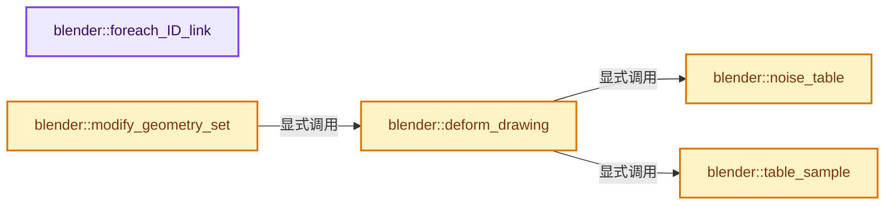
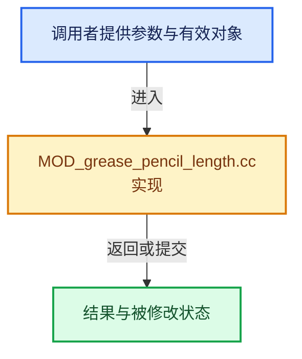

# 实现依赖专题：source/blender/modifiers/intern/MOD_grease_pencil_length.cc

[方向导航](README.md) · [符号索引](../%E7%AC%A6%E5%8F%B7%E4%BE%9D%E8%B5%96%E4%B8%8E%E5%AE%9E%E7%8E%B0%E7%B4%A2%E5%BC%95.md)

本专题从正文实际调用进入，集中保存共享实现。函数有稳定锚点，可从调用处直接跳到对应完整函数；递归与互相调用通过回链组织。

## 本文件的实现关系






## 完整成员与函数实现

<a id="f-3ed0cfe08486d0de"></a>

### `blender::foreach_ID_link`

实现位置：[source/blender/modifiers/intern/MOD_grease_pencil_length.cc](../../../../../source/blender/modifiers/intern/MOD_grease_pencil_length.cc) · L65—L69。

接口参数：

- `ModifierData *md`
- `Object *ob`
- `IDWalkFunc walk`
- `void *user_data`

**教学注释版**

<!-- annotated:a0f9c6990cab74 -->

```cpp
static void foreach_ID_link(ModifierData *md, Object *ob, IDWalkFunc walk, void *user_data)
{
  auto *omd = reinterpret_cast<GreasePencilLengthModifierData *>(md);
  modifier::greasepencil::foreach_influence_ID_link(&omd->influence, ob, walk, user_data);
}
```

<details>
<summary>核对原始源码：source/blender/modifiers/intern/MOD_grease_pencil_length.cc · L65—L69</summary>

<!-- original:a0f9c6990cab74:source/blender/modifiers/intern/MOD_grease_pencil_length.cc:65:69 -->

```cpp
static void foreach_ID_link(ModifierData *md, Object *ob, IDWalkFunc walk, void *user_data)
{
  auto *omd = reinterpret_cast<GreasePencilLengthModifierData *>(md);
  modifier::greasepencil::foreach_influence_ID_link(&omd->influence, ob, walk, user_data);
}
```

</details>

**继续追踪实现**

- `modifier::greasepencil::foreach_influence_ID_link` → [blender::modifier::greasepencil::foreach_influence_ID_link · L69](%E4%BE%9D%E8%B5%96-MOD_grease_pencil_util-d0b437.md#f-247ba56fa4c4e56f)。

<a id="f-bf548e69126af0b6"></a>

### `blender::noise_table`

实现位置：[source/blender/modifiers/intern/MOD_grease_pencil_length.cc](../../../../../source/blender/modifiers/intern/MOD_grease_pencil_length.cc) · L87—L94。

接口参数：

- `int len`
- `int offset`
- `int seed`

**教学注释版**

<!-- annotated:8341e8bd07f1da -->

```cpp
static Array<float> noise_table(int len, int offset, int seed)
{
  Array<float> table(len);
  // [讲解] table.index_range：查询固定有效长度及其索引范围。
  for (const int i : table.index_range()) {
    table[i] = BLI_hash_int_01(BLI_hash_int_2d(seed, i + offset + 1));
  }
  return table;
}
```

<details>
<summary>核对原始源码：source/blender/modifiers/intern/MOD_grease_pencil_length.cc · L87—L94</summary>

<!-- original:8341e8bd07f1da:source/blender/modifiers/intern/MOD_grease_pencil_length.cc:87:94 -->

```cpp
static Array<float> noise_table(int len, int offset, int seed)
{
  Array<float> table(len);
  for (const int i : table.index_range()) {
    table[i] = BLI_hash_int_01(BLI_hash_int_2d(seed, i + offset + 1));
  }
  return table;
}
```

</details>

**沿实际写入检查状态**

- `table[i] = BLI_hash_int_01(BLI_hash_int_2d(seed, i + offset + 1));`

**结果出口**

- `return table;`

**继续追踪实现**

- `table.index_range` → [blender::Array::index_range · L371](../01-%E5%9F%BA%E7%A1%80%E5%AE%B9%E5%99%A8%E4%B8%8E%E7%8E%B0%E4%BB%A3CPP/08-Array%E5%A4%8D%E5%88%B6%E7%A7%BB%E5%8A%A8%E4%B8%8E%E9%94%80%E6%AF%81.md#f-50a09e14742887a0)。
- `BLI_hash_int_01` → [blender::BLI_hash_int_01 · L94](../02-%E5%93%88%E5%B8%8C%E8%A1%A8%E4%B8%8E%E5%85%B3%E8%81%94%E6%95%B0%E6%8D%AE%E7%BB%93%E6%9E%84/%E4%BE%9D%E8%B5%96-BLI_hash_c-2ab8ea.md#f-5f15d616cd371045)。
- `BLI_hash_int_2d` → [blender::BLI_hash_int_2d · L53](../02-%E5%93%88%E5%B8%8C%E8%A1%A8%E4%B8%8E%E5%85%B3%E8%81%94%E6%95%B0%E6%8D%AE%E7%BB%93%E6%9E%84/%E4%BE%9D%E8%B5%96-BLI_hash_c-2ab8ea.md#f-3257c3494717d4c4)。

<a id="f-8ca2aff2eb5a345b"></a>

### `blender::table_sample`

实现位置：[source/blender/modifiers/intern/MOD_grease_pencil_length.cc](../../../../../source/blender/modifiers/intern/MOD_grease_pencil_length.cc) · L96—L99。

接口参数：

- `MutableSpan<float> table`
- `float x`

**教学注释版**

<!-- annotated:fbe9a76298a7da -->

```cpp
static float table_sample(MutableSpan<float> table, float x)
{
  return math::interpolate(table[int(math::floor(x))], table[int(math::ceil(x))], math::fract(x));
}
```

<details>
<summary>核对原始源码：source/blender/modifiers/intern/MOD_grease_pencil_length.cc · L96—L99</summary>

<!-- original:fbe9a76298a7da:source/blender/modifiers/intern/MOD_grease_pencil_length.cc:96:99 -->

```cpp
static float table_sample(MutableSpan<float> table, float x)
{
  return math::interpolate(table[int(math::floor(x))], table[int(math::ceil(x))], math::fract(x));
}
```

</details>

**结果出口**

- `return math::interpolate(table[int(math::floor(x))], table[int(math::ceil(x))], math::fract(x));`

**继续追踪实现**

- `math::interpolate` → [blender::math::interpolate · L335](../12-%E7%A9%BA%E9%97%B4%E6%95%B0%E6%8D%AE%E7%BB%93%E6%9E%84%E4%B8%8E%E5%87%A0%E4%BD%95%E7%AE%97%E6%B3%95/%E4%BE%9D%E8%B5%96-math_matrix-d7d8ee.md#f-91e7f517ebd72fb5)；[blender::math::interpolate · L379](../12-%E7%A9%BA%E9%97%B4%E6%95%B0%E6%8D%AE%E7%BB%93%E6%9E%84%E4%B8%8E%E5%87%A0%E4%BD%95%E7%AE%97%E6%B3%95/%E4%BE%9D%E8%B5%96-math_matrix-d7d8ee.md#f-a1be14e86ce595c2)；[blender::math::interpolate · L636](../12-%E7%A9%BA%E9%97%B4%E6%95%B0%E6%8D%AE%E7%BB%93%E6%9E%84%E4%B8%8E%E5%87%A0%E4%BD%95%E7%AE%97%E6%B3%95/%E4%BE%9D%E8%B5%96-BLI_math_vector-906a87.md#f-d612b6d6ab1b6e7c)；[blender::math::interpolate · L303](../12-%E7%A9%BA%E9%97%B4%E6%95%B0%E6%8D%AE%E7%BB%93%E6%9E%84%E4%B8%8E%E5%87%A0%E4%BD%95%E7%AE%97%E6%B3%95/%E4%BE%9D%E8%B5%96-BLI_math_quaternion-cf105d.md#f-48b9ace2a9c6185c)；[blender::math::interpolate · L17](../12-%E7%A9%BA%E9%97%B4%E6%95%B0%E6%8D%AE%E7%BB%93%E6%9E%84%E4%B8%8E%E5%87%A0%E4%BD%95%E7%AE%97%E6%B3%95/%E4%BE%9D%E8%B5%96-BLI_math_color-f3a6ea.md#f-eb5ef92b0f8c0926)；[blender::math::interpolate · L28](../12-%E7%A9%BA%E9%97%B4%E6%95%B0%E6%8D%AE%E7%BB%93%E6%9E%84%E4%B8%8E%E5%87%A0%E4%BD%95%E7%AE%97%E6%B3%95/%E4%BE%9D%E8%B5%96-BLI_math_color-f3a6ea.md#f-2a9e33ec55979ab6)；[blender::math::interpolate · L278](../12-%E7%A9%BA%E9%97%B4%E6%95%B0%E6%8D%AE%E7%BB%93%E6%9E%84%E4%B8%8E%E5%87%A0%E4%BD%95%E7%AE%97%E6%B3%95/%E4%BE%9D%E8%B5%96-BLI_math_base-0728eb.md#f-2629b871528f6528)。同名重载需按实参类型选择。
- `math::floor` → [外部契约](https://eel.is/c++draft/)：这个边界按实际表达式及所属类型核对参数、返回值、寿命与失败行为。这里提供接口入口，不声称已解释该第三方版本的内部实现。
- `math::ceil` → [外部契约](https://eel.is/c++draft/)：这个边界按实际表达式及所属类型核对参数、返回值、寿命与失败行为。这里提供接口入口，不声称已解释该第三方版本的内部实现。
- `math::fract` → [blender::math::fract · L418](../12-%E7%A9%BA%E9%97%B4%E6%95%B0%E6%8D%AE%E7%BB%93%E6%9E%84%E4%B8%8E%E5%87%A0%E4%BD%95%E7%AE%97%E6%B3%95/%E4%BE%9D%E8%B5%96-BLI_math_vector-906a87.md#f-f880c123697186fe)；[blender::math::fract · L148](../12-%E7%A9%BA%E9%97%B4%E6%95%B0%E6%8D%AE%E7%BB%93%E6%9E%84%E4%B8%8E%E5%87%A0%E4%BD%95%E7%AE%97%E6%B3%95/%E4%BE%9D%E8%B5%96-BLI_math_base-0728eb.md#f-d575d73a3482378e)。同名重载需按实参类型选择。

<a id="f-8ff2e3fa029a1d8d"></a>

### `blender::deform_drawing`

实现位置：[source/blender/modifiers/intern/MOD_grease_pencil_length.cc](../../../../../source/blender/modifiers/intern/MOD_grease_pencil_length.cc) · L101—L243。

接口参数：

- `const ModifierData &md`
- `const Object &ob`
- `bke::greasepencil::Drawing &drawing`
- `const int current_time`

**教学注释版**

<!-- annotated:bc2707c0091479 -->

```cpp
static void deform_drawing(const ModifierData &md,
                           const Object &ob,
                           bke::greasepencil::Drawing &drawing,
                           const int current_time)
{
  const GreasePencilLengthModifierData &mmd =
      reinterpret_cast<const GreasePencilLengthModifierData &>(md);
  modifier::greasepencil::ensure_no_bezier_curves(drawing);
  bke::CurvesGeometry &curves = drawing.strokes_for_write();

  if (curves.is_empty()) {
    return;
  }

  IndexMaskMemory memory;
  const IndexMask selection = modifier::greasepencil::get_filtered_stroke_mask(
      &ob, curves, mmd.influence, memory);

  const int curves_num = curves.curves_num();

  /* Variable for tagging shrinking when values are adjusted after random. */
  std::atomic<bool> needs_additional_shrinking = false;

  VArray<float> use_starts = VArray<float>::from_single(mmd.start_fac, curves_num);
  VArray<float> use_ends = VArray<float>::from_single(mmd.end_fac, curves_num);

  Array<float> modified_starts;
  Array<float> modified_ends;
  if (mmd.rand_start_fac != 0.0 || mmd.rand_end_fac != 0.0) {
    modified_starts = Array<float>(curves.curves_num(), mmd.start_fac);
    modified_ends = Array<float>(curves.curves_num(), mmd.end_fac);

    /* Use random to modify start/end factors. Put the modified values outside the
     * branch so it could be accessed in later stretching/shrinking stages. */
    // [讲解] modified_starts.as_mutable_span：提供数组的借用访问入口。
    use_starts = VArray<float>::from_span(modified_starts.as_mutable_span());
    use_ends = VArray<float>::from_span(modified_ends.as_mutable_span());

    int seed = mmd.seed;

    /* Make sure different modifiers get different seeds. */
    seed += BLI_hash_string(ob.id.name + 2);
    seed += BLI_hash_string(md.name);

    if (mmd.flag & GP_LENGTH_USE_RANDOM) {
      seed += current_time / mmd.step;
    }

    float rand_offset = BLI_hash_int_01(seed);

    Array<float> noise_table_length = noise_table(
        4 + curves_num, int(math::floor(mmd.rand_offset)), seed + 2);

    threading::parallel_for(IndexRange(curves_num), 512, [&](const IndexRange parallel_range) {
      for (const int i : parallel_range) {
        /* To ensure a nice distribution, we use halton sequence and offset using the seed. */
        double r[2];
        const uint primes[2] = {2, 3};
        double offset[2] = {0.0f, 0.0f};
        BLI_halton_2d(primes, offset, i, r);

        float rand[2] = {0.0f, 0.0f};
        for (int j = 0; j < 2; j++) {
          float noise = table_sample(noise_table_length, i + j * 2 + math::fract(mmd.rand_offset));

          rand[j] = math::mod(float(r[j] + rand_offset), 1.0f);
          rand[j] = math::abs(
              math::mod(sin(rand[j] * 12.9898f + j * 78.233f) * 43758.5453f, 1.0f) + noise);
        }

        modified_starts[i] = modified_starts[i] + rand[0] * mmd.rand_start_fac;
        modified_ends[i] = modified_ends[i] + rand[1] * mmd.rand_end_fac;

        if (modified_starts[i] <= 0.0f || modified_ends[i] <= 0.0f) {
          needs_additional_shrinking.store(true, std::memory_order_relaxed);
        }
      }
    });
  }

  curves = geometry::extend_curves(curves,
                                   selection,
                                   use_starts,
                                   use_ends,
                                   mmd.overshoot_fac,
                                   (mmd.flag & GP_LENGTH_USE_CURVATURE) != 0,
                                   mmd.point_density,
                                   mmd.segment_influence,
                                   mmd.max_angle,
                                   (mmd.flag & GP_LENGTH_INVERT_CURVATURE) != 0,
                                   ((mmd.mode & GP_LENGTH_ABSOLUTE) != 0) ?
                                       GEO_NODE_CURVE_SAMPLE_LENGTH :
                                       GEO_NODE_CURVE_SAMPLE_FACTOR,
                                   {});

  /* Always do the stretching first since it might depend on points which could be deleted by the
   * shrink. */
  if (mmd.start_fac < 0.0f || mmd.end_fac < 0.0f || needs_additional_shrinking) {
    /* #trim_curves() accepts the `end` values if it's sampling from the beginning of the
     * curve, so we need to get the lengths of the curves and subtract it from the back when the
     * modifier is in Absolute mode. For convenience, we always call #trim_curves() in LENGTH
     * mode since the function itself will need length to be sampled anyway. */
    Array<float> starts(curves.curves_num());
    Array<float> ends(curves.curves_num());
    Array<bool> needs_removal(curves.curves_num());
    // [讲解] needs_removal.fill：对现有元素赋同一个值。
    needs_removal.fill(false);

    curves.ensure_evaluated_lengths();
    const VArray<bool> &cyclic = curves.cyclic();

    threading::parallel_for(curves.curves_range(), 512, [&](const IndexRange parallel_range) {
      for (const int curve : parallel_range) {
        float length = curves.evaluated_length_total_for_curve(curve, cyclic[curve]);
        if (mmd.mode & GP_LENGTH_ABSOLUTE) {
          starts[curve] = -math::min(use_starts[curve], 0.0f);
          ends[curve] = length - -math::min(use_ends[curve], 0.0f);
        }
        else {
          starts[curve] = -math::min(use_starts[curve], 0.0f) * length;
          ends[curve] = (1 + math::min(use_ends[curve], 0.0f)) * length;
        }
        if (starts[curve] > ends[curve]) {
          needs_removal[curve] = true;
        }
      }
    });
    curves = geometry::trim_curves(curves,
                                   selection,
                                   // [讲解] starts.as_span：提供数组的借用访问入口。
                                   VArray<float>::from_span(starts.as_span()),
                                   VArray<float>::from_span(ends.as_span()),
                                   GEO_NODE_CURVE_SAMPLE_LENGTH,
                                   {});

    /* #trim_curves() will leave the last segment there when trimmed length is greater than
     * curve original length, thus we need to remove those curves afterwards. */
    IndexMaskMemory memory_remove;
    const IndexMask to_remove = IndexMask::from_bools(needs_removal.as_span(), memory_remove);
    if (!to_remove.is_empty()) {
      curves.remove_curves(to_remove, {});
    }
  }

  drawing.tag_topology_changed();
}
```

<details>
<summary>核对原始源码：source/blender/modifiers/intern/MOD_grease_pencil_length.cc · L101—L243</summary>

<!-- original:bc2707c0091479:source/blender/modifiers/intern/MOD_grease_pencil_length.cc:101:243 -->

```cpp
static void deform_drawing(const ModifierData &md,
                           const Object &ob,
                           bke::greasepencil::Drawing &drawing,
                           const int current_time)
{
  const GreasePencilLengthModifierData &mmd =
      reinterpret_cast<const GreasePencilLengthModifierData &>(md);
  modifier::greasepencil::ensure_no_bezier_curves(drawing);
  bke::CurvesGeometry &curves = drawing.strokes_for_write();

  if (curves.is_empty()) {
    return;
  }

  IndexMaskMemory memory;
  const IndexMask selection = modifier::greasepencil::get_filtered_stroke_mask(
      &ob, curves, mmd.influence, memory);

  const int curves_num = curves.curves_num();

  /* Variable for tagging shrinking when values are adjusted after random. */
  std::atomic<bool> needs_additional_shrinking = false;

  VArray<float> use_starts = VArray<float>::from_single(mmd.start_fac, curves_num);
  VArray<float> use_ends = VArray<float>::from_single(mmd.end_fac, curves_num);

  Array<float> modified_starts;
  Array<float> modified_ends;
  if (mmd.rand_start_fac != 0.0 || mmd.rand_end_fac != 0.0) {
    modified_starts = Array<float>(curves.curves_num(), mmd.start_fac);
    modified_ends = Array<float>(curves.curves_num(), mmd.end_fac);

    /* Use random to modify start/end factors. Put the modified values outside the
     * branch so it could be accessed in later stretching/shrinking stages. */
    use_starts = VArray<float>::from_span(modified_starts.as_mutable_span());
    use_ends = VArray<float>::from_span(modified_ends.as_mutable_span());

    int seed = mmd.seed;

    /* Make sure different modifiers get different seeds. */
    seed += BLI_hash_string(ob.id.name + 2);
    seed += BLI_hash_string(md.name);

    if (mmd.flag & GP_LENGTH_USE_RANDOM) {
      seed += current_time / mmd.step;
    }

    float rand_offset = BLI_hash_int_01(seed);

    Array<float> noise_table_length = noise_table(
        4 + curves_num, int(math::floor(mmd.rand_offset)), seed + 2);

    threading::parallel_for(IndexRange(curves_num), 512, [&](const IndexRange parallel_range) {
      for (const int i : parallel_range) {
        /* To ensure a nice distribution, we use halton sequence and offset using the seed. */
        double r[2];
        const uint primes[2] = {2, 3};
        double offset[2] = {0.0f, 0.0f};
        BLI_halton_2d(primes, offset, i, r);

        float rand[2] = {0.0f, 0.0f};
        for (int j = 0; j < 2; j++) {
          float noise = table_sample(noise_table_length, i + j * 2 + math::fract(mmd.rand_offset));

          rand[j] = math::mod(float(r[j] + rand_offset), 1.0f);
          rand[j] = math::abs(
              math::mod(sin(rand[j] * 12.9898f + j * 78.233f) * 43758.5453f, 1.0f) + noise);
        }

        modified_starts[i] = modified_starts[i] + rand[0] * mmd.rand_start_fac;
        modified_ends[i] = modified_ends[i] + rand[1] * mmd.rand_end_fac;

        if (modified_starts[i] <= 0.0f || modified_ends[i] <= 0.0f) {
          needs_additional_shrinking.store(true, std::memory_order_relaxed);
        }
      }
    });
  }

  curves = geometry::extend_curves(curves,
                                   selection,
                                   use_starts,
                                   use_ends,
                                   mmd.overshoot_fac,
                                   (mmd.flag & GP_LENGTH_USE_CURVATURE) != 0,
                                   mmd.point_density,
                                   mmd.segment_influence,
                                   mmd.max_angle,
                                   (mmd.flag & GP_LENGTH_INVERT_CURVATURE) != 0,
                                   ((mmd.mode & GP_LENGTH_ABSOLUTE) != 0) ?
                                       GEO_NODE_CURVE_SAMPLE_LENGTH :
                                       GEO_NODE_CURVE_SAMPLE_FACTOR,
                                   {});

  /* Always do the stretching first since it might depend on points which could be deleted by the
   * shrink. */
  if (mmd.start_fac < 0.0f || mmd.end_fac < 0.0f || needs_additional_shrinking) {
    /* #trim_curves() accepts the `end` values if it's sampling from the beginning of the
     * curve, so we need to get the lengths of the curves and subtract it from the back when the
     * modifier is in Absolute mode. For convenience, we always call #trim_curves() in LENGTH
     * mode since the function itself will need length to be sampled anyway. */
    Array<float> starts(curves.curves_num());
    Array<float> ends(curves.curves_num());
    Array<bool> needs_removal(curves.curves_num());
    needs_removal.fill(false);

    curves.ensure_evaluated_lengths();
    const VArray<bool> &cyclic = curves.cyclic();

    threading::parallel_for(curves.curves_range(), 512, [&](const IndexRange parallel_range) {
      for (const int curve : parallel_range) {
        float length = curves.evaluated_length_total_for_curve(curve, cyclic[curve]);
        if (mmd.mode & GP_LENGTH_ABSOLUTE) {
          starts[curve] = -math::min(use_starts[curve], 0.0f);
          ends[curve] = length - -math::min(use_ends[curve], 0.0f);
        }
        else {
          starts[curve] = -math::min(use_starts[curve], 0.0f) * length;
          ends[curve] = (1 + math::min(use_ends[curve], 0.0f)) * length;
        }
        if (starts[curve] > ends[curve]) {
          needs_removal[curve] = true;
        }
      }
    });
    curves = geometry::trim_curves(curves,
                                   selection,
                                   VArray<float>::from_span(starts.as_span()),
                                   VArray<float>::from_span(ends.as_span()),
                                   GEO_NODE_CURVE_SAMPLE_LENGTH,
                                   {});

    /* #trim_curves() will leave the last segment there when trimmed length is greater than
     * curve original length, thus we need to remove those curves afterwards. */
    IndexMaskMemory memory_remove;
    const IndexMask to_remove = IndexMask::from_bools(needs_removal.as_span(), memory_remove);
    if (!to_remove.is_empty()) {
      curves.remove_curves(to_remove, {});
    }
  }

  drawing.tag_topology_changed();
}
```

</details>

**沿实际写入检查状态**

- `modified_starts = Array<float>(curves.curves_num(), mmd.start_fac);`
- `modified_ends = Array<float>(curves.curves_num(), mmd.end_fac);`
- `use_starts = VArray<float>::from_span(modified_starts.as_mutable_span());`
- `use_ends = VArray<float>::from_span(modified_ends.as_mutable_span());`
- `seed += BLI_hash_string(ob.id.name + 2);`
- `seed += BLI_hash_string(md.name);`
- `seed += current_time / mmd.step;`
- `rand[j] = math::mod(float(r[j] + rand_offset), 1.0f);`
- `rand[j] = math::abs(`
- `modified_starts[i] = modified_starts[i] + rand[0] * mmd.rand_start_fac;`
- `modified_ends[i] = modified_ends[i] + rand[1] * mmd.rand_end_fac;`
- `curves = geometry::extend_curves(curves,`
- `starts[curve] = -math::min(use_starts[curve], 0.0f);`
- `ends[curve] = length - -math::min(use_ends[curve], 0.0f);`
- `starts[curve] = -math::min(use_starts[curve], 0.0f) * length;`
- `ends[curve] = (1 + math::min(use_ends[curve], 0.0f)) * length;`
- `needs_removal[curve] = true;`
- `curves = geometry::trim_curves(curves,`

**继续追踪实现**

- `modifier::greasepencil::ensure_no_bezier_curves` → [blender::modifier::greasepencil::ensure_no_bezier_curves · L432](%E4%BE%9D%E8%B5%96-MOD_grease_pencil_util-d0b437.md#f-1fde6483ac30d59b)。
- `drawing.strokes_for_write` → [blender::bke::greasepencil::Drawing::strokes_for_write · L1012](%E4%BE%9D%E8%B5%96-grease_pencil-f750d6.md#f-0649333785d0aa95)。
- `curves.is_empty` → [blender::bke::CurvesGeometry::is_empty · L1013](04-CurvesGeometry%E5%AD%98%E5%82%A8.md#f-4c323ef62c4b64ab)。
- `modifier::greasepencil::get_filtered_stroke_mask` → [blender::modifier::greasepencil::get_filtered_stroke_mask · L285](%E4%BE%9D%E8%B5%96-MOD_grease_pencil_util-d0b437.md#f-30c219d04de7dec3)；[blender::modifier::greasepencil::get_filtered_stroke_mask · L326](%E4%BE%9D%E8%B5%96-MOD_grease_pencil_util-d0b437.md#f-970c3bc880e4f350)。同名重载需按实参类型选择。
- `curves.curves_num` → [blender::bke::CurvesGeometry::curves_num · L1005](04-CurvesGeometry%E5%AD%98%E5%82%A8.md#f-eabb3f0e5d3c57be)。
- `VArray<float>::from_single` → [blender::GVArray::from_single · L880](../04-%E8%99%9A%E6%8B%9F%E6%95%B0%E7%BB%84%E4%B8%8E%E7%B4%A2%E5%BC%95%E9%80%89%E6%8B%A9/05-GVArray%E8%BF%90%E8%A1%8C%E6%97%B6%E7%B1%BB%E5%9E%8B.md#f-1c85e09520e47c5a)。
- `Array<float>` → [blender::Array::Array · L78](../01-%E5%9F%BA%E7%A1%80%E5%AE%B9%E5%99%A8%E4%B8%8E%E7%8E%B0%E4%BB%A3CPP/07-Array%E6%9E%84%E9%80%A0%E4%B8%8E%E5%AD%98%E5%82%A8.md#f-001fd5eb3c658238)；[blender::Array::Array · L84](../01-%E5%9F%BA%E7%A1%80%E5%AE%B9%E5%99%A8%E4%B8%8E%E7%8E%B0%E4%BB%A3CPP/07-Array%E6%9E%84%E9%80%A0%E4%B8%8E%E5%AD%98%E5%82%A8.md#f-674e2f10361a462b)；[blender::Array::Array · L89](../01-%E5%9F%BA%E7%A1%80%E5%AE%B9%E5%99%A8%E4%B8%8E%E7%8E%B0%E4%BB%A3CPP/07-Array%E6%9E%84%E9%80%A0%E4%B8%8E%E5%AD%98%E5%82%A8.md#f-aa1e5908a9b67557)；[blender::Array::Array · L103](../01-%E5%9F%BA%E7%A1%80%E5%AE%B9%E5%99%A8%E4%B8%8E%E7%8E%B0%E4%BB%A3CPP/07-Array%E6%9E%84%E9%80%A0%E4%B8%8E%E5%AD%98%E5%82%A8.md#f-b141be39084346f3)；[blender::Array::Array · L110](../01-%E5%9F%BA%E7%A1%80%E5%AE%B9%E5%99%A8%E4%B8%8E%E7%8E%B0%E4%BB%A3CPP/07-Array%E6%9E%84%E9%80%A0%E4%B8%8E%E5%AD%98%E5%82%A8.md#f-452e276f39e81a2a)；[blender::Array::Array · L123](../01-%E5%9F%BA%E7%A1%80%E5%AE%B9%E5%99%A8%E4%B8%8E%E7%8E%B0%E4%BB%A3CPP/07-Array%E6%9E%84%E9%80%A0%E4%B8%8E%E5%AD%98%E5%82%A8.md#f-646aa58152ec44f6)；[blender::Array::Array · L135](../01-%E5%9F%BA%E7%A1%80%E5%AE%B9%E5%99%A8%E4%B8%8E%E7%8E%B0%E4%BB%A3CPP/07-Array%E6%9E%84%E9%80%A0%E4%B8%8E%E5%AD%98%E5%82%A8.md#f-0a9de4a549125f99)；[blender::Array::Array · L168](../01-%E5%9F%BA%E7%A1%80%E5%AE%B9%E5%99%A8%E4%B8%8E%E7%8E%B0%E4%BB%A3CPP/07-Array%E6%9E%84%E9%80%A0%E4%B8%8E%E5%AD%98%E5%82%A8.md#f-31f001eb92069e9d)；[blender::Array::Array · L176](../01-%E5%9F%BA%E7%A1%80%E5%AE%B9%E5%99%A8%E4%B8%8E%E7%8E%B0%E4%BB%A3CPP/07-Array%E6%9E%84%E9%80%A0%E4%B8%8E%E5%AD%98%E5%82%A8.md#f-cf8148f06fc6747a)；[blender::Array::Array · L178](../01-%E5%9F%BA%E7%A1%80%E5%AE%B9%E5%99%A8%E4%B8%8E%E7%8E%B0%E4%BB%A3CPP/07-Array%E6%9E%84%E9%80%A0%E4%B8%8E%E5%AD%98%E5%82%A8.md#f-2ddca2fb9dd964b3)。同名重载需按实参类型选择。
- `VArray<float>::from_span` → [blender::GVArray::from_span · L895](../04-%E8%99%9A%E6%8B%9F%E6%95%B0%E7%BB%84%E4%B8%8E%E7%B4%A2%E5%BC%95%E9%80%89%E6%8B%A9/05-GVArray%E8%BF%90%E8%A1%8C%E6%97%B6%E7%B1%BB%E5%9E%8B.md#f-e8b978ca15febb67)。
- `modified_starts.as_mutable_span` → [blender::Array::as_mutable_span · L259](../01-%E5%9F%BA%E7%A1%80%E5%AE%B9%E5%99%A8%E4%B8%8E%E7%8E%B0%E4%BB%A3CPP/08-Array%E5%A4%8D%E5%88%B6%E7%A7%BB%E5%8A%A8%E4%B8%8E%E9%94%80%E6%AF%81.md#f-4e91de9f1337c144)。
- `modified_ends.as_mutable_span` → [blender::Array::as_mutable_span · L259](../01-%E5%9F%BA%E7%A1%80%E5%AE%B9%E5%99%A8%E4%B8%8E%E7%8E%B0%E4%BB%A3CPP/08-Array%E5%A4%8D%E5%88%B6%E7%A7%BB%E5%8A%A8%E4%B8%8E%E9%94%80%E6%AF%81.md#f-4e91de9f1337c144)。
- `BLI_hash_string` → [blender::BLI_hash_string · L69](../02-%E5%93%88%E5%B8%8C%E8%A1%A8%E4%B8%8E%E5%85%B3%E8%81%94%E6%95%B0%E6%8D%AE%E7%BB%93%E6%9E%84/%E4%BE%9D%E8%B5%96-BLI_hash_c-2ab8ea.md#f-0f3487d576368d89)。
- `BLI_hash_int_01` → [blender::BLI_hash_int_01 · L94](../02-%E5%93%88%E5%B8%8C%E8%A1%A8%E4%B8%8E%E5%85%B3%E8%81%94%E6%95%B0%E6%8D%AE%E7%BB%93%E6%9E%84/%E4%BE%9D%E8%B5%96-BLI_hash_c-2ab8ea.md#f-5f15d616cd371045)。
- `noise_table` → [blender::noise_table · L87](%E4%BE%9D%E8%B5%96-MOD_grease_pencil_length-522992.md#f-bf548e69126af0b6)。
- `math::floor` → [外部契约](https://eel.is/c++draft/)：这个边界按实际表达式及所属类型核对参数、返回值、寿命与失败行为。这里提供接口入口，不声称已解释该第三方版本的内部实现。
- `threading::parallel_for` → [blender::threading::parallel_for · L68](../11-Depsgraph%E4%B8%8E%E5%B9%B6%E8%A1%8C%E4%BB%BB%E5%8A%A1%E7%B3%BB%E7%BB%9F/07-%E4%BB%BB%E5%8A%A1%E6%B1%A0%E4%B8%8ETBB%E6%8E%A5%E5%85%A5.md#f-838294754c24426c)。
- `IndexRange` → [blender::IndexRange](../01-%E5%9F%BA%E7%A1%80%E5%AE%B9%E5%99%A8%E4%B8%8E%E7%8E%B0%E4%BB%A3CPP/%E4%BE%9D%E8%B5%96-BLI_index_range-7d7cc5.md#t-caa3466d6776)；[blender::gpu::shader::parser::IndexRange](%E4%BE%9D%E8%B5%96-utils-06433d.md#t-82d2bd4ea71c)；[blender::IndexRange](%E4%BE%9D%E8%B5%96-DNA_node_types-6708b9.md#t-0448cc889d39)。
- `BLI_halton_2d` → [RNG::BLI_halton_2d · L239](../01-%E5%9F%BA%E7%A1%80%E5%AE%B9%E5%99%A8%E4%B8%8E%E7%8E%B0%E4%BB%A3CPP/%E4%BE%9D%E8%B5%96-rand-171ca2.md#f-3cc86267e8641246)。
- `table_sample` → [blender::table_sample · L96](%E4%BE%9D%E8%B5%96-MOD_grease_pencil_length-522992.md#f-8ca2aff2eb5a345b)。
- `math::fract` → [blender::math::fract · L418](../12-%E7%A9%BA%E9%97%B4%E6%95%B0%E6%8D%AE%E7%BB%93%E6%9E%84%E4%B8%8E%E5%87%A0%E4%BD%95%E7%AE%97%E6%B3%95/%E4%BE%9D%E8%B5%96-BLI_math_vector-906a87.md#f-f880c123697186fe)；[blender::math::fract · L148](../12-%E7%A9%BA%E9%97%B4%E6%95%B0%E6%8D%AE%E7%BB%93%E6%9E%84%E4%B8%8E%E5%87%A0%E4%BD%95%E7%AE%97%E6%B3%95/%E4%BE%9D%E8%B5%96-BLI_math_base-0728eb.md#f-d575d73a3482378e)。同名重载需按实参类型选择。
- `math::mod` → [blender::math::mod · L157](../12-%E7%A9%BA%E9%97%B4%E6%95%B0%E6%8D%AE%E7%BB%93%E6%9E%84%E4%B8%8E%E5%87%A0%E4%BD%95%E7%AE%97%E6%B3%95/%E4%BE%9D%E8%B5%96-BLI_math_vector-906a87.md#f-63a20db59a1da3e5)；[blender::math::mod · L163](../12-%E7%A9%BA%E9%97%B4%E6%95%B0%E6%8D%AE%E7%BB%93%E6%9E%84%E4%B8%8E%E5%87%A0%E4%BD%95%E7%AE%97%E6%B3%95/%E4%BE%9D%E8%B5%96-BLI_math_vector-906a87.md#f-f0283c16ea40d512)；[blender::math::mod · L79](../12-%E7%A9%BA%E9%97%B4%E6%95%B0%E6%8D%AE%E7%BB%93%E6%9E%84%E4%B8%8E%E5%87%A0%E4%BD%95%E7%AE%97%E6%B3%95/%E4%BE%9D%E8%B5%96-BLI_math_base-0728eb.md#f-785d692213a12449)。同名重载需按实参类型选择。
- `math::abs` → [blender::math::abs · L38](../12-%E7%A9%BA%E9%97%B4%E6%95%B0%E6%8D%AE%E7%BB%93%E6%9E%84%E4%B8%8E%E5%87%A0%E4%BD%95%E7%AE%97%E6%B3%95/%E4%BE%9D%E8%B5%96-BLI_math_vector-906a87.md#f-e755530125bc2198)；[blender::math::abs · L201](../12-%E7%A9%BA%E9%97%B4%E6%95%B0%E6%8D%AE%E7%BB%93%E6%9E%84%E4%B8%8E%E5%87%A0%E4%BD%95%E7%AE%97%E6%B3%95/%E4%BE%9D%E8%B5%96-BLI_math_basis_types-fc7090.md#f-a137ffce39989ffc)；[blender::math::abs · L33](../12-%E7%A9%BA%E9%97%B4%E6%95%B0%E6%8D%AE%E7%BB%93%E6%9E%84%E4%B8%8E%E5%87%A0%E4%BD%95%E7%AE%97%E6%B3%95/%E4%BE%9D%E8%B5%96-BLI_math_base-0728eb.md#f-a2c9c981f4e8420c)。同名重载需按实参类型选择。
- `sin` → [外部契约](https://eel.is/c++draft/)：这个边界按实际表达式及所属类型核对参数、返回值、寿命与失败行为。这里提供接口入口，不声称已解释该第三方版本的内部实现。
- `needs_additional_shrinking.store` → [外部契约](https://eel.is/c++draft/)：这个边界按实际表达式及所属类型核对参数、返回值、寿命与失败行为。这里提供接口入口，不声称已解释该第三方版本的内部实现。
- `geometry::extend_curves` → [blender::geometry::extend_curves · L199](%E4%BE%9D%E8%B5%96-extend_curves-fc62d4.md#f-3610d5742fc0f2dd)。
- `needs_removal.fill` → [blender::Array::fill · L283](../01-%E5%9F%BA%E7%A1%80%E5%AE%B9%E5%99%A8%E4%B8%8E%E7%8E%B0%E4%BB%A3CPP/08-Array%E5%A4%8D%E5%88%B6%E7%A7%BB%E5%8A%A8%E4%B8%8E%E9%94%80%E6%AF%81.md#f-7c4a16a0c445ca41)。
- `curves.ensure_evaluated_lengths` → [blender::bke::CurvesGeometry::ensure_evaluated_lengths · L1183](%E4%BE%9D%E8%B5%96-curves_geometry-ad7f9f.md#f-2e6e98abd3c59b14)。
- `curves.cyclic` → [blender::bke::CurvesGeometry::cyclic · L362](%E4%BE%9D%E8%B5%96-curves_geometry-ad7f9f.md#f-ec08c2a1d6f3bfea)。
- `curves.curves_range` → [blender::bke::CurvesGeometry::curves_range · L1023](04-CurvesGeometry%E5%AD%98%E5%82%A8.md#f-9aedfb1afc5ebcfb)。
- `curves.evaluated_length_total_for_curve` → [blender::bke::CurvesGeometry::evaluated_length_total_for_curve · L1095](04-CurvesGeometry%E5%AD%98%E5%82%A8.md#f-e26e35a431ece56a)。
- `math::min` → [blender::math::min · L56](../12-%E7%A9%BA%E9%97%B4%E6%95%B0%E6%8D%AE%E7%BB%93%E6%9E%84%E4%B8%8E%E5%87%A0%E4%BD%95%E7%AE%97%E6%B3%95/%E4%BE%9D%E8%B5%96-BLI_math_vector-906a87.md#f-ee6ead51e4bb3364)；[blender::math::min · L65](../12-%E7%A9%BA%E9%97%B4%E6%95%B0%E6%8D%AE%E7%BB%93%E6%9E%84%E4%B8%8E%E5%87%A0%E4%BD%95%E7%AE%97%E6%B3%95/%E4%BE%9D%E8%B5%96-BLI_math_vector-906a87.md#f-f65ce48b3051cce3)；[blender::math::min · L81](../12-%E7%A9%BA%E9%97%B4%E6%95%B0%E6%8D%AE%E7%BB%93%E6%9E%84%E4%B8%8E%E5%87%A0%E4%BD%95%E7%AE%97%E6%B3%95/%E4%BE%9D%E8%B5%96-BLI_math_vector-906a87.md#f-9c602d29fab41795)；[blender::math::min · L43](../12-%E7%A9%BA%E9%97%B4%E6%95%B0%E6%8D%AE%E7%BB%93%E6%9E%84%E4%B8%8E%E5%87%A0%E4%BD%95%E7%AE%97%E6%B3%95/%E4%BE%9D%E8%B5%96-BLI_math_base-0728eb.md#f-72ff0c229e6c09b0)。同名重载需按实参类型选择。
- `geometry::trim_curves` → [blender::geometry::trim_curves · L955](%E4%BE%9D%E8%B5%96-trim_curves-5f30b3.md#f-d17df0d732065a9f)。
- `starts.as_span` → [blender::Array::as_span · L254](../01-%E5%9F%BA%E7%A1%80%E5%AE%B9%E5%99%A8%E4%B8%8E%E7%8E%B0%E4%BB%A3CPP/08-Array%E5%A4%8D%E5%88%B6%E7%A7%BB%E5%8A%A8%E4%B8%8E%E9%94%80%E6%AF%81.md#f-05fc77056a242032)。
- `ends.as_span` → [blender::Array::as_span · L254](../01-%E5%9F%BA%E7%A1%80%E5%AE%B9%E5%99%A8%E4%B8%8E%E7%8E%B0%E4%BB%A3CPP/08-Array%E5%A4%8D%E5%88%B6%E7%A7%BB%E5%8A%A8%E4%B8%8E%E9%94%80%E6%AF%81.md#f-05fc77056a242032)。
- `IndexMask::from_bools` → [blender::index_mask::IndexMask::from_bools · L593](../04-%E8%99%9A%E6%8B%9F%E6%95%B0%E7%BB%84%E4%B8%8E%E7%B4%A2%E5%BC%95%E9%80%89%E6%8B%A9/10-IndexMask%E6%9E%84%E5%BB%BA%E4%B8%8E%E5%B9%B6%E8%A1%8C.md#f-1eccbfd39b11c6bc)；[blender::index_mask::IndexMask::from_bools · L598](../04-%E8%99%9A%E6%8B%9F%E6%95%B0%E7%BB%84%E4%B8%8E%E7%B4%A2%E5%BC%95%E9%80%89%E6%8B%A9/10-IndexMask%E6%9E%84%E5%BB%BA%E4%B8%8E%E5%B9%B6%E8%A1%8C.md#f-3962fd5fd5aee616)；[blender::index_mask::IndexMask::from_bools · L613](../04-%E8%99%9A%E6%8B%9F%E6%95%B0%E7%BB%84%E4%B8%8E%E7%B4%A2%E5%BC%95%E9%80%89%E6%8B%A9/10-IndexMask%E6%9E%84%E5%BB%BA%E4%B8%8E%E5%B9%B6%E8%A1%8C.md#f-5f32581e6bbdca9e)；[blender::index_mask::IndexMask::from_bools · L649](../04-%E8%99%9A%E6%8B%9F%E6%95%B0%E7%BB%84%E4%B8%8E%E7%B4%A2%E5%BC%95%E9%80%89%E6%8B%A9/10-IndexMask%E6%9E%84%E5%BB%BA%E4%B8%8E%E5%B9%B6%E8%A1%8C.md#f-89ee3d007144c267)。同名重载需按实参类型选择。
- `needs_removal.as_span` → [blender::Array::as_span · L254](../01-%E5%9F%BA%E7%A1%80%E5%AE%B9%E5%99%A8%E4%B8%8E%E7%8E%B0%E4%BB%A3CPP/08-Array%E5%A4%8D%E5%88%B6%E7%A7%BB%E5%8A%A8%E4%B8%8E%E9%94%80%E6%AF%81.md#f-05fc77056a242032)。
- `to_remove.is_empty` → [blender::index_mask::IndexMask::is_empty · L748](../04-%E8%99%9A%E6%8B%9F%E6%95%B0%E7%BB%84%E4%B8%8E%E7%B4%A2%E5%BC%95%E9%80%89%E6%8B%A9/09-%E5%88%86%E6%AE%B5%E5%AD%98%E5%82%A8%E4%B8%8E%E9%81%8D%E5%8E%86.md#f-190ac996386064f4)。
- `curves.remove_curves` → [blender::bke::CurvesGeometry::remove_curves · L1636](%E4%BE%9D%E8%B5%96-curves_geometry-ad7f9f.md#f-d9e36471e8618e3b)。
- `drawing.tag_topology_changed` → [blender::bke::greasepencil::Drawing::tag_topology_changed · L1304](%E4%BE%9D%E8%B5%96-grease_pencil-f750d6.md#f-6eefbf46d05d944b)；[blender::bke::greasepencil::Drawing::tag_topology_changed · L1311](%E4%BE%9D%E8%B5%96-grease_pencil-f750d6.md#f-dbd37d071b845a58)。同名重载需按实参类型选择。

<a id="f-115999e601704e66"></a>

### `blender::modify_geometry_set`

实现位置：[source/blender/modifiers/intern/MOD_grease_pencil_length.cc](../../../../../source/blender/modifiers/intern/MOD_grease_pencil_length.cc) · L245—L267。

接口参数：

- `ModifierData *md`
- `const ModifierEvalContext *ctx`
- `bke::GeometrySet *geometry_set`

**教学注释版**

<!-- annotated:c9f41cdbe1813a -->

```cpp
static void modify_geometry_set(ModifierData *md,
                                const ModifierEvalContext *ctx,
                                bke::GeometrySet *geometry_set)
{
  GreasePencilLengthModifierData *mmd = reinterpret_cast<GreasePencilLengthModifierData *>(md);

  if (!geometry_set->has_grease_pencil()) {
    return;
  }

  GreasePencil &grease_pencil = *geometry_set->get_grease_pencil_for_write();

  IndexMaskMemory mask_memory;
  const IndexMask layer_mask = modifier::greasepencil::get_filtered_layer_mask(
      grease_pencil, mmd->influence, mask_memory);
  const Vector<bke::greasepencil::Drawing *> drawings =
      modifier::greasepencil::get_drawings_for_write(
          grease_pencil, layer_mask, grease_pencil.runtime->eval_frame);

  threading::parallel_for_each(drawings, [&](bke::greasepencil::Drawing *drawing) {
    deform_drawing(*md, *ctx->object, *drawing, grease_pencil.runtime->eval_frame);
  });
}
```

<details>
<summary>核对原始源码：source/blender/modifiers/intern/MOD_grease_pencil_length.cc · L245—L267</summary>

<!-- original:c9f41cdbe1813a:source/blender/modifiers/intern/MOD_grease_pencil_length.cc:245:267 -->

```cpp
static void modify_geometry_set(ModifierData *md,
                                const ModifierEvalContext *ctx,
                                bke::GeometrySet *geometry_set)
{
  GreasePencilLengthModifierData *mmd = reinterpret_cast<GreasePencilLengthModifierData *>(md);

  if (!geometry_set->has_grease_pencil()) {
    return;
  }

  GreasePencil &grease_pencil = *geometry_set->get_grease_pencil_for_write();

  IndexMaskMemory mask_memory;
  const IndexMask layer_mask = modifier::greasepencil::get_filtered_layer_mask(
      grease_pencil, mmd->influence, mask_memory);
  const Vector<bke::greasepencil::Drawing *> drawings =
      modifier::greasepencil::get_drawings_for_write(
          grease_pencil, layer_mask, grease_pencil.runtime->eval_frame);

  threading::parallel_for_each(drawings, [&](bke::greasepencil::Drawing *drawing) {
    deform_drawing(*md, *ctx->object, *drawing, grease_pencil.runtime->eval_frame);
  });
}
```

</details>

**继续追踪实现**

- `geometry_set->has_grease_pencil` → [blender::bke::GeometrySet::has_grease_pencil · L415](../06-%E9%9A%90%E5%BC%8F%E5%85%B1%E4%BA%AB%E4%B8%8E%E7%BC%93%E5%AD%98%E7%B3%BB%E7%BB%9F/05-GeometrySet%E8%AF%BB%E5%86%99%E4%B8%8E%E5%A4%8D%E5%88%B6.md#f-357bcb62da7a8afd)。
- `geometry_set->get_grease_pencil_for_write` → [blender::bke::GeometrySet::get_grease_pencil_for_write · L622](../06-%E9%9A%90%E5%BC%8F%E5%85%B1%E4%BA%AB%E4%B8%8E%E7%BC%93%E5%AD%98%E7%B3%BB%E7%BB%9F/05-GeometrySet%E8%AF%BB%E5%86%99%E4%B8%8E%E5%A4%8D%E5%88%B6.md#f-bfc5e891a352651b)。
- `modifier::greasepencil::get_filtered_layer_mask` → [blender::modifier::greasepencil::get_filtered_layer_mask · L213](%E4%BE%9D%E8%B5%96-MOD_grease_pencil_util-d0b437.md#f-6438bea51141f9db)；[blender::modifier::greasepencil::get_filtered_layer_mask · L268](%E4%BE%9D%E8%B5%96-MOD_grease_pencil_util-d0b437.md#f-e3d0f9748ecdf34b)。同名重载需按实参类型选择。
- `modifier::greasepencil::get_drawings_for_write` → [blender::modifier::greasepencil::get_drawings_for_write · L368](%E4%BE%9D%E8%B5%96-MOD_grease_pencil_util-d0b437.md#f-cef3871c31259376)。
- `threading::parallel_for_each` → [blender::threading::parallel_for_each · L30](../11-Depsgraph%E4%B8%8E%E5%B9%B6%E8%A1%8C%E4%BB%BB%E5%8A%A1%E7%B3%BB%E7%BB%9F/07-%E4%BB%BB%E5%8A%A1%E6%B1%A0%E4%B8%8ETBB%E6%8E%A5%E5%85%A5.md#f-d5604027445ef0f5)。
- `deform_drawing` → [blender::deform_drawing · L101](%E4%BE%9D%E8%B5%96-MOD_grease_pencil_length-522992.md#f-8ff2e3fa029a1d8d)。
