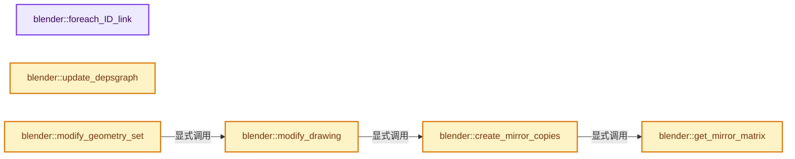
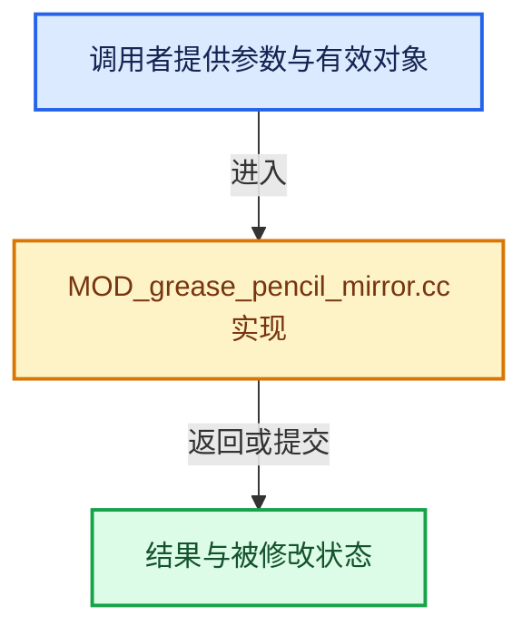

# 实现依赖专题：source/blender/modifiers/intern/MOD_grease_pencil_mirror.cc

[方向导航](README.md) · [符号索引](../%E7%AC%A6%E5%8F%B7%E4%BE%9D%E8%B5%96%E4%B8%8E%E5%AE%9E%E7%8E%B0%E7%B4%A2%E5%BC%95.md)

本专题从正文实际调用进入，集中保存共享实现。函数有稳定锚点，可从调用处直接跳到对应完整函数；递归与互相调用通过回链组织。

## 本文件的实现关系






## 完整成员与函数实现

<a id="f-ce011295654a0642"></a>

### `blender::foreach_ID_link`

实现位置：[source/blender/modifiers/intern/MOD_grease_pencil_mirror.cc](../../../../../source/blender/modifiers/intern/MOD_grease_pencil_mirror.cc) · L62—L67。

接口参数：

- `ModifierData *md`
- `Object *ob`
- `IDWalkFunc walk`
- `void *user_data`

**教学注释版**

<!-- annotated:d5a759653ffa6a -->

```cpp
static void foreach_ID_link(ModifierData *md, Object *ob, IDWalkFunc walk, void *user_data)
{
  auto *mmd = reinterpret_cast<GreasePencilMirrorModifierData *>(md);
  walk(user_data, ob, reinterpret_cast<ID **>(&mmd->object), IDWALK_CB_NOP);
  modifier::greasepencil::foreach_influence_ID_link(&mmd->influence, ob, walk, user_data);
}
```

<details>
<summary>核对原始源码：source/blender/modifiers/intern/MOD_grease_pencil_mirror.cc · L62—L67</summary>

<!-- original:d5a759653ffa6a:source/blender/modifiers/intern/MOD_grease_pencil_mirror.cc:62:67 -->

```cpp
static void foreach_ID_link(ModifierData *md, Object *ob, IDWalkFunc walk, void *user_data)
{
  auto *mmd = reinterpret_cast<GreasePencilMirrorModifierData *>(md);
  walk(user_data, ob, reinterpret_cast<ID **>(&mmd->object), IDWALK_CB_NOP);
  modifier::greasepencil::foreach_influence_ID_link(&mmd->influence, ob, walk, user_data);
}
```

</details>

**继续追踪实现**

- `walk` → [调用协议](../%E6%A8%A1%E6%9D%BF%E5%AE%8F%E4%B8%8E%E5%8A%A8%E6%80%81%E5%88%86%E6%B4%BE%E5%8D%8F%E8%AE%AE.md)：局部可调用对象，须结合其初始化与捕获环境。调用位置L65。
- `modifier::greasepencil::foreach_influence_ID_link` → [blender::modifier::greasepencil::foreach_influence_ID_link · L69](%E4%BE%9D%E8%B5%96-MOD_grease_pencil_util-d0b437.md#f-247ba56fa4c4e56f)。

<a id="f-d35ccff7a39b09c8"></a>

### `blender::update_depsgraph`

实现位置：[source/blender/modifiers/intern/MOD_grease_pencil_mirror.cc](../../../../../source/blender/modifiers/intern/MOD_grease_pencil_mirror.cc) · L69—L77。

接口参数：

- `ModifierData *md`
- `const ModifierUpdateDepsgraphContext *ctx`

**教学注释版**

<!-- annotated:1a7ebc3e94ecc8 -->

```cpp
static void update_depsgraph(ModifierData *md, const ModifierUpdateDepsgraphContext *ctx)
{
  auto *mmd = reinterpret_cast<GreasePencilMirrorModifierData *>(md);
  if (mmd->object != nullptr) {
    DEG_add_object_relation(
        ctx->node, mmd->object, DEG_OB_COMP_TRANSFORM, "Grease Pencil Mirror Modifier");
    DEG_add_depends_on_transform_relation(ctx->node, "Grease Pencil Mirror Modifier");
  }
}
```

<details>
<summary>核对原始源码：source/blender/modifiers/intern/MOD_grease_pencil_mirror.cc · L69—L77</summary>

<!-- original:1a7ebc3e94ecc8:source/blender/modifiers/intern/MOD_grease_pencil_mirror.cc:69:77 -->

```cpp
static void update_depsgraph(ModifierData *md, const ModifierUpdateDepsgraphContext *ctx)
{
  auto *mmd = reinterpret_cast<GreasePencilMirrorModifierData *>(md);
  if (mmd->object != nullptr) {
    DEG_add_object_relation(
        ctx->node, mmd->object, DEG_OB_COMP_TRANSFORM, "Grease Pencil Mirror Modifier");
    DEG_add_depends_on_transform_relation(ctx->node, "Grease Pencil Mirror Modifier");
  }
}
```

</details>

**继续追踪实现**

- `DEG_add_object_relation` → [blender::DEG_add_object_relation · L123](../11-Depsgraph%E4%B8%8E%E5%B9%B6%E8%A1%8C%E4%BB%BB%E5%8A%A1%E7%B3%BB%E7%BB%9F/%E4%BE%9D%E8%B5%96-depsgraph_build-ea2fc8.md#f-f570cffae97e273c)。
- `DEG_add_depends_on_transform_relation` → [blender::DEG_add_depends_on_transform_relation · L240](../11-Depsgraph%E4%B8%8E%E5%B9%B6%E8%A1%8C%E4%BB%BB%E5%8A%A1%E7%B3%BB%E7%BB%9F/%E4%BE%9D%E8%B5%96-depsgraph_build-ea2fc8.md#f-47c32a354defa20d)。

<a id="f-5bf32e29a3c0f186"></a>

### `blender::get_mirror_matrix`

实现位置：[source/blender/modifiers/intern/MOD_grease_pencil_mirror.cc](../../../../../source/blender/modifiers/intern/MOD_grease_pencil_mirror.cc) · L79—L95。

接口参数：

- `const Object &ob`
- `const GreasePencilMirrorModifierData &mmd`
- `const bool mirror_x`
- `const bool mirror_y`
- `const bool mirror_z`

**教学注释版**

<!-- annotated:9c5c142a07d360 -->

```cpp
static float4x4 get_mirror_matrix(const Object &ob,
                                  const GreasePencilMirrorModifierData &mmd,
                                  const bool mirror_x,
                                  const bool mirror_y,
                                  const bool mirror_z)
{
  float4x4 matrix = math::from_scale<float4x4, 3>(
      float3(mirror_x ? -1.0f : 1.0f, mirror_y ? -1.0f : 1.0f, mirror_z ? -1.0f : 1.0f));

  if (mmd.object) {
    /* Transforms from parent object space to target object space. */
    const float4x4 to_target = math::invert(mmd.object->object_to_world()) * ob.object_to_world();
    /* Mirror points in the target object space. */
    matrix = math::invert(to_target) * matrix * to_target;
  }
  return matrix;
}
```

<details>
<summary>核对原始源码：source/blender/modifiers/intern/MOD_grease_pencil_mirror.cc · L79—L95</summary>

<!-- original:9c5c142a07d360:source/blender/modifiers/intern/MOD_grease_pencil_mirror.cc:79:95 -->

```cpp
static float4x4 get_mirror_matrix(const Object &ob,
                                  const GreasePencilMirrorModifierData &mmd,
                                  const bool mirror_x,
                                  const bool mirror_y,
                                  const bool mirror_z)
{
  float4x4 matrix = math::from_scale<float4x4, 3>(
      float3(mirror_x ? -1.0f : 1.0f, mirror_y ? -1.0f : 1.0f, mirror_z ? -1.0f : 1.0f));

  if (mmd.object) {
    /* Transforms from parent object space to target object space. */
    const float4x4 to_target = math::invert(mmd.object->object_to_world()) * ob.object_to_world();
    /* Mirror points in the target object space. */
    matrix = math::invert(to_target) * matrix * to_target;
  }
  return matrix;
}
```

</details>

**沿实际写入检查状态**

- `matrix = math::invert(to_target) * matrix * to_target;`

**结果出口**

- `return matrix;`

**继续追踪实现**

- `math::from_scale<float4x4, 3>` → [调用协议](../%E6%A8%A1%E6%9D%BF%E5%AE%8F%E4%B8%8E%E5%8A%A8%E6%80%81%E5%88%86%E6%B4%BE%E5%8D%8F%E8%AE%AE.md)：函数指针、局部可调用对象或未展开的宏；必须结合调用者环境。调用位置L85。
- `float3` → [float3 · L641](%E4%BE%9D%E8%B5%96-smaa-b67bc2.md#m-0ea8254cfdb4)。宏定义由构建条件选择。
- `math::invert` → [blender::math::invert · L202](../12-%E7%A9%BA%E9%97%B4%E6%95%B0%E6%8D%AE%E7%BB%93%E6%9E%84%E4%B8%8E%E5%87%A0%E4%BD%95%E7%AE%97%E6%B3%95/%E4%BE%9D%E8%B5%96-math_matrix-d7d8ee.md#f-222be9a4cab433f5)；[blender::math::invert · L234](../12-%E7%A9%BA%E9%97%B4%E6%95%B0%E6%8D%AE%E7%BB%93%E6%9E%84%E4%B8%8E%E5%87%A0%E4%BD%95%E7%AE%97%E6%B3%95/%E4%BE%9D%E8%B5%96-BLI_math_quaternion-cf105d.md#f-7ba965075f461895)；[blender::math::invert · L648](../12-%E7%A9%BA%E9%97%B4%E6%95%B0%E6%8D%AE%E7%BB%93%E6%9E%84%E4%B8%8E%E5%87%A0%E4%BD%95%E7%AE%97%E6%B3%95/%E4%BE%9D%E8%B5%96-BLI_math_matrix-b7b2b4.md#f-2b50b5262b2a9121)；[blender::math::invert · L460](../12-%E7%A9%BA%E9%97%B4%E6%95%B0%E6%8D%AE%E7%BB%93%E6%9E%84%E4%B8%8E%E5%87%A0%E4%BD%95%E7%AE%97%E6%B3%95/%E4%BE%9D%E8%B5%96-BLI_math_basis_types-fc7090.md#f-76b56b37f151208d)。同名重载需按实参类型选择。
- `mmd.object->object_to_world` → [调用协议](../%E6%A8%A1%E6%9D%BF%E5%AE%8F%E4%B8%8E%E5%8A%A8%E6%80%81%E5%88%86%E6%B4%BE%E5%8D%8F%E8%AE%AE.md)：接收对象类型依赖auto、返回值或模板实例；不按同名猜测目标。调用位置L90。
- `ob.object_to_world` → [blender::Object::object_to_world · L5761](%E4%BE%9D%E8%B5%96-object-843689.md#f-12fc20026327d50c)。

<a id="f-a14b08b6dddff309"></a>

### `blender::create_mirror_copies`

实现位置：[source/blender/modifiers/intern/MOD_grease_pencil_mirror.cc](../../../../../source/blender/modifiers/intern/MOD_grease_pencil_mirror.cc) · L97—L146。

接口参数：

- `const Object &ob`
- `const GreasePencilMirrorModifierData &mmd`
- `const bke::CurvesGeometry &base_curves`
- `const bke::CurvesGeometry &mirror_curves`

**教学注释版**

<!-- annotated:118cbde314e82d -->

```cpp
static bke::CurvesGeometry create_mirror_copies(const Object &ob,
                                                const GreasePencilMirrorModifierData &mmd,
                                                const bke::CurvesGeometry &base_curves,
                                                const bke::CurvesGeometry &mirror_curves)
{
  const bool use_mirror_x = (mmd.flag & MOD_GREASE_PENCIL_MIRROR_AXIS_X);
  const bool use_mirror_y = (mmd.flag & MOD_GREASE_PENCIL_MIRROR_AXIS_Y);
  const bool use_mirror_z = (mmd.flag & MOD_GREASE_PENCIL_MIRROR_AXIS_Z);

  Curves *base_curves_id = bke::curves_new_nomain(base_curves);
  Curves *mirror_curves_id = bke::curves_new_nomain(mirror_curves);
  bke::GeometrySet base_geo = bke::GeometrySet::from_curves(base_curves_id);
  bke::GeometrySet mirror_geo = bke::GeometrySet::from_curves(mirror_curves_id);

  // [讲解] std::make_unique<bke::Instances>：创建独占拥有的对象，拥有关系可移动，get返回的借用指针不自动延长寿命。
  std::unique_ptr<bke::Instances> instances = std::make_unique<bke::Instances>();
  const int base_handle = instances->add_reference(bke::InstanceReference{base_geo});
  const int mirror_handle = instances->add_reference(bke::InstanceReference{mirror_geo});

  Vector<int> handles;
  Vector<float4x4> transforms;
  for (const int mirror_x : IndexRange(use_mirror_x ? 2 : 1)) {
    for (const int mirror_y : IndexRange(use_mirror_y ? 2 : 1)) {
      for (const int mirror_z : IndexRange(use_mirror_z ? 2 : 1)) {
        if (mirror_x == 0 && mirror_y == 0 && mirror_z == 0) {
          // [讲解] handles.append：在尾部建立新元素，必要时先扩大存储。
          handles.append(base_handle);
          transforms.append(float4x4::identity());
        }
        else {
          const float4x4 matrix = get_mirror_matrix(
              ob, mmd, bool(mirror_x), bool(mirror_y), bool(mirror_z));
          handles.append(mirror_handle);
          transforms.append(matrix);
        }
      }
    }
  }

  // [讲解] handles.size：用end_减begin_得到活元素数量。
  instances->resize(handles.size());
  instances->reference_handles_for_write().copy_from(handles);
  instances->transforms_for_write().copy_from(transforms);

  geometry::RealizeInstancesOptions options;
  options.keep_original_ids = true;
  options.realize_instance_attributes = false;
  bke::GeometrySet result_geo = geometry::realize_instances(
                                    // [讲解] std::move：把表达式转换成可供移动重载选择的值类别；不保证真的移动，不结束源对象寿命，对const值可能选择复制。
                                    bke::GeometrySet::from_instances(std::move(instances)),
                                    options)
                                    .geometry;
  return std::move(result_geo.get_curves_for_write()->geometry.wrap());
}
```

<details>
<summary>核对原始源码：source/blender/modifiers/intern/MOD_grease_pencil_mirror.cc · L97—L146</summary>

<!-- original:118cbde314e82d:source/blender/modifiers/intern/MOD_grease_pencil_mirror.cc:97:146 -->

```cpp
static bke::CurvesGeometry create_mirror_copies(const Object &ob,
                                                const GreasePencilMirrorModifierData &mmd,
                                                const bke::CurvesGeometry &base_curves,
                                                const bke::CurvesGeometry &mirror_curves)
{
  const bool use_mirror_x = (mmd.flag & MOD_GREASE_PENCIL_MIRROR_AXIS_X);
  const bool use_mirror_y = (mmd.flag & MOD_GREASE_PENCIL_MIRROR_AXIS_Y);
  const bool use_mirror_z = (mmd.flag & MOD_GREASE_PENCIL_MIRROR_AXIS_Z);

  Curves *base_curves_id = bke::curves_new_nomain(base_curves);
  Curves *mirror_curves_id = bke::curves_new_nomain(mirror_curves);
  bke::GeometrySet base_geo = bke::GeometrySet::from_curves(base_curves_id);
  bke::GeometrySet mirror_geo = bke::GeometrySet::from_curves(mirror_curves_id);

  std::unique_ptr<bke::Instances> instances = std::make_unique<bke::Instances>();
  const int base_handle = instances->add_reference(bke::InstanceReference{base_geo});
  const int mirror_handle = instances->add_reference(bke::InstanceReference{mirror_geo});

  Vector<int> handles;
  Vector<float4x4> transforms;
  for (const int mirror_x : IndexRange(use_mirror_x ? 2 : 1)) {
    for (const int mirror_y : IndexRange(use_mirror_y ? 2 : 1)) {
      for (const int mirror_z : IndexRange(use_mirror_z ? 2 : 1)) {
        if (mirror_x == 0 && mirror_y == 0 && mirror_z == 0) {
          handles.append(base_handle);
          transforms.append(float4x4::identity());
        }
        else {
          const float4x4 matrix = get_mirror_matrix(
              ob, mmd, bool(mirror_x), bool(mirror_y), bool(mirror_z));
          handles.append(mirror_handle);
          transforms.append(matrix);
        }
      }
    }
  }

  instances->resize(handles.size());
  instances->reference_handles_for_write().copy_from(handles);
  instances->transforms_for_write().copy_from(transforms);

  geometry::RealizeInstancesOptions options;
  options.keep_original_ids = true;
  options.realize_instance_attributes = false;
  bke::GeometrySet result_geo = geometry::realize_instances(
                                    bke::GeometrySet::from_instances(std::move(instances)),
                                    options)
                                    .geometry;
  return std::move(result_geo.get_curves_for_write()->geometry.wrap());
}
```

</details>

**沿实际写入检查状态**

- `options.keep_original_ids = true;`
- `options.realize_instance_attributes = false;`

**结果出口**

- `return std::move(result_geo.get_curves_for_write()->geometry.wrap());`

**继续追踪实现**

- `bke::curves_new_nomain` → [blender::bke::curves_new_nomain · L293](%E4%BE%9D%E8%B5%96-curves-fcb14d.md#f-702debf916bbedac)；[blender::bke::curves_new_nomain · L312](%E4%BE%9D%E8%B5%96-curves-fcb14d.md#f-ba10c7025cf69460)。同名重载需按实参类型选择。
- `bke::GeometrySet::from_curves` → [blender::bke::GeometrySet::from_curves · L448](../06-%E9%9A%90%E5%BC%8F%E5%85%B1%E4%BA%AB%E4%B8%8E%E7%BC%93%E5%AD%98%E7%B3%BB%E7%BB%9F/05-GeometrySet%E8%AF%BB%E5%86%99%E4%B8%8E%E5%A4%8D%E5%88%B6.md#f-4a638adc47cc3b9f)。
- `std::make_unique<bke::Instances>` → [外部契约](https://eel.is/c++draft/unique.ptr.create)：创建独占拥有的对象，拥有关系可移动，get返回的借用指针不自动延长寿命。
- `instances->add_reference` → [外部契约](https://eel.is/c++draft/)：这个边界按实际表达式及所属类型核对参数、返回值、寿命与失败行为。这里提供接口入口，不声称已解释该第三方版本的内部实现。
- `IndexRange` → [blender::IndexRange](../01-%E5%9F%BA%E7%A1%80%E5%AE%B9%E5%99%A8%E4%B8%8E%E7%8E%B0%E4%BB%A3CPP/%E4%BE%9D%E8%B5%96-BLI_index_range-7d7cc5.md#t-caa3466d6776)；[blender::gpu::shader::parser::IndexRange](%E4%BE%9D%E8%B5%96-utils-06433d.md#t-82d2bd4ea71c)；[blender::IndexRange](%E4%BE%9D%E8%B5%96-DNA_node_types-6708b9.md#t-0448cc889d39)。
- `handles.append` → [blender::Vector::append · L498](../01-%E5%9F%BA%E7%A1%80%E5%AE%B9%E5%99%A8%E4%B8%8E%E7%8E%B0%E4%BB%A3CPP/11-Vector%E6%8F%92%E5%85%A5%E5%88%A0%E9%99%A4%E4%B8%8E%E9%87%8D%E6%8E%92.md#f-5bde268a69e443ec)；[blender::Vector::append · L502](../01-%E5%9F%BA%E7%A1%80%E5%AE%B9%E5%99%A8%E4%B8%8E%E7%8E%B0%E4%BB%A3CPP/11-Vector%E6%8F%92%E5%85%A5%E5%88%A0%E9%99%A4%E4%B8%8E%E9%87%8D%E6%8E%92.md#f-591e0b15e6308532)。同名重载需按实参类型选择。
- `transforms.append` → [blender::Vector::append · L498](../01-%E5%9F%BA%E7%A1%80%E5%AE%B9%E5%99%A8%E4%B8%8E%E7%8E%B0%E4%BB%A3CPP/11-Vector%E6%8F%92%E5%85%A5%E5%88%A0%E9%99%A4%E4%B8%8E%E9%87%8D%E6%8E%92.md#f-5bde268a69e443ec)；[blender::Vector::append · L502](../01-%E5%9F%BA%E7%A1%80%E5%AE%B9%E5%99%A8%E4%B8%8E%E7%8E%B0%E4%BB%A3CPP/11-Vector%E6%8F%92%E5%85%A5%E5%88%A0%E9%99%A4%E4%B8%8E%E9%87%8D%E6%8E%92.md#f-591e0b15e6308532)。同名重载需按实参类型选择。
- `float4x4::identity` → [调用协议](../%E6%A8%A1%E6%9D%BF%E5%AE%8F%E4%B8%8E%E5%8A%A8%E6%80%81%E5%88%86%E6%B4%BE%E5%8D%8F%E8%AE%AE.md)：函数指针、局部可调用对象或未展开的宏；必须结合调用者环境。调用位置L122。
- `get_mirror_matrix` → [blender::get_mirror_matrix · L79](%E4%BE%9D%E8%B5%96-MOD_grease_pencil_mirror-70efb7.md#f-5bf32e29a3c0f186)。
- `instances->resize` → [外部契约](https://eel.is/c++draft/)：这个边界按实际表达式及所属类型核对参数、返回值、寿命与失败行为。这里提供接口入口，不声称已解释该第三方版本的内部实现。
- `handles.size` → [blender::Vector::size · L780](../01-%E5%9F%BA%E7%A1%80%E5%AE%B9%E5%99%A8%E4%B8%8E%E7%8E%B0%E4%BB%A3CPP/11-Vector%E6%8F%92%E5%85%A5%E5%88%A0%E9%99%A4%E4%B8%8E%E9%87%8D%E6%8E%92.md#f-714773731767349c)。
- `instances->reference_handles_for_write().copy_from` → [调用协议](../%E6%A8%A1%E6%9D%BF%E5%AE%8F%E4%B8%8E%E5%8A%A8%E6%80%81%E5%88%86%E6%B4%BE%E5%8D%8F%E8%AE%AE.md)：接收对象类型依赖auto、返回值或模板实例；不按同名猜测目标。调用位置L135。
- `instances->reference_handles_for_write` → [外部契约](https://eel.is/c++draft/)：这个边界按实际表达式及所属类型核对参数、返回值、寿命与失败行为。这里提供接口入口，不声称已解释该第三方版本的内部实现。
- `instances->transforms_for_write().copy_from` → [调用协议](../%E6%A8%A1%E6%9D%BF%E5%AE%8F%E4%B8%8E%E5%8A%A8%E6%80%81%E5%88%86%E6%B4%BE%E5%8D%8F%E8%AE%AE.md)：接收对象类型依赖auto、返回值或模板实例；不按同名猜测目标。调用位置L136。
- `instances->transforms_for_write` → [外部契约](https://eel.is/c++draft/)：这个边界按实际表达式及所属类型核对参数、返回值、寿命与失败行为。这里提供接口入口，不声称已解释该第三方版本的内部实现。
- `geometry::realize_instances` → [blender::geometry::realize_instances · L2925](%E4%BE%9D%E8%B5%96-realize_instances-35ae92.md#f-1bab21a4d5d19aba)；[blender::geometry::realize_instances · L2939](%E4%BE%9D%E8%B5%96-realize_instances-35ae92.md#f-7004abf3ef784a6a)。同名重载需按实参类型选择。
- `bke::GeometrySet::from_instances` → [blender::bke::GeometrySet::from_instances · L455](../06-%E9%9A%90%E5%BC%8F%E5%85%B1%E4%BA%AB%E4%B8%8E%E7%BC%93%E5%AD%98%E7%B3%BB%E7%BB%9F/05-GeometrySet%E8%AF%BB%E5%86%99%E4%B8%8E%E5%A4%8D%E5%88%B6.md#f-0c23a168248fb2cb)；[blender::bke::GeometrySet::from_instances · L462](../06-%E9%9A%90%E5%BC%8F%E5%85%B1%E4%BA%AB%E4%B8%8E%E7%BC%93%E5%AD%98%E7%B3%BB%E7%BB%9F/05-GeometrySet%E8%AF%BB%E5%86%99%E4%B8%8E%E5%A4%8D%E5%88%B6.md#f-447a100ea7cfda47)。同名重载需按实参类型选择。
- `std::move` → [外部契约](https://eel.is/c++draft/utility.forward)：把表达式转换成可供移动重载选择的值类别；不保证真的移动，不结束源对象寿命，对const值可能选择复制。
- `result_geo.get_curves_for_write()->geometry.wrap` → [调用协议](../%E6%A8%A1%E6%9D%BF%E5%AE%8F%E4%B8%8E%E5%8A%A8%E6%80%81%E5%88%86%E6%B4%BE%E5%8D%8F%E8%AE%AE.md)：接收对象类型依赖auto、返回值或模板实例；不按同名猜测目标。调用位置L145。
- `result_geo.get_curves_for_write` → [blender::bke::GeometrySet::get_curves_for_write · L580](../06-%E9%9A%90%E5%BC%8F%E5%85%B1%E4%BA%AB%E4%B8%8E%E7%BC%93%E5%AD%98%E7%B3%BB%E7%BB%9F/05-GeometrySet%E8%AF%BB%E5%86%99%E4%B8%8E%E5%A4%8D%E5%88%B6.md#f-95199063db32b8f7)。

<a id="f-cd136c37b758a78b"></a>

### `blender::modify_drawing`

实现位置：[source/blender/modifiers/intern/MOD_grease_pencil_mirror.cc](../../../../../source/blender/modifiers/intern/MOD_grease_pencil_mirror.cc) · L148—L182。

接口参数：

- `const GreasePencilMirrorModifierData &mmd`
- `const ModifierEvalContext &ctx`
- `bke::greasepencil::Drawing &drawing`

**教学注释版**

<!-- annotated:4d98b72333a194 -->

```cpp
static void modify_drawing(const GreasePencilMirrorModifierData &mmd,
                           const ModifierEvalContext &ctx,
                           bke::greasepencil::Drawing &drawing)
{
  const bool use_mirror_x = (mmd.flag & MOD_GREASE_PENCIL_MIRROR_AXIS_X);
  const bool use_mirror_y = (mmd.flag & MOD_GREASE_PENCIL_MIRROR_AXIS_Y);
  const bool use_mirror_z = (mmd.flag & MOD_GREASE_PENCIL_MIRROR_AXIS_Z);
  if (!use_mirror_x && !use_mirror_y && !use_mirror_z) {
    return;
  }

  const bke::CurvesGeometry &src_curves = drawing.strokes();
  if (src_curves.curve_num == 0) {
    return;
  }
  /* Selected source curves. */
  IndexMaskMemory curve_mask_memory;
  const IndexMask curves_mask = modifier::greasepencil::get_filtered_stroke_mask(
      ctx.object, src_curves, mmd.influence, curve_mask_memory);

  if (curves_mask.size() == src_curves.curve_num) {
    /* All geometry gets mirrored. */
    drawing.strokes_for_write() = create_mirror_copies(*ctx.object, mmd, src_curves, src_curves);
  }
  else {
    /* Create masked geometry, then mirror it. */
    bke::CurvesGeometry masked_curves = bke::curves_copy_curve_selection(
        src_curves, curves_mask, {});

    drawing.strokes_for_write() = create_mirror_copies(
        *ctx.object, mmd, src_curves, masked_curves);
  }

  drawing.tag_topology_changed();
}
```

<details>
<summary>核对原始源码：source/blender/modifiers/intern/MOD_grease_pencil_mirror.cc · L148—L182</summary>

<!-- original:4d98b72333a194:source/blender/modifiers/intern/MOD_grease_pencil_mirror.cc:148:182 -->

```cpp
static void modify_drawing(const GreasePencilMirrorModifierData &mmd,
                           const ModifierEvalContext &ctx,
                           bke::greasepencil::Drawing &drawing)
{
  const bool use_mirror_x = (mmd.flag & MOD_GREASE_PENCIL_MIRROR_AXIS_X);
  const bool use_mirror_y = (mmd.flag & MOD_GREASE_PENCIL_MIRROR_AXIS_Y);
  const bool use_mirror_z = (mmd.flag & MOD_GREASE_PENCIL_MIRROR_AXIS_Z);
  if (!use_mirror_x && !use_mirror_y && !use_mirror_z) {
    return;
  }

  const bke::CurvesGeometry &src_curves = drawing.strokes();
  if (src_curves.curve_num == 0) {
    return;
  }
  /* Selected source curves. */
  IndexMaskMemory curve_mask_memory;
  const IndexMask curves_mask = modifier::greasepencil::get_filtered_stroke_mask(
      ctx.object, src_curves, mmd.influence, curve_mask_memory);

  if (curves_mask.size() == src_curves.curve_num) {
    /* All geometry gets mirrored. */
    drawing.strokes_for_write() = create_mirror_copies(*ctx.object, mmd, src_curves, src_curves);
  }
  else {
    /* Create masked geometry, then mirror it. */
    bke::CurvesGeometry masked_curves = bke::curves_copy_curve_selection(
        src_curves, curves_mask, {});

    drawing.strokes_for_write() = create_mirror_copies(
        *ctx.object, mmd, src_curves, masked_curves);
  }

  drawing.tag_topology_changed();
}
```

</details>

**继续追踪实现**

- `drawing.strokes` → [blender::bke::greasepencil::Drawing::strokes · L1007](%E4%BE%9D%E8%B5%96-grease_pencil-f750d6.md#f-59e6522a8e8ac409)。
- `modifier::greasepencil::get_filtered_stroke_mask` → [blender::modifier::greasepencil::get_filtered_stroke_mask · L285](%E4%BE%9D%E8%B5%96-MOD_grease_pencil_util-d0b437.md#f-30c219d04de7dec3)；[blender::modifier::greasepencil::get_filtered_stroke_mask · L326](%E4%BE%9D%E8%B5%96-MOD_grease_pencil_util-d0b437.md#f-970c3bc880e4f350)。同名重载需按实参类型选择。
- `curves_mask.size` → [blender::index_mask::IndexMask::size · L743](../04-%E8%99%9A%E6%8B%9F%E6%95%B0%E7%BB%84%E4%B8%8E%E7%B4%A2%E5%BC%95%E9%80%89%E6%8B%A9/09-%E5%88%86%E6%AE%B5%E5%AD%98%E5%82%A8%E4%B8%8E%E9%81%8D%E5%8E%86.md#f-0163b32abc9a0d9c)。
- `drawing.strokes_for_write` → [blender::bke::greasepencil::Drawing::strokes_for_write · L1012](%E4%BE%9D%E8%B5%96-grease_pencil-f750d6.md#f-0649333785d0aa95)。
- `create_mirror_copies` → [blender::create_mirror_copies · L97](%E4%BE%9D%E8%B5%96-MOD_grease_pencil_mirror-70efb7.md#f-a14b08b6dddff309)。
- `bke::curves_copy_curve_selection` → [blender::bke::curves_copy_curve_selection · L1595](%E4%BE%9D%E8%B5%96-curves_geometry-ad7f9f.md#f-20ed952a2282520e)。
- `drawing.tag_topology_changed` → [blender::bke::greasepencil::Drawing::tag_topology_changed · L1304](%E4%BE%9D%E8%B5%96-grease_pencil-f750d6.md#f-6eefbf46d05d944b)；[blender::bke::greasepencil::Drawing::tag_topology_changed · L1311](%E4%BE%9D%E8%B5%96-grease_pencil-f750d6.md#f-dbd37d071b845a58)。同名重载需按实参类型选择。

<a id="f-3dc669ce25b45890"></a>

### `blender::modify_geometry_set`

实现位置：[source/blender/modifiers/intern/MOD_grease_pencil_mirror.cc](../../../../../source/blender/modifiers/intern/MOD_grease_pencil_mirror.cc) · L184—L206。

接口参数：

- `ModifierData *md`
- `const ModifierEvalContext *ctx`
- `bke::GeometrySet *geometry_set`

**教学注释版**

<!-- annotated:e0201e7d1b7ccc -->

```cpp
static void modify_geometry_set(ModifierData *md,
                                const ModifierEvalContext *ctx,
                                bke::GeometrySet *geometry_set)
{
  using bke::greasepencil::Drawing;

  auto *mmd = reinterpret_cast<GreasePencilMirrorModifierData *>(md);

  if (!geometry_set->has_grease_pencil()) {
    return;
  }
  GreasePencil &grease_pencil = *geometry_set->get_grease_pencil_for_write();
  const int frame = grease_pencil.runtime->eval_frame;

  IndexMaskMemory mask_memory;
  const IndexMask layer_mask = modifier::greasepencil::get_filtered_layer_mask(
      grease_pencil, mmd->influence, mask_memory);

  const Vector<Drawing *> drawings = modifier::greasepencil::get_drawings_for_write(
      grease_pencil, layer_mask, frame);
  threading::parallel_for_each(drawings,
                               [&](Drawing *drawing) { modify_drawing(*mmd, *ctx, *drawing); });
}
```

<details>
<summary>核对原始源码：source/blender/modifiers/intern/MOD_grease_pencil_mirror.cc · L184—L206</summary>

<!-- original:e0201e7d1b7ccc:source/blender/modifiers/intern/MOD_grease_pencil_mirror.cc:184:206 -->

```cpp
static void modify_geometry_set(ModifierData *md,
                                const ModifierEvalContext *ctx,
                                bke::GeometrySet *geometry_set)
{
  using bke::greasepencil::Drawing;

  auto *mmd = reinterpret_cast<GreasePencilMirrorModifierData *>(md);

  if (!geometry_set->has_grease_pencil()) {
    return;
  }
  GreasePencil &grease_pencil = *geometry_set->get_grease_pencil_for_write();
  const int frame = grease_pencil.runtime->eval_frame;

  IndexMaskMemory mask_memory;
  const IndexMask layer_mask = modifier::greasepencil::get_filtered_layer_mask(
      grease_pencil, mmd->influence, mask_memory);

  const Vector<Drawing *> drawings = modifier::greasepencil::get_drawings_for_write(
      grease_pencil, layer_mask, frame);
  threading::parallel_for_each(drawings,
                               [&](Drawing *drawing) { modify_drawing(*mmd, *ctx, *drawing); });
}
```

</details>

**继续追踪实现**

- `geometry_set->has_grease_pencil` → [blender::bke::GeometrySet::has_grease_pencil · L415](../06-%E9%9A%90%E5%BC%8F%E5%85%B1%E4%BA%AB%E4%B8%8E%E7%BC%93%E5%AD%98%E7%B3%BB%E7%BB%9F/05-GeometrySet%E8%AF%BB%E5%86%99%E4%B8%8E%E5%A4%8D%E5%88%B6.md#f-357bcb62da7a8afd)。
- `geometry_set->get_grease_pencil_for_write` → [blender::bke::GeometrySet::get_grease_pencil_for_write · L622](../06-%E9%9A%90%E5%BC%8F%E5%85%B1%E4%BA%AB%E4%B8%8E%E7%BC%93%E5%AD%98%E7%B3%BB%E7%BB%9F/05-GeometrySet%E8%AF%BB%E5%86%99%E4%B8%8E%E5%A4%8D%E5%88%B6.md#f-bfc5e891a352651b)。
- `modifier::greasepencil::get_filtered_layer_mask` → [blender::modifier::greasepencil::get_filtered_layer_mask · L213](%E4%BE%9D%E8%B5%96-MOD_grease_pencil_util-d0b437.md#f-6438bea51141f9db)；[blender::modifier::greasepencil::get_filtered_layer_mask · L268](%E4%BE%9D%E8%B5%96-MOD_grease_pencil_util-d0b437.md#f-e3d0f9748ecdf34b)。同名重载需按实参类型选择。
- `modifier::greasepencil::get_drawings_for_write` → [blender::modifier::greasepencil::get_drawings_for_write · L368](%E4%BE%9D%E8%B5%96-MOD_grease_pencil_util-d0b437.md#f-cef3871c31259376)。
- `threading::parallel_for_each` → [blender::threading::parallel_for_each · L30](../11-Depsgraph%E4%B8%8E%E5%B9%B6%E8%A1%8C%E4%BB%BB%E5%8A%A1%E7%B3%BB%E7%BB%9F/07-%E4%BB%BB%E5%8A%A1%E6%B1%A0%E4%B8%8ETBB%E6%8E%A5%E5%85%A5.md#f-d5604027445ef0f5)。
- `modify_drawing` → [blender::modify_drawing · L148](%E4%BE%9D%E8%B5%96-MOD_grease_pencil_mirror-70efb7.md#f-cd136c37b758a78b)。
