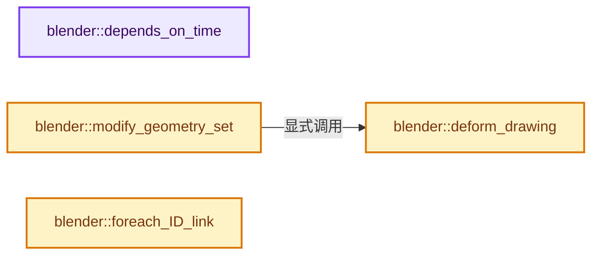
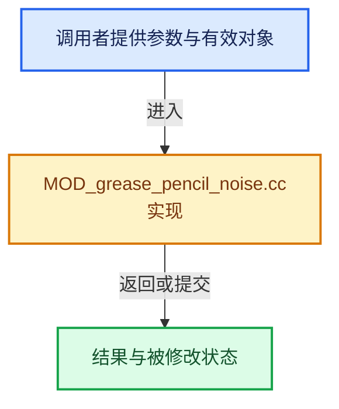

# 实现依赖专题：source/blender/modifiers/intern/MOD_grease_pencil_noise.cc

[方向导航](README.md) · [符号索引](../%E7%AC%A6%E5%8F%B7%E4%BE%9D%E8%B5%96%E4%B8%8E%E5%AE%9E%E7%8E%B0%E7%B4%A2%E5%BC%95.md)

本专题从正文实际调用进入，集中保存共享实现。函数有稳定锚点，可从调用处直接跳到对应完整函数；递归与互相调用通过回链组织。

## 本文件的实现关系






## 完整成员与函数实现

<a id="f-ea608cbb79fc8845"></a>

### `blender::depends_on_time`

实现位置：[source/blender/modifiers/intern/MOD_grease_pencil_noise.cc](../../../../../source/blender/modifiers/intern/MOD_grease_pencil_noise.cc) · L75—L79。

接口参数：

- `Scene *`
- `ModifierData *md`

**教学注释版**

<!-- annotated:8acef00435eb85 -->

```cpp
static bool depends_on_time(Scene * /*scene*/, ModifierData *md)
{
  GreasePencilNoiseModifierData *mmd = reinterpret_cast<GreasePencilNoiseModifierData *>(md);
  return (mmd->flag & GP_NOISE_USE_RANDOM) != 0;
}
```

<details>
<summary>核对原始源码：source/blender/modifiers/intern/MOD_grease_pencil_noise.cc · L75—L79</summary>

<!-- original:8acef00435eb85:source/blender/modifiers/intern/MOD_grease_pencil_noise.cc:75:79 -->

```cpp
static bool depends_on_time(Scene * /*scene*/, ModifierData *md)
{
  GreasePencilNoiseModifierData *mmd = reinterpret_cast<GreasePencilNoiseModifierData *>(md);
  return (mmd->flag & GP_NOISE_USE_RANDOM) != 0;
}
```

</details>

**结果出口**

- `return (mmd->flag & GP_NOISE_USE_RANDOM) != 0;`

**继续追踪实现**

本实现没有需要继续展开的显式调用；检查返回表达式、对象转换和调用者前置条件。

<a id="f-c774b0a76ac69a15"></a>

### `blender::deform_drawing`

实现位置：[source/blender/modifiers/intern/MOD_grease_pencil_noise.cc](../../../../../source/blender/modifiers/intern/MOD_grease_pencil_noise.cc) · L93—L241。

接口参数：

- `const GreasePencilNoiseModifierData &mmd`
- `const Object &ob`
- `const int ctime`
- `const int start_frame_number`
- `bke::greasepencil::Drawing &drawing`

**教学注释版**

<!-- annotated:c6535d93acbd17 -->

```cpp
static void deform_drawing(const GreasePencilNoiseModifierData &mmd,
                           const Object &ob,
                           const int ctime,
                           const int start_frame_number,
                           bke::greasepencil::Drawing &drawing)
{
  modifier::greasepencil::ensure_no_bezier_curves(drawing);
  bke::CurvesGeometry &strokes = drawing.strokes_for_write();
  bke::MutableAttributeAccessor attributes = strokes.attributes_for_write();
  if (strokes.is_empty()) {
    return;
  }

  IndexMaskMemory memory;
  const IndexMask filtered_strokes = modifier::greasepencil::get_filtered_stroke_mask(
      &ob, strokes, mmd.influence, memory);

  const bool use_curve = (mmd.influence.flag & GREASE_PENCIL_INFLUENCE_USE_CUSTOM_CURVE) != 0;
  const bool is_keyframe = (mmd.noise_mode == GP_NOISE_RANDOM_KEYFRAME);

  /* Sanitize as it can create out of bound reads. */
  const float noise_scale = math::clamp(mmd.noise_scale, 0.0f, 1.0f);

  if (filtered_strokes.is_empty()) {
    return;
  }

  int seed = mmd.seed;
  /* Make sure different modifiers get different seeds. */
  seed += BLI_hash_string(ob.id.name + 2);
  seed += BLI_hash_string(mmd.modifier.name);
  if (mmd.flag & GP_NOISE_USE_RANDOM) {
    if (!is_keyframe) {
      seed += math::floor(ctime / mmd.step);
    }
    else {
      /* If change every keyframe, use the last keyframe. */
      seed += start_frame_number;
    }
  }

  const OffsetIndices<int> points_by_curve = strokes.points_by_curve();
  const VArray<float> vgroup_weights = modifier::greasepencil::get_influence_vertex_weights(
      strokes, mmd.influence);

  auto get_weight = [&](const IndexRange points, const int point_i) {
    const float vertex_weight = vgroup_weights[points[point_i]];
    if (!use_curve) {
      return vertex_weight;
    }
    // [讲解] points.size：读取连续区间或分组的边界信息。
    const float value = float(point_i) / float(points.size() - 1);
    return vertex_weight * BKE_curvemapping_evaluateF(mmd.influence.custom_curve, 0, value);
  };

  auto get_noise = [](const Span<float> noise_table, const float value) {
    return math::interpolate(noise_table[int(math::floor(value))],
                             noise_table[int(math::ceil(value))],
                             math::fract(value));
  };

  if (mmd.factor > 0.0f) {
    const Span<float3> curve_plane_normals = drawing.curve_plane_normals();
    const Span<float3> tangents = strokes.evaluated_tangents();
    MutableSpan<float3> positions = strokes.positions_for_write();

    filtered_strokes.foreach_index(
        [&](const int stroke_i) {
          const IndexRange points = points_by_curve[stroke_i];
          const int noise_len = math::ceil(points.size() * noise_scale) + 2;
          const Array<float> table = noise_table(
              noise_len, int(math::floor(mmd.noise_offset)), seed + 2 + stroke_i);
          for (const int i : points.index_range()) {
            const int point = points[i];
            float weight = get_weight(points, i);
            /* Vector orthogonal to normal. */
            const float3 bi_normal = math::normalize(
                math::cross(tangents[point], curve_plane_normals[stroke_i]));
            const float noise = get_noise(table, i * noise_scale + math::fract(mmd.noise_offset));
            positions[point] += bi_normal * (noise * 2.0f - 1.0f) * weight * mmd.factor * 0.1f;
          }
        },
        exec_mode::grain_size(512));
    drawing.tag_positions_changed();
  }

  if (mmd.factor_thickness > 0.0f) {
    MutableSpan<float> radii = drawing.radii_for_write();

    filtered_strokes.foreach_index(
        [&](const int stroke_i) {
          const IndexRange points = points_by_curve[stroke_i];
          const int noise_len = math::ceil(points.size() * noise_scale) + 2;
          const Array<float> table = noise_table(
              noise_len, int(math::floor(mmd.noise_offset)), seed + stroke_i);
          for (const int i : points.index_range()) {
            const int point = points[i];
            const float weight = get_weight(points, i);
            const float noise = get_noise(table, i * noise_scale + math::fract(mmd.noise_offset));
            radii[point] *= math::max(1.0f + (noise * 2.0f - 1.0f) * weight * mmd.factor_thickness,
                                      0.0f);
          }
        },
        exec_mode::grain_size(512));
  }

  if (mmd.factor_strength > 0.0f) {
    MutableSpan<float> opacities = drawing.opacities_for_write();

    filtered_strokes.foreach_index(
        [&](const int stroke_i) {
          const IndexRange points = points_by_curve[stroke_i];
          const int noise_len = math::ceil(points.size() * noise_scale) + 2;
          const Array<float> table = noise_table(
              noise_len, int(math::floor(mmd.noise_offset)), seed + 3 + stroke_i);
          for (const int i : points.index_range()) {
            const int point = points[i];
            const float weight = get_weight(points, i);
            const float noise = get_noise(table, i * noise_scale + math::fract(mmd.noise_offset));
            opacities[point] *= math::max(1.0f - noise * weight * mmd.factor_strength, 0.0f);
          }
        },
        exec_mode::grain_size(512));
  }

  if (mmd.factor_uvs > 0.0f) {
    if (bke::SpanAttributeWriter<float> rotations = attributes.lookup_or_add_for_write_span<float>(
            "rotation", bke::AttrDomain::Point))
    {
      filtered_strokes.foreach_index(
          [&](const int stroke_i) {
            const IndexRange points = points_by_curve[stroke_i];
            const int noise_len = math::ceil(points.size() * noise_scale) + 2;
            const Array<float> table = noise_table(
                noise_len, int(math::floor(mmd.noise_offset)), seed + 4 + stroke_i);
            for (const int i : points.index_range()) {
              const int point = points[i];
              const float weight = get_weight(points, i);
              const float noise = get_noise(table,
                                            i * noise_scale + math::fract(mmd.noise_offset));
              const float delta_rot = (noise * 2.0f - 1.0f) * weight * mmd.factor_uvs * M_PI_2;
              rotations.span[point] = math::clamp(
                  rotations.span[point] + delta_rot, float(-M_PI_2), float(M_PI_2));
            }
          },
          exec_mode::grain_size(512));
      rotations.finish();
    }
  }
}
```

<details>
<summary>核对原始源码：source/blender/modifiers/intern/MOD_grease_pencil_noise.cc · L93—L241</summary>

<!-- original:c6535d93acbd17:source/blender/modifiers/intern/MOD_grease_pencil_noise.cc:93:241 -->

```cpp
static void deform_drawing(const GreasePencilNoiseModifierData &mmd,
                           const Object &ob,
                           const int ctime,
                           const int start_frame_number,
                           bke::greasepencil::Drawing &drawing)
{
  modifier::greasepencil::ensure_no_bezier_curves(drawing);
  bke::CurvesGeometry &strokes = drawing.strokes_for_write();
  bke::MutableAttributeAccessor attributes = strokes.attributes_for_write();
  if (strokes.is_empty()) {
    return;
  }

  IndexMaskMemory memory;
  const IndexMask filtered_strokes = modifier::greasepencil::get_filtered_stroke_mask(
      &ob, strokes, mmd.influence, memory);

  const bool use_curve = (mmd.influence.flag & GREASE_PENCIL_INFLUENCE_USE_CUSTOM_CURVE) != 0;
  const bool is_keyframe = (mmd.noise_mode == GP_NOISE_RANDOM_KEYFRAME);

  /* Sanitize as it can create out of bound reads. */
  const float noise_scale = math::clamp(mmd.noise_scale, 0.0f, 1.0f);

  if (filtered_strokes.is_empty()) {
    return;
  }

  int seed = mmd.seed;
  /* Make sure different modifiers get different seeds. */
  seed += BLI_hash_string(ob.id.name + 2);
  seed += BLI_hash_string(mmd.modifier.name);
  if (mmd.flag & GP_NOISE_USE_RANDOM) {
    if (!is_keyframe) {
      seed += math::floor(ctime / mmd.step);
    }
    else {
      /* If change every keyframe, use the last keyframe. */
      seed += start_frame_number;
    }
  }

  const OffsetIndices<int> points_by_curve = strokes.points_by_curve();
  const VArray<float> vgroup_weights = modifier::greasepencil::get_influence_vertex_weights(
      strokes, mmd.influence);

  auto get_weight = [&](const IndexRange points, const int point_i) {
    const float vertex_weight = vgroup_weights[points[point_i]];
    if (!use_curve) {
      return vertex_weight;
    }
    const float value = float(point_i) / float(points.size() - 1);
    return vertex_weight * BKE_curvemapping_evaluateF(mmd.influence.custom_curve, 0, value);
  };

  auto get_noise = [](const Span<float> noise_table, const float value) {
    return math::interpolate(noise_table[int(math::floor(value))],
                             noise_table[int(math::ceil(value))],
                             math::fract(value));
  };

  if (mmd.factor > 0.0f) {
    const Span<float3> curve_plane_normals = drawing.curve_plane_normals();
    const Span<float3> tangents = strokes.evaluated_tangents();
    MutableSpan<float3> positions = strokes.positions_for_write();

    filtered_strokes.foreach_index(
        [&](const int stroke_i) {
          const IndexRange points = points_by_curve[stroke_i];
          const int noise_len = math::ceil(points.size() * noise_scale) + 2;
          const Array<float> table = noise_table(
              noise_len, int(math::floor(mmd.noise_offset)), seed + 2 + stroke_i);
          for (const int i : points.index_range()) {
            const int point = points[i];
            float weight = get_weight(points, i);
            /* Vector orthogonal to normal. */
            const float3 bi_normal = math::normalize(
                math::cross(tangents[point], curve_plane_normals[stroke_i]));
            const float noise = get_noise(table, i * noise_scale + math::fract(mmd.noise_offset));
            positions[point] += bi_normal * (noise * 2.0f - 1.0f) * weight * mmd.factor * 0.1f;
          }
        },
        exec_mode::grain_size(512));
    drawing.tag_positions_changed();
  }

  if (mmd.factor_thickness > 0.0f) {
    MutableSpan<float> radii = drawing.radii_for_write();

    filtered_strokes.foreach_index(
        [&](const int stroke_i) {
          const IndexRange points = points_by_curve[stroke_i];
          const int noise_len = math::ceil(points.size() * noise_scale) + 2;
          const Array<float> table = noise_table(
              noise_len, int(math::floor(mmd.noise_offset)), seed + stroke_i);
          for (const int i : points.index_range()) {
            const int point = points[i];
            const float weight = get_weight(points, i);
            const float noise = get_noise(table, i * noise_scale + math::fract(mmd.noise_offset));
            radii[point] *= math::max(1.0f + (noise * 2.0f - 1.0f) * weight * mmd.factor_thickness,
                                      0.0f);
          }
        },
        exec_mode::grain_size(512));
  }

  if (mmd.factor_strength > 0.0f) {
    MutableSpan<float> opacities = drawing.opacities_for_write();

    filtered_strokes.foreach_index(
        [&](const int stroke_i) {
          const IndexRange points = points_by_curve[stroke_i];
          const int noise_len = math::ceil(points.size() * noise_scale) + 2;
          const Array<float> table = noise_table(
              noise_len, int(math::floor(mmd.noise_offset)), seed + 3 + stroke_i);
          for (const int i : points.index_range()) {
            const int point = points[i];
            const float weight = get_weight(points, i);
            const float noise = get_noise(table, i * noise_scale + math::fract(mmd.noise_offset));
            opacities[point] *= math::max(1.0f - noise * weight * mmd.factor_strength, 0.0f);
          }
        },
        exec_mode::grain_size(512));
  }

  if (mmd.factor_uvs > 0.0f) {
    if (bke::SpanAttributeWriter<float> rotations = attributes.lookup_or_add_for_write_span<float>(
            "rotation", bke::AttrDomain::Point))
    {
      filtered_strokes.foreach_index(
          [&](const int stroke_i) {
            const IndexRange points = points_by_curve[stroke_i];
            const int noise_len = math::ceil(points.size() * noise_scale) + 2;
            const Array<float> table = noise_table(
                noise_len, int(math::floor(mmd.noise_offset)), seed + 4 + stroke_i);
            for (const int i : points.index_range()) {
              const int point = points[i];
              const float weight = get_weight(points, i);
              const float noise = get_noise(table,
                                            i * noise_scale + math::fract(mmd.noise_offset));
              const float delta_rot = (noise * 2.0f - 1.0f) * weight * mmd.factor_uvs * M_PI_2;
              rotations.span[point] = math::clamp(
                  rotations.span[point] + delta_rot, float(-M_PI_2), float(M_PI_2));
            }
          },
          exec_mode::grain_size(512));
      rotations.finish();
    }
  }
}
```

</details>

**沿实际写入检查状态**

- `seed += BLI_hash_string(ob.id.name + 2);`
- `seed += BLI_hash_string(mmd.modifier.name);`
- `seed += math::floor(ctime / mmd.step);`
- `seed += start_frame_number;`
- `positions[point] += bi_normal * (noise * 2.0f - 1.0f) * weight * mmd.factor * 0.1f;`
- `radii[point] *= math::max(1.0f + (noise * 2.0f - 1.0f) * weight * mmd.factor_thickness,`
- `opacities[point] *= math::max(1.0f - noise * weight * mmd.factor_strength, 0.0f);`
- `rotations.span[point] = math::clamp(`

**结果出口**

- `return vertex_weight;`
- `return vertex_weight * BKE_curvemapping_evaluateF(mmd.influence.custom_curve, 0, value);`
- `return math::interpolate(noise_table[int(math::floor(value))],`

**继续追踪实现**

- `modifier::greasepencil::ensure_no_bezier_curves` → [blender::modifier::greasepencil::ensure_no_bezier_curves · L432](%E4%BE%9D%E8%B5%96-MOD_grease_pencil_util-d0b437.md#f-1fde6483ac30d59b)。
- `drawing.strokes_for_write` → [blender::bke::greasepencil::Drawing::strokes_for_write · L1012](%E4%BE%9D%E8%B5%96-grease_pencil-f750d6.md#f-0649333785d0aa95)。
- `strokes.attributes_for_write` → [blender::bke::CurvesGeometry::attributes_for_write · L1913](%E4%BE%9D%E8%B5%96-curves_geometry-ad7f9f.md#f-4930091b34fa9663)。
- `strokes.is_empty` → [blender::bke::CurvesGeometry::is_empty · L1013](04-CurvesGeometry%E5%AD%98%E5%82%A8.md#f-4c323ef62c4b64ab)。
- `modifier::greasepencil::get_filtered_stroke_mask` → [blender::modifier::greasepencil::get_filtered_stroke_mask · L285](%E4%BE%9D%E8%B5%96-MOD_grease_pencil_util-d0b437.md#f-30c219d04de7dec3)；[blender::modifier::greasepencil::get_filtered_stroke_mask · L326](%E4%BE%9D%E8%B5%96-MOD_grease_pencil_util-d0b437.md#f-970c3bc880e4f350)。同名重载需按实参类型选择。
- `math::clamp` → [blender::math::clamp · L118](../12-%E7%A9%BA%E9%97%B4%E6%95%B0%E6%8D%AE%E7%BB%93%E6%9E%84%E4%B8%8E%E5%87%A0%E4%BD%95%E7%AE%97%E6%B3%95/%E4%BE%9D%E8%B5%96-BLI_math_vector-906a87.md#f-65702e97e59fc41e)；[blender::math::clamp · L130](../12-%E7%A9%BA%E9%97%B4%E6%95%B0%E6%8D%AE%E7%BB%93%E6%9E%84%E4%B8%8E%E5%87%A0%E4%BD%95%E7%AE%97%E6%B3%95/%E4%BE%9D%E8%B5%96-BLI_math_vector-906a87.md#f-0365873940e23a11)；[blender::math::clamp · L69](../12-%E7%A9%BA%E9%97%B4%E6%95%B0%E6%8D%AE%E7%BB%93%E6%9E%84%E4%B8%8E%E5%87%A0%E4%BD%95%E7%AE%97%E6%B3%95/%E4%BE%9D%E8%B5%96-BLI_math_base-0728eb.md#f-9282cf5d06fa3723)。同名重载需按实参类型选择。
- `filtered_strokes.is_empty` → [blender::index_mask::IndexMask::is_empty · L748](../04-%E8%99%9A%E6%8B%9F%E6%95%B0%E7%BB%84%E4%B8%8E%E7%B4%A2%E5%BC%95%E9%80%89%E6%8B%A9/09-%E5%88%86%E6%AE%B5%E5%AD%98%E5%82%A8%E4%B8%8E%E9%81%8D%E5%8E%86.md#f-190ac996386064f4)。
- `BLI_hash_string` → [blender::BLI_hash_string · L69](../02-%E5%93%88%E5%B8%8C%E8%A1%A8%E4%B8%8E%E5%85%B3%E8%81%94%E6%95%B0%E6%8D%AE%E7%BB%93%E6%9E%84/%E4%BE%9D%E8%B5%96-BLI_hash_c-2ab8ea.md#f-0f3487d576368d89)。
- `math::floor` → [外部契约](https://eel.is/c++draft/)：这个边界按实际表达式及所属类型核对参数、返回值、寿命与失败行为。这里提供接口入口，不声称已解释该第三方版本的内部实现。
- `strokes.points_by_curve` → [blender::bke::CurvesGeometry::points_by_curve · L1058](04-CurvesGeometry%E5%AD%98%E5%82%A8.md#f-a0416697e10ec205)。
- `modifier::greasepencil::get_influence_vertex_weights` → [blender::modifier::greasepencil::get_influence_vertex_weights · L343](%E4%BE%9D%E8%B5%96-MOD_grease_pencil_util-d0b437.md#f-6f4fdb5693985db9)。
- `points.size` → [blender::IndexRange::size · L156](../01-%E5%9F%BA%E7%A1%80%E5%AE%B9%E5%99%A8%E4%B8%8E%E7%8E%B0%E4%BB%A3CPP/04-IndexRange%E8%BF%9E%E7%BB%AD%E6%95%B4%E6%95%B0%E5%8C%BA%E9%97%B4.md#f-05f66c3ebb2fdfec)。
- `BKE_curvemapping_evaluateF` → [blender::BKE_curvemapping_evaluateF · L1177](%E4%BE%9D%E8%B5%96-colortools-8bc37a.md#f-014584e04eeb1392)。
- `math::interpolate` → [blender::math::interpolate · L335](../12-%E7%A9%BA%E9%97%B4%E6%95%B0%E6%8D%AE%E7%BB%93%E6%9E%84%E4%B8%8E%E5%87%A0%E4%BD%95%E7%AE%97%E6%B3%95/%E4%BE%9D%E8%B5%96-math_matrix-d7d8ee.md#f-91e7f517ebd72fb5)；[blender::math::interpolate · L379](../12-%E7%A9%BA%E9%97%B4%E6%95%B0%E6%8D%AE%E7%BB%93%E6%9E%84%E4%B8%8E%E5%87%A0%E4%BD%95%E7%AE%97%E6%B3%95/%E4%BE%9D%E8%B5%96-math_matrix-d7d8ee.md#f-a1be14e86ce595c2)；[blender::math::interpolate · L636](../12-%E7%A9%BA%E9%97%B4%E6%95%B0%E6%8D%AE%E7%BB%93%E6%9E%84%E4%B8%8E%E5%87%A0%E4%BD%95%E7%AE%97%E6%B3%95/%E4%BE%9D%E8%B5%96-BLI_math_vector-906a87.md#f-d612b6d6ab1b6e7c)；[blender::math::interpolate · L303](../12-%E7%A9%BA%E9%97%B4%E6%95%B0%E6%8D%AE%E7%BB%93%E6%9E%84%E4%B8%8E%E5%87%A0%E4%BD%95%E7%AE%97%E6%B3%95/%E4%BE%9D%E8%B5%96-BLI_math_quaternion-cf105d.md#f-48b9ace2a9c6185c)；[blender::math::interpolate · L17](../12-%E7%A9%BA%E9%97%B4%E6%95%B0%E6%8D%AE%E7%BB%93%E6%9E%84%E4%B8%8E%E5%87%A0%E4%BD%95%E7%AE%97%E6%B3%95/%E4%BE%9D%E8%B5%96-BLI_math_color-f3a6ea.md#f-eb5ef92b0f8c0926)；[blender::math::interpolate · L28](../12-%E7%A9%BA%E9%97%B4%E6%95%B0%E6%8D%AE%E7%BB%93%E6%9E%84%E4%B8%8E%E5%87%A0%E4%BD%95%E7%AE%97%E6%B3%95/%E4%BE%9D%E8%B5%96-BLI_math_color-f3a6ea.md#f-2a9e33ec55979ab6)；[blender::math::interpolate · L278](../12-%E7%A9%BA%E9%97%B4%E6%95%B0%E6%8D%AE%E7%BB%93%E6%9E%84%E4%B8%8E%E5%87%A0%E4%BD%95%E7%AE%97%E6%B3%95/%E4%BE%9D%E8%B5%96-BLI_math_base-0728eb.md#f-2629b871528f6528)。同名重载需按实参类型选择。
- `math::ceil` → [外部契约](https://eel.is/c++draft/)：这个边界按实际表达式及所属类型核对参数、返回值、寿命与失败行为。这里提供接口入口，不声称已解释该第三方版本的内部实现。
- `math::fract` → [blender::math::fract · L418](../12-%E7%A9%BA%E9%97%B4%E6%95%B0%E6%8D%AE%E7%BB%93%E6%9E%84%E4%B8%8E%E5%87%A0%E4%BD%95%E7%AE%97%E6%B3%95/%E4%BE%9D%E8%B5%96-BLI_math_vector-906a87.md#f-f880c123697186fe)；[blender::math::fract · L148](../12-%E7%A9%BA%E9%97%B4%E6%95%B0%E6%8D%AE%E7%BB%93%E6%9E%84%E4%B8%8E%E5%87%A0%E4%BD%95%E7%AE%97%E6%B3%95/%E4%BE%9D%E8%B5%96-BLI_math_base-0728eb.md#f-d575d73a3482378e)。同名重载需按实参类型选择。
- `drawing.curve_plane_normals` → [blender::bke::greasepencil::Drawing::curve_plane_normals · L788](%E4%BE%9D%E8%B5%96-grease_pencil-f750d6.md#f-84a868266ab1f8ed)。
- `strokes.evaluated_tangents` → [blender::bke::CurvesGeometry::evaluated_tangents · L918](%E4%BE%9D%E8%B5%96-curves_geometry-ad7f9f.md#f-74049677258830a0)。
- `strokes.positions_for_write` → [blender::bke::CurvesGeometry::positions_for_write · L328](%E4%BE%9D%E8%B5%96-curves_geometry-ad7f9f.md#f-30e013e651e830c3)。
- `filtered_strokes.foreach_index` → [blender::index_mask::IndexMask::foreach_index · L855](../04-%E8%99%9A%E6%8B%9F%E6%95%B0%E7%BB%84%E4%B8%8E%E7%B4%A2%E5%BC%95%E9%80%89%E6%8B%A9/09-%E5%88%86%E6%AE%B5%E5%AD%98%E5%82%A8%E4%B8%8E%E9%81%8D%E5%8E%86.md#f-cd6cd317e2e2812c)。
- `noise_table` → [调用协议](../%E6%A8%A1%E6%9D%BF%E5%AE%8F%E4%B8%8E%E5%8A%A8%E6%80%81%E5%88%86%E6%B4%BE%E5%8D%8F%E8%AE%AE.md)：局部可调用对象，须结合其初始化与捕获环境。调用位置L162。
- `points.index_range` → [blender::IndexRange::index_range · L161](../01-%E5%9F%BA%E7%A1%80%E5%AE%B9%E5%99%A8%E4%B8%8E%E7%8E%B0%E4%BB%A3CPP/04-IndexRange%E8%BF%9E%E7%BB%AD%E6%95%B4%E6%95%B0%E5%8C%BA%E9%97%B4.md#f-fd83072b4b81bce5)。
- `get_weight` → [调用协议](../%E6%A8%A1%E6%9D%BF%E5%AE%8F%E4%B8%8E%E5%8A%A8%E6%80%81%E5%88%86%E6%B4%BE%E5%8D%8F%E8%AE%AE.md)：局部可调用对象，须结合其初始化与捕获环境。调用位置L166。
- `math::normalize` → [blender::math::normalize · L542](../12-%E7%A9%BA%E9%97%B4%E6%95%B0%E6%8D%AE%E7%BB%93%E6%9E%84%E4%B8%8E%E5%87%A0%E4%BD%95%E7%AE%97%E6%B3%95/%E4%BE%9D%E8%B5%96-BLI_math_vector-906a87.md#f-5bea914457e11f7f)；[blender::math::normalize · L258](../12-%E7%A9%BA%E9%97%B4%E6%95%B0%E6%8D%AE%E7%BB%93%E6%9E%84%E4%B8%8E%E5%87%A0%E4%BD%95%E7%AE%97%E6%B3%95/%E4%BE%9D%E8%B5%96-BLI_math_quaternion-cf105d.md#f-5bf6b351333e4054)；[blender::math::normalize · L450](../12-%E7%A9%BA%E9%97%B4%E6%95%B0%E6%8D%AE%E7%BB%93%E6%9E%84%E4%B8%8E%E5%87%A0%E4%BD%95%E7%AE%97%E6%B3%95/%E4%BE%9D%E8%B5%96-BLI_math_quaternion-cf105d.md#f-b852cee8f0cc9b6a)；[blender::math::normalize · L745](../12-%E7%A9%BA%E9%97%B4%E6%95%B0%E6%8D%AE%E7%BB%93%E6%9E%84%E4%B8%8E%E5%87%A0%E4%BD%95%E7%AE%97%E6%B3%95/%E4%BE%9D%E8%B5%96-BLI_math_matrix-b7b2b4.md#f-2235cb6f5ec7ff18)；[blender::math::normalize · L783](../12-%E7%A9%BA%E9%97%B4%E6%95%B0%E6%8D%AE%E7%BB%93%E6%9E%84%E4%B8%8E%E5%87%A0%E4%BD%95%E7%AE%97%E6%B3%95/%E4%BE%9D%E8%B5%96-BLI_math_matrix-b7b2b4.md#f-0386bc4ee9ac7425)。同名重载需按实参类型选择。
- `math::cross` → [blender::math::cross · L549](../12-%E7%A9%BA%E9%97%B4%E6%95%B0%E6%8D%AE%E7%BB%93%E6%9E%84%E4%B8%8E%E5%87%A0%E4%BD%95%E7%AE%97%E6%B3%95/%E4%BE%9D%E8%B5%96-BLI_math_vector-906a87.md#f-cb1b14dc107aa107)；[blender::math::cross · L562](../12-%E7%A9%BA%E9%97%B4%E6%95%B0%E6%8D%AE%E7%BB%93%E6%9E%84%E4%B8%8E%E5%87%A0%E4%BD%95%E7%AE%97%E6%B3%95/%E4%BE%9D%E8%B5%96-BLI_math_vector-906a87.md#f-8dcac1cc63a3672a)；[blender::math::cross · L217](../12-%E7%A9%BA%E9%97%B4%E6%95%B0%E6%8D%AE%E7%BB%93%E6%9E%84%E4%B8%8E%E5%87%A0%E4%BD%95%E7%AE%97%E6%B3%95/%E4%BE%9D%E8%B5%96-BLI_math_basis_types-fc7090.md#f-0cb9fb63f068f85e)。同名重载需按实参类型选择。
- `get_noise` → [调用协议](../%E6%A8%A1%E6%9D%BF%E5%AE%8F%E4%B8%8E%E5%8A%A8%E6%80%81%E5%88%86%E6%B4%BE%E5%8D%8F%E8%AE%AE.md)：局部可调用对象，须结合其初始化与捕获环境。调用位置L170。
- `exec_mode::grain_size` → [blender::exec_mode::grain_size · L79](../01-%E5%9F%BA%E7%A1%80%E5%AE%B9%E5%99%A8%E4%B8%8E%E7%8E%B0%E4%BB%A3CPP/%E4%BE%9D%E8%B5%96-BLI_execution_mode-1528fb.md#f-0b4fc2f9fa6e66e7)。
- `drawing.tag_positions_changed` → [blender::bke::greasepencil::Drawing::tag_positions_changed · L1095](%E4%BE%9D%E8%B5%96-grease_pencil-f750d6.md#f-cc348dc1ca18c109)；[blender::bke::greasepencil::Drawing::tag_positions_changed · L1229](%E4%BE%9D%E8%B5%96-grease_pencil-f750d6.md#f-36aaac52033b03bf)。同名重载需按实参类型选择。
- `drawing.radii_for_write` → [blender::bke::greasepencil::Drawing::radii_for_write · L1023](%E4%BE%9D%E8%B5%96-grease_pencil-f750d6.md#f-53b2a01d6a3079c0)。
- `math::max` → [blender::math::max · L87](../12-%E7%A9%BA%E9%97%B4%E6%95%B0%E6%8D%AE%E7%BB%93%E6%9E%84%E4%B8%8E%E5%87%A0%E4%BD%95%E7%AE%97%E6%B3%95/%E4%BE%9D%E8%B5%96-BLI_math_vector-906a87.md#f-9be564a293777d6b)；[blender::math::max · L96](../12-%E7%A9%BA%E9%97%B4%E6%95%B0%E6%8D%AE%E7%BB%93%E6%9E%84%E4%B8%8E%E5%87%A0%E4%BD%95%E7%AE%97%E6%B3%95/%E4%BE%9D%E8%B5%96-BLI_math_vector-906a87.md#f-ce32dff37d0af3bc)；[blender::math::max · L112](../12-%E7%A9%BA%E9%97%B4%E6%95%B0%E6%8D%AE%E7%BB%93%E6%9E%84%E4%B8%8E%E5%87%A0%E4%BD%95%E7%AE%97%E6%B3%95/%E4%BE%9D%E8%B5%96-BLI_math_vector-906a87.md#f-668eb1fcf1fa8292)；[blender::math::max · L49](../12-%E7%A9%BA%E9%97%B4%E6%95%B0%E6%8D%AE%E7%BB%93%E6%9E%84%E4%B8%8E%E5%87%A0%E4%BD%95%E7%AE%97%E6%B3%95/%E4%BE%9D%E8%B5%96-BLI_math_base-0728eb.md#f-a6991ca3d12937e1)。同名重载需按实参类型选择。
- `drawing.opacities_for_write` → [blender::bke::greasepencil::Drawing::opacities_for_write · L1038](%E4%BE%9D%E8%B5%96-grease_pencil-f750d6.md#f-e9418de3657dd416)。
- `attributes.lookup_or_add_for_write_span<float>` → [blender::bke::MutableAttributeAccessor::lookup_or_add_for_write_span · L533](%E4%BE%9D%E8%B5%96-attribute_access-bceef3.md#f-c533eff1b9a4973e)；[blender::bke::MutableAttributeAccessor::lookup_or_add_for_write_span · L861](08-AttributeAccessor%E6%8E%A5%E5%8F%A3.md#f-aa4c0d5a61437381)。同名重载需按实参类型选择。
- `rotations.finish` → [blender::bke::SpanAttributeWriter::finish · L279](08-AttributeAccessor%E6%8E%A5%E5%8F%A3.md#f-585970a3b1bd4da4)。

<a id="f-230f261ee5b301b9"></a>

### `blender::modify_geometry_set`

实现位置：[source/blender/modifiers/intern/MOD_grease_pencil_noise.cc](../../../../../source/blender/modifiers/intern/MOD_grease_pencil_noise.cc) · L243—L270。

接口参数：

- `ModifierData *md`
- `const ModifierEvalContext *ctx`
- `bke::GeometrySet *geometry_set`

**教学注释版**

<!-- annotated:92ab52fffd3eb0 -->

```cpp
static void modify_geometry_set(ModifierData *md,
                                const ModifierEvalContext *ctx,
                                bke::GeometrySet *geometry_set)
{
  const auto *mmd = reinterpret_cast<GreasePencilNoiseModifierData *>(md);

  if (!geometry_set->has_grease_pencil()) {
    return;
  }

  if (!mmd->factor && !mmd->factor_strength && !mmd->factor_thickness && !mmd->factor_uvs) {
    return;
  }

  GreasePencil &grease_pencil = *geometry_set->get_grease_pencil_for_write();
  const int current_frame = grease_pencil.runtime->eval_frame;

  IndexMaskMemory mask_memory;
  const IndexMask layer_mask = modifier::greasepencil::get_filtered_layer_mask(
      grease_pencil, mmd->influence, mask_memory);
  const Vector<modifier::greasepencil::FrameDrawingInfo> drawing_infos =
      modifier::greasepencil::get_drawing_infos_by_frame(grease_pencil, layer_mask, current_frame);

  threading::parallel_for_each(
      drawing_infos, [&](const modifier::greasepencil::FrameDrawingInfo &info) {
        deform_drawing(*mmd, *ctx->object, current_frame, info.start_frame_number, *info.drawing);
      });
}
```

<details>
<summary>核对原始源码：source/blender/modifiers/intern/MOD_grease_pencil_noise.cc · L243—L270</summary>

<!-- original:92ab52fffd3eb0:source/blender/modifiers/intern/MOD_grease_pencil_noise.cc:243:270 -->

```cpp
static void modify_geometry_set(ModifierData *md,
                                const ModifierEvalContext *ctx,
                                bke::GeometrySet *geometry_set)
{
  const auto *mmd = reinterpret_cast<GreasePencilNoiseModifierData *>(md);

  if (!geometry_set->has_grease_pencil()) {
    return;
  }

  if (!mmd->factor && !mmd->factor_strength && !mmd->factor_thickness && !mmd->factor_uvs) {
    return;
  }

  GreasePencil &grease_pencil = *geometry_set->get_grease_pencil_for_write();
  const int current_frame = grease_pencil.runtime->eval_frame;

  IndexMaskMemory mask_memory;
  const IndexMask layer_mask = modifier::greasepencil::get_filtered_layer_mask(
      grease_pencil, mmd->influence, mask_memory);
  const Vector<modifier::greasepencil::FrameDrawingInfo> drawing_infos =
      modifier::greasepencil::get_drawing_infos_by_frame(grease_pencil, layer_mask, current_frame);

  threading::parallel_for_each(
      drawing_infos, [&](const modifier::greasepencil::FrameDrawingInfo &info) {
        deform_drawing(*mmd, *ctx->object, current_frame, info.start_frame_number, *info.drawing);
      });
}
```

</details>

**继续追踪实现**

- `geometry_set->has_grease_pencil` → [blender::bke::GeometrySet::has_grease_pencil · L415](../06-%E9%9A%90%E5%BC%8F%E5%85%B1%E4%BA%AB%E4%B8%8E%E7%BC%93%E5%AD%98%E7%B3%BB%E7%BB%9F/05-GeometrySet%E8%AF%BB%E5%86%99%E4%B8%8E%E5%A4%8D%E5%88%B6.md#f-357bcb62da7a8afd)。
- `geometry_set->get_grease_pencil_for_write` → [blender::bke::GeometrySet::get_grease_pencil_for_write · L622](../06-%E9%9A%90%E5%BC%8F%E5%85%B1%E4%BA%AB%E4%B8%8E%E7%BC%93%E5%AD%98%E7%B3%BB%E7%BB%9F/05-GeometrySet%E8%AF%BB%E5%86%99%E4%B8%8E%E5%A4%8D%E5%88%B6.md#f-bfc5e891a352651b)。
- `modifier::greasepencil::get_filtered_layer_mask` → [blender::modifier::greasepencil::get_filtered_layer_mask · L213](%E4%BE%9D%E8%B5%96-MOD_grease_pencil_util-d0b437.md#f-6438bea51141f9db)；[blender::modifier::greasepencil::get_filtered_layer_mask · L268](%E4%BE%9D%E8%B5%96-MOD_grease_pencil_util-d0b437.md#f-e3d0f9748ecdf34b)。同名重载需按实参类型选择。
- `modifier::greasepencil::get_drawing_infos_by_frame` → [blender::modifier::greasepencil::get_drawing_infos_by_frame · L406](%E4%BE%9D%E8%B5%96-MOD_grease_pencil_util-d0b437.md#f-188e0cc82983898b)。
- `threading::parallel_for_each` → [blender::threading::parallel_for_each · L30](../11-Depsgraph%E4%B8%8E%E5%B9%B6%E8%A1%8C%E4%BB%BB%E5%8A%A1%E7%B3%BB%E7%BB%9F/07-%E4%BB%BB%E5%8A%A1%E6%B1%A0%E4%B8%8ETBB%E6%8E%A5%E5%85%A5.md#f-d5604027445ef0f5)。
- `deform_drawing` → [blender::deform_drawing · L93](%E4%BE%9D%E8%B5%96-MOD_grease_pencil_noise-eae4f5.md#f-c774b0a76ac69a15)。

<a id="f-24aff8a16d0b3487"></a>

### `blender::foreach_ID_link`

实现位置：[source/blender/modifiers/intern/MOD_grease_pencil_noise.cc](../../../../../source/blender/modifiers/intern/MOD_grease_pencil_noise.cc) · L272—L277。

接口参数：

- `ModifierData *md`
- `Object *ob`
- `IDWalkFunc walk`
- `void *user_data`

**教学注释版**

<!-- annotated:a37178c5c32200 -->

```cpp
static void foreach_ID_link(ModifierData *md, Object *ob, IDWalkFunc walk, void *user_data)
{
  GreasePencilNoiseModifierData *mmd = reinterpret_cast<GreasePencilNoiseModifierData *>(md);

  modifier::greasepencil::foreach_influence_ID_link(&mmd->influence, ob, walk, user_data);
}
```

<details>
<summary>核对原始源码：source/blender/modifiers/intern/MOD_grease_pencil_noise.cc · L272—L277</summary>

<!-- original:a37178c5c32200:source/blender/modifiers/intern/MOD_grease_pencil_noise.cc:272:277 -->

```cpp
static void foreach_ID_link(ModifierData *md, Object *ob, IDWalkFunc walk, void *user_data)
{
  GreasePencilNoiseModifierData *mmd = reinterpret_cast<GreasePencilNoiseModifierData *>(md);

  modifier::greasepencil::foreach_influence_ID_link(&mmd->influence, ob, walk, user_data);
}
```

</details>

**继续追踪实现**

- `modifier::greasepencil::foreach_influence_ID_link` → [blender::modifier::greasepencil::foreach_influence_ID_link · L69](%E4%BE%9D%E8%B5%96-MOD_grease_pencil_util-d0b437.md#f-247ba56fa4c4e56f)。
