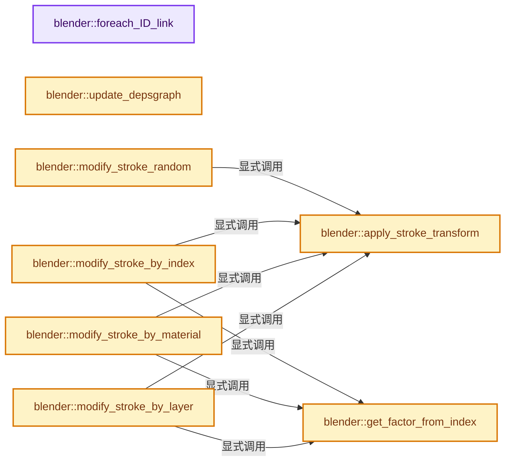
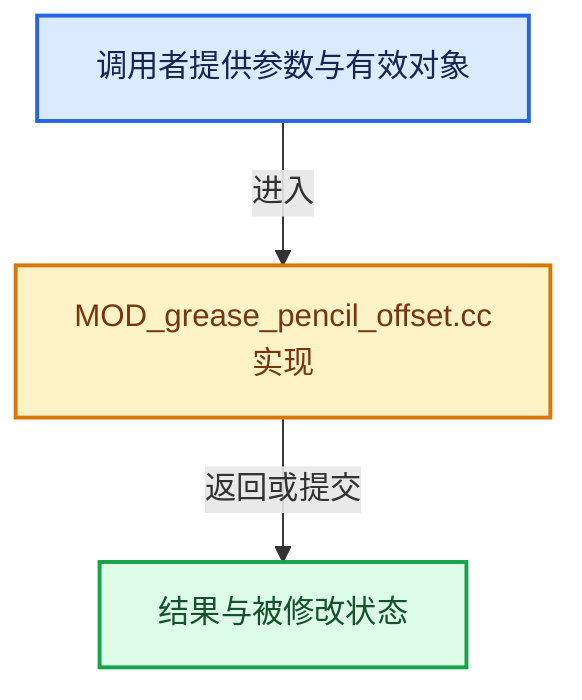

# 实现依赖专题：source/blender/modifiers/intern/MOD_grease_pencil_offset.cc

[方向导航](README.md) · [符号索引](../%E7%AC%A6%E5%8F%B7%E4%BE%9D%E8%B5%96%E4%B8%8E%E5%AE%9E%E7%8E%B0%E7%B4%A2%E5%BC%95.md)

本专题从正文实际调用进入，集中保存共享实现。函数有稳定锚点，可从调用处直接跳到对应完整函数；递归与互相调用通过回链组织。

## 本文件的实现关系






## 完整成员与函数实现

<a id="f-1d0bd0307c8ff199"></a>

### `blender::foreach_ID_link`

实现位置：[source/blender/modifiers/intern/MOD_grease_pencil_offset.cc](../../../../../source/blender/modifiers/intern/MOD_grease_pencil_offset.cc) · L64—L68。

接口参数：

- `ModifierData *md`
- `Object *ob`
- `IDWalkFunc walk`
- `void *user_data`

**教学注释版**

<!-- annotated:ee8da2d1797233 -->

```cpp
static void foreach_ID_link(ModifierData *md, Object *ob, IDWalkFunc walk, void *user_data)
{
  auto *omd = reinterpret_cast<GreasePencilOffsetModifierData *>(md);
  modifier::greasepencil::foreach_influence_ID_link(&omd->influence, ob, walk, user_data);
}
```

<details>
<summary>核对原始源码：source/blender/modifiers/intern/MOD_grease_pencil_offset.cc · L64—L68</summary>

<!-- original:ee8da2d1797233:source/blender/modifiers/intern/MOD_grease_pencil_offset.cc:64:68 -->

```cpp
static void foreach_ID_link(ModifierData *md, Object *ob, IDWalkFunc walk, void *user_data)
{
  auto *omd = reinterpret_cast<GreasePencilOffsetModifierData *>(md);
  modifier::greasepencil::foreach_influence_ID_link(&omd->influence, ob, walk, user_data);
}
```

</details>

**继续追踪实现**

- `modifier::greasepencil::foreach_influence_ID_link` → [blender::modifier::greasepencil::foreach_influence_ID_link · L69](%E4%BE%9D%E8%B5%96-MOD_grease_pencil_util-d0b437.md#f-247ba56fa4c4e56f)。

<a id="f-409e062902e11bbc"></a>

### `blender::update_depsgraph`

实现位置：[source/blender/modifiers/intern/MOD_grease_pencil_offset.cc](../../../../../source/blender/modifiers/intern/MOD_grease_pencil_offset.cc) · L70—L74。

接口参数：

- `ModifierData *`
- `const ModifierUpdateDepsgraphContext *ctx`

**教学注释版**

<!-- annotated:345de8205237c8 -->

```cpp
static void update_depsgraph(ModifierData * /*md*/, const ModifierUpdateDepsgraphContext *ctx)
{
  DEG_add_object_relation(
      ctx->node, ctx->object, DEG_OB_COMP_TRANSFORM, "Grease Pencil Offset Modifier");
}
```

<details>
<summary>核对原始源码：source/blender/modifiers/intern/MOD_grease_pencil_offset.cc · L70—L74</summary>

<!-- original:345de8205237c8:source/blender/modifiers/intern/MOD_grease_pencil_offset.cc:70:74 -->

```cpp
static void update_depsgraph(ModifierData * /*md*/, const ModifierUpdateDepsgraphContext *ctx)
{
  DEG_add_object_relation(
      ctx->node, ctx->object, DEG_OB_COMP_TRANSFORM, "Grease Pencil Offset Modifier");
}
```

</details>

**继续追踪实现**

- `DEG_add_object_relation` → [blender::DEG_add_object_relation · L123](../11-Depsgraph%E4%B8%8E%E5%B9%B6%E8%A1%8C%E4%BB%BB%E5%8A%A1%E7%B3%BB%E7%BB%9F/%E4%BE%9D%E8%B5%96-depsgraph_build-ea2fc8.md#f-f570cffae97e273c)。

<a id="f-27989e7c362d3257"></a>

### `blender::apply_stroke_transform`

实现位置：[source/blender/modifiers/intern/MOD_grease_pencil_offset.cc](../../../../../source/blender/modifiers/intern/MOD_grease_pencil_offset.cc) · L76—L118。

接口参数：

- `const GreasePencilOffsetModifierData &omd`
- `const VArray<float> &weights`
- `const IndexRange &points`
- `const float3 &loc_factor`
- `const float3 &rot_factor`
- `const float3 &scale_factor`
- `const MutableSpan<float3> positions`
- `const MutableSpan<float> radii`

**教学注释版**

<!-- annotated:71cd3ca540630a -->

```cpp
static void apply_stroke_transform(const GreasePencilOffsetModifierData &omd,
                                   const VArray<float> &weights,
                                   const IndexRange &points,
                                   const float3 &loc_factor,
                                   const float3 &rot_factor,
                                   const float3 &scale_factor,
                                   const MutableSpan<float3> positions,
                                   const MutableSpan<float> radii)
{
  const bool has_global_offset = !(math::is_zero(float3(omd.loc)) &&
                                   math::is_zero(float3(omd.rot)) &&
                                   math::is_zero(float3(omd.scale)));
  const bool has_stroke_offset = !(math::is_zero(float3(omd.stroke_loc)) &&
                                   math::is_zero(float3(omd.stroke_rot)) &&
                                   math::is_zero(float3(omd.stroke_scale)));

  for (const int64_t i : points) {
    const float weight = weights[i];
    float3 &pos = positions[i];
    float &radius = radii[i];

    /* Add per-stroke offset. */
    if (has_stroke_offset) {
      const float4x4 matrix = math::from_loc_rot_scale<float4x4>(
          omd.stroke_loc * loc_factor * weight,
          omd.stroke_rot * rot_factor * weight,
          float3(1.0f) + omd.stroke_scale * scale_factor * weight);
      pos = math::transform_point(matrix, pos);
    }
    /* Add global offset. */
    if (has_global_offset) {
      const float3 scale = float3(1.0f) + float3(omd.scale) * weight;
      const float4x4 matrix = math::from_loc_rot_scale<float4x4>(
          float3(omd.loc) * weight, float3(omd.rot) * weight, scale);
      pos = math::transform_point(matrix, pos);

      /* Apply scale to thickness. */
      const float unit_scale = (math::abs(scale.x) + math::abs(scale.y) + math::abs(scale.z)) /
                               3.0f;
      radius *= unit_scale;
    }
  }
}
```

<details>
<summary>核对原始源码：source/blender/modifiers/intern/MOD_grease_pencil_offset.cc · L76—L118</summary>

<!-- original:71cd3ca540630a:source/blender/modifiers/intern/MOD_grease_pencil_offset.cc:76:118 -->

```cpp
static void apply_stroke_transform(const GreasePencilOffsetModifierData &omd,
                                   const VArray<float> &weights,
                                   const IndexRange &points,
                                   const float3 &loc_factor,
                                   const float3 &rot_factor,
                                   const float3 &scale_factor,
                                   const MutableSpan<float3> positions,
                                   const MutableSpan<float> radii)
{
  const bool has_global_offset = !(math::is_zero(float3(omd.loc)) &&
                                   math::is_zero(float3(omd.rot)) &&
                                   math::is_zero(float3(omd.scale)));
  const bool has_stroke_offset = !(math::is_zero(float3(omd.stroke_loc)) &&
                                   math::is_zero(float3(omd.stroke_rot)) &&
                                   math::is_zero(float3(omd.stroke_scale)));

  for (const int64_t i : points) {
    const float weight = weights[i];
    float3 &pos = positions[i];
    float &radius = radii[i];

    /* Add per-stroke offset. */
    if (has_stroke_offset) {
      const float4x4 matrix = math::from_loc_rot_scale<float4x4>(
          omd.stroke_loc * loc_factor * weight,
          omd.stroke_rot * rot_factor * weight,
          float3(1.0f) + omd.stroke_scale * scale_factor * weight);
      pos = math::transform_point(matrix, pos);
    }
    /* Add global offset. */
    if (has_global_offset) {
      const float3 scale = float3(1.0f) + float3(omd.scale) * weight;
      const float4x4 matrix = math::from_loc_rot_scale<float4x4>(
          float3(omd.loc) * weight, float3(omd.rot) * weight, scale);
      pos = math::transform_point(matrix, pos);

      /* Apply scale to thickness. */
      const float unit_scale = (math::abs(scale.x) + math::abs(scale.y) + math::abs(scale.z)) /
                               3.0f;
      radius *= unit_scale;
    }
  }
}
```

</details>

**沿实际写入检查状态**

- `pos = math::transform_point(matrix, pos);`
- `radius *= unit_scale;`

**继续追踪实现**

- `math::is_zero` → [blender::math::is_zero · L784](../12-%E7%A9%BA%E9%97%B4%E6%95%B0%E6%8D%AE%E7%BB%93%E6%9E%84%E4%B8%8E%E5%87%A0%E4%BD%95%E7%AE%97%E6%B3%95/%E4%BE%9D%E8%B5%96-BLI_math_vector-906a87.md#f-b05b3db842a9f17e)；[blender::math::is_zero · L108](../12-%E7%A9%BA%E9%97%B4%E6%95%B0%E6%8D%AE%E7%BB%93%E6%9E%84%E4%B8%8E%E5%87%A0%E4%BD%95%E7%AE%97%E6%B3%95/%E4%BE%9D%E8%B5%96-BLI_math_quaternion-cf105d.md#f-b97bee3fbc328c0d)；[blender::math::is_zero · L593](../12-%E7%A9%BA%E9%97%B4%E6%95%B0%E6%8D%AE%E7%BB%93%E6%9E%84%E4%B8%8E%E5%87%A0%E4%BD%95%E7%AE%97%E6%B3%95/%E4%BE%9D%E8%B5%96-BLI_math_matrix-b7b2b4.md#f-b879ac524126b464)；[blender::math::is_zero · L23](../12-%E7%A9%BA%E9%97%B4%E6%95%B0%E6%8D%AE%E7%BB%93%E6%9E%84%E4%B8%8E%E5%87%A0%E4%BD%95%E7%AE%97%E6%B3%95/%E4%BE%9D%E8%B5%96-BLI_math_base-0728eb.md#f-6fdcc74ca7338838)。同名重载需按实参类型选择。
- `float3` → [float3 · L641](%E4%BE%9D%E8%B5%96-smaa-b67bc2.md#m-0ea8254cfdb4)。宏定义由构建条件选择。
- `math::from_loc_rot_scale<float4x4>` → [调用协议](../%E6%A8%A1%E6%9D%BF%E5%AE%8F%E4%B8%8E%E5%8A%A8%E6%80%81%E5%88%86%E6%B4%BE%E5%8D%8F%E8%AE%AE.md)：函数指针、局部可调用对象或未展开的宏；必须结合调用者环境。调用位置L99。
- `math::transform_point` → [blender::math::transform_point · L318](../12-%E7%A9%BA%E9%97%B4%E6%95%B0%E6%8D%AE%E7%BB%93%E6%9E%84%E4%B8%8E%E5%87%A0%E4%BD%95%E7%AE%97%E6%B3%95/%E4%BE%9D%E8%B5%96-BLI_math_quaternion-cf105d.md#f-e52a2e8c12e32657)；[blender::math::transform_point · L491](../12-%E7%A9%BA%E9%97%B4%E6%95%B0%E6%8D%AE%E7%BB%93%E6%9E%84%E4%B8%8E%E5%87%A0%E4%BD%95%E7%AE%97%E6%B3%95/%E4%BE%9D%E8%B5%96-BLI_math_quaternion-cf105d.md#f-6c9f8362c60efe6c)；[blender::math::transform_point · L445](../12-%E7%A9%BA%E9%97%B4%E6%95%B0%E6%8D%AE%E7%BB%93%E6%9E%84%E4%B8%8E%E5%87%A0%E4%BD%95%E7%AE%97%E6%B3%95/%E4%BE%9D%E8%B5%96-BLI_math_basis_types-fc7090.md#f-a151fd44ae743502)。同名重载需按实参类型选择。
- `math::abs` → [blender::math::abs · L38](../12-%E7%A9%BA%E9%97%B4%E6%95%B0%E6%8D%AE%E7%BB%93%E6%9E%84%E4%B8%8E%E5%87%A0%E4%BD%95%E7%AE%97%E6%B3%95/%E4%BE%9D%E8%B5%96-BLI_math_vector-906a87.md#f-e755530125bc2198)；[blender::math::abs · L201](../12-%E7%A9%BA%E9%97%B4%E6%95%B0%E6%8D%AE%E7%BB%93%E6%9E%84%E4%B8%8E%E5%87%A0%E4%BD%95%E7%AE%97%E6%B3%95/%E4%BE%9D%E8%B5%96-BLI_math_basis_types-fc7090.md#f-a137ffce39989ffc)；[blender::math::abs · L33](../12-%E7%A9%BA%E9%97%B4%E6%95%B0%E6%8D%AE%E7%BB%93%E6%9E%84%E4%B8%8E%E5%87%A0%E4%BD%95%E7%AE%97%E6%B3%95/%E4%BE%9D%E8%B5%96-BLI_math_base-0728eb.md#f-a2c9c981f4e8420c)。同名重载需按实参类型选择。

<a id="f-df0a5178e050285f"></a>

### `blender::modify_stroke_random`

实现位置：[source/blender/modifiers/intern/MOD_grease_pencil_offset.cc](../../../../../source/blender/modifiers/intern/MOD_grease_pencil_offset.cc) · L121—L189。

接口参数：

- `const Object &ob`
- `const GreasePencilOffsetModifierData &omd`
- `const IndexMask &curves_mask`
- `bke::CurvesGeometry &curves`

**教学注释版**

<!-- annotated:110cdc25c19079 -->

```cpp
static void modify_stroke_random(const Object &ob,
                                 const GreasePencilOffsetModifierData &omd,
                                 const IndexMask &curves_mask,
                                 bke::CurvesGeometry &curves)
{
  const bool use_uniform_scale = (omd.flag & MOD_GREASE_PENCIL_OFFSET_UNIFORM_RANDOM_SCALE);

  const OffsetIndices<int> points_by_curve = curves.points_by_curve();
  bke::MutableAttributeAccessor attributes = curves.attributes_for_write();
  bke::SpanAttributeWriter<float> radii = attributes.lookup_or_add_for_write_span<float>(
      "radius", bke::AttrDomain::Point);
  const MutableSpan<float3> positions = curves.positions_for_write();
  const VArray<float> vgroup_weights = modifier::greasepencil::get_influence_vertex_weights(
      curves, omd.influence);

  /* Make sure different modifiers get different seeds. */
  const int seed = omd.seed + BLI_hash_string(ob.id.name + 2) + BLI_hash_string(omd.modifier.name);
  const float rand_offset = BLI_hash_int_01(seed);

  /* Generates a random number for loc/rot/scale channels, based on seed and a per-stroke random
   * value r. */
  auto get_random_channel = [&](const char channel, const double r) {
    float rand = fmodf(r * 2.0f - 1.0f + rand_offset, 1.0f);
    return fmodf(sin(rand * 12.9898f + channel * 78.233f) * 43758.5453f, 1.0f);
  };

  auto get_random_value = [&](const char channel, const int64_t curve_i) {
    const uint halton_primes[3] = {2, 3, 7};
    double halton_offset[3] = {0.0f, 0.0f, 0.0f};
    double r[3];
    /* To ensure a nice distribution, we use halton sequence and offset using the curve index. */
    BLI_halton_3d(halton_primes, halton_offset, curve_i, r);
    return get_random_channel(channel, r[0]);
  };

  auto get_random_vector = [&](const char channel, const int64_t curve_i) {
    const uint halton_primes[3] = {2, 3, 7};
    double halton_offset[3] = {0.0f, 0.0f, 0.0f};
    double r[3];
    /* To ensure a nice distribution, we use halton sequence and offset using the curve index. */
    BLI_halton_3d(halton_primes, halton_offset, curve_i, r);
    return float3(get_random_channel(channel, r[0]),
                  get_random_channel(channel, r[1]),
                  get_random_channel(channel, r[2]));
  };

  curves_mask.foreach_index(
      [&](const int64_t curve_i) {
        const IndexRange points = points_by_curve[curve_i];

        /* Randomness factors for loc/rot/scale per curve. */
        const float3 loc_factor = get_random_vector(0, curve_i);
        const float3 rot_factor = get_random_vector(1, curve_i);
        const float3 scale_factor = use_uniform_scale ? float3(get_random_value(2, curve_i)) :
                                                        get_random_vector(2, curve_i);

        apply_stroke_transform(omd,
                               vgroup_weights,
                               points,
                               loc_factor,
                               rot_factor,
                               scale_factor,
                               positions,
                               radii.span);
      },
      exec_mode::grain_size(512));

  radii.finish();
}
```

<details>
<summary>核对原始源码：source/blender/modifiers/intern/MOD_grease_pencil_offset.cc · L121—L189</summary>

<!-- original:110cdc25c19079:source/blender/modifiers/intern/MOD_grease_pencil_offset.cc:121:189 -->

```cpp
static void modify_stroke_random(const Object &ob,
                                 const GreasePencilOffsetModifierData &omd,
                                 const IndexMask &curves_mask,
                                 bke::CurvesGeometry &curves)
{
  const bool use_uniform_scale = (omd.flag & MOD_GREASE_PENCIL_OFFSET_UNIFORM_RANDOM_SCALE);

  const OffsetIndices<int> points_by_curve = curves.points_by_curve();
  bke::MutableAttributeAccessor attributes = curves.attributes_for_write();
  bke::SpanAttributeWriter<float> radii = attributes.lookup_or_add_for_write_span<float>(
      "radius", bke::AttrDomain::Point);
  const MutableSpan<float3> positions = curves.positions_for_write();
  const VArray<float> vgroup_weights = modifier::greasepencil::get_influence_vertex_weights(
      curves, omd.influence);

  /* Make sure different modifiers get different seeds. */
  const int seed = omd.seed + BLI_hash_string(ob.id.name + 2) + BLI_hash_string(omd.modifier.name);
  const float rand_offset = BLI_hash_int_01(seed);

  /* Generates a random number for loc/rot/scale channels, based on seed and a per-stroke random
   * value r. */
  auto get_random_channel = [&](const char channel, const double r) {
    float rand = fmodf(r * 2.0f - 1.0f + rand_offset, 1.0f);
    return fmodf(sin(rand * 12.9898f + channel * 78.233f) * 43758.5453f, 1.0f);
  };

  auto get_random_value = [&](const char channel, const int64_t curve_i) {
    const uint halton_primes[3] = {2, 3, 7};
    double halton_offset[3] = {0.0f, 0.0f, 0.0f};
    double r[3];
    /* To ensure a nice distribution, we use halton sequence and offset using the curve index. */
    BLI_halton_3d(halton_primes, halton_offset, curve_i, r);
    return get_random_channel(channel, r[0]);
  };

  auto get_random_vector = [&](const char channel, const int64_t curve_i) {
    const uint halton_primes[3] = {2, 3, 7};
    double halton_offset[3] = {0.0f, 0.0f, 0.0f};
    double r[3];
    /* To ensure a nice distribution, we use halton sequence and offset using the curve index. */
    BLI_halton_3d(halton_primes, halton_offset, curve_i, r);
    return float3(get_random_channel(channel, r[0]),
                  get_random_channel(channel, r[1]),
                  get_random_channel(channel, r[2]));
  };

  curves_mask.foreach_index(
      [&](const int64_t curve_i) {
        const IndexRange points = points_by_curve[curve_i];

        /* Randomness factors for loc/rot/scale per curve. */
        const float3 loc_factor = get_random_vector(0, curve_i);
        const float3 rot_factor = get_random_vector(1, curve_i);
        const float3 scale_factor = use_uniform_scale ? float3(get_random_value(2, curve_i)) :
                                                        get_random_vector(2, curve_i);

        apply_stroke_transform(omd,
                               vgroup_weights,
                               points,
                               loc_factor,
                               rot_factor,
                               scale_factor,
                               positions,
                               radii.span);
      },
      exec_mode::grain_size(512));

  radii.finish();
}
```

</details>

**结果出口**

- `return fmodf(sin(rand * 12.9898f + channel * 78.233f) * 43758.5453f, 1.0f);`
- `return get_random_channel(channel, r[0]);`
- `return float3(get_random_channel(channel, r[0]),`

**继续追踪实现**

- `curves.points_by_curve` → [blender::bke::CurvesGeometry::points_by_curve · L1058](04-CurvesGeometry%E5%AD%98%E5%82%A8.md#f-a0416697e10ec205)。
- `curves.attributes_for_write` → [blender::bke::CurvesGeometry::attributes_for_write · L1913](%E4%BE%9D%E8%B5%96-curves_geometry-ad7f9f.md#f-4930091b34fa9663)。
- `attributes.lookup_or_add_for_write_span<float>` → [blender::bke::MutableAttributeAccessor::lookup_or_add_for_write_span · L533](%E4%BE%9D%E8%B5%96-attribute_access-bceef3.md#f-c533eff1b9a4973e)；[blender::bke::MutableAttributeAccessor::lookup_or_add_for_write_span · L861](08-AttributeAccessor%E6%8E%A5%E5%8F%A3.md#f-aa4c0d5a61437381)。同名重载需按实参类型选择。
- `curves.positions_for_write` → [blender::bke::CurvesGeometry::positions_for_write · L328](%E4%BE%9D%E8%B5%96-curves_geometry-ad7f9f.md#f-30e013e651e830c3)。
- `modifier::greasepencil::get_influence_vertex_weights` → [blender::modifier::greasepencil::get_influence_vertex_weights · L343](%E4%BE%9D%E8%B5%96-MOD_grease_pencil_util-d0b437.md#f-6f4fdb5693985db9)。
- `BLI_hash_string` → [blender::BLI_hash_string · L69](../02-%E5%93%88%E5%B8%8C%E8%A1%A8%E4%B8%8E%E5%85%B3%E8%81%94%E6%95%B0%E6%8D%AE%E7%BB%93%E6%9E%84/%E4%BE%9D%E8%B5%96-BLI_hash_c-2ab8ea.md#f-0f3487d576368d89)。
- `BLI_hash_int_01` → [blender::BLI_hash_int_01 · L94](../02-%E5%93%88%E5%B8%8C%E8%A1%A8%E4%B8%8E%E5%85%B3%E8%81%94%E6%95%B0%E6%8D%AE%E7%BB%93%E6%9E%84/%E4%BE%9D%E8%B5%96-BLI_hash_c-2ab8ea.md#f-5f15d616cd371045)。
- `fmodf` → [fmodf · L182](%E4%BE%9D%E8%B5%96-compat-56205c.md#m-56e5993ab048)；[fmodf · L277](%E4%BE%9D%E8%B5%96-compat-efe0e9.md#m-d7e7e2616aed)。宏定义由构建条件选择。
- `sin` → [外部契约](https://eel.is/c++draft/)：这个边界按实际表达式及所属类型核对参数、返回值、寿命与失败行为。这里提供接口入口，不声称已解释该第三方版本的内部实现。
- `BLI_halton_3d` → [RNG::BLI_halton_3d · L252](../01-%E5%9F%BA%E7%A1%80%E5%AE%B9%E5%99%A8%E4%B8%8E%E7%8E%B0%E4%BB%A3CPP/%E4%BE%9D%E8%B5%96-rand-171ca2.md#f-5c37d529e0d07122)。
- `get_random_channel` → [调用协议](../%E6%A8%A1%E6%9D%BF%E5%AE%8F%E4%B8%8E%E5%8A%A8%E6%80%81%E5%88%86%E6%B4%BE%E5%8D%8F%E8%AE%AE.md)：局部可调用对象，须结合其初始化与捕获环境。调用位置L153。
- `float3` → [float3 · L641](%E4%BE%9D%E8%B5%96-smaa-b67bc2.md#m-0ea8254cfdb4)。宏定义由构建条件选择。
- `curves_mask.foreach_index` → [blender::index_mask::IndexMask::foreach_index · L855](../04-%E8%99%9A%E6%8B%9F%E6%95%B0%E7%BB%84%E4%B8%8E%E7%B4%A2%E5%BC%95%E9%80%89%E6%8B%A9/09-%E5%88%86%E6%AE%B5%E5%AD%98%E5%82%A8%E4%B8%8E%E9%81%8D%E5%8E%86.md#f-cd6cd317e2e2812c)。
- `get_random_vector` → [调用协议](../%E6%A8%A1%E6%9D%BF%E5%AE%8F%E4%B8%8E%E5%8A%A8%E6%80%81%E5%88%86%E6%B4%BE%E5%8D%8F%E8%AE%AE.md)：局部可调用对象，须结合其初始化与捕获环境。调用位置L172。
- `get_random_value` → [调用协议](../%E6%A8%A1%E6%9D%BF%E5%AE%8F%E4%B8%8E%E5%8A%A8%E6%80%81%E5%88%86%E6%B4%BE%E5%8D%8F%E8%AE%AE.md)：局部可调用对象，须结合其初始化与捕获环境。调用位置L174。
- `apply_stroke_transform` → [blender::apply_stroke_transform · L76](%E4%BE%9D%E8%B5%96-MOD_grease_pencil_offset-ea9491.md#f-27989e7c362d3257)。
- `exec_mode::grain_size` → [blender::exec_mode::grain_size · L79](../01-%E5%9F%BA%E7%A1%80%E5%AE%B9%E5%99%A8%E4%B8%8E%E7%8E%B0%E4%BB%A3CPP/%E4%BE%9D%E8%B5%96-BLI_execution_mode-1528fb.md#f-0b4fc2f9fa6e66e7)。
- `radii.finish` → [blender::bke::SpanAttributeWriter::finish · L279](08-AttributeAccessor%E6%8E%A5%E5%8F%A3.md#f-585970a3b1bd4da4)。

<a id="f-836eaf18d1ddb78a"></a>

### `blender::get_factor_from_index`

实现位置：[source/blender/modifiers/intern/MOD_grease_pencil_offset.cc](../../../../../source/blender/modifiers/intern/MOD_grease_pencil_offset.cc) · L192—L199。

接口参数：

- `const GreasePencilOffsetModifierData &omd`
- `const int size`
- `const int index`

**教学注释版**

<!-- annotated:fbf8b40285451f -->

```cpp
static float get_factor_from_index(const GreasePencilOffsetModifierData &omd,
                                   const int size,
                                   const int index)
{
  const int step = max_ii(omd.stroke_step, 1);
  const int start_offset = omd.stroke_start_offset;
  return ((size - (index / step + start_offset % size) % size * step % size) - 1) / float(size);
}
```

<details>
<summary>核对原始源码：source/blender/modifiers/intern/MOD_grease_pencil_offset.cc · L192—L199</summary>

<!-- original:fbf8b40285451f:source/blender/modifiers/intern/MOD_grease_pencil_offset.cc:192:199 -->

```cpp
static float get_factor_from_index(const GreasePencilOffsetModifierData &omd,
                                   const int size,
                                   const int index)
{
  const int step = max_ii(omd.stroke_step, 1);
  const int start_offset = omd.stroke_start_offset;
  return ((size - (index / step + start_offset % size) % size * step % size) - 1) / float(size);
}
```

</details>

**结果出口**

- `return ((size - (index / step + start_offset % size) % size * step % size) - 1) / float(size);`

**继续追踪实现**

- `max_ii` → [blender::max_ii · L368](../12-%E7%A9%BA%E9%97%B4%E6%95%B0%E6%8D%AE%E7%BB%93%E6%9E%84%E4%B8%8E%E5%87%A0%E4%BD%95%E7%AE%97%E6%B3%95/%E4%BE%9D%E8%B5%96-math_base_inline-546b00.md#f-c45aa7b373adb94c)。

<a id="f-b1ce492e3c091155"></a>

### `blender::modify_stroke_by_index`

实现位置：[source/blender/modifiers/intern/MOD_grease_pencil_offset.cc](../../../../../source/blender/modifiers/intern/MOD_grease_pencil_offset.cc) · L202—L230。

接口参数：

- `const GreasePencilOffsetModifierData &omd`
- `const IndexMask &curves_mask`
- `bke::CurvesGeometry &curves`

**教学注释版**

<!-- annotated:a7b209b6b57250 -->

```cpp
static void modify_stroke_by_index(const GreasePencilOffsetModifierData &omd,
                                   const IndexMask &curves_mask,
                                   bke::CurvesGeometry &curves)
{
  const OffsetIndices<int> points_by_curve = curves.points_by_curve();
  bke::MutableAttributeAccessor attributes = curves.attributes_for_write();
  bke::SpanAttributeWriter<float> radii = attributes.lookup_or_add_for_write_span<float>(
      "radius", bke::AttrDomain::Point);
  const MutableSpan<float3> positions = curves.positions_for_write();
  const VArray<float> vgroup_weights = modifier::greasepencil::get_influence_vertex_weights(
      curves, omd.influence);

  curves_mask.foreach_index(
      [&](const int64_t curve_i) {
        const IndexRange points = points_by_curve[curve_i];
        const float factor = get_factor_from_index(omd, curves.curves_num(), curve_i);
        apply_stroke_transform(omd,
                               vgroup_weights,
                               points,
                               float3(factor),
                               float3(factor),
                               float3(factor),
                               positions,
                               radii.span);
      },
      exec_mode::grain_size(512));

  radii.finish();
}
```

<details>
<summary>核对原始源码：source/blender/modifiers/intern/MOD_grease_pencil_offset.cc · L202—L230</summary>

<!-- original:a7b209b6b57250:source/blender/modifiers/intern/MOD_grease_pencil_offset.cc:202:230 -->

```cpp
static void modify_stroke_by_index(const GreasePencilOffsetModifierData &omd,
                                   const IndexMask &curves_mask,
                                   bke::CurvesGeometry &curves)
{
  const OffsetIndices<int> points_by_curve = curves.points_by_curve();
  bke::MutableAttributeAccessor attributes = curves.attributes_for_write();
  bke::SpanAttributeWriter<float> radii = attributes.lookup_or_add_for_write_span<float>(
      "radius", bke::AttrDomain::Point);
  const MutableSpan<float3> positions = curves.positions_for_write();
  const VArray<float> vgroup_weights = modifier::greasepencil::get_influence_vertex_weights(
      curves, omd.influence);

  curves_mask.foreach_index(
      [&](const int64_t curve_i) {
        const IndexRange points = points_by_curve[curve_i];
        const float factor = get_factor_from_index(omd, curves.curves_num(), curve_i);
        apply_stroke_transform(omd,
                               vgroup_weights,
                               points,
                               float3(factor),
                               float3(factor),
                               float3(factor),
                               positions,
                               radii.span);
      },
      exec_mode::grain_size(512));

  radii.finish();
}
```

</details>

**继续追踪实现**

- `curves.points_by_curve` → [blender::bke::CurvesGeometry::points_by_curve · L1058](04-CurvesGeometry%E5%AD%98%E5%82%A8.md#f-a0416697e10ec205)。
- `curves.attributes_for_write` → [blender::bke::CurvesGeometry::attributes_for_write · L1913](%E4%BE%9D%E8%B5%96-curves_geometry-ad7f9f.md#f-4930091b34fa9663)。
- `attributes.lookup_or_add_for_write_span<float>` → [blender::bke::MutableAttributeAccessor::lookup_or_add_for_write_span · L533](%E4%BE%9D%E8%B5%96-attribute_access-bceef3.md#f-c533eff1b9a4973e)；[blender::bke::MutableAttributeAccessor::lookup_or_add_for_write_span · L861](08-AttributeAccessor%E6%8E%A5%E5%8F%A3.md#f-aa4c0d5a61437381)。同名重载需按实参类型选择。
- `curves.positions_for_write` → [blender::bke::CurvesGeometry::positions_for_write · L328](%E4%BE%9D%E8%B5%96-curves_geometry-ad7f9f.md#f-30e013e651e830c3)。
- `modifier::greasepencil::get_influence_vertex_weights` → [blender::modifier::greasepencil::get_influence_vertex_weights · L343](%E4%BE%9D%E8%B5%96-MOD_grease_pencil_util-d0b437.md#f-6f4fdb5693985db9)。
- `curves_mask.foreach_index` → [blender::index_mask::IndexMask::foreach_index · L855](../04-%E8%99%9A%E6%8B%9F%E6%95%B0%E7%BB%84%E4%B8%8E%E7%B4%A2%E5%BC%95%E9%80%89%E6%8B%A9/09-%E5%88%86%E6%AE%B5%E5%AD%98%E5%82%A8%E4%B8%8E%E9%81%8D%E5%8E%86.md#f-cd6cd317e2e2812c)。
- `get_factor_from_index` → [blender::get_factor_from_index · L192](%E4%BE%9D%E8%B5%96-MOD_grease_pencil_offset-ea9491.md#f-836eaf18d1ddb78a)。
- `curves.curves_num` → [blender::bke::CurvesGeometry::curves_num · L1005](04-CurvesGeometry%E5%AD%98%E5%82%A8.md#f-eabb3f0e5d3c57be)。
- `apply_stroke_transform` → [blender::apply_stroke_transform · L76](%E4%BE%9D%E8%B5%96-MOD_grease_pencil_offset-ea9491.md#f-27989e7c362d3257)。
- `float3` → [float3 · L641](%E4%BE%9D%E8%B5%96-smaa-b67bc2.md#m-0ea8254cfdb4)。宏定义由构建条件选择。
- `exec_mode::grain_size` → [blender::exec_mode::grain_size · L79](../01-%E5%9F%BA%E7%A1%80%E5%AE%B9%E5%99%A8%E4%B8%8E%E7%8E%B0%E4%BB%A3CPP/%E4%BE%9D%E8%B5%96-BLI_execution_mode-1528fb.md#f-0b4fc2f9fa6e66e7)。
- `radii.finish` → [blender::bke::SpanAttributeWriter::finish · L279](08-AttributeAccessor%E6%8E%A5%E5%8F%A3.md#f-585970a3b1bd4da4)。

<a id="f-6b9ec9b344f8f764"></a>

### `blender::modify_stroke_by_material`

实现位置：[source/blender/modifiers/intern/MOD_grease_pencil_offset.cc](../../../../../source/blender/modifiers/intern/MOD_grease_pencil_offset.cc) · L233—L267。

接口参数：

- `const Object &ob`
- `const GreasePencilOffsetModifierData &omd`
- `const IndexMask &curves_mask`
- `bke::CurvesGeometry &curves`

**教学注释版**

<!-- annotated:2386e9c45f2eb9 -->

```cpp
static void modify_stroke_by_material(const Object &ob,
                                      const GreasePencilOffsetModifierData &omd,
                                      const IndexMask &curves_mask,
                                      bke::CurvesGeometry &curves)
{
  const short *totcolp = BKE_object_material_len_p(const_cast<Object *>(&ob));
  const short totcol = totcolp ? *totcolp : 0;

  const OffsetIndices<int> points_by_curve = curves.points_by_curve();
  bke::MutableAttributeAccessor attributes = curves.attributes_for_write();
  bke::SpanAttributeWriter<float> radii = attributes.lookup_or_add_for_write_span<float>(
      "radius", bke::AttrDomain::Point);
  const MutableSpan<float3> positions = curves.positions_for_write();
  const VArray<float> vgroup_weights = modifier::greasepencil::get_influence_vertex_weights(
      curves, omd.influence);
  const VArray<int> stroke_materials = *attributes.lookup_or_default<int>(
      "material_index", bke::AttrDomain::Curve, 0);

  curves_mask.foreach_index(
      [&](const int64_t curve_i) {
        const IndexRange points = points_by_curve[curve_i];
        const float factor = get_factor_from_index(omd, totcol, stroke_materials[curve_i]);
        apply_stroke_transform(omd,
                               vgroup_weights,
                               points,
                               float3(factor),
                               float3(factor),
                               float3(factor),
                               positions,
                               radii.span);
      },
      exec_mode::grain_size(512));

  radii.finish();
}
```

<details>
<summary>核对原始源码：source/blender/modifiers/intern/MOD_grease_pencil_offset.cc · L233—L267</summary>

<!-- original:2386e9c45f2eb9:source/blender/modifiers/intern/MOD_grease_pencil_offset.cc:233:267 -->

```cpp
static void modify_stroke_by_material(const Object &ob,
                                      const GreasePencilOffsetModifierData &omd,
                                      const IndexMask &curves_mask,
                                      bke::CurvesGeometry &curves)
{
  const short *totcolp = BKE_object_material_len_p(const_cast<Object *>(&ob));
  const short totcol = totcolp ? *totcolp : 0;

  const OffsetIndices<int> points_by_curve = curves.points_by_curve();
  bke::MutableAttributeAccessor attributes = curves.attributes_for_write();
  bke::SpanAttributeWriter<float> radii = attributes.lookup_or_add_for_write_span<float>(
      "radius", bke::AttrDomain::Point);
  const MutableSpan<float3> positions = curves.positions_for_write();
  const VArray<float> vgroup_weights = modifier::greasepencil::get_influence_vertex_weights(
      curves, omd.influence);
  const VArray<int> stroke_materials = *attributes.lookup_or_default<int>(
      "material_index", bke::AttrDomain::Curve, 0);

  curves_mask.foreach_index(
      [&](const int64_t curve_i) {
        const IndexRange points = points_by_curve[curve_i];
        const float factor = get_factor_from_index(omd, totcol, stroke_materials[curve_i]);
        apply_stroke_transform(omd,
                               vgroup_weights,
                               points,
                               float3(factor),
                               float3(factor),
                               float3(factor),
                               positions,
                               radii.span);
      },
      exec_mode::grain_size(512));

  radii.finish();
}
```

</details>

**继续追踪实现**

- `BKE_object_material_len_p` → [blender::BKE_object_material_len_p · L405](%E4%BE%9D%E8%B5%96-material-aea8ec.md#f-4bef3241c966494d)。
- `curves.points_by_curve` → [blender::bke::CurvesGeometry::points_by_curve · L1058](04-CurvesGeometry%E5%AD%98%E5%82%A8.md#f-a0416697e10ec205)。
- `curves.attributes_for_write` → [blender::bke::CurvesGeometry::attributes_for_write · L1913](%E4%BE%9D%E8%B5%96-curves_geometry-ad7f9f.md#f-4930091b34fa9663)。
- `attributes.lookup_or_add_for_write_span<float>` → [blender::bke::MutableAttributeAccessor::lookup_or_add_for_write_span · L533](%E4%BE%9D%E8%B5%96-attribute_access-bceef3.md#f-c533eff1b9a4973e)；[blender::bke::MutableAttributeAccessor::lookup_or_add_for_write_span · L861](08-AttributeAccessor%E6%8E%A5%E5%8F%A3.md#f-aa4c0d5a61437381)。同名重载需按实参类型选择。
- `curves.positions_for_write` → [blender::bke::CurvesGeometry::positions_for_write · L328](%E4%BE%9D%E8%B5%96-curves_geometry-ad7f9f.md#f-30e013e651e830c3)。
- `modifier::greasepencil::get_influence_vertex_weights` → [blender::modifier::greasepencil::get_influence_vertex_weights · L343](%E4%BE%9D%E8%B5%96-MOD_grease_pencil_util-d0b437.md#f-6f4fdb5693985db9)。
- `attributes.lookup_or_default<int>` → [blender::bke::AttributeAccessor::lookup_or_default · L415](%E4%BE%9D%E8%B5%96-attribute_access-bceef3.md#f-a0cc3e316f1da4bd)；[blender::bke::AttributeAccessor::lookup_or_default · L643](08-AttributeAccessor%E6%8E%A5%E5%8F%A3.md#f-e3d2ed81ebe0af61)。同名重载需按实参类型选择。
- `curves_mask.foreach_index` → [blender::index_mask::IndexMask::foreach_index · L855](../04-%E8%99%9A%E6%8B%9F%E6%95%B0%E7%BB%84%E4%B8%8E%E7%B4%A2%E5%BC%95%E9%80%89%E6%8B%A9/09-%E5%88%86%E6%AE%B5%E5%AD%98%E5%82%A8%E4%B8%8E%E9%81%8D%E5%8E%86.md#f-cd6cd317e2e2812c)。
- `get_factor_from_index` → [blender::get_factor_from_index · L192](%E4%BE%9D%E8%B5%96-MOD_grease_pencil_offset-ea9491.md#f-836eaf18d1ddb78a)。
- `apply_stroke_transform` → [blender::apply_stroke_transform · L76](%E4%BE%9D%E8%B5%96-MOD_grease_pencil_offset-ea9491.md#f-27989e7c362d3257)。
- `float3` → [float3 · L641](%E4%BE%9D%E8%B5%96-smaa-b67bc2.md#m-0ea8254cfdb4)。宏定义由构建条件选择。
- `exec_mode::grain_size` → [blender::exec_mode::grain_size · L79](../01-%E5%9F%BA%E7%A1%80%E5%AE%B9%E5%99%A8%E4%B8%8E%E7%8E%B0%E4%BB%A3CPP/%E4%BE%9D%E8%B5%96-BLI_execution_mode-1528fb.md#f-0b4fc2f9fa6e66e7)。
- `radii.finish` → [blender::bke::SpanAttributeWriter::finish · L279](08-AttributeAccessor%E6%8E%A5%E5%8F%A3.md#f-585970a3b1bd4da4)。

<a id="f-ff92414256d5a0ee"></a>

### `blender::modify_stroke_by_layer`

实现位置：[source/blender/modifiers/intern/MOD_grease_pencil_offset.cc](../../../../../source/blender/modifiers/intern/MOD_grease_pencil_offset.cc) · L270—L301。

接口参数：

- `const GreasePencilOffsetModifierData &omd`
- `const int layer_index`
- `const int layers_num`
- `const IndexMask &curves_mask`
- `bke::CurvesGeometry &curves`

**教学注释版**

<!-- annotated:5b1afb7a18ec0c -->

```cpp
static void modify_stroke_by_layer(const GreasePencilOffsetModifierData &omd,
                                   const int layer_index,
                                   const int layers_num,
                                   const IndexMask &curves_mask,
                                   bke::CurvesGeometry &curves)
{
  const OffsetIndices<int> points_by_curve = curves.points_by_curve();
  bke::MutableAttributeAccessor attributes = curves.attributes_for_write();
  bke::SpanAttributeWriter<float> radii = attributes.lookup_or_add_for_write_span<float>(
      "radius", bke::AttrDomain::Point);
  const MutableSpan<float3> positions = curves.positions_for_write();
  const VArray<float> vgroup_weights = modifier::greasepencil::get_influence_vertex_weights(
      curves, omd.influence);

  const float factor = get_factor_from_index(omd, layers_num, layer_index);

  curves_mask.foreach_index(
      [&](const int64_t curve_i) {
        const IndexRange points = points_by_curve[curve_i];
        apply_stroke_transform(omd,
                               vgroup_weights,
                               points,
                               float3(factor),
                               float3(factor),
                               float3(factor),
                               positions,
                               radii.span);
      },
      exec_mode::grain_size(512));

  radii.finish();
}
```

<details>
<summary>核对原始源码：source/blender/modifiers/intern/MOD_grease_pencil_offset.cc · L270—L301</summary>

<!-- original:5b1afb7a18ec0c:source/blender/modifiers/intern/MOD_grease_pencil_offset.cc:270:301 -->

```cpp
static void modify_stroke_by_layer(const GreasePencilOffsetModifierData &omd,
                                   const int layer_index,
                                   const int layers_num,
                                   const IndexMask &curves_mask,
                                   bke::CurvesGeometry &curves)
{
  const OffsetIndices<int> points_by_curve = curves.points_by_curve();
  bke::MutableAttributeAccessor attributes = curves.attributes_for_write();
  bke::SpanAttributeWriter<float> radii = attributes.lookup_or_add_for_write_span<float>(
      "radius", bke::AttrDomain::Point);
  const MutableSpan<float3> positions = curves.positions_for_write();
  const VArray<float> vgroup_weights = modifier::greasepencil::get_influence_vertex_weights(
      curves, omd.influence);

  const float factor = get_factor_from_index(omd, layers_num, layer_index);

  curves_mask.foreach_index(
      [&](const int64_t curve_i) {
        const IndexRange points = points_by_curve[curve_i];
        apply_stroke_transform(omd,
                               vgroup_weights,
                               points,
                               float3(factor),
                               float3(factor),
                               float3(factor),
                               positions,
                               radii.span);
      },
      exec_mode::grain_size(512));

  radii.finish();
}
```

</details>

**继续追踪实现**

- `curves.points_by_curve` → [blender::bke::CurvesGeometry::points_by_curve · L1058](04-CurvesGeometry%E5%AD%98%E5%82%A8.md#f-a0416697e10ec205)。
- `curves.attributes_for_write` → [blender::bke::CurvesGeometry::attributes_for_write · L1913](%E4%BE%9D%E8%B5%96-curves_geometry-ad7f9f.md#f-4930091b34fa9663)。
- `attributes.lookup_or_add_for_write_span<float>` → [blender::bke::MutableAttributeAccessor::lookup_or_add_for_write_span · L533](%E4%BE%9D%E8%B5%96-attribute_access-bceef3.md#f-c533eff1b9a4973e)；[blender::bke::MutableAttributeAccessor::lookup_or_add_for_write_span · L861](08-AttributeAccessor%E6%8E%A5%E5%8F%A3.md#f-aa4c0d5a61437381)。同名重载需按实参类型选择。
- `curves.positions_for_write` → [blender::bke::CurvesGeometry::positions_for_write · L328](%E4%BE%9D%E8%B5%96-curves_geometry-ad7f9f.md#f-30e013e651e830c3)。
- `modifier::greasepencil::get_influence_vertex_weights` → [blender::modifier::greasepencil::get_influence_vertex_weights · L343](%E4%BE%9D%E8%B5%96-MOD_grease_pencil_util-d0b437.md#f-6f4fdb5693985db9)。
- `get_factor_from_index` → [blender::get_factor_from_index · L192](%E4%BE%9D%E8%B5%96-MOD_grease_pencil_offset-ea9491.md#f-836eaf18d1ddb78a)。
- `curves_mask.foreach_index` → [blender::index_mask::IndexMask::foreach_index · L855](../04-%E8%99%9A%E6%8B%9F%E6%95%B0%E7%BB%84%E4%B8%8E%E7%B4%A2%E5%BC%95%E9%80%89%E6%8B%A9/09-%E5%88%86%E6%AE%B5%E5%AD%98%E5%82%A8%E4%B8%8E%E9%81%8D%E5%8E%86.md#f-cd6cd317e2e2812c)。
- `apply_stroke_transform` → [blender::apply_stroke_transform · L76](%E4%BE%9D%E8%B5%96-MOD_grease_pencil_offset-ea9491.md#f-27989e7c362d3257)。
- `float3` → [float3 · L641](%E4%BE%9D%E8%B5%96-smaa-b67bc2.md#m-0ea8254cfdb4)。宏定义由构建条件选择。
- `exec_mode::grain_size` → [blender::exec_mode::grain_size · L79](../01-%E5%9F%BA%E7%A1%80%E5%AE%B9%E5%99%A8%E4%B8%8E%E7%8E%B0%E4%BB%A3CPP/%E4%BE%9D%E8%B5%96-BLI_execution_mode-1528fb.md#f-0b4fc2f9fa6e66e7)。
- `radii.finish` → [blender::bke::SpanAttributeWriter::finish · L279](08-AttributeAccessor%E6%8E%A5%E5%8F%A3.md#f-585970a3b1bd4da4)。

<a id="f-a49e41e1555fd130"></a>

### `blender::modify_drawing`

实现位置：[source/blender/modifiers/intern/MOD_grease_pencil_offset.cc](../../../../../source/blender/modifiers/intern/MOD_grease_pencil_offset.cc) · L303—L332。

接口参数：

- `const ModifierData &md`
- `const ModifierEvalContext &ctx`
- `bke::greasepencil::Drawing &drawing`

**教学注释版**

<!-- annotated:35291f4bdde31c -->

```cpp
static void modify_drawing(const ModifierData &md,
                           const ModifierEvalContext &ctx,
                           bke::greasepencil::Drawing &drawing)
{
  const auto &omd = reinterpret_cast<const GreasePencilOffsetModifierData &>(md);

  modifier::greasepencil::ensure_no_bezier_curves(drawing);

  bke::CurvesGeometry &curves = drawing.strokes_for_write();
  IndexMaskMemory mask_memory;
  const IndexMask curves_mask = modifier::greasepencil::get_filtered_stroke_mask(
      ctx.object, curves, omd.influence, mask_memory);

  switch (omd.offset_mode) {
    case MOD_GREASE_PENCIL_OFFSET_RANDOM:
      modify_stroke_random(*ctx.object, omd, curves_mask, curves);
      break;
    case MOD_GREASE_PENCIL_OFFSET_MATERIAL:
      modify_stroke_by_material(*ctx.object, omd, curves_mask, curves);
      break;
    case MOD_GREASE_PENCIL_OFFSET_STROKE:
      modify_stroke_by_index(omd, curves_mask, curves);
      break;
    case MOD_GREASE_PENCIL_OFFSET_LAYER:
      BLI_assert_unreachable();
      break;
  }

  drawing.tag_positions_changed();
}
```

<details>
<summary>核对原始源码：source/blender/modifiers/intern/MOD_grease_pencil_offset.cc · L303—L332</summary>

<!-- original:35291f4bdde31c:source/blender/modifiers/intern/MOD_grease_pencil_offset.cc:303:332 -->

```cpp
static void modify_drawing(const ModifierData &md,
                           const ModifierEvalContext &ctx,
                           bke::greasepencil::Drawing &drawing)
{
  const auto &omd = reinterpret_cast<const GreasePencilOffsetModifierData &>(md);

  modifier::greasepencil::ensure_no_bezier_curves(drawing);

  bke::CurvesGeometry &curves = drawing.strokes_for_write();
  IndexMaskMemory mask_memory;
  const IndexMask curves_mask = modifier::greasepencil::get_filtered_stroke_mask(
      ctx.object, curves, omd.influence, mask_memory);

  switch (omd.offset_mode) {
    case MOD_GREASE_PENCIL_OFFSET_RANDOM:
      modify_stroke_random(*ctx.object, omd, curves_mask, curves);
      break;
    case MOD_GREASE_PENCIL_OFFSET_MATERIAL:
      modify_stroke_by_material(*ctx.object, omd, curves_mask, curves);
      break;
    case MOD_GREASE_PENCIL_OFFSET_STROKE:
      modify_stroke_by_index(omd, curves_mask, curves);
      break;
    case MOD_GREASE_PENCIL_OFFSET_LAYER:
      BLI_assert_unreachable();
      break;
  }

  drawing.tag_positions_changed();
}
```

</details>

**继续追踪实现**

- `modifier::greasepencil::ensure_no_bezier_curves` → [blender::modifier::greasepencil::ensure_no_bezier_curves · L432](%E4%BE%9D%E8%B5%96-MOD_grease_pencil_util-d0b437.md#f-1fde6483ac30d59b)。
- `drawing.strokes_for_write` → [blender::bke::greasepencil::Drawing::strokes_for_write · L1012](%E4%BE%9D%E8%B5%96-grease_pencil-f750d6.md#f-0649333785d0aa95)。
- `modifier::greasepencil::get_filtered_stroke_mask` → [blender::modifier::greasepencil::get_filtered_stroke_mask · L285](%E4%BE%9D%E8%B5%96-MOD_grease_pencil_util-d0b437.md#f-30c219d04de7dec3)；[blender::modifier::greasepencil::get_filtered_stroke_mask · L326](%E4%BE%9D%E8%B5%96-MOD_grease_pencil_util-d0b437.md#f-970c3bc880e4f350)。同名重载需按实参类型选择。
- `modify_stroke_random` → [blender::modify_stroke_random · L121](%E4%BE%9D%E8%B5%96-MOD_grease_pencil_offset-ea9491.md#f-df0a5178e050285f)。
- `modify_stroke_by_material` → [blender::modify_stroke_by_material · L233](%E4%BE%9D%E8%B5%96-MOD_grease_pencil_offset-ea9491.md#f-6b9ec9b344f8f764)。
- `modify_stroke_by_index` → [blender::modify_stroke_by_index · L202](%E4%BE%9D%E8%B5%96-MOD_grease_pencil_offset-ea9491.md#f-b1ce492e3c091155)。
- `BLI_assert_unreachable` → [BLI_assert_unreachable · L77](../01-%E5%9F%BA%E7%A1%80%E5%AE%B9%E5%99%A8%E4%B8%8E%E7%8E%B0%E4%BB%A3CPP/%E4%BE%9D%E8%B5%96-BLI_assert-cc98e8.md#m-7a2d91a67d8e)。宏定义由构建条件选择。
- `drawing.tag_positions_changed` → [blender::bke::greasepencil::Drawing::tag_positions_changed · L1095](%E4%BE%9D%E8%B5%96-grease_pencil-f750d6.md#f-cc348dc1ca18c109)；[blender::bke::greasepencil::Drawing::tag_positions_changed · L1229](%E4%BE%9D%E8%B5%96-grease_pencil-f750d6.md#f-36aaac52033b03bf)。同名重载需按实参类型选择。

<a id="f-aee2a4831cf77dc6"></a>

### `blender::modify_drawing_by_layer`

实现位置：[source/blender/modifiers/intern/MOD_grease_pencil_offset.cc](../../../../../source/blender/modifiers/intern/MOD_grease_pencil_offset.cc) · L334—L357。

接口参数：

- `const ModifierData &md`
- `const ModifierEvalContext &ctx`
- `bke::greasepencil::Drawing &drawing`
- `int layer_index`
- `int layers_num`

**教学注释版**

<!-- annotated:26683735d9d4ab -->

```cpp
static void modify_drawing_by_layer(const ModifierData &md,
                                    const ModifierEvalContext &ctx,
                                    bke::greasepencil::Drawing &drawing,
                                    int layer_index,
                                    int layers_num)
{
  const auto &omd = reinterpret_cast<const GreasePencilOffsetModifierData &>(md);

  bke::CurvesGeometry &curves = drawing.strokes_for_write();
  IndexMaskMemory mask_memory;
  const IndexMask curves_mask = modifier::greasepencil::get_filtered_stroke_mask(
      ctx.object, curves, omd.influence, mask_memory);

  switch (omd.offset_mode) {
    case MOD_GREASE_PENCIL_OFFSET_LAYER:
      modify_stroke_by_layer(omd, layer_index, layers_num, curves_mask, curves);
      break;
    case MOD_GREASE_PENCIL_OFFSET_RANDOM:
    case MOD_GREASE_PENCIL_OFFSET_MATERIAL:
    case MOD_GREASE_PENCIL_OFFSET_STROKE:
      BLI_assert_unreachable();
      break;
  }
}
```

<details>
<summary>核对原始源码：source/blender/modifiers/intern/MOD_grease_pencil_offset.cc · L334—L357</summary>

<!-- original:26683735d9d4ab:source/blender/modifiers/intern/MOD_grease_pencil_offset.cc:334:357 -->

```cpp
static void modify_drawing_by_layer(const ModifierData &md,
                                    const ModifierEvalContext &ctx,
                                    bke::greasepencil::Drawing &drawing,
                                    int layer_index,
                                    int layers_num)
{
  const auto &omd = reinterpret_cast<const GreasePencilOffsetModifierData &>(md);

  bke::CurvesGeometry &curves = drawing.strokes_for_write();
  IndexMaskMemory mask_memory;
  const IndexMask curves_mask = modifier::greasepencil::get_filtered_stroke_mask(
      ctx.object, curves, omd.influence, mask_memory);

  switch (omd.offset_mode) {
    case MOD_GREASE_PENCIL_OFFSET_LAYER:
      modify_stroke_by_layer(omd, layer_index, layers_num, curves_mask, curves);
      break;
    case MOD_GREASE_PENCIL_OFFSET_RANDOM:
    case MOD_GREASE_PENCIL_OFFSET_MATERIAL:
    case MOD_GREASE_PENCIL_OFFSET_STROKE:
      BLI_assert_unreachable();
      break;
  }
}
```

</details>

**继续追踪实现**

- `drawing.strokes_for_write` → [blender::bke::greasepencil::Drawing::strokes_for_write · L1012](%E4%BE%9D%E8%B5%96-grease_pencil-f750d6.md#f-0649333785d0aa95)。
- `modifier::greasepencil::get_filtered_stroke_mask` → [blender::modifier::greasepencil::get_filtered_stroke_mask · L285](%E4%BE%9D%E8%B5%96-MOD_grease_pencil_util-d0b437.md#f-30c219d04de7dec3)；[blender::modifier::greasepencil::get_filtered_stroke_mask · L326](%E4%BE%9D%E8%B5%96-MOD_grease_pencil_util-d0b437.md#f-970c3bc880e4f350)。同名重载需按实参类型选择。
- `modify_stroke_by_layer` → [blender::modify_stroke_by_layer · L270](%E4%BE%9D%E8%B5%96-MOD_grease_pencil_offset-ea9491.md#f-ff92414256d5a0ee)。
- `BLI_assert_unreachable` → [BLI_assert_unreachable · L77](../01-%E5%9F%BA%E7%A1%80%E5%AE%B9%E5%99%A8%E4%B8%8E%E7%8E%B0%E4%BB%A3CPP/%E4%BE%9D%E8%B5%96-BLI_assert-cc98e8.md#m-7a2d91a67d8e)。宏定义由构建条件选择。

<a id="f-efbe77084a15801e"></a>

### `blender::modify_geometry_set`

实现位置：[source/blender/modifiers/intern/MOD_grease_pencil_offset.cc](../../../../../source/blender/modifiers/intern/MOD_grease_pencil_offset.cc) · L359—L392。

接口参数：

- `ModifierData *md`
- `const ModifierEvalContext *ctx`
- `bke::GeometrySet *geometry_set`

**教学注释版**

<!-- annotated:f85dbb72847836 -->

```cpp
static void modify_geometry_set(ModifierData *md,
                                const ModifierEvalContext *ctx,
                                bke::GeometrySet *geometry_set)
{
  using bke::greasepencil::Drawing;
  using modifier::greasepencil::LayerDrawingInfo;

  auto *omd = reinterpret_cast<GreasePencilOffsetModifierData *>(md);

  if (!geometry_set->has_grease_pencil()) {
    return;
  }
  GreasePencil &grease_pencil = *geometry_set->get_grease_pencil_for_write();
  const int frame = grease_pencil.runtime->eval_frame;

  IndexMaskMemory mask_memory;
  const IndexMask layer_mask = modifier::greasepencil::get_filtered_layer_mask(
      grease_pencil, omd->influence, mask_memory);

  if (omd->offset_mode == MOD_GREASE_PENCIL_OFFSET_LAYER) {
    const Vector<LayerDrawingInfo> drawings = modifier::greasepencil::get_drawing_infos_by_layer(
        grease_pencil, layer_mask, frame);
    threading::parallel_for_each(drawings, [&](const LayerDrawingInfo &info) {
      modify_drawing_by_layer(
          *md, *ctx, *info.drawing, info.layer_index, grease_pencil.layers().size());
    });
  }
  else {
    const Vector<Drawing *> drawings = modifier::greasepencil::get_drawings_for_write(
        grease_pencil, layer_mask, frame);
    threading::parallel_for_each(drawings,
                                 [&](Drawing *drawing) { modify_drawing(*md, *ctx, *drawing); });
  }
}
```

<details>
<summary>核对原始源码：source/blender/modifiers/intern/MOD_grease_pencil_offset.cc · L359—L392</summary>

<!-- original:f85dbb72847836:source/blender/modifiers/intern/MOD_grease_pencil_offset.cc:359:392 -->

```cpp
static void modify_geometry_set(ModifierData *md,
                                const ModifierEvalContext *ctx,
                                bke::GeometrySet *geometry_set)
{
  using bke::greasepencil::Drawing;
  using modifier::greasepencil::LayerDrawingInfo;

  auto *omd = reinterpret_cast<GreasePencilOffsetModifierData *>(md);

  if (!geometry_set->has_grease_pencil()) {
    return;
  }
  GreasePencil &grease_pencil = *geometry_set->get_grease_pencil_for_write();
  const int frame = grease_pencil.runtime->eval_frame;

  IndexMaskMemory mask_memory;
  const IndexMask layer_mask = modifier::greasepencil::get_filtered_layer_mask(
      grease_pencil, omd->influence, mask_memory);

  if (omd->offset_mode == MOD_GREASE_PENCIL_OFFSET_LAYER) {
    const Vector<LayerDrawingInfo> drawings = modifier::greasepencil::get_drawing_infos_by_layer(
        grease_pencil, layer_mask, frame);
    threading::parallel_for_each(drawings, [&](const LayerDrawingInfo &info) {
      modify_drawing_by_layer(
          *md, *ctx, *info.drawing, info.layer_index, grease_pencil.layers().size());
    });
  }
  else {
    const Vector<Drawing *> drawings = modifier::greasepencil::get_drawings_for_write(
        grease_pencil, layer_mask, frame);
    threading::parallel_for_each(drawings,
                                 [&](Drawing *drawing) { modify_drawing(*md, *ctx, *drawing); });
  }
}
```

</details>

**继续追踪实现**

- `geometry_set->has_grease_pencil` → [blender::bke::GeometrySet::has_grease_pencil · L415](../06-%E9%9A%90%E5%BC%8F%E5%85%B1%E4%BA%AB%E4%B8%8E%E7%BC%93%E5%AD%98%E7%B3%BB%E7%BB%9F/05-GeometrySet%E8%AF%BB%E5%86%99%E4%B8%8E%E5%A4%8D%E5%88%B6.md#f-357bcb62da7a8afd)。
- `geometry_set->get_grease_pencil_for_write` → [blender::bke::GeometrySet::get_grease_pencil_for_write · L622](../06-%E9%9A%90%E5%BC%8F%E5%85%B1%E4%BA%AB%E4%B8%8E%E7%BC%93%E5%AD%98%E7%B3%BB%E7%BB%9F/05-GeometrySet%E8%AF%BB%E5%86%99%E4%B8%8E%E5%A4%8D%E5%88%B6.md#f-bfc5e891a352651b)。
- `modifier::greasepencil::get_filtered_layer_mask` → [blender::modifier::greasepencil::get_filtered_layer_mask · L213](%E4%BE%9D%E8%B5%96-MOD_grease_pencil_util-d0b437.md#f-6438bea51141f9db)；[blender::modifier::greasepencil::get_filtered_layer_mask · L268](%E4%BE%9D%E8%B5%96-MOD_grease_pencil_util-d0b437.md#f-e3d0f9748ecdf34b)。同名重载需按实参类型选择。
- `modifier::greasepencil::get_drawing_infos_by_layer` → [blender::modifier::greasepencil::get_drawing_infos_by_layer · L384](%E4%BE%9D%E8%B5%96-MOD_grease_pencil_util-d0b437.md#f-ec5c582e82a4d4fb)。
- `threading::parallel_for_each` → [blender::threading::parallel_for_each · L30](../11-Depsgraph%E4%B8%8E%E5%B9%B6%E8%A1%8C%E4%BB%BB%E5%8A%A1%E7%B3%BB%E7%BB%9F/07-%E4%BB%BB%E5%8A%A1%E6%B1%A0%E4%B8%8ETBB%E6%8E%A5%E5%85%A5.md#f-d5604027445ef0f5)。
- `modify_drawing_by_layer` → [blender::modify_drawing_by_layer · L334](%E4%BE%9D%E8%B5%96-MOD_grease_pencil_offset-ea9491.md#f-aee2a4831cf77dc6)。
- `grease_pencil.layers().size` → [调用协议](../%E6%A8%A1%E6%9D%BF%E5%AE%8F%E4%B8%8E%E5%8A%A8%E6%80%81%E5%88%86%E6%B4%BE%E5%8D%8F%E8%AE%AE.md)：接收对象类型依赖auto、返回值或模板实例；不按同名猜测目标。调用位置L383。
- `grease_pencil.layers` → [blender::GreasePencil::layers · L3983](%E4%BE%9D%E8%B5%96-grease_pencil-f750d6.md#f-15d64ed11a2babc0)。
- `modifier::greasepencil::get_drawings_for_write` → [blender::modifier::greasepencil::get_drawings_for_write · L368](%E4%BE%9D%E8%B5%96-MOD_grease_pencil_util-d0b437.md#f-cef3871c31259376)。
- `modify_drawing` → [blender::modify_drawing · L303](%E4%BE%9D%E8%B5%96-MOD_grease_pencil_offset-ea9491.md#f-a49e41e1555fd130)。
