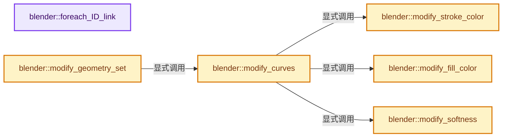
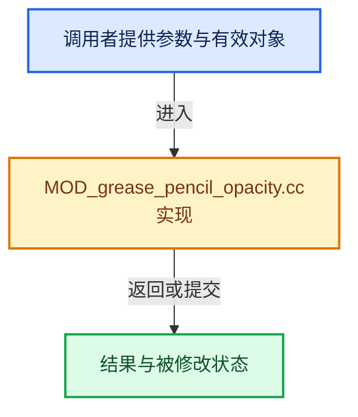

# 实现依赖专题：source/blender/modifiers/intern/MOD_grease_pencil_opacity.cc

[方向导航](README.md) · [符号索引](../%E7%AC%A6%E5%8F%B7%E4%BE%9D%E8%B5%96%E4%B8%8E%E5%AE%9E%E7%8E%B0%E7%B4%A2%E5%BC%95.md)

本专题从正文实际调用进入，集中保存共享实现。函数有稳定锚点，可从调用处直接跳到对应完整函数；递归与互相调用通过回链组织。

## 本文件的实现关系






## 完整成员与函数实现

<a id="f-ab0f828d6a5455f2"></a>

### `blender::foreach_ID_link`

实现位置：[source/blender/modifiers/intern/MOD_grease_pencil_opacity.cc](../../../../../source/blender/modifiers/intern/MOD_grease_pencil_opacity.cc) · L62—L66。

接口参数：

- `ModifierData *md`
- `Object *ob`
- `IDWalkFunc walk`
- `void *user_data`

**教学注释版**

<!-- annotated:38915428f6fbe2 -->

```cpp
static void foreach_ID_link(ModifierData *md, Object *ob, IDWalkFunc walk, void *user_data)
{
  auto *omd = reinterpret_cast<GreasePencilOpacityModifierData *>(md);
  modifier::greasepencil::foreach_influence_ID_link(&omd->influence, ob, walk, user_data);
}
```

<details>
<summary>核对原始源码：source/blender/modifiers/intern/MOD_grease_pencil_opacity.cc · L62—L66</summary>

<!-- original:38915428f6fbe2:source/blender/modifiers/intern/MOD_grease_pencil_opacity.cc:62:66 -->

```cpp
static void foreach_ID_link(ModifierData *md, Object *ob, IDWalkFunc walk, void *user_data)
{
  auto *omd = reinterpret_cast<GreasePencilOpacityModifierData *>(md);
  modifier::greasepencil::foreach_influence_ID_link(&omd->influence, ob, walk, user_data);
}
```

</details>

**继续追踪实现**

- `modifier::greasepencil::foreach_influence_ID_link` → [blender::modifier::greasepencil::foreach_influence_ID_link · L69](%E4%BE%9D%E8%B5%96-MOD_grease_pencil_util-d0b437.md#f-247ba56fa4c4e56f)。

<a id="f-7a43319a5a380e3d"></a>

### `blender::modify_stroke_color`

实现位置：[source/blender/modifiers/intern/MOD_grease_pencil_opacity.cc](../../../../../source/blender/modifiers/intern/MOD_grease_pencil_opacity.cc) · L68—L121。

接口参数：

- `const GreasePencilOpacityModifierData &omd`
- `bke::CurvesGeometry &curves`
- `const IndexMask &curves_mask`

**教学注释版**

<!-- annotated:55a1747e218fe4 -->

```cpp
static void modify_stroke_color(const GreasePencilOpacityModifierData &omd,
                                bke::CurvesGeometry &curves,
                                const IndexMask &curves_mask)
{
  const bool use_uniform_opacity = (omd.flag & MOD_GREASE_PENCIL_OPACITY_USE_UNIFORM_OPACITY);
  const bool use_weight_as_factor = (omd.flag & MOD_GREASE_PENCIL_OPACITY_USE_WEIGHT_AS_FACTOR);
  const bool use_curve = (omd.influence.flag & GREASE_PENCIL_INFLUENCE_USE_CUSTOM_CURVE);
  const OffsetIndices<int> points_by_curve = curves.points_by_curve();

  bke::MutableAttributeAccessor attributes = curves.attributes_for_write();
  bke::SpanAttributeWriter<float> opacities = attributes.lookup_or_add_for_write_span<float>(
      "opacity", bke::AttrDomain::Point);
  if (!opacities) {
    return;
  }
  const VArray<float> vgroup_weights = modifier::greasepencil::get_influence_vertex_weights(
      curves, omd.influence);

  curves_mask.foreach_index(
      [&](const int64_t curve_i) {
        const IndexRange points = points_by_curve[curve_i];
        for (const int64_t point_i : points) {
          const float vgroup_weight = vgroup_weights[point_i];
          if (vgroup_weight <= 0.0f) {
            continue;
          }

          // [讲解] points.size：读取连续区间或分组的边界信息。
          const float curve_input = points.size() >= 2 ? (float(point_i - points.first()) /
                                                          float(points.size() - 1)) :
                                                         0.0f;
          const float curve_factor = use_curve ? BKE_curvemapping_evaluateF(
                                                     omd.influence.custom_curve, 0, curve_input) :
                                                 1.0f;

          if (use_uniform_opacity) {
            opacities.span[point_i] = std::clamp(omd.color_factor * curve_factor, 0.0f, 1.0f);
          }
          else if (use_weight_as_factor) {
            /* Use vertex group weights as opacity factors. */
            opacities.span[point_i] = std::clamp(curve_factor * vgroup_weight, 0.0f, 1.0f);
          }
          else {
            /* Use vertex group weights as influence factors. */
            opacities.span[point_i] = std::clamp(
                opacities.span[point_i] + (omd.color_factor * curve_factor - 1.0f) * vgroup_weight,
                0.0f,
                1.0f);
          }
        }
      },
      exec_mode::grain_size(512));

  opacities.finish();
}
```

<details>
<summary>核对原始源码：source/blender/modifiers/intern/MOD_grease_pencil_opacity.cc · L68—L121</summary>

<!-- original:55a1747e218fe4:source/blender/modifiers/intern/MOD_grease_pencil_opacity.cc:68:121 -->

```cpp
static void modify_stroke_color(const GreasePencilOpacityModifierData &omd,
                                bke::CurvesGeometry &curves,
                                const IndexMask &curves_mask)
{
  const bool use_uniform_opacity = (omd.flag & MOD_GREASE_PENCIL_OPACITY_USE_UNIFORM_OPACITY);
  const bool use_weight_as_factor = (omd.flag & MOD_GREASE_PENCIL_OPACITY_USE_WEIGHT_AS_FACTOR);
  const bool use_curve = (omd.influence.flag & GREASE_PENCIL_INFLUENCE_USE_CUSTOM_CURVE);
  const OffsetIndices<int> points_by_curve = curves.points_by_curve();

  bke::MutableAttributeAccessor attributes = curves.attributes_for_write();
  bke::SpanAttributeWriter<float> opacities = attributes.lookup_or_add_for_write_span<float>(
      "opacity", bke::AttrDomain::Point);
  if (!opacities) {
    return;
  }
  const VArray<float> vgroup_weights = modifier::greasepencil::get_influence_vertex_weights(
      curves, omd.influence);

  curves_mask.foreach_index(
      [&](const int64_t curve_i) {
        const IndexRange points = points_by_curve[curve_i];
        for (const int64_t point_i : points) {
          const float vgroup_weight = vgroup_weights[point_i];
          if (vgroup_weight <= 0.0f) {
            continue;
          }

          const float curve_input = points.size() >= 2 ? (float(point_i - points.first()) /
                                                          float(points.size() - 1)) :
                                                         0.0f;
          const float curve_factor = use_curve ? BKE_curvemapping_evaluateF(
                                                     omd.influence.custom_curve, 0, curve_input) :
                                                 1.0f;

          if (use_uniform_opacity) {
            opacities.span[point_i] = std::clamp(omd.color_factor * curve_factor, 0.0f, 1.0f);
          }
          else if (use_weight_as_factor) {
            /* Use vertex group weights as opacity factors. */
            opacities.span[point_i] = std::clamp(curve_factor * vgroup_weight, 0.0f, 1.0f);
          }
          else {
            /* Use vertex group weights as influence factors. */
            opacities.span[point_i] = std::clamp(
                opacities.span[point_i] + (omd.color_factor * curve_factor - 1.0f) * vgroup_weight,
                0.0f,
                1.0f);
          }
        }
      },
      exec_mode::grain_size(512));

  opacities.finish();
}
```

</details>

**沿实际写入检查状态**

- `opacities.span[point_i] = std::clamp(omd.color_factor * curve_factor, 0.0f, 1.0f);`
- `opacities.span[point_i] = std::clamp(curve_factor * vgroup_weight, 0.0f, 1.0f);`
- `opacities.span[point_i] = std::clamp(`

**继续追踪实现**

- `curves.points_by_curve` → [blender::bke::CurvesGeometry::points_by_curve · L1058](04-CurvesGeometry%E5%AD%98%E5%82%A8.md#f-a0416697e10ec205)。
- `curves.attributes_for_write` → [blender::bke::CurvesGeometry::attributes_for_write · L1913](%E4%BE%9D%E8%B5%96-curves_geometry-ad7f9f.md#f-4930091b34fa9663)。
- `attributes.lookup_or_add_for_write_span<float>` → [blender::bke::MutableAttributeAccessor::lookup_or_add_for_write_span · L533](%E4%BE%9D%E8%B5%96-attribute_access-bceef3.md#f-c533eff1b9a4973e)；[blender::bke::MutableAttributeAccessor::lookup_or_add_for_write_span · L861](08-AttributeAccessor%E6%8E%A5%E5%8F%A3.md#f-aa4c0d5a61437381)。同名重载需按实参类型选择。
- `modifier::greasepencil::get_influence_vertex_weights` → [blender::modifier::greasepencil::get_influence_vertex_weights · L343](%E4%BE%9D%E8%B5%96-MOD_grease_pencil_util-d0b437.md#f-6f4fdb5693985db9)。
- `curves_mask.foreach_index` → [blender::index_mask::IndexMask::foreach_index · L855](../04-%E8%99%9A%E6%8B%9F%E6%95%B0%E7%BB%84%E4%B8%8E%E7%B4%A2%E5%BC%95%E9%80%89%E6%8B%A9/09-%E5%88%86%E6%AE%B5%E5%AD%98%E5%82%A8%E4%B8%8E%E9%81%8D%E5%8E%86.md#f-cd6cd317e2e2812c)。
- `points.size` → [blender::IndexRange::size · L156](../01-%E5%9F%BA%E7%A1%80%E5%AE%B9%E5%99%A8%E4%B8%8E%E7%8E%B0%E4%BB%A3CPP/04-IndexRange%E8%BF%9E%E7%BB%AD%E6%95%B4%E6%95%B0%E5%8C%BA%E9%97%B4.md#f-05f66c3ebb2fdfec)。
- `points.first` → [blender::IndexRange::first · L204](../01-%E5%9F%BA%E7%A1%80%E5%AE%B9%E5%99%A8%E4%B8%8E%E7%8E%B0%E4%BB%A3CPP/04-IndexRange%E8%BF%9E%E7%BB%AD%E6%95%B4%E6%95%B0%E5%8C%BA%E9%97%B4.md#f-ab443c94e531befa)。
- `BKE_curvemapping_evaluateF` → [blender::BKE_curvemapping_evaluateF · L1177](%E4%BE%9D%E8%B5%96-colortools-8bc37a.md#f-014584e04eeb1392)。
- `std::clamp` → [外部契约](https://eel.is/c++draft/)：这个边界按实际表达式及所属类型核对参数、返回值、寿命与失败行为。这里提供接口入口，不声称已解释该第三方版本的内部实现。
- `exec_mode::grain_size` → [blender::exec_mode::grain_size · L79](../01-%E5%9F%BA%E7%A1%80%E5%AE%B9%E5%99%A8%E4%B8%8E%E7%8E%B0%E4%BB%A3CPP/%E4%BE%9D%E8%B5%96-BLI_execution_mode-1528fb.md#f-0b4fc2f9fa6e66e7)。
- `opacities.finish` → [blender::bke::SpanAttributeWriter::finish · L279](08-AttributeAccessor%E6%8E%A5%E5%8F%A3.md#f-585970a3b1bd4da4)。

<a id="f-f5ab9a20a6bbb61c"></a>

### `blender::modify_fill_color`

实现位置：[source/blender/modifiers/intern/MOD_grease_pencil_opacity.cc](../../../../../source/blender/modifiers/intern/MOD_grease_pencil_opacity.cc) · L123—L159。

接口参数：

- `const GreasePencilOpacityModifierData &omd`
- `bke::CurvesGeometry &curves`
- `const IndexMask &curves_mask`

**教学注释版**

<!-- annotated:323207372e4f8c -->

```cpp
static void modify_fill_color(const GreasePencilOpacityModifierData &omd,
                              bke::CurvesGeometry &curves,
                              const IndexMask &curves_mask)
{
  const bool use_vgroup_opacity = (omd.flag & MOD_GREASE_PENCIL_OPACITY_USE_WEIGHT_AS_FACTOR);
  const OffsetIndices<int> points_by_curve = curves.points_by_curve();

  bke::MutableAttributeAccessor attributes = curves.attributes_for_write();
  /* Fill color opacity per stroke. */
  bke::SpanAttributeWriter<float> fill_opacities = attributes.convert_or_add_for_write_span<float>(
      "fill_opacity", bke::AttrDomain::Curve, bke::AttributeInitValue(1.0f));
  const VArray<float> vgroup_weights = modifier::greasepencil::get_influence_vertex_weights(
      curves, omd.influence);

  curves_mask.foreach_index(
      [&](int64_t curve_i) {
        /* Use the first stroke point as vertex weight. */
        const IndexRange points = points_by_curve[curve_i];
        // [讲解] points.first：读取范围两端的有效索引或值。
        const float vgroup_weight_first = vgroup_weights[points.first()];
        float stroke_weight = vgroup_weight_first;
        if (use_vgroup_opacity) {
          // [讲解] points.is_empty：读取连续区间或分组的边界信息。
          if (points.is_empty() || (stroke_weight <= 0.0f)) {
            stroke_weight = 1.0f;
          }
          fill_opacities.span[curve_i] = std::clamp(stroke_weight, 0.0f, 1.0f);
        }
        else {
          if (!points.is_empty() && (stroke_weight > 0.0f)) {
            fill_opacities.span[curve_i] = std::clamp(
                omd.color_factor * stroke_weight, 0.0f, 1.0f);
          }
        }
      },
      exec_mode::grain_size(512));

  fill_opacities.finish();
}
```

<details>
<summary>核对原始源码：source/blender/modifiers/intern/MOD_grease_pencil_opacity.cc · L123—L159</summary>

<!-- original:323207372e4f8c:source/blender/modifiers/intern/MOD_grease_pencil_opacity.cc:123:159 -->

```cpp
static void modify_fill_color(const GreasePencilOpacityModifierData &omd,
                              bke::CurvesGeometry &curves,
                              const IndexMask &curves_mask)
{
  const bool use_vgroup_opacity = (omd.flag & MOD_GREASE_PENCIL_OPACITY_USE_WEIGHT_AS_FACTOR);
  const OffsetIndices<int> points_by_curve = curves.points_by_curve();

  bke::MutableAttributeAccessor attributes = curves.attributes_for_write();
  /* Fill color opacity per stroke. */
  bke::SpanAttributeWriter<float> fill_opacities = attributes.convert_or_add_for_write_span<float>(
      "fill_opacity", bke::AttrDomain::Curve, bke::AttributeInitValue(1.0f));
  const VArray<float> vgroup_weights = modifier::greasepencil::get_influence_vertex_weights(
      curves, omd.influence);

  curves_mask.foreach_index(
      [&](int64_t curve_i) {
        /* Use the first stroke point as vertex weight. */
        const IndexRange points = points_by_curve[curve_i];
        const float vgroup_weight_first = vgroup_weights[points.first()];
        float stroke_weight = vgroup_weight_first;
        if (use_vgroup_opacity) {
          if (points.is_empty() || (stroke_weight <= 0.0f)) {
            stroke_weight = 1.0f;
          }
          fill_opacities.span[curve_i] = std::clamp(stroke_weight, 0.0f, 1.0f);
        }
        else {
          if (!points.is_empty() && (stroke_weight > 0.0f)) {
            fill_opacities.span[curve_i] = std::clamp(
                omd.color_factor * stroke_weight, 0.0f, 1.0f);
          }
        }
      },
      exec_mode::grain_size(512));

  fill_opacities.finish();
}
```

</details>

**沿实际写入检查状态**

- `stroke_weight = 1.0f;`
- `fill_opacities.span[curve_i] = std::clamp(stroke_weight, 0.0f, 1.0f);`
- `fill_opacities.span[curve_i] = std::clamp(`

**继续追踪实现**

- `curves.points_by_curve` → [blender::bke::CurvesGeometry::points_by_curve · L1058](04-CurvesGeometry%E5%AD%98%E5%82%A8.md#f-a0416697e10ec205)。
- `curves.attributes_for_write` → [blender::bke::CurvesGeometry::attributes_for_write · L1913](%E4%BE%9D%E8%B5%96-curves_geometry-ad7f9f.md#f-4930091b34fa9663)。
- `attributes.convert_or_add_for_write_span<float>` → [blender::bke::MutableAttributeAccessor::convert_or_add_for_write_span · L612](%E4%BE%9D%E8%B5%96-attribute_access-bceef3.md#f-e709ca290fc29dc1)；[blender::bke::MutableAttributeAccessor::convert_or_add_for_write_span · L959](08-AttributeAccessor%E6%8E%A5%E5%8F%A3.md#f-841bfd3d266ac810)。同名重载需按实参类型选择。
- `bke::AttributeInitValue` → [blender::bke::AttributeInitValue::AttributeInitValue · L100](08-AttributeAccessor%E6%8E%A5%E5%8F%A3.md#f-cd502d5742ad6d0f)；[blender::bke::AttributeInitValue::AttributeInitValue · L104](08-AttributeAccessor%E6%8E%A5%E5%8F%A3.md#f-54b1dad08bff7914)。同名重载需按实参类型选择。
- `modifier::greasepencil::get_influence_vertex_weights` → [blender::modifier::greasepencil::get_influence_vertex_weights · L343](%E4%BE%9D%E8%B5%96-MOD_grease_pencil_util-d0b437.md#f-6f4fdb5693985db9)。
- `curves_mask.foreach_index` → [blender::index_mask::IndexMask::foreach_index · L855](../04-%E8%99%9A%E6%8B%9F%E6%95%B0%E7%BB%84%E4%B8%8E%E7%B4%A2%E5%BC%95%E9%80%89%E6%8B%A9/09-%E5%88%86%E6%AE%B5%E5%AD%98%E5%82%A8%E4%B8%8E%E9%81%8D%E5%8E%86.md#f-cd6cd317e2e2812c)。
- `points.first` → [blender::IndexRange::first · L204](../01-%E5%9F%BA%E7%A1%80%E5%AE%B9%E5%99%A8%E4%B8%8E%E7%8E%B0%E4%BB%A3CPP/04-IndexRange%E8%BF%9E%E7%BB%AD%E6%95%B4%E6%95%B0%E5%8C%BA%E9%97%B4.md#f-ab443c94e531befa)。
- `points.is_empty` → [blender::IndexRange::is_empty · L169](../01-%E5%9F%BA%E7%A1%80%E5%AE%B9%E5%99%A8%E4%B8%8E%E7%8E%B0%E4%BB%A3CPP/04-IndexRange%E8%BF%9E%E7%BB%AD%E6%95%B4%E6%95%B0%E5%8C%BA%E9%97%B4.md#f-9501e070be01ff71)。
- `std::clamp` → [外部契约](https://eel.is/c++draft/)：这个边界按实际表达式及所属类型核对参数、返回值、寿命与失败行为。这里提供接口入口，不声称已解释该第三方版本的内部实现。
- `exec_mode::grain_size` → [blender::exec_mode::grain_size · L79](../01-%E5%9F%BA%E7%A1%80%E5%AE%B9%E5%99%A8%E4%B8%8E%E7%8E%B0%E4%BB%A3CPP/%E4%BE%9D%E8%B5%96-BLI_execution_mode-1528fb.md#f-0b4fc2f9fa6e66e7)。
- `fill_opacities.finish` → [blender::bke::SpanAttributeWriter::finish · L279](08-AttributeAccessor%E6%8E%A5%E5%8F%A3.md#f-585970a3b1bd4da4)。

<a id="f-8d45ba1c6b060e4f"></a>

### `blender::modify_softness`

实现位置：[source/blender/modifiers/intern/MOD_grease_pencil_opacity.cc](../../../../../source/blender/modifiers/intern/MOD_grease_pencil_opacity.cc) · L161—L177。

接口参数：

- `const GreasePencilOpacityModifierData &omd`
- `bke::CurvesGeometry &curves`
- `const IndexMask &curves_mask`

**教学注释版**

<!-- annotated:d20408f4cec38a -->

```cpp
static void modify_softness(const GreasePencilOpacityModifierData &omd,
                            bke::CurvesGeometry &curves,
                            const IndexMask &curves_mask)
{
  bke::MutableAttributeAccessor attributes = curves.attributes_for_write();
  bke::SpanAttributeWriter<float> softness = attributes.lookup_or_add_for_write_span<float>(
      "softness", bke::AttrDomain::Curve);

  curves_mask.foreach_index_optimized<int64_t>(
      [&](int64_t curve_i) {
        softness.span[curve_i] =
            1.0f - std::clamp((1.0f - softness.span[curve_i]) * omd.hardness_factor, 0.0f, 1.0f);
      },
      exec_mode::grain_size(4096));

  softness.finish();
}
```

<details>
<summary>核对原始源码：source/blender/modifiers/intern/MOD_grease_pencil_opacity.cc · L161—L177</summary>

<!-- original:d20408f4cec38a:source/blender/modifiers/intern/MOD_grease_pencil_opacity.cc:161:177 -->

```cpp
static void modify_softness(const GreasePencilOpacityModifierData &omd,
                            bke::CurvesGeometry &curves,
                            const IndexMask &curves_mask)
{
  bke::MutableAttributeAccessor attributes = curves.attributes_for_write();
  bke::SpanAttributeWriter<float> softness = attributes.lookup_or_add_for_write_span<float>(
      "softness", bke::AttrDomain::Curve);

  curves_mask.foreach_index_optimized<int64_t>(
      [&](int64_t curve_i) {
        softness.span[curve_i] =
            1.0f - std::clamp((1.0f - softness.span[curve_i]) * omd.hardness_factor, 0.0f, 1.0f);
      },
      exec_mode::grain_size(4096));

  softness.finish();
}
```

</details>

**沿实际写入检查状态**

- `softness.span[curve_i] =`

**继续追踪实现**

- `curves.attributes_for_write` → [blender::bke::CurvesGeometry::attributes_for_write · L1913](%E4%BE%9D%E8%B5%96-curves_geometry-ad7f9f.md#f-4930091b34fa9663)。
- `attributes.lookup_or_add_for_write_span<float>` → [blender::bke::MutableAttributeAccessor::lookup_or_add_for_write_span · L533](%E4%BE%9D%E8%B5%96-attribute_access-bceef3.md#f-c533eff1b9a4973e)；[blender::bke::MutableAttributeAccessor::lookup_or_add_for_write_span · L861](08-AttributeAccessor%E6%8E%A5%E5%8F%A3.md#f-aa4c0d5a61437381)。同名重载需按实参类型选择。
- `curves_mask.foreach_index_optimized<int64_t>` → [blender::index_mask::IndexMask::foreach_index_optimized · L937](../04-%E8%99%9A%E6%8B%9F%E6%95%B0%E7%BB%84%E4%B8%8E%E7%B4%A2%E5%BC%95%E9%80%89%E6%8B%A9/12-%E9%87%8D%E6%9E%84%E5%8E%86%E5%8F%B2%E4%B8%8E%E5%9F%BA%E5%87%86%E7%BB%83%E4%B9%A0.md#f-a2c3e7876407eaaf)。
- `std::clamp` → [外部契约](https://eel.is/c++draft/)：这个边界按实际表达式及所属类型核对参数、返回值、寿命与失败行为。这里提供接口入口，不声称已解释该第三方版本的内部实现。
- `exec_mode::grain_size` → [blender::exec_mode::grain_size · L79](../01-%E5%9F%BA%E7%A1%80%E5%AE%B9%E5%99%A8%E4%B8%8E%E7%8E%B0%E4%BB%A3CPP/%E4%BE%9D%E8%B5%96-BLI_execution_mode-1528fb.md#f-0b4fc2f9fa6e66e7)。
- `softness.finish` → [blender::bke::SpanAttributeWriter::finish · L279](08-AttributeAccessor%E6%8E%A5%E5%8F%A3.md#f-585970a3b1bd4da4)。

<a id="f-faba24a8213682fd"></a>

### `blender::modify_curves`

实现位置：[source/blender/modifiers/intern/MOD_grease_pencil_opacity.cc](../../../../../source/blender/modifiers/intern/MOD_grease_pencil_opacity.cc) · L179—L204。

接口参数：

- `ModifierData *md`
- `const ModifierEvalContext *ctx`
- `bke::CurvesGeometry &curves`

**教学注释版**

<!-- annotated:19ef9143b67ca9 -->

```cpp
static void modify_curves(ModifierData *md,
                          const ModifierEvalContext *ctx,
                          bke::CurvesGeometry &curves)
{
  const auto *omd = reinterpret_cast<GreasePencilOpacityModifierData *>(md);

  IndexMaskMemory mask_memory;
  const IndexMask curves_mask = modifier::greasepencil::get_filtered_stroke_mask(
      ctx->object, curves, omd->influence, mask_memory);

  switch (omd->color_mode) {
    case MOD_GREASE_PENCIL_COLOR_STROKE:
      modify_stroke_color(*omd, curves, curves_mask);
      break;
    case MOD_GREASE_PENCIL_COLOR_FILL:
      modify_fill_color(*omd, curves, curves_mask);
      break;
    case MOD_GREASE_PENCIL_COLOR_BOTH:
      modify_stroke_color(*omd, curves, curves_mask);
      modify_fill_color(*omd, curves, curves_mask);
      break;
    case MOD_GREASE_PENCIL_COLOR_HARDNESS:
      modify_softness(*omd, curves, curves_mask);
      break;
  }
}
```

<details>
<summary>核对原始源码：source/blender/modifiers/intern/MOD_grease_pencil_opacity.cc · L179—L204</summary>

<!-- original:19ef9143b67ca9:source/blender/modifiers/intern/MOD_grease_pencil_opacity.cc:179:204 -->

```cpp
static void modify_curves(ModifierData *md,
                          const ModifierEvalContext *ctx,
                          bke::CurvesGeometry &curves)
{
  const auto *omd = reinterpret_cast<GreasePencilOpacityModifierData *>(md);

  IndexMaskMemory mask_memory;
  const IndexMask curves_mask = modifier::greasepencil::get_filtered_stroke_mask(
      ctx->object, curves, omd->influence, mask_memory);

  switch (omd->color_mode) {
    case MOD_GREASE_PENCIL_COLOR_STROKE:
      modify_stroke_color(*omd, curves, curves_mask);
      break;
    case MOD_GREASE_PENCIL_COLOR_FILL:
      modify_fill_color(*omd, curves, curves_mask);
      break;
    case MOD_GREASE_PENCIL_COLOR_BOTH:
      modify_stroke_color(*omd, curves, curves_mask);
      modify_fill_color(*omd, curves, curves_mask);
      break;
    case MOD_GREASE_PENCIL_COLOR_HARDNESS:
      modify_softness(*omd, curves, curves_mask);
      break;
  }
}
```

</details>

**继续追踪实现**

- `modifier::greasepencil::get_filtered_stroke_mask` → [blender::modifier::greasepencil::get_filtered_stroke_mask · L285](%E4%BE%9D%E8%B5%96-MOD_grease_pencil_util-d0b437.md#f-30c219d04de7dec3)；[blender::modifier::greasepencil::get_filtered_stroke_mask · L326](%E4%BE%9D%E8%B5%96-MOD_grease_pencil_util-d0b437.md#f-970c3bc880e4f350)。同名重载需按实参类型选择。
- `modify_stroke_color` → [blender::modify_stroke_color · L68](%E4%BE%9D%E8%B5%96-MOD_grease_pencil_opacity-33f86c.md#f-7a43319a5a380e3d)。
- `modify_fill_color` → [blender::modify_fill_color · L123](%E4%BE%9D%E8%B5%96-MOD_grease_pencil_opacity-33f86c.md#f-f5ab9a20a6bbb61c)。
- `modify_softness` → [blender::modify_softness · L161](%E4%BE%9D%E8%B5%96-MOD_grease_pencil_opacity-33f86c.md#f-8d45ba1c6b060e4f)。

<a id="f-e612ca2075a8aa0f"></a>

### `blender::modify_geometry_set`

实现位置：[source/blender/modifiers/intern/MOD_grease_pencil_opacity.cc](../../../../../source/blender/modifiers/intern/MOD_grease_pencil_opacity.cc) · L206—L225。

接口参数：

- `ModifierData *md`
- `const ModifierEvalContext *ctx`
- `bke::GeometrySet *geometry_set`

**教学注释版**

<!-- annotated:85886689e703c3 -->

```cpp
static void modify_geometry_set(ModifierData *md,
                                const ModifierEvalContext *ctx,
                                bke::GeometrySet *geometry_set)
{
  const auto *omd = reinterpret_cast<GreasePencilOpacityModifierData *>(md);

  GreasePencil *grease_pencil = geometry_set->get_grease_pencil_for_write();
  if (grease_pencil == nullptr) {
    return;
  }

  IndexMaskMemory mask_memory;
  const IndexMask layer_mask = modifier::greasepencil::get_filtered_layer_mask(
      *grease_pencil, omd->influence, mask_memory);
  const int frame = grease_pencil->runtime->eval_frame;
  const Vector<Drawing *> drawings = modifier::greasepencil::get_drawings_for_write(
      *grease_pencil, layer_mask, frame);
  threading::parallel_for_each(
      drawings, [&](Drawing *drawing) { modify_curves(md, ctx, drawing->strokes_for_write()); });
}
```

<details>
<summary>核对原始源码：source/blender/modifiers/intern/MOD_grease_pencil_opacity.cc · L206—L225</summary>

<!-- original:85886689e703c3:source/blender/modifiers/intern/MOD_grease_pencil_opacity.cc:206:225 -->

```cpp
static void modify_geometry_set(ModifierData *md,
                                const ModifierEvalContext *ctx,
                                bke::GeometrySet *geometry_set)
{
  const auto *omd = reinterpret_cast<GreasePencilOpacityModifierData *>(md);

  GreasePencil *grease_pencil = geometry_set->get_grease_pencil_for_write();
  if (grease_pencil == nullptr) {
    return;
  }

  IndexMaskMemory mask_memory;
  const IndexMask layer_mask = modifier::greasepencil::get_filtered_layer_mask(
      *grease_pencil, omd->influence, mask_memory);
  const int frame = grease_pencil->runtime->eval_frame;
  const Vector<Drawing *> drawings = modifier::greasepencil::get_drawings_for_write(
      *grease_pencil, layer_mask, frame);
  threading::parallel_for_each(
      drawings, [&](Drawing *drawing) { modify_curves(md, ctx, drawing->strokes_for_write()); });
}
```

</details>

**继续追踪实现**

- `geometry_set->get_grease_pencil_for_write` → [blender::bke::GeometrySet::get_grease_pencil_for_write · L622](../06-%E9%9A%90%E5%BC%8F%E5%85%B1%E4%BA%AB%E4%B8%8E%E7%BC%93%E5%AD%98%E7%B3%BB%E7%BB%9F/05-GeometrySet%E8%AF%BB%E5%86%99%E4%B8%8E%E5%A4%8D%E5%88%B6.md#f-bfc5e891a352651b)。
- `modifier::greasepencil::get_filtered_layer_mask` → [blender::modifier::greasepencil::get_filtered_layer_mask · L213](%E4%BE%9D%E8%B5%96-MOD_grease_pencil_util-d0b437.md#f-6438bea51141f9db)；[blender::modifier::greasepencil::get_filtered_layer_mask · L268](%E4%BE%9D%E8%B5%96-MOD_grease_pencil_util-d0b437.md#f-e3d0f9748ecdf34b)。同名重载需按实参类型选择。
- `modifier::greasepencil::get_drawings_for_write` → [blender::modifier::greasepencil::get_drawings_for_write · L368](%E4%BE%9D%E8%B5%96-MOD_grease_pencil_util-d0b437.md#f-cef3871c31259376)。
- `threading::parallel_for_each` → [blender::threading::parallel_for_each · L30](../11-Depsgraph%E4%B8%8E%E5%B9%B6%E8%A1%8C%E4%BB%BB%E5%8A%A1%E7%B3%BB%E7%BB%9F/07-%E4%BB%BB%E5%8A%A1%E6%B1%A0%E4%B8%8ETBB%E6%8E%A5%E5%85%A5.md#f-d5604027445ef0f5)。
- `modify_curves` → [blender::modify_curves · L179](%E4%BE%9D%E8%B5%96-MOD_grease_pencil_opacity-33f86c.md#f-faba24a8213682fd)。
- `drawing->strokes_for_write` → [blender::bke::greasepencil::Drawing::strokes_for_write · L1012](%E4%BE%9D%E8%B5%96-grease_pencil-f750d6.md#f-0649333785d0aa95)。
