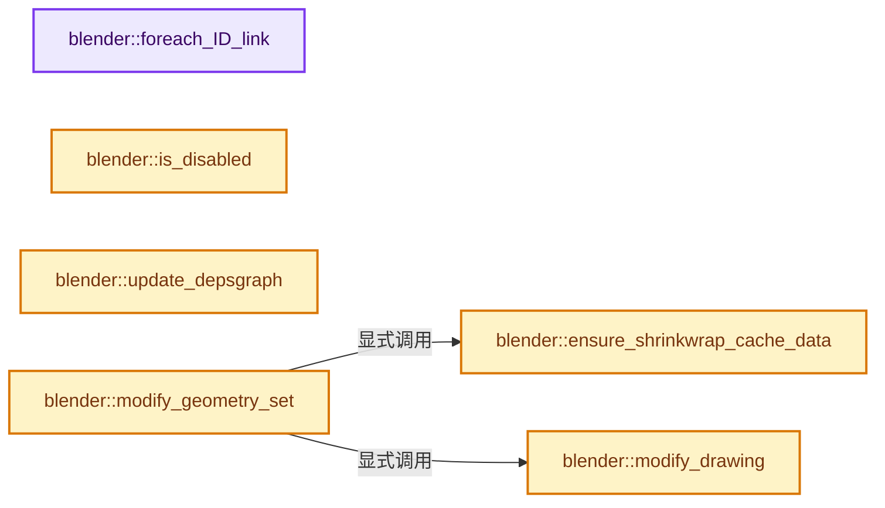
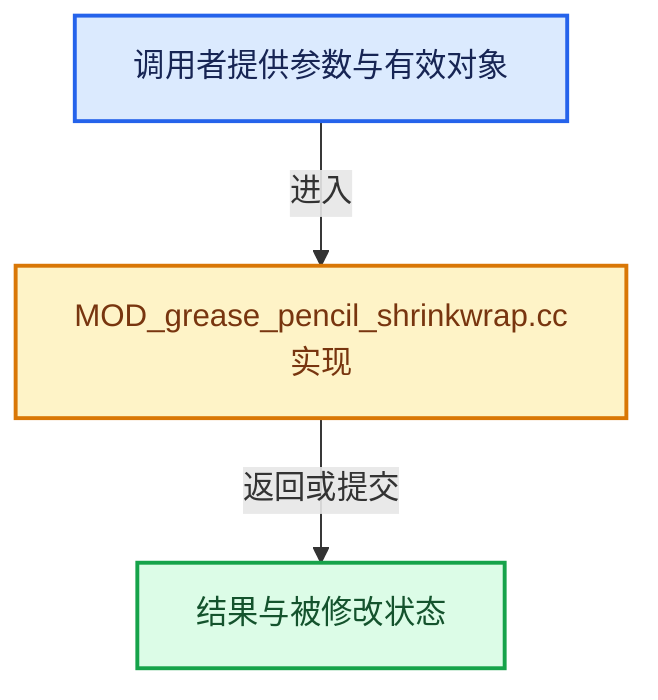

# 实现依赖专题：source/blender/modifiers/intern/MOD_grease_pencil_shrinkwrap.cc

[方向导航](README.md) · [符号索引](../%E7%AC%A6%E5%8F%B7%E4%BE%9D%E8%B5%96%E4%B8%8E%E5%AE%9E%E7%8E%B0%E7%B4%A2%E5%BC%95.md)

本专题从正文实际调用进入，集中保存共享实现。函数有稳定锚点，可从调用处直接跳到对应完整函数；递归与互相调用通过回链组织。

## 本文件的实现关系






## 完整成员与函数实现

<a id="f-c27b5c4b02a06aaf"></a>

### `blender::foreach_ID_link`

实现位置：[source/blender/modifiers/intern/MOD_grease_pencil_shrinkwrap.cc](../../../../../source/blender/modifiers/intern/MOD_grease_pencil_shrinkwrap.cc) · L77—L83。

接口参数：

- `ModifierData *md`
- `Object *ob`
- `IDWalkFunc walk`
- `void *user_data`

**教学注释版**

<!-- annotated:909ca1fcc845c6 -->

```cpp
static void foreach_ID_link(ModifierData *md, Object *ob, IDWalkFunc walk, void *user_data)
{
  auto *smd = reinterpret_cast<GreasePencilShrinkwrapModifierData *>(md);
  modifier::greasepencil::foreach_influence_ID_link(&smd->influence, ob, walk, user_data);
  walk(user_data, ob, reinterpret_cast<ID **>(&smd->target), IDWALK_CB_NOP);
  walk(user_data, ob, reinterpret_cast<ID **>(&smd->aux_target), IDWALK_CB_NOP);
}
```

<details>
<summary>核对原始源码：source/blender/modifiers/intern/MOD_grease_pencil_shrinkwrap.cc · L77—L83</summary>

<!-- original:909ca1fcc845c6:source/blender/modifiers/intern/MOD_grease_pencil_shrinkwrap.cc:77:83 -->

```cpp
static void foreach_ID_link(ModifierData *md, Object *ob, IDWalkFunc walk, void *user_data)
{
  auto *smd = reinterpret_cast<GreasePencilShrinkwrapModifierData *>(md);
  modifier::greasepencil::foreach_influence_ID_link(&smd->influence, ob, walk, user_data);
  walk(user_data, ob, reinterpret_cast<ID **>(&smd->target), IDWALK_CB_NOP);
  walk(user_data, ob, reinterpret_cast<ID **>(&smd->aux_target), IDWALK_CB_NOP);
}
```

</details>

**继续追踪实现**

- `modifier::greasepencil::foreach_influence_ID_link` → [blender::modifier::greasepencil::foreach_influence_ID_link · L69](%E4%BE%9D%E8%B5%96-MOD_grease_pencil_util-d0b437.md#f-247ba56fa4c4e56f)。
- `walk` → [调用协议](../%E6%A8%A1%E6%9D%BF%E5%AE%8F%E4%B8%8E%E5%8A%A8%E6%80%81%E5%88%86%E6%B4%BE%E5%8D%8F%E8%AE%AE.md)：局部可调用对象，须结合其初始化与捕获环境。调用位置L81。

<a id="f-b004accafec24111"></a>

### `blender::is_disabled`

实现位置：[source/blender/modifiers/intern/MOD_grease_pencil_shrinkwrap.cc](../../../../../source/blender/modifiers/intern/MOD_grease_pencil_shrinkwrap.cc) · L85—L101。

接口参数：

- `const Scene *`
- `ModifierData *md`
- `bool`

**教学注释版**

<!-- annotated:43f4c85bcee4f6 -->

```cpp
static bool is_disabled(const Scene * /*scene*/, ModifierData *md, bool /*use_render_params*/)
{
  auto *smd = reinterpret_cast<GreasePencilShrinkwrapModifierData *>(md);

  /* The object type check is only needed here in case we have a placeholder
   * object assigned (because the library containing the mesh is missing).
   *
   * In other cases it should be impossible to have a type mismatch.
   */
  if (smd->target == nullptr || smd->target->type != OB_MESH) {
    return true;
  }
  if (smd->aux_target != nullptr && smd->aux_target->type != OB_MESH) {
    return true;
  }
  return false;
}
```

<details>
<summary>核对原始源码：source/blender/modifiers/intern/MOD_grease_pencil_shrinkwrap.cc · L85—L101</summary>

<!-- original:43f4c85bcee4f6:source/blender/modifiers/intern/MOD_grease_pencil_shrinkwrap.cc:85:101 -->

```cpp
static bool is_disabled(const Scene * /*scene*/, ModifierData *md, bool /*use_render_params*/)
{
  auto *smd = reinterpret_cast<GreasePencilShrinkwrapModifierData *>(md);

  /* The object type check is only needed here in case we have a placeholder
   * object assigned (because the library containing the mesh is missing).
   *
   * In other cases it should be impossible to have a type mismatch.
   */
  if (smd->target == nullptr || smd->target->type != OB_MESH) {
    return true;
  }
  if (smd->aux_target != nullptr && smd->aux_target->type != OB_MESH) {
    return true;
  }
  return false;
}
```

</details>

**结果出口**

- `return true;`
- `return false;`

**继续追踪实现**

本实现没有需要继续展开的显式调用；检查返回表达式、对象转换和调用者前置条件。

<a id="f-1a3690c8ca7b9c0f"></a>

### `blender::update_depsgraph`

实现位置：[source/blender/modifiers/intern/MOD_grease_pencil_shrinkwrap.cc](../../../../../source/blender/modifiers/intern/MOD_grease_pencil_shrinkwrap.cc) · L103—L127。

接口参数：

- `ModifierData *md`
- `const ModifierUpdateDepsgraphContext *ctx`

**教学注释版**

<!-- annotated:1f08c9c66dee81 -->

```cpp
static void update_depsgraph(ModifierData *md, const ModifierUpdateDepsgraphContext *ctx)
{
  auto *smd = reinterpret_cast<GreasePencilShrinkwrapModifierData *>(md);

  if (smd->target != nullptr) {
    DEG_add_object_relation(
        ctx->node, smd->target, DEG_OB_COMP_TRANSFORM, "Grease Pencil Shrinkwrap Modifier");
    DEG_add_object_relation(
        ctx->node, smd->target, DEG_OB_COMP_GEOMETRY, "Grease Pencil Shrinkwrap Modifier");
    if (smd->shrink_type == MOD_SHRINKWRAP_TARGET_PROJECT) {
      DEG_add_special_eval_flag(ctx->node, &smd->target->id, DAG_EVAL_NEED_SHRINKWRAP_BOUNDARY);
    }
  }
  if (smd->aux_target != nullptr) {
    DEG_add_object_relation(
        ctx->node, smd->aux_target, DEG_OB_COMP_TRANSFORM, "Grease Pencil Shrinkwrap Modifier");
    DEG_add_object_relation(
        ctx->node, smd->aux_target, DEG_OB_COMP_GEOMETRY, "Grease Pencil Shrinkwrap Modifier");
    if (smd->shrink_type == MOD_SHRINKWRAP_TARGET_PROJECT) {
      DEG_add_special_eval_flag(
          ctx->node, &smd->aux_target->id, DAG_EVAL_NEED_SHRINKWRAP_BOUNDARY);
    }
  }
  DEG_add_depends_on_transform_relation(ctx->node, "Grease Pencil Shrinkwrap Modifier");
}
```

<details>
<summary>核对原始源码：source/blender/modifiers/intern/MOD_grease_pencil_shrinkwrap.cc · L103—L127</summary>

<!-- original:1f08c9c66dee81:source/blender/modifiers/intern/MOD_grease_pencil_shrinkwrap.cc:103:127 -->

```cpp
static void update_depsgraph(ModifierData *md, const ModifierUpdateDepsgraphContext *ctx)
{
  auto *smd = reinterpret_cast<GreasePencilShrinkwrapModifierData *>(md);

  if (smd->target != nullptr) {
    DEG_add_object_relation(
        ctx->node, smd->target, DEG_OB_COMP_TRANSFORM, "Grease Pencil Shrinkwrap Modifier");
    DEG_add_object_relation(
        ctx->node, smd->target, DEG_OB_COMP_GEOMETRY, "Grease Pencil Shrinkwrap Modifier");
    if (smd->shrink_type == MOD_SHRINKWRAP_TARGET_PROJECT) {
      DEG_add_special_eval_flag(ctx->node, &smd->target->id, DAG_EVAL_NEED_SHRINKWRAP_BOUNDARY);
    }
  }
  if (smd->aux_target != nullptr) {
    DEG_add_object_relation(
        ctx->node, smd->aux_target, DEG_OB_COMP_TRANSFORM, "Grease Pencil Shrinkwrap Modifier");
    DEG_add_object_relation(
        ctx->node, smd->aux_target, DEG_OB_COMP_GEOMETRY, "Grease Pencil Shrinkwrap Modifier");
    if (smd->shrink_type == MOD_SHRINKWRAP_TARGET_PROJECT) {
      DEG_add_special_eval_flag(
          ctx->node, &smd->aux_target->id, DAG_EVAL_NEED_SHRINKWRAP_BOUNDARY);
    }
  }
  DEG_add_depends_on_transform_relation(ctx->node, "Grease Pencil Shrinkwrap Modifier");
}
```

</details>

**继续追踪实现**

- `DEG_add_object_relation` → [blender::DEG_add_object_relation · L123](../11-Depsgraph%E4%B8%8E%E5%B9%B6%E8%A1%8C%E4%BB%BB%E5%8A%A1%E7%B3%BB%E7%BB%9F/%E4%BE%9D%E8%B5%96-depsgraph_build-ea2fc8.md#f-f570cffae97e273c)。
- `DEG_add_special_eval_flag` → [blender::DEG_add_special_eval_flag · L253](../11-Depsgraph%E4%B8%8E%E5%B9%B6%E8%A1%8C%E4%BB%BB%E5%8A%A1%E7%B3%BB%E7%BB%9F/%E4%BE%9D%E8%B5%96-depsgraph_build-ea2fc8.md#f-d68e9c73ded33dd2)。
- `DEG_add_depends_on_transform_relation` → [blender::DEG_add_depends_on_transform_relation · L240](../11-Depsgraph%E4%B8%8E%E5%B9%B6%E8%A1%8C%E4%BB%BB%E5%8A%A1%E7%B3%BB%E7%BB%9F/%E4%BE%9D%E8%B5%96-depsgraph_build-ea2fc8.md#f-47c32a354defa20d)。

<a id="f-86d177ae9d24f3cb"></a>

### `blender::modify_drawing`

实现位置：[source/blender/modifiers/intern/MOD_grease_pencil_shrinkwrap.cc](../../../../../source/blender/modifiers/intern/MOD_grease_pencil_shrinkwrap.cc) · L129—L182。

接口参数：

- `const GreasePencilShrinkwrapModifierData &smd`
- `const ModifierEvalContext &ctx`
- `bke::greasepencil::Drawing &drawing`

**教学注释版**

<!-- annotated:251b760a4fb253 -->

```cpp
static void modify_drawing(const GreasePencilShrinkwrapModifierData &smd,
                           const ModifierEvalContext &ctx,
                           bke::greasepencil::Drawing &drawing)
{
  modifier::greasepencil::ensure_no_bezier_curves(drawing);
  bke::CurvesGeometry &curves = drawing.strokes_for_write();
  const OffsetIndices<int> points_by_curve = curves.points_by_curve();
  const Span<MDeformVert> dverts = curves.deform_verts();
  const MutableSpan<float3> positions = curves.positions_for_write();
  const int defgrp_idx = BKE_object_defgroup_name_index(ctx.object,
                                                        smd.influence.vertex_group_name);

  /* Selected source curves. */
  IndexMaskMemory curve_mask_memory;
  const IndexMask curves_mask = modifier::greasepencil::get_filtered_stroke_mask(
      ctx.object, drawing.strokes(), smd.influence, curve_mask_memory);

  ShrinkwrapParams params;
  params.target = smd.target;
  params.aux_target = smd.aux_target;
  params.invert_vertex_weights = smd.influence.flag & GREASE_PENCIL_INFLUENCE_INVERT_VERTEX_GROUP;
  params.keep_distance = smd.keep_dist;
  params.shrink_type = smd.shrink_type;
  params.shrink_options = smd.shrink_opts;
  params.shrink_mode = smd.shrink_mode;
  params.projection_limit = smd.proj_limit;
  params.projection_axis = smd.proj_axis;
  params.subsurf_levels = smd.subsurf_levels;

  curves_mask.foreach_index([&](const int curve_i) {
    const IndexRange points = points_by_curve[curve_i];
    // [讲解] dverts.is_empty：查询视图长度或生成对应有效索引区间。
    const Span<MDeformVert> curve_dverts = dverts.is_empty() ? dverts : dverts.slice(points);
    // [讲解] positions.slice：建立原连续范围的子视图。
    const MutableSpan<float3> curve_positions = positions.slice(points);

    shrinkwrapParams_deform(
        params, *ctx.object, *smd.cache_data, curve_dverts, defgrp_idx, curve_positions);
  });

  /* Optional smoothing after shrinkwrap. */
  const VArray<bool> point_selection = VArray<bool>::from_single(true, curves.points_num());
  const bool smooth_ends = false;
  const bool keep_shape = true;
  geometry::smooth_curve_attribute(curves_mask,
                                   points_by_curve,
                                   point_selection,
                                   curves.cyclic(),
                                   smd.smooth_step,
                                   smd.smooth_factor,
                                   smooth_ends,
                                   keep_shape,
                                   positions);

  drawing.tag_positions_changed();
}
```

<details>
<summary>核对原始源码：source/blender/modifiers/intern/MOD_grease_pencil_shrinkwrap.cc · L129—L182</summary>

<!-- original:251b760a4fb253:source/blender/modifiers/intern/MOD_grease_pencil_shrinkwrap.cc:129:182 -->

```cpp
static void modify_drawing(const GreasePencilShrinkwrapModifierData &smd,
                           const ModifierEvalContext &ctx,
                           bke::greasepencil::Drawing &drawing)
{
  modifier::greasepencil::ensure_no_bezier_curves(drawing);
  bke::CurvesGeometry &curves = drawing.strokes_for_write();
  const OffsetIndices<int> points_by_curve = curves.points_by_curve();
  const Span<MDeformVert> dverts = curves.deform_verts();
  const MutableSpan<float3> positions = curves.positions_for_write();
  const int defgrp_idx = BKE_object_defgroup_name_index(ctx.object,
                                                        smd.influence.vertex_group_name);

  /* Selected source curves. */
  IndexMaskMemory curve_mask_memory;
  const IndexMask curves_mask = modifier::greasepencil::get_filtered_stroke_mask(
      ctx.object, drawing.strokes(), smd.influence, curve_mask_memory);

  ShrinkwrapParams params;
  params.target = smd.target;
  params.aux_target = smd.aux_target;
  params.invert_vertex_weights = smd.influence.flag & GREASE_PENCIL_INFLUENCE_INVERT_VERTEX_GROUP;
  params.keep_distance = smd.keep_dist;
  params.shrink_type = smd.shrink_type;
  params.shrink_options = smd.shrink_opts;
  params.shrink_mode = smd.shrink_mode;
  params.projection_limit = smd.proj_limit;
  params.projection_axis = smd.proj_axis;
  params.subsurf_levels = smd.subsurf_levels;

  curves_mask.foreach_index([&](const int curve_i) {
    const IndexRange points = points_by_curve[curve_i];
    const Span<MDeformVert> curve_dverts = dverts.is_empty() ? dverts : dverts.slice(points);
    const MutableSpan<float3> curve_positions = positions.slice(points);

    shrinkwrapParams_deform(
        params, *ctx.object, *smd.cache_data, curve_dverts, defgrp_idx, curve_positions);
  });

  /* Optional smoothing after shrinkwrap. */
  const VArray<bool> point_selection = VArray<bool>::from_single(true, curves.points_num());
  const bool smooth_ends = false;
  const bool keep_shape = true;
  geometry::smooth_curve_attribute(curves_mask,
                                   points_by_curve,
                                   point_selection,
                                   curves.cyclic(),
                                   smd.smooth_step,
                                   smd.smooth_factor,
                                   smooth_ends,
                                   keep_shape,
                                   positions);

  drawing.tag_positions_changed();
}
```

</details>

**沿实际写入检查状态**

- `params.target = smd.target;`
- `params.aux_target = smd.aux_target;`
- `params.invert_vertex_weights = smd.influence.flag & GREASE_PENCIL_INFLUENCE_INVERT_VERTEX_GROUP;`
- `params.keep_distance = smd.keep_dist;`
- `params.shrink_type = smd.shrink_type;`
- `params.shrink_options = smd.shrink_opts;`
- `params.shrink_mode = smd.shrink_mode;`
- `params.projection_limit = smd.proj_limit;`
- `params.projection_axis = smd.proj_axis;`
- `params.subsurf_levels = smd.subsurf_levels;`

**继续追踪实现**

- `modifier::greasepencil::ensure_no_bezier_curves` → [blender::modifier::greasepencil::ensure_no_bezier_curves · L432](%E4%BE%9D%E8%B5%96-MOD_grease_pencil_util-d0b437.md#f-1fde6483ac30d59b)。
- `drawing.strokes_for_write` → [blender::bke::greasepencil::Drawing::strokes_for_write · L1012](%E4%BE%9D%E8%B5%96-grease_pencil-f750d6.md#f-0649333785d0aa95)。
- `curves.points_by_curve` → [blender::bke::CurvesGeometry::points_by_curve · L1058](04-CurvesGeometry%E5%AD%98%E5%82%A8.md#f-a0416697e10ec205)。
- `curves.deform_verts` → [blender::bke::CurvesGeometry::deform_verts · L611](%E4%BE%9D%E8%B5%96-curves_geometry-ad7f9f.md#f-45589948eb3850fc)。
- `curves.positions_for_write` → [blender::bke::CurvesGeometry::positions_for_write · L328](%E4%BE%9D%E8%B5%96-curves_geometry-ad7f9f.md#f-30e013e651e830c3)。
- `BKE_object_defgroup_name_index` → [blender::BKE_object_defgroup_name_index · L597](%E4%BE%9D%E8%B5%96-deform-6949f4.md#f-ad856e5bba5cd758)。
- `modifier::greasepencil::get_filtered_stroke_mask` → [blender::modifier::greasepencil::get_filtered_stroke_mask · L285](%E4%BE%9D%E8%B5%96-MOD_grease_pencil_util-d0b437.md#f-30c219d04de7dec3)；[blender::modifier::greasepencil::get_filtered_stroke_mask · L326](%E4%BE%9D%E8%B5%96-MOD_grease_pencil_util-d0b437.md#f-970c3bc880e4f350)。同名重载需按实参类型选择。
- `drawing.strokes` → [blender::bke::greasepencil::Drawing::strokes · L1007](%E4%BE%9D%E8%B5%96-grease_pencil-f750d6.md#f-59e6522a8e8ac409)。
- `curves_mask.foreach_index` → [blender::index_mask::IndexMask::foreach_index · L855](../04-%E8%99%9A%E6%8B%9F%E6%95%B0%E7%BB%84%E4%B8%8E%E7%B4%A2%E5%BC%95%E9%80%89%E6%8B%A9/09-%E5%88%86%E6%AE%B5%E5%AD%98%E5%82%A8%E4%B8%8E%E9%81%8D%E5%8E%86.md#f-cd6cd317e2e2812c)。
- `dverts.is_empty` → [blender::Span::is_empty · L264](../01-%E5%9F%BA%E7%A1%80%E5%AE%B9%E5%99%A8%E4%B8%8E%E7%8E%B0%E4%BB%A3CPP/05-Span%E5%8F%AA%E8%AF%BB%E8%BF%9E%E7%BB%AD%E8%A7%86%E5%9B%BE.md#f-8cc1d7ba8feb50e6)。
- `dverts.slice` → [blender::Span::slice · L141](../01-%E5%9F%BA%E7%A1%80%E5%AE%B9%E5%99%A8%E4%B8%8E%E7%8E%B0%E4%BB%A3CPP/05-Span%E5%8F%AA%E8%AF%BB%E8%BF%9E%E7%BB%AD%E8%A7%86%E5%9B%BE.md#f-380a0e8fdcbd53cc)；[blender::Span::slice · L149](../01-%E5%9F%BA%E7%A1%80%E5%AE%B9%E5%99%A8%E4%B8%8E%E7%8E%B0%E4%BB%A3CPP/05-Span%E5%8F%AA%E8%AF%BB%E8%BF%9E%E7%BB%AD%E8%A7%86%E5%9B%BE.md#f-9b9c15e78dd54eec)。同名重载需按实参类型选择。
- `positions.slice` → [blender::MutableSpan::slice · L579](../01-%E5%9F%BA%E7%A1%80%E5%AE%B9%E5%99%A8%E4%B8%8E%E7%8E%B0%E4%BB%A3CPP/06-MutableSpan%E5%8F%AF%E5%86%99%E8%A7%86%E5%9B%BE.md#f-6808b4aefbf58808)；[blender::MutableSpan::slice · L587](../01-%E5%9F%BA%E7%A1%80%E5%AE%B9%E5%99%A8%E4%B8%8E%E7%8E%B0%E4%BB%A3CPP/06-MutableSpan%E5%8F%AF%E5%86%99%E8%A7%86%E5%9B%BE.md#f-c05b010821861e4f)。同名重载需按实参类型选择。
- `shrinkwrapParams_deform` → [blender::shrinkwrapParams_deform · L1396](%E4%BE%9D%E8%B5%96-shrinkwrap-e3f168.md#f-54495e488d1c3c4c)。
- `VArray<bool>::from_single` → [blender::GVArray::from_single · L880](../04-%E8%99%9A%E6%8B%9F%E6%95%B0%E7%BB%84%E4%B8%8E%E7%B4%A2%E5%BC%95%E9%80%89%E6%8B%A9/05-GVArray%E8%BF%90%E8%A1%8C%E6%97%B6%E7%B1%BB%E5%9E%8B.md#f-1c85e09520e47c5a)。
- `curves.points_num` → [blender::bke::CurvesGeometry::points_num · L1001](04-CurvesGeometry%E5%AD%98%E5%82%A8.md#f-049421b1f643c700)。
- `geometry::smooth_curve_attribute` → [blender::geometry::smooth_curve_attribute · L177](%E4%BE%9D%E8%B5%96-smooth_curves-b27f29.md#f-501455310c3a0583)；[blender::geometry::smooth_curve_attribute · L230](%E4%BE%9D%E8%B5%96-smooth_curves-b27f29.md#f-12e5671d56fad9b7)。同名重载需按实参类型选择。
- `curves.cyclic` → [blender::bke::CurvesGeometry::cyclic · L362](%E4%BE%9D%E8%B5%96-curves_geometry-ad7f9f.md#f-ec08c2a1d6f3bfea)。
- `drawing.tag_positions_changed` → [blender::bke::greasepencil::Drawing::tag_positions_changed · L1095](%E4%BE%9D%E8%B5%96-grease_pencil-f750d6.md#f-cc348dc1ca18c109)；[blender::bke::greasepencil::Drawing::tag_positions_changed · L1229](%E4%BE%9D%E8%B5%96-grease_pencil-f750d6.md#f-36aaac52033b03bf)。同名重载需按实参类型选择。

<a id="f-e53fa617bab6ea7c"></a>

### `blender::ensure_shrinkwrap_cache_data`

实现位置：[source/blender/modifiers/intern/MOD_grease_pencil_shrinkwrap.cc](../../../../../source/blender/modifiers/intern/MOD_grease_pencil_shrinkwrap.cc) · L184—L202。

接口参数：

- `GreasePencilShrinkwrapModifierData &smd`
- `const ModifierEvalContext &ctx`

**教学注释版**

<!-- annotated:00a84ed74a95d3 -->

```cpp
static void ensure_shrinkwrap_cache_data(GreasePencilShrinkwrapModifierData &smd,
                                         const ModifierEvalContext &ctx)
{
  if (smd.cache_data) {
    BKE_shrinkwrap_free_tree(smd.cache_data);
    MEM_delete(smd.cache_data);
    smd.cache_data = nullptr;
  }
  Object *target_ob = DEG_get_evaluated(ctx.depsgraph, smd.target);
  Mesh *target_mesh = BKE_modifier_get_evaluated_mesh_from_evaluated_object(target_ob);

  smd.cache_data = MEM_new<ShrinkwrapTreeData>(__func__);
  const bool tree_ok = BKE_shrinkwrap_init_tree(
      smd.cache_data, target_mesh, smd.shrink_type, smd.shrink_mode, false);
  if (!tree_ok) {
    MEM_delete(smd.cache_data);
    smd.cache_data = nullptr;
  }
}
```

<details>
<summary>核对原始源码：source/blender/modifiers/intern/MOD_grease_pencil_shrinkwrap.cc · L184—L202</summary>

<!-- original:00a84ed74a95d3:source/blender/modifiers/intern/MOD_grease_pencil_shrinkwrap.cc:184:202 -->

```cpp
static void ensure_shrinkwrap_cache_data(GreasePencilShrinkwrapModifierData &smd,
                                         const ModifierEvalContext &ctx)
{
  if (smd.cache_data) {
    BKE_shrinkwrap_free_tree(smd.cache_data);
    MEM_delete(smd.cache_data);
    smd.cache_data = nullptr;
  }
  Object *target_ob = DEG_get_evaluated(ctx.depsgraph, smd.target);
  Mesh *target_mesh = BKE_modifier_get_evaluated_mesh_from_evaluated_object(target_ob);

  smd.cache_data = MEM_new<ShrinkwrapTreeData>(__func__);
  const bool tree_ok = BKE_shrinkwrap_init_tree(
      smd.cache_data, target_mesh, smd.shrink_type, smd.shrink_mode, false);
  if (!tree_ok) {
    MEM_delete(smd.cache_data);
    smd.cache_data = nullptr;
  }
}
```

</details>

**沿实际写入检查状态**

- `smd.cache_data = nullptr;`
- `smd.cache_data = MEM_new<ShrinkwrapTreeData>(__func__);`

**继续追踪实现**

- `BKE_shrinkwrap_free_tree` → [blender::BKE_shrinkwrap_free_tree · L144](%E4%BE%9D%E8%B5%96-shrinkwrap-e3f168.md#f-803c1caa34293b9d)。
- `MEM_delete` → [MEM_delete · L400](../03-%E5%86%85%E5%AD%98%E5%88%86%E9%85%8D%E4%B8%8E%E8%BF%90%E8%A1%8C%E6%97%B6%E7%B1%BB%E5%9E%8B/%E4%BE%9D%E8%B5%96-MEM_guardedalloc-b54eca.md#f-9049ffdd1682887c)。
- `DEG_get_evaluated` → [blender::DEG_get_evaluated · L106](../11-Depsgraph%E4%B8%8E%E5%B9%B6%E8%A1%8C%E4%BB%BB%E5%8A%A1%E7%B3%BB%E7%BB%9F/%E4%BE%9D%E8%B5%96-DEG_depsgraph_query-db0d31.md#f-e70143fa875363bf)；[blender::DEG_get_evaluated · L112](../11-Depsgraph%E4%B8%8E%E5%B9%B6%E8%A1%8C%E4%BB%BB%E5%8A%A1%E7%B3%BB%E7%BB%9F/%E4%BE%9D%E8%B5%96-DEG_depsgraph_query-db0d31.md#f-129df72cfb5a1bad)。同名重载需按实参类型选择。
- `BKE_modifier_get_evaluated_mesh_from_evaluated_object` → [blender::BKE_modifier_get_evaluated_mesh_from_evaluated_object · L1041](%E4%BE%9D%E8%B5%96-modifier-ab0273.md#f-75729c35b147b115)。
- `MEM_new<ShrinkwrapTreeData>` → [MEM_new · L351](../03-%E5%86%85%E5%AD%98%E5%88%86%E9%85%8D%E4%B8%8E%E8%BF%90%E8%A1%8C%E6%97%B6%E7%B1%BB%E5%9E%8B/%E4%BE%9D%E8%B5%96-MEM_guardedalloc-b54eca.md#f-115f9b6784f89912)。
- `BKE_shrinkwrap_init_tree` → [blender::BKE_shrinkwrap_init_tree · L87](%E4%BE%9D%E8%B5%96-shrinkwrap-e3f168.md#f-d6641b6a47bc4e77)。

<a id="f-46686f6c416f5e15"></a>

### `blender::modify_geometry_set`

实现位置：[source/blender/modifiers/intern/MOD_grease_pencil_shrinkwrap.cc](../../../../../source/blender/modifiers/intern/MOD_grease_pencil_shrinkwrap.cc) · L204—L236。

接口参数：

- `ModifierData *md`
- `const ModifierEvalContext *ctx`
- `bke::GeometrySet *geometry_set`

**教学注释版**

<!-- annotated:9470d769428ed4 -->

```cpp
static void modify_geometry_set(ModifierData *md,
                                const ModifierEvalContext *ctx,
                                bke::GeometrySet *geometry_set)
{
  using bke::greasepencil::Drawing;
  using bke::greasepencil::Layer;
  using modifier::greasepencil::LayerDrawingInfo;

  auto &smd = *reinterpret_cast<GreasePencilShrinkwrapModifierData *>(md);
  BLI_assert(smd.target != nullptr);
  if (smd.target == ctx->object || smd.aux_target == ctx->object) {
    return;
  }
  if (!geometry_set->has_grease_pencil()) {
    return;
  }
  GreasePencil &grease_pencil = *geometry_set->get_grease_pencil_for_write();
  const int frame = grease_pencil.runtime->eval_frame;

  ensure_shrinkwrap_cache_data(smd, *ctx);
  if (!smd.cache_data) {
    return;
  }

  IndexMaskMemory mask_memory;
  const IndexMask layer_mask = modifier::greasepencil::get_filtered_layer_mask(
      grease_pencil, smd.influence, mask_memory);

  const Vector<Drawing *> drawings = modifier::greasepencil::get_drawings_for_write(
      grease_pencil, layer_mask, frame);
  threading::parallel_for_each(drawings,
                               [&](Drawing *drawing) { modify_drawing(smd, *ctx, *drawing); });
}
```

<details>
<summary>核对原始源码：source/blender/modifiers/intern/MOD_grease_pencil_shrinkwrap.cc · L204—L236</summary>

<!-- original:9470d769428ed4:source/blender/modifiers/intern/MOD_grease_pencil_shrinkwrap.cc:204:236 -->

```cpp
static void modify_geometry_set(ModifierData *md,
                                const ModifierEvalContext *ctx,
                                bke::GeometrySet *geometry_set)
{
  using bke::greasepencil::Drawing;
  using bke::greasepencil::Layer;
  using modifier::greasepencil::LayerDrawingInfo;

  auto &smd = *reinterpret_cast<GreasePencilShrinkwrapModifierData *>(md);
  BLI_assert(smd.target != nullptr);
  if (smd.target == ctx->object || smd.aux_target == ctx->object) {
    return;
  }
  if (!geometry_set->has_grease_pencil()) {
    return;
  }
  GreasePencil &grease_pencil = *geometry_set->get_grease_pencil_for_write();
  const int frame = grease_pencil.runtime->eval_frame;

  ensure_shrinkwrap_cache_data(smd, *ctx);
  if (!smd.cache_data) {
    return;
  }

  IndexMaskMemory mask_memory;
  const IndexMask layer_mask = modifier::greasepencil::get_filtered_layer_mask(
      grease_pencil, smd.influence, mask_memory);

  const Vector<Drawing *> drawings = modifier::greasepencil::get_drawings_for_write(
      grease_pencil, layer_mask, frame);
  threading::parallel_for_each(drawings,
                               [&](Drawing *drawing) { modify_drawing(smd, *ctx, *drawing); });
}
```

</details>

**继续追踪实现**

- `BLI_assert` → [BLI_assert · L48](../01-%E5%9F%BA%E7%A1%80%E5%AE%B9%E5%99%A8%E4%B8%8E%E7%8E%B0%E4%BB%A3CPP/%E4%BE%9D%E8%B5%96-BLI_assert-cc98e8.md#m-57a88495704d)；[BLI_assert · L63](../01-%E5%9F%BA%E7%A1%80%E5%AE%B9%E5%99%A8%E4%B8%8E%E7%8E%B0%E4%BB%A3CPP/%E4%BE%9D%E8%B5%96-BLI_assert-cc98e8.md#m-d07050020cb5)。宏定义由构建条件选择。
- `geometry_set->has_grease_pencil` → [blender::bke::GeometrySet::has_grease_pencil · L415](../06-%E9%9A%90%E5%BC%8F%E5%85%B1%E4%BA%AB%E4%B8%8E%E7%BC%93%E5%AD%98%E7%B3%BB%E7%BB%9F/05-GeometrySet%E8%AF%BB%E5%86%99%E4%B8%8E%E5%A4%8D%E5%88%B6.md#f-357bcb62da7a8afd)。
- `geometry_set->get_grease_pencil_for_write` → [blender::bke::GeometrySet::get_grease_pencil_for_write · L622](../06-%E9%9A%90%E5%BC%8F%E5%85%B1%E4%BA%AB%E4%B8%8E%E7%BC%93%E5%AD%98%E7%B3%BB%E7%BB%9F/05-GeometrySet%E8%AF%BB%E5%86%99%E4%B8%8E%E5%A4%8D%E5%88%B6.md#f-bfc5e891a352651b)。
- `ensure_shrinkwrap_cache_data` → [blender::ensure_shrinkwrap_cache_data · L184](%E4%BE%9D%E8%B5%96-MOD_grease_pencil_shrinkwrap-67e646.md#f-e53fa617bab6ea7c)。
- `modifier::greasepencil::get_filtered_layer_mask` → [blender::modifier::greasepencil::get_filtered_layer_mask · L213](%E4%BE%9D%E8%B5%96-MOD_grease_pencil_util-d0b437.md#f-6438bea51141f9db)；[blender::modifier::greasepencil::get_filtered_layer_mask · L268](%E4%BE%9D%E8%B5%96-MOD_grease_pencil_util-d0b437.md#f-e3d0f9748ecdf34b)。同名重载需按实参类型选择。
- `modifier::greasepencil::get_drawings_for_write` → [blender::modifier::greasepencil::get_drawings_for_write · L368](%E4%BE%9D%E8%B5%96-MOD_grease_pencil_util-d0b437.md#f-cef3871c31259376)。
- `threading::parallel_for_each` → [blender::threading::parallel_for_each · L30](../11-Depsgraph%E4%B8%8E%E5%B9%B6%E8%A1%8C%E4%BB%BB%E5%8A%A1%E7%B3%BB%E7%BB%9F/07-%E4%BB%BB%E5%8A%A1%E6%B1%A0%E4%B8%8ETBB%E6%8E%A5%E5%85%A5.md#f-d5604027445ef0f5)。
- `modify_drawing` → [blender::modify_drawing · L129](%E4%BE%9D%E8%B5%96-MOD_grease_pencil_shrinkwrap-67e646.md#f-86d177ae9d24f3cb)。
