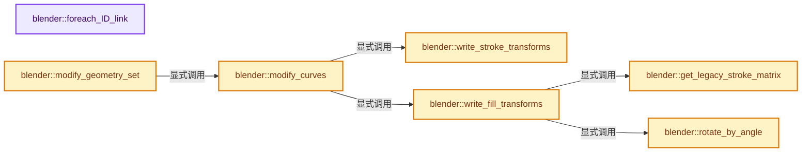
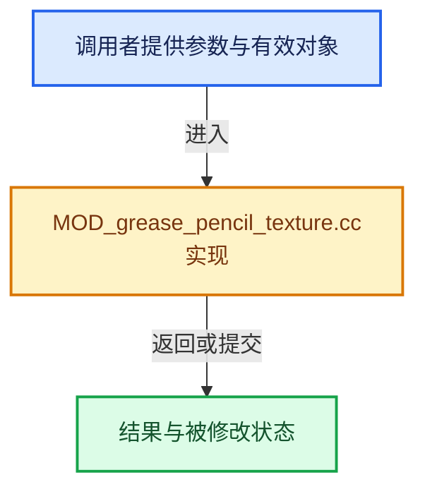

# 实现依赖专题：source/blender/modifiers/intern/MOD_grease_pencil_texture.cc

[方向导航](README.md) · [符号索引](../%E7%AC%A6%E5%8F%B7%E4%BE%9D%E8%B5%96%E4%B8%8E%E5%AE%9E%E7%8E%B0%E7%B4%A2%E5%BC%95.md)

本专题从正文实际调用进入，集中保存共享实现。函数有稳定锚点，可从调用处直接跳到对应完整函数；递归与互相调用通过回链组织。

## 本文件的实现关系






## 完整成员与函数实现

<a id="f-12cb91d85cd45a19"></a>

### `blender::foreach_ID_link`

实现位置：[source/blender/modifiers/intern/MOD_grease_pencil_texture.cc](../../../../../source/blender/modifiers/intern/MOD_grease_pencil_texture.cc) · L68—L72。

接口参数：

- `ModifierData *md`
- `Object *ob`
- `IDWalkFunc walk`
- `void *user_data`

**教学注释版**

<!-- annotated:bedbb3da3ca97c -->

```cpp
static void foreach_ID_link(ModifierData *md, Object *ob, IDWalkFunc walk, void *user_data)
{
  auto *tmd = reinterpret_cast<GreasePencilTextureModifierData *>(md);
  modifier::greasepencil::foreach_influence_ID_link(&tmd->influence, ob, walk, user_data);
}
```

<details>
<summary>核对原始源码：source/blender/modifiers/intern/MOD_grease_pencil_texture.cc · L68—L72</summary>

<!-- original:bedbb3da3ca97c:source/blender/modifiers/intern/MOD_grease_pencil_texture.cc:68:72 -->

```cpp
static void foreach_ID_link(ModifierData *md, Object *ob, IDWalkFunc walk, void *user_data)
{
  auto *tmd = reinterpret_cast<GreasePencilTextureModifierData *>(md);
  modifier::greasepencil::foreach_influence_ID_link(&tmd->influence, ob, walk, user_data);
}
```

</details>

**继续追踪实现**

- `modifier::greasepencil::foreach_influence_ID_link` → [blender::modifier::greasepencil::foreach_influence_ID_link · L69](%E4%BE%9D%E8%B5%96-MOD_grease_pencil_util-d0b437.md#f-247ba56fa4c4e56f)。

<a id="f-6337f5dc8e879fe0"></a>

### `blender::write_stroke_transforms`

实现位置：[source/blender/modifiers/intern/MOD_grease_pencil_texture.cc](../../../../../source/blender/modifiers/intern/MOD_grease_pencil_texture.cc) · L74—L116。

接口参数：

- `bke::greasepencil::Drawing &drawing`
- `const IndexMask &curves_mask`
- `const float offset`
- `const float rotation`
- `const float scale`
- `const bool normalize_u`

**教学注释版**

<!-- annotated:eb61610375ad48 -->

```cpp
static void write_stroke_transforms(bke::greasepencil::Drawing &drawing,
                                    const IndexMask &curves_mask,
                                    const float offset,
                                    const float rotation,
                                    const float scale,
                                    const bool normalize_u)
{
  bke::CurvesGeometry &curves = drawing.strokes_for_write();
  const OffsetIndices<int> points_by_curve = curves.points_by_curve();
  const VArray<bool> cyclic = curves.cyclic();

  bke::MutableAttributeAccessor attributes = curves.attributes_for_write();
  bke::SpanAttributeWriter<float> u_translations = attributes.lookup_or_add_for_write_span<float>(
      "u_translation", bke::AttrDomain::Curve);
  bke::SpanAttributeWriter<float> rotations = attributes.lookup_or_add_for_write_span<float>(
      "rotation", bke::AttrDomain::Point);
  bke::SpanAttributeWriter<float> u_scales = attributes.lookup_or_add_for_write_span<float>(
      "u_scale", bke::AttrDomain::Curve, bke::AttributeInitValue(1.0f));
  if (!u_translations || !rotations || !u_scales) {
    return;
  }

  curves.ensure_evaluated_lengths();

  curves_mask.foreach_index(
      [&](int64_t curve_i) {
        const IndexRange points = points_by_curve[curve_i];
        const bool is_cyclic = cyclic[curve_i];
        const Span<float> lengths = curves.evaluated_lengths_for_curve(curve_i, is_cyclic);
        // [讲解] lengths.last：按视图边界访问元素。
        const float norm = normalize_u ? math::safe_rcp(lengths.last()) : 1.0f;

        u_translations.span[curve_i] += offset;
        u_scales.span[curve_i] *= scale * norm;
        for (const int point_i : points) {
          rotations.span[point_i] += rotation;
        }
      },
      exec_mode::grain_size(512));

  u_translations.finish();
  u_scales.finish();
  rotations.finish();
}
```

<details>
<summary>核对原始源码：source/blender/modifiers/intern/MOD_grease_pencil_texture.cc · L74—L116</summary>

<!-- original:eb61610375ad48:source/blender/modifiers/intern/MOD_grease_pencil_texture.cc:74:116 -->

```cpp
static void write_stroke_transforms(bke::greasepencil::Drawing &drawing,
                                    const IndexMask &curves_mask,
                                    const float offset,
                                    const float rotation,
                                    const float scale,
                                    const bool normalize_u)
{
  bke::CurvesGeometry &curves = drawing.strokes_for_write();
  const OffsetIndices<int> points_by_curve = curves.points_by_curve();
  const VArray<bool> cyclic = curves.cyclic();

  bke::MutableAttributeAccessor attributes = curves.attributes_for_write();
  bke::SpanAttributeWriter<float> u_translations = attributes.lookup_or_add_for_write_span<float>(
      "u_translation", bke::AttrDomain::Curve);
  bke::SpanAttributeWriter<float> rotations = attributes.lookup_or_add_for_write_span<float>(
      "rotation", bke::AttrDomain::Point);
  bke::SpanAttributeWriter<float> u_scales = attributes.lookup_or_add_for_write_span<float>(
      "u_scale", bke::AttrDomain::Curve, bke::AttributeInitValue(1.0f));
  if (!u_translations || !rotations || !u_scales) {
    return;
  }

  curves.ensure_evaluated_lengths();

  curves_mask.foreach_index(
      [&](int64_t curve_i) {
        const IndexRange points = points_by_curve[curve_i];
        const bool is_cyclic = cyclic[curve_i];
        const Span<float> lengths = curves.evaluated_lengths_for_curve(curve_i, is_cyclic);
        const float norm = normalize_u ? math::safe_rcp(lengths.last()) : 1.0f;

        u_translations.span[curve_i] += offset;
        u_scales.span[curve_i] *= scale * norm;
        for (const int point_i : points) {
          rotations.span[point_i] += rotation;
        }
      },
      exec_mode::grain_size(512));

  u_translations.finish();
  u_scales.finish();
  rotations.finish();
}
```

</details>

**沿实际写入检查状态**

- `u_translations.span[curve_i] += offset;`
- `u_scales.span[curve_i] *= scale * norm;`
- `rotations.span[point_i] += rotation;`

**继续追踪实现**

- `drawing.strokes_for_write` → [blender::bke::greasepencil::Drawing::strokes_for_write · L1012](%E4%BE%9D%E8%B5%96-grease_pencil-f750d6.md#f-0649333785d0aa95)。
- `curves.points_by_curve` → [blender::bke::CurvesGeometry::points_by_curve · L1058](04-CurvesGeometry%E5%AD%98%E5%82%A8.md#f-a0416697e10ec205)。
- `curves.cyclic` → [blender::bke::CurvesGeometry::cyclic · L362](%E4%BE%9D%E8%B5%96-curves_geometry-ad7f9f.md#f-ec08c2a1d6f3bfea)。
- `curves.attributes_for_write` → [blender::bke::CurvesGeometry::attributes_for_write · L1913](%E4%BE%9D%E8%B5%96-curves_geometry-ad7f9f.md#f-4930091b34fa9663)。
- `attributes.lookup_or_add_for_write_span<float>` → [blender::bke::MutableAttributeAccessor::lookup_or_add_for_write_span · L533](%E4%BE%9D%E8%B5%96-attribute_access-bceef3.md#f-c533eff1b9a4973e)；[blender::bke::MutableAttributeAccessor::lookup_or_add_for_write_span · L861](08-AttributeAccessor%E6%8E%A5%E5%8F%A3.md#f-aa4c0d5a61437381)。同名重载需按实参类型选择。
- `bke::AttributeInitValue` → [blender::bke::AttributeInitValue::AttributeInitValue · L100](08-AttributeAccessor%E6%8E%A5%E5%8F%A3.md#f-cd502d5742ad6d0f)；[blender::bke::AttributeInitValue::AttributeInitValue · L104](08-AttributeAccessor%E6%8E%A5%E5%8F%A3.md#f-54b1dad08bff7914)。同名重载需按实参类型选择。
- `curves.ensure_evaluated_lengths` → [blender::bke::CurvesGeometry::ensure_evaluated_lengths · L1183](%E4%BE%9D%E8%B5%96-curves_geometry-ad7f9f.md#f-2e6e98abd3c59b14)。
- `curves_mask.foreach_index` → [blender::index_mask::IndexMask::foreach_index · L855](../04-%E8%99%9A%E6%8B%9F%E6%95%B0%E7%BB%84%E4%B8%8E%E7%B4%A2%E5%BC%95%E9%80%89%E6%8B%A9/09-%E5%88%86%E6%AE%B5%E5%AD%98%E5%82%A8%E4%B8%8E%E9%81%8D%E5%8E%86.md#f-cd6cd317e2e2812c)。
- `curves.evaluated_lengths_for_curve` → [blender::bke::CurvesGeometry::evaluated_lengths_for_curve · L1088](04-CurvesGeometry%E5%AD%98%E5%82%A8.md#f-d88b56fe4968987d)。
- `math::safe_rcp` → [blender::math::safe_rcp · L412](../12-%E7%A9%BA%E9%97%B4%E6%95%B0%E6%8D%AE%E7%BB%93%E6%9E%84%E4%B8%8E%E5%87%A0%E4%BD%95%E7%AE%97%E6%B3%95/%E4%BE%9D%E8%B5%96-BLI_math_vector-906a87.md#f-2ab396fe1193778b)；[blender::math::safe_rcp · L168](../12-%E7%A9%BA%E9%97%B4%E6%95%B0%E6%8D%AE%E7%BB%93%E6%9E%84%E4%B8%8E%E5%87%A0%E4%BD%95%E7%AE%97%E6%B3%95/%E4%BE%9D%E8%B5%96-BLI_math_base-0728eb.md#f-f06a817fcc49e8a6)。同名重载需按实参类型选择。
- `lengths.last` → [blender::Span::last · L329](../01-%E5%9F%BA%E7%A1%80%E5%AE%B9%E5%99%A8%E4%B8%8E%E7%8E%B0%E4%BB%A3CPP/05-Span%E5%8F%AA%E8%AF%BB%E8%BF%9E%E7%BB%AD%E8%A7%86%E5%9B%BE.md#f-a92146c285596891)。
- `exec_mode::grain_size` → [blender::exec_mode::grain_size · L79](../01-%E5%9F%BA%E7%A1%80%E5%AE%B9%E5%99%A8%E4%B8%8E%E7%8E%B0%E4%BB%A3CPP/%E4%BE%9D%E8%B5%96-BLI_execution_mode-1528fb.md#f-0b4fc2f9fa6e66e7)。
- `u_translations.finish` → [blender::bke::SpanAttributeWriter::finish · L279](08-AttributeAccessor%E6%8E%A5%E5%8F%A3.md#f-585970a3b1bd4da4)。
- `u_scales.finish` → [blender::bke::SpanAttributeWriter::finish · L279](08-AttributeAccessor%E6%8E%A5%E5%8F%A3.md#f-585970a3b1bd4da4)。
- `rotations.finish` → [blender::bke::SpanAttributeWriter::finish · L279](08-AttributeAccessor%E6%8E%A5%E5%8F%A3.md#f-585970a3b1bd4da4)。

<a id="f-bbdcf58783d304b2"></a>

### `blender::rotate_by_angle`

实现位置：[source/blender/modifiers/intern/MOD_grease_pencil_texture.cc](../../../../../source/blender/modifiers/intern/MOD_grease_pencil_texture.cc) · L118—L123。

接口参数：

- `const float2 &p`
- `const float angle`

**教学注释版**

<!-- annotated:07b222ff5f02f0 -->

```cpp
static float2 rotate_by_angle(const float2 &p, const float angle)
{
  const float cos_angle = math::cos(angle);
  const float sin_angle = math::sin(angle);
  return float2(p.x * cos_angle - p.y * sin_angle, p.x * sin_angle + p.y * cos_angle);
}
```

<details>
<summary>核对原始源码：source/blender/modifiers/intern/MOD_grease_pencil_texture.cc · L118—L123</summary>

<!-- original:07b222ff5f02f0:source/blender/modifiers/intern/MOD_grease_pencil_texture.cc:118:123 -->

```cpp
static float2 rotate_by_angle(const float2 &p, const float angle)
{
  const float cos_angle = math::cos(angle);
  const float sin_angle = math::sin(angle);
  return float2(p.x * cos_angle - p.y * sin_angle, p.x * sin_angle + p.y * cos_angle);
}
```

</details>

**结果出口**

- `return float2(p.x * cos_angle - p.y * sin_angle, p.x * sin_angle + p.y * cos_angle);`

**继续追踪实现**

- `math::cos` → [外部契约](https://eel.is/c++draft/)：这个边界按实际表达式及所属类型核对参数、返回值、寿命与失败行为。这里提供接口入口，不声称已解释该第三方版本的内部实现。
- `math::sin` → [外部契约](https://eel.is/c++draft/)：这个边界按实际表达式及所属类型核对参数、返回值、寿命与失败行为。这里提供接口入口，不声称已解释该第三方版本的内部实现。
- `float2` → [float2::float2 · L45](%E4%BE%9D%E8%B5%96-sky_math-8091a6.md#f-04c2783f21f996aa)；[float2::float2 · L47](%E4%BE%9D%E8%B5%96-sky_math-8091a6.md#f-dba79c4c10e5ea46)；[float2::float2 · L49](%E4%BE%9D%E8%B5%96-sky_math-8091a6.md#f-920ca90efa37bf0b)；[float2::float2 · L51](%E4%BE%9D%E8%B5%96-sky_math-8091a6.md#f-4b3fbf848d719a63)；[float2::float2 · L53](%E4%BE%9D%E8%B5%96-sky_math-8091a6.md#f-9b2acd8475cc2843)；[float2::float2 · L55](%E4%BE%9D%E8%B5%96-sky_math-8091a6.md#f-1e9233a9a231be51)。同名重载需按实参类型选择。

<a id="f-c20a89890565e311"></a>

### `blender::get_legacy_stroke_matrix`

实现位置：[source/blender/modifiers/intern/MOD_grease_pencil_texture.cc](../../../../../source/blender/modifiers/intern/MOD_grease_pencil_texture.cc) · L128—L160。

接口参数：

- `const Span<float3> positions`
- `float3x4 &stroke_to_layer`
- `float4x3 &layer_to_stroke`

**教学注释版**

<!-- annotated:cfc6c74e21fa67 -->

```cpp
static void get_legacy_stroke_matrix(const Span<float3> positions,
                                     float3x4 &stroke_to_layer,
                                     float4x3 &layer_to_stroke)
{
  using namespace blender::math;

  // [讲解] positions.size：查询视图长度或生成对应有效索引区间。
  if (positions.size() < 2) {
    stroke_to_layer = float3x4::identity();
    layer_to_stroke = float4x3::identity();
  }

  const float3 &pt0 = positions[0];
  const float3 &pt1 = positions[1];
  const float3 &pt3 = positions[int(positions.size() * 0.75f)];

  /* Local X axis (p0 -> p1) */
  const float3 local_x = normalize(pt1 - pt0);

  /* Point vector at 3/4 */
  const float3 local_3 = (positions.size() == 2) ? (pt3 * 0.001f) - pt0 : pt3 - pt0;

  /* Vector orthogonal to polygon plane. */
  const float3 normal = cross(local_x, local_3);

  /* Local Y axis (cross to normal/x axis). */
  const float3 local_y = normalize(cross(normal, local_x));

  /* Get layer space using first point as origin. */
  stroke_to_layer = float3x4(float4(local_x, 0), float4(local_y, 0), float4(pt0, 1));
  layer_to_stroke = math::transpose(float3x4(float4(local_x, -dot(pt0, local_x)),
                                             float4(local_y, -dot(pt0, local_y)),
                                             float4(0, 0, 0, 1)));
}
```

<details>
<summary>核对原始源码：source/blender/modifiers/intern/MOD_grease_pencil_texture.cc · L128—L160</summary>

<!-- original:cfc6c74e21fa67:source/blender/modifiers/intern/MOD_grease_pencil_texture.cc:128:160 -->

```cpp
static void get_legacy_stroke_matrix(const Span<float3> positions,
                                     float3x4 &stroke_to_layer,
                                     float4x3 &layer_to_stroke)
{
  using namespace blender::math;

  if (positions.size() < 2) {
    stroke_to_layer = float3x4::identity();
    layer_to_stroke = float4x3::identity();
  }

  const float3 &pt0 = positions[0];
  const float3 &pt1 = positions[1];
  const float3 &pt3 = positions[int(positions.size() * 0.75f)];

  /* Local X axis (p0 -> p1) */
  const float3 local_x = normalize(pt1 - pt0);

  /* Point vector at 3/4 */
  const float3 local_3 = (positions.size() == 2) ? (pt3 * 0.001f) - pt0 : pt3 - pt0;

  /* Vector orthogonal to polygon plane. */
  const float3 normal = cross(local_x, local_3);

  /* Local Y axis (cross to normal/x axis). */
  const float3 local_y = normalize(cross(normal, local_x));

  /* Get layer space using first point as origin. */
  stroke_to_layer = float3x4(float4(local_x, 0), float4(local_y, 0), float4(pt0, 1));
  layer_to_stroke = math::transpose(float3x4(float4(local_x, -dot(pt0, local_x)),
                                             float4(local_y, -dot(pt0, local_y)),
                                             float4(0, 0, 0, 1)));
}
```

</details>

**沿实际写入检查状态**

- `stroke_to_layer = float3x4::identity();`
- `layer_to_stroke = float4x3::identity();`
- `stroke_to_layer = float3x4(float4(local_x, 0), float4(local_y, 0), float4(pt0, 1));`
- `layer_to_stroke = math::transpose(float3x4(float4(local_x, -dot(pt0, local_x)),`

**继续追踪实现**

- `positions.size` → [blender::Span::size · L256](../01-%E5%9F%BA%E7%A1%80%E5%AE%B9%E5%99%A8%E4%B8%8E%E7%8E%B0%E4%BB%A3CPP/05-Span%E5%8F%AA%E8%AF%BB%E8%BF%9E%E7%BB%AD%E8%A7%86%E5%9B%BE.md#f-5f80fa006089c998)。
- `float3x4::identity` → [调用协议](../%E6%A8%A1%E6%9D%BF%E5%AE%8F%E4%B8%8E%E5%8A%A8%E6%80%81%E5%88%86%E6%B4%BE%E5%8D%8F%E8%AE%AE.md)：函数指针、局部可调用对象或未展开的宏；必须结合调用者环境。调用位置L135。
- `float4x3::identity` → [调用协议](../%E6%A8%A1%E6%9D%BF%E5%AE%8F%E4%B8%8E%E5%8A%A8%E6%80%81%E5%88%86%E6%B4%BE%E5%8D%8F%E8%AE%AE.md)：函数指针、局部可调用对象或未展开的宏；必须结合调用者环境。调用位置L136。
- `normalize` → [调用协议](../%E6%A8%A1%E6%9D%BF%E5%AE%8F%E4%B8%8E%E5%8A%A8%E6%80%81%E5%88%86%E6%B4%BE%E5%8D%8F%E8%AE%AE.md)：函数指针、局部可调用对象或未展开的宏；必须结合调用者环境。调用位置L144。
- `cross` → [调用协议](../%E6%A8%A1%E6%9D%BF%E5%AE%8F%E4%B8%8E%E5%8A%A8%E6%80%81%E5%88%86%E6%B4%BE%E5%8D%8F%E8%AE%AE.md)：函数指针、局部可调用对象或未展开的宏；必须结合调用者环境。调用位置L150。
- `float3x4` → [调用协议](../%E6%A8%A1%E6%9D%BF%E5%AE%8F%E4%B8%8E%E5%8A%A8%E6%80%81%E5%88%86%E6%B4%BE%E5%8D%8F%E8%AE%AE.md)：函数指针、局部可调用对象或未展开的宏；必须结合调用者环境。调用位置L156。
- `float4` → [float4 · L56](%E4%BE%9D%E8%B5%96-radial_tiling_shared-98abf9.md#m-f0908e385c5b)；[float4 · L60](../01-%E5%9F%BA%E7%A1%80%E5%AE%B9%E5%99%A8%E4%B8%8E%E7%8E%B0%E4%BB%A3CPP/%E4%BE%9D%E8%B5%96-radial_tiling_shared-7989a4.md#m-7962dcdc288b)；[float4 · L56](%E4%BE%9D%E8%B5%96-node_radial_tiling_shared-b14bc2.md#m-adb8e9e87775)；[float4 · L642](%E4%BE%9D%E8%B5%96-smaa-b67bc2.md#m-9362daaa821c)。宏定义由构建条件选择。
- `math::transpose` → [blender::math::transpose · L656](../12-%E7%A9%BA%E9%97%B4%E6%95%B0%E6%8D%AE%E7%BB%93%E6%9E%84%E4%B8%8E%E5%87%A0%E4%BD%95%E7%AE%97%E6%B3%95/%E4%BE%9D%E8%B5%96-BLI_math_matrix-b7b2b4.md#f-3e15c82dc61a01f4)。
- `dot` → [调用协议](../%E6%A8%A1%E6%9D%BF%E5%AE%8F%E4%B8%8E%E5%8A%A8%E6%80%81%E5%88%86%E6%B4%BE%E5%8D%8F%E8%AE%AE.md)：函数指针、局部可调用对象或未展开的宏；必须结合调用者环境。调用位置L157。

<a id="f-09825415a1dfdd42"></a>

### `blender::write_fill_transforms`

实现位置：[source/blender/modifiers/intern/MOD_grease_pencil_texture.cc](../../../../../source/blender/modifiers/intern/MOD_grease_pencil_texture.cc) · L162—L247。

接口参数：

- `bke::greasepencil::Drawing &drawing`
- `const IndexMask &curves_mask`
- `const float2 &offset`
- `const float rotation`
- `const float scale`

**教学注释版**

<!-- annotated:89306f4ac08d6a -->

```cpp
static void write_fill_transforms(bke::greasepencil::Drawing &drawing,
                                  const IndexMask &curves_mask,
                                  const float2 &offset,
                                  const float rotation,
                                  const float scale)
{
  /* Texture matrices are a combination of an unknown 3D transform into UV space, with a known 2D
   * transform on top.
   *
   * However, the modifier offset is not applied directly to the UV transform, since it emulates
   * legacy behavior of the GPv2 modifier, which applied translation first, before rotating about
   * (0.5, 0.5) and scaling. To achieve the same result as the legacy modifier, the actual offset
   * is calculated such that the result matches the GPv2 behavior.
   *
   * The canonical transform is
   *   uv = T + R / S * xy
   *
   * In terms of legacy variables TL, RL, SL the same transform is described as
   *   uv = (RL * (xy / 2 + TL) + 1/2) / SL
   *
   * where the 1/2 scaling factor and offset are the "bounds" transform and rotation center.
   *
   * Rearranging into canonical loc/rot/scale terms:
   *   uv = (RL * TL + 1/2) / SL + 1/2 * RL / SL * xy
   * <=>
   *    T = (RL * TL + 1/2) / SL
   *    R = RL
   *    S = 2*SL
   * <=>
   *    TL = 1/2 * R^T * (T * S - 1)
   *    RL = R
   *    SL = S/2
   */

  bke::CurvesGeometry &curves = drawing.strokes_for_write();
  const Span<float3> positions = curves.positions();
  Array<float4x2> texture_matrices(drawing.texture_matrices());

  curves_mask.foreach_index(
      [&](int64_t curve_i) {
        const IndexRange points = curves.points_by_curve()[curve_i];
        float4x2 &texture_matrix = texture_matrices[curve_i];
        /* Factor out the stroke-to-layer transform part used by GPv2.
         * This may not be the same as the transform used by GPv3 for concave shapes due to a
         * simplistic normal calculation, but we want to achieve the same effect as GPv2 so have to
         * use the same matrix. */
        float3x4 stroke_to_layer;
        float4x3 layer_to_stroke;
        // [讲解] positions.slice：建立原连续范围的子视图。
        get_legacy_stroke_matrix(positions.slice(points), stroke_to_layer, layer_to_stroke);
        const float3x2 uv_matrix = texture_matrix * stroke_to_layer;
        const float2 uv_translation = uv_matrix[2];
        float2 inv_uv_scale;
        const float2 axis_u = math::normalize_and_get_length(uv_matrix[0], inv_uv_scale[0]);
        const float2 axis_v = math::normalize_and_get_length(uv_matrix[1], inv_uv_scale[1]);
        UNUSED_VARS(axis_v); /* `inv_uv_scale[1]` is used. */
        const float uv_rotation = math::atan2(axis_u[1], axis_u[0]);
        const float2 uv_scale = math::safe_rcp(inv_uv_scale);

        const float2 legacy_uv_translation = rotate_by_angle(
            0.5f * uv_scale * uv_translation - 0.5f, -uv_rotation);
        const float legacy_uv_rotation = uv_rotation;
        const float2 legacy_uv_scale = 0.5f * uv_scale;

        const float2 legacy_uv_translation_new = legacy_uv_translation + offset;
        const float legacy_uv_rotation_new = legacy_uv_rotation + rotation;
        const float2 legacy_uv_scale_new = legacy_uv_scale * scale;

        const float2 uv_translation_new =
            (rotate_by_angle(legacy_uv_translation_new, legacy_uv_rotation_new) + 0.5f) *
            math::safe_rcp(legacy_uv_scale_new);
        const float uv_rotation_new = legacy_uv_rotation_new;
        const float2 uv_scale_new = 2.0f * legacy_uv_scale_new;

        const float cos_uv_rotation_new = math::cos(uv_rotation_new);
        const float sin_uv_rotation_new = math::sin(uv_rotation_new);
        const float2 inv_uv_scale_new = math::safe_rcp(uv_scale_new);
        const float3x2 uv_matrix_new = float3x2(
            inv_uv_scale_new[0] * float2(cos_uv_rotation_new, sin_uv_rotation_new),
            inv_uv_scale_new[1] * float2(-sin_uv_rotation_new, cos_uv_rotation_new),
            uv_translation_new);
        texture_matrix = uv_matrix_new * layer_to_stroke;
      },
      exec_mode::grain_size(512));

  drawing.set_texture_matrices(texture_matrices, curves_mask);
}
```

<details>
<summary>核对原始源码：source/blender/modifiers/intern/MOD_grease_pencil_texture.cc · L162—L247</summary>

<!-- original:89306f4ac08d6a:source/blender/modifiers/intern/MOD_grease_pencil_texture.cc:162:247 -->

```cpp
static void write_fill_transforms(bke::greasepencil::Drawing &drawing,
                                  const IndexMask &curves_mask,
                                  const float2 &offset,
                                  const float rotation,
                                  const float scale)
{
  /* Texture matrices are a combination of an unknown 3D transform into UV space, with a known 2D
   * transform on top.
   *
   * However, the modifier offset is not applied directly to the UV transform, since it emulates
   * legacy behavior of the GPv2 modifier, which applied translation first, before rotating about
   * (0.5, 0.5) and scaling. To achieve the same result as the legacy modifier, the actual offset
   * is calculated such that the result matches the GPv2 behavior.
   *
   * The canonical transform is
   *   uv = T + R / S * xy
   *
   * In terms of legacy variables TL, RL, SL the same transform is described as
   *   uv = (RL * (xy / 2 + TL) + 1/2) / SL
   *
   * where the 1/2 scaling factor and offset are the "bounds" transform and rotation center.
   *
   * Rearranging into canonical loc/rot/scale terms:
   *   uv = (RL * TL + 1/2) / SL + 1/2 * RL / SL * xy
   * <=>
   *    T = (RL * TL + 1/2) / SL
   *    R = RL
   *    S = 2*SL
   * <=>
   *    TL = 1/2 * R^T * (T * S - 1)
   *    RL = R
   *    SL = S/2
   */

  bke::CurvesGeometry &curves = drawing.strokes_for_write();
  const Span<float3> positions = curves.positions();
  Array<float4x2> texture_matrices(drawing.texture_matrices());

  curves_mask.foreach_index(
      [&](int64_t curve_i) {
        const IndexRange points = curves.points_by_curve()[curve_i];
        float4x2 &texture_matrix = texture_matrices[curve_i];
        /* Factor out the stroke-to-layer transform part used by GPv2.
         * This may not be the same as the transform used by GPv3 for concave shapes due to a
         * simplistic normal calculation, but we want to achieve the same effect as GPv2 so have to
         * use the same matrix. */
        float3x4 stroke_to_layer;
        float4x3 layer_to_stroke;
        get_legacy_stroke_matrix(positions.slice(points), stroke_to_layer, layer_to_stroke);
        const float3x2 uv_matrix = texture_matrix * stroke_to_layer;
        const float2 uv_translation = uv_matrix[2];
        float2 inv_uv_scale;
        const float2 axis_u = math::normalize_and_get_length(uv_matrix[0], inv_uv_scale[0]);
        const float2 axis_v = math::normalize_and_get_length(uv_matrix[1], inv_uv_scale[1]);
        UNUSED_VARS(axis_v); /* `inv_uv_scale[1]` is used. */
        const float uv_rotation = math::atan2(axis_u[1], axis_u[0]);
        const float2 uv_scale = math::safe_rcp(inv_uv_scale);

        const float2 legacy_uv_translation = rotate_by_angle(
            0.5f * uv_scale * uv_translation - 0.5f, -uv_rotation);
        const float legacy_uv_rotation = uv_rotation;
        const float2 legacy_uv_scale = 0.5f * uv_scale;

        const float2 legacy_uv_translation_new = legacy_uv_translation + offset;
        const float legacy_uv_rotation_new = legacy_uv_rotation + rotation;
        const float2 legacy_uv_scale_new = legacy_uv_scale * scale;

        const float2 uv_translation_new =
            (rotate_by_angle(legacy_uv_translation_new, legacy_uv_rotation_new) + 0.5f) *
            math::safe_rcp(legacy_uv_scale_new);
        const float uv_rotation_new = legacy_uv_rotation_new;
        const float2 uv_scale_new = 2.0f * legacy_uv_scale_new;

        const float cos_uv_rotation_new = math::cos(uv_rotation_new);
        const float sin_uv_rotation_new = math::sin(uv_rotation_new);
        const float2 inv_uv_scale_new = math::safe_rcp(uv_scale_new);
        const float3x2 uv_matrix_new = float3x2(
            inv_uv_scale_new[0] * float2(cos_uv_rotation_new, sin_uv_rotation_new),
            inv_uv_scale_new[1] * float2(-sin_uv_rotation_new, cos_uv_rotation_new),
            uv_translation_new);
        texture_matrix = uv_matrix_new * layer_to_stroke;
      },
      exec_mode::grain_size(512));

  drawing.set_texture_matrices(texture_matrices, curves_mask);
}
```

</details>

**沿实际写入检查状态**

- `texture_matrix = uv_matrix_new * layer_to_stroke;`

**继续追踪实现**

- `drawing.strokes_for_write` → [blender::bke::greasepencil::Drawing::strokes_for_write · L1012](%E4%BE%9D%E8%B5%96-grease_pencil-f750d6.md#f-0649333785d0aa95)。
- `curves.positions` → [blender::bke::CurvesGeometry::positions · L323](%E4%BE%9D%E8%B5%96-curves_geometry-ad7f9f.md#f-42ba586557e8ff18)。
- `drawing.texture_matrices` → [blender::bke::greasepencil::Drawing::texture_matrices · L892](%E4%BE%9D%E8%B5%96-grease_pencil-f750d6.md#f-3454e3cb8fa4ecf6)。
- `curves_mask.foreach_index` → [blender::index_mask::IndexMask::foreach_index · L855](../04-%E8%99%9A%E6%8B%9F%E6%95%B0%E7%BB%84%E4%B8%8E%E7%B4%A2%E5%BC%95%E9%80%89%E6%8B%A9/09-%E5%88%86%E6%AE%B5%E5%AD%98%E5%82%A8%E4%B8%8E%E9%81%8D%E5%8E%86.md#f-cd6cd317e2e2812c)。
- `curves.points_by_curve` → [blender::bke::CurvesGeometry::points_by_curve · L1058](04-CurvesGeometry%E5%AD%98%E5%82%A8.md#f-a0416697e10ec205)。
- `get_legacy_stroke_matrix` → [blender::get_legacy_stroke_matrix · L128](%E4%BE%9D%E8%B5%96-MOD_grease_pencil_texture-53cfff.md#f-c20a89890565e311)。
- `positions.slice` → [blender::Span::slice · L141](../01-%E5%9F%BA%E7%A1%80%E5%AE%B9%E5%99%A8%E4%B8%8E%E7%8E%B0%E4%BB%A3CPP/05-Span%E5%8F%AA%E8%AF%BB%E8%BF%9E%E7%BB%AD%E8%A7%86%E5%9B%BE.md#f-380a0e8fdcbd53cc)；[blender::Span::slice · L149](../01-%E5%9F%BA%E7%A1%80%E5%AE%B9%E5%99%A8%E4%B8%8E%E7%8E%B0%E4%BB%A3CPP/05-Span%E5%8F%AA%E8%AF%BB%E8%BF%9E%E7%BB%AD%E8%A7%86%E5%9B%BE.md#f-9b9c15e78dd54eec)。同名重载需按实参类型选择。
- `math::normalize_and_get_length` → [blender::math::normalize_and_get_length · L526](../12-%E7%A9%BA%E9%97%B4%E6%95%B0%E6%8D%AE%E7%BB%93%E6%9E%84%E4%B8%8E%E5%87%A0%E4%BD%95%E7%AE%97%E6%B3%95/%E4%BE%9D%E8%B5%96-BLI_math_vector-906a87.md#f-77d1393eb1349806)；[blender::math::normalize_and_get_length · L250](../12-%E7%A9%BA%E9%97%B4%E6%95%B0%E6%8D%AE%E7%BB%93%E6%9E%84%E4%B8%8E%E5%87%A0%E4%BD%95%E7%AE%97%E6%B3%95/%E4%BE%9D%E8%B5%96-BLI_math_quaternion-cf105d.md#f-6fcf25529d2136aa)。同名重载需按实参类型选择。
- `UNUSED_VARS` → [UNUSED_VARS · L522](../01-%E5%9F%BA%E7%A1%80%E5%AE%B9%E5%99%A8%E4%B8%8E%E7%8E%B0%E4%BB%A3CPP/%E4%BE%9D%E8%B5%96-BLI_utildefines-293a0a.md#m-013582537634)；[UNUSED_VARS · L41](%E4%BE%9D%E8%B5%96-GPU_shader_shared_utils-0adda3.md#m-05d9d7a33da0)；[UNUSED_VARS · L62](%E4%BE%9D%E8%B5%96-GPU_shader_shared_utils-0adda3.md#m-e12c683a4aca)。宏定义由构建条件选择。
- `math::atan2` → [blender::math::atan2 · L268](../12-%E7%A9%BA%E9%97%B4%E6%95%B0%E6%8D%AE%E7%BB%93%E6%9E%84%E4%B8%8E%E5%87%A0%E4%BD%95%E7%AE%97%E6%B3%95/%E4%BE%9D%E8%B5%96-BLI_math_base-0728eb.md#f-97a0b24e14551058)。
- `math::safe_rcp` → [blender::math::safe_rcp · L412](../12-%E7%A9%BA%E9%97%B4%E6%95%B0%E6%8D%AE%E7%BB%93%E6%9E%84%E4%B8%8E%E5%87%A0%E4%BD%95%E7%AE%97%E6%B3%95/%E4%BE%9D%E8%B5%96-BLI_math_vector-906a87.md#f-2ab396fe1193778b)；[blender::math::safe_rcp · L168](../12-%E7%A9%BA%E9%97%B4%E6%95%B0%E6%8D%AE%E7%BB%93%E6%9E%84%E4%B8%8E%E5%87%A0%E4%BD%95%E7%AE%97%E6%B3%95/%E4%BE%9D%E8%B5%96-BLI_math_base-0728eb.md#f-f06a817fcc49e8a6)。同名重载需按实参类型选择。
- `rotate_by_angle` → [blender::rotate_by_angle · L118](%E4%BE%9D%E8%B5%96-MOD_grease_pencil_texture-53cfff.md#f-bbdcf58783d304b2)。
- `math::cos` → [外部契约](https://eel.is/c++draft/)：这个边界按实际表达式及所属类型核对参数、返回值、寿命与失败行为。这里提供接口入口，不声称已解释该第三方版本的内部实现。
- `math::sin` → [外部契约](https://eel.is/c++draft/)：这个边界按实际表达式及所属类型核对参数、返回值、寿命与失败行为。这里提供接口入口，不声称已解释该第三方版本的内部实现。
- `float3x2` → [调用协议](../%E6%A8%A1%E6%9D%BF%E5%AE%8F%E4%B8%8E%E5%8A%A8%E6%80%81%E5%88%86%E6%B4%BE%E5%8D%8F%E8%AE%AE.md)：函数指针、局部可调用对象或未展开的宏；必须结合调用者环境。调用位置L238。
- `float2` → [float2::float2 · L45](%E4%BE%9D%E8%B5%96-sky_math-8091a6.md#f-04c2783f21f996aa)；[float2::float2 · L47](%E4%BE%9D%E8%B5%96-sky_math-8091a6.md#f-dba79c4c10e5ea46)；[float2::float2 · L49](%E4%BE%9D%E8%B5%96-sky_math-8091a6.md#f-920ca90efa37bf0b)；[float2::float2 · L51](%E4%BE%9D%E8%B5%96-sky_math-8091a6.md#f-4b3fbf848d719a63)；[float2::float2 · L53](%E4%BE%9D%E8%B5%96-sky_math-8091a6.md#f-9b2acd8475cc2843)；[float2::float2 · L55](%E4%BE%9D%E8%B5%96-sky_math-8091a6.md#f-1e9233a9a231be51)。同名重载需按实参类型选择。
- `exec_mode::grain_size` → [blender::exec_mode::grain_size · L79](../01-%E5%9F%BA%E7%A1%80%E5%AE%B9%E5%99%A8%E4%B8%8E%E7%8E%B0%E4%BB%A3CPP/%E4%BE%9D%E8%B5%96-BLI_execution_mode-1528fb.md#f-0b4fc2f9fa6e66e7)。
- `drawing.set_texture_matrices` → [blender::bke::greasepencil::Drawing::set_texture_matrices · L927](%E4%BE%9D%E8%B5%96-grease_pencil-f750d6.md#f-0706932cf1275ed3)。

<a id="f-586686ba9db759d2"></a>

### `blender::modify_curves`

实现位置：[source/blender/modifiers/intern/MOD_grease_pencil_texture.cc](../../../../../source/blender/modifiers/intern/MOD_grease_pencil_texture.cc) · L249—L274。

接口参数：

- `const GreasePencilTextureModifierData &tmd`
- `const ModifierEvalContext &ctx`
- `bke::greasepencil::Drawing &drawing`

**教学注释版**

<!-- annotated:c166567ed007fb -->

```cpp
static void modify_curves(const GreasePencilTextureModifierData &tmd,
                          const ModifierEvalContext &ctx,
                          bke::greasepencil::Drawing &drawing)
{
  IndexMaskMemory mask_memory;
  const IndexMask curves_mask = modifier::greasepencil::get_filtered_stroke_mask(
      ctx.object, drawing.strokes(), tmd.influence, mask_memory);

  const bool normalize_u = (tmd.fit_method == MOD_GREASE_PENCIL_TEXTURE_FIT_STROKE);
  switch (GreasePencilTextureModifierMode(tmd.mode)) {
    case MOD_GREASE_PENCIL_TEXTURE_STROKE:
      write_stroke_transforms(
          drawing, curves_mask, tmd.uv_offset, tmd.alignment_rotation, tmd.uv_scale, normalize_u);
      break;
    case MOD_GREASE_PENCIL_TEXTURE_FILL:
      write_fill_transforms(
          drawing, curves_mask, tmd.fill_offset, tmd.fill_rotation, tmd.fill_scale);
      break;
    case MOD_GREASE_PENCIL_TEXTURE_STROKE_AND_FILL:
      write_stroke_transforms(
          drawing, curves_mask, tmd.uv_offset, tmd.alignment_rotation, tmd.uv_scale, normalize_u);
      write_fill_transforms(
          drawing, curves_mask, tmd.fill_offset, tmd.fill_rotation, tmd.fill_scale);
      break;
  }
}
```

<details>
<summary>核对原始源码：source/blender/modifiers/intern/MOD_grease_pencil_texture.cc · L249—L274</summary>

<!-- original:c166567ed007fb:source/blender/modifiers/intern/MOD_grease_pencil_texture.cc:249:274 -->

```cpp
static void modify_curves(const GreasePencilTextureModifierData &tmd,
                          const ModifierEvalContext &ctx,
                          bke::greasepencil::Drawing &drawing)
{
  IndexMaskMemory mask_memory;
  const IndexMask curves_mask = modifier::greasepencil::get_filtered_stroke_mask(
      ctx.object, drawing.strokes(), tmd.influence, mask_memory);

  const bool normalize_u = (tmd.fit_method == MOD_GREASE_PENCIL_TEXTURE_FIT_STROKE);
  switch (GreasePencilTextureModifierMode(tmd.mode)) {
    case MOD_GREASE_PENCIL_TEXTURE_STROKE:
      write_stroke_transforms(
          drawing, curves_mask, tmd.uv_offset, tmd.alignment_rotation, tmd.uv_scale, normalize_u);
      break;
    case MOD_GREASE_PENCIL_TEXTURE_FILL:
      write_fill_transforms(
          drawing, curves_mask, tmd.fill_offset, tmd.fill_rotation, tmd.fill_scale);
      break;
    case MOD_GREASE_PENCIL_TEXTURE_STROKE_AND_FILL:
      write_stroke_transforms(
          drawing, curves_mask, tmd.uv_offset, tmd.alignment_rotation, tmd.uv_scale, normalize_u);
      write_fill_transforms(
          drawing, curves_mask, tmd.fill_offset, tmd.fill_rotation, tmd.fill_scale);
      break;
  }
}
```

</details>

**继续追踪实现**

- `modifier::greasepencil::get_filtered_stroke_mask` → [blender::modifier::greasepencil::get_filtered_stroke_mask · L285](%E4%BE%9D%E8%B5%96-MOD_grease_pencil_util-d0b437.md#f-30c219d04de7dec3)；[blender::modifier::greasepencil::get_filtered_stroke_mask · L326](%E4%BE%9D%E8%B5%96-MOD_grease_pencil_util-d0b437.md#f-970c3bc880e4f350)。同名重载需按实参类型选择。
- `drawing.strokes` → [blender::bke::greasepencil::Drawing::strokes · L1007](%E4%BE%9D%E8%B5%96-grease_pencil-f750d6.md#f-59e6522a8e8ac409)。
- `GreasePencilTextureModifierMode` → [blender::GreasePencilTextureModifierMode](%E4%BE%9D%E8%B5%96-DNA_modifier_types-56a227.md#t-3ada13e6a788)。
- `write_stroke_transforms` → [blender::write_stroke_transforms · L74](%E4%BE%9D%E8%B5%96-MOD_grease_pencil_texture-53cfff.md#f-6337f5dc8e879fe0)。
- `write_fill_transforms` → [blender::write_fill_transforms · L162](%E4%BE%9D%E8%B5%96-MOD_grease_pencil_texture-53cfff.md#f-09825415a1dfdd42)。

<a id="f-1ff4ec887af41ab7"></a>

### `blender::modify_geometry_set`

实现位置：[source/blender/modifiers/intern/MOD_grease_pencil_texture.cc](../../../../../source/blender/modifiers/intern/MOD_grease_pencil_texture.cc) · L276—L298。

接口参数：

- `ModifierData *md`
- `const ModifierEvalContext *ctx`
- `bke::GeometrySet *geometry_set`

**教学注释版**

<!-- annotated:8f0b618d47bc53 -->

```cpp
static void modify_geometry_set(ModifierData *md,
                                const ModifierEvalContext *ctx,
                                bke::GeometrySet *geometry_set)
{
  using bke::greasepencil::Drawing;
  using bke::greasepencil::Layer;

  const auto &tmd = *reinterpret_cast<const GreasePencilTextureModifierData *>(md);

  if (!geometry_set->has_grease_pencil()) {
    return;
  }
  GreasePencil &grease_pencil = *geometry_set->get_grease_pencil_for_write();

  IndexMaskMemory mask_memory;
  const IndexMask layer_mask = modifier::greasepencil::get_filtered_layer_mask(
      grease_pencil, tmd.influence, mask_memory);
  const int frame = grease_pencil.runtime->eval_frame;
  const Vector<Drawing *> drawings = modifier::greasepencil::get_drawings_for_write(
      grease_pencil, layer_mask, frame);
  threading::parallel_for_each(drawings,
                               [&](Drawing *drawing) { modify_curves(tmd, *ctx, *drawing); });
}
```

<details>
<summary>核对原始源码：source/blender/modifiers/intern/MOD_grease_pencil_texture.cc · L276—L298</summary>

<!-- original:8f0b618d47bc53:source/blender/modifiers/intern/MOD_grease_pencil_texture.cc:276:298 -->

```cpp
static void modify_geometry_set(ModifierData *md,
                                const ModifierEvalContext *ctx,
                                bke::GeometrySet *geometry_set)
{
  using bke::greasepencil::Drawing;
  using bke::greasepencil::Layer;

  const auto &tmd = *reinterpret_cast<const GreasePencilTextureModifierData *>(md);

  if (!geometry_set->has_grease_pencil()) {
    return;
  }
  GreasePencil &grease_pencil = *geometry_set->get_grease_pencil_for_write();

  IndexMaskMemory mask_memory;
  const IndexMask layer_mask = modifier::greasepencil::get_filtered_layer_mask(
      grease_pencil, tmd.influence, mask_memory);
  const int frame = grease_pencil.runtime->eval_frame;
  const Vector<Drawing *> drawings = modifier::greasepencil::get_drawings_for_write(
      grease_pencil, layer_mask, frame);
  threading::parallel_for_each(drawings,
                               [&](Drawing *drawing) { modify_curves(tmd, *ctx, *drawing); });
}
```

</details>

**继续追踪实现**

- `geometry_set->has_grease_pencil` → [blender::bke::GeometrySet::has_grease_pencil · L415](../06-%E9%9A%90%E5%BC%8F%E5%85%B1%E4%BA%AB%E4%B8%8E%E7%BC%93%E5%AD%98%E7%B3%BB%E7%BB%9F/05-GeometrySet%E8%AF%BB%E5%86%99%E4%B8%8E%E5%A4%8D%E5%88%B6.md#f-357bcb62da7a8afd)。
- `geometry_set->get_grease_pencil_for_write` → [blender::bke::GeometrySet::get_grease_pencil_for_write · L622](../06-%E9%9A%90%E5%BC%8F%E5%85%B1%E4%BA%AB%E4%B8%8E%E7%BC%93%E5%AD%98%E7%B3%BB%E7%BB%9F/05-GeometrySet%E8%AF%BB%E5%86%99%E4%B8%8E%E5%A4%8D%E5%88%B6.md#f-bfc5e891a352651b)。
- `modifier::greasepencil::get_filtered_layer_mask` → [blender::modifier::greasepencil::get_filtered_layer_mask · L213](%E4%BE%9D%E8%B5%96-MOD_grease_pencil_util-d0b437.md#f-6438bea51141f9db)；[blender::modifier::greasepencil::get_filtered_layer_mask · L268](%E4%BE%9D%E8%B5%96-MOD_grease_pencil_util-d0b437.md#f-e3d0f9748ecdf34b)。同名重载需按实参类型选择。
- `modifier::greasepencil::get_drawings_for_write` → [blender::modifier::greasepencil::get_drawings_for_write · L368](%E4%BE%9D%E8%B5%96-MOD_grease_pencil_util-d0b437.md#f-cef3871c31259376)。
- `threading::parallel_for_each` → [blender::threading::parallel_for_each · L30](../11-Depsgraph%E4%B8%8E%E5%B9%B6%E8%A1%8C%E4%BB%BB%E5%8A%A1%E7%B3%BB%E7%BB%9F/07-%E4%BB%BB%E5%8A%A1%E6%B1%A0%E4%B8%8ETBB%E6%8E%A5%E5%85%A5.md#f-d5604027445ef0f5)。
- `modify_curves` → [blender::modify_curves · L249](%E4%BE%9D%E8%B5%96-MOD_grease_pencil_texture-53cfff.md#f-586686ba9db759d2)。
