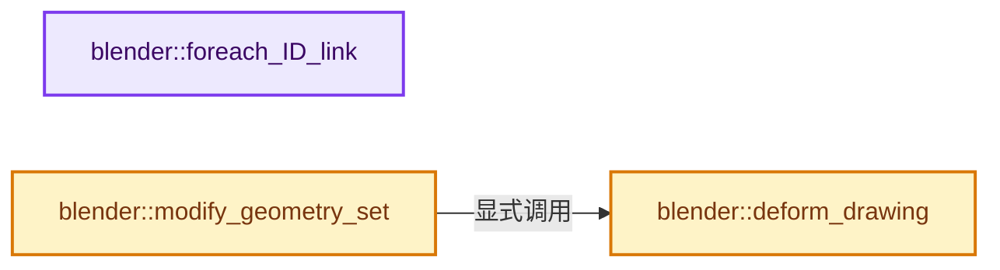
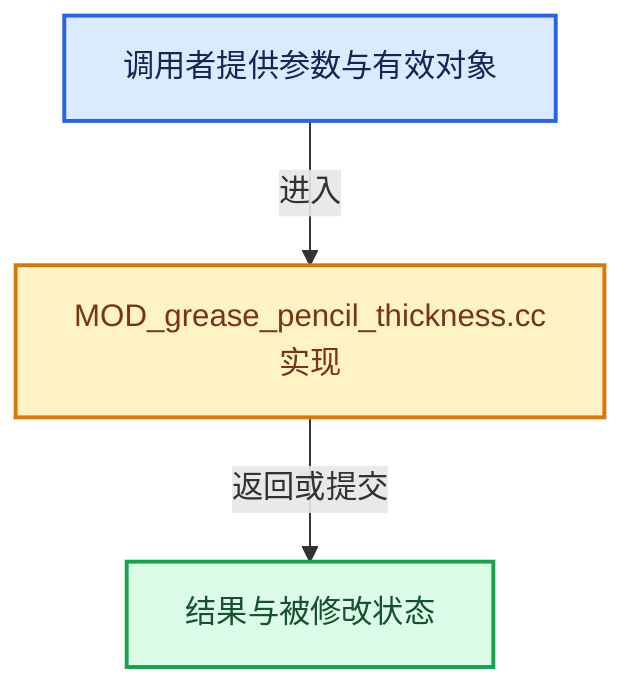

# 实现依赖专题：source/blender/modifiers/intern/MOD_grease_pencil_thickness.cc

[方向导航](README.md) · [符号索引](../%E7%AC%A6%E5%8F%B7%E4%BE%9D%E8%B5%96%E4%B8%8E%E5%AE%9E%E7%8E%B0%E7%B4%A2%E5%BC%95.md)

本专题从正文实际调用进入，集中保存共享实现。函数有稳定锚点，可从调用处直接跳到对应完整函数；递归与互相调用通过回链组织。

## 本文件的实现关系






## 完整成员与函数实现

<a id="f-6202e6a7f448cec1"></a>

### `blender::foreach_ID_link`

实现位置：[source/blender/modifiers/intern/MOD_grease_pencil_thickness.cc](../../../../../source/blender/modifiers/intern/MOD_grease_pencil_thickness.cc) · L60—L65。

接口参数：

- `ModifierData *md`
- `Object *ob`
- `IDWalkFunc walk`
- `void *user_data`

**教学注释版**

<!-- annotated:b58a4a6670a4bd -->

```cpp
static void foreach_ID_link(ModifierData *md, Object *ob, IDWalkFunc walk, void *user_data)
{
  GreasePencilThickModifierData *mmd = reinterpret_cast<GreasePencilThickModifierData *>(md);

  modifier::greasepencil::foreach_influence_ID_link(&mmd->influence, ob, walk, user_data);
}
```

<details>
<summary>核对原始源码：source/blender/modifiers/intern/MOD_grease_pencil_thickness.cc · L60—L65</summary>

<!-- original:b58a4a6670a4bd:source/blender/modifiers/intern/MOD_grease_pencil_thickness.cc:60:65 -->

```cpp
static void foreach_ID_link(ModifierData *md, Object *ob, IDWalkFunc walk, void *user_data)
{
  GreasePencilThickModifierData *mmd = reinterpret_cast<GreasePencilThickModifierData *>(md);

  modifier::greasepencil::foreach_influence_ID_link(&mmd->influence, ob, walk, user_data);
}
```

</details>

**继续追踪实现**

- `modifier::greasepencil::foreach_influence_ID_link` → [blender::modifier::greasepencil::foreach_influence_ID_link · L69](%E4%BE%9D%E8%B5%96-MOD_grease_pencil_util-d0b437.md#f-247ba56fa4c4e56f)。

<a id="f-f5b439b7659c4cf7"></a>

### `blender::deform_drawing`

实现位置：[source/blender/modifiers/intern/MOD_grease_pencil_thickness.cc](../../../../../source/blender/modifiers/intern/MOD_grease_pencil_thickness.cc) · L82—L148。

接口参数：

- `const ModifierData &md`
- `const Object &ob`
- `bke::greasepencil::Drawing &drawing`

**教学注释版**

<!-- annotated:36b042b311fc9b -->

```cpp
static void deform_drawing(const ModifierData &md,
                           const Object &ob,
                           bke::greasepencil::Drawing &drawing)
{
  const auto &mmd = reinterpret_cast<const GreasePencilThickModifierData &>(md);

  bke::CurvesGeometry &curves = drawing.strokes_for_write();
  if (curves.is_empty()) {
    return;
  }

  IndexMaskMemory memory;
  const IndexMask strokes = modifier::greasepencil::get_filtered_stroke_mask(
      &ob, curves, mmd.influence, memory);
  if (strokes.is_empty()) {
    return;
  }

  MutableSpan<float> radii = drawing.radii_for_write();
  const OffsetIndices points_by_curve = curves.points_by_curve();
  const VArray<float> vgroup_weights = modifier::greasepencil::get_influence_vertex_weights(
      curves, mmd.influence);
  const bool is_normalized = (mmd.flag & MOD_GREASE_PENCIL_THICK_NORMALIZE) != 0;
  const bool is_inverted = ((mmd.flag & MOD_GREASE_PENCIL_THICK_WEIGHT_FACTOR) == 0) &&
                           ((mmd.influence.flag & GREASE_PENCIL_INFLUENCE_INVERT_VERTEX_GROUP) !=
                            0);

  strokes.foreach_index(
      [&](const int curve) {
        const IndexRange points = points_by_curve[curve];
        for (const int i : points.index_range()) {
          const int point = points[i];
          const float weight = vgroup_weights[point];
          if (weight <= 0.0f) {
            continue;
          }

          if ((!is_normalized) && (mmd.flag & MOD_GREASE_PENCIL_THICK_WEIGHT_FACTOR)) {
            radii[point] *= (is_inverted ? 1.0f - weight : weight);
            radii[point] = math::max(radii[point], 0.0f);
            continue;
          }

          const float influence = [&]() {
            if (mmd.influence.flag & GREASE_PENCIL_INFLUENCE_USE_CUSTOM_CURVE &&
                (mmd.influence.custom_curve))
            {
              /* Normalize value to evaluate curve. */
              // [讲解] points.size：读取连续区间或分组的边界信息。
              const float value = math::safe_divide(float(i), float(points.size() - 1));
              return BKE_curvemapping_evaluateF(mmd.influence.custom_curve, 0, value);
            }
            return 1.0f;
          }();

          const float target = [&]() {
            if (is_normalized) {
              return mmd.thickness * influence;
            }
            return radii[point] * math::interpolate(1.0f, mmd.thickness_fac, influence);
          }();

          const float radius = math::interpolate(radii[point], target, weight);
          radii[point] = math::max(radius, 0.0f);
        }
      },
      exec_mode::grain_size(512));
}
```

<details>
<summary>核对原始源码：source/blender/modifiers/intern/MOD_grease_pencil_thickness.cc · L82—L148</summary>

<!-- original:36b042b311fc9b:source/blender/modifiers/intern/MOD_grease_pencil_thickness.cc:82:148 -->

```cpp
static void deform_drawing(const ModifierData &md,
                           const Object &ob,
                           bke::greasepencil::Drawing &drawing)
{
  const auto &mmd = reinterpret_cast<const GreasePencilThickModifierData &>(md);

  bke::CurvesGeometry &curves = drawing.strokes_for_write();
  if (curves.is_empty()) {
    return;
  }

  IndexMaskMemory memory;
  const IndexMask strokes = modifier::greasepencil::get_filtered_stroke_mask(
      &ob, curves, mmd.influence, memory);
  if (strokes.is_empty()) {
    return;
  }

  MutableSpan<float> radii = drawing.radii_for_write();
  const OffsetIndices points_by_curve = curves.points_by_curve();
  const VArray<float> vgroup_weights = modifier::greasepencil::get_influence_vertex_weights(
      curves, mmd.influence);
  const bool is_normalized = (mmd.flag & MOD_GREASE_PENCIL_THICK_NORMALIZE) != 0;
  const bool is_inverted = ((mmd.flag & MOD_GREASE_PENCIL_THICK_WEIGHT_FACTOR) == 0) &&
                           ((mmd.influence.flag & GREASE_PENCIL_INFLUENCE_INVERT_VERTEX_GROUP) !=
                            0);

  strokes.foreach_index(
      [&](const int curve) {
        const IndexRange points = points_by_curve[curve];
        for (const int i : points.index_range()) {
          const int point = points[i];
          const float weight = vgroup_weights[point];
          if (weight <= 0.0f) {
            continue;
          }

          if ((!is_normalized) && (mmd.flag & MOD_GREASE_PENCIL_THICK_WEIGHT_FACTOR)) {
            radii[point] *= (is_inverted ? 1.0f - weight : weight);
            radii[point] = math::max(radii[point], 0.0f);
            continue;
          }

          const float influence = [&]() {
            if (mmd.influence.flag & GREASE_PENCIL_INFLUENCE_USE_CUSTOM_CURVE &&
                (mmd.influence.custom_curve))
            {
              /* Normalize value to evaluate curve. */
              const float value = math::safe_divide(float(i), float(points.size() - 1));
              return BKE_curvemapping_evaluateF(mmd.influence.custom_curve, 0, value);
            }
            return 1.0f;
          }();

          const float target = [&]() {
            if (is_normalized) {
              return mmd.thickness * influence;
            }
            return radii[point] * math::interpolate(1.0f, mmd.thickness_fac, influence);
          }();

          const float radius = math::interpolate(radii[point], target, weight);
          radii[point] = math::max(radius, 0.0f);
        }
      },
      exec_mode::grain_size(512));
}
```

</details>

**沿实际写入检查状态**

- `radii[point] *= (is_inverted ? 1.0f - weight : weight);`
- `radii[point] = math::max(radii[point], 0.0f);`
- `radii[point] = math::max(radius, 0.0f);`

**结果出口**

- `return BKE_curvemapping_evaluateF(mmd.influence.custom_curve, 0, value);`
- `return 1.0f;`
- `return mmd.thickness * influence;`
- `return radii[point] * math::interpolate(1.0f, mmd.thickness_fac, influence);`

**继续追踪实现**

- `drawing.strokes_for_write` → [blender::bke::greasepencil::Drawing::strokes_for_write · L1012](%E4%BE%9D%E8%B5%96-grease_pencil-f750d6.md#f-0649333785d0aa95)。
- `curves.is_empty` → [blender::bke::CurvesGeometry::is_empty · L1013](04-CurvesGeometry%E5%AD%98%E5%82%A8.md#f-4c323ef62c4b64ab)。
- `modifier::greasepencil::get_filtered_stroke_mask` → [blender::modifier::greasepencil::get_filtered_stroke_mask · L285](%E4%BE%9D%E8%B5%96-MOD_grease_pencil_util-d0b437.md#f-30c219d04de7dec3)；[blender::modifier::greasepencil::get_filtered_stroke_mask · L326](%E4%BE%9D%E8%B5%96-MOD_grease_pencil_util-d0b437.md#f-970c3bc880e4f350)。同名重载需按实参类型选择。
- `strokes.is_empty` → [blender::index_mask::IndexMask::is_empty · L748](../04-%E8%99%9A%E6%8B%9F%E6%95%B0%E7%BB%84%E4%B8%8E%E7%B4%A2%E5%BC%95%E9%80%89%E6%8B%A9/09-%E5%88%86%E6%AE%B5%E5%AD%98%E5%82%A8%E4%B8%8E%E9%81%8D%E5%8E%86.md#f-190ac996386064f4)。
- `drawing.radii_for_write` → [blender::bke::greasepencil::Drawing::radii_for_write · L1023](%E4%BE%9D%E8%B5%96-grease_pencil-f750d6.md#f-53b2a01d6a3079c0)。
- `curves.points_by_curve` → [blender::bke::CurvesGeometry::points_by_curve · L1058](04-CurvesGeometry%E5%AD%98%E5%82%A8.md#f-a0416697e10ec205)。
- `modifier::greasepencil::get_influence_vertex_weights` → [blender::modifier::greasepencil::get_influence_vertex_weights · L343](%E4%BE%9D%E8%B5%96-MOD_grease_pencil_util-d0b437.md#f-6f4fdb5693985db9)。
- `strokes.foreach_index` → [blender::index_mask::IndexMask::foreach_index · L855](../04-%E8%99%9A%E6%8B%9F%E6%95%B0%E7%BB%84%E4%B8%8E%E7%B4%A2%E5%BC%95%E9%80%89%E6%8B%A9/09-%E5%88%86%E6%AE%B5%E5%AD%98%E5%82%A8%E4%B8%8E%E9%81%8D%E5%8E%86.md#f-cd6cd317e2e2812c)。
- `points.index_range` → [blender::IndexRange::index_range · L161](../01-%E5%9F%BA%E7%A1%80%E5%AE%B9%E5%99%A8%E4%B8%8E%E7%8E%B0%E4%BB%A3CPP/04-IndexRange%E8%BF%9E%E7%BB%AD%E6%95%B4%E6%95%B0%E5%8C%BA%E9%97%B4.md#f-fd83072b4b81bce5)。
- `math::max` → [blender::math::max · L87](../12-%E7%A9%BA%E9%97%B4%E6%95%B0%E6%8D%AE%E7%BB%93%E6%9E%84%E4%B8%8E%E5%87%A0%E4%BD%95%E7%AE%97%E6%B3%95/%E4%BE%9D%E8%B5%96-BLI_math_vector-906a87.md#f-9be564a293777d6b)；[blender::math::max · L96](../12-%E7%A9%BA%E9%97%B4%E6%95%B0%E6%8D%AE%E7%BB%93%E6%9E%84%E4%B8%8E%E5%87%A0%E4%BD%95%E7%AE%97%E6%B3%95/%E4%BE%9D%E8%B5%96-BLI_math_vector-906a87.md#f-ce32dff37d0af3bc)；[blender::math::max · L112](../12-%E7%A9%BA%E9%97%B4%E6%95%B0%E6%8D%AE%E7%BB%93%E6%9E%84%E4%B8%8E%E5%87%A0%E4%BD%95%E7%AE%97%E6%B3%95/%E4%BE%9D%E8%B5%96-BLI_math_vector-906a87.md#f-668eb1fcf1fa8292)；[blender::math::max · L49](../12-%E7%A9%BA%E9%97%B4%E6%95%B0%E6%8D%AE%E7%BB%93%E6%9E%84%E4%B8%8E%E5%87%A0%E4%BD%95%E7%AE%97%E6%B3%95/%E4%BE%9D%E8%B5%96-BLI_math_base-0728eb.md#f-a6991ca3d12937e1)。同名重载需按实参类型选择。
- `[&]() { if (mmd.influence.flag & GREASE_PENCIL_INFLUENCE_USE_CUSTOM_CURVE && (mmd.influence.custom_curve)) { /* Normalize value to evaluate curve. */ const float value = math::safe …（完整表达式见本函数源码）` → [blender::() · L390](../12-%E7%A9%BA%E9%97%B4%E6%95%B0%E6%8D%AE%E7%BB%93%E6%9E%84%E4%B8%8E%E5%87%A0%E4%BD%95%E7%AE%97%E6%B3%95/%E4%BE%9D%E8%B5%96-BLI_math_vector_types-5b9874.md#f-26f597afed18e002)。
- `math::safe_divide` → [blender::math::safe_divide · L341](../12-%E7%A9%BA%E9%97%B4%E6%95%B0%E6%8D%AE%E7%BB%93%E6%9E%84%E4%B8%8E%E5%87%A0%E4%BD%95%E7%AE%97%E6%B3%95/%E4%BE%9D%E8%B5%96-BLI_math_vector-906a87.md#f-ab8c82f9a578f2d4)；[blender::math::safe_divide · L351](../12-%E7%A9%BA%E9%97%B4%E6%95%B0%E6%8D%AE%E7%BB%93%E6%9E%84%E4%B8%8E%E5%87%A0%E4%BD%95%E7%AE%97%E6%B3%95/%E4%BE%9D%E8%B5%96-BLI_math_vector-906a87.md#f-0d22d4b64f9b5c0e)；[blender::math::safe_divide · L107](../12-%E7%A9%BA%E9%97%B4%E6%95%B0%E6%8D%AE%E7%BB%93%E6%9E%84%E4%B8%8E%E5%87%A0%E4%BD%95%E7%AE%97%E6%B3%95/%E4%BE%9D%E8%B5%96-BLI_math_base-0728eb.md#f-a81537b8ea4660b0)。同名重载需按实参类型选择。
- `points.size` → [blender::IndexRange::size · L156](../01-%E5%9F%BA%E7%A1%80%E5%AE%B9%E5%99%A8%E4%B8%8E%E7%8E%B0%E4%BB%A3CPP/04-IndexRange%E8%BF%9E%E7%BB%AD%E6%95%B4%E6%95%B0%E5%8C%BA%E9%97%B4.md#f-05f66c3ebb2fdfec)。
- `BKE_curvemapping_evaluateF` → [blender::BKE_curvemapping_evaluateF · L1177](%E4%BE%9D%E8%B5%96-colortools-8bc37a.md#f-014584e04eeb1392)。
- `[&]() { if (is_normalized) { return mmd.thickness * influence; } return radii[point] * math::interpolate(1.0f, mmd.thickness_fac, influence); }` → [blender::() · L390](../12-%E7%A9%BA%E9%97%B4%E6%95%B0%E6%8D%AE%E7%BB%93%E6%9E%84%E4%B8%8E%E5%87%A0%E4%BD%95%E7%AE%97%E6%B3%95/%E4%BE%9D%E8%B5%96-BLI_math_vector_types-5b9874.md#f-26f597afed18e002)。
- `math::interpolate` → [blender::math::interpolate · L335](../12-%E7%A9%BA%E9%97%B4%E6%95%B0%E6%8D%AE%E7%BB%93%E6%9E%84%E4%B8%8E%E5%87%A0%E4%BD%95%E7%AE%97%E6%B3%95/%E4%BE%9D%E8%B5%96-math_matrix-d7d8ee.md#f-91e7f517ebd72fb5)；[blender::math::interpolate · L379](../12-%E7%A9%BA%E9%97%B4%E6%95%B0%E6%8D%AE%E7%BB%93%E6%9E%84%E4%B8%8E%E5%87%A0%E4%BD%95%E7%AE%97%E6%B3%95/%E4%BE%9D%E8%B5%96-math_matrix-d7d8ee.md#f-a1be14e86ce595c2)；[blender::math::interpolate · L636](../12-%E7%A9%BA%E9%97%B4%E6%95%B0%E6%8D%AE%E7%BB%93%E6%9E%84%E4%B8%8E%E5%87%A0%E4%BD%95%E7%AE%97%E6%B3%95/%E4%BE%9D%E8%B5%96-BLI_math_vector-906a87.md#f-d612b6d6ab1b6e7c)；[blender::math::interpolate · L303](../12-%E7%A9%BA%E9%97%B4%E6%95%B0%E6%8D%AE%E7%BB%93%E6%9E%84%E4%B8%8E%E5%87%A0%E4%BD%95%E7%AE%97%E6%B3%95/%E4%BE%9D%E8%B5%96-BLI_math_quaternion-cf105d.md#f-48b9ace2a9c6185c)；[blender::math::interpolate · L17](../12-%E7%A9%BA%E9%97%B4%E6%95%B0%E6%8D%AE%E7%BB%93%E6%9E%84%E4%B8%8E%E5%87%A0%E4%BD%95%E7%AE%97%E6%B3%95/%E4%BE%9D%E8%B5%96-BLI_math_color-f3a6ea.md#f-eb5ef92b0f8c0926)；[blender::math::interpolate · L28](../12-%E7%A9%BA%E9%97%B4%E6%95%B0%E6%8D%AE%E7%BB%93%E6%9E%84%E4%B8%8E%E5%87%A0%E4%BD%95%E7%AE%97%E6%B3%95/%E4%BE%9D%E8%B5%96-BLI_math_color-f3a6ea.md#f-2a9e33ec55979ab6)；[blender::math::interpolate · L278](../12-%E7%A9%BA%E9%97%B4%E6%95%B0%E6%8D%AE%E7%BB%93%E6%9E%84%E4%B8%8E%E5%87%A0%E4%BD%95%E7%AE%97%E6%B3%95/%E4%BE%9D%E8%B5%96-BLI_math_base-0728eb.md#f-2629b871528f6528)。同名重载需按实参类型选择。
- `exec_mode::grain_size` → [blender::exec_mode::grain_size · L79](../01-%E5%9F%BA%E7%A1%80%E5%AE%B9%E5%99%A8%E4%B8%8E%E7%8E%B0%E4%BB%A3CPP/%E4%BE%9D%E8%B5%96-BLI_execution_mode-1528fb.md#f-0b4fc2f9fa6e66e7)。

<a id="f-4e7b0f538b12bed5"></a>

### `blender::modify_geometry_set`

实现位置：[source/blender/modifiers/intern/MOD_grease_pencil_thickness.cc](../../../../../source/blender/modifiers/intern/MOD_grease_pencil_thickness.cc) · L150—L171。

接口参数：

- `ModifierData *md`
- `const ModifierEvalContext *ctx`
- `bke::GeometrySet *geometry_set`

**教学注释版**

<!-- annotated:c193a040706b87 -->

```cpp
static void modify_geometry_set(ModifierData *md,
                                const ModifierEvalContext *ctx,
                                bke::GeometrySet *geometry_set)
{
  GreasePencilThickModifierData *mmd = reinterpret_cast<GreasePencilThickModifierData *>(md);

  if (!geometry_set->has_grease_pencil()) {
    return;
  }
  GreasePencil &grease_pencil = *geometry_set->get_grease_pencil_for_write();
  const int current_frame = grease_pencil.runtime->eval_frame;

  IndexMaskMemory mask_memory;
  const IndexMask layer_mask = modifier::greasepencil::get_filtered_layer_mask(
      grease_pencil, mmd->influence, mask_memory);
  const Vector<bke::greasepencil::Drawing *> drawings =
      modifier::greasepencil::get_drawings_for_write(grease_pencil, layer_mask, current_frame);

  threading::parallel_for_each(drawings, [&](bke::greasepencil::Drawing *drawing) {
    deform_drawing(*md, *ctx->object, *drawing);
  });
}
```

<details>
<summary>核对原始源码：source/blender/modifiers/intern/MOD_grease_pencil_thickness.cc · L150—L171</summary>

<!-- original:c193a040706b87:source/blender/modifiers/intern/MOD_grease_pencil_thickness.cc:150:171 -->

```cpp
static void modify_geometry_set(ModifierData *md,
                                const ModifierEvalContext *ctx,
                                bke::GeometrySet *geometry_set)
{
  GreasePencilThickModifierData *mmd = reinterpret_cast<GreasePencilThickModifierData *>(md);

  if (!geometry_set->has_grease_pencil()) {
    return;
  }
  GreasePencil &grease_pencil = *geometry_set->get_grease_pencil_for_write();
  const int current_frame = grease_pencil.runtime->eval_frame;

  IndexMaskMemory mask_memory;
  const IndexMask layer_mask = modifier::greasepencil::get_filtered_layer_mask(
      grease_pencil, mmd->influence, mask_memory);
  const Vector<bke::greasepencil::Drawing *> drawings =
      modifier::greasepencil::get_drawings_for_write(grease_pencil, layer_mask, current_frame);

  threading::parallel_for_each(drawings, [&](bke::greasepencil::Drawing *drawing) {
    deform_drawing(*md, *ctx->object, *drawing);
  });
}
```

</details>

**继续追踪实现**

- `geometry_set->has_grease_pencil` → [blender::bke::GeometrySet::has_grease_pencil · L415](../06-%E9%9A%90%E5%BC%8F%E5%85%B1%E4%BA%AB%E4%B8%8E%E7%BC%93%E5%AD%98%E7%B3%BB%E7%BB%9F/05-GeometrySet%E8%AF%BB%E5%86%99%E4%B8%8E%E5%A4%8D%E5%88%B6.md#f-357bcb62da7a8afd)。
- `geometry_set->get_grease_pencil_for_write` → [blender::bke::GeometrySet::get_grease_pencil_for_write · L622](../06-%E9%9A%90%E5%BC%8F%E5%85%B1%E4%BA%AB%E4%B8%8E%E7%BC%93%E5%AD%98%E7%B3%BB%E7%BB%9F/05-GeometrySet%E8%AF%BB%E5%86%99%E4%B8%8E%E5%A4%8D%E5%88%B6.md#f-bfc5e891a352651b)。
- `modifier::greasepencil::get_filtered_layer_mask` → [blender::modifier::greasepencil::get_filtered_layer_mask · L213](%E4%BE%9D%E8%B5%96-MOD_grease_pencil_util-d0b437.md#f-6438bea51141f9db)；[blender::modifier::greasepencil::get_filtered_layer_mask · L268](%E4%BE%9D%E8%B5%96-MOD_grease_pencil_util-d0b437.md#f-e3d0f9748ecdf34b)。同名重载需按实参类型选择。
- `modifier::greasepencil::get_drawings_for_write` → [blender::modifier::greasepencil::get_drawings_for_write · L368](%E4%BE%9D%E8%B5%96-MOD_grease_pencil_util-d0b437.md#f-cef3871c31259376)。
- `threading::parallel_for_each` → [blender::threading::parallel_for_each · L30](../11-Depsgraph%E4%B8%8E%E5%B9%B6%E8%A1%8C%E4%BB%BB%E5%8A%A1%E7%B3%BB%E7%BB%9F/07-%E4%BB%BB%E5%8A%A1%E6%B1%A0%E4%B8%8ETBB%E6%8E%A5%E5%85%A5.md#f-d5604027445ef0f5)。
- `deform_drawing` → [blender::deform_drawing · L82](%E4%BE%9D%E8%B5%96-MOD_grease_pencil_thickness-bd8572.md#f-f5b439b7659c4cf7)。
