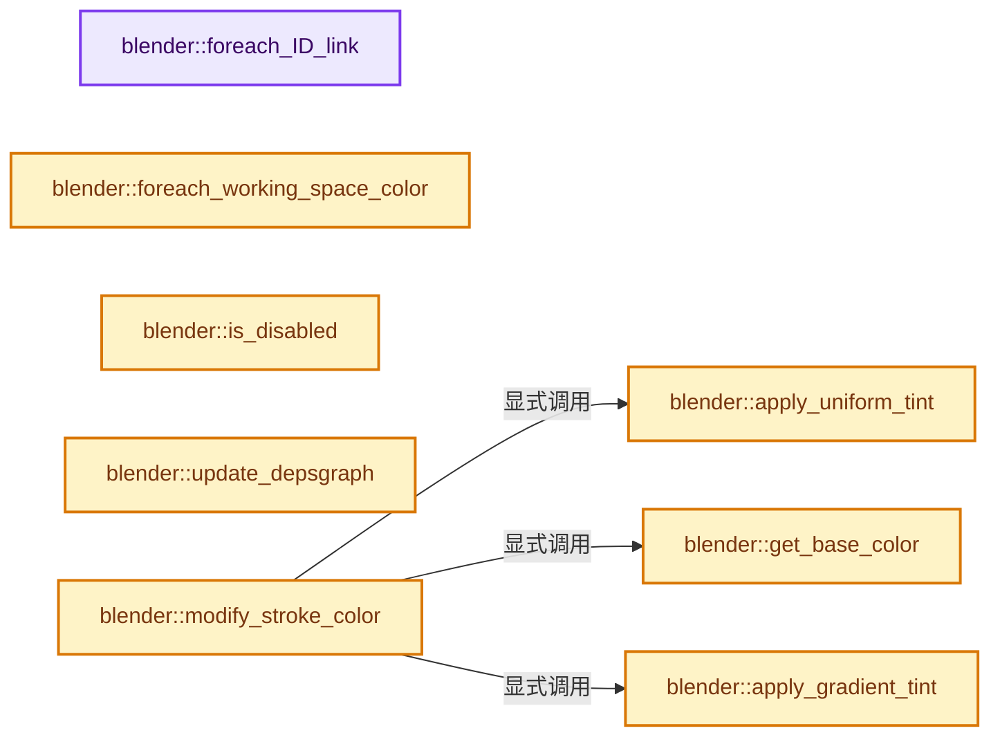
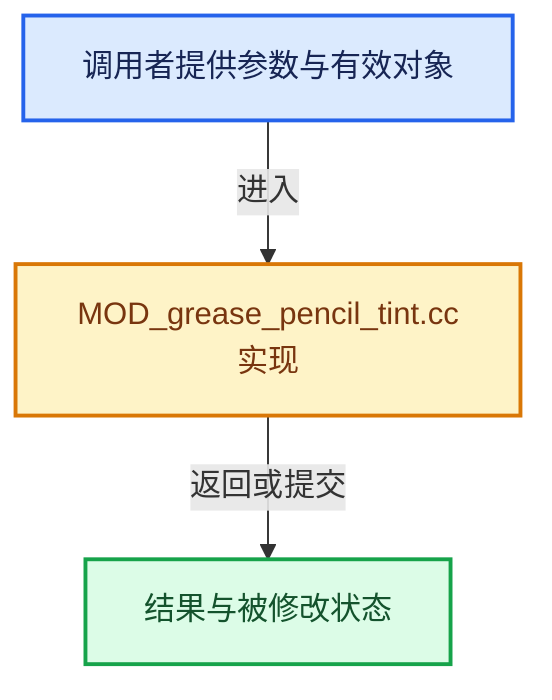

# 实现依赖专题：source/blender/modifiers/intern/MOD_grease_pencil_tint.cc

[方向导航](README.md) · [符号索引](../%E7%AC%A6%E5%8F%B7%E4%BE%9D%E8%B5%96%E4%B8%8E%E5%AE%9E%E7%8E%B0%E7%B4%A2%E5%BC%95.md)

本专题从正文实际调用进入，集中保存共享实现。函数有稳定锚点，可从调用处直接跳到对应完整函数；递归与互相调用通过回链组织。

## 本文件的实现关系






## 完整成员与函数实现

<a id="f-b61bd09b4b386e0b"></a>

### `blender::foreach_ID_link`

实现位置：[source/blender/modifiers/intern/MOD_grease_pencil_tint.cc](../../../../../source/blender/modifiers/intern/MOD_grease_pencil_tint.cc) · L97—L102。

接口参数：

- `ModifierData *md`
- `Object *ob`
- `IDWalkFunc walk`
- `void *user_data`

**教学注释版**

<!-- annotated:b7e0e10d3476bd -->

```cpp
static void foreach_ID_link(ModifierData *md, Object *ob, IDWalkFunc walk, void *user_data)
{
  auto *tmd = reinterpret_cast<GreasePencilTintModifierData *>(md);
  modifier::greasepencil::foreach_influence_ID_link(&tmd->influence, ob, walk, user_data);
  walk(user_data, ob, reinterpret_cast<ID **>(&tmd->object), IDWALK_CB_NOP);
}
```

<details>
<summary>核对原始源码：source/blender/modifiers/intern/MOD_grease_pencil_tint.cc · L97—L102</summary>

<!-- original:b7e0e10d3476bd:source/blender/modifiers/intern/MOD_grease_pencil_tint.cc:97:102 -->

```cpp
static void foreach_ID_link(ModifierData *md, Object *ob, IDWalkFunc walk, void *user_data)
{
  auto *tmd = reinterpret_cast<GreasePencilTintModifierData *>(md);
  modifier::greasepencil::foreach_influence_ID_link(&tmd->influence, ob, walk, user_data);
  walk(user_data, ob, reinterpret_cast<ID **>(&tmd->object), IDWALK_CB_NOP);
}
```

</details>

**继续追踪实现**

- `modifier::greasepencil::foreach_influence_ID_link` → [blender::modifier::greasepencil::foreach_influence_ID_link · L69](%E4%BE%9D%E8%B5%96-MOD_grease_pencil_util-d0b437.md#f-247ba56fa4c4e56f)。
- `walk` → [调用协议](../%E6%A8%A1%E6%9D%BF%E5%AE%8F%E4%B8%8E%E5%8A%A8%E6%80%81%E5%88%86%E6%B4%BE%E5%8D%8F%E8%AE%AE.md)：局部可调用对象，须结合其初始化与捕获环境。调用位置L101。

<a id="f-a4ba442341313aad"></a>

### `blender::foreach_working_space_color`

实现位置：[source/blender/modifiers/intern/MOD_grease_pencil_tint.cc](../../../../../source/blender/modifiers/intern/MOD_grease_pencil_tint.cc) · L104—L110。

接口参数：

- `ModifierData *md`
- `const IDTypeForeachColorFunctionCallback &fn`

**教学注释版**

<!-- annotated:7002e31a62350b -->

```cpp
static void foreach_working_space_color(ModifierData *md,
                                        const IDTypeForeachColorFunctionCallback &fn)
{
  auto *tmd = reinterpret_cast<GreasePencilTintModifierData *>(md);
  fn.single(tmd->color);
  BKE_colorband_foreach_working_space_color(tmd->color_ramp, fn);
}
```

<details>
<summary>核对原始源码：source/blender/modifiers/intern/MOD_grease_pencil_tint.cc · L104—L110</summary>

<!-- original:7002e31a62350b:source/blender/modifiers/intern/MOD_grease_pencil_tint.cc:104:110 -->

```cpp
static void foreach_working_space_color(ModifierData *md,
                                        const IDTypeForeachColorFunctionCallback &fn)
{
  auto *tmd = reinterpret_cast<GreasePencilTintModifierData *>(md);
  fn.single(tmd->color);
  BKE_colorband_foreach_working_space_color(tmd->color_ramp, fn);
}
```

</details>

**继续追踪实现**

- `fn.single` → [blender::bits::BoolToBit::single · L68](../01-%E5%9F%BA%E7%A1%80%E5%AE%B9%E5%99%A8%E4%B8%8E%E7%8E%B0%E4%BB%A3CPP/%E4%BE%9D%E8%B5%96-bit_bool_conversion-6a719a.md#f-08318f2d0747602b)。
- `BKE_colorband_foreach_working_space_color` → [blender::BKE_colorband_foreach_working_space_color · L655](%E4%BE%9D%E8%B5%96-colorband-8196f8.md#f-9a99d715ca440f5d)。

<a id="f-c16e54ca49f05062"></a>

### `blender::is_disabled`

实现位置：[source/blender/modifiers/intern/MOD_grease_pencil_tint.cc](../../../../../source/blender/modifiers/intern/MOD_grease_pencil_tint.cc) · L112—L119。

接口参数：

- `const Scene *`
- `ModifierData *md`
- `bool`

**教学注释版**

<!-- annotated:2fe0b1a4890a49 -->

```cpp
static bool is_disabled(const Scene * /*scene*/, ModifierData *md, bool /*use_render_params*/)
{
  auto *tmd = reinterpret_cast<GreasePencilTintModifierData *>(md);
  if (tmd->tint_mode == MOD_GREASE_PENCIL_TINT_GRADIENT) {
    return tmd->object == nullptr;
  }
  return false;
}
```

<details>
<summary>核对原始源码：source/blender/modifiers/intern/MOD_grease_pencil_tint.cc · L112—L119</summary>

<!-- original:2fe0b1a4890a49:source/blender/modifiers/intern/MOD_grease_pencil_tint.cc:112:119 -->

```cpp
static bool is_disabled(const Scene * /*scene*/, ModifierData *md, bool /*use_render_params*/)
{
  auto *tmd = reinterpret_cast<GreasePencilTintModifierData *>(md);
  if (tmd->tint_mode == MOD_GREASE_PENCIL_TINT_GRADIENT) {
    return tmd->object == nullptr;
  }
  return false;
}
```

</details>

**结果出口**

- `return tmd->object == nullptr;`
- `return false;`

**继续追踪实现**

本实现没有需要继续展开的显式调用；检查返回表达式、对象转换和调用者前置条件。

<a id="f-e630ae60321eb009"></a>

### `blender::update_depsgraph`

实现位置：[source/blender/modifiers/intern/MOD_grease_pencil_tint.cc](../../../../../source/blender/modifiers/intern/MOD_grease_pencil_tint.cc) · L121—L130。

接口参数：

- `ModifierData *md`
- `const ModifierUpdateDepsgraphContext *ctx`

**教学注释版**

<!-- annotated:d234a07bdfd3d5 -->

```cpp
static void update_depsgraph(ModifierData *md, const ModifierUpdateDepsgraphContext *ctx)
{
  auto *tmd = reinterpret_cast<GreasePencilTintModifierData *>(md);
  if (tmd->object != nullptr) {
    DEG_add_object_relation(
        ctx->node, tmd->object, DEG_OB_COMP_TRANSFORM, "Grease Pencil Tint Modifier");
  }
  DEG_add_object_relation(
      ctx->node, ctx->object, DEG_OB_COMP_TRANSFORM, "Grease Pencil Tint Modifier");
}
```

<details>
<summary>核对原始源码：source/blender/modifiers/intern/MOD_grease_pencil_tint.cc · L121—L130</summary>

<!-- original:d234a07bdfd3d5:source/blender/modifiers/intern/MOD_grease_pencil_tint.cc:121:130 -->

```cpp
static void update_depsgraph(ModifierData *md, const ModifierUpdateDepsgraphContext *ctx)
{
  auto *tmd = reinterpret_cast<GreasePencilTintModifierData *>(md);
  if (tmd->object != nullptr) {
    DEG_add_object_relation(
        ctx->node, tmd->object, DEG_OB_COMP_TRANSFORM, "Grease Pencil Tint Modifier");
  }
  DEG_add_object_relation(
      ctx->node, ctx->object, DEG_OB_COMP_TRANSFORM, "Grease Pencil Tint Modifier");
}
```

</details>

**继续追踪实现**

- `DEG_add_object_relation` → [blender::DEG_add_object_relation · L123](../11-Depsgraph%E4%B8%8E%E5%B9%B6%E8%A1%8C%E4%BB%BB%E5%8A%A1%E7%B3%BB%E7%BB%9F/%E4%BE%9D%E8%B5%96-depsgraph_build-ea2fc8.md#f-f570cffae97e273c)。

<a id="f-3c51e6b3248f8cc8"></a>

### `blender::get_base_color`

实现位置：[source/blender/modifiers/intern/MOD_grease_pencil_tint.cc](../../../../../source/blender/modifiers/intern/MOD_grease_pencil_tint.cc) · L132—L137。

接口参数：

- `const ColorGeometry4f &input_color`
- `const ColorGeometry4f &material_color`

**教学注释版**

<!-- annotated:2a31eef1deca7a -->

```cpp
static ColorGeometry4f get_base_color(const ColorGeometry4f &input_color,
                                      const ColorGeometry4f &material_color)
{
  /* When input alpha is zero, replace with material color. */
  return (input_color.a == 0.0f && material_color.a > 0.0f) ? material_color : input_color;
}
```

<details>
<summary>核对原始源码：source/blender/modifiers/intern/MOD_grease_pencil_tint.cc · L132—L137</summary>

<!-- original:2a31eef1deca7a:source/blender/modifiers/intern/MOD_grease_pencil_tint.cc:132:137 -->

```cpp
static ColorGeometry4f get_base_color(const ColorGeometry4f &input_color,
                                      const ColorGeometry4f &material_color)
{
  /* When input alpha is zero, replace with material color. */
  return (input_color.a == 0.0f && material_color.a > 0.0f) ? material_color : input_color;
}
```

</details>

**结果出口**

- `return (input_color.a == 0.0f && material_color.a > 0.0f) ? material_color : input_color;`

**继续追踪实现**

本实现没有需要继续展开的显式调用；检查返回表达式、对象转换和调用者前置条件。

<a id="f-cb133b62f9e6ce65"></a>

### `blender::apply_uniform_tint`

实现位置：[source/blender/modifiers/intern/MOD_grease_pencil_tint.cc](../../../../../source/blender/modifiers/intern/MOD_grease_pencil_tint.cc) · L139—L147。

接口参数：

- `const GreasePencilTintModifierData &tmd`
- `const ColorGeometry4f &input_color`
- `const float factor`

**教学注释版**

<!-- annotated:d5f8c33961e281 -->

```cpp
static ColorGeometry4f apply_uniform_tint(const GreasePencilTintModifierData &tmd,
                                          const ColorGeometry4f &input_color,
                                          const float factor)
{
  const float3 rgb = math::interpolate(
      float3(input_color.r, input_color.g, input_color.b), float3(tmd.color), factor);
  /* Alpha is unchanged. */
  return ColorGeometry4f(rgb[0], rgb[1], rgb[2], input_color.a);
}
```

<details>
<summary>核对原始源码：source/blender/modifiers/intern/MOD_grease_pencil_tint.cc · L139—L147</summary>

<!-- original:d5f8c33961e281:source/blender/modifiers/intern/MOD_grease_pencil_tint.cc:139:147 -->

```cpp
static ColorGeometry4f apply_uniform_tint(const GreasePencilTintModifierData &tmd,
                                          const ColorGeometry4f &input_color,
                                          const float factor)
{
  const float3 rgb = math::interpolate(
      float3(input_color.r, input_color.g, input_color.b), float3(tmd.color), factor);
  /* Alpha is unchanged. */
  return ColorGeometry4f(rgb[0], rgb[1], rgb[2], input_color.a);
}
```

</details>

**结果出口**

- `return ColorGeometry4f(rgb[0], rgb[1], rgb[2], input_color.a);`

**继续追踪实现**

- `math::interpolate` → [blender::math::interpolate · L335](../12-%E7%A9%BA%E9%97%B4%E6%95%B0%E6%8D%AE%E7%BB%93%E6%9E%84%E4%B8%8E%E5%87%A0%E4%BD%95%E7%AE%97%E6%B3%95/%E4%BE%9D%E8%B5%96-math_matrix-d7d8ee.md#f-91e7f517ebd72fb5)；[blender::math::interpolate · L379](../12-%E7%A9%BA%E9%97%B4%E6%95%B0%E6%8D%AE%E7%BB%93%E6%9E%84%E4%B8%8E%E5%87%A0%E4%BD%95%E7%AE%97%E6%B3%95/%E4%BE%9D%E8%B5%96-math_matrix-d7d8ee.md#f-a1be14e86ce595c2)；[blender::math::interpolate · L636](../12-%E7%A9%BA%E9%97%B4%E6%95%B0%E6%8D%AE%E7%BB%93%E6%9E%84%E4%B8%8E%E5%87%A0%E4%BD%95%E7%AE%97%E6%B3%95/%E4%BE%9D%E8%B5%96-BLI_math_vector-906a87.md#f-d612b6d6ab1b6e7c)；[blender::math::interpolate · L303](../12-%E7%A9%BA%E9%97%B4%E6%95%B0%E6%8D%AE%E7%BB%93%E6%9E%84%E4%B8%8E%E5%87%A0%E4%BD%95%E7%AE%97%E6%B3%95/%E4%BE%9D%E8%B5%96-BLI_math_quaternion-cf105d.md#f-48b9ace2a9c6185c)；[blender::math::interpolate · L17](../12-%E7%A9%BA%E9%97%B4%E6%95%B0%E6%8D%AE%E7%BB%93%E6%9E%84%E4%B8%8E%E5%87%A0%E4%BD%95%E7%AE%97%E6%B3%95/%E4%BE%9D%E8%B5%96-BLI_math_color-f3a6ea.md#f-eb5ef92b0f8c0926)；[blender::math::interpolate · L28](../12-%E7%A9%BA%E9%97%B4%E6%95%B0%E6%8D%AE%E7%BB%93%E6%9E%84%E4%B8%8E%E5%87%A0%E4%BD%95%E7%AE%97%E6%B3%95/%E4%BE%9D%E8%B5%96-BLI_math_color-f3a6ea.md#f-2a9e33ec55979ab6)；[blender::math::interpolate · L278](../12-%E7%A9%BA%E9%97%B4%E6%95%B0%E6%8D%AE%E7%BB%93%E6%9E%84%E4%B8%8E%E5%87%A0%E4%BD%95%E7%AE%97%E6%B3%95/%E4%BE%9D%E8%B5%96-BLI_math_base-0728eb.md#f-2629b871528f6528)。同名重载需按实参类型选择。
- `float3` → [float3 · L641](%E4%BE%9D%E8%B5%96-smaa-b67bc2.md#m-0ea8254cfdb4)。宏定义由构建条件选择。
- `ColorGeometry4f` → [调用协议](../%E6%A8%A1%E6%9D%BF%E5%AE%8F%E4%B8%8E%E5%8A%A8%E6%80%81%E5%88%86%E6%B4%BE%E5%8D%8F%E8%AE%AE.md)：函数指针、局部可调用对象或未展开的宏；必须结合调用者环境。调用位置L146。

<a id="f-3c2a9355aa9a4779"></a>

### `blender::apply_gradient_tint`

实现位置：[source/blender/modifiers/intern/MOD_grease_pencil_tint.cc](../../../../../source/blender/modifiers/intern/MOD_grease_pencil_tint.cc) · L149—L169。

接口参数：

- `const GreasePencilTintModifierData &tmd`
- `const float4x4 &matrix`
- `const float3 &position`
- `const ColorGeometry4f &input_color`
- `const float factor`

**教学注释版**

<!-- annotated:f72a177007c166 -->

```cpp
static ColorGeometry4f apply_gradient_tint(const GreasePencilTintModifierData &tmd,
                                           const float4x4 &matrix,
                                           const float3 &position,
                                           const ColorGeometry4f &input_color,
                                           const float factor)
{
  const float3 gradient_pos = math::transform_point(matrix, position);
  const float gradient_factor = std::clamp(
      math::safe_divide(math::length(gradient_pos), tmd.radius), 0.0f, 1.0f);

  float4 gradient_color;
  BKE_colorband_evaluate(tmd.color_ramp, gradient_factor, gradient_color);

  const float3 input_rgb = {input_color.r, input_color.g, input_color.b};
  /* GP2 compatibility: ignore vertex group factor and use the plain modifier setting for
   * RGB mixing. */
  const float3 rgb = math::interpolate(
      input_rgb, gradient_color.xyz(), tmd.factor * gradient_color.w);
  /* GP2 compatibility: use vertex group factor for alpha. */
  return ColorGeometry4f(rgb[0], rgb[1], rgb[2], factor);
}
```

<details>
<summary>核对原始源码：source/blender/modifiers/intern/MOD_grease_pencil_tint.cc · L149—L169</summary>

<!-- original:f72a177007c166:source/blender/modifiers/intern/MOD_grease_pencil_tint.cc:149:169 -->

```cpp
static ColorGeometry4f apply_gradient_tint(const GreasePencilTintModifierData &tmd,
                                           const float4x4 &matrix,
                                           const float3 &position,
                                           const ColorGeometry4f &input_color,
                                           const float factor)
{
  const float3 gradient_pos = math::transform_point(matrix, position);
  const float gradient_factor = std::clamp(
      math::safe_divide(math::length(gradient_pos), tmd.radius), 0.0f, 1.0f);

  float4 gradient_color;
  BKE_colorband_evaluate(tmd.color_ramp, gradient_factor, gradient_color);

  const float3 input_rgb = {input_color.r, input_color.g, input_color.b};
  /* GP2 compatibility: ignore vertex group factor and use the plain modifier setting for
   * RGB mixing. */
  const float3 rgb = math::interpolate(
      input_rgb, gradient_color.xyz(), tmd.factor * gradient_color.w);
  /* GP2 compatibility: use vertex group factor for alpha. */
  return ColorGeometry4f(rgb[0], rgb[1], rgb[2], factor);
}
```

</details>

**结果出口**

- `return ColorGeometry4f(rgb[0], rgb[1], rgb[2], factor);`

**继续追踪实现**

- `math::transform_point` → [blender::math::transform_point · L318](../12-%E7%A9%BA%E9%97%B4%E6%95%B0%E6%8D%AE%E7%BB%93%E6%9E%84%E4%B8%8E%E5%87%A0%E4%BD%95%E7%AE%97%E6%B3%95/%E4%BE%9D%E8%B5%96-BLI_math_quaternion-cf105d.md#f-e52a2e8c12e32657)；[blender::math::transform_point · L491](../12-%E7%A9%BA%E9%97%B4%E6%95%B0%E6%8D%AE%E7%BB%93%E6%9E%84%E4%B8%8E%E5%87%A0%E4%BD%95%E7%AE%97%E6%B3%95/%E4%BE%9D%E8%B5%96-BLI_math_quaternion-cf105d.md#f-6c9f8362c60efe6c)；[blender::math::transform_point · L445](../12-%E7%A9%BA%E9%97%B4%E6%95%B0%E6%8D%AE%E7%BB%93%E6%9E%84%E4%B8%8E%E5%87%A0%E4%BD%95%E7%AE%97%E6%B3%95/%E4%BE%9D%E8%B5%96-BLI_math_basis_types-fc7090.md#f-a151fd44ae743502)。同名重载需按实参类型选择。
- `std::clamp` → [外部契约](https://eel.is/c++draft/)：这个边界按实际表达式及所属类型核对参数、返回值、寿命与失败行为。这里提供接口入口，不声称已解释该第三方版本的内部实现。
- `math::safe_divide` → [blender::math::safe_divide · L341](../12-%E7%A9%BA%E9%97%B4%E6%95%B0%E6%8D%AE%E7%BB%93%E6%9E%84%E4%B8%8E%E5%87%A0%E4%BD%95%E7%AE%97%E6%B3%95/%E4%BE%9D%E8%B5%96-BLI_math_vector-906a87.md#f-ab8c82f9a578f2d4)；[blender::math::safe_divide · L351](../12-%E7%A9%BA%E9%97%B4%E6%95%B0%E6%8D%AE%E7%BB%93%E6%9E%84%E4%B8%8E%E5%87%A0%E4%BD%95%E7%AE%97%E6%B3%95/%E4%BE%9D%E8%B5%96-BLI_math_vector-906a87.md#f-0d22d4b64f9b5c0e)；[blender::math::safe_divide · L107](../12-%E7%A9%BA%E9%97%B4%E6%95%B0%E6%8D%AE%E7%BB%93%E6%9E%84%E4%B8%8E%E5%87%A0%E4%BD%95%E7%AE%97%E6%B3%95/%E4%BE%9D%E8%B5%96-BLI_math_base-0728eb.md#f-a81537b8ea4660b0)。同名重载需按实参类型选择。
- `math::length` → [blender::math::length · L40](../12-%E7%A9%BA%E9%97%B4%E6%95%B0%E6%8D%AE%E7%BB%93%E6%9E%84%E4%B8%8E%E5%87%A0%E4%BD%95%E7%AE%97%E6%B3%95/%E4%BE%9D%E8%B5%96-BLI_math_vector_mpq_types-faeefa.md#f-16c31b0e3391026f)；[blender::math::length · L49](../12-%E7%A9%BA%E9%97%B4%E6%95%B0%E6%8D%AE%E7%BB%93%E6%9E%84%E4%B8%8E%E5%87%A0%E4%BD%95%E7%AE%97%E6%B3%95/%E4%BE%9D%E8%B5%96-BLI_math_vector_mpq_types-faeefa.md#f-82d5aa193c621065)；[blender::math::length · L457](../12-%E7%A9%BA%E9%97%B4%E6%95%B0%E6%8D%AE%E7%BB%93%E6%9E%84%E4%B8%8E%E5%87%A0%E4%BD%95%E7%AE%97%E6%B3%95/%E4%BE%9D%E8%B5%96-BLI_math_vector-906a87.md#f-2c7dceafa898907c)。同名重载需按实参类型选择。
- `BKE_colorband_evaluate` → [blender::BKE_colorband_evaluate · L399](%E4%BE%9D%E8%B5%96-colorband-8196f8.md#f-eaf01798b5e01b4c)。
- `math::interpolate` → [blender::math::interpolate · L335](../12-%E7%A9%BA%E9%97%B4%E6%95%B0%E6%8D%AE%E7%BB%93%E6%9E%84%E4%B8%8E%E5%87%A0%E4%BD%95%E7%AE%97%E6%B3%95/%E4%BE%9D%E8%B5%96-math_matrix-d7d8ee.md#f-91e7f517ebd72fb5)；[blender::math::interpolate · L379](../12-%E7%A9%BA%E9%97%B4%E6%95%B0%E6%8D%AE%E7%BB%93%E6%9E%84%E4%B8%8E%E5%87%A0%E4%BD%95%E7%AE%97%E6%B3%95/%E4%BE%9D%E8%B5%96-math_matrix-d7d8ee.md#f-a1be14e86ce595c2)；[blender::math::interpolate · L636](../12-%E7%A9%BA%E9%97%B4%E6%95%B0%E6%8D%AE%E7%BB%93%E6%9E%84%E4%B8%8E%E5%87%A0%E4%BD%95%E7%AE%97%E6%B3%95/%E4%BE%9D%E8%B5%96-BLI_math_vector-906a87.md#f-d612b6d6ab1b6e7c)；[blender::math::interpolate · L303](../12-%E7%A9%BA%E9%97%B4%E6%95%B0%E6%8D%AE%E7%BB%93%E6%9E%84%E4%B8%8E%E5%87%A0%E4%BD%95%E7%AE%97%E6%B3%95/%E4%BE%9D%E8%B5%96-BLI_math_quaternion-cf105d.md#f-48b9ace2a9c6185c)；[blender::math::interpolate · L17](../12-%E7%A9%BA%E9%97%B4%E6%95%B0%E6%8D%AE%E7%BB%93%E6%9E%84%E4%B8%8E%E5%87%A0%E4%BD%95%E7%AE%97%E6%B3%95/%E4%BE%9D%E8%B5%96-BLI_math_color-f3a6ea.md#f-eb5ef92b0f8c0926)；[blender::math::interpolate · L28](../12-%E7%A9%BA%E9%97%B4%E6%95%B0%E6%8D%AE%E7%BB%93%E6%9E%84%E4%B8%8E%E5%87%A0%E4%BD%95%E7%AE%97%E6%B3%95/%E4%BE%9D%E8%B5%96-BLI_math_color-f3a6ea.md#f-2a9e33ec55979ab6)；[blender::math::interpolate · L278](../12-%E7%A9%BA%E9%97%B4%E6%95%B0%E6%8D%AE%E7%BB%93%E6%9E%84%E4%B8%8E%E5%87%A0%E4%BD%95%E7%AE%97%E6%B3%95/%E4%BE%9D%E8%B5%96-BLI_math_base-0728eb.md#f-2629b871528f6528)。同名重载需按实参类型选择。
- `gradient_color.xyz` → [调用协议](../%E6%A8%A1%E6%9D%BF%E5%AE%8F%E4%B8%8E%E5%8A%A8%E6%80%81%E5%88%86%E6%B4%BE%E5%8D%8F%E8%AE%AE.md)：由接收对象具体类型或运行时策略提供实现。调用位置L166。
- `ColorGeometry4f` → [调用协议](../%E6%A8%A1%E6%9D%BF%E5%AE%8F%E4%B8%8E%E5%8A%A8%E6%80%81%E5%88%86%E6%B4%BE%E5%8D%8F%E8%AE%AE.md)：函数指针、局部可调用对象或未展开的宏；必须结合调用者环境。调用位置L168。

<a id="f-203369be14b8693f"></a>

### `blender::modify_stroke_color`

实现位置：[source/blender/modifiers/intern/MOD_grease_pencil_tint.cc](../../../../../source/blender/modifiers/intern/MOD_grease_pencil_tint.cc) · L171—L259。

接口参数：

- `Object &ob`
- `const GreasePencilTintModifierData &tmd`
- `bke::CurvesGeometry &curves`
- `const IndexMask &curves_mask`
- `const MutableSpan<ColorGeometry4f> vertex_colors`

**教学注释版**

<!-- annotated:6237c72aa47708 -->

```cpp
static void modify_stroke_color(Object &ob,
                                const GreasePencilTintModifierData &tmd,
                                bke::CurvesGeometry &curves,
                                const IndexMask &curves_mask,
                                const MutableSpan<ColorGeometry4f> vertex_colors)
{
  const bool use_curve = (tmd.influence.flag & GREASE_PENCIL_INFLUENCE_USE_CUSTOM_CURVE);
  const bool use_weight_as_factor = (tmd.flag & MOD_GREASE_PENCIL_TINT_USE_WEIGHT_AS_FACTOR);
  const OffsetIndices<int> points_by_curve = curves.points_by_curve();

  bke::AttributeAccessor attributes = curves.attributes();
  const VArray<int> stroke_materials = *attributes.lookup_or_default<int>(
      "material_index", bke::AttrDomain::Curve, 0);
  const VArray<float> vgroup_weights = modifier::greasepencil::get_influence_vertex_weights(
      curves, tmd.influence);

  /* Common input color and base factor calculation. */
  auto get_material_color = [&](const int64_t curve_i) {
    const Material *ma = BKE_object_material_get(&ob, stroke_materials[curve_i] + 1);
    const MaterialGPencilStyle *gp_style = ma ? ma->gp_style : nullptr;
    if (!gp_style) {
      return ColorGeometry4f(0.0f, 0.0f, 0.0f, 0.0f);
    }
    return ColorGeometry4f(gp_style->stroke_rgba);
  };

  auto get_point_factor = [&](const int64_t point_i) {
    const float weight = vgroup_weights[point_i];
    if (use_weight_as_factor) {
      return weight;
    }
    return tmd.factor * weight;
  };

  const GreasePencilTintModifierMode tint_mode = GreasePencilTintModifierMode(tmd.tint_mode);
  switch (tint_mode) {
    case MOD_GREASE_PENCIL_TINT_UNIFORM: {
      curves_mask.foreach_index(
          [&](const int64_t curve_i) {
            const ColorGeometry4f material_color = get_material_color(curve_i);

            const IndexRange points = points_by_curve[curve_i];
            for (const int64_t i : points.index_range()) {
              const int64_t point_i = points[i];
              // [讲解] points.size：读取连续区间或分组的边界信息。
              const float curve_input = points.size() >= 2 ?
                                            (float(i) / float(points.size() - 1)) :
                                            0.0f;
              const float curve_factor = use_curve ?
                                             BKE_curvemapping_evaluateF(
                                                 tmd.influence.custom_curve, 0, curve_input) :
                                             1.0f;
              vertex_colors[point_i] = apply_uniform_tint(
                  tmd,
                  get_base_color(vertex_colors[point_i], material_color),
                  get_point_factor(point_i) * curve_factor);
            }
          },
          exec_mode::grain_size(512));
      break;
    }
    case MOD_GREASE_PENCIL_TINT_GRADIENT: {
      if (tmd.object == nullptr) {
        return;
      }

      const OffsetIndices<int> points_by_curve = curves.points_by_curve();
      const Span<float3> positions = curves.positions();
      /* Transforms points to the gradient object space. */
      const float4x4 matrix = tmd.object->world_to_object() * ob.object_to_world();

      curves_mask.foreach_index(
          [&](const int64_t curve_i) {
            const ColorGeometry4f material_color = get_material_color(curve_i);

            const IndexRange points = points_by_curve[curve_i];
            for (const int64_t point_i : points) {
              vertex_colors[point_i] = apply_gradient_tint(
                  tmd,
                  matrix,
                  positions[point_i],
                  get_base_color(vertex_colors[point_i], material_color),
                  get_point_factor(point_i));
            }
          },
          exec_mode::grain_size(512));
      break;
    }
  }
}
```

<details>
<summary>核对原始源码：source/blender/modifiers/intern/MOD_grease_pencil_tint.cc · L171—L259</summary>

<!-- original:6237c72aa47708:source/blender/modifiers/intern/MOD_grease_pencil_tint.cc:171:259 -->

```cpp
static void modify_stroke_color(Object &ob,
                                const GreasePencilTintModifierData &tmd,
                                bke::CurvesGeometry &curves,
                                const IndexMask &curves_mask,
                                const MutableSpan<ColorGeometry4f> vertex_colors)
{
  const bool use_curve = (tmd.influence.flag & GREASE_PENCIL_INFLUENCE_USE_CUSTOM_CURVE);
  const bool use_weight_as_factor = (tmd.flag & MOD_GREASE_PENCIL_TINT_USE_WEIGHT_AS_FACTOR);
  const OffsetIndices<int> points_by_curve = curves.points_by_curve();

  bke::AttributeAccessor attributes = curves.attributes();
  const VArray<int> stroke_materials = *attributes.lookup_or_default<int>(
      "material_index", bke::AttrDomain::Curve, 0);
  const VArray<float> vgroup_weights = modifier::greasepencil::get_influence_vertex_weights(
      curves, tmd.influence);

  /* Common input color and base factor calculation. */
  auto get_material_color = [&](const int64_t curve_i) {
    const Material *ma = BKE_object_material_get(&ob, stroke_materials[curve_i] + 1);
    const MaterialGPencilStyle *gp_style = ma ? ma->gp_style : nullptr;
    if (!gp_style) {
      return ColorGeometry4f(0.0f, 0.0f, 0.0f, 0.0f);
    }
    return ColorGeometry4f(gp_style->stroke_rgba);
  };

  auto get_point_factor = [&](const int64_t point_i) {
    const float weight = vgroup_weights[point_i];
    if (use_weight_as_factor) {
      return weight;
    }
    return tmd.factor * weight;
  };

  const GreasePencilTintModifierMode tint_mode = GreasePencilTintModifierMode(tmd.tint_mode);
  switch (tint_mode) {
    case MOD_GREASE_PENCIL_TINT_UNIFORM: {
      curves_mask.foreach_index(
          [&](const int64_t curve_i) {
            const ColorGeometry4f material_color = get_material_color(curve_i);

            const IndexRange points = points_by_curve[curve_i];
            for (const int64_t i : points.index_range()) {
              const int64_t point_i = points[i];
              const float curve_input = points.size() >= 2 ?
                                            (float(i) / float(points.size() - 1)) :
                                            0.0f;
              const float curve_factor = use_curve ?
                                             BKE_curvemapping_evaluateF(
                                                 tmd.influence.custom_curve, 0, curve_input) :
                                             1.0f;
              vertex_colors[point_i] = apply_uniform_tint(
                  tmd,
                  get_base_color(vertex_colors[point_i], material_color),
                  get_point_factor(point_i) * curve_factor);
            }
          },
          exec_mode::grain_size(512));
      break;
    }
    case MOD_GREASE_PENCIL_TINT_GRADIENT: {
      if (tmd.object == nullptr) {
        return;
      }

      const OffsetIndices<int> points_by_curve = curves.points_by_curve();
      const Span<float3> positions = curves.positions();
      /* Transforms points to the gradient object space. */
      const float4x4 matrix = tmd.object->world_to_object() * ob.object_to_world();

      curves_mask.foreach_index(
          [&](const int64_t curve_i) {
            const ColorGeometry4f material_color = get_material_color(curve_i);

            const IndexRange points = points_by_curve[curve_i];
            for (const int64_t point_i : points) {
              vertex_colors[point_i] = apply_gradient_tint(
                  tmd,
                  matrix,
                  positions[point_i],
                  get_base_color(vertex_colors[point_i], material_color),
                  get_point_factor(point_i));
            }
          },
          exec_mode::grain_size(512));
      break;
    }
  }
}
```

</details>

**沿实际写入检查状态**

- `vertex_colors[point_i] = apply_uniform_tint(`
- `vertex_colors[point_i] = apply_gradient_tint(`

**结果出口**

- `return ColorGeometry4f(0.0f, 0.0f, 0.0f, 0.0f);`
- `return ColorGeometry4f(gp_style->stroke_rgba);`
- `return weight;`
- `return tmd.factor * weight;`

**继续追踪实现**

- `curves.points_by_curve` → [blender::bke::CurvesGeometry::points_by_curve · L1058](04-CurvesGeometry%E5%AD%98%E5%82%A8.md#f-a0416697e10ec205)。
- `curves.attributes` → [blender::bke::CurvesGeometry::attributes · L1908](%E4%BE%9D%E8%B5%96-curves_geometry-ad7f9f.md#f-8e24fbf758862a22)。
- `attributes.lookup_or_default<int>` → [blender::bke::AttributeAccessor::lookup_or_default · L415](%E4%BE%9D%E8%B5%96-attribute_access-bceef3.md#f-a0cc3e316f1da4bd)；[blender::bke::AttributeAccessor::lookup_or_default · L643](08-AttributeAccessor%E6%8E%A5%E5%8F%A3.md#f-e3d2ed81ebe0af61)。同名重载需按实参类型选择。
- `modifier::greasepencil::get_influence_vertex_weights` → [blender::modifier::greasepencil::get_influence_vertex_weights · L343](%E4%BE%9D%E8%B5%96-MOD_grease_pencil_util-d0b437.md#f-6f4fdb5693985db9)。
- `BKE_object_material_get` → [blender::BKE_object_material_get · L759](%E4%BE%9D%E8%B5%96-material-aea8ec.md#f-9e9ad276ccef84b3)。
- `ColorGeometry4f` → [调用协议](../%E6%A8%A1%E6%9D%BF%E5%AE%8F%E4%B8%8E%E5%8A%A8%E6%80%81%E5%88%86%E6%B4%BE%E5%8D%8F%E8%AE%AE.md)：函数指针、局部可调用对象或未展开的宏；必须结合调用者环境。调用位置L192。
- `GreasePencilTintModifierMode` → [blender::GreasePencilTintModifierMode](%E4%BE%9D%E8%B5%96-DNA_modifier_types-56a227.md#t-2c2900b2d6f7)。
- `curves_mask.foreach_index` → [blender::index_mask::IndexMask::foreach_index · L855](../04-%E8%99%9A%E6%8B%9F%E6%95%B0%E7%BB%84%E4%B8%8E%E7%B4%A2%E5%BC%95%E9%80%89%E6%8B%A9/09-%E5%88%86%E6%AE%B5%E5%AD%98%E5%82%A8%E4%B8%8E%E9%81%8D%E5%8E%86.md#f-cd6cd317e2e2812c)。
- `get_material_color` → [调用协议](../%E6%A8%A1%E6%9D%BF%E5%AE%8F%E4%B8%8E%E5%8A%A8%E6%80%81%E5%88%86%E6%B4%BE%E5%8D%8F%E8%AE%AE.md)：局部可调用对象，须结合其初始化与捕获环境。调用位置L210。
- `points.index_range` → [blender::IndexRange::index_range · L161](../01-%E5%9F%BA%E7%A1%80%E5%AE%B9%E5%99%A8%E4%B8%8E%E7%8E%B0%E4%BB%A3CPP/04-IndexRange%E8%BF%9E%E7%BB%AD%E6%95%B4%E6%95%B0%E5%8C%BA%E9%97%B4.md#f-fd83072b4b81bce5)。
- `points.size` → [blender::IndexRange::size · L156](../01-%E5%9F%BA%E7%A1%80%E5%AE%B9%E5%99%A8%E4%B8%8E%E7%8E%B0%E4%BB%A3CPP/04-IndexRange%E8%BF%9E%E7%BB%AD%E6%95%B4%E6%95%B0%E5%8C%BA%E9%97%B4.md#f-05f66c3ebb2fdfec)。
- `BKE_curvemapping_evaluateF` → [blender::BKE_curvemapping_evaluateF · L1177](%E4%BE%9D%E8%B5%96-colortools-8bc37a.md#f-014584e04eeb1392)。
- `apply_uniform_tint` → [blender::apply_uniform_tint · L139](%E4%BE%9D%E8%B5%96-MOD_grease_pencil_tint-130b42.md#f-cb133b62f9e6ce65)。
- `get_base_color` → [blender::get_base_color · L132](%E4%BE%9D%E8%B5%96-MOD_grease_pencil_tint-130b42.md#f-3c51e6b3248f8cc8)。
- `get_point_factor` → [调用协议](../%E6%A8%A1%E6%9D%BF%E5%AE%8F%E4%B8%8E%E5%8A%A8%E6%80%81%E5%88%86%E6%B4%BE%E5%8D%8F%E8%AE%AE.md)：局部可调用对象，须结合其初始化与捕获环境。调用位置L225。
- `exec_mode::grain_size` → [blender::exec_mode::grain_size · L79](../01-%E5%9F%BA%E7%A1%80%E5%AE%B9%E5%99%A8%E4%B8%8E%E7%8E%B0%E4%BB%A3CPP/%E4%BE%9D%E8%B5%96-BLI_execution_mode-1528fb.md#f-0b4fc2f9fa6e66e7)。
- `curves.positions` → [blender::bke::CurvesGeometry::positions · L323](%E4%BE%9D%E8%B5%96-curves_geometry-ad7f9f.md#f-42ba586557e8ff18)。
- `tmd.object->world_to_object` → [调用协议](../%E6%A8%A1%E6%9D%BF%E5%AE%8F%E4%B8%8E%E5%8A%A8%E6%80%81%E5%88%86%E6%B4%BE%E5%8D%8F%E8%AE%AE.md)：接收对象类型依赖auto、返回值或模板实例；不按同名猜测目标。调用位置L239。
- `ob.object_to_world` → [blender::Object::object_to_world · L5761](%E4%BE%9D%E8%B5%96-object-843689.md#f-12fc20026327d50c)。
- `apply_gradient_tint` → [blender::apply_gradient_tint · L149](%E4%BE%9D%E8%B5%96-MOD_grease_pencil_tint-130b42.md#f-3c2a9355aa9a4779)。

<a id="f-3a05a6dfd039444d"></a>

### `blender::modify_fill_color`

实现位置：[source/blender/modifiers/intern/MOD_grease_pencil_tint.cc](../../../../../source/blender/modifiers/intern/MOD_grease_pencil_tint.cc) · L261—L346。

接口参数：

- `Object &ob`
- `const GreasePencilTintModifierData &tmd`
- `Drawing &drawing`
- `const IndexMask &curves_mask`

**教学注释版**

<!-- annotated:4a810f6a27bb1a -->

```cpp
static void modify_fill_color(Object &ob,
                              const GreasePencilTintModifierData &tmd,
                              Drawing &drawing,
                              const IndexMask &curves_mask)
{
  const bool use_weight_as_factor = (tmd.flag & MOD_GREASE_PENCIL_TINT_USE_WEIGHT_AS_FACTOR);
  const bke::CurvesGeometry &curves = drawing.strokes();
  const OffsetIndices<int> points_by_curve = curves.points_by_curve();
  const GreasePencilTintModifierMode tint_mode = GreasePencilTintModifierMode(tmd.tint_mode);

  /* Check early before getting attribute writers. */
  if (tint_mode == MOD_GREASE_PENCIL_TINT_GRADIENT && tmd.object == nullptr) {
    return;
  }

  bke::MutableAttributeAccessor attributes = drawing.strokes_for_write().attributes_for_write();
  /* Fill color per stroke. */
  MutableSpan<ColorGeometry4f> fill_colors = drawing.fill_colors_for_write();
  const VArray<int> stroke_materials = *attributes.lookup_or_default<int>(
      "material_index", bke::AttrDomain::Curve, 0);
  const VArray<float> vgroup_weights = modifier::greasepencil::get_influence_vertex_weights(
      curves, tmd.influence);

  /* Common input color and base factor calculation. */
  auto get_material_color = [&](const int64_t curve_i) {
    const Material *ma = BKE_object_material_get(&ob, stroke_materials[curve_i] + 1);
    const MaterialGPencilStyle *gp_style = ma ? ma->gp_style : nullptr;
    if (!gp_style) {
      return ColorGeometry4f(0.0f, 0.0f, 0.0f, 0.0f);
    }
    return ColorGeometry4f(gp_style->fill_rgba);
  };

  auto get_curve_factor = [&](const int64_t curve_i) {
    /* Use the first stroke point as vertex weight. */
    const IndexRange points = points_by_curve[curve_i];
    // [讲解] points.first：读取范围两端的有效索引或值。
    const float vgroup_weight_first = vgroup_weights[points.first()];
    float stroke_weight = vgroup_weight_first;
    // [讲解] points.is_empty：读取连续区间或分组的边界信息。
    if (points.is_empty() || (stroke_weight <= 0.0f)) {
      return 0.0f;
    }
    if (use_weight_as_factor) {
      return stroke_weight;
    }
    return tmd.factor * stroke_weight;
  };

  switch (tint_mode) {
    case MOD_GREASE_PENCIL_TINT_UNIFORM: {
      curves_mask.foreach_index(
          [&](int64_t curve_i) {
            const ColorGeometry4f material_color = get_material_color(curve_i);
            fill_colors[curve_i] = apply_uniform_tint(
                tmd,
                get_base_color(fill_colors[curve_i], material_color),
                get_curve_factor(curve_i));
          },
          exec_mode::grain_size(512));
      break;
    }
    case MOD_GREASE_PENCIL_TINT_GRADIENT: {
      const OffsetIndices<int> points_by_curve = curves.points_by_curve();
      const Span<float3> positions = curves.positions();
      /* Transforms points to the gradient object space. */
      const float4x4 matrix = tmd.object->world_to_object() * ob.object_to_world();

      curves_mask.foreach_index(
          [&](int64_t curve_i) {
            const ColorGeometry4f material_color = get_material_color(curve_i);
            /* Use the first stroke point for gradient position. */
            const IndexRange points = points_by_curve[curve_i];
            const float3 pos = points.is_empty() ? float3(0.0f, 0.0f, 0.0f) :
                                                   positions[points.first()];

            fill_colors[curve_i] = apply_gradient_tint(
                tmd,
                matrix,
                pos,
                get_base_color(fill_colors[curve_i], material_color),
                get_curve_factor(curve_i));
          },
          exec_mode::grain_size(512));
      break;
    }
  }
}
```

<details>
<summary>核对原始源码：source/blender/modifiers/intern/MOD_grease_pencil_tint.cc · L261—L346</summary>

<!-- original:4a810f6a27bb1a:source/blender/modifiers/intern/MOD_grease_pencil_tint.cc:261:346 -->

```cpp
static void modify_fill_color(Object &ob,
                              const GreasePencilTintModifierData &tmd,
                              Drawing &drawing,
                              const IndexMask &curves_mask)
{
  const bool use_weight_as_factor = (tmd.flag & MOD_GREASE_PENCIL_TINT_USE_WEIGHT_AS_FACTOR);
  const bke::CurvesGeometry &curves = drawing.strokes();
  const OffsetIndices<int> points_by_curve = curves.points_by_curve();
  const GreasePencilTintModifierMode tint_mode = GreasePencilTintModifierMode(tmd.tint_mode);

  /* Check early before getting attribute writers. */
  if (tint_mode == MOD_GREASE_PENCIL_TINT_GRADIENT && tmd.object == nullptr) {
    return;
  }

  bke::MutableAttributeAccessor attributes = drawing.strokes_for_write().attributes_for_write();
  /* Fill color per stroke. */
  MutableSpan<ColorGeometry4f> fill_colors = drawing.fill_colors_for_write();
  const VArray<int> stroke_materials = *attributes.lookup_or_default<int>(
      "material_index", bke::AttrDomain::Curve, 0);
  const VArray<float> vgroup_weights = modifier::greasepencil::get_influence_vertex_weights(
      curves, tmd.influence);

  /* Common input color and base factor calculation. */
  auto get_material_color = [&](const int64_t curve_i) {
    const Material *ma = BKE_object_material_get(&ob, stroke_materials[curve_i] + 1);
    const MaterialGPencilStyle *gp_style = ma ? ma->gp_style : nullptr;
    if (!gp_style) {
      return ColorGeometry4f(0.0f, 0.0f, 0.0f, 0.0f);
    }
    return ColorGeometry4f(gp_style->fill_rgba);
  };

  auto get_curve_factor = [&](const int64_t curve_i) {
    /* Use the first stroke point as vertex weight. */
    const IndexRange points = points_by_curve[curve_i];
    const float vgroup_weight_first = vgroup_weights[points.first()];
    float stroke_weight = vgroup_weight_first;
    if (points.is_empty() || (stroke_weight <= 0.0f)) {
      return 0.0f;
    }
    if (use_weight_as_factor) {
      return stroke_weight;
    }
    return tmd.factor * stroke_weight;
  };

  switch (tint_mode) {
    case MOD_GREASE_PENCIL_TINT_UNIFORM: {
      curves_mask.foreach_index(
          [&](int64_t curve_i) {
            const ColorGeometry4f material_color = get_material_color(curve_i);
            fill_colors[curve_i] = apply_uniform_tint(
                tmd,
                get_base_color(fill_colors[curve_i], material_color),
                get_curve_factor(curve_i));
          },
          exec_mode::grain_size(512));
      break;
    }
    case MOD_GREASE_PENCIL_TINT_GRADIENT: {
      const OffsetIndices<int> points_by_curve = curves.points_by_curve();
      const Span<float3> positions = curves.positions();
      /* Transforms points to the gradient object space. */
      const float4x4 matrix = tmd.object->world_to_object() * ob.object_to_world();

      curves_mask.foreach_index(
          [&](int64_t curve_i) {
            const ColorGeometry4f material_color = get_material_color(curve_i);
            /* Use the first stroke point for gradient position. */
            const IndexRange points = points_by_curve[curve_i];
            const float3 pos = points.is_empty() ? float3(0.0f, 0.0f, 0.0f) :
                                                   positions[points.first()];

            fill_colors[curve_i] = apply_gradient_tint(
                tmd,
                matrix,
                pos,
                get_base_color(fill_colors[curve_i], material_color),
                get_curve_factor(curve_i));
          },
          exec_mode::grain_size(512));
      break;
    }
  }
}
```

</details>

**沿实际写入检查状态**

- `fill_colors[curve_i] = apply_uniform_tint(`
- `fill_colors[curve_i] = apply_gradient_tint(`

**结果出口**

- `return ColorGeometry4f(0.0f, 0.0f, 0.0f, 0.0f);`
- `return ColorGeometry4f(gp_style->fill_rgba);`
- `return 0.0f;`
- `return stroke_weight;`
- `return tmd.factor * stroke_weight;`

**继续追踪实现**

- `drawing.strokes` → [blender::bke::greasepencil::Drawing::strokes · L1007](%E4%BE%9D%E8%B5%96-grease_pencil-f750d6.md#f-59e6522a8e8ac409)。
- `curves.points_by_curve` → [blender::bke::CurvesGeometry::points_by_curve · L1058](04-CurvesGeometry%E5%AD%98%E5%82%A8.md#f-a0416697e10ec205)。
- `GreasePencilTintModifierMode` → [blender::GreasePencilTintModifierMode](%E4%BE%9D%E8%B5%96-DNA_modifier_types-56a227.md#t-2c2900b2d6f7)。
- `drawing.strokes_for_write().attributes_for_write` → [调用协议](../%E6%A8%A1%E6%9D%BF%E5%AE%8F%E4%B8%8E%E5%8A%A8%E6%80%81%E5%88%86%E6%B4%BE%E5%8D%8F%E8%AE%AE.md)：接收对象类型依赖auto、返回值或模板实例；不按同名猜测目标。调用位置L276。
- `drawing.strokes_for_write` → [blender::bke::greasepencil::Drawing::strokes_for_write · L1012](%E4%BE%9D%E8%B5%96-grease_pencil-f750d6.md#f-0649333785d0aa95)。
- `drawing.fill_colors_for_write` → [blender::bke::greasepencil::Drawing::fill_colors_for_write · L1069](%E4%BE%9D%E8%B5%96-grease_pencil-f750d6.md#f-c1670c8b77b029fa)。
- `attributes.lookup_or_default<int>` → [blender::bke::AttributeAccessor::lookup_or_default · L415](%E4%BE%9D%E8%B5%96-attribute_access-bceef3.md#f-a0cc3e316f1da4bd)；[blender::bke::AttributeAccessor::lookup_or_default · L643](08-AttributeAccessor%E6%8E%A5%E5%8F%A3.md#f-e3d2ed81ebe0af61)。同名重载需按实参类型选择。
- `modifier::greasepencil::get_influence_vertex_weights` → [blender::modifier::greasepencil::get_influence_vertex_weights · L343](%E4%BE%9D%E8%B5%96-MOD_grease_pencil_util-d0b437.md#f-6f4fdb5693985db9)。
- `BKE_object_material_get` → [blender::BKE_object_material_get · L759](%E4%BE%9D%E8%B5%96-material-aea8ec.md#f-9e9ad276ccef84b3)。
- `ColorGeometry4f` → [调用协议](../%E6%A8%A1%E6%9D%BF%E5%AE%8F%E4%B8%8E%E5%8A%A8%E6%80%81%E5%88%86%E6%B4%BE%E5%8D%8F%E8%AE%AE.md)：函数指针、局部可调用对象或未展开的宏；必须结合调用者环境。调用位置L289。
- `points.first` → [blender::IndexRange::first · L204](../01-%E5%9F%BA%E7%A1%80%E5%AE%B9%E5%99%A8%E4%B8%8E%E7%8E%B0%E4%BB%A3CPP/04-IndexRange%E8%BF%9E%E7%BB%AD%E6%95%B4%E6%95%B0%E5%8C%BA%E9%97%B4.md#f-ab443c94e531befa)。
- `points.is_empty` → [blender::IndexRange::is_empty · L169](../01-%E5%9F%BA%E7%A1%80%E5%AE%B9%E5%99%A8%E4%B8%8E%E7%8E%B0%E4%BB%A3CPP/04-IndexRange%E8%BF%9E%E7%BB%AD%E6%95%B4%E6%95%B0%E5%8C%BA%E9%97%B4.md#f-9501e070be01ff71)。
- `curves_mask.foreach_index` → [blender::index_mask::IndexMask::foreach_index · L855](../04-%E8%99%9A%E6%8B%9F%E6%95%B0%E7%BB%84%E4%B8%8E%E7%B4%A2%E5%BC%95%E9%80%89%E6%8B%A9/09-%E5%88%86%E6%AE%B5%E5%AD%98%E5%82%A8%E4%B8%8E%E9%81%8D%E5%8E%86.md#f-cd6cd317e2e2812c)。
- `get_material_color` → [调用协议](../%E6%A8%A1%E6%9D%BF%E5%AE%8F%E4%B8%8E%E5%8A%A8%E6%80%81%E5%88%86%E6%B4%BE%E5%8D%8F%E8%AE%AE.md)：局部可调用对象，须结合其初始化与捕获环境。调用位置L312。
- `apply_uniform_tint` → [blender::apply_uniform_tint · L139](%E4%BE%9D%E8%B5%96-MOD_grease_pencil_tint-130b42.md#f-cb133b62f9e6ce65)。
- `get_base_color` → [blender::get_base_color · L132](%E4%BE%9D%E8%B5%96-MOD_grease_pencil_tint-130b42.md#f-3c51e6b3248f8cc8)。
- `get_curve_factor` → [调用协议](../%E6%A8%A1%E6%9D%BF%E5%AE%8F%E4%B8%8E%E5%8A%A8%E6%80%81%E5%88%86%E6%B4%BE%E5%8D%8F%E8%AE%AE.md)：局部可调用对象，须结合其初始化与捕获环境。调用位置L316。
- `exec_mode::grain_size` → [blender::exec_mode::grain_size · L79](../01-%E5%9F%BA%E7%A1%80%E5%AE%B9%E5%99%A8%E4%B8%8E%E7%8E%B0%E4%BB%A3CPP/%E4%BE%9D%E8%B5%96-BLI_execution_mode-1528fb.md#f-0b4fc2f9fa6e66e7)。
- `curves.positions` → [blender::bke::CurvesGeometry::positions · L323](%E4%BE%9D%E8%B5%96-curves_geometry-ad7f9f.md#f-42ba586557e8ff18)。
- `tmd.object->world_to_object` → [调用协议](../%E6%A8%A1%E6%9D%BF%E5%AE%8F%E4%B8%8E%E5%8A%A8%E6%80%81%E5%88%86%E6%B4%BE%E5%8D%8F%E8%AE%AE.md)：接收对象类型依赖auto、返回值或模板实例；不按同名猜测目标。调用位置L325。
- `ob.object_to_world` → [blender::Object::object_to_world · L5761](%E4%BE%9D%E8%B5%96-object-843689.md#f-12fc20026327d50c)。
- `float3` → [float3 · L641](%E4%BE%9D%E8%B5%96-smaa-b67bc2.md#m-0ea8254cfdb4)。宏定义由构建条件选择。
- `apply_gradient_tint` → [blender::apply_gradient_tint · L149](%E4%BE%9D%E8%B5%96-MOD_grease_pencil_tint-130b42.md#f-3c2a9355aa9a4779)。

<a id="f-64acaeccb708ca4a"></a>

### `blender::modify_opacity`

实现位置：[source/blender/modifiers/intern/MOD_grease_pencil_tint.cc](../../../../../source/blender/modifiers/intern/MOD_grease_pencil_tint.cc) · L348—L376。

接口参数：

- `const GreasePencilTintModifierData &tmd`
- `bke::CurvesGeometry &curves`
- `const IndexMask &curves_mask`

**教学注释版**

<!-- annotated:e485d34fb6a01e -->

```cpp
static void modify_opacity(const GreasePencilTintModifierData &tmd,
                           bke::CurvesGeometry &curves,
                           const IndexMask &curves_mask)
{
  /* Only when factor is greater than 1. */
  if (tmd.factor <= 1.0f) {
    return;
  }

  const OffsetIndices<int> points_by_curve = curves.points_by_curve();
  bke::MutableAttributeAccessor attributes = curves.attributes_for_write();
  bke::SpanAttributeWriter<float> opacities = attributes.lookup_or_add_for_write_span<float>(
      "opacity", bke::AttrDomain::Point);
  if (!opacities) {
    return;
  }

  curves_mask.foreach_index(
      [&](const int64_t curve_i) {
        const IndexRange points = points_by_curve[curve_i];
        for (const int64_t point_i : points) {
          opacities.span[point_i] = std::clamp(
              opacities.span[point_i] + tmd.factor - 1.0f, 0.0f, 1.0f);
        }
      },
      exec_mode::grain_size(512));

  opacities.finish();
}
```

<details>
<summary>核对原始源码：source/blender/modifiers/intern/MOD_grease_pencil_tint.cc · L348—L376</summary>

<!-- original:e485d34fb6a01e:source/blender/modifiers/intern/MOD_grease_pencil_tint.cc:348:376 -->

```cpp
static void modify_opacity(const GreasePencilTintModifierData &tmd,
                           bke::CurvesGeometry &curves,
                           const IndexMask &curves_mask)
{
  /* Only when factor is greater than 1. */
  if (tmd.factor <= 1.0f) {
    return;
  }

  const OffsetIndices<int> points_by_curve = curves.points_by_curve();
  bke::MutableAttributeAccessor attributes = curves.attributes_for_write();
  bke::SpanAttributeWriter<float> opacities = attributes.lookup_or_add_for_write_span<float>(
      "opacity", bke::AttrDomain::Point);
  if (!opacities) {
    return;
  }

  curves_mask.foreach_index(
      [&](const int64_t curve_i) {
        const IndexRange points = points_by_curve[curve_i];
        for (const int64_t point_i : points) {
          opacities.span[point_i] = std::clamp(
              opacities.span[point_i] + tmd.factor - 1.0f, 0.0f, 1.0f);
        }
      },
      exec_mode::grain_size(512));

  opacities.finish();
}
```

</details>

**沿实际写入检查状态**

- `opacities.span[point_i] = std::clamp(`

**继续追踪实现**

- `curves.points_by_curve` → [blender::bke::CurvesGeometry::points_by_curve · L1058](04-CurvesGeometry%E5%AD%98%E5%82%A8.md#f-a0416697e10ec205)。
- `curves.attributes_for_write` → [blender::bke::CurvesGeometry::attributes_for_write · L1913](%E4%BE%9D%E8%B5%96-curves_geometry-ad7f9f.md#f-4930091b34fa9663)。
- `attributes.lookup_or_add_for_write_span<float>` → [blender::bke::MutableAttributeAccessor::lookup_or_add_for_write_span · L533](%E4%BE%9D%E8%B5%96-attribute_access-bceef3.md#f-c533eff1b9a4973e)；[blender::bke::MutableAttributeAccessor::lookup_or_add_for_write_span · L861](08-AttributeAccessor%E6%8E%A5%E5%8F%A3.md#f-aa4c0d5a61437381)。同名重载需按实参类型选择。
- `curves_mask.foreach_index` → [blender::index_mask::IndexMask::foreach_index · L855](../04-%E8%99%9A%E6%8B%9F%E6%95%B0%E7%BB%84%E4%B8%8E%E7%B4%A2%E5%BC%95%E9%80%89%E6%8B%A9/09-%E5%88%86%E6%AE%B5%E5%AD%98%E5%82%A8%E4%B8%8E%E9%81%8D%E5%8E%86.md#f-cd6cd317e2e2812c)。
- `std::clamp` → [外部契约](https://eel.is/c++draft/)：这个边界按实际表达式及所属类型核对参数、返回值、寿命与失败行为。这里提供接口入口，不声称已解释该第三方版本的内部实现。
- `exec_mode::grain_size` → [blender::exec_mode::grain_size · L79](../01-%E5%9F%BA%E7%A1%80%E5%AE%B9%E5%99%A8%E4%B8%8E%E7%8E%B0%E4%BB%A3CPP/%E4%BE%9D%E8%B5%96-BLI_execution_mode-1528fb.md#f-0b4fc2f9fa6e66e7)。
- `opacities.finish` → [blender::bke::SpanAttributeWriter::finish · L279](08-AttributeAccessor%E6%8E%A5%E5%8F%A3.md#f-585970a3b1bd4da4)。

<a id="f-3429fbaa64cdcd39"></a>

### `blender::modify_curves`

实现位置：[source/blender/modifiers/intern/MOD_grease_pencil_tint.cc](../../../../../source/blender/modifiers/intern/MOD_grease_pencil_tint.cc) · L378—L407。

接口参数：

- `ModifierData &md`
- `const ModifierEvalContext &ctx`
- `Drawing &drawing`

**教学注释版**

<!-- annotated:abca45445fad15 -->

```cpp
static void modify_curves(ModifierData &md, const ModifierEvalContext &ctx, Drawing &drawing)
{
  auto &tmd = reinterpret_cast<GreasePencilTintModifierData &>(md);
  bke::CurvesGeometry &curves = drawing.strokes_for_write();

  IndexMaskMemory mask_memory;
  const IndexMask curves_mask = modifier::greasepencil::get_filtered_stroke_mask(
      ctx.object, curves, tmd.influence, mask_memory);

  /* Factor > 1.0 also affects the opacity of the stroke. */
  modify_opacity(tmd, curves, curves_mask);

  switch (tmd.color_mode) {
    case MOD_GREASE_PENCIL_COLOR_STROKE:
      modify_stroke_color(
          *ctx.object, tmd, curves, curves_mask, drawing.vertex_colors_for_write());
      break;
    case MOD_GREASE_PENCIL_COLOR_FILL:
      modify_fill_color(*ctx.object, tmd, drawing, curves_mask);
      break;
    case MOD_GREASE_PENCIL_COLOR_BOTH:
      modify_stroke_color(
          *ctx.object, tmd, curves, curves_mask, drawing.vertex_colors_for_write());
      modify_fill_color(*ctx.object, tmd, drawing, curves_mask);
      break;
    case MOD_GREASE_PENCIL_COLOR_HARDNESS:
      BLI_assert_unreachable();
      break;
  }
}
```

<details>
<summary>核对原始源码：source/blender/modifiers/intern/MOD_grease_pencil_tint.cc · L378—L407</summary>

<!-- original:abca45445fad15:source/blender/modifiers/intern/MOD_grease_pencil_tint.cc:378:407 -->

```cpp
static void modify_curves(ModifierData &md, const ModifierEvalContext &ctx, Drawing &drawing)
{
  auto &tmd = reinterpret_cast<GreasePencilTintModifierData &>(md);
  bke::CurvesGeometry &curves = drawing.strokes_for_write();

  IndexMaskMemory mask_memory;
  const IndexMask curves_mask = modifier::greasepencil::get_filtered_stroke_mask(
      ctx.object, curves, tmd.influence, mask_memory);

  /* Factor > 1.0 also affects the opacity of the stroke. */
  modify_opacity(tmd, curves, curves_mask);

  switch (tmd.color_mode) {
    case MOD_GREASE_PENCIL_COLOR_STROKE:
      modify_stroke_color(
          *ctx.object, tmd, curves, curves_mask, drawing.vertex_colors_for_write());
      break;
    case MOD_GREASE_PENCIL_COLOR_FILL:
      modify_fill_color(*ctx.object, tmd, drawing, curves_mask);
      break;
    case MOD_GREASE_PENCIL_COLOR_BOTH:
      modify_stroke_color(
          *ctx.object, tmd, curves, curves_mask, drawing.vertex_colors_for_write());
      modify_fill_color(*ctx.object, tmd, drawing, curves_mask);
      break;
    case MOD_GREASE_PENCIL_COLOR_HARDNESS:
      BLI_assert_unreachable();
      break;
  }
}
```

</details>

**继续追踪实现**

- `drawing.strokes_for_write` → [blender::bke::greasepencil::Drawing::strokes_for_write · L1012](%E4%BE%9D%E8%B5%96-grease_pencil-f750d6.md#f-0649333785d0aa95)。
- `modifier::greasepencil::get_filtered_stroke_mask` → [blender::modifier::greasepencil::get_filtered_stroke_mask · L285](%E4%BE%9D%E8%B5%96-MOD_grease_pencil_util-d0b437.md#f-30c219d04de7dec3)；[blender::modifier::greasepencil::get_filtered_stroke_mask · L326](%E4%BE%9D%E8%B5%96-MOD_grease_pencil_util-d0b437.md#f-970c3bc880e4f350)。同名重载需按实参类型选择。
- `modify_opacity` → [blender::modify_opacity · L348](%E4%BE%9D%E8%B5%96-MOD_grease_pencil_tint-130b42.md#f-64acaeccb708ca4a)。
- `modify_stroke_color` → [blender::modify_stroke_color · L171](%E4%BE%9D%E8%B5%96-MOD_grease_pencil_tint-130b42.md#f-203369be14b8693f)。
- `drawing.vertex_colors_for_write` → [blender::bke::greasepencil::Drawing::vertex_colors_for_write · L1053](%E4%BE%9D%E8%B5%96-grease_pencil-f750d6.md#f-2d24b72934b99ac2)。
- `modify_fill_color` → [blender::modify_fill_color · L261](%E4%BE%9D%E8%B5%96-MOD_grease_pencil_tint-130b42.md#f-3a05a6dfd039444d)。
- `BLI_assert_unreachable` → [BLI_assert_unreachable · L77](../01-%E5%9F%BA%E7%A1%80%E5%AE%B9%E5%99%A8%E4%B8%8E%E7%8E%B0%E4%BB%A3CPP/%E4%BE%9D%E8%B5%96-BLI_assert-cc98e8.md#m-7a2d91a67d8e)。宏定义由构建条件选择。

<a id="f-54a72eb9cf6cff28"></a>

### `blender::modify_geometry_set`

实现位置：[source/blender/modifiers/intern/MOD_grease_pencil_tint.cc](../../../../../source/blender/modifiers/intern/MOD_grease_pencil_tint.cc) · L409—L428。

接口参数：

- `ModifierData *md`
- `const ModifierEvalContext *ctx`
- `bke::GeometrySet *geometry_set`

**教学注释版**

<!-- annotated:ab9f1dff5aa96a -->

```cpp
static void modify_geometry_set(ModifierData *md,
                                const ModifierEvalContext *ctx,
                                bke::GeometrySet *geometry_set)
{
  auto *tmd = reinterpret_cast<GreasePencilTintModifierData *>(md);

  if (!geometry_set->has_grease_pencil()) {
    return;
  }
  GreasePencil &grease_pencil = *geometry_set->get_grease_pencil_for_write();
  const int frame = grease_pencil.runtime->eval_frame;

  IndexMaskMemory mask_memory;
  const IndexMask layer_mask = modifier::greasepencil::get_filtered_layer_mask(
      grease_pencil, tmd->influence, mask_memory);
  const Vector<Drawing *> drawings = modifier::greasepencil::get_drawings_for_write(
      grease_pencil, layer_mask, frame);
  threading::parallel_for_each(drawings,
                               [&](Drawing *drawing) { modify_curves(*md, *ctx, *drawing); });
}
```

<details>
<summary>核对原始源码：source/blender/modifiers/intern/MOD_grease_pencil_tint.cc · L409—L428</summary>

<!-- original:ab9f1dff5aa96a:source/blender/modifiers/intern/MOD_grease_pencil_tint.cc:409:428 -->

```cpp
static void modify_geometry_set(ModifierData *md,
                                const ModifierEvalContext *ctx,
                                bke::GeometrySet *geometry_set)
{
  auto *tmd = reinterpret_cast<GreasePencilTintModifierData *>(md);

  if (!geometry_set->has_grease_pencil()) {
    return;
  }
  GreasePencil &grease_pencil = *geometry_set->get_grease_pencil_for_write();
  const int frame = grease_pencil.runtime->eval_frame;

  IndexMaskMemory mask_memory;
  const IndexMask layer_mask = modifier::greasepencil::get_filtered_layer_mask(
      grease_pencil, tmd->influence, mask_memory);
  const Vector<Drawing *> drawings = modifier::greasepencil::get_drawings_for_write(
      grease_pencil, layer_mask, frame);
  threading::parallel_for_each(drawings,
                               [&](Drawing *drawing) { modify_curves(*md, *ctx, *drawing); });
}
```

</details>

**继续追踪实现**

- `geometry_set->has_grease_pencil` → [blender::bke::GeometrySet::has_grease_pencil · L415](../06-%E9%9A%90%E5%BC%8F%E5%85%B1%E4%BA%AB%E4%B8%8E%E7%BC%93%E5%AD%98%E7%B3%BB%E7%BB%9F/05-GeometrySet%E8%AF%BB%E5%86%99%E4%B8%8E%E5%A4%8D%E5%88%B6.md#f-357bcb62da7a8afd)。
- `geometry_set->get_grease_pencil_for_write` → [blender::bke::GeometrySet::get_grease_pencil_for_write · L622](../06-%E9%9A%90%E5%BC%8F%E5%85%B1%E4%BA%AB%E4%B8%8E%E7%BC%93%E5%AD%98%E7%B3%BB%E7%BB%9F/05-GeometrySet%E8%AF%BB%E5%86%99%E4%B8%8E%E5%A4%8D%E5%88%B6.md#f-bfc5e891a352651b)。
- `modifier::greasepencil::get_filtered_layer_mask` → [blender::modifier::greasepencil::get_filtered_layer_mask · L213](%E4%BE%9D%E8%B5%96-MOD_grease_pencil_util-d0b437.md#f-6438bea51141f9db)；[blender::modifier::greasepencil::get_filtered_layer_mask · L268](%E4%BE%9D%E8%B5%96-MOD_grease_pencil_util-d0b437.md#f-e3d0f9748ecdf34b)。同名重载需按实参类型选择。
- `modifier::greasepencil::get_drawings_for_write` → [blender::modifier::greasepencil::get_drawings_for_write · L368](%E4%BE%9D%E8%B5%96-MOD_grease_pencil_util-d0b437.md#f-cef3871c31259376)。
- `threading::parallel_for_each` → [blender::threading::parallel_for_each · L30](../11-Depsgraph%E4%B8%8E%E5%B9%B6%E8%A1%8C%E4%BB%BB%E5%8A%A1%E7%B3%BB%E7%BB%9F/07-%E4%BB%BB%E5%8A%A1%E6%B1%A0%E4%B8%8ETBB%E6%8E%A5%E5%85%A5.md#f-d5604027445ef0f5)。
- `modify_curves` → [blender::modify_curves · L378](%E4%BE%9D%E8%B5%96-MOD_grease_pencil_tint-130b42.md#f-3429fbaa64cdcd39)。
