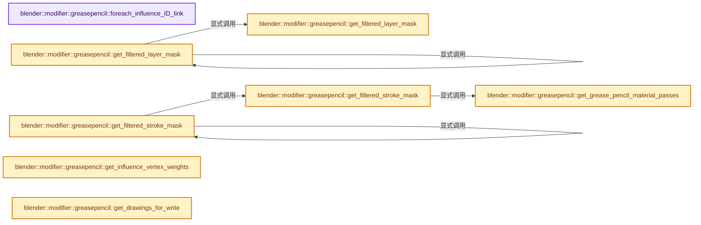
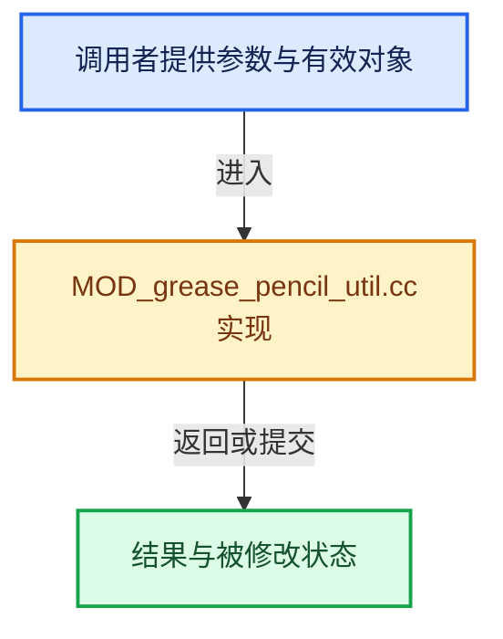

# 实现依赖专题：source/blender/modifiers/intern/MOD_grease_pencil_util.cc

[方向导航](README.md) · [符号索引](../%E7%AC%A6%E5%8F%B7%E4%BE%9D%E8%B5%96%E4%B8%8E%E5%AE%9E%E7%8E%B0%E7%B4%A2%E5%BC%95.md)

本专题从正文实际调用进入，集中保存共享实现。函数有稳定锚点，可从调用处直接跳到对应完整函数；递归与互相调用通过回链组织。

## 本文件的实现关系






## 完整成员与函数实现

<a id="f-247ba56fa4c4e56f"></a>

### `blender::modifier::greasepencil::foreach_influence_ID_link`

实现位置：[source/blender/modifiers/intern/MOD_grease_pencil_util.cc](../../../../../source/blender/modifiers/intern/MOD_grease_pencil_util.cc) · L69—L75。

接口参数：

- `GreasePencilModifierInfluenceData *influence_data`
- `Object *ob`
- `IDWalkFunc walk`
- `void *user_data`

**教学注释版**

<!-- annotated:391a96ed207d91 -->

```cpp
void foreach_influence_ID_link(GreasePencilModifierInfluenceData *influence_data,
                               Object *ob,
                               IDWalkFunc walk,
                               void *user_data)
{
  walk(user_data, ob, reinterpret_cast<ID **>(&influence_data->material), IDWALK_CB_USER);
}
```

<details>
<summary>核对原始源码：source/blender/modifiers/intern/MOD_grease_pencil_util.cc · L69—L75</summary>

<!-- original:391a96ed207d91:source/blender/modifiers/intern/MOD_grease_pencil_util.cc:69:75 -->

```cpp
void foreach_influence_ID_link(GreasePencilModifierInfluenceData *influence_data,
                               Object *ob,
                               IDWalkFunc walk,
                               void *user_data)
{
  walk(user_data, ob, reinterpret_cast<ID **>(&influence_data->material), IDWALK_CB_USER);
}
```

</details>

**继续追踪实现**

- `walk` → [调用协议](../%E6%A8%A1%E6%9D%BF%E5%AE%8F%E4%B8%8E%E5%8A%A8%E6%80%81%E5%88%86%E6%B4%BE%E5%8D%8F%E8%AE%AE.md)：局部可调用对象，须结合其初始化与捕获环境。调用位置L74。

<a id="f-14ee5d499adc9fd0"></a>

### `blender::modifier::greasepencil::get_grease_pencil_material_passes`

实现位置：[source/blender/modifiers/intern/MOD_grease_pencil_util.cc](../../../../../source/blender/modifiers/intern/MOD_grease_pencil_util.cc) · L199—L211。

接口参数：

- `const Object *ob`

**教学注释版**

<!-- annotated:82adc9a893263e -->

```cpp
static Vector<int> get_grease_pencil_material_passes(const Object *ob)
{
  short *totcol = BKE_object_material_len_p(const_cast<Object *>(ob));
  Vector<int> result(*totcol, 0);
  for (short i = 0; i < *totcol; i++) {
    const Material *ma = BKE_object_material_get(const_cast<Object *>(ob), i + 1);
    if (ma) {
      /* Pass index of the grease pencil material. */
      result[i] = ma->gp_style->index;
    }
  }
  return result;
}
```

<details>
<summary>核对原始源码：source/blender/modifiers/intern/MOD_grease_pencil_util.cc · L199—L211</summary>

<!-- original:82adc9a893263e:source/blender/modifiers/intern/MOD_grease_pencil_util.cc:199:211 -->

```cpp
static Vector<int> get_grease_pencil_material_passes(const Object *ob)
{
  short *totcol = BKE_object_material_len_p(const_cast<Object *>(ob));
  Vector<int> result(*totcol, 0);
  for (short i = 0; i < *totcol; i++) {
    const Material *ma = BKE_object_material_get(const_cast<Object *>(ob), i + 1);
    if (ma) {
      /* Pass index of the grease pencil material. */
      result[i] = ma->gp_style->index;
    }
  }
  return result;
}
```

</details>

**沿实际写入检查状态**

- `result[i] = ma->gp_style->index;`

**结果出口**

- `return result;`

**继续追踪实现**

- `BKE_object_material_len_p` → [blender::BKE_object_material_len_p · L405](%E4%BE%9D%E8%B5%96-material-aea8ec.md#f-4bef3241c966494d)。
- `BKE_object_material_get` → [blender::BKE_object_material_get · L759](%E4%BE%9D%E8%B5%96-material-aea8ec.md#f-9e9ad276ccef84b3)。

<a id="f-6438bea51141f9db"></a>

### `blender::modifier::greasepencil::get_filtered_layer_mask`

实现位置：[source/blender/modifiers/intern/MOD_grease_pencil_util.cc](../../../../../source/blender/modifiers/intern/MOD_grease_pencil_util.cc) · L213—L266。

接口参数：

- `const GreasePencil &grease_pencil`
- `const std::optional<StringRef> tree_node_name_filter`
- `const std::optional<int> layer_pass_filter`
- `const bool layer_filter_invert`
- `const bool layer_pass_filter_invert`
- `IndexMaskMemory &memory`

**教学注释版**

<!-- annotated:fe7626a4f38675 -->

```cpp
static IndexMask get_filtered_layer_mask(const GreasePencil &grease_pencil,
                                         const std::optional<StringRef> tree_node_name_filter,
                                         const std::optional<int> layer_pass_filter,
                                         const bool layer_filter_invert,
                                         const bool layer_pass_filter_invert,
                                         IndexMaskMemory &memory)
{
  const IndexMask full_mask = grease_pencil.layers().index_range();
  if (!tree_node_name_filter && !layer_pass_filter) {
    return full_mask;
  }

  bke::AttributeAccessor layer_attributes = grease_pencil.attributes();
  const Span<const Layer *> layers = grease_pencil.layers();
  const VArray<int> layer_passes =
      layer_attributes.lookup_or_default<int>("pass_index", bke::AttrDomain::Layer, 0).varray;

  const LayerGroup *filter_layer_group = nullptr;
  if (tree_node_name_filter) {
    for (const LayerGroup *group : grease_pencil.layer_groups()) {
      if (group->name() == tree_node_name_filter.value()) {
        filter_layer_group = group;
        break;
      }
    }
  }

  IndexMask result = IndexMask::from_predicate(full_mask, memory, [&](const int64_t layer_i) {
    if (tree_node_name_filter) {
      const Layer *layer = layers[layer_i];
      if (filter_layer_group) {
        const bool match = layer->is_child_of(*filter_layer_group);
        if (match == layer_filter_invert) {
          return false;
        }
      }
      else {
        const bool match = (layer->name() == tree_node_name_filter.value());
        if (match == layer_filter_invert) {
          return false;
        }
      }
    }
    if (layer_pass_filter) {
      const int layer_pass = layer_passes.get(layer_i);
      const bool match = (layer_pass == layer_pass_filter.value());
      if (match == layer_pass_filter_invert) {
        return false;
      }
    }
    return true;
  });
  return result;
}
```

<details>
<summary>核对原始源码：source/blender/modifiers/intern/MOD_grease_pencil_util.cc · L213—L266</summary>

<!-- original:fe7626a4f38675:source/blender/modifiers/intern/MOD_grease_pencil_util.cc:213:266 -->

```cpp
static IndexMask get_filtered_layer_mask(const GreasePencil &grease_pencil,
                                         const std::optional<StringRef> tree_node_name_filter,
                                         const std::optional<int> layer_pass_filter,
                                         const bool layer_filter_invert,
                                         const bool layer_pass_filter_invert,
                                         IndexMaskMemory &memory)
{
  const IndexMask full_mask = grease_pencil.layers().index_range();
  if (!tree_node_name_filter && !layer_pass_filter) {
    return full_mask;
  }

  bke::AttributeAccessor layer_attributes = grease_pencil.attributes();
  const Span<const Layer *> layers = grease_pencil.layers();
  const VArray<int> layer_passes =
      layer_attributes.lookup_or_default<int>("pass_index", bke::AttrDomain::Layer, 0).varray;

  const LayerGroup *filter_layer_group = nullptr;
  if (tree_node_name_filter) {
    for (const LayerGroup *group : grease_pencil.layer_groups()) {
      if (group->name() == tree_node_name_filter.value()) {
        filter_layer_group = group;
        break;
      }
    }
  }

  IndexMask result = IndexMask::from_predicate(full_mask, memory, [&](const int64_t layer_i) {
    if (tree_node_name_filter) {
      const Layer *layer = layers[layer_i];
      if (filter_layer_group) {
        const bool match = layer->is_child_of(*filter_layer_group);
        if (match == layer_filter_invert) {
          return false;
        }
      }
      else {
        const bool match = (layer->name() == tree_node_name_filter.value());
        if (match == layer_filter_invert) {
          return false;
        }
      }
    }
    if (layer_pass_filter) {
      const int layer_pass = layer_passes.get(layer_i);
      const bool match = (layer_pass == layer_pass_filter.value());
      if (match == layer_pass_filter_invert) {
        return false;
      }
    }
    return true;
  });
  return result;
}
```

</details>

**沿实际写入检查状态**

- `filter_layer_group = group;`

**结果出口**

- `return full_mask;`
- `return false;`
- `return true;`
- `return result;`

**继续追踪实现**

- `grease_pencil.layers().index_range` → [调用协议](../%E6%A8%A1%E6%9D%BF%E5%AE%8F%E4%B8%8E%E5%8A%A8%E6%80%81%E5%88%86%E6%B4%BE%E5%8D%8F%E8%AE%AE.md)：接收对象类型依赖auto、返回值或模板实例；不按同名猜测目标。调用位置L220。
- `grease_pencil.layers` → [blender::GreasePencil::layers · L3983](%E4%BE%9D%E8%B5%96-grease_pencil-f750d6.md#f-15d64ed11a2babc0)。
- `grease_pencil.attributes` → [blender::GreasePencil::attributes · L4779](%E4%BE%9D%E8%B5%96-grease_pencil-f750d6.md#f-ec6cc4692f8712ff)。
- `layer_attributes.lookup_or_default<int>` → [blender::bke::AttributeAccessor::lookup_or_default · L415](%E4%BE%9D%E8%B5%96-attribute_access-bceef3.md#f-a0cc3e316f1da4bd)；[blender::bke::AttributeAccessor::lookup_or_default · L643](08-AttributeAccessor%E6%8E%A5%E5%8F%A3.md#f-e3d2ed81ebe0af61)。同名重载需按实参类型选择。
- `grease_pencil.layer_groups` → [blender::GreasePencil::layer_groups · L3995](%E4%BE%9D%E8%B5%96-grease_pencil-f750d6.md#f-d6163a0e878c9be0)。
- `group->name` → [调用协议](../%E6%A8%A1%E6%9D%BF%E5%AE%8F%E4%B8%8E%E5%8A%A8%E6%80%81%E5%88%86%E6%B4%BE%E5%8D%8F%E8%AE%AE.md)：接收对象类型依赖auto、返回值或模板实例；不按同名猜测目标。调用位置L233。
- `tree_node_name_filter.value` → [外部契约](https://eel.is/c++draft/)：这个边界按实际表达式及所属类型核对参数、返回值、寿命与失败行为。这里提供接口入口，不声称已解释该第三方版本的内部实现。
- `IndexMask::from_predicate` → [blender::index_mask::IndexMask::from_predicate · L1073](../04-%E8%99%9A%E6%8B%9F%E6%95%B0%E7%BB%84%E4%B8%8E%E7%B4%A2%E5%BC%95%E9%80%89%E6%8B%A9/12-%E9%87%8D%E6%9E%84%E5%8E%86%E5%8F%B2%E4%B8%8E%E5%9F%BA%E5%87%86%E7%BB%83%E4%B9%A0.md#f-3864daa059098df8)。
- `layer->is_child_of` → [blender::bke::greasepencil::TreeNode::is_child_of · L931](%E4%BE%9D%E8%B5%96-BKE_grease_pencil-42a7a1.md#f-897558c8d619f098)。
- `layer->name` → [调用协议](../%E6%A8%A1%E6%9D%BF%E5%AE%8F%E4%B8%8E%E5%8A%A8%E6%80%81%E5%88%86%E6%B4%BE%E5%8D%8F%E8%AE%AE.md)：由接收对象具体类型或运行时策略提供实现。调用位置L250。
- `layer_passes.get` → [调用协议](../%E6%A8%A1%E6%9D%BF%E5%AE%8F%E4%B8%8E%E5%8A%A8%E6%80%81%E5%88%86%E6%B4%BE%E5%8D%8F%E8%AE%AE.md)：由接收对象具体类型或运行时策略提供实现。调用位置L257。
- `layer_pass_filter.value` → [外部契约](https://eel.is/c++draft/)：这个边界按实际表达式及所属类型核对参数、返回值、寿命与失败行为。这里提供接口入口，不声称已解释该第三方版本的内部实现。

<a id="f-e3d0f9748ecdf34b"></a>

### `blender::modifier::greasepencil::get_filtered_layer_mask`

实现位置：[source/blender/modifiers/intern/MOD_grease_pencil_util.cc](../../../../../source/blender/modifiers/intern/MOD_grease_pencil_util.cc) · L268—L283。

接口参数：

- `const GreasePencil &grease_pencil`
- `const GreasePencilModifierInfluenceData &influence_data`
- `IndexMaskMemory &memory`

**教学注释版**

<!-- annotated:2cf1c213ceac2b -->

```cpp
IndexMask get_filtered_layer_mask(const GreasePencil &grease_pencil,
                                  const GreasePencilModifierInfluenceData &influence_data,
                                  IndexMaskMemory &memory)
{
  return get_filtered_layer_mask(
      grease_pencil,
      influence_data.layer_name[0] != '\0' ?
          std::make_optional<StringRef>(influence_data.layer_name) :
          std::nullopt,
      (influence_data.flag & GREASE_PENCIL_INFLUENCE_USE_LAYER_PASS_FILTER) ?
          std::make_optional<int>(influence_data.layer_pass) :
          std::nullopt,
      influence_data.flag & GREASE_PENCIL_INFLUENCE_INVERT_LAYER_FILTER,
      influence_data.flag & GREASE_PENCIL_INFLUENCE_INVERT_LAYER_PASS_FILTER,
      memory);
}
```

<details>
<summary>核对原始源码：source/blender/modifiers/intern/MOD_grease_pencil_util.cc · L268—L283</summary>

<!-- original:2cf1c213ceac2b:source/blender/modifiers/intern/MOD_grease_pencil_util.cc:268:283 -->

```cpp
IndexMask get_filtered_layer_mask(const GreasePencil &grease_pencil,
                                  const GreasePencilModifierInfluenceData &influence_data,
                                  IndexMaskMemory &memory)
{
  return get_filtered_layer_mask(
      grease_pencil,
      influence_data.layer_name[0] != '\0' ?
          std::make_optional<StringRef>(influence_data.layer_name) :
          std::nullopt,
      (influence_data.flag & GREASE_PENCIL_INFLUENCE_USE_LAYER_PASS_FILTER) ?
          std::make_optional<int>(influence_data.layer_pass) :
          std::nullopt,
      influence_data.flag & GREASE_PENCIL_INFLUENCE_INVERT_LAYER_FILTER,
      influence_data.flag & GREASE_PENCIL_INFLUENCE_INVERT_LAYER_PASS_FILTER,
      memory);
}
```

</details>

**结果出口**

- `return get_filtered_layer_mask(`

**继续追踪实现**

- `get_filtered_layer_mask` → [blender::modifier::greasepencil::get_filtered_layer_mask · L213](%E4%BE%9D%E8%B5%96-MOD_grease_pencil_util-d0b437.md#f-6438bea51141f9db)；[blender::modifier::greasepencil::get_filtered_layer_mask · L268](%E4%BE%9D%E8%B5%96-MOD_grease_pencil_util-d0b437.md#f-e3d0f9748ecdf34b)。同名重载需按实参类型选择。
- `std::make_optional<StringRef>` → [外部契约](https://eel.is/c++draft/)：这个边界按实际表达式及所属类型核对参数、返回值、寿命与失败行为。这里提供接口入口，不声称已解释该第三方版本的内部实现。
- `std::make_optional<int>` → [外部契约](https://eel.is/c++draft/)：这个边界按实际表达式及所属类型核对参数、返回值、寿命与失败行为。这里提供接口入口，不声称已解释该第三方版本的内部实现。

<a id="f-30c219d04de7dec3"></a>

### `blender::modifier::greasepencil::get_filtered_stroke_mask`

实现位置：[source/blender/modifiers/intern/MOD_grease_pencil_util.cc](../../../../../source/blender/modifiers/intern/MOD_grease_pencil_util.cc) · L285—L324。

接口参数：

- `const Object *ob`
- `const bke::CurvesGeometry &curves`
- `const Material *material_filter`
- `const std::optional<int> material_pass_filter`
- `const bool material_filter_invert`
- `const bool material_pass_filter_invert`
- `IndexMaskMemory &memory`

**教学注释版**

<!-- annotated:9fd6cd1d054df9 -->

```cpp
static IndexMask get_filtered_stroke_mask(const Object *ob,
                                          const bke::CurvesGeometry &curves,
                                          const Material *material_filter,
                                          const std::optional<int> material_pass_filter,
                                          const bool material_filter_invert,
                                          const bool material_pass_filter_invert,
                                          IndexMaskMemory &memory)
{
  const IndexMask full_mask = curves.curves_range();
  if (!material_filter && !material_pass_filter) {
    return full_mask;
  }

  const int material_filter_index = BKE_object_material_index_get(
      const_cast<Object *>(ob), const_cast<Material *>(material_filter));
  const Vector<int> material_pass_by_index = get_grease_pencil_material_passes(ob);

  bke::AttributeAccessor attributes = curves.attributes();
  VArray<int> stroke_materials =
      attributes.lookup_or_default<int>("material_index", bke::AttrDomain::Curve, 0).varray;

  IndexMask result = IndexMask::from_predicate(full_mask, memory, [&](const int64_t stroke_i) {
    const int material_index = stroke_materials.get(stroke_i);
    if (material_filter != nullptr) {
      const bool match = (material_index == material_filter_index);
      if (match == material_filter_invert) {
        return false;
      }
    }
    if (material_pass_filter) {
      const int material_pass = material_pass_by_index[material_index];
      const bool match = (material_pass == material_pass_filter.value());
      if (match == material_pass_filter_invert) {
        return false;
      }
    }
    return true;
  });
  return result;
}
```

<details>
<summary>核对原始源码：source/blender/modifiers/intern/MOD_grease_pencil_util.cc · L285—L324</summary>

<!-- original:9fd6cd1d054df9:source/blender/modifiers/intern/MOD_grease_pencil_util.cc:285:324 -->

```cpp
static IndexMask get_filtered_stroke_mask(const Object *ob,
                                          const bke::CurvesGeometry &curves,
                                          const Material *material_filter,
                                          const std::optional<int> material_pass_filter,
                                          const bool material_filter_invert,
                                          const bool material_pass_filter_invert,
                                          IndexMaskMemory &memory)
{
  const IndexMask full_mask = curves.curves_range();
  if (!material_filter && !material_pass_filter) {
    return full_mask;
  }

  const int material_filter_index = BKE_object_material_index_get(
      const_cast<Object *>(ob), const_cast<Material *>(material_filter));
  const Vector<int> material_pass_by_index = get_grease_pencil_material_passes(ob);

  bke::AttributeAccessor attributes = curves.attributes();
  VArray<int> stroke_materials =
      attributes.lookup_or_default<int>("material_index", bke::AttrDomain::Curve, 0).varray;

  IndexMask result = IndexMask::from_predicate(full_mask, memory, [&](const int64_t stroke_i) {
    const int material_index = stroke_materials.get(stroke_i);
    if (material_filter != nullptr) {
      const bool match = (material_index == material_filter_index);
      if (match == material_filter_invert) {
        return false;
      }
    }
    if (material_pass_filter) {
      const int material_pass = material_pass_by_index[material_index];
      const bool match = (material_pass == material_pass_filter.value());
      if (match == material_pass_filter_invert) {
        return false;
      }
    }
    return true;
  });
  return result;
}
```

</details>

**结果出口**

- `return full_mask;`
- `return false;`
- `return true;`
- `return result;`

**继续追踪实现**

- `curves.curves_range` → [blender::bke::CurvesGeometry::curves_range · L1023](04-CurvesGeometry%E5%AD%98%E5%82%A8.md#f-9aedfb1afc5ebcfb)。
- `BKE_object_material_index_get` → [blender::BKE_object_material_index_get · L941](%E4%BE%9D%E8%B5%96-material-aea8ec.md#f-7ab53a5a12f32d0c)。
- `get_grease_pencil_material_passes` → [blender::modifier::greasepencil::get_grease_pencil_material_passes · L199](%E4%BE%9D%E8%B5%96-MOD_grease_pencil_util-d0b437.md#f-14ee5d499adc9fd0)。
- `curves.attributes` → [blender::bke::CurvesGeometry::attributes · L1908](%E4%BE%9D%E8%B5%96-curves_geometry-ad7f9f.md#f-8e24fbf758862a22)。
- `attributes.lookup_or_default<int>` → [blender::bke::AttributeAccessor::lookup_or_default · L415](%E4%BE%9D%E8%B5%96-attribute_access-bceef3.md#f-a0cc3e316f1da4bd)；[blender::bke::AttributeAccessor::lookup_or_default · L643](08-AttributeAccessor%E6%8E%A5%E5%8F%A3.md#f-e3d2ed81ebe0af61)。同名重载需按实参类型选择。
- `IndexMask::from_predicate` → [blender::index_mask::IndexMask::from_predicate · L1073](../04-%E8%99%9A%E6%8B%9F%E6%95%B0%E7%BB%84%E4%B8%8E%E7%B4%A2%E5%BC%95%E9%80%89%E6%8B%A9/12-%E9%87%8D%E6%9E%84%E5%8E%86%E5%8F%B2%E4%B8%8E%E5%9F%BA%E5%87%86%E7%BB%83%E4%B9%A0.md#f-3864daa059098df8)。
- `stroke_materials.get` → [调用协议](../%E6%A8%A1%E6%9D%BF%E5%AE%8F%E4%B8%8E%E5%8A%A8%E6%80%81%E5%88%86%E6%B4%BE%E5%8D%8F%E8%AE%AE.md)：由接收对象具体类型或运行时策略提供实现。调用位置L307。
- `material_pass_filter.value` → [外部契约](https://eel.is/c++draft/)：这个边界按实际表达式及所属类型核对参数、返回值、寿命与失败行为。这里提供接口入口，不声称已解释该第三方版本的内部实现。

<a id="f-970c3bc880e4f350"></a>

### `blender::modifier::greasepencil::get_filtered_stroke_mask`

实现位置：[source/blender/modifiers/intern/MOD_grease_pencil_util.cc](../../../../../source/blender/modifiers/intern/MOD_grease_pencil_util.cc) · L326—L341。

接口参数：

- `const Object *ob`
- `const bke::CurvesGeometry &curves`
- `const GreasePencilModifierInfluenceData &influence_data`
- `IndexMaskMemory &memory`

**教学注释版**

<!-- annotated:4cec2781430412 -->

```cpp
IndexMask get_filtered_stroke_mask(const Object *ob,
                                   const bke::CurvesGeometry &curves,
                                   const GreasePencilModifierInfluenceData &influence_data,
                                   IndexMaskMemory &memory)
{
  return get_filtered_stroke_mask(
      ob,
      curves,
      influence_data.material,
      (influence_data.flag & GREASE_PENCIL_INFLUENCE_USE_MATERIAL_PASS_FILTER) ?
          std::make_optional<int>(influence_data.material_pass) :
          std::nullopt,
      influence_data.flag & GREASE_PENCIL_INFLUENCE_INVERT_MATERIAL_FILTER,
      influence_data.flag & GREASE_PENCIL_INFLUENCE_INVERT_MATERIAL_PASS_FILTER,
      memory);
}
```

<details>
<summary>核对原始源码：source/blender/modifiers/intern/MOD_grease_pencil_util.cc · L326—L341</summary>

<!-- original:4cec2781430412:source/blender/modifiers/intern/MOD_grease_pencil_util.cc:326:341 -->

```cpp
IndexMask get_filtered_stroke_mask(const Object *ob,
                                   const bke::CurvesGeometry &curves,
                                   const GreasePencilModifierInfluenceData &influence_data,
                                   IndexMaskMemory &memory)
{
  return get_filtered_stroke_mask(
      ob,
      curves,
      influence_data.material,
      (influence_data.flag & GREASE_PENCIL_INFLUENCE_USE_MATERIAL_PASS_FILTER) ?
          std::make_optional<int>(influence_data.material_pass) :
          std::nullopt,
      influence_data.flag & GREASE_PENCIL_INFLUENCE_INVERT_MATERIAL_FILTER,
      influence_data.flag & GREASE_PENCIL_INFLUENCE_INVERT_MATERIAL_PASS_FILTER,
      memory);
}
```

</details>

**结果出口**

- `return get_filtered_stroke_mask(`

**继续追踪实现**

- `get_filtered_stroke_mask` → [blender::modifier::greasepencil::get_filtered_stroke_mask · L285](%E4%BE%9D%E8%B5%96-MOD_grease_pencil_util-d0b437.md#f-30c219d04de7dec3)；[blender::modifier::greasepencil::get_filtered_stroke_mask · L326](%E4%BE%9D%E8%B5%96-MOD_grease_pencil_util-d0b437.md#f-970c3bc880e4f350)。同名重载需按实参类型选择。
- `std::make_optional<int>` → [外部契约](https://eel.is/c++draft/)：这个边界按实际表达式及所属类型核对参数、返回值、寿命与失败行为。这里提供接口入口，不声称已解释该第三方版本的内部实现。

<a id="f-6f4fdb5693985db9"></a>

### `blender::modifier::greasepencil::get_influence_vertex_weights`

实现位置：[source/blender/modifiers/intern/MOD_grease_pencil_util.cc](../../../../../source/blender/modifiers/intern/MOD_grease_pencil_util.cc) · L343—L366。

接口参数：

- `const bke::CurvesGeometry &curves`
- `const GreasePencilModifierInfluenceData &influence_data`

**教学注释版**

<!-- annotated:bdfc724502d7cd -->

```cpp
VArray<float> get_influence_vertex_weights(const bke::CurvesGeometry &curves,
                                           const GreasePencilModifierInfluenceData &influence_data)
{
  if (influence_data.vertex_group_name[0] == '\0') {
    /* If vertex group is not set, use full weight for all vertices. */
    return VArray<float>::from_single(1.0f, curves.point_num);
  }
  /* Vertex group weights, with zero weight as a fallback. */
  VArray<float> influence_weights = *curves.attributes().lookup_or_default<float>(
      influence_data.vertex_group_name, bke::AttrDomain::Point, 0.0f);

  if (influence_data.flag & GREASE_PENCIL_INFLUENCE_INVERT_VERTEX_GROUP) {
    Array<float> influence_weights_inverted(influence_weights.size());
    threading::parallel_for(
        // [讲解] influence_weights_inverted.index_range：查询固定有效长度及其索引范围。
        influence_weights_inverted.index_range(), 8192, [&](const IndexRange range) {
          for (const int i : range) {
            influence_weights_inverted[i] = 1.0f - influence_weights[i];
          }
        });
    return VArray<float>::from_container(influence_weights_inverted);
  }

  return influence_weights;
}
```

<details>
<summary>核对原始源码：source/blender/modifiers/intern/MOD_grease_pencil_util.cc · L343—L366</summary>

<!-- original:bdfc724502d7cd:source/blender/modifiers/intern/MOD_grease_pencil_util.cc:343:366 -->

```cpp
VArray<float> get_influence_vertex_weights(const bke::CurvesGeometry &curves,
                                           const GreasePencilModifierInfluenceData &influence_data)
{
  if (influence_data.vertex_group_name[0] == '\0') {
    /* If vertex group is not set, use full weight for all vertices. */
    return VArray<float>::from_single(1.0f, curves.point_num);
  }
  /* Vertex group weights, with zero weight as a fallback. */
  VArray<float> influence_weights = *curves.attributes().lookup_or_default<float>(
      influence_data.vertex_group_name, bke::AttrDomain::Point, 0.0f);

  if (influence_data.flag & GREASE_PENCIL_INFLUENCE_INVERT_VERTEX_GROUP) {
    Array<float> influence_weights_inverted(influence_weights.size());
    threading::parallel_for(
        influence_weights_inverted.index_range(), 8192, [&](const IndexRange range) {
          for (const int i : range) {
            influence_weights_inverted[i] = 1.0f - influence_weights[i];
          }
        });
    return VArray<float>::from_container(influence_weights_inverted);
  }

  return influence_weights;
}
```

</details>

**沿实际写入检查状态**

- `influence_weights_inverted[i] = 1.0f - influence_weights[i];`

**结果出口**

- `return VArray<float>::from_single(1.0f, curves.point_num);`
- `return VArray<float>::from_container(influence_weights_inverted);`
- `return influence_weights;`

**继续追踪实现**

- `VArray<float>::from_single` → [blender::GVArray::from_single · L880](../04-%E8%99%9A%E6%8B%9F%E6%95%B0%E7%BB%84%E4%B8%8E%E7%B4%A2%E5%BC%95%E9%80%89%E6%8B%A9/05-GVArray%E8%BF%90%E8%A1%8C%E6%97%B6%E7%B1%BB%E5%9E%8B.md#f-1c85e09520e47c5a)；[blender::VArray::from_single · L759](../04-%E8%99%9A%E6%8B%9F%E6%95%B0%E7%BB%84%E4%B8%8E%E7%B4%A2%E5%BC%95%E9%80%89%E6%8B%A9/03-%E5%8D%95%E5%80%BC%E4%B8%8ESpan%E8%A1%A8%E7%A4%BA.md#f-ea0b7b864c7f4785)。同名重载需按实参类型选择。
- `curves.attributes().lookup_or_default<float>` → [调用协议](../%E6%A8%A1%E6%9D%BF%E5%AE%8F%E4%B8%8E%E5%8A%A8%E6%80%81%E5%88%86%E6%B4%BE%E5%8D%8F%E8%AE%AE.md)：接收对象类型依赖auto、返回值或模板实例；不按同名猜测目标。调用位置L351。
- `curves.attributes` → [blender::bke::CurvesGeometry::attributes · L1908](%E4%BE%9D%E8%B5%96-curves_geometry-ad7f9f.md#f-8e24fbf758862a22)。
- `influence_weights.size` → [调用协议](../%E6%A8%A1%E6%9D%BF%E5%AE%8F%E4%B8%8E%E5%8A%A8%E6%80%81%E5%88%86%E6%B4%BE%E5%8D%8F%E8%AE%AE.md)：由接收对象具体类型或运行时策略提供实现。调用位置L355。
- `threading::parallel_for` → [blender::threading::parallel_for · L68](../11-Depsgraph%E4%B8%8E%E5%B9%B6%E8%A1%8C%E4%BB%BB%E5%8A%A1%E7%B3%BB%E7%BB%9F/07-%E4%BB%BB%E5%8A%A1%E6%B1%A0%E4%B8%8ETBB%E6%8E%A5%E5%85%A5.md#f-838294754c24426c)。
- `influence_weights_inverted.index_range` → [blender::Array::index_range · L371](../01-%E5%9F%BA%E7%A1%80%E5%AE%B9%E5%99%A8%E4%B8%8E%E7%8E%B0%E4%BB%A3CPP/08-Array%E5%A4%8D%E5%88%B6%E7%A7%BB%E5%8A%A8%E4%B8%8E%E9%94%80%E6%AF%81.md#f-50a09e14742887a0)。
- `VArray<float>::from_container` → [blender::VArray::from_container · L809](../04-%E8%99%9A%E6%8B%9F%E6%95%B0%E7%BB%84%E4%B8%8E%E7%B4%A2%E5%BC%95%E9%80%89%E6%8B%A9/03-%E5%8D%95%E5%80%BC%E4%B8%8ESpan%E8%A1%A8%E7%A4%BA.md#f-0e0990c28b1aac89)。

<a id="f-cef3871c31259376"></a>

### `blender::modifier::greasepencil::get_drawings_for_write`

实现位置：[source/blender/modifiers/intern/MOD_grease_pencil_util.cc](../../../../../source/blender/modifiers/intern/MOD_grease_pencil_util.cc) · L368—L382。

接口参数：

- `GreasePencil &grease_pencil`
- `const IndexMask &layer_mask`
- `const int frame`

**教学注释版**

<!-- annotated:1ca994702fab15 -->

```cpp
Vector<bke::greasepencil::Drawing *> get_drawings_for_write(GreasePencil &grease_pencil,
                                                            const IndexMask &layer_mask,
                                                            const int frame)
{
  using namespace blender::bke::greasepencil;
  VectorSet<Drawing *> drawings;
  layer_mask.foreach_index([&](const int64_t layer_i) {
    const Layer &layer = grease_pencil.layer(layer_i);
    /* Set of owned drawings, ignore drawing references to other data blocks. */
    if (Drawing *drawing = grease_pencil.get_drawing_at(layer, frame)) {
      // [讲解] drawings.add：按哈希与相等关系加入键或键值。
      drawings.add(drawing);
    }
  });
  return Vector<Drawing *>(drawings.as_span());
}
```

<details>
<summary>核对原始源码：source/blender/modifiers/intern/MOD_grease_pencil_util.cc · L368—L382</summary>

<!-- original:1ca994702fab15:source/blender/modifiers/intern/MOD_grease_pencil_util.cc:368:382 -->

```cpp
Vector<bke::greasepencil::Drawing *> get_drawings_for_write(GreasePencil &grease_pencil,
                                                            const IndexMask &layer_mask,
                                                            const int frame)
{
  using namespace blender::bke::greasepencil;
  VectorSet<Drawing *> drawings;
  layer_mask.foreach_index([&](const int64_t layer_i) {
    const Layer &layer = grease_pencil.layer(layer_i);
    /* Set of owned drawings, ignore drawing references to other data blocks. */
    if (Drawing *drawing = grease_pencil.get_drawing_at(layer, frame)) {
      drawings.add(drawing);
    }
  });
  return Vector<Drawing *>(drawings.as_span());
}
```

</details>

**结果出口**

- `return Vector<Drawing *>(drawings.as_span());`

**继续追踪实现**

- `layer_mask.foreach_index` → [blender::index_mask::IndexMask::foreach_index · L855](../04-%E8%99%9A%E6%8B%9F%E6%95%B0%E7%BB%84%E4%B8%8E%E7%B4%A2%E5%BC%95%E9%80%89%E6%8B%A9/09-%E5%88%86%E6%AE%B5%E5%AD%98%E5%82%A8%E4%B8%8E%E9%81%8D%E5%8E%86.md#f-cd6cd317e2e2812c)。
- `grease_pencil.layer` → [blender::GreasePencil::layer · L1144](%E4%BE%9D%E8%B5%96-BKE_grease_pencil-42a7a1.md#f-7196ac6431650af5)；[blender::GreasePencil::layer · L1148](%E4%BE%9D%E8%B5%96-BKE_grease_pencil-42a7a1.md#f-82f7eddc62fb11fe)。同名重载需按实参类型选择。
- `grease_pencil.get_drawing_at` → [blender::GreasePencil::get_drawing_at · L3814](%E4%BE%9D%E8%B5%96-grease_pencil-f750d6.md#f-c38643507419f9ee)；[blender::GreasePencil::get_drawing_at · L3834](%E4%BE%9D%E8%B5%96-grease_pencil-f750d6.md#f-42398964c13c6abb)。同名重载需按实参类型选择。
- `drawings.add` → [blender::VectorSet::add · L351](../01-%E5%9F%BA%E7%A1%80%E5%AE%B9%E5%99%A8%E4%B8%8E%E7%8E%B0%E4%BB%A3CPP/14-VectorSet%E7%A8%B3%E5%AE%9A%E7%B4%A2%E5%BC%95%E4%B8%8E%E5%8E%BB%E9%87%8D.md#f-96bfe2bf376d6298)；[blender::VectorSet::add · L355](../01-%E5%9F%BA%E7%A1%80%E5%AE%B9%E5%99%A8%E4%B8%8E%E7%8E%B0%E4%BB%A3CPP/14-VectorSet%E7%A8%B3%E5%AE%9A%E7%B4%A2%E5%BC%95%E4%B8%8E%E5%8E%BB%E9%87%8D.md#f-c0474f6a0568033b)。同名重载需按实参类型选择。
- `Vector<Drawing *>` → [KDL::Vector](%E4%BE%9D%E8%B5%96-traits-655f3e.md#t-3494ab227c7f)；[KDL::Vector](%E4%BE%9D%E8%B5%96-frames-531715.md#t-7db3cae4c06c)；[KDL::Vector](%E4%BE%9D%E8%B5%96-frames-531715.md#t-d9f123375f9e)；[blender::Vector](../01-%E5%9F%BA%E7%A1%80%E5%AE%B9%E5%99%A8%E4%B8%8E%E7%8E%B0%E4%BB%A3CPP/%E4%BE%9D%E8%B5%96-BLI_vector-c355b1.md#t-14451f176559)；[blender::nodes::decl::Vector](../09-LazyFunction%E4%B8%8E%E8%8A%82%E7%82%B9%E6%89%A7%E8%A1%8C%E6%9E%B6%E6%9E%84/%E4%BE%9D%E8%B5%96-NOD_socket_declarations-8d29c1.md#t-244cfac6be12)。
- `drawings.as_span` → [blender::VectorSet::as_span · L326](../01-%E5%9F%BA%E7%A1%80%E5%AE%B9%E5%99%A8%E4%B8%8E%E7%8E%B0%E4%BB%A3CPP/14-VectorSet%E7%A8%B3%E5%AE%9A%E7%B4%A2%E5%BC%95%E4%B8%8E%E5%8E%BB%E9%87%8D.md#f-76ed81b1cfbe99ad)。

<a id="f-ec5c582e82a4d4fb"></a>

### `blender::modifier::greasepencil::get_drawing_infos_by_layer`

实现位置：[source/blender/modifiers/intern/MOD_grease_pencil_util.cc](../../../../../source/blender/modifiers/intern/MOD_grease_pencil_util.cc) · L384—L404。

接口参数：

- `GreasePencil &grease_pencil`
- `const IndexMask &layer_mask`
- `const int frame`

**教学注释版**

<!-- annotated:1260d95ad04133 -->

```cpp
Vector<LayerDrawingInfo> get_drawing_infos_by_layer(GreasePencil &grease_pencil,
                                                    const IndexMask &layer_mask,
                                                    const int frame)
{
  using namespace blender::bke::greasepencil;
  Set<Drawing *> drawings;
  Vector<LayerDrawingInfo> drawing_infos;
  layer_mask.foreach_index([&](const int64_t layer_i) {
    const Layer &layer = grease_pencil.layer(layer_i);
    Drawing *drawing = grease_pencil.get_drawing_at(layer, frame);
    if (drawing == nullptr) {
      return;
    }

    // [讲解] drawings.contains：查询活项数量或键是否存在。
    if (!drawings.contains(drawing)) {
      // [讲解] drawings.add_new：按哈希与相等关系加入键或键值。
      drawings.add_new(drawing);
      // [讲解] drawing_infos.append：在尾部建立新元素，必要时先扩大存储。
      drawing_infos.append({drawing, int(layer_i)});
    }
  });
  return drawing_infos;
}
```

<details>
<summary>核对原始源码：source/blender/modifiers/intern/MOD_grease_pencil_util.cc · L384—L404</summary>

<!-- original:1260d95ad04133:source/blender/modifiers/intern/MOD_grease_pencil_util.cc:384:404 -->

```cpp
Vector<LayerDrawingInfo> get_drawing_infos_by_layer(GreasePencil &grease_pencil,
                                                    const IndexMask &layer_mask,
                                                    const int frame)
{
  using namespace blender::bke::greasepencil;
  Set<Drawing *> drawings;
  Vector<LayerDrawingInfo> drawing_infos;
  layer_mask.foreach_index([&](const int64_t layer_i) {
    const Layer &layer = grease_pencil.layer(layer_i);
    Drawing *drawing = grease_pencil.get_drawing_at(layer, frame);
    if (drawing == nullptr) {
      return;
    }

    if (!drawings.contains(drawing)) {
      drawings.add_new(drawing);
      drawing_infos.append({drawing, int(layer_i)});
    }
  });
  return drawing_infos;
}
```

</details>

**结果出口**

- `return drawing_infos;`

**继续追踪实现**

- `layer_mask.foreach_index` → [blender::index_mask::IndexMask::foreach_index · L855](../04-%E8%99%9A%E6%8B%9F%E6%95%B0%E7%BB%84%E4%B8%8E%E7%B4%A2%E5%BC%95%E9%80%89%E6%8B%A9/09-%E5%88%86%E6%AE%B5%E5%AD%98%E5%82%A8%E4%B8%8E%E9%81%8D%E5%8E%86.md#f-cd6cd317e2e2812c)。
- `grease_pencil.layer` → [blender::GreasePencil::layer · L1144](%E4%BE%9D%E8%B5%96-BKE_grease_pencil-42a7a1.md#f-7196ac6431650af5)；[blender::GreasePencil::layer · L1148](%E4%BE%9D%E8%B5%96-BKE_grease_pencil-42a7a1.md#f-82f7eddc62fb11fe)。同名重载需按实参类型选择。
- `grease_pencil.get_drawing_at` → [blender::GreasePencil::get_drawing_at · L3814](%E4%BE%9D%E8%B5%96-grease_pencil-f750d6.md#f-c38643507419f9ee)；[blender::GreasePencil::get_drawing_at · L3834](%E4%BE%9D%E8%B5%96-grease_pencil-f750d6.md#f-42398964c13c6abb)。同名重载需按实参类型选择。
- `drawings.contains` → [blender::Set::contains · L310](../02-%E5%93%88%E5%B8%8C%E8%A1%A8%E4%B8%8E%E5%85%B3%E8%81%94%E6%95%B0%E6%8D%AE%E7%BB%93%E6%9E%84/08-Set%E4%B8%8E%E9%9B%86%E5%90%88%E8%AF%AD%E4%B9%89.md#f-af7099799494350e)。
- `drawings.add_new` → [blender::Set::add_new · L233](../02-%E5%93%88%E5%B8%8C%E8%A1%A8%E4%B8%8E%E5%85%B3%E8%81%94%E6%95%B0%E6%8D%AE%E7%BB%93%E6%9E%84/08-Set%E4%B8%8E%E9%9B%86%E5%90%88%E8%AF%AD%E4%B9%89.md#f-12f4dd65a3abaaac)；[blender::Set::add_new · L237](../02-%E5%93%88%E5%B8%8C%E8%A1%A8%E4%B8%8E%E5%85%B3%E8%81%94%E6%95%B0%E6%8D%AE%E7%BB%93%E6%9E%84/08-Set%E4%B8%8E%E9%9B%86%E5%90%88%E8%AF%AD%E4%B9%89.md#f-9c46c167cdd9bb73)。同名重载需按实参类型选择。
- `drawing_infos.append` → [blender::Vector::append · L498](../01-%E5%9F%BA%E7%A1%80%E5%AE%B9%E5%99%A8%E4%B8%8E%E7%8E%B0%E4%BB%A3CPP/11-Vector%E6%8F%92%E5%85%A5%E5%88%A0%E9%99%A4%E4%B8%8E%E9%87%8D%E6%8E%92.md#f-5bde268a69e443ec)；[blender::Vector::append · L502](../01-%E5%9F%BA%E7%A1%80%E5%AE%B9%E5%99%A8%E4%B8%8E%E7%8E%B0%E4%BB%A3CPP/11-Vector%E6%8F%92%E5%85%A5%E5%88%A0%E9%99%A4%E4%B8%8E%E9%87%8D%E6%8E%92.md#f-591e0b15e6308532)。同名重载需按实参类型选择。

<a id="f-188e0cc82983898b"></a>

### `blender::modifier::greasepencil::get_drawing_infos_by_frame`

实现位置：[source/blender/modifiers/intern/MOD_grease_pencil_util.cc](../../../../../source/blender/modifiers/intern/MOD_grease_pencil_util.cc) · L406—L430。

接口参数：

- `GreasePencil &grease_pencil`
- `const IndexMask &layer_mask`
- `const int frame`

**教学注释版**

<!-- annotated:481cae35bedc47 -->

```cpp
Vector<FrameDrawingInfo> get_drawing_infos_by_frame(GreasePencil &grease_pencil,
                                                    const IndexMask &layer_mask,
                                                    const int frame)
{
  using namespace blender::bke::greasepencil;
  Set<Drawing *> drawings;
  Vector<FrameDrawingInfo> drawing_infos;
  layer_mask.foreach_index([&](const int64_t layer_i) {
    const Layer &layer = grease_pencil.layer(layer_i);
    const std::optional<int> start_frame = layer.start_frame_at(frame);
    if (!start_frame) {
      return;
    }
    Drawing *drawing = grease_pencil.get_drawing_at(layer, *start_frame);
    if (drawing == nullptr) {
      return;
    }

    // [讲解] drawings.contains：查询活项数量或键是否存在。
    if (!drawings.contains(drawing)) {
      // [讲解] drawings.add_new：按哈希与相等关系加入键或键值。
      drawings.add_new(drawing);
      // [讲解] drawing_infos.append：在尾部建立新元素，必要时先扩大存储。
      drawing_infos.append({drawing, *start_frame});
    }
  });
  return drawing_infos;
}
```

<details>
<summary>核对原始源码：source/blender/modifiers/intern/MOD_grease_pencil_util.cc · L406—L430</summary>

<!-- original:481cae35bedc47:source/blender/modifiers/intern/MOD_grease_pencil_util.cc:406:430 -->

```cpp
Vector<FrameDrawingInfo> get_drawing_infos_by_frame(GreasePencil &grease_pencil,
                                                    const IndexMask &layer_mask,
                                                    const int frame)
{
  using namespace blender::bke::greasepencil;
  Set<Drawing *> drawings;
  Vector<FrameDrawingInfo> drawing_infos;
  layer_mask.foreach_index([&](const int64_t layer_i) {
    const Layer &layer = grease_pencil.layer(layer_i);
    const std::optional<int> start_frame = layer.start_frame_at(frame);
    if (!start_frame) {
      return;
    }
    Drawing *drawing = grease_pencil.get_drawing_at(layer, *start_frame);
    if (drawing == nullptr) {
      return;
    }

    if (!drawings.contains(drawing)) {
      drawings.add_new(drawing);
      drawing_infos.append({drawing, *start_frame});
    }
  });
  return drawing_infos;
}
```

</details>

**结果出口**

- `return drawing_infos;`

**继续追踪实现**

- `layer_mask.foreach_index` → [blender::index_mask::IndexMask::foreach_index · L855](../04-%E8%99%9A%E6%8B%9F%E6%95%B0%E7%BB%84%E4%B8%8E%E7%B4%A2%E5%BC%95%E9%80%89%E6%8B%A9/09-%E5%88%86%E6%AE%B5%E5%AD%98%E5%82%A8%E4%B8%8E%E9%81%8D%E5%8E%86.md#f-cd6cd317e2e2812c)。
- `grease_pencil.layer` → [blender::GreasePencil::layer · L1144](%E4%BE%9D%E8%B5%96-BKE_grease_pencil-42a7a1.md#f-7196ac6431650af5)；[blender::GreasePencil::layer · L1148](%E4%BE%9D%E8%B5%96-BKE_grease_pencil-42a7a1.md#f-82f7eddc62fb11fe)。同名重载需按实参类型选择。
- `layer.start_frame_at` → [blender::bke::greasepencil::Layer::start_frame_at · L1786](%E4%BE%9D%E8%B5%96-grease_pencil-f750d6.md#f-570e107fb286ae92)。
- `grease_pencil.get_drawing_at` → [blender::GreasePencil::get_drawing_at · L3814](%E4%BE%9D%E8%B5%96-grease_pencil-f750d6.md#f-c38643507419f9ee)；[blender::GreasePencil::get_drawing_at · L3834](%E4%BE%9D%E8%B5%96-grease_pencil-f750d6.md#f-42398964c13c6abb)。同名重载需按实参类型选择。
- `drawings.contains` → [blender::Set::contains · L310](../02-%E5%93%88%E5%B8%8C%E8%A1%A8%E4%B8%8E%E5%85%B3%E8%81%94%E6%95%B0%E6%8D%AE%E7%BB%93%E6%9E%84/08-Set%E4%B8%8E%E9%9B%86%E5%90%88%E8%AF%AD%E4%B9%89.md#f-af7099799494350e)。
- `drawings.add_new` → [blender::Set::add_new · L233](../02-%E5%93%88%E5%B8%8C%E8%A1%A8%E4%B8%8E%E5%85%B3%E8%81%94%E6%95%B0%E6%8D%AE%E7%BB%93%E6%9E%84/08-Set%E4%B8%8E%E9%9B%86%E5%90%88%E8%AF%AD%E4%B9%89.md#f-12f4dd65a3abaaac)；[blender::Set::add_new · L237](../02-%E5%93%88%E5%B8%8C%E8%A1%A8%E4%B8%8E%E5%85%B3%E8%81%94%E6%95%B0%E6%8D%AE%E7%BB%93%E6%9E%84/08-Set%E4%B8%8E%E9%9B%86%E5%90%88%E8%AF%AD%E4%B9%89.md#f-9c46c167cdd9bb73)。同名重载需按实参类型选择。
- `drawing_infos.append` → [blender::Vector::append · L498](../01-%E5%9F%BA%E7%A1%80%E5%AE%B9%E5%99%A8%E4%B8%8E%E7%8E%B0%E4%BB%A3CPP/11-Vector%E6%8F%92%E5%85%A5%E5%88%A0%E9%99%A4%E4%B8%8E%E9%87%8D%E6%8E%92.md#f-5bde268a69e443ec)；[blender::Vector::append · L502](../01-%E5%9F%BA%E7%A1%80%E5%AE%B9%E5%99%A8%E4%B8%8E%E7%8E%B0%E4%BB%A3CPP/11-Vector%E6%8F%92%E5%85%A5%E5%88%A0%E9%99%A4%E4%B8%8E%E9%87%8D%E6%8E%92.md#f-591e0b15e6308532)。同名重载需按实参类型选择。

<a id="f-1fde6483ac30d59b"></a>

### `blender::modifier::greasepencil::ensure_no_bezier_curves`

实现位置：[source/blender/modifiers/intern/MOD_grease_pencil_util.cc](../../../../../source/blender/modifiers/intern/MOD_grease_pencil_util.cc) · L432—L442。

接口参数：

- `Drawing &drawing`

**教学注释版**

<!-- annotated:f513b3bc409ee5 -->

```cpp
void ensure_no_bezier_curves(Drawing &drawing)
{
  const bke::CurvesGeometry &curves = drawing.strokes();
  IndexMaskMemory memory;
  const IndexMask bezier_selection = curves.indices_for_curve_type(CURVE_TYPE_BEZIER, memory);
  if (bezier_selection.is_empty()) {
    return;
  }
  drawing.strokes_for_write() = geometry::resample_to_evaluated(curves, bezier_selection);
  drawing.tag_topology_changed();
}
```

<details>
<summary>核对原始源码：source/blender/modifiers/intern/MOD_grease_pencil_util.cc · L432—L442</summary>

<!-- original:f513b3bc409ee5:source/blender/modifiers/intern/MOD_grease_pencil_util.cc:432:442 -->

```cpp
void ensure_no_bezier_curves(Drawing &drawing)
{
  const bke::CurvesGeometry &curves = drawing.strokes();
  IndexMaskMemory memory;
  const IndexMask bezier_selection = curves.indices_for_curve_type(CURVE_TYPE_BEZIER, memory);
  if (bezier_selection.is_empty()) {
    return;
  }
  drawing.strokes_for_write() = geometry::resample_to_evaluated(curves, bezier_selection);
  drawing.tag_topology_changed();
}
```

</details>

**继续追踪实现**

- `drawing.strokes` → [blender::bke::greasepencil::Drawing::strokes · L1007](%E4%BE%9D%E8%B5%96-grease_pencil-f750d6.md#f-59e6522a8e8ac409)。
- `curves.indices_for_curve_type` → [blender::bke::CurvesGeometry::indices_for_curve_type · L743](%E4%BE%9D%E8%B5%96-curves_geometry-ad7f9f.md#f-877b8cb9ab439938)；[blender::bke::CurvesGeometry::indices_for_curve_type · L749](%E4%BE%9D%E8%B5%96-curves_geometry-ad7f9f.md#f-c438d4f7db989b9e)。同名重载需按实参类型选择。
- `bezier_selection.is_empty` → [blender::index_mask::IndexMask::is_empty · L748](../04-%E8%99%9A%E6%8B%9F%E6%95%B0%E7%BB%84%E4%B8%8E%E7%B4%A2%E5%BC%95%E9%80%89%E6%8B%A9/09-%E5%88%86%E6%AE%B5%E5%AD%98%E5%82%A8%E4%B8%8E%E9%81%8D%E5%8E%86.md#f-190ac996386064f4)。
- `drawing.strokes_for_write` → [blender::bke::greasepencil::Drawing::strokes_for_write · L1012](%E4%BE%9D%E8%B5%96-grease_pencil-f750d6.md#f-0649333785d0aa95)。
- `geometry::resample_to_evaluated` → [blender::geometry::resample_to_evaluated · L566](%E4%BE%9D%E8%B5%96-resample_curves-6db51f.md#f-8485fb9ee49258ed)；[blender::geometry::resample_to_evaluated · L653](%E4%BE%9D%E8%B5%96-resample_curves-6db51f.md#f-48a655db76dc6b3c)。同名重载需按实参类型选择。
- `drawing.tag_topology_changed` → [blender::bke::greasepencil::Drawing::tag_topology_changed · L1304](%E4%BE%9D%E8%B5%96-grease_pencil-f750d6.md#f-6eefbf46d05d944b)；[blender::bke::greasepencil::Drawing::tag_topology_changed · L1311](%E4%BE%9D%E8%B5%96-grease_pencil-f750d6.md#f-dbd37d071b845a58)。同名重载需按实参类型选择。
