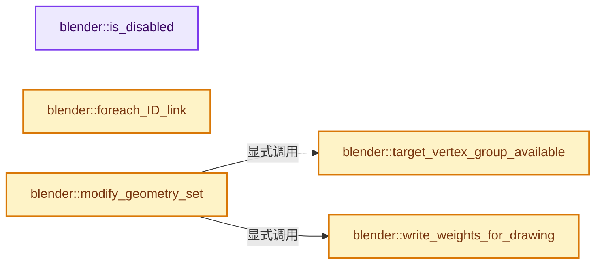
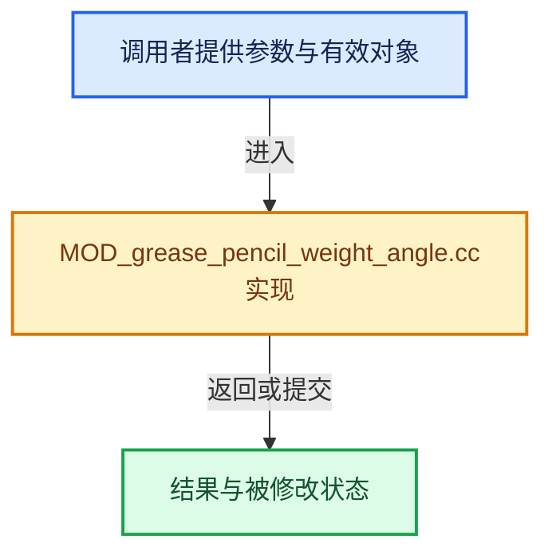

# 实现依赖专题：source/blender/modifiers/intern/MOD_grease_pencil_weight_angle.cc

[方向导航](README.md) · [符号索引](../%E7%AC%A6%E5%8F%B7%E4%BE%9D%E8%B5%96%E4%B8%8E%E5%AE%9E%E7%8E%B0%E7%B4%A2%E5%BC%95.md)

本专题从正文实际调用进入，集中保存共享实现。函数有稳定锚点，可从调用处直接跳到对应完整函数；递归与互相调用通过回链组织。

## 本文件的实现关系






## 完整成员与函数实现

<a id="f-69c2fb9ecdd947e6"></a>

### `blender::is_disabled`

实现位置：[source/blender/modifiers/intern/MOD_grease_pencil_weight_angle.cc](../../../../../source/blender/modifiers/intern/MOD_grease_pencil_weight_angle.cc) · L66—L72。

接口参数：

- `const Scene *`
- `ModifierData *md`
- `bool`

**教学注释版**

<!-- annotated:3aaab5523b5df6 -->

```cpp
static bool is_disabled(const Scene * /*scene*/, ModifierData *md, bool /*use_render_params*/)
{
  GreasePencilWeightAngleModifierData *mmd =
      reinterpret_cast<GreasePencilWeightAngleModifierData *>(md);

  return (mmd->target_vgname[0] == '\0');
}
```

<details>
<summary>核对原始源码：source/blender/modifiers/intern/MOD_grease_pencil_weight_angle.cc · L66—L72</summary>

<!-- original:3aaab5523b5df6:source/blender/modifiers/intern/MOD_grease_pencil_weight_angle.cc:66:72 -->

```cpp
static bool is_disabled(const Scene * /*scene*/, ModifierData *md, bool /*use_render_params*/)
{
  GreasePencilWeightAngleModifierData *mmd =
      reinterpret_cast<GreasePencilWeightAngleModifierData *>(md);

  return (mmd->target_vgname[0] == '\0');
}
```

</details>

**结果出口**

- `return (mmd->target_vgname[0] == '\0');`

**继续追踪实现**

本实现没有需要继续展开的显式调用；检查返回表达式、对象转换和调用者前置条件。

<a id="f-a03a99c4ca900f84"></a>

### `blender::foreach_ID_link`

实现位置：[source/blender/modifiers/intern/MOD_grease_pencil_weight_angle.cc](../../../../../source/blender/modifiers/intern/MOD_grease_pencil_weight_angle.cc) · L74—L80。

接口参数：

- `ModifierData *md`
- `Object *ob`
- `IDWalkFunc walk`
- `void *user_data`

**教学注释版**

<!-- annotated:36f23253b0ad80 -->

```cpp
static void foreach_ID_link(ModifierData *md, Object *ob, IDWalkFunc walk, void *user_data)
{
  GreasePencilWeightAngleModifierData *mmd =
      reinterpret_cast<GreasePencilWeightAngleModifierData *>(md);

  modifier::greasepencil::foreach_influence_ID_link(&mmd->influence, ob, walk, user_data);
}
```

<details>
<summary>核对原始源码：source/blender/modifiers/intern/MOD_grease_pencil_weight_angle.cc · L74—L80</summary>

<!-- original:36f23253b0ad80:source/blender/modifiers/intern/MOD_grease_pencil_weight_angle.cc:74:80 -->

```cpp
static void foreach_ID_link(ModifierData *md, Object *ob, IDWalkFunc walk, void *user_data)
{
  GreasePencilWeightAngleModifierData *mmd =
      reinterpret_cast<GreasePencilWeightAngleModifierData *>(md);

  modifier::greasepencil::foreach_influence_ID_link(&mmd->influence, ob, walk, user_data);
}
```

</details>

**继续追踪实现**

- `modifier::greasepencil::foreach_influence_ID_link` → [blender::modifier::greasepencil::foreach_influence_ID_link · L69](%E4%BE%9D%E8%B5%96-MOD_grease_pencil_util-d0b437.md#f-247ba56fa4c4e56f)。

<a id="f-478518e1dfad8fb5"></a>

### `blender::target_vertex_group_available`

实现位置：[source/blender/modifiers/intern/MOD_grease_pencil_weight_angle.cc](../../../../../source/blender/modifiers/intern/MOD_grease_pencil_weight_angle.cc) · L98—L106。

接口参数：

- `const StringRefNull name`
- `const ListBaseT<bDeformGroup> &vertex_group_names`

**教学注释版**

<!-- annotated:890e3af44507e8 -->

```cpp
static bool target_vertex_group_available(const StringRefNull name,
                                          const ListBaseT<bDeformGroup> &vertex_group_names)
{
  const int def_nr = BKE_defgroup_name_index(&vertex_group_names, name);
  if (def_nr < 0) {
    return false;
  }
  return true;
}
```

<details>
<summary>核对原始源码：source/blender/modifiers/intern/MOD_grease_pencil_weight_angle.cc · L98—L106</summary>

<!-- original:890e3af44507e8:source/blender/modifiers/intern/MOD_grease_pencil_weight_angle.cc:98:106 -->

```cpp
static bool target_vertex_group_available(const StringRefNull name,
                                          const ListBaseT<bDeformGroup> &vertex_group_names)
{
  const int def_nr = BKE_defgroup_name_index(&vertex_group_names, name);
  if (def_nr < 0) {
    return false;
  }
  return true;
}
```

</details>

**结果出口**

- `return false;`
- `return true;`

**继续追踪实现**

- `BKE_defgroup_name_index` → [blender::BKE_defgroup_name_index · L544](%E4%BE%9D%E8%B5%96-deform-6949f4.md#f-41ba0c2309b689c8)。

<a id="f-bdcaa2cfe0f452dd"></a>

### `blender::write_weights_for_drawing`

实现位置：[source/blender/modifiers/intern/MOD_grease_pencil_weight_angle.cc](../../../../../source/blender/modifiers/intern/MOD_grease_pencil_weight_angle.cc) · L108—L190。

接口参数：

- `const ModifierData &md`
- `const Object &ob`
- `bke::greasepencil::Drawing &drawing`

**教学注释版**

<!-- annotated:1a6c360003ae37 -->

```cpp
static void write_weights_for_drawing(const ModifierData &md,
                                      const Object &ob,
                                      bke::greasepencil::Drawing &drawing)
{
  const auto &mmd = reinterpret_cast<const GreasePencilWeightAngleModifierData &>(md);
  bke::CurvesGeometry &curves = drawing.strokes_for_write();
  if (curves.is_empty()) {
    return;
  }
  IndexMaskMemory memory;
  const IndexMask strokes = modifier::greasepencil::get_filtered_stroke_mask(
      &ob, curves, mmd.influence, memory);
  if (strokes.is_empty()) {
    return;
  }

  /* Make sure that the target vertex group is added to this drawing so we can write to it. */
  bke::greasepencil::ensure_vertex_group(mmd.target_vgname, curves.vertex_group_names);

  bke::MutableAttributeAccessor attributes = curves.attributes_for_write();
  bke::SpanAttributeWriter<float> dst_weights = attributes.lookup_for_write_span<float>(
      mmd.target_vgname);

  BLI_assert(!dst_weights.span.is_empty());

  const VArray<float> influence_weights = modifier::greasepencil::get_influence_vertex_weights(
      curves, mmd.influence);

  /* Use default Z up. */
  const float3 z_up(0.0f, 0.0f, 1.0f);
  float3 axis(0.0f);
  axis[mmd.axis] = 1.0f;
  float3 vec_ref;
  /* Apply modifier rotation (sub 90 degrees for Y axis due Z-Up vector). */
  const float rot_angle = mmd.angle - ((mmd.axis == 1) ? M_PI_2 : 0.0f);
  rotate_normalized_v3_v3v3fl(vec_ref, z_up, axis, rot_angle);

  const float3x3 obmat3x3(ob.object_to_world());

  /* Apply the rotation of the object. */
  if (mmd.space == MOD_GREASE_PENCIL_WEIGHT_ANGLE_SPACE_LOCAL) {
    vec_ref = math::transform_point(obmat3x3, vec_ref);
  }

  const OffsetIndices points_by_curve = curves.points_by_curve();
  const Span<float3> positions = curves.positions();

  strokes.foreach_index(
      [&](const int stroke) {
        const IndexRange points = points_by_curve[stroke];
        // [讲解] points.size：读取连续区间或分组的边界信息。
        if (points.size() == 1) {
          // [讲解] points.start：读取连续区间或分组的边界信息。
          dst_weights.span[points.start()] = 1.0f;
          return;
        }
        for (const int point : points.drop_front(1)) {
          const float influence_weight = influence_weights[point];
          if (influence_weight <= 0.0f) {
            continue;
          }

          const float3 p1 = math::transform_point(obmat3x3, positions[point]);
          const float3 p2 = math::transform_point(obmat3x3, positions[point - 1]);
          const float3 vec = p2 - p1;
          const float angle = angle_on_axis_v3v3_v3(vec_ref, vec, axis);
          float weight = 1.0f - math::sin(angle);

          if (mmd.flag & MOD_GREASE_PENCIL_WEIGHT_ANGLE_INVERT_OUTPUT) {
            weight = 1.0f - weight;
          }

          dst_weights.span[point] = (mmd.flag & MOD_GREASE_PENCIL_WEIGHT_ANGLE_MULTIPLY_DATA) ?
                                        dst_weights.span[point] * weight :
                                        weight;
          dst_weights.span[point] *= influence_weight;
          dst_weights.span[point] = math::clamp(dst_weights.span[point], mmd.min_weight, 1.0f);
        }
        /* First point has the same weight as the second one. */
        dst_weights.span[points[0]] = dst_weights.span[points[1]];
      },
      exec_mode::grain_size(512));

  dst_weights.finish();
}
```

<details>
<summary>核对原始源码：source/blender/modifiers/intern/MOD_grease_pencil_weight_angle.cc · L108—L190</summary>

<!-- original:1a6c360003ae37:source/blender/modifiers/intern/MOD_grease_pencil_weight_angle.cc:108:190 -->

```cpp
static void write_weights_for_drawing(const ModifierData &md,
                                      const Object &ob,
                                      bke::greasepencil::Drawing &drawing)
{
  const auto &mmd = reinterpret_cast<const GreasePencilWeightAngleModifierData &>(md);
  bke::CurvesGeometry &curves = drawing.strokes_for_write();
  if (curves.is_empty()) {
    return;
  }
  IndexMaskMemory memory;
  const IndexMask strokes = modifier::greasepencil::get_filtered_stroke_mask(
      &ob, curves, mmd.influence, memory);
  if (strokes.is_empty()) {
    return;
  }

  /* Make sure that the target vertex group is added to this drawing so we can write to it. */
  bke::greasepencil::ensure_vertex_group(mmd.target_vgname, curves.vertex_group_names);

  bke::MutableAttributeAccessor attributes = curves.attributes_for_write();
  bke::SpanAttributeWriter<float> dst_weights = attributes.lookup_for_write_span<float>(
      mmd.target_vgname);

  BLI_assert(!dst_weights.span.is_empty());

  const VArray<float> influence_weights = modifier::greasepencil::get_influence_vertex_weights(
      curves, mmd.influence);

  /* Use default Z up. */
  const float3 z_up(0.0f, 0.0f, 1.0f);
  float3 axis(0.0f);
  axis[mmd.axis] = 1.0f;
  float3 vec_ref;
  /* Apply modifier rotation (sub 90 degrees for Y axis due Z-Up vector). */
  const float rot_angle = mmd.angle - ((mmd.axis == 1) ? M_PI_2 : 0.0f);
  rotate_normalized_v3_v3v3fl(vec_ref, z_up, axis, rot_angle);

  const float3x3 obmat3x3(ob.object_to_world());

  /* Apply the rotation of the object. */
  if (mmd.space == MOD_GREASE_PENCIL_WEIGHT_ANGLE_SPACE_LOCAL) {
    vec_ref = math::transform_point(obmat3x3, vec_ref);
  }

  const OffsetIndices points_by_curve = curves.points_by_curve();
  const Span<float3> positions = curves.positions();

  strokes.foreach_index(
      [&](const int stroke) {
        const IndexRange points = points_by_curve[stroke];
        if (points.size() == 1) {
          dst_weights.span[points.start()] = 1.0f;
          return;
        }
        for (const int point : points.drop_front(1)) {
          const float influence_weight = influence_weights[point];
          if (influence_weight <= 0.0f) {
            continue;
          }

          const float3 p1 = math::transform_point(obmat3x3, positions[point]);
          const float3 p2 = math::transform_point(obmat3x3, positions[point - 1]);
          const float3 vec = p2 - p1;
          const float angle = angle_on_axis_v3v3_v3(vec_ref, vec, axis);
          float weight = 1.0f - math::sin(angle);

          if (mmd.flag & MOD_GREASE_PENCIL_WEIGHT_ANGLE_INVERT_OUTPUT) {
            weight = 1.0f - weight;
          }

          dst_weights.span[point] = (mmd.flag & MOD_GREASE_PENCIL_WEIGHT_ANGLE_MULTIPLY_DATA) ?
                                        dst_weights.span[point] * weight :
                                        weight;
          dst_weights.span[point] *= influence_weight;
          dst_weights.span[point] = math::clamp(dst_weights.span[point], mmd.min_weight, 1.0f);
        }
        /* First point has the same weight as the second one. */
        dst_weights.span[points[0]] = dst_weights.span[points[1]];
      },
      exec_mode::grain_size(512));

  dst_weights.finish();
}
```

</details>

**沿实际写入检查状态**

- `axis[mmd.axis] = 1.0f;`
- `vec_ref = math::transform_point(obmat3x3, vec_ref);`
- `weight = 1.0f - weight;`
- `dst_weights.span[point] = (mmd.flag & MOD_GREASE_PENCIL_WEIGHT_ANGLE_MULTIPLY_DATA) ?`
- `dst_weights.span[point] *= influence_weight;`
- `dst_weights.span[point] = math::clamp(dst_weights.span[point], mmd.min_weight, 1.0f);`
- `dst_weights.span[points[0]] = dst_weights.span[points[1]];`

**继续追踪实现**

- `drawing.strokes_for_write` → [blender::bke::greasepencil::Drawing::strokes_for_write · L1012](%E4%BE%9D%E8%B5%96-grease_pencil-f750d6.md#f-0649333785d0aa95)。
- `curves.is_empty` → [blender::bke::CurvesGeometry::is_empty · L1013](04-CurvesGeometry%E5%AD%98%E5%82%A8.md#f-4c323ef62c4b64ab)。
- `modifier::greasepencil::get_filtered_stroke_mask` → [blender::modifier::greasepencil::get_filtered_stroke_mask · L285](%E4%BE%9D%E8%B5%96-MOD_grease_pencil_util-d0b437.md#f-30c219d04de7dec3)；[blender::modifier::greasepencil::get_filtered_stroke_mask · L326](%E4%BE%9D%E8%B5%96-MOD_grease_pencil_util-d0b437.md#f-970c3bc880e4f350)。同名重载需按实参类型选择。
- `strokes.is_empty` → [blender::index_mask::IndexMask::is_empty · L748](../04-%E8%99%9A%E6%8B%9F%E6%95%B0%E7%BB%84%E4%B8%8E%E7%B4%A2%E5%BC%95%E9%80%89%E6%8B%A9/09-%E5%88%86%E6%AE%B5%E5%AD%98%E5%82%A8%E4%B8%8E%E9%81%8D%E5%8E%86.md#f-190ac996386064f4)。
- `bke::greasepencil::ensure_vertex_group` → [blender::bke::greasepencil::ensure_vertex_group · L54](%E4%BE%9D%E8%B5%96-grease_pencil_vertex_groups-f8b0e1.md#f-2d0283b48f7c4c8a)。
- `curves.attributes_for_write` → [blender::bke::CurvesGeometry::attributes_for_write · L1913](%E4%BE%9D%E8%B5%96-curves_geometry-ad7f9f.md#f-4930091b34fa9663)。
- `attributes.lookup_for_write_span<float>` → [blender::bke::MutableAttributeAccessor::lookup_for_write_span · L505](%E4%BE%9D%E8%B5%96-attribute_access-bceef3.md#f-eac5b5d8814ff900)；[blender::bke::MutableAttributeAccessor::lookup_for_write_span · L744](08-AttributeAccessor%E6%8E%A5%E5%8F%A3.md#f-4ace458d74222bb4)。同名重载需按实参类型选择。
- `BLI_assert` → [BLI_assert · L48](../01-%E5%9F%BA%E7%A1%80%E5%AE%B9%E5%99%A8%E4%B8%8E%E7%8E%B0%E4%BB%A3CPP/%E4%BE%9D%E8%B5%96-BLI_assert-cc98e8.md#m-57a88495704d)；[BLI_assert · L63](../01-%E5%9F%BA%E7%A1%80%E5%AE%B9%E5%99%A8%E4%B8%8E%E7%8E%B0%E4%BB%A3CPP/%E4%BE%9D%E8%B5%96-BLI_assert-cc98e8.md#m-d07050020cb5)。宏定义由构建条件选择。
- `dst_weights.span.is_empty` → [调用协议](../%E6%A8%A1%E6%9D%BF%E5%AE%8F%E4%B8%8E%E5%8A%A8%E6%80%81%E5%88%86%E6%B4%BE%E5%8D%8F%E8%AE%AE.md)：接收对象类型依赖auto、返回值或模板实例；不按同名猜测目标。调用位置L131。
- `modifier::greasepencil::get_influence_vertex_weights` → [blender::modifier::greasepencil::get_influence_vertex_weights · L343](%E4%BE%9D%E8%B5%96-MOD_grease_pencil_util-d0b437.md#f-6f4fdb5693985db9)。
- `rotate_normalized_v3_v3v3fl` → [blender::rotate_normalized_v3_v3v3fl · L637](../12-%E7%A9%BA%E9%97%B4%E6%95%B0%E6%8D%AE%E7%BB%93%E6%9E%84%E4%B8%8E%E5%87%A0%E4%BD%95%E7%AE%97%E6%B3%95/%E4%BE%9D%E8%B5%96-math_vector-5f35fa.md#f-e21ab1b864a023a8)。
- `ob.object_to_world` → [blender::Object::object_to_world · L5761](%E4%BE%9D%E8%B5%96-object-843689.md#f-12fc20026327d50c)。
- `math::transform_point` → [blender::math::transform_point · L318](../12-%E7%A9%BA%E9%97%B4%E6%95%B0%E6%8D%AE%E7%BB%93%E6%9E%84%E4%B8%8E%E5%87%A0%E4%BD%95%E7%AE%97%E6%B3%95/%E4%BE%9D%E8%B5%96-BLI_math_quaternion-cf105d.md#f-e52a2e8c12e32657)；[blender::math::transform_point · L491](../12-%E7%A9%BA%E9%97%B4%E6%95%B0%E6%8D%AE%E7%BB%93%E6%9E%84%E4%B8%8E%E5%87%A0%E4%BD%95%E7%AE%97%E6%B3%95/%E4%BE%9D%E8%B5%96-BLI_math_quaternion-cf105d.md#f-6c9f8362c60efe6c)；[blender::math::transform_point · L445](../12-%E7%A9%BA%E9%97%B4%E6%95%B0%E6%8D%AE%E7%BB%93%E6%9E%84%E4%B8%8E%E5%87%A0%E4%BD%95%E7%AE%97%E6%B3%95/%E4%BE%9D%E8%B5%96-BLI_math_basis_types-fc7090.md#f-a151fd44ae743502)。同名重载需按实参类型选择。
- `curves.points_by_curve` → [blender::bke::CurvesGeometry::points_by_curve · L1058](04-CurvesGeometry%E5%AD%98%E5%82%A8.md#f-a0416697e10ec205)。
- `curves.positions` → [blender::bke::CurvesGeometry::positions · L323](%E4%BE%9D%E8%B5%96-curves_geometry-ad7f9f.md#f-42ba586557e8ff18)。
- `strokes.foreach_index` → [blender::index_mask::IndexMask::foreach_index · L855](../04-%E8%99%9A%E6%8B%9F%E6%95%B0%E7%BB%84%E4%B8%8E%E7%B4%A2%E5%BC%95%E9%80%89%E6%8B%A9/09-%E5%88%86%E6%AE%B5%E5%AD%98%E5%82%A8%E4%B8%8E%E9%81%8D%E5%8E%86.md#f-cd6cd317e2e2812c)。
- `points.size` → [blender::IndexRange::size · L156](../01-%E5%9F%BA%E7%A1%80%E5%AE%B9%E5%99%A8%E4%B8%8E%E7%8E%B0%E4%BB%A3CPP/04-IndexRange%E8%BF%9E%E7%BB%AD%E6%95%B4%E6%95%B0%E5%8C%BA%E9%97%B4.md#f-05f66c3ebb2fdfec)。
- `points.start` → [blender::IndexRange::start · L243](../01-%E5%9F%BA%E7%A1%80%E5%AE%B9%E5%99%A8%E4%B8%8E%E7%8E%B0%E4%BB%A3CPP/04-IndexRange%E8%BF%9E%E7%BB%AD%E6%95%B4%E6%95%B0%E5%8C%BA%E9%97%B4.md#f-99d2195bd9cfd1f0)。
- `points.drop_front` → [blender::IndexRange::drop_front · L306](../01-%E5%9F%BA%E7%A1%80%E5%AE%B9%E5%99%A8%E4%B8%8E%E7%8E%B0%E4%BB%A3CPP/04-IndexRange%E8%BF%9E%E7%BB%AD%E6%95%B4%E6%95%B0%E5%8C%BA%E9%97%B4.md#f-ef3101407d982c90)。
- `angle_on_axis_v3v3_v3` → [blender::angle_on_axis_v3v3_v3 · L368](../12-%E7%A9%BA%E9%97%B4%E6%95%B0%E6%8D%AE%E7%BB%93%E6%9E%84%E4%B8%8E%E5%87%A0%E4%BD%95%E7%AE%97%E6%B3%95/%E4%BE%9D%E8%B5%96-math_vector-5f35fa.md#f-6eae2bbdfb1eb2ce)。
- `math::sin` → [外部契约](https://eel.is/c++draft/)：这个边界按实际表达式及所属类型核对参数、返回值、寿命与失败行为。这里提供接口入口，不声称已解释该第三方版本的内部实现。
- `math::clamp` → [blender::math::clamp · L118](../12-%E7%A9%BA%E9%97%B4%E6%95%B0%E6%8D%AE%E7%BB%93%E6%9E%84%E4%B8%8E%E5%87%A0%E4%BD%95%E7%AE%97%E6%B3%95/%E4%BE%9D%E8%B5%96-BLI_math_vector-906a87.md#f-65702e97e59fc41e)；[blender::math::clamp · L130](../12-%E7%A9%BA%E9%97%B4%E6%95%B0%E6%8D%AE%E7%BB%93%E6%9E%84%E4%B8%8E%E5%87%A0%E4%BD%95%E7%AE%97%E6%B3%95/%E4%BE%9D%E8%B5%96-BLI_math_vector-906a87.md#f-0365873940e23a11)；[blender::math::clamp · L69](../12-%E7%A9%BA%E9%97%B4%E6%95%B0%E6%8D%AE%E7%BB%93%E6%9E%84%E4%B8%8E%E5%87%A0%E4%BD%95%E7%AE%97%E6%B3%95/%E4%BE%9D%E8%B5%96-BLI_math_base-0728eb.md#f-9282cf5d06fa3723)。同名重载需按实参类型选择。
- `exec_mode::grain_size` → [blender::exec_mode::grain_size · L79](../01-%E5%9F%BA%E7%A1%80%E5%AE%B9%E5%99%A8%E4%B8%8E%E7%8E%B0%E4%BB%A3CPP/%E4%BE%9D%E8%B5%96-BLI_execution_mode-1528fb.md#f-0b4fc2f9fa6e66e7)。
- `dst_weights.finish` → [blender::bke::SpanAttributeWriter::finish · L279](08-AttributeAccessor%E6%8E%A5%E5%8F%A3.md#f-585970a3b1bd4da4)。

<a id="f-782ecf61845b0827"></a>

### `blender::modify_geometry_set`

实现位置：[source/blender/modifiers/intern/MOD_grease_pencil_weight_angle.cc](../../../../../source/blender/modifiers/intern/MOD_grease_pencil_weight_angle.cc) · L192—L220。

接口参数：

- `ModifierData *md`
- `const ModifierEvalContext *ctx`
- `bke::GeometrySet *geometry_set`

**教学注释版**

<!-- annotated:99a641882b967e -->

```cpp
static void modify_geometry_set(ModifierData *md,
                                const ModifierEvalContext *ctx,
                                bke::GeometrySet *geometry_set)
{
  const GreasePencilWeightAngleModifierData *mmd =
      reinterpret_cast<GreasePencilWeightAngleModifierData *>(md);

  if (!geometry_set->has_grease_pencil()) {
    return;
  }

  GreasePencil &grease_pencil = *geometry_set->get_grease_pencil_for_write();

  if (!target_vertex_group_available(mmd->target_vgname, grease_pencil.vertex_group_names)) {
    return;
  }

  const int current_frame = grease_pencil.runtime->eval_frame;

  IndexMaskMemory mask_memory;
  const IndexMask layer_mask = modifier::greasepencil::get_filtered_layer_mask(
      grease_pencil, mmd->influence, mask_memory);
  const Vector<bke::greasepencil::Drawing *> drawings =
      modifier::greasepencil::get_drawings_for_write(grease_pencil, layer_mask, current_frame);

  threading::parallel_for_each(drawings, [&](bke::greasepencil::Drawing *drawing) {
    write_weights_for_drawing(*md, *ctx->object, *drawing);
  });
}
```

<details>
<summary>核对原始源码：source/blender/modifiers/intern/MOD_grease_pencil_weight_angle.cc · L192—L220</summary>

<!-- original:99a641882b967e:source/blender/modifiers/intern/MOD_grease_pencil_weight_angle.cc:192:220 -->

```cpp
static void modify_geometry_set(ModifierData *md,
                                const ModifierEvalContext *ctx,
                                bke::GeometrySet *geometry_set)
{
  const GreasePencilWeightAngleModifierData *mmd =
      reinterpret_cast<GreasePencilWeightAngleModifierData *>(md);

  if (!geometry_set->has_grease_pencil()) {
    return;
  }

  GreasePencil &grease_pencil = *geometry_set->get_grease_pencil_for_write();

  if (!target_vertex_group_available(mmd->target_vgname, grease_pencil.vertex_group_names)) {
    return;
  }

  const int current_frame = grease_pencil.runtime->eval_frame;

  IndexMaskMemory mask_memory;
  const IndexMask layer_mask = modifier::greasepencil::get_filtered_layer_mask(
      grease_pencil, mmd->influence, mask_memory);
  const Vector<bke::greasepencil::Drawing *> drawings =
      modifier::greasepencil::get_drawings_for_write(grease_pencil, layer_mask, current_frame);

  threading::parallel_for_each(drawings, [&](bke::greasepencil::Drawing *drawing) {
    write_weights_for_drawing(*md, *ctx->object, *drawing);
  });
}
```

</details>

**继续追踪实现**

- `geometry_set->has_grease_pencil` → [blender::bke::GeometrySet::has_grease_pencil · L415](../06-%E9%9A%90%E5%BC%8F%E5%85%B1%E4%BA%AB%E4%B8%8E%E7%BC%93%E5%AD%98%E7%B3%BB%E7%BB%9F/05-GeometrySet%E8%AF%BB%E5%86%99%E4%B8%8E%E5%A4%8D%E5%88%B6.md#f-357bcb62da7a8afd)。
- `geometry_set->get_grease_pencil_for_write` → [blender::bke::GeometrySet::get_grease_pencil_for_write · L622](../06-%E9%9A%90%E5%BC%8F%E5%85%B1%E4%BA%AB%E4%B8%8E%E7%BC%93%E5%AD%98%E7%B3%BB%E7%BB%9F/05-GeometrySet%E8%AF%BB%E5%86%99%E4%B8%8E%E5%A4%8D%E5%88%B6.md#f-bfc5e891a352651b)。
- `target_vertex_group_available` → [blender::target_vertex_group_available · L98](%E4%BE%9D%E8%B5%96-MOD_grease_pencil_weight_angle-591cee.md#f-478518e1dfad8fb5)。
- `modifier::greasepencil::get_filtered_layer_mask` → [blender::modifier::greasepencil::get_filtered_layer_mask · L213](%E4%BE%9D%E8%B5%96-MOD_grease_pencil_util-d0b437.md#f-6438bea51141f9db)；[blender::modifier::greasepencil::get_filtered_layer_mask · L268](%E4%BE%9D%E8%B5%96-MOD_grease_pencil_util-d0b437.md#f-e3d0f9748ecdf34b)。同名重载需按实参类型选择。
- `modifier::greasepencil::get_drawings_for_write` → [blender::modifier::greasepencil::get_drawings_for_write · L368](%E4%BE%9D%E8%B5%96-MOD_grease_pencil_util-d0b437.md#f-cef3871c31259376)。
- `threading::parallel_for_each` → [blender::threading::parallel_for_each · L30](../11-Depsgraph%E4%B8%8E%E5%B9%B6%E8%A1%8C%E4%BB%BB%E5%8A%A1%E7%B3%BB%E7%BB%9F/07-%E4%BB%BB%E5%8A%A1%E6%B1%A0%E4%B8%8ETBB%E6%8E%A5%E5%85%A5.md#f-d5604027445ef0f5)。
- `write_weights_for_drawing` → [blender::write_weights_for_drawing · L108](%E4%BE%9D%E8%B5%96-MOD_grease_pencil_weight_angle-591cee.md#f-bdcaa2cfe0f452dd)。
