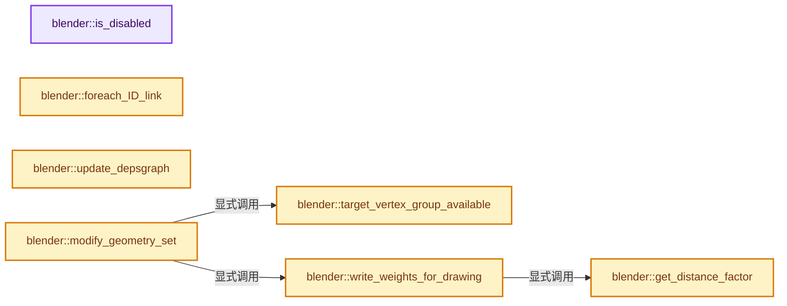
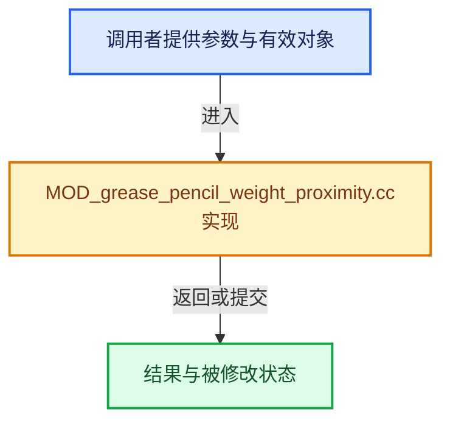

# 实现依赖专题：source/blender/modifiers/intern/MOD_grease_pencil_weight_proximity.cc

[方向导航](README.md) · [符号索引](../%E7%AC%A6%E5%8F%B7%E4%BE%9D%E8%B5%96%E4%B8%8E%E5%AE%9E%E7%8E%B0%E7%B4%A2%E5%BC%95.md)

本专题从正文实际调用进入，集中保存共享实现。函数有稳定锚点，可从调用处直接跳到对应完整函数；递归与互相调用通过回链组织。

## 本文件的实现关系






## 完整成员与函数实现

<a id="f-1f7ded59fac77678"></a>

### `blender::is_disabled`

实现位置：[source/blender/modifiers/intern/MOD_grease_pencil_weight_proximity.cc](../../../../../source/blender/modifiers/intern/MOD_grease_pencil_weight_proximity.cc) · L64—L69。

接口参数：

- `const Scene *`
- `ModifierData *md`
- `bool`

**教学注释版**

<!-- annotated:37833361298dcc -->

```cpp
static bool is_disabled(const Scene * /*scene*/, ModifierData *md, bool /*use_render_params*/)
{
  auto *mmd = reinterpret_cast<GreasePencilWeightProximityModifierData *>(md);

  return (mmd->target_vgname[0] == '\0' || mmd->object == nullptr);
}
```

<details>
<summary>核对原始源码：source/blender/modifiers/intern/MOD_grease_pencil_weight_proximity.cc · L64—L69</summary>

<!-- original:37833361298dcc:source/blender/modifiers/intern/MOD_grease_pencil_weight_proximity.cc:64:69 -->

```cpp
static bool is_disabled(const Scene * /*scene*/, ModifierData *md, bool /*use_render_params*/)
{
  auto *mmd = reinterpret_cast<GreasePencilWeightProximityModifierData *>(md);

  return (mmd->target_vgname[0] == '\0' || mmd->object == nullptr);
}
```

</details>

**结果出口**

- `return (mmd->target_vgname[0] == '\0' || mmd->object == nullptr);`

**继续追踪实现**

本实现没有需要继续展开的显式调用；检查返回表达式、对象转换和调用者前置条件。

<a id="f-adcd54430d75cb0d"></a>

### `blender::foreach_ID_link`

实现位置：[source/blender/modifiers/intern/MOD_grease_pencil_weight_proximity.cc](../../../../../source/blender/modifiers/intern/MOD_grease_pencil_weight_proximity.cc) · L71—L79。

接口参数：

- `ModifierData *md`
- `Object *ob`
- `IDWalkFunc walk`
- `void *user_data`

**教学注释版**

<!-- annotated:9354e192cca63b -->

```cpp
static void foreach_ID_link(ModifierData *md, Object *ob, IDWalkFunc walk, void *user_data)
{
  GreasePencilWeightProximityModifierData *mmd =
      reinterpret_cast<GreasePencilWeightProximityModifierData *>(md);

  modifier::greasepencil::foreach_influence_ID_link(&mmd->influence, ob, walk, user_data);

  walk(user_data, ob, reinterpret_cast<ID **>(&mmd->object), IDWALK_CB_NOP);
}
```

<details>
<summary>核对原始源码：source/blender/modifiers/intern/MOD_grease_pencil_weight_proximity.cc · L71—L79</summary>

<!-- original:9354e192cca63b:source/blender/modifiers/intern/MOD_grease_pencil_weight_proximity.cc:71:79 -->

```cpp
static void foreach_ID_link(ModifierData *md, Object *ob, IDWalkFunc walk, void *user_data)
{
  GreasePencilWeightProximityModifierData *mmd =
      reinterpret_cast<GreasePencilWeightProximityModifierData *>(md);

  modifier::greasepencil::foreach_influence_ID_link(&mmd->influence, ob, walk, user_data);

  walk(user_data, ob, reinterpret_cast<ID **>(&mmd->object), IDWALK_CB_NOP);
}
```

</details>

**继续追踪实现**

- `modifier::greasepencil::foreach_influence_ID_link` → [blender::modifier::greasepencil::foreach_influence_ID_link · L69](%E4%BE%9D%E8%B5%96-MOD_grease_pencil_util-d0b437.md#f-247ba56fa4c4e56f)。
- `walk` → [调用协议](../%E6%A8%A1%E6%9D%BF%E5%AE%8F%E4%B8%8E%E5%8A%A8%E6%80%81%E5%88%86%E6%B4%BE%E5%8D%8F%E8%AE%AE.md)：局部可调用对象，须结合其初始化与捕获环境。调用位置L78。

<a id="f-fec958340fbad532"></a>

### `blender::update_depsgraph`

实现位置：[source/blender/modifiers/intern/MOD_grease_pencil_weight_proximity.cc](../../../../../source/blender/modifiers/intern/MOD_grease_pencil_weight_proximity.cc) · L81—L89。

接口参数：

- `ModifierData *md`
- `const ModifierUpdateDepsgraphContext *ctx`

**教学注释版**

<!-- annotated:1f8b04cb0b7c84 -->

```cpp
static void update_depsgraph(ModifierData *md, const ModifierUpdateDepsgraphContext *ctx)
{
  auto *mmd = reinterpret_cast<GreasePencilWeightProximityModifierData *>(md);
  if (mmd->object != nullptr) {
    DEG_add_object_relation(
        ctx->node, mmd->object, DEG_OB_COMP_TRANSFORM, "Grease Pencil Proximity Modifier");
    DEG_add_depends_on_transform_relation(ctx->node, "Grease Pencil Proximity Modifier");
  }
}
```

<details>
<summary>核对原始源码：source/blender/modifiers/intern/MOD_grease_pencil_weight_proximity.cc · L81—L89</summary>

<!-- original:1f8b04cb0b7c84:source/blender/modifiers/intern/MOD_grease_pencil_weight_proximity.cc:81:89 -->

```cpp
static void update_depsgraph(ModifierData *md, const ModifierUpdateDepsgraphContext *ctx)
{
  auto *mmd = reinterpret_cast<GreasePencilWeightProximityModifierData *>(md);
  if (mmd->object != nullptr) {
    DEG_add_object_relation(
        ctx->node, mmd->object, DEG_OB_COMP_TRANSFORM, "Grease Pencil Proximity Modifier");
    DEG_add_depends_on_transform_relation(ctx->node, "Grease Pencil Proximity Modifier");
  }
}
```

</details>

**继续追踪实现**

- `DEG_add_object_relation` → [blender::DEG_add_object_relation · L123](../11-Depsgraph%E4%B8%8E%E5%B9%B6%E8%A1%8C%E4%BB%BB%E5%8A%A1%E7%B3%BB%E7%BB%9F/%E4%BE%9D%E8%B5%96-depsgraph_build-ea2fc8.md#f-f570cffae97e273c)。
- `DEG_add_depends_on_transform_relation` → [blender::DEG_add_depends_on_transform_relation · L240](../11-Depsgraph%E4%B8%8E%E5%B9%B6%E8%A1%8C%E4%BB%BB%E5%8A%A1%E7%B3%BB%E7%BB%9F/%E4%BE%9D%E8%B5%96-depsgraph_build-ea2fc8.md#f-47c32a354defa20d)。

<a id="f-bf883120ffc58770"></a>

### `blender::get_distance_factor`

实现位置：[source/blender/modifiers/intern/MOD_grease_pencil_weight_proximity.cc](../../../../../source/blender/modifiers/intern/MOD_grease_pencil_weight_proximity.cc) · L107—L137。

接口参数：

- `float3 target_pos`
- `const float4x4 &obmat`
- `float3 pos`
- `const float dist_min`
- `const float dist_max`

**教学注释版**

<!-- annotated:8763771c3cfdca -->

```cpp
static float get_distance_factor(float3 target_pos,
                                 const float4x4 &obmat,
                                 float3 pos,
                                 const float dist_min,
                                 const float dist_max)
{
  const float3 gvert = math::transform_point(obmat, pos);
  const float dist = math::distance(target_pos, gvert);

  if (dist_max > dist_min) {
    if (dist > dist_max) {
      return 1.0f;
    }
    if (dist <= dist_max && dist > dist_min) {
      return 1.0f - ((dist_max - dist) / math::max((dist_max - dist_min), 0.0001f));
    }
    return 0.0f;
  }
  if (dist_max < dist_min) {
    if (dist > dist_min) {
      return 0.0f;
    }
    if (dist <= dist_min && dist > dist_max) {
      return (dist_min - dist) / math::max((dist_min - dist_max), 0.0001f);
    }
    return 1.0f;
  }

  /* dist_max == dist_min, "stepped" behavior then. */
  return (dist > dist_max) ? 0.0f : 1.0f;
}
```

<details>
<summary>核对原始源码：source/blender/modifiers/intern/MOD_grease_pencil_weight_proximity.cc · L107—L137</summary>

<!-- original:8763771c3cfdca:source/blender/modifiers/intern/MOD_grease_pencil_weight_proximity.cc:107:137 -->

```cpp
static float get_distance_factor(float3 target_pos,
                                 const float4x4 &obmat,
                                 float3 pos,
                                 const float dist_min,
                                 const float dist_max)
{
  const float3 gvert = math::transform_point(obmat, pos);
  const float dist = math::distance(target_pos, gvert);

  if (dist_max > dist_min) {
    if (dist > dist_max) {
      return 1.0f;
    }
    if (dist <= dist_max && dist > dist_min) {
      return 1.0f - ((dist_max - dist) / math::max((dist_max - dist_min), 0.0001f));
    }
    return 0.0f;
  }
  if (dist_max < dist_min) {
    if (dist > dist_min) {
      return 0.0f;
    }
    if (dist <= dist_min && dist > dist_max) {
      return (dist_min - dist) / math::max((dist_min - dist_max), 0.0001f);
    }
    return 1.0f;
  }

  /* dist_max == dist_min, "stepped" behavior then. */
  return (dist > dist_max) ? 0.0f : 1.0f;
}
```

</details>

**结果出口**

- `return 1.0f;`
- `return 1.0f - ((dist_max - dist) / math::max((dist_max - dist_min), 0.0001f));`
- `return 0.0f;`
- `return (dist_min - dist) / math::max((dist_min - dist_max), 0.0001f);`
- `return (dist > dist_max) ? 0.0f : 1.0f;`

**继续追踪实现**

- `math::transform_point` → [blender::math::transform_point · L318](../12-%E7%A9%BA%E9%97%B4%E6%95%B0%E6%8D%AE%E7%BB%93%E6%9E%84%E4%B8%8E%E5%87%A0%E4%BD%95%E7%AE%97%E6%B3%95/%E4%BE%9D%E8%B5%96-BLI_math_quaternion-cf105d.md#f-e52a2e8c12e32657)；[blender::math::transform_point · L491](../12-%E7%A9%BA%E9%97%B4%E6%95%B0%E6%8D%AE%E7%BB%93%E6%9E%84%E4%B8%8E%E5%87%A0%E4%BD%95%E7%AE%97%E6%B3%95/%E4%BE%9D%E8%B5%96-BLI_math_quaternion-cf105d.md#f-6c9f8362c60efe6c)；[blender::math::transform_point · L445](../12-%E7%A9%BA%E9%97%B4%E6%95%B0%E6%8D%AE%E7%BB%93%E6%9E%84%E4%B8%8E%E5%87%A0%E4%BD%95%E7%AE%97%E6%B3%95/%E4%BE%9D%E8%B5%96-BLI_math_basis_types-fc7090.md#f-a151fd44ae743502)。同名重载需按实参类型选择。
- `math::distance` → [blender::math::distance · L485](../12-%E7%A9%BA%E9%97%B4%E6%95%B0%E6%8D%AE%E7%BB%93%E6%9E%84%E4%B8%8E%E5%87%A0%E4%BD%95%E7%AE%97%E6%B3%95/%E4%BE%9D%E8%B5%96-BLI_math_vector-906a87.md#f-0a0df9b41ececd7b)；[blender::math::distance · L143](../12-%E7%A9%BA%E9%97%B4%E6%95%B0%E6%8D%AE%E7%BB%93%E6%9E%84%E4%B8%8E%E5%87%A0%E4%BD%95%E7%AE%97%E6%B3%95/%E4%BE%9D%E8%B5%96-BLI_math_base-0728eb.md#f-45db793191057701)。同名重载需按实参类型选择。
- `math::max` → [blender::math::max · L87](../12-%E7%A9%BA%E9%97%B4%E6%95%B0%E6%8D%AE%E7%BB%93%E6%9E%84%E4%B8%8E%E5%87%A0%E4%BD%95%E7%AE%97%E6%B3%95/%E4%BE%9D%E8%B5%96-BLI_math_vector-906a87.md#f-9be564a293777d6b)；[blender::math::max · L96](../12-%E7%A9%BA%E9%97%B4%E6%95%B0%E6%8D%AE%E7%BB%93%E6%9E%84%E4%B8%8E%E5%87%A0%E4%BD%95%E7%AE%97%E6%B3%95/%E4%BE%9D%E8%B5%96-BLI_math_vector-906a87.md#f-ce32dff37d0af3bc)；[blender::math::max · L112](../12-%E7%A9%BA%E9%97%B4%E6%95%B0%E6%8D%AE%E7%BB%93%E6%9E%84%E4%B8%8E%E5%87%A0%E4%BD%95%E7%AE%97%E6%B3%95/%E4%BE%9D%E8%B5%96-BLI_math_vector-906a87.md#f-668eb1fcf1fa8292)；[blender::math::max · L49](../12-%E7%A9%BA%E9%97%B4%E6%95%B0%E6%8D%AE%E7%BB%93%E6%9E%84%E4%B8%8E%E5%87%A0%E4%BD%95%E7%AE%97%E6%B3%95/%E4%BE%9D%E8%B5%96-BLI_math_base-0728eb.md#f-a6991ca3d12937e1)。同名重载需按实参类型选择。

<a id="f-a4bd05779fde8729"></a>

### `blender::target_vertex_group_available`

实现位置：[source/blender/modifiers/intern/MOD_grease_pencil_weight_proximity.cc](../../../../../source/blender/modifiers/intern/MOD_grease_pencil_weight_proximity.cc) · L139—L147。

接口参数：

- `const StringRefNull name`
- `const ListBaseT<bDeformGroup> &vertex_group_names`

**教学注释版**

<!-- annotated:e2b5e6ad4e8a0c -->

```cpp
static bool target_vertex_group_available(const StringRefNull name,
                                          const ListBaseT<bDeformGroup> &vertex_group_names)
{
  const int def_nr = BKE_defgroup_name_index(&vertex_group_names, name);
  if (def_nr < 0) {
    return false;
  }
  return true;
}
```

<details>
<summary>核对原始源码：source/blender/modifiers/intern/MOD_grease_pencil_weight_proximity.cc · L139—L147</summary>

<!-- original:e2b5e6ad4e8a0c:source/blender/modifiers/intern/MOD_grease_pencil_weight_proximity.cc:139:147 -->

```cpp
static bool target_vertex_group_available(const StringRefNull name,
                                          const ListBaseT<bDeformGroup> &vertex_group_names)
{
  const int def_nr = BKE_defgroup_name_index(&vertex_group_names, name);
  if (def_nr < 0) {
    return false;
  }
  return true;
}
```

</details>

**结果出口**

- `return false;`
- `return true;`

**继续追踪实现**

- `BKE_defgroup_name_index` → [blender::BKE_defgroup_name_index · L544](%E4%BE%9D%E8%B5%96-deform-6949f4.md#f-41ba0c2309b689c8)。

<a id="f-f439dd4a51c09c33"></a>

### `blender::write_weights_for_drawing`

实现位置：[source/blender/modifiers/intern/MOD_grease_pencil_weight_proximity.cc](../../../../../source/blender/modifiers/intern/MOD_grease_pencil_weight_proximity.cc) · L149—L210。

接口参数：

- `const ModifierData &md`
- `const Object &ob`
- `bke::greasepencil::Drawing &drawing`

**教学注释版**

<!-- annotated:44caa4c7409fcb -->

```cpp
static void write_weights_for_drawing(const ModifierData &md,
                                      const Object &ob,
                                      bke::greasepencil::Drawing &drawing)
{
  const auto &mmd = reinterpret_cast<const GreasePencilWeightProximityModifierData &>(md);
  bke::CurvesGeometry &curves = drawing.strokes_for_write();
  if (curves.is_empty()) {
    return;
  }
  IndexMaskMemory memory;
  const IndexMask strokes = modifier::greasepencil::get_filtered_stroke_mask(
      &ob, curves, mmd.influence, memory);
  if (strokes.is_empty()) {
    return;
  }

  /* Make sure that the target vertex group is added to this drawing so we can write to it. */
  bke::greasepencil::ensure_vertex_group(mmd.target_vgname, curves.vertex_group_names);

  bke::MutableAttributeAccessor attributes = curves.attributes_for_write();
  bke::SpanAttributeWriter<float> dst_weights = attributes.lookup_for_write_span<float>(
      mmd.target_vgname);

  BLI_assert(!dst_weights.span.is_empty());

  const VArray<float> vgroup_weights = modifier::greasepencil::get_influence_vertex_weights(
      curves, mmd.influence);

  const Span<float3> positions = curves.positions();
  const float4x4 &obmat = ob.object_to_world();
  const float3 target_pos = mmd.object->object_to_world().location();
  const bool invert = (mmd.flag & MOD_GREASE_PENCIL_WEIGHT_PROXIMITY_INVERT_OUTPUT) != 0;
  const bool do_multiply = (mmd.flag & MOD_GREASE_PENCIL_WEIGHT_PROXIMITY_MULTIPLY_DATA) != 0;

  // [讲解] positions.index_range：查询视图长度或生成对应有效索引区间。
  threading::parallel_for(positions.index_range(), 1024, [&](const IndexRange range) {
    for (const int point_i : range) {
      const float weight = vgroup_weights[point_i];
      if (weight <= 0.0f) {
        continue;
      }

      float dist_fac = get_distance_factor(
          target_pos, obmat, positions[point_i], mmd.dist_start, mmd.dist_end);

      if (invert) {
        dist_fac = 1.0f - dist_fac;
      }

      dst_weights.span[point_i] = do_multiply ? dst_weights.span[point_i] * dist_fac : dist_fac;

      dst_weights.span[point_i] = math::clamp(
          dst_weights.span[point_i],
          /* Weight==0 will remove the point from the group, assign a sufficiently small value
           * there to prevent the visual disconnect, and keep the behavior same as the old
           * modifier. */
          math::max(mmd.min_weight, 1e-5f),
          1.0f);
    }
  });

  dst_weights.finish();
}
```

<details>
<summary>核对原始源码：source/blender/modifiers/intern/MOD_grease_pencil_weight_proximity.cc · L149—L210</summary>

<!-- original:44caa4c7409fcb:source/blender/modifiers/intern/MOD_grease_pencil_weight_proximity.cc:149:210 -->

```cpp
static void write_weights_for_drawing(const ModifierData &md,
                                      const Object &ob,
                                      bke::greasepencil::Drawing &drawing)
{
  const auto &mmd = reinterpret_cast<const GreasePencilWeightProximityModifierData &>(md);
  bke::CurvesGeometry &curves = drawing.strokes_for_write();
  if (curves.is_empty()) {
    return;
  }
  IndexMaskMemory memory;
  const IndexMask strokes = modifier::greasepencil::get_filtered_stroke_mask(
      &ob, curves, mmd.influence, memory);
  if (strokes.is_empty()) {
    return;
  }

  /* Make sure that the target vertex group is added to this drawing so we can write to it. */
  bke::greasepencil::ensure_vertex_group(mmd.target_vgname, curves.vertex_group_names);

  bke::MutableAttributeAccessor attributes = curves.attributes_for_write();
  bke::SpanAttributeWriter<float> dst_weights = attributes.lookup_for_write_span<float>(
      mmd.target_vgname);

  BLI_assert(!dst_weights.span.is_empty());

  const VArray<float> vgroup_weights = modifier::greasepencil::get_influence_vertex_weights(
      curves, mmd.influence);

  const Span<float3> positions = curves.positions();
  const float4x4 &obmat = ob.object_to_world();
  const float3 target_pos = mmd.object->object_to_world().location();
  const bool invert = (mmd.flag & MOD_GREASE_PENCIL_WEIGHT_PROXIMITY_INVERT_OUTPUT) != 0;
  const bool do_multiply = (mmd.flag & MOD_GREASE_PENCIL_WEIGHT_PROXIMITY_MULTIPLY_DATA) != 0;

  threading::parallel_for(positions.index_range(), 1024, [&](const IndexRange range) {
    for (const int point_i : range) {
      const float weight = vgroup_weights[point_i];
      if (weight <= 0.0f) {
        continue;
      }

      float dist_fac = get_distance_factor(
          target_pos, obmat, positions[point_i], mmd.dist_start, mmd.dist_end);

      if (invert) {
        dist_fac = 1.0f - dist_fac;
      }

      dst_weights.span[point_i] = do_multiply ? dst_weights.span[point_i] * dist_fac : dist_fac;

      dst_weights.span[point_i] = math::clamp(
          dst_weights.span[point_i],
          /* Weight==0 will remove the point from the group, assign a sufficiently small value
           * there to prevent the visual disconnect, and keep the behavior same as the old
           * modifier. */
          math::max(mmd.min_weight, 1e-5f),
          1.0f);
    }
  });

  dst_weights.finish();
}
```

</details>

**沿实际写入检查状态**

- `dist_fac = 1.0f - dist_fac;`
- `dst_weights.span[point_i] = do_multiply ? dst_weights.span[point_i] * dist_fac : dist_fac;`
- `dst_weights.span[point_i] = math::clamp(`

**继续追踪实现**

- `drawing.strokes_for_write` → [blender::bke::greasepencil::Drawing::strokes_for_write · L1012](%E4%BE%9D%E8%B5%96-grease_pencil-f750d6.md#f-0649333785d0aa95)。
- `curves.is_empty` → [blender::bke::CurvesGeometry::is_empty · L1013](04-CurvesGeometry%E5%AD%98%E5%82%A8.md#f-4c323ef62c4b64ab)。
- `modifier::greasepencil::get_filtered_stroke_mask` → [blender::modifier::greasepencil::get_filtered_stroke_mask · L285](%E4%BE%9D%E8%B5%96-MOD_grease_pencil_util-d0b437.md#f-30c219d04de7dec3)；[blender::modifier::greasepencil::get_filtered_stroke_mask · L326](%E4%BE%9D%E8%B5%96-MOD_grease_pencil_util-d0b437.md#f-970c3bc880e4f350)。同名重载需按实参类型选择。
- `strokes.is_empty` → [blender::index_mask::IndexMask::is_empty · L748](../04-%E8%99%9A%E6%8B%9F%E6%95%B0%E7%BB%84%E4%B8%8E%E7%B4%A2%E5%BC%95%E9%80%89%E6%8B%A9/09-%E5%88%86%E6%AE%B5%E5%AD%98%E5%82%A8%E4%B8%8E%E9%81%8D%E5%8E%86.md#f-190ac996386064f4)。
- `bke::greasepencil::ensure_vertex_group` → [blender::bke::greasepencil::ensure_vertex_group · L54](%E4%BE%9D%E8%B5%96-grease_pencil_vertex_groups-f8b0e1.md#f-2d0283b48f7c4c8a)。
- `curves.attributes_for_write` → [blender::bke::CurvesGeometry::attributes_for_write · L1913](%E4%BE%9D%E8%B5%96-curves_geometry-ad7f9f.md#f-4930091b34fa9663)。
- `attributes.lookup_for_write_span<float>` → [blender::bke::MutableAttributeAccessor::lookup_for_write_span · L505](%E4%BE%9D%E8%B5%96-attribute_access-bceef3.md#f-eac5b5d8814ff900)；[blender::bke::MutableAttributeAccessor::lookup_for_write_span · L744](08-AttributeAccessor%E6%8E%A5%E5%8F%A3.md#f-4ace458d74222bb4)。同名重载需按实参类型选择。
- `BLI_assert` → [BLI_assert · L48](../01-%E5%9F%BA%E7%A1%80%E5%AE%B9%E5%99%A8%E4%B8%8E%E7%8E%B0%E4%BB%A3CPP/%E4%BE%9D%E8%B5%96-BLI_assert-cc98e8.md#m-57a88495704d)；[BLI_assert · L63](../01-%E5%9F%BA%E7%A1%80%E5%AE%B9%E5%99%A8%E4%B8%8E%E7%8E%B0%E4%BB%A3CPP/%E4%BE%9D%E8%B5%96-BLI_assert-cc98e8.md#m-d07050020cb5)。宏定义由构建条件选择。
- `dst_weights.span.is_empty` → [调用协议](../%E6%A8%A1%E6%9D%BF%E5%AE%8F%E4%B8%8E%E5%8A%A8%E6%80%81%E5%88%86%E6%B4%BE%E5%8D%8F%E8%AE%AE.md)：接收对象类型依赖auto、返回值或模板实例；不按同名猜测目标。调用位置L172。
- `modifier::greasepencil::get_influence_vertex_weights` → [blender::modifier::greasepencil::get_influence_vertex_weights · L343](%E4%BE%9D%E8%B5%96-MOD_grease_pencil_util-d0b437.md#f-6f4fdb5693985db9)。
- `curves.positions` → [blender::bke::CurvesGeometry::positions · L323](%E4%BE%9D%E8%B5%96-curves_geometry-ad7f9f.md#f-42ba586557e8ff18)。
- `ob.object_to_world` → [blender::Object::object_to_world · L5761](%E4%BE%9D%E8%B5%96-object-843689.md#f-12fc20026327d50c)。
- `mmd.object->object_to_world().location` → [调用协议](../%E6%A8%A1%E6%9D%BF%E5%AE%8F%E4%B8%8E%E5%8A%A8%E6%80%81%E5%88%86%E6%B4%BE%E5%8D%8F%E8%AE%AE.md)：接收对象类型依赖auto、返回值或模板实例；不按同名猜测目标。调用位置L179。
- `mmd.object->object_to_world` → [调用协议](../%E6%A8%A1%E6%9D%BF%E5%AE%8F%E4%B8%8E%E5%8A%A8%E6%80%81%E5%88%86%E6%B4%BE%E5%8D%8F%E8%AE%AE.md)：接收对象类型依赖auto、返回值或模板实例；不按同名猜测目标。调用位置L179。
- `threading::parallel_for` → [blender::threading::parallel_for · L68](../11-Depsgraph%E4%B8%8E%E5%B9%B6%E8%A1%8C%E4%BB%BB%E5%8A%A1%E7%B3%BB%E7%BB%9F/07-%E4%BB%BB%E5%8A%A1%E6%B1%A0%E4%B8%8ETBB%E6%8E%A5%E5%85%A5.md#f-838294754c24426c)。
- `positions.index_range` → [blender::Span::index_range · L405](../01-%E5%9F%BA%E7%A1%80%E5%AE%B9%E5%99%A8%E4%B8%8E%E7%8E%B0%E4%BB%A3CPP/05-Span%E5%8F%AA%E8%AF%BB%E8%BF%9E%E7%BB%AD%E8%A7%86%E5%9B%BE.md#f-caaa9b06e13e53e0)。
- `get_distance_factor` → [blender::get_distance_factor · L107](%E4%BE%9D%E8%B5%96-MOD_grease_pencil_weight_proximity-e5bd3c.md#f-bf883120ffc58770)。
- `math::clamp` → [blender::math::clamp · L118](../12-%E7%A9%BA%E9%97%B4%E6%95%B0%E6%8D%AE%E7%BB%93%E6%9E%84%E4%B8%8E%E5%87%A0%E4%BD%95%E7%AE%97%E6%B3%95/%E4%BE%9D%E8%B5%96-BLI_math_vector-906a87.md#f-65702e97e59fc41e)；[blender::math::clamp · L130](../12-%E7%A9%BA%E9%97%B4%E6%95%B0%E6%8D%AE%E7%BB%93%E6%9E%84%E4%B8%8E%E5%87%A0%E4%BD%95%E7%AE%97%E6%B3%95/%E4%BE%9D%E8%B5%96-BLI_math_vector-906a87.md#f-0365873940e23a11)；[blender::math::clamp · L69](../12-%E7%A9%BA%E9%97%B4%E6%95%B0%E6%8D%AE%E7%BB%93%E6%9E%84%E4%B8%8E%E5%87%A0%E4%BD%95%E7%AE%97%E6%B3%95/%E4%BE%9D%E8%B5%96-BLI_math_base-0728eb.md#f-9282cf5d06fa3723)。同名重载需按实参类型选择。
- `math::max` → [blender::math::max · L87](../12-%E7%A9%BA%E9%97%B4%E6%95%B0%E6%8D%AE%E7%BB%93%E6%9E%84%E4%B8%8E%E5%87%A0%E4%BD%95%E7%AE%97%E6%B3%95/%E4%BE%9D%E8%B5%96-BLI_math_vector-906a87.md#f-9be564a293777d6b)；[blender::math::max · L96](../12-%E7%A9%BA%E9%97%B4%E6%95%B0%E6%8D%AE%E7%BB%93%E6%9E%84%E4%B8%8E%E5%87%A0%E4%BD%95%E7%AE%97%E6%B3%95/%E4%BE%9D%E8%B5%96-BLI_math_vector-906a87.md#f-ce32dff37d0af3bc)；[blender::math::max · L112](../12-%E7%A9%BA%E9%97%B4%E6%95%B0%E6%8D%AE%E7%BB%93%E6%9E%84%E4%B8%8E%E5%87%A0%E4%BD%95%E7%AE%97%E6%B3%95/%E4%BE%9D%E8%B5%96-BLI_math_vector-906a87.md#f-668eb1fcf1fa8292)；[blender::math::max · L49](../12-%E7%A9%BA%E9%97%B4%E6%95%B0%E6%8D%AE%E7%BB%93%E6%9E%84%E4%B8%8E%E5%87%A0%E4%BD%95%E7%AE%97%E6%B3%95/%E4%BE%9D%E8%B5%96-BLI_math_base-0728eb.md#f-a6991ca3d12937e1)。同名重载需按实参类型选择。
- `dst_weights.finish` → [blender::bke::SpanAttributeWriter::finish · L279](08-AttributeAccessor%E6%8E%A5%E5%8F%A3.md#f-585970a3b1bd4da4)。

<a id="f-ea5a620d5c23e64e"></a>

### `blender::modify_geometry_set`

实现位置：[source/blender/modifiers/intern/MOD_grease_pencil_weight_proximity.cc](../../../../../source/blender/modifiers/intern/MOD_grease_pencil_weight_proximity.cc) · L212—L240。

接口参数：

- `ModifierData *md`
- `const ModifierEvalContext *ctx`
- `bke::GeometrySet *geometry_set`

**教学注释版**

<!-- annotated:fef305711a9fc8 -->

```cpp
static void modify_geometry_set(ModifierData *md,
                                const ModifierEvalContext *ctx,
                                bke::GeometrySet *geometry_set)
{
  const GreasePencilWeightProximityModifierData *mmd =
      reinterpret_cast<GreasePencilWeightProximityModifierData *>(md);

  if (!geometry_set->has_grease_pencil()) {
    return;
  }

  GreasePencil &grease_pencil = *geometry_set->get_grease_pencil_for_write();

  if (!target_vertex_group_available(mmd->target_vgname, grease_pencil.vertex_group_names)) {
    return;
  }

  const int current_frame = grease_pencil.runtime->eval_frame;

  IndexMaskMemory mask_memory;
  const IndexMask layer_mask = modifier::greasepencil::get_filtered_layer_mask(
      grease_pencil, mmd->influence, mask_memory);
  const Vector<bke::greasepencil::Drawing *> drawings =
      modifier::greasepencil::get_drawings_for_write(grease_pencil, layer_mask, current_frame);

  threading::parallel_for_each(drawings, [&](bke::greasepencil::Drawing *drawing) {
    write_weights_for_drawing(*md, *ctx->object, *drawing);
  });
}
```

<details>
<summary>核对原始源码：source/blender/modifiers/intern/MOD_grease_pencil_weight_proximity.cc · L212—L240</summary>

<!-- original:fef305711a9fc8:source/blender/modifiers/intern/MOD_grease_pencil_weight_proximity.cc:212:240 -->

```cpp
static void modify_geometry_set(ModifierData *md,
                                const ModifierEvalContext *ctx,
                                bke::GeometrySet *geometry_set)
{
  const GreasePencilWeightProximityModifierData *mmd =
      reinterpret_cast<GreasePencilWeightProximityModifierData *>(md);

  if (!geometry_set->has_grease_pencil()) {
    return;
  }

  GreasePencil &grease_pencil = *geometry_set->get_grease_pencil_for_write();

  if (!target_vertex_group_available(mmd->target_vgname, grease_pencil.vertex_group_names)) {
    return;
  }

  const int current_frame = grease_pencil.runtime->eval_frame;

  IndexMaskMemory mask_memory;
  const IndexMask layer_mask = modifier::greasepencil::get_filtered_layer_mask(
      grease_pencil, mmd->influence, mask_memory);
  const Vector<bke::greasepencil::Drawing *> drawings =
      modifier::greasepencil::get_drawings_for_write(grease_pencil, layer_mask, current_frame);

  threading::parallel_for_each(drawings, [&](bke::greasepencil::Drawing *drawing) {
    write_weights_for_drawing(*md, *ctx->object, *drawing);
  });
}
```

</details>

**继续追踪实现**

- `geometry_set->has_grease_pencil` → [blender::bke::GeometrySet::has_grease_pencil · L415](../06-%E9%9A%90%E5%BC%8F%E5%85%B1%E4%BA%AB%E4%B8%8E%E7%BC%93%E5%AD%98%E7%B3%BB%E7%BB%9F/05-GeometrySet%E8%AF%BB%E5%86%99%E4%B8%8E%E5%A4%8D%E5%88%B6.md#f-357bcb62da7a8afd)。
- `geometry_set->get_grease_pencil_for_write` → [blender::bke::GeometrySet::get_grease_pencil_for_write · L622](../06-%E9%9A%90%E5%BC%8F%E5%85%B1%E4%BA%AB%E4%B8%8E%E7%BC%93%E5%AD%98%E7%B3%BB%E7%BB%9F/05-GeometrySet%E8%AF%BB%E5%86%99%E4%B8%8E%E5%A4%8D%E5%88%B6.md#f-bfc5e891a352651b)。
- `target_vertex_group_available` → [blender::target_vertex_group_available · L139](%E4%BE%9D%E8%B5%96-MOD_grease_pencil_weight_proximity-e5bd3c.md#f-a4bd05779fde8729)。
- `modifier::greasepencil::get_filtered_layer_mask` → [blender::modifier::greasepencil::get_filtered_layer_mask · L213](%E4%BE%9D%E8%B5%96-MOD_grease_pencil_util-d0b437.md#f-6438bea51141f9db)；[blender::modifier::greasepencil::get_filtered_layer_mask · L268](%E4%BE%9D%E8%B5%96-MOD_grease_pencil_util-d0b437.md#f-e3d0f9748ecdf34b)。同名重载需按实参类型选择。
- `modifier::greasepencil::get_drawings_for_write` → [blender::modifier::greasepencil::get_drawings_for_write · L368](%E4%BE%9D%E8%B5%96-MOD_grease_pencil_util-d0b437.md#f-cef3871c31259376)。
- `threading::parallel_for_each` → [blender::threading::parallel_for_each · L30](../11-Depsgraph%E4%B8%8E%E5%B9%B6%E8%A1%8C%E4%BB%BB%E5%8A%A1%E7%B3%BB%E7%BB%9F/07-%E4%BB%BB%E5%8A%A1%E6%B1%A0%E4%B8%8ETBB%E6%8E%A5%E5%85%A5.md#f-d5604027445ef0f5)。
- `write_weights_for_drawing` → [blender::write_weights_for_drawing · L149](%E4%BE%9D%E8%B5%96-MOD_grease_pencil_weight_proximity-e5bd3c.md#f-f439dd4a51c09c33)。
