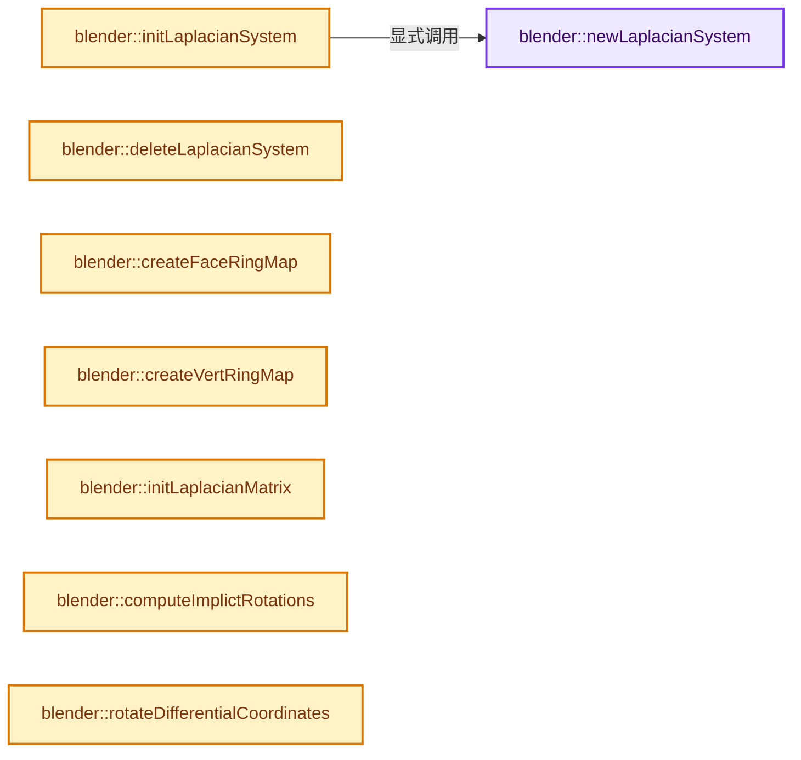
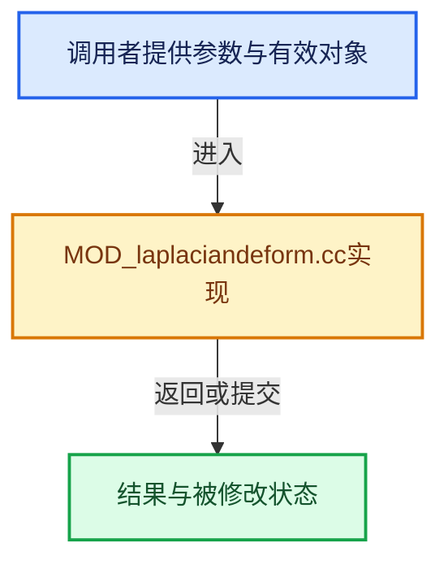

# 实现依赖专题：source/blender/modifiers/intern/MOD_laplaciandeform.cc

[方向导航](README.md) · [符号索引](../%E7%AC%A6%E5%8F%B7%E4%BE%9D%E8%B5%96%E4%B8%8E%E5%AE%9E%E7%8E%B0%E7%B4%A2%E5%BC%95.md)

本专题从正文实际调用进入，集中保存共享实现。函数有稳定锚点，可从调用处直接跳到对应完整函数；递归与互相调用通过回链组织。

## 本文件的实现关系






## 完整成员与函数实现

<a id="f-fc9bdb636c2f695e"></a>

### `blender::newLaplacianSystem`

实现位置：[source/blender/modifiers/intern/MOD_laplaciandeform.cc](../../../../../source/blender/modifiers/intern/MOD_laplaciandeform.cc) · L95—L109。

**教学注释版**

<!-- annotated:5c288936564006 -->

```cpp
static LaplacianSystem *newLaplacianSystem()
{
  LaplacianSystem *sys = MEM_new_zeroed<LaplacianSystem>(__func__);

  sys->is_matrix_computed = false;
  sys->has_solution = false;
  sys->verts_num = 0;
  sys->edges_num = 0;
  sys->anchors_num = 0;
  sys->tris_num = 0;
  sys->repeat = 1;
  sys->anchor_grp_name[0] = '\0';

  return sys;
}
```

<details>
<summary>核对原始源码：source/blender/modifiers/intern/MOD_laplaciandeform.cc · L95—L109</summary>

<!-- original:5c288936564006:source/blender/modifiers/intern/MOD_laplaciandeform.cc:95:109 -->

```cpp
static LaplacianSystem *newLaplacianSystem()
{
  LaplacianSystem *sys = MEM_new_zeroed<LaplacianSystem>(__func__);

  sys->is_matrix_computed = false;
  sys->has_solution = false;
  sys->verts_num = 0;
  sys->edges_num = 0;
  sys->anchors_num = 0;
  sys->tris_num = 0;
  sys->repeat = 1;
  sys->anchor_grp_name[0] = '\0';

  return sys;
}
```

</details>

**沿实际写入检查状态**

- `sys->is_matrix_computed = false;`
- `sys->has_solution = false;`
- `sys->verts_num = 0;`
- `sys->edges_num = 0;`
- `sys->anchors_num = 0;`
- `sys->tris_num = 0;`
- `sys->repeat = 1;`
- `sys->anchor_grp_name[0] = '\0';`

**结果出口**

- `return sys;`

**继续追踪实现**

- `MEM_new_zeroed<LaplacianSystem>` → [MEM_new_zeroed · L550](../03-%E5%86%85%E5%AD%98%E5%88%86%E9%85%8D%E4%B8%8E%E8%BF%90%E8%A1%8C%E6%97%B6%E7%B1%BB%E5%9E%8B/%E4%BE%9D%E8%B5%96-MEM_guardedalloc-b54eca.md#f-eeb1e2a7f57dd231)；[MEM_new_zeroed · L114](../03-%E5%86%85%E5%AD%98%E5%88%86%E9%85%8D%E4%B8%8E%E8%BF%90%E8%A1%8C%E6%97%B6%E7%B1%BB%E5%9E%8B/%E4%BE%9D%E8%B5%96-mallocn-afdcd4.md#f-e04cf01c64c8b180)。同名重载需按实参类型选择。

<a id="f-99ea41265582dde5"></a>

### `blender::initLaplacianSystem`

实现位置：[source/blender/modifiers/intern/MOD_laplaciandeform.cc](../../../../../source/blender/modifiers/intern/MOD_laplaciandeform.cc) · L111—L135。

接口参数：

- `int verts_num`
- `int edges_num`
- `int tris_num`
- `int anchors_num`
- `const char defgrpName[64]`
- `int iterations`

**教学注释版**

<!-- annotated:926873243aa10f -->

```cpp
static LaplacianSystem *initLaplacianSystem(int verts_num,
                                            int edges_num,
                                            int tris_num,
                                            int anchors_num,
                                            const char defgrpName[64],
                                            int iterations)
{
  LaplacianSystem *sys = newLaplacianSystem();

  sys->is_matrix_computed = false;
  sys->has_solution = false;
  sys->verts_num = verts_num;
  sys->edges_num = edges_num;
  sys->tris_num = tris_num;
  sys->anchors_num = anchors_num;
  sys->repeat = iterations;
  STRNCPY(sys->anchor_grp_name, defgrpName);
  sys->co = MEM_new_array_uninitialized<float[3]>(size_t(verts_num), __func__);
  sys->no = MEM_new_array_zeroed<float[3]>(verts_num, __func__);
  sys->delta = MEM_new_array_zeroed<float[3]>(verts_num, __func__);
  sys->tris = MEM_new_array_uninitialized<uint[3]>(size_t(tris_num), __func__);
  sys->index_anchors = MEM_new_array_uninitialized<int>(size_t(anchors_num), __func__);
  sys->unit_verts = MEM_new_array_zeroed<int>(verts_num, __func__);
  return sys;
}
```

<details>
<summary>核对原始源码：source/blender/modifiers/intern/MOD_laplaciandeform.cc · L111—L135</summary>

<!-- original:926873243aa10f:source/blender/modifiers/intern/MOD_laplaciandeform.cc:111:135 -->

```cpp
static LaplacianSystem *initLaplacianSystem(int verts_num,
                                            int edges_num,
                                            int tris_num,
                                            int anchors_num,
                                            const char defgrpName[64],
                                            int iterations)
{
  LaplacianSystem *sys = newLaplacianSystem();

  sys->is_matrix_computed = false;
  sys->has_solution = false;
  sys->verts_num = verts_num;
  sys->edges_num = edges_num;
  sys->tris_num = tris_num;
  sys->anchors_num = anchors_num;
  sys->repeat = iterations;
  STRNCPY(sys->anchor_grp_name, defgrpName);
  sys->co = MEM_new_array_uninitialized<float[3]>(size_t(verts_num), __func__);
  sys->no = MEM_new_array_zeroed<float[3]>(verts_num, __func__);
  sys->delta = MEM_new_array_zeroed<float[3]>(verts_num, __func__);
  sys->tris = MEM_new_array_uninitialized<uint[3]>(size_t(tris_num), __func__);
  sys->index_anchors = MEM_new_array_uninitialized<int>(size_t(anchors_num), __func__);
  sys->unit_verts = MEM_new_array_zeroed<int>(verts_num, __func__);
  return sys;
}
```

</details>

**沿实际写入检查状态**

- `sys->is_matrix_computed = false;`
- `sys->has_solution = false;`
- `sys->verts_num = verts_num;`
- `sys->edges_num = edges_num;`
- `sys->tris_num = tris_num;`
- `sys->anchors_num = anchors_num;`
- `sys->repeat = iterations;`
- `sys->co = MEM_new_array_uninitialized<float[3]>(size_t(verts_num), __func__);`
- `sys->no = MEM_new_array_zeroed<float[3]>(verts_num, __func__);`
- `sys->delta = MEM_new_array_zeroed<float[3]>(verts_num, __func__);`
- `sys->tris = MEM_new_array_uninitialized<uint[3]>(size_t(tris_num), __func__);`
- `sys->index_anchors = MEM_new_array_uninitialized<int>(size_t(anchors_num), __func__);`
- `sys->unit_verts = MEM_new_array_zeroed<int>(verts_num, __func__);`

**结果出口**

- `return sys;`

**继续追踪实现**

- `newLaplacianSystem` → [blender::newLaplacianSystem · L95](%E4%BE%9D%E8%B5%96-MOD_laplaciandeform-15347d.md#f-fc9bdb636c2f695e)。
- `STRNCPY` → [blender::STRNCPY · L690](../01-%E5%9F%BA%E7%A1%80%E5%AE%B9%E5%99%A8%E4%B8%8E%E7%8E%B0%E4%BB%A3CPP/%E4%BE%9D%E8%B5%96-BLI_string-b43058.md#f-6b2d861724026be6)。
- `MEM_new_array_uninitialized<float[3]>` → [MEM_new_array_uninitialized · L608](../03-%E5%86%85%E5%AD%98%E5%88%86%E9%85%8D%E4%B8%8E%E8%BF%90%E8%A1%8C%E6%97%B6%E7%B1%BB%E5%9E%8B/%E4%BE%9D%E8%B5%96-MEM_guardedalloc-b54eca.md#f-b7103eae8eb57b05)；[MEM_new_array_uninitialized · L129](../03-%E5%86%85%E5%AD%98%E5%88%86%E9%85%8D%E4%B8%8E%E8%BF%90%E8%A1%8C%E6%97%B6%E7%B1%BB%E5%9E%8B/%E4%BE%9D%E8%B5%96-mallocn-afdcd4.md#f-bf6ef4ddcfb6e5df)。同名重载需按实参类型选择。
- `MEM_new_array_zeroed<float[3]>` → [MEM_new_array_zeroed · L566](../03-%E5%86%85%E5%AD%98%E5%88%86%E9%85%8D%E4%B8%8E%E8%BF%90%E8%A1%8C%E6%97%B6%E7%B1%BB%E5%9E%8B/%E4%BE%9D%E8%B5%96-MEM_guardedalloc-b54eca.md#f-3a0cf63fb5216500)；[MEM_new_array_zeroed · L119](../03-%E5%86%85%E5%AD%98%E5%88%86%E9%85%8D%E4%B8%8E%E8%BF%90%E8%A1%8C%E6%97%B6%E7%B1%BB%E5%9E%8B/%E4%BE%9D%E8%B5%96-mallocn-afdcd4.md#f-6825557da566fdbe)。同名重载需按实参类型选择。
- `MEM_new_array_uninitialized<uint[3]>` → [MEM_new_array_uninitialized · L608](../03-%E5%86%85%E5%AD%98%E5%88%86%E9%85%8D%E4%B8%8E%E8%BF%90%E8%A1%8C%E6%97%B6%E7%B1%BB%E5%9E%8B/%E4%BE%9D%E8%B5%96-MEM_guardedalloc-b54eca.md#f-b7103eae8eb57b05)；[MEM_new_array_uninitialized · L129](../03-%E5%86%85%E5%AD%98%E5%88%86%E9%85%8D%E4%B8%8E%E8%BF%90%E8%A1%8C%E6%97%B6%E7%B1%BB%E5%9E%8B/%E4%BE%9D%E8%B5%96-mallocn-afdcd4.md#f-bf6ef4ddcfb6e5df)。同名重载需按实参类型选择。
- `MEM_new_array_uninitialized<int>` → [MEM_new_array_uninitialized · L608](../03-%E5%86%85%E5%AD%98%E5%88%86%E9%85%8D%E4%B8%8E%E8%BF%90%E8%A1%8C%E6%97%B6%E7%B1%BB%E5%9E%8B/%E4%BE%9D%E8%B5%96-MEM_guardedalloc-b54eca.md#f-b7103eae8eb57b05)；[MEM_new_array_uninitialized · L129](../03-%E5%86%85%E5%AD%98%E5%88%86%E9%85%8D%E4%B8%8E%E8%BF%90%E8%A1%8C%E6%97%B6%E7%B1%BB%E5%9E%8B/%E4%BE%9D%E8%B5%96-mallocn-afdcd4.md#f-bf6ef4ddcfb6e5df)。同名重载需按实参类型选择。
- `MEM_new_array_zeroed<int>` → [MEM_new_array_zeroed · L566](../03-%E5%86%85%E5%AD%98%E5%88%86%E9%85%8D%E4%B8%8E%E8%BF%90%E8%A1%8C%E6%97%B6%E7%B1%BB%E5%9E%8B/%E4%BE%9D%E8%B5%96-MEM_guardedalloc-b54eca.md#f-3a0cf63fb5216500)；[MEM_new_array_zeroed · L119](../03-%E5%86%85%E5%AD%98%E5%88%86%E9%85%8D%E4%B8%8E%E8%BF%90%E8%A1%8C%E6%97%B6%E7%B1%BB%E5%9E%8B/%E4%BE%9D%E8%B5%96-mallocn-afdcd4.md#f-6825557da566fdbe)。同名重载需按实参类型选择。

<a id="f-c759c7923cca7105"></a>

### `blender::deleteLaplacianSystem`

实现位置：[source/blender/modifiers/intern/MOD_laplaciandeform.cc](../../../../../source/blender/modifiers/intern/MOD_laplaciandeform.cc) · L137—L154。

接口参数：

- `LaplacianSystem *sys`

**教学注释版**

<!-- annotated:9b20c02b0fb413 -->

```cpp
static void deleteLaplacianSystem(LaplacianSystem *sys)
{
  MEM_SAFE_DELETE(sys->co);
  MEM_SAFE_DELETE(sys->no);
  MEM_SAFE_DELETE(sys->delta);
  MEM_SAFE_DELETE(sys->tris);
  MEM_SAFE_DELETE(sys->index_anchors);
  MEM_SAFE_DELETE(sys->unit_verts);
  MEM_SAFE_DELETE(sys->ringf_indices);
  MEM_SAFE_DELETE(sys->ringv_indices);
  MEM_SAFE_DELETE(sys->ringf_map);
  MEM_SAFE_DELETE(sys->ringv_map);

  if (sys->context) {
    EIG_linear_solver_delete(sys->context);
  }
  MEM_SAFE_DELETE(sys);
}
```

<details>
<summary>核对原始源码：source/blender/modifiers/intern/MOD_laplaciandeform.cc · L137—L154</summary>

<!-- original:9b20c02b0fb413:source/blender/modifiers/intern/MOD_laplaciandeform.cc:137:154 -->

```cpp
static void deleteLaplacianSystem(LaplacianSystem *sys)
{
  MEM_SAFE_DELETE(sys->co);
  MEM_SAFE_DELETE(sys->no);
  MEM_SAFE_DELETE(sys->delta);
  MEM_SAFE_DELETE(sys->tris);
  MEM_SAFE_DELETE(sys->index_anchors);
  MEM_SAFE_DELETE(sys->unit_verts);
  MEM_SAFE_DELETE(sys->ringf_indices);
  MEM_SAFE_DELETE(sys->ringv_indices);
  MEM_SAFE_DELETE(sys->ringf_map);
  MEM_SAFE_DELETE(sys->ringv_map);

  if (sys->context) {
    EIG_linear_solver_delete(sys->context);
  }
  MEM_SAFE_DELETE(sys);
}
```

</details>

**继续追踪实现**

- `MEM_SAFE_DELETE` → [MEM_SAFE_DELETE · L436](../03-%E5%86%85%E5%AD%98%E5%88%86%E9%85%8D%E4%B8%8E%E8%BF%90%E8%A1%8C%E6%97%B6%E7%B1%BB%E5%9E%8B/%E4%BE%9D%E8%B5%96-MEM_guardedalloc-b54eca.md#m-eadb3bc5b902)。宏定义由构建条件选择。
- `EIG_linear_solver_delete` → [EIG_linear_solver_delete · L114](%E4%BE%9D%E8%B5%96-linear_solver-fa35c0.md#f-77ab65724c82635a)。

<a id="f-2dce6e5fec3ee2bd"></a>

### `blender::createFaceRingMap`

实现位置：[source/blender/modifiers/intern/MOD_laplaciandeform.cc](../../../../../source/blender/modifiers/intern/MOD_laplaciandeform.cc) · L156—L191。

接口参数：

- `const int mvert_tot`
- `Span<int3> corner_tris`
- `Span<int> corner_verts`
- `MeshElemMap **r_map`
- `int **r_indices`

**教学注释版**

<!-- annotated:349d476aec0498 -->

```cpp
static void createFaceRingMap(const int mvert_tot,
                              Span<int3> corner_tris,
                              Span<int> corner_verts,
                              MeshElemMap **r_map,
                              int **r_indices)
{
  int indices_num = 0;
  int *indices, *index_iter;
  MeshElemMap *map = MEM_new_array_zeroed<MeshElemMap>(mvert_tot, __func__);

  // [讲解] corner_tris.index_range：查询视图长度或生成对应有效索引区间。
  for (const int i : corner_tris.index_range()) {
    const int3 &tri = corner_tris[i];
    for (int j = 0; j < 3; j++) {
      const int v_index = corner_verts[tri[j]];
      map[v_index].count++;
      indices_num++;
    }
  }
  indices = MEM_new_array_zeroed<int>(indices_num, __func__);
  index_iter = indices;
  for (int i = 0; i < mvert_tot; i++) {
    map[i].indices = index_iter;
    index_iter += map[i].count;
    map[i].count = 0;
  }
  for (const int i : corner_tris.index_range()) {
    const int3 &tri = corner_tris[i];
    for (int j = 0; j < 3; j++) {
      const int v_index = corner_verts[tri[j]];
      map[v_index].indices[map[v_index].count] = i;
      map[v_index].count++;
    }
  }
  *r_map = map;
  *r_indices = indices;
}
```

<details>
<summary>核对原始源码：source/blender/modifiers/intern/MOD_laplaciandeform.cc · L156—L191</summary>

<!-- original:349d476aec0498:source/blender/modifiers/intern/MOD_laplaciandeform.cc:156:191 -->

```cpp
static void createFaceRingMap(const int mvert_tot,
                              Span<int3> corner_tris,
                              Span<int> corner_verts,
                              MeshElemMap **r_map,
                              int **r_indices)
{
  int indices_num = 0;
  int *indices, *index_iter;
  MeshElemMap *map = MEM_new_array_zeroed<MeshElemMap>(mvert_tot, __func__);

  for (const int i : corner_tris.index_range()) {
    const int3 &tri = corner_tris[i];
    for (int j = 0; j < 3; j++) {
      const int v_index = corner_verts[tri[j]];
      map[v_index].count++;
      indices_num++;
    }
  }
  indices = MEM_new_array_zeroed<int>(indices_num, __func__);
  index_iter = indices;
  for (int i = 0; i < mvert_tot; i++) {
    map[i].indices = index_iter;
    index_iter += map[i].count;
    map[i].count = 0;
  }
  for (const int i : corner_tris.index_range()) {
    const int3 &tri = corner_tris[i];
    for (int j = 0; j < 3; j++) {
      const int v_index = corner_verts[tri[j]];
      map[v_index].indices[map[v_index].count] = i;
      map[v_index].count++;
    }
  }
  *r_map = map;
  *r_indices = indices;
}
```

</details>

**沿实际写入检查状态**

- `indices = MEM_new_array_zeroed<int>(indices_num, __func__);`
- `index_iter = indices;`
- `map[i].indices = index_iter;`
- `index_iter += map[i].count;`
- `map[i].count = 0;`
- `map[v_index].indices[map[v_index].count] = i;`

**继续追踪实现**

- `MEM_new_array_zeroed<MeshElemMap>` → [MEM_new_array_zeroed · L566](../03-%E5%86%85%E5%AD%98%E5%88%86%E9%85%8D%E4%B8%8E%E8%BF%90%E8%A1%8C%E6%97%B6%E7%B1%BB%E5%9E%8B/%E4%BE%9D%E8%B5%96-MEM_guardedalloc-b54eca.md#f-3a0cf63fb5216500)；[MEM_new_array_zeroed · L119](../03-%E5%86%85%E5%AD%98%E5%88%86%E9%85%8D%E4%B8%8E%E8%BF%90%E8%A1%8C%E6%97%B6%E7%B1%BB%E5%9E%8B/%E4%BE%9D%E8%B5%96-mallocn-afdcd4.md#f-6825557da566fdbe)。同名重载需按实参类型选择。
- `corner_tris.index_range` → [blender::Span::index_range · L405](../01-%E5%9F%BA%E7%A1%80%E5%AE%B9%E5%99%A8%E4%B8%8E%E7%8E%B0%E4%BB%A3CPP/05-Span%E5%8F%AA%E8%AF%BB%E8%BF%9E%E7%BB%AD%E8%A7%86%E5%9B%BE.md#f-caaa9b06e13e53e0)。
- `MEM_new_array_zeroed<int>` → [MEM_new_array_zeroed · L566](../03-%E5%86%85%E5%AD%98%E5%88%86%E9%85%8D%E4%B8%8E%E8%BF%90%E8%A1%8C%E6%97%B6%E7%B1%BB%E5%9E%8B/%E4%BE%9D%E8%B5%96-MEM_guardedalloc-b54eca.md#f-3a0cf63fb5216500)；[MEM_new_array_zeroed · L119](../03-%E5%86%85%E5%AD%98%E5%88%86%E9%85%8D%E4%B8%8E%E8%BF%90%E8%A1%8C%E6%97%B6%E7%B1%BB%E5%9E%8B/%E4%BE%9D%E8%B5%96-mallocn-afdcd4.md#f-6825557da566fdbe)。同名重载需按实参类型选择。

<a id="f-ad6dc5044efcf3ac"></a>

### `blender::createVertRingMap`

实现位置：[source/blender/modifiers/intern/MOD_laplaciandeform.cc](../../../../../source/blender/modifiers/intern/MOD_laplaciandeform.cc) · L193—L226。

接口参数：

- `const int mvert_tot`
- `const Span<int2> edges`
- `MeshElemMap **r_map`
- `int **r_indices`

**教学注释版**

<!-- annotated:069a4f7fce5f22 -->

```cpp
static void createVertRingMap(const int mvert_tot,
                              const Span<int2> edges,
                              MeshElemMap **r_map,
                              int **r_indices)
{
  MeshElemMap *map = MEM_new_array_zeroed<MeshElemMap>(mvert_tot, __func__);
  int i, vid[2], indices_num = 0;
  int *indices, *index_iter;

  // [讲解] edges.index_range：查询视图长度或生成对应有效索引区间。
  for (const int i : edges.index_range()) {
    vid[0] = edges[i][0];
    vid[1] = edges[i][1];
    map[vid[0]].count++;
    map[vid[1]].count++;
    indices_num += 2;
  }
  indices = MEM_new_array_zeroed<int>(indices_num, __func__);
  index_iter = indices;
  for (i = 0; i < mvert_tot; i++) {
    map[i].indices = index_iter;
    index_iter += map[i].count;
    map[i].count = 0;
  }
  for (const int i : edges.index_range()) {
    vid[0] = edges[i][0];
    vid[1] = edges[i][1];
    map[vid[0]].indices[map[vid[0]].count] = vid[1];
    map[vid[0]].count++;
    map[vid[1]].indices[map[vid[1]].count] = vid[0];
    map[vid[1]].count++;
  }
  *r_map = map;
  *r_indices = indices;
}
```

<details>
<summary>核对原始源码：source/blender/modifiers/intern/MOD_laplaciandeform.cc · L193—L226</summary>

<!-- original:069a4f7fce5f22:source/blender/modifiers/intern/MOD_laplaciandeform.cc:193:226 -->

```cpp
static void createVertRingMap(const int mvert_tot,
                              const Span<int2> edges,
                              MeshElemMap **r_map,
                              int **r_indices)
{
  MeshElemMap *map = MEM_new_array_zeroed<MeshElemMap>(mvert_tot, __func__);
  int i, vid[2], indices_num = 0;
  int *indices, *index_iter;

  for (const int i : edges.index_range()) {
    vid[0] = edges[i][0];
    vid[1] = edges[i][1];
    map[vid[0]].count++;
    map[vid[1]].count++;
    indices_num += 2;
  }
  indices = MEM_new_array_zeroed<int>(indices_num, __func__);
  index_iter = indices;
  for (i = 0; i < mvert_tot; i++) {
    map[i].indices = index_iter;
    index_iter += map[i].count;
    map[i].count = 0;
  }
  for (const int i : edges.index_range()) {
    vid[0] = edges[i][0];
    vid[1] = edges[i][1];
    map[vid[0]].indices[map[vid[0]].count] = vid[1];
    map[vid[0]].count++;
    map[vid[1]].indices[map[vid[1]].count] = vid[0];
    map[vid[1]].count++;
  }
  *r_map = map;
  *r_indices = indices;
}
```

</details>

**沿实际写入检查状态**

- `vid[0] = edges[i][0];`
- `vid[1] = edges[i][1];`
- `indices_num += 2;`
- `indices = MEM_new_array_zeroed<int>(indices_num, __func__);`
- `index_iter = indices;`
- `map[i].indices = index_iter;`
- `index_iter += map[i].count;`
- `map[i].count = 0;`
- `map[vid[0]].indices[map[vid[0]].count] = vid[1];`
- `map[vid[1]].indices[map[vid[1]].count] = vid[0];`

**继续追踪实现**

- `MEM_new_array_zeroed<MeshElemMap>` → [MEM_new_array_zeroed · L566](../03-%E5%86%85%E5%AD%98%E5%88%86%E9%85%8D%E4%B8%8E%E8%BF%90%E8%A1%8C%E6%97%B6%E7%B1%BB%E5%9E%8B/%E4%BE%9D%E8%B5%96-MEM_guardedalloc-b54eca.md#f-3a0cf63fb5216500)；[MEM_new_array_zeroed · L119](../03-%E5%86%85%E5%AD%98%E5%88%86%E9%85%8D%E4%B8%8E%E8%BF%90%E8%A1%8C%E6%97%B6%E7%B1%BB%E5%9E%8B/%E4%BE%9D%E8%B5%96-mallocn-afdcd4.md#f-6825557da566fdbe)。同名重载需按实参类型选择。
- `edges.index_range` → [blender::Span::index_range · L405](../01-%E5%9F%BA%E7%A1%80%E5%AE%B9%E5%99%A8%E4%B8%8E%E7%8E%B0%E4%BB%A3CPP/05-Span%E5%8F%AA%E8%AF%BB%E8%BF%9E%E7%BB%AD%E8%A7%86%E5%9B%BE.md#f-caaa9b06e13e53e0)。
- `MEM_new_array_zeroed<int>` → [MEM_new_array_zeroed · L566](../03-%E5%86%85%E5%AD%98%E5%88%86%E9%85%8D%E4%B8%8E%E8%BF%90%E8%A1%8C%E6%97%B6%E7%B1%BB%E5%9E%8B/%E4%BE%9D%E8%B5%96-MEM_guardedalloc-b54eca.md#f-3a0cf63fb5216500)；[MEM_new_array_zeroed · L119](../03-%E5%86%85%E5%AD%98%E5%88%86%E9%85%8D%E4%B8%8E%E8%BF%90%E8%A1%8C%E6%97%B6%E7%B1%BB%E5%9E%8B/%E4%BE%9D%E8%B5%96-mallocn-afdcd4.md#f-6825557da566fdbe)。同名重载需按实参类型选择。

<a id="f-df798cb2644d29e1"></a>

### `blender::initLaplacianMatrix`

实现位置：[source/blender/modifiers/intern/MOD_laplaciandeform.cc](../../../../../source/blender/modifiers/intern/MOD_laplaciandeform.cc) · L260—L311。

接口参数：

- `LaplacianSystem *sys`

**教学注释版**

<!-- annotated:61aad9c1aefc55 -->

```cpp
static void initLaplacianMatrix(LaplacianSystem *sys)
{
  float no[3];
  float w2, w3;
  int i = 3, j, ti;
  int idv[3];

  for (ti = 0; ti < sys->tris_num; ti++) {
    const uint *vidt = sys->tris[ti];
    const float *co[3];

    co[0] = sys->co[vidt[0]];
    co[1] = sys->co[vidt[1]];
    co[2] = sys->co[vidt[2]];

    normal_tri_v3(no, UNPACK3(co));
    add_v3_v3(sys->no[vidt[0]], no);
    add_v3_v3(sys->no[vidt[1]], no);
    add_v3_v3(sys->no[vidt[2]], no);

    for (j = 0; j < 3; j++) {
      const float *v1, *v2, *v3;

      idv[0] = vidt[j];
      idv[1] = vidt[(j + 1) % i];
      idv[2] = vidt[(j + 2) % i];

      v1 = sys->co[idv[0]];
      v2 = sys->co[idv[1]];
      v3 = sys->co[idv[2]];

      w2 = cotangent_tri_weight_v3(v3, v1, v2);
      w3 = cotangent_tri_weight_v3(v2, v3, v1);

      sys->delta[idv[0]][0] += v1[0] * (w2 + w3);
      sys->delta[idv[0]][1] += v1[1] * (w2 + w3);
      sys->delta[idv[0]][2] += v1[2] * (w2 + w3);

      sys->delta[idv[0]][0] -= v2[0] * w2;
      sys->delta[idv[0]][1] -= v2[1] * w2;
      sys->delta[idv[0]][2] -= v2[2] * w2;

      sys->delta[idv[0]][0] -= v3[0] * w3;
      sys->delta[idv[0]][1] -= v3[1] * w3;
      sys->delta[idv[0]][2] -= v3[2] * w3;

      EIG_linear_solver_matrix_add(sys->context, idv[0], idv[1], -w2);
      EIG_linear_solver_matrix_add(sys->context, idv[0], idv[2], -w3);
      EIG_linear_solver_matrix_add(sys->context, idv[0], idv[0], w2 + w3);
    }
  }
}
```

<details>
<summary>核对原始源码：source/blender/modifiers/intern/MOD_laplaciandeform.cc · L260—L311</summary>

<!-- original:61aad9c1aefc55:source/blender/modifiers/intern/MOD_laplaciandeform.cc:260:311 -->

```cpp
static void initLaplacianMatrix(LaplacianSystem *sys)
{
  float no[3];
  float w2, w3;
  int i = 3, j, ti;
  int idv[3];

  for (ti = 0; ti < sys->tris_num; ti++) {
    const uint *vidt = sys->tris[ti];
    const float *co[3];

    co[0] = sys->co[vidt[0]];
    co[1] = sys->co[vidt[1]];
    co[2] = sys->co[vidt[2]];

    normal_tri_v3(no, UNPACK3(co));
    add_v3_v3(sys->no[vidt[0]], no);
    add_v3_v3(sys->no[vidt[1]], no);
    add_v3_v3(sys->no[vidt[2]], no);

    for (j = 0; j < 3; j++) {
      const float *v1, *v2, *v3;

      idv[0] = vidt[j];
      idv[1] = vidt[(j + 1) % i];
      idv[2] = vidt[(j + 2) % i];

      v1 = sys->co[idv[0]];
      v2 = sys->co[idv[1]];
      v3 = sys->co[idv[2]];

      w2 = cotangent_tri_weight_v3(v3, v1, v2);
      w3 = cotangent_tri_weight_v3(v2, v3, v1);

      sys->delta[idv[0]][0] += v1[0] * (w2 + w3);
      sys->delta[idv[0]][1] += v1[1] * (w2 + w3);
      sys->delta[idv[0]][2] += v1[2] * (w2 + w3);

      sys->delta[idv[0]][0] -= v2[0] * w2;
      sys->delta[idv[0]][1] -= v2[1] * w2;
      sys->delta[idv[0]][2] -= v2[2] * w2;

      sys->delta[idv[0]][0] -= v3[0] * w3;
      sys->delta[idv[0]][1] -= v3[1] * w3;
      sys->delta[idv[0]][2] -= v3[2] * w3;

      EIG_linear_solver_matrix_add(sys->context, idv[0], idv[1], -w2);
      EIG_linear_solver_matrix_add(sys->context, idv[0], idv[2], -w3);
      EIG_linear_solver_matrix_add(sys->context, idv[0], idv[0], w2 + w3);
    }
  }
}
```

</details>

**沿实际写入检查状态**

- `co[0] = sys->co[vidt[0]];`
- `co[1] = sys->co[vidt[1]];`
- `co[2] = sys->co[vidt[2]];`
- `idv[0] = vidt[j];`
- `idv[1] = vidt[(j + 1) % i];`
- `idv[2] = vidt[(j + 2) % i];`
- `v1 = sys->co[idv[0]];`
- `v2 = sys->co[idv[1]];`
- `v3 = sys->co[idv[2]];`
- `w2 = cotangent_tri_weight_v3(v3, v1, v2);`
- `w3 = cotangent_tri_weight_v3(v2, v3, v1);`
- `sys->delta[idv[0]][0] += v1[0] * (w2 + w3);`
- `sys->delta[idv[0]][1] += v1[1] * (w2 + w3);`
- `sys->delta[idv[0]][2] += v1[2] * (w2 + w3);`
- `sys->delta[idv[0]][0] -= v2[0] * w2;`
- `sys->delta[idv[0]][1] -= v2[1] * w2;`
- `sys->delta[idv[0]][2] -= v2[2] * w2;`
- `sys->delta[idv[0]][0] -= v3[0] * w3;`
- `sys->delta[idv[0]][1] -= v3[1] * w3;`
- `sys->delta[idv[0]][2] -= v3[2] * w3;`

**继续追踪实现**

- `normal_tri_v3` → [blender::normal_tri_v3 · L45](../12-%E7%A9%BA%E9%97%B4%E6%95%B0%E6%8D%AE%E7%BB%93%E6%9E%84%E4%B8%8E%E5%87%A0%E4%BD%95%E7%AE%97%E6%B3%95/%E4%BE%9D%E8%B5%96-math_geom-8d91a3.md#f-f574cdfe156b33d2)。
- `UNPACK3` → [UNPACK3 · L23](%E4%BE%9D%E8%B5%96-GHOST_utildefines-34b996.md#m-f882324eb80a)；[UNPACK3 · L235](../01-%E5%9F%BA%E7%A1%80%E5%AE%B9%E5%99%A8%E4%B8%8E%E7%8E%B0%E4%BB%A3CPP/%E4%BE%9D%E8%B5%96-BLI_utildefines-293a0a.md#m-bbbbdcf09d3b)；[UNPACK3 · L14](%E4%BE%9D%E8%B5%96-gpu_shader_utildefines.bsl-e9f199.md#m-b4e3357a0310)。宏定义由构建条件选择。
- `add_v3_v3` → [blender::add_v3_v3 · L286](../12-%E7%A9%BA%E9%97%B4%E6%95%B0%E6%8D%AE%E7%BB%93%E6%9E%84%E4%B8%8E%E5%87%A0%E4%BD%95%E7%AE%97%E6%B3%95/%E4%BE%9D%E8%B5%96-math_vector_inline-0c8541.md#f-e7930c6fdefe462c)。
- `cotangent_tri_weight_v3` → [blender::cotangent_tri_weight_v3 · L202](../12-%E7%A9%BA%E9%97%B4%E6%95%B0%E6%8D%AE%E7%BB%93%E6%9E%84%E4%B8%8E%E5%87%A0%E4%BD%95%E7%AE%97%E6%B3%95/%E4%BE%9D%E8%B5%96-math_geom-8d91a3.md#f-78c6e2c246a0cb10)。
- `EIG_linear_solver_matrix_add` → [EIG_linear_solver_matrix_add · L217](%E4%BE%9D%E8%B5%96-linear_solver-fa35c0.md#f-a7c671eec084f178)。

<a id="f-a7b6f97e8e15d8d5"></a>

### `blender::computeImplictRotations`

实现位置：[source/blender/modifiers/intern/MOD_laplaciandeform.cc](../../../../../source/blender/modifiers/intern/MOD_laplaciandeform.cc) · L313—L336。

接口参数：

- `LaplacianSystem *sys`

**教学注释版**

<!-- annotated:a6f87e31db8c17 -->

```cpp
static void computeImplictRotations(LaplacianSystem *sys)
{
  int vid, *vidn = nullptr;
  float minj, mjt, qj[3], vj[3];
  int i, j, ln;

  for (i = 0; i < sys->verts_num; i++) {
    normalize_v3(sys->no[i]);
    vidn = sys->ringv_map[i].indices;
    ln = sys->ringv_map[i].count;
    minj = 1000000.0f;
    for (j = 0; j < ln; j++) {
      vid = vidn[j];
      copy_v3_v3(qj, sys->co[vid]);
      sub_v3_v3v3(vj, qj, sys->co[i]);
      normalize_v3(vj);
      mjt = fabsf(dot_v3v3(vj, sys->no[i]));
      if (mjt < minj) {
        minj = mjt;
        sys->unit_verts[i] = vidn[j];
      }
    }
  }
}
```

<details>
<summary>核对原始源码：source/blender/modifiers/intern/MOD_laplaciandeform.cc · L313—L336</summary>

<!-- original:a6f87e31db8c17:source/blender/modifiers/intern/MOD_laplaciandeform.cc:313:336 -->

```cpp
static void computeImplictRotations(LaplacianSystem *sys)
{
  int vid, *vidn = nullptr;
  float minj, mjt, qj[3], vj[3];
  int i, j, ln;

  for (i = 0; i < sys->verts_num; i++) {
    normalize_v3(sys->no[i]);
    vidn = sys->ringv_map[i].indices;
    ln = sys->ringv_map[i].count;
    minj = 1000000.0f;
    for (j = 0; j < ln; j++) {
      vid = vidn[j];
      copy_v3_v3(qj, sys->co[vid]);
      sub_v3_v3v3(vj, qj, sys->co[i]);
      normalize_v3(vj);
      mjt = fabsf(dot_v3v3(vj, sys->no[i]));
      if (mjt < minj) {
        minj = mjt;
        sys->unit_verts[i] = vidn[j];
      }
    }
  }
}
```

</details>

**沿实际写入检查状态**

- `vidn = sys->ringv_map[i].indices;`
- `ln = sys->ringv_map[i].count;`
- `minj = 1000000.0f;`
- `vid = vidn[j];`
- `mjt = fabsf(dot_v3v3(vj, sys->no[i]));`
- `minj = mjt;`
- `sys->unit_verts[i] = vidn[j];`

**继续追踪实现**

- `normalize_v3` → [blender::normalize_v3 · L933](../12-%E7%A9%BA%E9%97%B4%E6%95%B0%E6%8D%AE%E7%BB%93%E6%9E%84%E4%B8%8E%E5%87%A0%E4%BD%95%E7%AE%97%E6%B3%95/%E4%BE%9D%E8%B5%96-math_vector_inline-0c8541.md#f-5f3257e657ef732c)。
- `copy_v3_v3` → [blender::copy_v3_v3 · L47](../12-%E7%A9%BA%E9%97%B4%E6%95%B0%E6%8D%AE%E7%BB%93%E6%9E%84%E4%B8%8E%E5%87%A0%E4%BD%95%E7%AE%97%E6%B3%95/%E4%BE%9D%E8%B5%96-math_vector_inline-0c8541.md#f-037a0d5fa5060bd6)。
- `sub_v3_v3v3` → [blender::sub_v3_v3v3 · L360](../12-%E7%A9%BA%E9%97%B4%E6%95%B0%E6%8D%AE%E7%BB%93%E6%9E%84%E4%B8%8E%E5%87%A0%E4%BD%95%E7%AE%97%E6%B3%95/%E4%BE%9D%E8%B5%96-math_vector_inline-0c8541.md#f-23781c252db8b30c)。
- `fabsf` → [fabsf · L21](%E4%BE%9D%E8%B5%96-radial_tiling_shared-98abf9.md#m-02cc4c69cfb3)；[fabsf · L43](%E4%BE%9D%E8%B5%96-radial_tiling_shared-98abf9.md#m-04effe61803b)；[fabsf · L74](%E4%BE%9D%E8%B5%96-radial_tiling_shared-98abf9.md#m-927dd4eba7dc)；[fabsf · L25](../01-%E5%9F%BA%E7%A1%80%E5%AE%B9%E5%99%A8%E4%B8%8E%E7%8E%B0%E4%BB%A3CPP/%E4%BE%9D%E8%B5%96-radial_tiling_shared-7989a4.md#m-8348d6b3d08f)；[fabsf · L47](../01-%E5%9F%BA%E7%A1%80%E5%AE%B9%E5%99%A8%E4%B8%8E%E7%8E%B0%E4%BB%A3CPP/%E4%BE%9D%E8%B5%96-radial_tiling_shared-7989a4.md#m-13b7e0b6d84f)；[fabsf · L78](../01-%E5%9F%BA%E7%A1%80%E5%AE%B9%E5%99%A8%E4%B8%8E%E7%8E%B0%E4%BB%A3CPP/%E4%BE%9D%E8%B5%96-radial_tiling_shared-7989a4.md#m-326c83464a0d)；[fabsf · L21](%E4%BE%9D%E8%B5%96-node_radial_tiling_shared-b14bc2.md#m-7c3ee12fc119)；[fabsf · L43](%E4%BE%9D%E8%B5%96-node_radial_tiling_shared-b14bc2.md#m-9112db0e2dd1)；[fabsf · L74](%E4%BE%9D%E8%B5%96-node_radial_tiling_shared-b14bc2.md#m-ee4e61908a6f)；[fabsf · L167](%E4%BE%9D%E8%B5%96-compat-56205c.md#m-b039ee6c1601)；[fabsf · L265](%E4%BE%9D%E8%B5%96-compat-efe0e9.md#m-6b21869e9f3f)。宏定义由构建条件选择。
- `dot_v3v3` → [blender::dot_v3v3 · L646](../12-%E7%A9%BA%E9%97%B4%E6%95%B0%E6%8D%AE%E7%BB%93%E6%9E%84%E4%B8%8E%E5%87%A0%E4%BD%95%E7%AE%97%E6%B3%95/%E4%BE%9D%E8%B5%96-math_vector_inline-0c8541.md#f-c88befa67d07591a)。

<a id="f-c15b60e2553d9cd7"></a>

### `blender::rotateDifferentialCoordinates`

实现位置：[source/blender/modifiers/intern/MOD_laplaciandeform.cc](../../../../../source/blender/modifiers/intern/MOD_laplaciandeform.cc) · L338—L404。

接口参数：

- `LaplacianSystem *sys`

**教学注释版**

<!-- annotated:662f6a25fc3e28 -->

```cpp
static void rotateDifferentialCoordinates(LaplacianSystem *sys)
{
  float alpha, beta, gamma;
  float pj[3], ni[3], di[3];
  float uij[3], dun[3], e2[3], pi[3], fni[3], vn[3][3];
  int i, j, fidn_num, k, fi;
  int *fidn;

  for (i = 0; i < sys->verts_num; i++) {
    copy_v3_v3(pi, sys->co[i]);
    copy_v3_v3(ni, sys->no[i]);
    k = sys->unit_verts[i];
    copy_v3_v3(pj, sys->co[k]);
    sub_v3_v3v3(uij, pj, pi);
    mul_v3_v3fl(dun, ni, dot_v3v3(uij, ni));
    sub_v3_v3(uij, dun);
    normalize_v3(uij);
    cross_v3_v3v3(e2, ni, uij);
    copy_v3_v3(di, sys->delta[i]);
    alpha = dot_v3v3(ni, di);
    beta = dot_v3v3(uij, di);
    gamma = dot_v3v3(e2, di);

    pi[0] = EIG_linear_solver_variable_get(sys->context, 0, i);
    pi[1] = EIG_linear_solver_variable_get(sys->context, 1, i);
    pi[2] = EIG_linear_solver_variable_get(sys->context, 2, i);
    zero_v3(ni);
    fidn_num = sys->ringf_map[i].count;
    for (fi = 0; fi < fidn_num; fi++) {
      const uint *vin;
      fidn = sys->ringf_map[i].indices;
      vin = sys->tris[fidn[fi]];
      for (j = 0; j < 3; j++) {
        vn[j][0] = EIG_linear_solver_variable_get(sys->context, 0, vin[j]);
        vn[j][1] = EIG_linear_solver_variable_get(sys->context, 1, vin[j]);
        vn[j][2] = EIG_linear_solver_variable_get(sys->context, 2, vin[j]);
        if (vin[j] == sys->unit_verts[i]) {
          copy_v3_v3(pj, vn[j]);
        }
      }

      normal_tri_v3(fni, UNPACK3(vn));
      add_v3_v3(ni, fni);
    }

    normalize_v3(ni);
    sub_v3_v3v3(uij, pj, pi);
    mul_v3_v3fl(dun, ni, dot_v3v3(uij, ni));
    sub_v3_v3(uij, dun);
    normalize_v3(uij);
    cross_v3_v3v3(e2, ni, uij);
    fni[0] = alpha * ni[0] + beta * uij[0] + gamma * e2[0];
    fni[1] = alpha * ni[1] + beta * uij[1] + gamma * e2[1];
    fni[2] = alpha * ni[2] + beta * uij[2] + gamma * e2[2];

    if (len_squared_v3(fni) > FLT_EPSILON) {
      EIG_linear_solver_right_hand_side_add(sys->context, 0, i, fni[0]);
      EIG_linear_solver_right_hand_side_add(sys->context, 1, i, fni[1]);
      EIG_linear_solver_right_hand_side_add(sys->context, 2, i, fni[2]);
    }
    else {
      EIG_linear_solver_right_hand_side_add(sys->context, 0, i, sys->delta[i][0]);
      EIG_linear_solver_right_hand_side_add(sys->context, 1, i, sys->delta[i][1]);
      EIG_linear_solver_right_hand_side_add(sys->context, 2, i, sys->delta[i][2]);
    }
  }
}
```

<details>
<summary>核对原始源码：source/blender/modifiers/intern/MOD_laplaciandeform.cc · L338—L404</summary>

<!-- original:662f6a25fc3e28:source/blender/modifiers/intern/MOD_laplaciandeform.cc:338:404 -->

```cpp
static void rotateDifferentialCoordinates(LaplacianSystem *sys)
{
  float alpha, beta, gamma;
  float pj[3], ni[3], di[3];
  float uij[3], dun[3], e2[3], pi[3], fni[3], vn[3][3];
  int i, j, fidn_num, k, fi;
  int *fidn;

  for (i = 0; i < sys->verts_num; i++) {
    copy_v3_v3(pi, sys->co[i]);
    copy_v3_v3(ni, sys->no[i]);
    k = sys->unit_verts[i];
    copy_v3_v3(pj, sys->co[k]);
    sub_v3_v3v3(uij, pj, pi);
    mul_v3_v3fl(dun, ni, dot_v3v3(uij, ni));
    sub_v3_v3(uij, dun);
    normalize_v3(uij);
    cross_v3_v3v3(e2, ni, uij);
    copy_v3_v3(di, sys->delta[i]);
    alpha = dot_v3v3(ni, di);
    beta = dot_v3v3(uij, di);
    gamma = dot_v3v3(e2, di);

    pi[0] = EIG_linear_solver_variable_get(sys->context, 0, i);
    pi[1] = EIG_linear_solver_variable_get(sys->context, 1, i);
    pi[2] = EIG_linear_solver_variable_get(sys->context, 2, i);
    zero_v3(ni);
    fidn_num = sys->ringf_map[i].count;
    for (fi = 0; fi < fidn_num; fi++) {
      const uint *vin;
      fidn = sys->ringf_map[i].indices;
      vin = sys->tris[fidn[fi]];
      for (j = 0; j < 3; j++) {
        vn[j][0] = EIG_linear_solver_variable_get(sys->context, 0, vin[j]);
        vn[j][1] = EIG_linear_solver_variable_get(sys->context, 1, vin[j]);
        vn[j][2] = EIG_linear_solver_variable_get(sys->context, 2, vin[j]);
        if (vin[j] == sys->unit_verts[i]) {
          copy_v3_v3(pj, vn[j]);
        }
      }

      normal_tri_v3(fni, UNPACK3(vn));
      add_v3_v3(ni, fni);
    }

    normalize_v3(ni);
    sub_v3_v3v3(uij, pj, pi);
    mul_v3_v3fl(dun, ni, dot_v3v3(uij, ni));
    sub_v3_v3(uij, dun);
    normalize_v3(uij);
    cross_v3_v3v3(e2, ni, uij);
    fni[0] = alpha * ni[0] + beta * uij[0] + gamma * e2[0];
    fni[1] = alpha * ni[1] + beta * uij[1] + gamma * e2[1];
    fni[2] = alpha * ni[2] + beta * uij[2] + gamma * e2[2];

    if (len_squared_v3(fni) > FLT_EPSILON) {
      EIG_linear_solver_right_hand_side_add(sys->context, 0, i, fni[0]);
      EIG_linear_solver_right_hand_side_add(sys->context, 1, i, fni[1]);
      EIG_linear_solver_right_hand_side_add(sys->context, 2, i, fni[2]);
    }
    else {
      EIG_linear_solver_right_hand_side_add(sys->context, 0, i, sys->delta[i][0]);
      EIG_linear_solver_right_hand_side_add(sys->context, 1, i, sys->delta[i][1]);
      EIG_linear_solver_right_hand_side_add(sys->context, 2, i, sys->delta[i][2]);
    }
  }
}
```

</details>

**沿实际写入检查状态**

- `k = sys->unit_verts[i];`
- `alpha = dot_v3v3(ni, di);`
- `beta = dot_v3v3(uij, di);`
- `gamma = dot_v3v3(e2, di);`
- `pi[0] = EIG_linear_solver_variable_get(sys->context, 0, i);`
- `pi[1] = EIG_linear_solver_variable_get(sys->context, 1, i);`
- `pi[2] = EIG_linear_solver_variable_get(sys->context, 2, i);`
- `fidn_num = sys->ringf_map[i].count;`
- `fidn = sys->ringf_map[i].indices;`
- `vin = sys->tris[fidn[fi]];`
- `vn[j][0] = EIG_linear_solver_variable_get(sys->context, 0, vin[j]);`
- `vn[j][1] = EIG_linear_solver_variable_get(sys->context, 1, vin[j]);`
- `vn[j][2] = EIG_linear_solver_variable_get(sys->context, 2, vin[j]);`
- `fni[0] = alpha * ni[0] + beta * uij[0] + gamma * e2[0];`
- `fni[1] = alpha * ni[1] + beta * uij[1] + gamma * e2[1];`
- `fni[2] = alpha * ni[2] + beta * uij[2] + gamma * e2[2];`

**继续追踪实现**

- `copy_v3_v3` → [blender::copy_v3_v3 · L47](../12-%E7%A9%BA%E9%97%B4%E6%95%B0%E6%8D%AE%E7%BB%93%E6%9E%84%E4%B8%8E%E5%87%A0%E4%BD%95%E7%AE%97%E6%B3%95/%E4%BE%9D%E8%B5%96-math_vector_inline-0c8541.md#f-037a0d5fa5060bd6)。
- `sub_v3_v3v3` → [blender::sub_v3_v3v3 · L360](../12-%E7%A9%BA%E9%97%B4%E6%95%B0%E6%8D%AE%E7%BB%93%E6%9E%84%E4%B8%8E%E5%87%A0%E4%BD%95%E7%AE%97%E6%B3%95/%E4%BE%9D%E8%B5%96-math_vector_inline-0c8541.md#f-23781c252db8b30c)。
- `mul_v3_v3fl` → [blender::mul_v3_v3fl · L428](../12-%E7%A9%BA%E9%97%B4%E6%95%B0%E6%8D%AE%E7%BB%93%E6%9E%84%E4%B8%8E%E5%87%A0%E4%BD%95%E7%AE%97%E6%B3%95/%E4%BE%9D%E8%B5%96-math_vector_inline-0c8541.md#f-c3cb822497b967a8)。
- `dot_v3v3` → [blender::dot_v3v3 · L646](../12-%E7%A9%BA%E9%97%B4%E6%95%B0%E6%8D%AE%E7%BB%93%E6%9E%84%E4%B8%8E%E5%87%A0%E4%BD%95%E7%AE%97%E6%B3%95/%E4%BE%9D%E8%B5%96-math_vector_inline-0c8541.md#f-c88befa67d07591a)。
- `sub_v3_v3` → [blender::sub_v3_v3 · L353](../12-%E7%A9%BA%E9%97%B4%E6%95%B0%E6%8D%AE%E7%BB%93%E6%9E%84%E4%B8%8E%E5%87%A0%E4%BD%95%E7%AE%97%E6%B3%95/%E4%BE%9D%E8%B5%96-math_vector_inline-0c8541.md#f-da39d7342c417f4b)。
- `normalize_v3` → [blender::normalize_v3 · L933](../12-%E7%A9%BA%E9%97%B4%E6%95%B0%E6%8D%AE%E7%BB%93%E6%9E%84%E4%B8%8E%E5%87%A0%E4%BD%95%E7%AE%97%E6%B3%95/%E4%BE%9D%E8%B5%96-math_vector_inline-0c8541.md#f-5f3257e657ef732c)。
- `cross_v3_v3v3` → [blender::cross_v3_v3v3 · L690](../12-%E7%A9%BA%E9%97%B4%E6%95%B0%E6%8D%AE%E7%BB%93%E6%9E%84%E4%B8%8E%E5%87%A0%E4%BD%95%E7%AE%97%E6%B3%95/%E4%BE%9D%E8%B5%96-math_vector_inline-0c8541.md#f-ac8d04405fb5dad4)。
- `EIG_linear_solver_variable_get` → [EIG_linear_solver_variable_get · L126](%E4%BE%9D%E8%B5%96-linear_solver-fa35c0.md#f-8d3d403e867904a7)。
- `zero_v3` → [blender::zero_v3 · L26](../12-%E7%A9%BA%E9%97%B4%E6%95%B0%E6%8D%AE%E7%BB%93%E6%9E%84%E4%B8%8E%E5%87%A0%E4%BD%95%E7%AE%97%E6%B3%95/%E4%BE%9D%E8%B5%96-math_vector_inline-0c8541.md#f-13235b08fdecb098)。
- `normal_tri_v3` → [blender::normal_tri_v3 · L45](../12-%E7%A9%BA%E9%97%B4%E6%95%B0%E6%8D%AE%E7%BB%93%E6%9E%84%E4%B8%8E%E5%87%A0%E4%BD%95%E7%AE%97%E6%B3%95/%E4%BE%9D%E8%B5%96-math_geom-8d91a3.md#f-f574cdfe156b33d2)。
- `UNPACK3` → [UNPACK3 · L23](%E4%BE%9D%E8%B5%96-GHOST_utildefines-34b996.md#m-f882324eb80a)；[UNPACK3 · L235](../01-%E5%9F%BA%E7%A1%80%E5%AE%B9%E5%99%A8%E4%B8%8E%E7%8E%B0%E4%BB%A3CPP/%E4%BE%9D%E8%B5%96-BLI_utildefines-293a0a.md#m-bbbbdcf09d3b)；[UNPACK3 · L14](%E4%BE%9D%E8%B5%96-gpu_shader_utildefines.bsl-e9f199.md#m-b4e3357a0310)。宏定义由构建条件选择。
- `add_v3_v3` → [blender::add_v3_v3 · L286](../12-%E7%A9%BA%E9%97%B4%E6%95%B0%E6%8D%AE%E7%BB%93%E6%9E%84%E4%B8%8E%E5%87%A0%E4%BD%95%E7%AE%97%E6%B3%95/%E4%BE%9D%E8%B5%96-math_vector_inline-0c8541.md#f-e7930c6fdefe462c)。
- `len_squared_v3` → [blender::len_squared_v3 · L724](../12-%E7%A9%BA%E9%97%B4%E6%95%B0%E6%8D%AE%E7%BB%93%E6%9E%84%E4%B8%8E%E5%87%A0%E4%BD%95%E7%AE%97%E6%B3%95/%E4%BE%9D%E8%B5%96-math_vector_inline-0c8541.md#f-089409f6f09f82ef)。
- `EIG_linear_solver_right_hand_side_add` → [EIG_linear_solver_right_hand_side_add · L252](%E4%BE%9D%E8%B5%96-linear_solver-fa35c0.md#f-004dda847b593720)。

<a id="f-6ae5f537bb88460c"></a>

### `blender::laplacianDeformPreview`

实现位置：[source/blender/modifiers/intern/MOD_laplaciandeform.cc](../../../../../source/blender/modifiers/intern/MOD_laplaciandeform.cc) · L406—L521。

接口参数：

- `LaplacianSystem *sys`
- `float (*vertexCos)[3]`

**教学注释版**

<!-- annotated:007bde8fdd197e -->

```cpp
static void laplacianDeformPreview(LaplacianSystem *sys, float (*vertexCos)[3])
{
  int vid, i, j, n, na;
  n = sys->verts_num;
  na = sys->anchors_num;

  if (!sys->is_matrix_computed) {
    sys->context = EIG_linear_least_squares_solver_new(n + na, n, 3);

    for (i = 0; i < n; i++) {
      EIG_linear_solver_variable_set(sys->context, 0, i, sys->co[i][0]);
      EIG_linear_solver_variable_set(sys->context, 1, i, sys->co[i][1]);
      EIG_linear_solver_variable_set(sys->context, 2, i, sys->co[i][2]);
    }
    for (i = 0; i < na; i++) {
      vid = sys->index_anchors[i];
      EIG_linear_solver_variable_set(sys->context, 0, vid, vertexCos[vid][0]);
      EIG_linear_solver_variable_set(sys->context, 1, vid, vertexCos[vid][1]);
      EIG_linear_solver_variable_set(sys->context, 2, vid, vertexCos[vid][2]);
    }

    initLaplacianMatrix(sys);
    computeImplictRotations(sys);

    for (i = 0; i < n; i++) {
      EIG_linear_solver_right_hand_side_add(sys->context, 0, i, sys->delta[i][0]);
      EIG_linear_solver_right_hand_side_add(sys->context, 1, i, sys->delta[i][1]);
      EIG_linear_solver_right_hand_side_add(sys->context, 2, i, sys->delta[i][2]);
    }
    for (i = 0; i < na; i++) {
      vid = sys->index_anchors[i];
      EIG_linear_solver_right_hand_side_add(sys->context, 0, n + i, vertexCos[vid][0]);
      EIG_linear_solver_right_hand_side_add(sys->context, 1, n + i, vertexCos[vid][1]);
      EIG_linear_solver_right_hand_side_add(sys->context, 2, n + i, vertexCos[vid][2]);
      EIG_linear_solver_matrix_add(sys->context, n + i, vid, 1.0f);
    }
    if (EIG_linear_solver_solve(sys->context)) {
      sys->has_solution = true;

      for (j = 1; j <= sys->repeat; j++) {
        rotateDifferentialCoordinates(sys);

        for (i = 0; i < na; i++) {
          vid = sys->index_anchors[i];
          EIG_linear_solver_right_hand_side_add(sys->context, 0, n + i, vertexCos[vid][0]);
          EIG_linear_solver_right_hand_side_add(sys->context, 1, n + i, vertexCos[vid][1]);
          EIG_linear_solver_right_hand_side_add(sys->context, 2, n + i, vertexCos[vid][2]);
        }

        if (!EIG_linear_solver_solve(sys->context)) {
          sys->has_solution = false;
          break;
        }
      }
      if (sys->has_solution) {
        for (vid = 0; vid < sys->verts_num; vid++) {
          vertexCos[vid][0] = EIG_linear_solver_variable_get(sys->context, 0, vid);
          vertexCos[vid][1] = EIG_linear_solver_variable_get(sys->context, 1, vid);
          vertexCos[vid][2] = EIG_linear_solver_variable_get(sys->context, 2, vid);
        }
      }
      else {
        sys->has_solution = false;
      }
    }
    else {
      sys->has_solution = false;
    }
    sys->is_matrix_computed = true;
  }
  else if (sys->has_solution) {
    for (i = 0; i < n; i++) {
      EIG_linear_solver_right_hand_side_add(sys->context, 0, i, sys->delta[i][0]);
      EIG_linear_solver_right_hand_side_add(sys->context, 1, i, sys->delta[i][1]);
      EIG_linear_solver_right_hand_side_add(sys->context, 2, i, sys->delta[i][2]);
    }
    for (i = 0; i < na; i++) {
      vid = sys->index_anchors[i];
      EIG_linear_solver_right_hand_side_add(sys->context, 0, n + i, vertexCos[vid][0]);
      EIG_linear_solver_right_hand_side_add(sys->context, 1, n + i, vertexCos[vid][1]);
      EIG_linear_solver_right_hand_side_add(sys->context, 2, n + i, vertexCos[vid][2]);
      EIG_linear_solver_matrix_add(sys->context, n + i, vid, 1.0f);
    }

    if (EIG_linear_solver_solve(sys->context)) {
      sys->has_solution = true;
      for (j = 1; j <= sys->repeat; j++) {
        rotateDifferentialCoordinates(sys);

        for (i = 0; i < na; i++) {
          vid = sys->index_anchors[i];
          EIG_linear_solver_right_hand_side_add(sys->context, 0, n + i, vertexCos[vid][0]);
          EIG_linear_solver_right_hand_side_add(sys->context, 1, n + i, vertexCos[vid][1]);
          EIG_linear_solver_right_hand_side_add(sys->context, 2, n + i, vertexCos[vid][2]);
        }
        if (!EIG_linear_solver_solve(sys->context)) {
          sys->has_solution = false;
          break;
        }
      }
      if (sys->has_solution) {
        for (vid = 0; vid < sys->verts_num; vid++) {
          vertexCos[vid][0] = EIG_linear_solver_variable_get(sys->context, 0, vid);
          vertexCos[vid][1] = EIG_linear_solver_variable_get(sys->context, 1, vid);
          vertexCos[vid][2] = EIG_linear_solver_variable_get(sys->context, 2, vid);
        }
      }
      else {
        sys->has_solution = false;
      }
    }
    else {
      sys->has_solution = false;
    }
  }
}
```

<details>
<summary>核对原始源码：source/blender/modifiers/intern/MOD_laplaciandeform.cc · L406—L521</summary>

<!-- original:007bde8fdd197e:source/blender/modifiers/intern/MOD_laplaciandeform.cc:406:521 -->

```cpp
static void laplacianDeformPreview(LaplacianSystem *sys, float (*vertexCos)[3])
{
  int vid, i, j, n, na;
  n = sys->verts_num;
  na = sys->anchors_num;

  if (!sys->is_matrix_computed) {
    sys->context = EIG_linear_least_squares_solver_new(n + na, n, 3);

    for (i = 0; i < n; i++) {
      EIG_linear_solver_variable_set(sys->context, 0, i, sys->co[i][0]);
      EIG_linear_solver_variable_set(sys->context, 1, i, sys->co[i][1]);
      EIG_linear_solver_variable_set(sys->context, 2, i, sys->co[i][2]);
    }
    for (i = 0; i < na; i++) {
      vid = sys->index_anchors[i];
      EIG_linear_solver_variable_set(sys->context, 0, vid, vertexCos[vid][0]);
      EIG_linear_solver_variable_set(sys->context, 1, vid, vertexCos[vid][1]);
      EIG_linear_solver_variable_set(sys->context, 2, vid, vertexCos[vid][2]);
    }

    initLaplacianMatrix(sys);
    computeImplictRotations(sys);

    for (i = 0; i < n; i++) {
      EIG_linear_solver_right_hand_side_add(sys->context, 0, i, sys->delta[i][0]);
      EIG_linear_solver_right_hand_side_add(sys->context, 1, i, sys->delta[i][1]);
      EIG_linear_solver_right_hand_side_add(sys->context, 2, i, sys->delta[i][2]);
    }
    for (i = 0; i < na; i++) {
      vid = sys->index_anchors[i];
      EIG_linear_solver_right_hand_side_add(sys->context, 0, n + i, vertexCos[vid][0]);
      EIG_linear_solver_right_hand_side_add(sys->context, 1, n + i, vertexCos[vid][1]);
      EIG_linear_solver_right_hand_side_add(sys->context, 2, n + i, vertexCos[vid][2]);
      EIG_linear_solver_matrix_add(sys->context, n + i, vid, 1.0f);
    }
    if (EIG_linear_solver_solve(sys->context)) {
      sys->has_solution = true;

      for (j = 1; j <= sys->repeat; j++) {
        rotateDifferentialCoordinates(sys);

        for (i = 0; i < na; i++) {
          vid = sys->index_anchors[i];
          EIG_linear_solver_right_hand_side_add(sys->context, 0, n + i, vertexCos[vid][0]);
          EIG_linear_solver_right_hand_side_add(sys->context, 1, n + i, vertexCos[vid][1]);
          EIG_linear_solver_right_hand_side_add(sys->context, 2, n + i, vertexCos[vid][2]);
        }

        if (!EIG_linear_solver_solve(sys->context)) {
          sys->has_solution = false;
          break;
        }
      }
      if (sys->has_solution) {
        for (vid = 0; vid < sys->verts_num; vid++) {
          vertexCos[vid][0] = EIG_linear_solver_variable_get(sys->context, 0, vid);
          vertexCos[vid][1] = EIG_linear_solver_variable_get(sys->context, 1, vid);
          vertexCos[vid][2] = EIG_linear_solver_variable_get(sys->context, 2, vid);
        }
      }
      else {
        sys->has_solution = false;
      }
    }
    else {
      sys->has_solution = false;
    }
    sys->is_matrix_computed = true;
  }
  else if (sys->has_solution) {
    for (i = 0; i < n; i++) {
      EIG_linear_solver_right_hand_side_add(sys->context, 0, i, sys->delta[i][0]);
      EIG_linear_solver_right_hand_side_add(sys->context, 1, i, sys->delta[i][1]);
      EIG_linear_solver_right_hand_side_add(sys->context, 2, i, sys->delta[i][2]);
    }
    for (i = 0; i < na; i++) {
      vid = sys->index_anchors[i];
      EIG_linear_solver_right_hand_side_add(sys->context, 0, n + i, vertexCos[vid][0]);
      EIG_linear_solver_right_hand_side_add(sys->context, 1, n + i, vertexCos[vid][1]);
      EIG_linear_solver_right_hand_side_add(sys->context, 2, n + i, vertexCos[vid][2]);
      EIG_linear_solver_matrix_add(sys->context, n + i, vid, 1.0f);
    }

    if (EIG_linear_solver_solve(sys->context)) {
      sys->has_solution = true;
      for (j = 1; j <= sys->repeat; j++) {
        rotateDifferentialCoordinates(sys);

        for (i = 0; i < na; i++) {
          vid = sys->index_anchors[i];
          EIG_linear_solver_right_hand_side_add(sys->context, 0, n + i, vertexCos[vid][0]);
          EIG_linear_solver_right_hand_side_add(sys->context, 1, n + i, vertexCos[vid][1]);
          EIG_linear_solver_right_hand_side_add(sys->context, 2, n + i, vertexCos[vid][2]);
        }
        if (!EIG_linear_solver_solve(sys->context)) {
          sys->has_solution = false;
          break;
        }
      }
      if (sys->has_solution) {
        for (vid = 0; vid < sys->verts_num; vid++) {
          vertexCos[vid][0] = EIG_linear_solver_variable_get(sys->context, 0, vid);
          vertexCos[vid][1] = EIG_linear_solver_variable_get(sys->context, 1, vid);
          vertexCos[vid][2] = EIG_linear_solver_variable_get(sys->context, 2, vid);
        }
      }
      else {
        sys->has_solution = false;
      }
    }
    else {
      sys->has_solution = false;
    }
  }
}
```

</details>

**沿实际写入检查状态**

- `n = sys->verts_num;`
- `na = sys->anchors_num;`
- `sys->context = EIG_linear_least_squares_solver_new(n + na, n, 3);`
- `vid = sys->index_anchors[i];`
- `sys->has_solution = true;`
- `sys->has_solution = false;`
- `vertexCos[vid][0] = EIG_linear_solver_variable_get(sys->context, 0, vid);`
- `vertexCos[vid][1] = EIG_linear_solver_variable_get(sys->context, 1, vid);`
- `vertexCos[vid][2] = EIG_linear_solver_variable_get(sys->context, 2, vid);`
- `sys->is_matrix_computed = true;`

**继续追踪实现**

- `EIG_linear_least_squares_solver_new` → [EIG_linear_least_squares_solver_new · L107](%E4%BE%9D%E8%B5%96-linear_solver-fa35c0.md#f-7e608b10aebe0fa4)。
- `EIG_linear_solver_variable_set` → [EIG_linear_solver_variable_set · L121](%E4%BE%9D%E8%B5%96-linear_solver-fa35c0.md#f-0dbaf94cbb0d8ce5)。
- `initLaplacianMatrix` → [blender::initLaplacianMatrix · L260](%E4%BE%9D%E8%B5%96-MOD_laplaciandeform-15347d.md#f-df798cb2644d29e1)。
- `computeImplictRotations` → [blender::computeImplictRotations · L313](%E4%BE%9D%E8%B5%96-MOD_laplaciandeform-15347d.md#f-a7b6f97e8e15d8d5)。
- `EIG_linear_solver_right_hand_side_add` → [EIG_linear_solver_right_hand_side_add · L252](%E4%BE%9D%E8%B5%96-linear_solver-fa35c0.md#f-004dda847b593720)。
- `EIG_linear_solver_matrix_add` → [EIG_linear_solver_matrix_add · L217](%E4%BE%9D%E8%B5%96-linear_solver-fa35c0.md#f-a7c671eec084f178)。
- `EIG_linear_solver_solve` → [EIG_linear_solver_solve · L267](%E4%BE%9D%E8%B5%96-linear_solver-fa35c0.md#f-f316a9f7923a6144)。
- `rotateDifferentialCoordinates` → [blender::rotateDifferentialCoordinates · L338](%E4%BE%9D%E8%B5%96-MOD_laplaciandeform-15347d.md#f-c15b60e2553d9cd7)。
- `EIG_linear_solver_variable_get` → [EIG_linear_solver_variable_get · L126](%E4%BE%9D%E8%B5%96-linear_solver-fa35c0.md#f-8d3d403e867904a7)。

<a id="f-8f9d83c4d994553c"></a>

### `blender::isValidVertexGroup`

实现位置：[source/blender/modifiers/intern/MOD_laplaciandeform.cc](../../../../../source/blender/modifiers/intern/MOD_laplaciandeform.cc) · L523—L531。

接口参数：

- `LaplacianDeformModifierData *lmd`
- `Object *ob`
- `Mesh *mesh`

**教学注释版**

<!-- annotated:741b82f738c642 -->

```cpp
static bool isValidVertexGroup(LaplacianDeformModifierData *lmd, Object *ob, Mesh *mesh)
{
  int defgrp_index;
  const MDeformVert *dvert = nullptr;

  MOD_get_vgroup(ob, mesh, lmd->anchor_grp_name, &dvert, &defgrp_index);

  return (dvert != nullptr);
}
```

<details>
<summary>核对原始源码：source/blender/modifiers/intern/MOD_laplaciandeform.cc · L523—L531</summary>

<!-- original:741b82f738c642:source/blender/modifiers/intern/MOD_laplaciandeform.cc:523:531 -->

```cpp
static bool isValidVertexGroup(LaplacianDeformModifierData *lmd, Object *ob, Mesh *mesh)
{
  int defgrp_index;
  const MDeformVert *dvert = nullptr;

  MOD_get_vgroup(ob, mesh, lmd->anchor_grp_name, &dvert, &defgrp_index);

  return (dvert != nullptr);
}
```

</details>

**结果出口**

- `return (dvert != nullptr);`

**继续追踪实现**

- `MOD_get_vgroup` → [blender::MOD_get_vgroup · L158](%E4%BE%9D%E8%B5%96-MOD_util-83ca4b.md#f-f461611d86b94405)。

<a id="f-a0cdfaa5dcf9875a"></a>

### `blender::initSystem`

实现位置：[source/blender/modifiers/intern/MOD_laplaciandeform.cc](../../../../../source/blender/modifiers/intern/MOD_laplaciandeform.cc) · L533—L595。

接口参数：

- `LaplacianDeformModifierData *lmd`
- `Object *ob`
- `Mesh *mesh`
- `float (*vertexCos)[3]`
- `int verts_num`

**教学注释版**

<!-- annotated:8646862f6359e1 -->

```cpp
static void initSystem(
    LaplacianDeformModifierData *lmd, Object *ob, Mesh *mesh, float (*vertexCos)[3], int verts_num)
{
  int i;
  int defgrp_index;
  int anchors_num;
  float wpaint;
  const MDeformVert *dvert = nullptr;
  const MDeformVert *dv = nullptr;
  LaplacianSystem *sys;
  const bool invert_vgroup = (lmd->flag & MOD_LAPLACIANDEFORM_INVERT_VGROUP) != 0;

  if (isValidVertexGroup(lmd, ob, mesh)) {
    int *index_anchors = MEM_new_array_uninitialized<int>(size_t(verts_num),
                                                          __func__); /* Over-allocate. */

    STACK_DECLARE(index_anchors);

    STACK_INIT(index_anchors, verts_num);

    MOD_get_vgroup(ob, mesh, lmd->anchor_grp_name, &dvert, &defgrp_index);
    BLI_assert(dvert != nullptr);
    dv = dvert;
    for (i = 0; i < verts_num; i++) {
      wpaint = invert_vgroup ? 1.0f - BKE_defvert_find_weight(dv, defgrp_index) :
                               BKE_defvert_find_weight(dv, defgrp_index);
      dv++;
      if (wpaint > 0.0f) {
        STACK_PUSH(index_anchors, i);
      }
    }

    const Span<int2> edges = mesh->edges();
    const Span<int> corner_verts = mesh->corner_verts();
    const Span<int3> corner_tris = mesh->corner_tris();

    anchors_num = STACK_SIZE(index_anchors);
    lmd->cache_system = initLaplacianSystem(verts_num,
                                            // [讲解] edges.size：查询视图长度或生成对应有效索引区间。
                                            edges.size(),
                                            corner_tris.size(),
                                            anchors_num,
                                            lmd->anchor_grp_name,
                                            lmd->repeat);
    sys = static_cast<LaplacianSystem *>(lmd->cache_system);
    // [讲解] memcpy：复制字节，源与目标不应重叠。类型生命周期、对齐和可复制表示须由调用者证明，不是任意对象的复制构造。
    memcpy(sys->index_anchors, index_anchors, sizeof(int) * anchors_num);
    memcpy(sys->co, vertexCos, sizeof(float[3]) * verts_num);
    MEM_delete(index_anchors);
    lmd->vertexco = MEM_new_array_uninitialized<float>(3 * size_t(verts_num), __func__);
    lmd->vertexco_sharing_info = implicit_sharing::info_for_mem_free(lmd->vertexco);
    memcpy(lmd->vertexco, vertexCos, sizeof(float[3]) * verts_num);
    lmd->verts_num = verts_num;

    createFaceRingMap(
        mesh->verts_num, corner_tris, corner_verts, &sys->ringf_map, &sys->ringf_indices);
    createVertRingMap(mesh->verts_num, edges, &sys->ringv_map, &sys->ringv_indices);

    for (i = 0; i < sys->tris_num; i++) {
      sys->tris[i][0] = corner_verts[corner_tris[i][0]];
      sys->tris[i][1] = corner_verts[corner_tris[i][1]];
      sys->tris[i][2] = corner_verts[corner_tris[i][2]];
    }
  }
}
```

<details>
<summary>核对原始源码：source/blender/modifiers/intern/MOD_laplaciandeform.cc · L533—L595</summary>

<!-- original:8646862f6359e1:source/blender/modifiers/intern/MOD_laplaciandeform.cc:533:595 -->

```cpp
static void initSystem(
    LaplacianDeformModifierData *lmd, Object *ob, Mesh *mesh, float (*vertexCos)[3], int verts_num)
{
  int i;
  int defgrp_index;
  int anchors_num;
  float wpaint;
  const MDeformVert *dvert = nullptr;
  const MDeformVert *dv = nullptr;
  LaplacianSystem *sys;
  const bool invert_vgroup = (lmd->flag & MOD_LAPLACIANDEFORM_INVERT_VGROUP) != 0;

  if (isValidVertexGroup(lmd, ob, mesh)) {
    int *index_anchors = MEM_new_array_uninitialized<int>(size_t(verts_num),
                                                          __func__); /* Over-allocate. */

    STACK_DECLARE(index_anchors);

    STACK_INIT(index_anchors, verts_num);

    MOD_get_vgroup(ob, mesh, lmd->anchor_grp_name, &dvert, &defgrp_index);
    BLI_assert(dvert != nullptr);
    dv = dvert;
    for (i = 0; i < verts_num; i++) {
      wpaint = invert_vgroup ? 1.0f - BKE_defvert_find_weight(dv, defgrp_index) :
                               BKE_defvert_find_weight(dv, defgrp_index);
      dv++;
      if (wpaint > 0.0f) {
        STACK_PUSH(index_anchors, i);
      }
    }

    const Span<int2> edges = mesh->edges();
    const Span<int> corner_verts = mesh->corner_verts();
    const Span<int3> corner_tris = mesh->corner_tris();

    anchors_num = STACK_SIZE(index_anchors);
    lmd->cache_system = initLaplacianSystem(verts_num,
                                            edges.size(),
                                            corner_tris.size(),
                                            anchors_num,
                                            lmd->anchor_grp_name,
                                            lmd->repeat);
    sys = static_cast<LaplacianSystem *>(lmd->cache_system);
    memcpy(sys->index_anchors, index_anchors, sizeof(int) * anchors_num);
    memcpy(sys->co, vertexCos, sizeof(float[3]) * verts_num);
    MEM_delete(index_anchors);
    lmd->vertexco = MEM_new_array_uninitialized<float>(3 * size_t(verts_num), __func__);
    lmd->vertexco_sharing_info = implicit_sharing::info_for_mem_free(lmd->vertexco);
    memcpy(lmd->vertexco, vertexCos, sizeof(float[3]) * verts_num);
    lmd->verts_num = verts_num;

    createFaceRingMap(
        mesh->verts_num, corner_tris, corner_verts, &sys->ringf_map, &sys->ringf_indices);
    createVertRingMap(mesh->verts_num, edges, &sys->ringv_map, &sys->ringv_indices);

    for (i = 0; i < sys->tris_num; i++) {
      sys->tris[i][0] = corner_verts[corner_tris[i][0]];
      sys->tris[i][1] = corner_verts[corner_tris[i][1]];
      sys->tris[i][2] = corner_verts[corner_tris[i][2]];
    }
  }
}
```

</details>

**沿实际写入检查状态**

- `dv = dvert;`
- `wpaint = invert_vgroup ? 1.0f - BKE_defvert_find_weight(dv, defgrp_index) :`
- `anchors_num = STACK_SIZE(index_anchors);`
- `lmd->cache_system = initLaplacianSystem(verts_num,`
- `sys = static_cast<LaplacianSystem *>(lmd->cache_system);`
- `lmd->vertexco = MEM_new_array_uninitialized<float>(3 * size_t(verts_num), __func__);`
- `lmd->vertexco_sharing_info = implicit_sharing::info_for_mem_free(lmd->vertexco);`
- `lmd->verts_num = verts_num;`
- `sys->tris[i][0] = corner_verts[corner_tris[i][0]];`
- `sys->tris[i][1] = corner_verts[corner_tris[i][1]];`
- `sys->tris[i][2] = corner_verts[corner_tris[i][2]];`

**继续追踪实现**

- `isValidVertexGroup` → [blender::isValidVertexGroup · L523](%E4%BE%9D%E8%B5%96-MOD_laplaciandeform-15347d.md#f-8f9d83c4d994553c)。
- `MEM_new_array_uninitialized<int>` → [MEM_new_array_uninitialized · L608](../03-%E5%86%85%E5%AD%98%E5%88%86%E9%85%8D%E4%B8%8E%E8%BF%90%E8%A1%8C%E6%97%B6%E7%B1%BB%E5%9E%8B/%E4%BE%9D%E8%B5%96-MEM_guardedalloc-b54eca.md#f-b7103eae8eb57b05)；[MEM_new_array_uninitialized · L129](../03-%E5%86%85%E5%AD%98%E5%88%86%E9%85%8D%E4%B8%8E%E8%BF%90%E8%A1%8C%E6%97%B6%E7%B1%BB%E5%9E%8B/%E4%BE%9D%E8%B5%96-mallocn-afdcd4.md#f-bf6ef4ddcfb6e5df)。同名重载需按实参类型选择。
- `STACK_DECLARE` → [STACK_DECLARE · L16](../01-%E5%9F%BA%E7%A1%80%E5%AE%B9%E5%99%A8%E4%B8%8E%E7%8E%B0%E4%BB%A3CPP/%E4%BE%9D%E8%B5%96-BLI_utildefines_stack-a43a85.md#m-f46a6637d868)；[STACK_DECLARE · L26](../01-%E5%9F%BA%E7%A1%80%E5%AE%B9%E5%99%A8%E4%B8%8E%E7%8E%B0%E4%BB%A3CPP/%E4%BE%9D%E8%B5%96-BLI_utildefines_stack-a43a85.md#m-8fc157423707)。宏定义由构建条件选择。
- `STACK_INIT` → [STACK_INIT · L17](../01-%E5%9F%BA%E7%A1%80%E5%AE%B9%E5%99%A8%E4%B8%8E%E7%8E%B0%E4%BB%A3CPP/%E4%BE%9D%E8%B5%96-BLI_utildefines_stack-a43a85.md#m-4faf42665148)；[STACK_INIT · L27](../01-%E5%9F%BA%E7%A1%80%E5%AE%B9%E5%99%A8%E4%B8%8E%E7%8E%B0%E4%BB%A3CPP/%E4%BE%9D%E8%B5%96-BLI_utildefines_stack-a43a85.md#m-dda4483df379)。宏定义由构建条件选择。
- `MOD_get_vgroup` → [blender::MOD_get_vgroup · L158](%E4%BE%9D%E8%B5%96-MOD_util-83ca4b.md#f-f461611d86b94405)。
- `BLI_assert` → [BLI_assert · L48](../01-%E5%9F%BA%E7%A1%80%E5%AE%B9%E5%99%A8%E4%B8%8E%E7%8E%B0%E4%BB%A3CPP/%E4%BE%9D%E8%B5%96-BLI_assert-cc98e8.md#m-57a88495704d)；[BLI_assert · L63](../01-%E5%9F%BA%E7%A1%80%E5%AE%B9%E5%99%A8%E4%B8%8E%E7%8E%B0%E4%BB%A3CPP/%E4%BE%9D%E8%B5%96-BLI_assert-cc98e8.md#m-d07050020cb5)。宏定义由构建条件选择。
- `BKE_defvert_find_weight` → [blender::BKE_defvert_find_weight · L779](%E4%BE%9D%E8%B5%96-deform-6949f4.md#f-c117fcd05c4fd453)。
- `STACK_PUSH` → [STACK_PUSH · L43](../01-%E5%9F%BA%E7%A1%80%E5%AE%B9%E5%99%A8%E4%B8%8E%E7%8E%B0%E4%BB%A3CPP/%E4%BE%9D%E8%B5%96-BLI_utildefines_stack-a43a85.md#m-9a5f4720c097)。宏定义由构建条件选择。
- `mesh->edges` → [Mesh::edges · L1205](03-MPoly%E8%BF%81%E7%A7%BB%E4%B8%8E%E5%85%BC%E5%AE%B9.md#f-7232f6756b674d12)。
- `mesh->corner_verts` → [Mesh::corner_verts · L1238](03-MPoly%E8%BF%81%E7%A7%BB%E4%B8%8E%E5%85%BC%E5%AE%B9.md#f-a59c61f583b64bc4)。
- `mesh->corner_tris` → [blender::Mesh::corner_tris · L264](../06-%E9%9A%90%E5%BC%8F%E5%85%B1%E4%BA%AB%E4%B8%8E%E7%BC%93%E5%AD%98%E7%B3%BB%E7%BB%9F/10-%E5%B1%80%E9%83%A8%E6%9B%B4%E6%96%B0%E4%B8%8E%E5%A4%B1%E6%95%88%E4%BF%AE%E5%A4%8D.md#f-9bb421790000fc20)。
- `STACK_SIZE` → [STACK_SIZE · L35](../01-%E5%9F%BA%E7%A1%80%E5%AE%B9%E5%99%A8%E4%B8%8E%E7%8E%B0%E4%BB%A3CPP/%E4%BE%9D%E8%B5%96-BLI_utildefines_stack-a43a85.md#m-fc750f4e0a0a)。宏定义由构建条件选择。
- `initLaplacianSystem` → [blender::initLaplacianSystem · L111](%E4%BE%9D%E8%B5%96-MOD_laplaciandeform-15347d.md#f-99ea41265582dde5)。
- `edges.size` → [blender::Span::size · L256](../01-%E5%9F%BA%E7%A1%80%E5%AE%B9%E5%99%A8%E4%B8%8E%E7%8E%B0%E4%BB%A3CPP/05-Span%E5%8F%AA%E8%AF%BB%E8%BF%9E%E7%BB%AD%E8%A7%86%E5%9B%BE.md#f-5f80fa006089c998)。
- `corner_tris.size` → [blender::Span::size · L256](../01-%E5%9F%BA%E7%A1%80%E5%AE%B9%E5%99%A8%E4%B8%8E%E7%8E%B0%E4%BB%A3CPP/05-Span%E5%8F%AA%E8%AF%BB%E8%BF%9E%E7%BB%AD%E8%A7%86%E5%9B%BE.md#f-5f80fa006089c998)。
- `memcpy` → [外部契约](https://eel.is/c++draft/cstring.syn)：复制字节，源与目标不应重叠。类型生命周期、对齐和可复制表示须由调用者证明，不是任意对象的复制构造。
- `MEM_delete` → [MEM_delete · L400](../03-%E5%86%85%E5%AD%98%E5%88%86%E9%85%8D%E4%B8%8E%E8%BF%90%E8%A1%8C%E6%97%B6%E7%B1%BB%E5%9E%8B/%E4%BE%9D%E8%B5%96-MEM_guardedalloc-b54eca.md#f-9049ffdd1682887c)。
- `MEM_new_array_uninitialized<float>` → [MEM_new_array_uninitialized · L608](../03-%E5%86%85%E5%AD%98%E5%88%86%E9%85%8D%E4%B8%8E%E8%BF%90%E8%A1%8C%E6%97%B6%E7%B1%BB%E5%9E%8B/%E4%BE%9D%E8%B5%96-MEM_guardedalloc-b54eca.md#f-b7103eae8eb57b05)；[MEM_new_array_uninitialized · L129](../03-%E5%86%85%E5%AD%98%E5%88%86%E9%85%8D%E4%B8%8E%E8%BF%90%E8%A1%8C%E6%97%B6%E7%B1%BB%E5%9E%8B/%E4%BE%9D%E8%B5%96-mallocn-afdcd4.md#f-bf6ef4ddcfb6e5df)。同名重载需按实参类型选择。
- `implicit_sharing::info_for_mem_free` → [blender::implicit_sharing::info_for_mem_free · L301](../06-%E9%9A%90%E5%BC%8F%E5%85%B1%E4%BA%AB%E4%B8%8E%E7%BC%93%E5%AD%98%E7%B3%BB%E7%BB%9F/02-ImplicitSharingInfo%E8%AE%A1%E6%95%B0.md#f-7ad95caa930eb54d)。
- `createFaceRingMap` → [blender::createFaceRingMap · L156](%E4%BE%9D%E8%B5%96-MOD_laplaciandeform-15347d.md#f-2dce6e5fec3ee2bd)。
- `createVertRingMap` → [blender::createVertRingMap · L193](%E4%BE%9D%E8%B5%96-MOD_laplaciandeform-15347d.md#f-ad6dc5044efcf3ac)。

<a id="f-19dbb6ca219a9860"></a>

### `blender::isSystemDifferent`

实现位置：[source/blender/modifiers/intern/MOD_laplaciandeform.cc](../../../../../source/blender/modifiers/intern/MOD_laplaciandeform.cc) · L597—L638。

接口参数：

- `LaplacianDeformModifierData *lmd`
- `Object *ob`
- `Mesh *mesh`
- `int verts_num`

**教学注释版**

<!-- annotated:dcffdd4191422d -->

```cpp
static int isSystemDifferent(LaplacianDeformModifierData *lmd,
                             Object *ob,
                             Mesh *mesh,
                             int verts_num)
{
  int i;
  int defgrp_index;
  int anchors_num = 0;
  float wpaint;
  const MDeformVert *dvert = nullptr;
  const MDeformVert *dv = nullptr;
  LaplacianSystem *sys = static_cast<LaplacianSystem *>(lmd->cache_system);
  const bool invert_vgroup = (lmd->flag & MOD_LAPLACIANDEFORM_INVERT_VGROUP) != 0;

  if (sys->verts_num != verts_num) {
    return LAPDEFORM_SYSTEM_CHANGE_VERTEXES;
  }
  if (sys->edges_num != mesh->edges_num) {
    return LAPDEFORM_SYSTEM_CHANGE_EDGES;
  }
  if (!STREQ(lmd->anchor_grp_name, sys->anchor_grp_name)) {
    return LAPDEFORM_SYSTEM_ONLY_CHANGE_GROUP;
  }
  MOD_get_vgroup(ob, mesh, lmd->anchor_grp_name, &dvert, &defgrp_index);
  if (!dvert) {
    return LAPDEFORM_SYSTEM_CHANGE_NOT_VALID_GROUP;
  }
  dv = dvert;
  for (i = 0; i < verts_num; i++) {
    wpaint = invert_vgroup ? 1.0f - BKE_defvert_find_weight(dv, defgrp_index) :
                             BKE_defvert_find_weight(dv, defgrp_index);
    dv++;
    if (wpaint > 0.0f) {
      anchors_num++;
    }
  }
  if (sys->anchors_num != anchors_num) {
    return LAPDEFORM_SYSTEM_ONLY_CHANGE_ANCHORS;
  }

  return LAPDEFORM_SYSTEM_NOT_CHANGE;
}
```

<details>
<summary>核对原始源码：source/blender/modifiers/intern/MOD_laplaciandeform.cc · L597—L638</summary>

<!-- original:dcffdd4191422d:source/blender/modifiers/intern/MOD_laplaciandeform.cc:597:638 -->

```cpp
static int isSystemDifferent(LaplacianDeformModifierData *lmd,
                             Object *ob,
                             Mesh *mesh,
                             int verts_num)
{
  int i;
  int defgrp_index;
  int anchors_num = 0;
  float wpaint;
  const MDeformVert *dvert = nullptr;
  const MDeformVert *dv = nullptr;
  LaplacianSystem *sys = static_cast<LaplacianSystem *>(lmd->cache_system);
  const bool invert_vgroup = (lmd->flag & MOD_LAPLACIANDEFORM_INVERT_VGROUP) != 0;

  if (sys->verts_num != verts_num) {
    return LAPDEFORM_SYSTEM_CHANGE_VERTEXES;
  }
  if (sys->edges_num != mesh->edges_num) {
    return LAPDEFORM_SYSTEM_CHANGE_EDGES;
  }
  if (!STREQ(lmd->anchor_grp_name, sys->anchor_grp_name)) {
    return LAPDEFORM_SYSTEM_ONLY_CHANGE_GROUP;
  }
  MOD_get_vgroup(ob, mesh, lmd->anchor_grp_name, &dvert, &defgrp_index);
  if (!dvert) {
    return LAPDEFORM_SYSTEM_CHANGE_NOT_VALID_GROUP;
  }
  dv = dvert;
  for (i = 0; i < verts_num; i++) {
    wpaint = invert_vgroup ? 1.0f - BKE_defvert_find_weight(dv, defgrp_index) :
                             BKE_defvert_find_weight(dv, defgrp_index);
    dv++;
    if (wpaint > 0.0f) {
      anchors_num++;
    }
  }
  if (sys->anchors_num != anchors_num) {
    return LAPDEFORM_SYSTEM_ONLY_CHANGE_ANCHORS;
  }

  return LAPDEFORM_SYSTEM_NOT_CHANGE;
}
```

</details>

**沿实际写入检查状态**

- `dv = dvert;`
- `wpaint = invert_vgroup ? 1.0f - BKE_defvert_find_weight(dv, defgrp_index) :`

**结果出口**

- `return LAPDEFORM_SYSTEM_CHANGE_VERTEXES;`
- `return LAPDEFORM_SYSTEM_CHANGE_EDGES;`
- `return LAPDEFORM_SYSTEM_ONLY_CHANGE_GROUP;`
- `return LAPDEFORM_SYSTEM_CHANGE_NOT_VALID_GROUP;`
- `return LAPDEFORM_SYSTEM_ONLY_CHANGE_ANCHORS;`
- `return LAPDEFORM_SYSTEM_NOT_CHANGE;`

**继续追踪实现**

- `STREQ` → [STREQ · L112](%E4%BE%9D%E8%B5%96-GHOST_utildefines-34b996.md#m-9549fb6aafd2)；[STREQ · L451](../01-%E5%9F%BA%E7%A1%80%E5%AE%B9%E5%99%A8%E4%B8%8E%E7%8E%B0%E4%BB%A3CPP/%E4%BE%9D%E8%B5%96-BLI_utildefines-293a0a.md#m-c7b745bcfad2)；[STREQ · L55](%E4%BE%9D%E8%B5%96-clog-a0bec8.md#m-96e78f386894)。宏定义由构建条件选择。
- `MOD_get_vgroup` → [blender::MOD_get_vgroup · L158](%E4%BE%9D%E8%B5%96-MOD_util-83ca4b.md#f-f461611d86b94405)。
- `BKE_defvert_find_weight` → [blender::BKE_defvert_find_weight · L779](%E4%BE%9D%E8%B5%96-deform-6949f4.md#f-c117fcd05c4fd453)。

<a id="f-30da03ba07027398"></a>

### `blender::LaplacianDeformModifier_do`

实现位置：[source/blender/modifiers/intern/MOD_laplaciandeform.cc](../../../../../source/blender/modifiers/intern/MOD_laplaciandeform.cc) · L640—L725。

接口参数：

- `LaplacianDeformModifierData *lmd`
- `Object *ob`
- `Mesh *mesh`
- `float (*vertexCos)[3]`
- `int verts_num`

**教学注释版**

<!-- annotated:06a15eb50f4585 -->

```cpp
static void LaplacianDeformModifier_do(
    LaplacianDeformModifierData *lmd, Object *ob, Mesh *mesh, float (*vertexCos)[3], int verts_num)
{
  float (*filevertexCos)[3];
  int sysdif;
  LaplacianSystem *sys = nullptr;
  filevertexCos = nullptr;
  if (!(lmd->flag & MOD_LAPLACIANDEFORM_BIND)) {
    if (lmd->cache_system) {
      sys = static_cast<LaplacianSystem *>(lmd->cache_system);
      deleteLaplacianSystem(sys);
      lmd->cache_system = nullptr;
    }
    lmd->verts_num = 0;
    implicit_sharing::free_shared_data(&lmd->vertexco, &lmd->vertexco_sharing_info);
    return;
  }
  if (lmd->cache_system) {
    sysdif = isSystemDifferent(lmd, ob, mesh, verts_num);
    sys = static_cast<LaplacianSystem *>(lmd->cache_system);
    if (sysdif) {
      if (ELEM(sysdif, LAPDEFORM_SYSTEM_ONLY_CHANGE_ANCHORS, LAPDEFORM_SYSTEM_ONLY_CHANGE_GROUP)) {
        filevertexCos = MEM_new_array_uninitialized<float[3]>(size_t(verts_num), __func__);
        // [讲解] memcpy：复制字节，源与目标不应重叠。类型生命周期、对齐和可复制表示须由调用者证明，不是任意对象的复制构造。
        memcpy(filevertexCos, lmd->vertexco, sizeof(float[3]) * verts_num);
        implicit_sharing::free_shared_data(&lmd->vertexco, &lmd->vertexco_sharing_info);
        lmd->verts_num = 0;
        deleteLaplacianSystem(sys);
        lmd->cache_system = nullptr;
        initSystem(lmd, ob, mesh, filevertexCos, verts_num);
        sys = static_cast<LaplacianSystem *>(lmd->cache_system); /* may have been reallocated */
        MEM_SAFE_DELETE(filevertexCos);
        if (sys) {
          laplacianDeformPreview(sys, vertexCos);
        }
      }
      else {
        if (sysdif == LAPDEFORM_SYSTEM_CHANGE_VERTEXES) {
          BKE_modifier_set_error(
              ob, &lmd->modifier, "Vertices changed from %d to %d", lmd->verts_num, verts_num);
        }
        else if (sysdif == LAPDEFORM_SYSTEM_CHANGE_EDGES) {
          BKE_modifier_set_error(
              ob, &lmd->modifier, "Edges changed from %d to %d", sys->edges_num, mesh->edges_num);
        }
        else if (sysdif == LAPDEFORM_SYSTEM_CHANGE_NOT_VALID_GROUP) {
          BKE_modifier_set_error(ob,
                                 &lmd->modifier,
                                 "Vertex group '%s' is not valid, or maybe empty",
                                 sys->anchor_grp_name);
        }
      }
    }
    else {
      sys->repeat = lmd->repeat;
      laplacianDeformPreview(sys, vertexCos);
    }
  }
  else {
    if (!isValidVertexGroup(lmd, ob, mesh)) {
      BKE_modifier_set_error(ob,
                             &lmd->modifier,
                             "Vertex group '%s' is not valid, or maybe empty",
                             lmd->anchor_grp_name);
      lmd->flag &= ~MOD_LAPLACIANDEFORM_BIND;
    }
    else if (lmd->verts_num > 0 && lmd->verts_num == verts_num) {
      filevertexCos = MEM_new_array_uninitialized<float[3]>(size_t(verts_num),
                                                            "TempDeformCoordinates");
      memcpy(filevertexCos, lmd->vertexco, sizeof(float[3]) * verts_num);
      implicit_sharing::free_shared_data(&lmd->vertexco, &lmd->vertexco_sharing_info);
      lmd->verts_num = 0;
      initSystem(lmd, ob, mesh, filevertexCos, verts_num);
      sys = static_cast<LaplacianSystem *>(lmd->cache_system);
      MEM_SAFE_DELETE(filevertexCos);
      laplacianDeformPreview(sys, vertexCos);
    }
    else {
      initSystem(lmd, ob, mesh, vertexCos, verts_num);
      sys = static_cast<LaplacianSystem *>(lmd->cache_system);
      laplacianDeformPreview(sys, vertexCos);
    }
  }
  if (sys && sys->is_matrix_computed && !sys->has_solution) {
    BKE_modifier_set_error(ob, &lmd->modifier, "The system did not find a solution");
  }
}
```

<details>
<summary>核对原始源码：source/blender/modifiers/intern/MOD_laplaciandeform.cc · L640—L725</summary>

<!-- original:06a15eb50f4585:source/blender/modifiers/intern/MOD_laplaciandeform.cc:640:725 -->

```cpp
static void LaplacianDeformModifier_do(
    LaplacianDeformModifierData *lmd, Object *ob, Mesh *mesh, float (*vertexCos)[3], int verts_num)
{
  float (*filevertexCos)[3];
  int sysdif;
  LaplacianSystem *sys = nullptr;
  filevertexCos = nullptr;
  if (!(lmd->flag & MOD_LAPLACIANDEFORM_BIND)) {
    if (lmd->cache_system) {
      sys = static_cast<LaplacianSystem *>(lmd->cache_system);
      deleteLaplacianSystem(sys);
      lmd->cache_system = nullptr;
    }
    lmd->verts_num = 0;
    implicit_sharing::free_shared_data(&lmd->vertexco, &lmd->vertexco_sharing_info);
    return;
  }
  if (lmd->cache_system) {
    sysdif = isSystemDifferent(lmd, ob, mesh, verts_num);
    sys = static_cast<LaplacianSystem *>(lmd->cache_system);
    if (sysdif) {
      if (ELEM(sysdif, LAPDEFORM_SYSTEM_ONLY_CHANGE_ANCHORS, LAPDEFORM_SYSTEM_ONLY_CHANGE_GROUP)) {
        filevertexCos = MEM_new_array_uninitialized<float[3]>(size_t(verts_num), __func__);
        memcpy(filevertexCos, lmd->vertexco, sizeof(float[3]) * verts_num);
        implicit_sharing::free_shared_data(&lmd->vertexco, &lmd->vertexco_sharing_info);
        lmd->verts_num = 0;
        deleteLaplacianSystem(sys);
        lmd->cache_system = nullptr;
        initSystem(lmd, ob, mesh, filevertexCos, verts_num);
        sys = static_cast<LaplacianSystem *>(lmd->cache_system); /* may have been reallocated */
        MEM_SAFE_DELETE(filevertexCos);
        if (sys) {
          laplacianDeformPreview(sys, vertexCos);
        }
      }
      else {
        if (sysdif == LAPDEFORM_SYSTEM_CHANGE_VERTEXES) {
          BKE_modifier_set_error(
              ob, &lmd->modifier, "Vertices changed from %d to %d", lmd->verts_num, verts_num);
        }
        else if (sysdif == LAPDEFORM_SYSTEM_CHANGE_EDGES) {
          BKE_modifier_set_error(
              ob, &lmd->modifier, "Edges changed from %d to %d", sys->edges_num, mesh->edges_num);
        }
        else if (sysdif == LAPDEFORM_SYSTEM_CHANGE_NOT_VALID_GROUP) {
          BKE_modifier_set_error(ob,
                                 &lmd->modifier,
                                 "Vertex group '%s' is not valid, or maybe empty",
                                 sys->anchor_grp_name);
        }
      }
    }
    else {
      sys->repeat = lmd->repeat;
      laplacianDeformPreview(sys, vertexCos);
    }
  }
  else {
    if (!isValidVertexGroup(lmd, ob, mesh)) {
      BKE_modifier_set_error(ob,
                             &lmd->modifier,
                             "Vertex group '%s' is not valid, or maybe empty",
                             lmd->anchor_grp_name);
      lmd->flag &= ~MOD_LAPLACIANDEFORM_BIND;
    }
    else if (lmd->verts_num > 0 && lmd->verts_num == verts_num) {
      filevertexCos = MEM_new_array_uninitialized<float[3]>(size_t(verts_num),
                                                            "TempDeformCoordinates");
      memcpy(filevertexCos, lmd->vertexco, sizeof(float[3]) * verts_num);
      implicit_sharing::free_shared_data(&lmd->vertexco, &lmd->vertexco_sharing_info);
      lmd->verts_num = 0;
      initSystem(lmd, ob, mesh, filevertexCos, verts_num);
      sys = static_cast<LaplacianSystem *>(lmd->cache_system);
      MEM_SAFE_DELETE(filevertexCos);
      laplacianDeformPreview(sys, vertexCos);
    }
    else {
      initSystem(lmd, ob, mesh, vertexCos, verts_num);
      sys = static_cast<LaplacianSystem *>(lmd->cache_system);
      laplacianDeformPreview(sys, vertexCos);
    }
  }
  if (sys && sys->is_matrix_computed && !sys->has_solution) {
    BKE_modifier_set_error(ob, &lmd->modifier, "The system did not find a solution");
  }
}
```

</details>

**沿实际写入检查状态**

- `filevertexCos = nullptr;`
- `sys = static_cast<LaplacianSystem *>(lmd->cache_system);`
- `lmd->cache_system = nullptr;`
- `lmd->verts_num = 0;`
- `sysdif = isSystemDifferent(lmd, ob, mesh, verts_num);`
- `filevertexCos = MEM_new_array_uninitialized<float[3]>(size_t(verts_num), __func__);`
- `sys = static_cast<LaplacianSystem *>(lmd->cache_system); /* may have been reallocated */`
- `sys->repeat = lmd->repeat;`
- `lmd->flag &= ~MOD_LAPLACIANDEFORM_BIND;`
- `filevertexCos = MEM_new_array_uninitialized<float[3]>(size_t(verts_num),`

**继续追踪实现**

- `deleteLaplacianSystem` → [blender::deleteLaplacianSystem · L137](%E4%BE%9D%E8%B5%96-MOD_laplaciandeform-15347d.md#f-c759c7923cca7105)。
- `implicit_sharing::free_shared_data` → [blender::implicit_sharing::free_shared_data · L287](../06-%E9%9A%90%E5%BC%8F%E5%85%B1%E4%BA%AB%E4%B8%8E%E7%BC%93%E5%AD%98%E7%B3%BB%E7%BB%9F/02-ImplicitSharingInfo%E8%AE%A1%E6%95%B0.md#f-8e443cc043206969)。
- `isSystemDifferent` → [blender::isSystemDifferent · L597](%E4%BE%9D%E8%B5%96-MOD_laplaciandeform-15347d.md#f-19dbb6ca219a9860)。
- `ELEM` → [ELEM · L88](%E4%BE%9D%E8%B5%96-GHOST_utildefines-34b996.md#m-d28724a15928)；[ELEM · L135](../01-%E5%9F%BA%E7%A1%80%E5%AE%B9%E5%99%A8%E4%B8%8E%E7%8E%B0%E4%BB%A3CPP/%E4%BE%9D%E8%B5%96-BLI_utildefines-293a0a.md#m-d6572de7cae0)。宏定义由构建条件选择。
- `MEM_new_array_uninitialized<float[3]>` → [MEM_new_array_uninitialized · L608](../03-%E5%86%85%E5%AD%98%E5%88%86%E9%85%8D%E4%B8%8E%E8%BF%90%E8%A1%8C%E6%97%B6%E7%B1%BB%E5%9E%8B/%E4%BE%9D%E8%B5%96-MEM_guardedalloc-b54eca.md#f-b7103eae8eb57b05)；[MEM_new_array_uninitialized · L129](../03-%E5%86%85%E5%AD%98%E5%88%86%E9%85%8D%E4%B8%8E%E8%BF%90%E8%A1%8C%E6%97%B6%E7%B1%BB%E5%9E%8B/%E4%BE%9D%E8%B5%96-mallocn-afdcd4.md#f-bf6ef4ddcfb6e5df)。同名重载需按实参类型选择。
- `memcpy` → [外部契约](https://eel.is/c++draft/cstring.syn)：复制字节，源与目标不应重叠。类型生命周期、对齐和可复制表示须由调用者证明，不是任意对象的复制构造。
- `initSystem` → [blender::initSystem · L533](%E4%BE%9D%E8%B5%96-MOD_laplaciandeform-15347d.md#f-a0cdfaa5dcf9875a)。
- `MEM_SAFE_DELETE` → [MEM_SAFE_DELETE · L436](../03-%E5%86%85%E5%AD%98%E5%88%86%E9%85%8D%E4%B8%8E%E8%BF%90%E8%A1%8C%E6%97%B6%E7%B1%BB%E5%9E%8B/%E4%BE%9D%E8%B5%96-MEM_guardedalloc-b54eca.md#m-eadb3bc5b902)。宏定义由构建条件选择。
- `laplacianDeformPreview` → [blender::laplacianDeformPreview · L406](%E4%BE%9D%E8%B5%96-MOD_laplaciandeform-15347d.md#f-6ae5f537bb88460c)。
- `BKE_modifier_set_error` → [blender::BKE_modifier_set_error · L416](%E4%BE%9D%E8%B5%96-modifier-ab0273.md#f-6241829f21c08456)。
- `isValidVertexGroup` → [blender::isValidVertexGroup · L523](%E4%BE%9D%E8%B5%96-MOD_laplaciandeform-15347d.md#f-8f9d83c4d994553c)。

<a id="f-9d2a656c5929964b"></a>

### `blender::is_disabled`

实现位置：[source/blender/modifiers/intern/MOD_laplaciandeform.cc](../../../../../source/blender/modifiers/intern/MOD_laplaciandeform.cc) · L746—L753。

接口参数：

- `const Scene *`
- `ModifierData *md`
- `bool`

**教学注释版**

<!-- annotated:abd09c52165ab5 -->

```cpp
static bool is_disabled(const Scene * /*scene*/, ModifierData *md, bool /*use_render_params*/)
{
  LaplacianDeformModifierData *lmd = reinterpret_cast<LaplacianDeformModifierData *>(md);
  if (lmd->anchor_grp_name[0]) {
    return false;
  }
  return true;
}
```

<details>
<summary>核对原始源码：source/blender/modifiers/intern/MOD_laplaciandeform.cc · L746—L753</summary>

<!-- original:abd09c52165ab5:source/blender/modifiers/intern/MOD_laplaciandeform.cc:746:753 -->

```cpp
static bool is_disabled(const Scene * /*scene*/, ModifierData *md, bool /*use_render_params*/)
{
  LaplacianDeformModifierData *lmd = reinterpret_cast<LaplacianDeformModifierData *>(md);
  if (lmd->anchor_grp_name[0]) {
    return false;
  }
  return true;
}
```

</details>

**结果出口**

- `return false;`
- `return true;`

**继续追踪实现**

本实现没有需要继续展开的显式调用；检查返回表达式、对象转换和调用者前置条件。

<a id="f-e361ecf6faeae144"></a>

### `blender::required_data_mask`

实现位置：[source/blender/modifiers/intern/MOD_laplaciandeform.cc](../../../../../source/blender/modifiers/intern/MOD_laplaciandeform.cc) · L755—L762。

接口参数：

- `ModifierData *md`
- `CustomData_MeshMasks *r_cddata_masks`

**教学注释版**

<!-- annotated:9c84d804b7f641 -->

```cpp
static void required_data_mask(ModifierData *md, CustomData_MeshMasks *r_cddata_masks)
{
  LaplacianDeformModifierData *lmd = reinterpret_cast<LaplacianDeformModifierData *>(md);

  if (lmd->anchor_grp_name[0] != '\0') {
    r_cddata_masks->vmask |= CD_MASK_MDEFORMVERT;
  }
}
```

<details>
<summary>核对原始源码：source/blender/modifiers/intern/MOD_laplaciandeform.cc · L755—L762</summary>

<!-- original:9c84d804b7f641:source/blender/modifiers/intern/MOD_laplaciandeform.cc:755:762 -->

```cpp
static void required_data_mask(ModifierData *md, CustomData_MeshMasks *r_cddata_masks)
{
  LaplacianDeformModifierData *lmd = reinterpret_cast<LaplacianDeformModifierData *>(md);

  if (lmd->anchor_grp_name[0] != '\0') {
    r_cddata_masks->vmask |= CD_MASK_MDEFORMVERT;
  }
}
```

</details>

**沿实际写入检查状态**

- `r_cddata_masks->vmask |= CD_MASK_MDEFORMVERT;`

**继续追踪实现**

本实现没有需要继续展开的显式调用；检查返回表达式、对象转换和调用者前置条件。

<a id="f-5a090dd99388d5a1"></a>

### `blender::deform_verts`

实现位置：[source/blender/modifiers/intern/MOD_laplaciandeform.cc](../../../../../source/blender/modifiers/intern/MOD_laplaciandeform.cc) · L764—L774。

接口参数：

- `ModifierData *md`
- `const ModifierEvalContext *ctx`
- `Mesh *mesh`
- `MutableSpan<float3> positions`

**教学注释版**

<!-- annotated:cb6254d05f94db -->

```cpp
static void deform_verts(ModifierData *md,
                         const ModifierEvalContext *ctx,
                         Mesh *mesh,
                         MutableSpan<float3> positions)
{
  LaplacianDeformModifier_do(reinterpret_cast<LaplacianDeformModifierData *>(md),
                             ctx->object,
                             mesh,
                             // [讲解] positions.data：返回借用范围的地址。
                             reinterpret_cast<float (*)[3]>(positions.data()),
                             // [讲解] positions.size：查询视图长度或生成对应有效索引区间。
                             positions.size());
}
```

<details>
<summary>核对原始源码：source/blender/modifiers/intern/MOD_laplaciandeform.cc · L764—L774</summary>

<!-- original:cb6254d05f94db:source/blender/modifiers/intern/MOD_laplaciandeform.cc:764:774 -->

```cpp
static void deform_verts(ModifierData *md,
                         const ModifierEvalContext *ctx,
                         Mesh *mesh,
                         MutableSpan<float3> positions)
{
  LaplacianDeformModifier_do(reinterpret_cast<LaplacianDeformModifierData *>(md),
                             ctx->object,
                             mesh,
                             reinterpret_cast<float (*)[3]>(positions.data()),
                             positions.size());
}
```

</details>

**继续追踪实现**

- `LaplacianDeformModifier_do` → [blender::LaplacianDeformModifier_do · L640](%E4%BE%9D%E8%B5%96-MOD_laplaciandeform-15347d.md#f-30da03ba07027398)。
- `positions.data` → [blender::MutableSpan::data · L545](../01-%E5%9F%BA%E7%A1%80%E5%AE%B9%E5%99%A8%E4%B8%8E%E7%8E%B0%E4%BB%A3CPP/06-MutableSpan%E5%8F%AF%E5%86%99%E8%A7%86%E5%9B%BE.md#f-eb45a6e4d8211efd)；[blender::gpu::shader::parser::MutableSpan::data · L82](%E4%BE%9D%E8%B5%96-utils-06433d.md#f-ad0a09cec9741c65)。同名重载需按实参类型选择。
- `positions.size` → [blender::MutableSpan::size · L499](../01-%E5%9F%BA%E7%A1%80%E5%AE%B9%E5%99%A8%E4%B8%8E%E7%8E%B0%E4%BB%A3CPP/06-MutableSpan%E5%8F%AF%E5%86%99%E8%A7%86%E5%9B%BE.md#f-1de6a66839c304a8)；[blender::gpu::shader::parser::MutableSpan::size · L87](%E4%BE%9D%E8%B5%96-utils-06433d.md#f-5e684af6ee7990e9)。同名重载需按实参类型选择。
