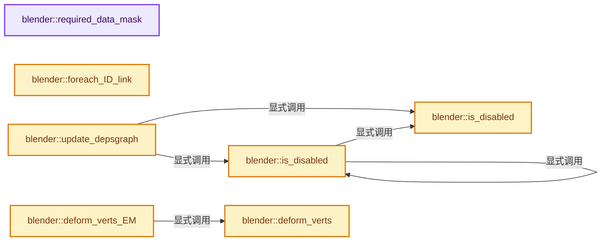
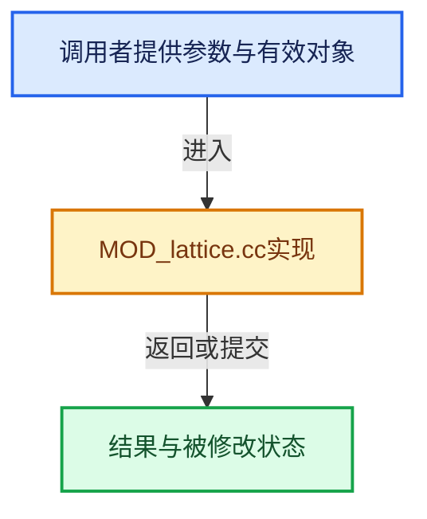

# 实现依赖专题：source/blender/modifiers/intern/MOD_lattice.cc

[方向导航](README.md) · [符号索引](../%E7%AC%A6%E5%8F%B7%E4%BE%9D%E8%B5%96%E4%B8%8E%E5%AE%9E%E7%8E%B0%E7%B4%A2%E5%BC%95.md)

本专题从正文实际调用进入，集中保存共享实现。函数有稳定锚点，可从调用处直接跳到对应完整函数；递归与互相调用通过回链组织。

## 本文件的实现关系






## 完整成员与函数实现

<a id="f-bae72bcd35508d56"></a>

### `blender::required_data_mask`

实现位置：[source/blender/modifiers/intern/MOD_lattice.cc](../../../../../source/blender/modifiers/intern/MOD_lattice.cc) · L40—L48。

接口参数：

- `ModifierData *md`
- `CustomData_MeshMasks *r_cddata_masks`

**教学注释版**

<!-- annotated:3b4c9b5fcb664c -->

```cpp
static void required_data_mask(ModifierData *md, CustomData_MeshMasks *r_cddata_masks)
{
  LatticeModifierData *lmd = reinterpret_cast<LatticeModifierData *>(md);

  /* Ask for vertex-groups if we need them. */
  if (lmd->name[0] != '\0') {
    r_cddata_masks->vmask |= CD_MASK_MDEFORMVERT;
  }
}
```

<details>
<summary>核对原始源码：source/blender/modifiers/intern/MOD_lattice.cc · L40—L48</summary>

<!-- original:3b4c9b5fcb664c:source/blender/modifiers/intern/MOD_lattice.cc:40:48 -->

```cpp
static void required_data_mask(ModifierData *md, CustomData_MeshMasks *r_cddata_masks)
{
  LatticeModifierData *lmd = reinterpret_cast<LatticeModifierData *>(md);

  /* Ask for vertex-groups if we need them. */
  if (lmd->name[0] != '\0') {
    r_cddata_masks->vmask |= CD_MASK_MDEFORMVERT;
  }
}
```

</details>

**沿实际写入检查状态**

- `r_cddata_masks->vmask |= CD_MASK_MDEFORMVERT;`

**继续追踪实现**

本实现没有需要继续展开的显式调用；检查返回表达式、对象转换和调用者前置条件。

<a id="f-edd429545e7ba90f"></a>

### `blender::is_disabled`

实现位置：[source/blender/modifiers/intern/MOD_lattice.cc](../../../../../source/blender/modifiers/intern/MOD_lattice.cc) · L55—L58。

接口参数：

- `LatticeModifierData *lmd`

**教学注释版**

<!-- annotated:e366c302f183f4 -->

```cpp
static bool is_disabled(LatticeModifierData *lmd)
{
  return !lmd->object || lmd->object->type != OB_LATTICE;
}
```

<details>
<summary>核对原始源码：source/blender/modifiers/intern/MOD_lattice.cc · L55—L58</summary>

<!-- original:e366c302f183f4:source/blender/modifiers/intern/MOD_lattice.cc:55:58 -->

```cpp
static bool is_disabled(LatticeModifierData *lmd)
{
  return !lmd->object || lmd->object->type != OB_LATTICE;
}
```

</details>

**结果出口**

- `return !lmd->object || lmd->object->type != OB_LATTICE;`

**继续追踪实现**

本实现没有需要继续展开的显式调用；检查返回表达式、对象转换和调用者前置条件。

<a id="f-ee807ba898915214"></a>

### `blender::is_disabled`

实现位置：[source/blender/modifiers/intern/MOD_lattice.cc](../../../../../source/blender/modifiers/intern/MOD_lattice.cc) · L60—L64。

接口参数：

- `const Scene *`
- `ModifierData *md`
- `bool`

**教学注释版**

<!-- annotated:7800b20b866fb9 -->

```cpp
static bool is_disabled(const Scene * /*scene*/, ModifierData *md, bool /*use_render_params*/)
{
  LatticeModifierData *lmd = reinterpret_cast<LatticeModifierData *>(md);
  return is_disabled(lmd);
}
```

<details>
<summary>核对原始源码：source/blender/modifiers/intern/MOD_lattice.cc · L60—L64</summary>

<!-- original:7800b20b866fb9:source/blender/modifiers/intern/MOD_lattice.cc:60:64 -->

```cpp
static bool is_disabled(const Scene * /*scene*/, ModifierData *md, bool /*use_render_params*/)
{
  LatticeModifierData *lmd = reinterpret_cast<LatticeModifierData *>(md);
  return is_disabled(lmd);
}
```

</details>

**结果出口**

- `return is_disabled(lmd);`

**继续追踪实现**

- `is_disabled` → [blender::is_disabled · L55](%E4%BE%9D%E8%B5%96-MOD_lattice-0787ab.md#f-edd429545e7ba90f)；[blender::is_disabled · L60](%E4%BE%9D%E8%B5%96-MOD_lattice-0787ab.md#f-ee807ba898915214)。同名重载需按实参类型选择。

<a id="f-5aa450ccff6f6c2d"></a>

### `blender::foreach_ID_link`

实现位置：[source/blender/modifiers/intern/MOD_lattice.cc](../../../../../source/blender/modifiers/intern/MOD_lattice.cc) · L66—L71。

接口参数：

- `ModifierData *md`
- `Object *ob`
- `IDWalkFunc walk`
- `void *user_data`

**教学注释版**

<!-- annotated:fd2287a2f01e2d -->

```cpp
static void foreach_ID_link(ModifierData *md, Object *ob, IDWalkFunc walk, void *user_data)
{
  LatticeModifierData *lmd = reinterpret_cast<LatticeModifierData *>(md);

  walk(user_data, ob, reinterpret_cast<ID **>(&lmd->object), IDWALK_CB_NOP);
}
```

<details>
<summary>核对原始源码：source/blender/modifiers/intern/MOD_lattice.cc · L66—L71</summary>

<!-- original:fd2287a2f01e2d:source/blender/modifiers/intern/MOD_lattice.cc:66:71 -->

```cpp
static void foreach_ID_link(ModifierData *md, Object *ob, IDWalkFunc walk, void *user_data)
{
  LatticeModifierData *lmd = reinterpret_cast<LatticeModifierData *>(md);

  walk(user_data, ob, reinterpret_cast<ID **>(&lmd->object), IDWALK_CB_NOP);
}
```

</details>

**继续追踪实现**

- `walk` → [调用协议](../%E6%A8%A1%E6%9D%BF%E5%AE%8F%E4%B8%8E%E5%8A%A8%E6%80%81%E5%88%86%E6%B4%BE%E5%8D%8F%E8%AE%AE.md)：局部可调用对象，须结合其初始化与捕获环境。调用位置L70。

<a id="f-eaa0b039dd144afd"></a>

### `blender::update_depsgraph`

实现位置：[source/blender/modifiers/intern/MOD_lattice.cc](../../../../../source/blender/modifiers/intern/MOD_lattice.cc) · L73—L83。

接口参数：

- `ModifierData *md`
- `const ModifierUpdateDepsgraphContext *ctx`

**教学注释版**

<!-- annotated:4d3d8f39629e9e -->

```cpp
static void update_depsgraph(ModifierData *md, const ModifierUpdateDepsgraphContext *ctx)
{
  LatticeModifierData *lmd = reinterpret_cast<LatticeModifierData *>(md);
  if (is_disabled(lmd)) {
    return;
  }

  DEG_add_object_relation(ctx->node, lmd->object, DEG_OB_COMP_GEOMETRY, "Lattice Modifier");
  DEG_add_object_relation(ctx->node, lmd->object, DEG_OB_COMP_TRANSFORM, "Lattice Modifier");
  DEG_add_depends_on_transform_relation(ctx->node, "Lattice Modifier");
}
```

<details>
<summary>核对原始源码：source/blender/modifiers/intern/MOD_lattice.cc · L73—L83</summary>

<!-- original:4d3d8f39629e9e:source/blender/modifiers/intern/MOD_lattice.cc:73:83 -->

```cpp
static void update_depsgraph(ModifierData *md, const ModifierUpdateDepsgraphContext *ctx)
{
  LatticeModifierData *lmd = reinterpret_cast<LatticeModifierData *>(md);
  if (is_disabled(lmd)) {
    return;
  }

  DEG_add_object_relation(ctx->node, lmd->object, DEG_OB_COMP_GEOMETRY, "Lattice Modifier");
  DEG_add_object_relation(ctx->node, lmd->object, DEG_OB_COMP_TRANSFORM, "Lattice Modifier");
  DEG_add_depends_on_transform_relation(ctx->node, "Lattice Modifier");
}
```

</details>

**继续追踪实现**

- `is_disabled` → [blender::is_disabled · L55](%E4%BE%9D%E8%B5%96-MOD_lattice-0787ab.md#f-edd429545e7ba90f)；[blender::is_disabled · L60](%E4%BE%9D%E8%B5%96-MOD_lattice-0787ab.md#f-ee807ba898915214)。同名重载需按实参类型选择。
- `DEG_add_object_relation` → [blender::DEG_add_object_relation · L123](../11-Depsgraph%E4%B8%8E%E5%B9%B6%E8%A1%8C%E4%BB%BB%E5%8A%A1%E7%B3%BB%E7%BB%9F/%E4%BE%9D%E8%B5%96-depsgraph_build-ea2fc8.md#f-f570cffae97e273c)。
- `DEG_add_depends_on_transform_relation` → [blender::DEG_add_depends_on_transform_relation · L240](../11-Depsgraph%E4%B8%8E%E5%B9%B6%E8%A1%8C%E4%BB%BB%E5%8A%A1%E7%B3%BB%E7%BB%9F/%E4%BE%9D%E8%B5%96-depsgraph_build-ea2fc8.md#f-47c32a354defa20d)。

<a id="f-ecfdd18aaaaf0313"></a>

### `blender::deform_verts`

实现位置：[source/blender/modifiers/intern/MOD_lattice.cc](../../../../../source/blender/modifiers/intern/MOD_lattice.cc) · L85—L103。

接口参数：

- `ModifierData *md`
- `const ModifierEvalContext *ctx`
- `Mesh *mesh`
- `MutableSpan<float3> positions`

**教学注释版**

<!-- annotated:05783d698046c6 -->

```cpp
static void deform_verts(ModifierData *md,
                         const ModifierEvalContext *ctx,
                         Mesh *mesh,
                         MutableSpan<float3> positions)
{
  LatticeModifierData *lmd = reinterpret_cast<LatticeModifierData *>(md);

  /* if next modifier needs original vertices */
  // [讲解] positions.data：返回借用范围的地址。
  MOD_previous_vcos_store(md, reinterpret_cast<const float (*)[3]>(positions.data()));

  BKE_lattice_deform_coords_with_mesh(lmd->object,
                                      ctx->object,
                                      reinterpret_cast<float (*)[3]>(positions.data()),
                                      // [讲解] positions.size：查询视图长度或生成对应有效索引区间。
                                      positions.size(),
                                      lmd->flag,
                                      lmd->name,
                                      lmd->strength,
                                      mesh);
}
```

<details>
<summary>核对原始源码：source/blender/modifiers/intern/MOD_lattice.cc · L85—L103</summary>

<!-- original:05783d698046c6:source/blender/modifiers/intern/MOD_lattice.cc:85:103 -->

```cpp
static void deform_verts(ModifierData *md,
                         const ModifierEvalContext *ctx,
                         Mesh *mesh,
                         MutableSpan<float3> positions)
{
  LatticeModifierData *lmd = reinterpret_cast<LatticeModifierData *>(md);

  /* if next modifier needs original vertices */
  MOD_previous_vcos_store(md, reinterpret_cast<const float (*)[3]>(positions.data()));

  BKE_lattice_deform_coords_with_mesh(lmd->object,
                                      ctx->object,
                                      reinterpret_cast<float (*)[3]>(positions.data()),
                                      positions.size(),
                                      lmd->flag,
                                      lmd->name,
                                      lmd->strength,
                                      mesh);
}
```

</details>

**继续追踪实现**

- `MOD_previous_vcos_store` → [blender::MOD_previous_vcos_store · L144](%E4%BE%9D%E8%B5%96-MOD_util-83ca4b.md#f-3c67667357b76b7a)。
- `positions.data` → [blender::MutableSpan::data · L545](../01-%E5%9F%BA%E7%A1%80%E5%AE%B9%E5%99%A8%E4%B8%8E%E7%8E%B0%E4%BB%A3CPP/06-MutableSpan%E5%8F%AF%E5%86%99%E8%A7%86%E5%9B%BE.md#f-eb45a6e4d8211efd)；[blender::gpu::shader::parser::MutableSpan::data · L82](%E4%BE%9D%E8%B5%96-utils-06433d.md#f-ad0a09cec9741c65)。同名重载需按实参类型选择。
- `BKE_lattice_deform_coords_with_mesh` → [blender::BKE_lattice_deform_coords_with_mesh · L460](%E4%BE%9D%E8%B5%96-lattice_deform-0c25d0.md#f-f438fcfd18a55d24)。
- `positions.size` → [blender::MutableSpan::size · L499](../01-%E5%9F%BA%E7%A1%80%E5%AE%B9%E5%99%A8%E4%B8%8E%E7%8E%B0%E4%BB%A3CPP/06-MutableSpan%E5%8F%AF%E5%86%99%E8%A7%86%E5%9B%BE.md#f-1de6a66839c304a8)；[blender::gpu::shader::parser::MutableSpan::size · L87](%E4%BE%9D%E8%B5%96-utils-06433d.md#f-5e684af6ee7990e9)。同名重载需按实参类型选择。

<a id="f-d5c124019cedae5c"></a>

### `blender::deform_verts_EM`

实现位置：[source/blender/modifiers/intern/MOD_lattice.cc](../../../../../source/blender/modifiers/intern/MOD_lattice.cc) · L105—L129。

接口参数：

- `ModifierData *md`
- `const ModifierEvalContext *ctx`
- `const BMEditMesh *em`
- `Mesh *mesh`
- `MutableSpan<float3> positions`

**教学注释版**

<!-- annotated:d76a978969600b -->

```cpp
static void deform_verts_EM(ModifierData *md,
                            const ModifierEvalContext *ctx,
                            const BMEditMesh *em,
                            Mesh *mesh,
                            MutableSpan<float3> positions)
{
  if (mesh->runtime->wrapper_type == ME_WRAPPER_TYPE_MDATA) {
    deform_verts(md, ctx, mesh, positions);
    return;
  }

  LatticeModifierData *lmd = reinterpret_cast<LatticeModifierData *>(md);

  /* if next modifier needs original vertices */
  // [讲解] positions.data：返回借用范围的地址。
  MOD_previous_vcos_store(md, reinterpret_cast<const float (*)[3]>(positions.data()));

  BKE_lattice_deform_coords_with_editmesh(lmd->object,
                                          ctx->object,
                                          reinterpret_cast<float (*)[3]>(positions.data()),
                                          // [讲解] positions.size：查询视图长度或生成对应有效索引区间。
                                          positions.size(),
                                          lmd->flag,
                                          lmd->name,
                                          lmd->strength,
                                          em);
}
```

<details>
<summary>核对原始源码：source/blender/modifiers/intern/MOD_lattice.cc · L105—L129</summary>

<!-- original:d76a978969600b:source/blender/modifiers/intern/MOD_lattice.cc:105:129 -->

```cpp
static void deform_verts_EM(ModifierData *md,
                            const ModifierEvalContext *ctx,
                            const BMEditMesh *em,
                            Mesh *mesh,
                            MutableSpan<float3> positions)
{
  if (mesh->runtime->wrapper_type == ME_WRAPPER_TYPE_MDATA) {
    deform_verts(md, ctx, mesh, positions);
    return;
  }

  LatticeModifierData *lmd = reinterpret_cast<LatticeModifierData *>(md);

  /* if next modifier needs original vertices */
  MOD_previous_vcos_store(md, reinterpret_cast<const float (*)[3]>(positions.data()));

  BKE_lattice_deform_coords_with_editmesh(lmd->object,
                                          ctx->object,
                                          reinterpret_cast<float (*)[3]>(positions.data()),
                                          positions.size(),
                                          lmd->flag,
                                          lmd->name,
                                          lmd->strength,
                                          em);
}
```

</details>

**继续追踪实现**

- `deform_verts` → [blender::deform_verts · L85](%E4%BE%9D%E8%B5%96-MOD_lattice-0787ab.md#f-ecfdd18aaaaf0313)。
- `MOD_previous_vcos_store` → [blender::MOD_previous_vcos_store · L144](%E4%BE%9D%E8%B5%96-MOD_util-83ca4b.md#f-3c67667357b76b7a)。
- `positions.data` → [blender::MutableSpan::data · L545](../01-%E5%9F%BA%E7%A1%80%E5%AE%B9%E5%99%A8%E4%B8%8E%E7%8E%B0%E4%BB%A3CPP/06-MutableSpan%E5%8F%AF%E5%86%99%E8%A7%86%E5%9B%BE.md#f-eb45a6e4d8211efd)；[blender::gpu::shader::parser::MutableSpan::data · L82](%E4%BE%9D%E8%B5%96-utils-06433d.md#f-ad0a09cec9741c65)。同名重载需按实参类型选择。
- `BKE_lattice_deform_coords_with_editmesh` → [blender::BKE_lattice_deform_coords_with_editmesh · L480](%E4%BE%9D%E8%B5%96-lattice_deform-0c25d0.md#f-67be3572cbccfa12)。
- `positions.size` → [blender::MutableSpan::size · L499](../01-%E5%9F%BA%E7%A1%80%E5%AE%B9%E5%99%A8%E4%B8%8E%E7%8E%B0%E4%BB%A3CPP/06-MutableSpan%E5%8F%AF%E5%86%99%E8%A7%86%E5%9B%BE.md#f-1de6a66839c304a8)；[blender::gpu::shader::parser::MutableSpan::size · L87](%E4%BE%9D%E8%B5%96-utils-06433d.md#f-5e684af6ee7990e9)。同名重载需按实参类型选择。
