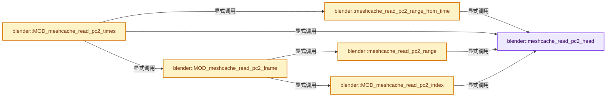
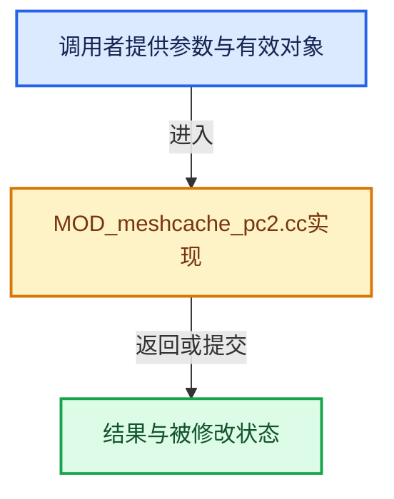

# 实现依赖专题：source/blender/modifiers/intern/MOD_meshcache_pc2.cc

[方向导航](README.md) · [符号索引](../%E7%AC%A6%E5%8F%B7%E4%BE%9D%E8%B5%96%E4%B8%8E%E5%AE%9E%E7%8E%B0%E7%B4%A2%E5%BC%95.md)

本专题从正文实际调用进入，集中保存共享实现。函数有稳定锚点，可从调用处直接跳到对应完整函数；递归与互相调用通过回链组织。

## 本文件的实现关系






## 完整成员与函数实现

<a id="f-dec44470294fa1f6"></a>

### `blender::meshcache_read_pc2_head`

实现位置：[source/blender/modifiers/intern/MOD_meshcache_pc2.cc](../../../../../source/blender/modifiers/intern/MOD_meshcache_pc2.cc) · L39—L70。

接口参数：

- `FILE *fp`
- `const int verts_tot`
- `PC2Head *pc2_head`
- `const char **r_err_str`

**教学注释版**

<!-- annotated:5ce15c41a5b150 -->

```cpp
static bool meshcache_read_pc2_head(FILE *fp,
                                    const int verts_tot,
                                    PC2Head *pc2_head,
                                    const char **r_err_str)
{
  if (!fread(pc2_head, sizeof(*pc2_head), 1, fp)) {
    *r_err_str = RPT_("Missing header");
    return false;
  }

  if (!STREQ(pc2_head->header, "POINTCACHE2")) {
    *r_err_str = RPT_("Invalid header");
    return false;
  }

  /* NOTE: this is endianness-sensitive. */
  /* The pc2_head->file_version and following values would need to be switched on big-endian
   * systems. */

  if (pc2_head->verts_tot != verts_tot) {
    *r_err_str = RPT_("Vertex count mismatch");
    return false;
  }

  if (pc2_head->frame_tot <= 0) {
    *r_err_str = RPT_("Invalid frame total");
    return false;
  }
  /* Intentionally don't seek back. */

  return true;
}
```

<details>
<summary>核对原始源码：source/blender/modifiers/intern/MOD_meshcache_pc2.cc · L39—L70</summary>

<!-- original:5ce15c41a5b150:source/blender/modifiers/intern/MOD_meshcache_pc2.cc:39:70 -->

```cpp
static bool meshcache_read_pc2_head(FILE *fp,
                                    const int verts_tot,
                                    PC2Head *pc2_head,
                                    const char **r_err_str)
{
  if (!fread(pc2_head, sizeof(*pc2_head), 1, fp)) {
    *r_err_str = RPT_("Missing header");
    return false;
  }

  if (!STREQ(pc2_head->header, "POINTCACHE2")) {
    *r_err_str = RPT_("Invalid header");
    return false;
  }

  /* NOTE: this is endianness-sensitive. */
  /* The pc2_head->file_version and following values would need to be switched on big-endian
   * systems. */

  if (pc2_head->verts_tot != verts_tot) {
    *r_err_str = RPT_("Vertex count mismatch");
    return false;
  }

  if (pc2_head->frame_tot <= 0) {
    *r_err_str = RPT_("Invalid frame total");
    return false;
  }
  /* Intentionally don't seek back. */

  return true;
}
```

</details>

**结果出口**

- `return false;`
- `return true;`

**继续追踪实现**

- `fread` → [调用协议](../%E6%A8%A1%E6%9D%BF%E5%AE%8F%E4%B8%8E%E5%8A%A8%E6%80%81%E5%88%86%E6%B4%BE%E5%8D%8F%E8%AE%AE.md)：函数指针、局部可调用对象或未展开的宏；必须结合调用者环境。调用位置L44。
- `RPT_` → [RPT_ · L51](%E4%BE%9D%E8%B5%96-BLT_translation-c89e58.md#m-c13f94a1a934)。宏定义由构建条件选择。
- `STREQ` → [STREQ · L112](%E4%BE%9D%E8%B5%96-GHOST_utildefines-34b996.md#m-9549fb6aafd2)；[STREQ · L451](../01-%E5%9F%BA%E7%A1%80%E5%AE%B9%E5%99%A8%E4%B8%8E%E7%8E%B0%E4%BB%A3CPP/%E4%BE%9D%E8%B5%96-BLI_utildefines-293a0a.md#m-c7b745bcfad2)；[STREQ · L55](%E4%BE%9D%E8%B5%96-clog-a0bec8.md#m-96e78f386894)。宏定义由构建条件选择。

<a id="f-b207922fc3090965"></a>

### `blender::meshcache_read_pc2_range`

实现位置：[source/blender/modifiers/intern/MOD_meshcache_pc2.cc](../../../../../source/blender/modifiers/intern/MOD_meshcache_pc2.cc) · L77—L96。

接口参数：

- `FILE *fp`
- `const int verts_tot`
- `const float frame`
- `const char interp`
- `int r_index_range[2]`
- `float *r_factor`
- `const char **r_err_str`

**教学注释版**

<!-- annotated:dd117d767d0e5f -->

```cpp
static bool meshcache_read_pc2_range(FILE *fp,
                                     const int verts_tot,
                                     const float frame,
                                     const char interp,
                                     int r_index_range[2],
                                     float *r_factor,
                                     const char **r_err_str)
{
  PC2Head pc2_head;

  /* first check interpolation and get the vert locations */

  if (meshcache_read_pc2_head(fp, verts_tot, &pc2_head, r_err_str) == false) {
    return false;
  }

  MOD_meshcache_calc_range(frame, interp, pc2_head.frame_tot, r_index_range, r_factor);

  return true;
}
```

<details>
<summary>核对原始源码：source/blender/modifiers/intern/MOD_meshcache_pc2.cc · L77—L96</summary>

<!-- original:dd117d767d0e5f:source/blender/modifiers/intern/MOD_meshcache_pc2.cc:77:96 -->

```cpp
static bool meshcache_read_pc2_range(FILE *fp,
                                     const int verts_tot,
                                     const float frame,
                                     const char interp,
                                     int r_index_range[2],
                                     float *r_factor,
                                     const char **r_err_str)
{
  PC2Head pc2_head;

  /* first check interpolation and get the vert locations */

  if (meshcache_read_pc2_head(fp, verts_tot, &pc2_head, r_err_str) == false) {
    return false;
  }

  MOD_meshcache_calc_range(frame, interp, pc2_head.frame_tot, r_index_range, r_factor);

  return true;
}
```

</details>

**结果出口**

- `return false;`
- `return true;`

**继续追踪实现**

- `meshcache_read_pc2_head` → [blender::meshcache_read_pc2_head · L39](%E4%BE%9D%E8%B5%96-MOD_meshcache_pc2-cfad69.md#f-dec44470294fa1f6)。
- `MOD_meshcache_calc_range` → [blender::MOD_meshcache_calc_range · L17](%E4%BE%9D%E8%B5%96-MOD_meshcache_util-8b8276.md#f-293a4803d3c64fd4)。

<a id="f-cca15dbc49142cbc"></a>

### `blender::meshcache_read_pc2_range_from_time`

实现位置：[source/blender/modifiers/intern/MOD_meshcache_pc2.cc](../../../../../source/blender/modifiers/intern/MOD_meshcache_pc2.cc) · L98—L123。

接口参数：

- `FILE *fp`
- `const int verts_tot`
- `const float time`
- `const float fps`
- `float *r_frame`
- `const char **r_err_str`

**教学注释版**

<!-- annotated:6c4fb4204336e0 -->

```cpp
static bool meshcache_read_pc2_range_from_time(FILE *fp,
                                               const int verts_tot,
                                               const float time,
                                               const float fps,
                                               float *r_frame,
                                               const char **r_err_str)
{
  PC2Head pc2_head;
  float frame;

  if (meshcache_read_pc2_head(fp, verts_tot, &pc2_head, r_err_str) == false) {
    return false;
  }

  frame = ((time / fps) - pc2_head.start) / pc2_head.sampling;

  if (frame >= pc2_head.frame_tot) {
    frame = float(pc2_head.frame_tot - 1);
  }
  else if (frame < 0.0f) {
    frame = 0.0f;
  }

  *r_frame = frame;
  return true;
}
```

<details>
<summary>核对原始源码：source/blender/modifiers/intern/MOD_meshcache_pc2.cc · L98—L123</summary>

<!-- original:6c4fb4204336e0:source/blender/modifiers/intern/MOD_meshcache_pc2.cc:98:123 -->

```cpp
static bool meshcache_read_pc2_range_from_time(FILE *fp,
                                               const int verts_tot,
                                               const float time,
                                               const float fps,
                                               float *r_frame,
                                               const char **r_err_str)
{
  PC2Head pc2_head;
  float frame;

  if (meshcache_read_pc2_head(fp, verts_tot, &pc2_head, r_err_str) == false) {
    return false;
  }

  frame = ((time / fps) - pc2_head.start) / pc2_head.sampling;

  if (frame >= pc2_head.frame_tot) {
    frame = float(pc2_head.frame_tot - 1);
  }
  else if (frame < 0.0f) {
    frame = 0.0f;
  }

  *r_frame = frame;
  return true;
}
```

</details>

**沿实际写入检查状态**

- `frame = ((time / fps) - pc2_head.start) / pc2_head.sampling;`
- `frame = float(pc2_head.frame_tot - 1);`
- `frame = 0.0f;`

**结果出口**

- `return false;`
- `return true;`

**继续追踪实现**

- `meshcache_read_pc2_head` → [blender::meshcache_read_pc2_head · L39](%E4%BE%9D%E8%B5%96-MOD_meshcache_pc2-cfad69.md#f-dec44470294fa1f6)。

<a id="f-9f43b7ae1bec5dd6"></a>

### `blender::MOD_meshcache_read_pc2_index`

实现位置：[source/blender/modifiers/intern/MOD_meshcache_pc2.cc](../../../../../source/blender/modifiers/intern/MOD_meshcache_pc2.cc) · L125—L178。

接口参数：

- `FILE *fp`
- `float (*vertexCos)[3]`
- `const int verts_tot`
- `const int index`
- `const float factor`
- `const char **r_err_str`

**教学注释版**

<!-- annotated:6ca219a1df843e -->

```cpp
bool MOD_meshcache_read_pc2_index(FILE *fp,
                                  float (*vertexCos)[3],
                                  const int verts_tot,
                                  const int index,
                                  const float factor,
                                  const char **r_err_str)
{
  PC2Head pc2_head;

  if (meshcache_read_pc2_head(fp, verts_tot, &pc2_head, r_err_str) == false) {
    return false;
  }

  if (BLI_fseek(fp, sizeof(float[3]) * index * pc2_head.verts_tot, SEEK_CUR) != 0) {
    *r_err_str = RPT_("Failed to seek frame");
    return false;
  }

  size_t verts_read_num = 0;
  errno = 0;
  if (factor >= 1.0f) {
    float *vco = *vertexCos;
    uint i;
    for (i = pc2_head.verts_tot; i != 0; i--, vco += 3) {
      verts_read_num += fread(vco, sizeof(float[3]), 1, fp);

      /* NOTE: this is endianness-sensitive. */
      /* The `vco` values would need to be switched on big-endian systems. */
    }
  }
  else {
    const float ifactor = 1.0f - factor;
    float *vco = *vertexCos;
    uint i;
    for (i = pc2_head.verts_tot; i != 0; i--, vco += 3) {
      float tvec[3];
      verts_read_num += fread(tvec, sizeof(float[3]), 1, fp);

      /* NOTE: this is endianness-sensitive. */
      /* The `tvec` values would need to be switched on big-endian systems. */

      vco[0] = (vco[0] * ifactor) + (tvec[0] * factor);
      vco[1] = (vco[1] * ifactor) + (tvec[1] * factor);
      vco[2] = (vco[2] * ifactor) + (tvec[2] * factor);
    }
  }

  if (verts_read_num != pc2_head.verts_tot) {
    *r_err_str = errno ? strerror(errno) : RPT_("Vertex coordinate read failed");
    return false;
  }

  return true;
}
```

<details>
<summary>核对原始源码：source/blender/modifiers/intern/MOD_meshcache_pc2.cc · L125—L178</summary>

<!-- original:6ca219a1df843e:source/blender/modifiers/intern/MOD_meshcache_pc2.cc:125:178 -->

```cpp
bool MOD_meshcache_read_pc2_index(FILE *fp,
                                  float (*vertexCos)[3],
                                  const int verts_tot,
                                  const int index,
                                  const float factor,
                                  const char **r_err_str)
{
  PC2Head pc2_head;

  if (meshcache_read_pc2_head(fp, verts_tot, &pc2_head, r_err_str) == false) {
    return false;
  }

  if (BLI_fseek(fp, sizeof(float[3]) * index * pc2_head.verts_tot, SEEK_CUR) != 0) {
    *r_err_str = RPT_("Failed to seek frame");
    return false;
  }

  size_t verts_read_num = 0;
  errno = 0;
  if (factor >= 1.0f) {
    float *vco = *vertexCos;
    uint i;
    for (i = pc2_head.verts_tot; i != 0; i--, vco += 3) {
      verts_read_num += fread(vco, sizeof(float[3]), 1, fp);

      /* NOTE: this is endianness-sensitive. */
      /* The `vco` values would need to be switched on big-endian systems. */
    }
  }
  else {
    const float ifactor = 1.0f - factor;
    float *vco = *vertexCos;
    uint i;
    for (i = pc2_head.verts_tot; i != 0; i--, vco += 3) {
      float tvec[3];
      verts_read_num += fread(tvec, sizeof(float[3]), 1, fp);

      /* NOTE: this is endianness-sensitive. */
      /* The `tvec` values would need to be switched on big-endian systems. */

      vco[0] = (vco[0] * ifactor) + (tvec[0] * factor);
      vco[1] = (vco[1] * ifactor) + (tvec[1] * factor);
      vco[2] = (vco[2] * ifactor) + (tvec[2] * factor);
    }
  }

  if (verts_read_num != pc2_head.verts_tot) {
    *r_err_str = errno ? strerror(errno) : RPT_("Vertex coordinate read failed");
    return false;
  }

  return true;
}
```

</details>

**沿实际写入检查状态**

- `errno = 0;`
- `verts_read_num += fread(vco, sizeof(float[3]), 1, fp);`
- `verts_read_num += fread(tvec, sizeof(float[3]), 1, fp);`
- `vco[0] = (vco[0] * ifactor) + (tvec[0] * factor);`
- `vco[1] = (vco[1] * ifactor) + (tvec[1] * factor);`
- `vco[2] = (vco[2] * ifactor) + (tvec[2] * factor);`

**结果出口**

- `return false;`
- `return true;`

**继续追踪实现**

- `meshcache_read_pc2_head` → [blender::meshcache_read_pc2_head · L39](%E4%BE%9D%E8%B5%96-MOD_meshcache_pc2-cfad69.md#f-dec44470294fa1f6)。
- `BLI_fseek` → [blender::BLI_fseek · L201](../01-%E5%9F%BA%E7%A1%80%E5%AE%B9%E5%99%A8%E4%B8%8E%E7%8E%B0%E4%BB%A3CPP/%E4%BE%9D%E8%B5%96-storage-bda15e.md#f-66c5f3581da90506)。
- `RPT_` → [RPT_ · L51](%E4%BE%9D%E8%B5%96-BLT_translation-c89e58.md#m-c13f94a1a934)。宏定义由构建条件选择。
- `fread` → [调用协议](../%E6%A8%A1%E6%9D%BF%E5%AE%8F%E4%B8%8E%E5%8A%A8%E6%80%81%E5%88%86%E6%B4%BE%E5%8D%8F%E8%AE%AE.md)：函数指针、局部可调用对象或未展开的宏；必须结合调用者环境。调用位置L149。
- `strerror` → [调用协议](../%E6%A8%A1%E6%9D%BF%E5%AE%8F%E4%B8%8E%E5%8A%A8%E6%80%81%E5%88%86%E6%B4%BE%E5%8D%8F%E8%AE%AE.md)：函数指针、局部可调用对象或未展开的宏；必须结合调用者环境。调用位置L173。

<a id="f-c3c069cfa6ae35e0"></a>

### `blender::MOD_meshcache_read_pc2_frame`

实现位置：[source/blender/modifiers/intern/MOD_meshcache_pc2.cc](../../../../../source/blender/modifiers/intern/MOD_meshcache_pc2.cc) · L180—L222。

接口参数：

- `FILE *fp`
- `float (*vertexCos)[3]`
- `const int verts_tot`
- `const char interp`
- `const float frame`
- `const char **r_err_str`

**教学注释版**

<!-- annotated:d021faf422264d -->

```cpp
bool MOD_meshcache_read_pc2_frame(FILE *fp,
                                  float (*vertexCos)[3],
                                  const int verts_tot,
                                  const char interp,
                                  const float frame,
                                  const char **r_err_str)
{
  int index_range[2];
  float factor;

  if (meshcache_read_pc2_range(fp,
                               verts_tot,
                               frame,
                               interp,
                               index_range,
                               &factor, /* read into these values */
                               r_err_str) == false)
  {
    return false;
  }

  if (index_range[0] == index_range[1]) {
    /* read single */
    if ((BLI_fseek(fp, 0, SEEK_SET) == 0) &&
        MOD_meshcache_read_pc2_index(fp, vertexCos, verts_tot, index_range[0], 1.0f, r_err_str))
    {
      return true;
    }

    return false;
  }

  /* read both and interpolate */
  if ((BLI_fseek(fp, 0, SEEK_SET) == 0) &&
      MOD_meshcache_read_pc2_index(fp, vertexCos, verts_tot, index_range[0], 1.0f, r_err_str) &&
      (BLI_fseek(fp, 0, SEEK_SET) == 0) &&
      MOD_meshcache_read_pc2_index(fp, vertexCos, verts_tot, index_range[1], factor, r_err_str))
  {
    return true;
  }

  return false;
}
```

<details>
<summary>核对原始源码：source/blender/modifiers/intern/MOD_meshcache_pc2.cc · L180—L222</summary>

<!-- original:d021faf422264d:source/blender/modifiers/intern/MOD_meshcache_pc2.cc:180:222 -->

```cpp
bool MOD_meshcache_read_pc2_frame(FILE *fp,
                                  float (*vertexCos)[3],
                                  const int verts_tot,
                                  const char interp,
                                  const float frame,
                                  const char **r_err_str)
{
  int index_range[2];
  float factor;

  if (meshcache_read_pc2_range(fp,
                               verts_tot,
                               frame,
                               interp,
                               index_range,
                               &factor, /* read into these values */
                               r_err_str) == false)
  {
    return false;
  }

  if (index_range[0] == index_range[1]) {
    /* read single */
    if ((BLI_fseek(fp, 0, SEEK_SET) == 0) &&
        MOD_meshcache_read_pc2_index(fp, vertexCos, verts_tot, index_range[0], 1.0f, r_err_str))
    {
      return true;
    }

    return false;
  }

  /* read both and interpolate */
  if ((BLI_fseek(fp, 0, SEEK_SET) == 0) &&
      MOD_meshcache_read_pc2_index(fp, vertexCos, verts_tot, index_range[0], 1.0f, r_err_str) &&
      (BLI_fseek(fp, 0, SEEK_SET) == 0) &&
      MOD_meshcache_read_pc2_index(fp, vertexCos, verts_tot, index_range[1], factor, r_err_str))
  {
    return true;
  }

  return false;
}
```

</details>

**结果出口**

- `return false;`
- `return true;`

**继续追踪实现**

- `meshcache_read_pc2_range` → [blender::meshcache_read_pc2_range · L77](%E4%BE%9D%E8%B5%96-MOD_meshcache_pc2-cfad69.md#f-b207922fc3090965)。
- `BLI_fseek` → [blender::BLI_fseek · L201](../01-%E5%9F%BA%E7%A1%80%E5%AE%B9%E5%99%A8%E4%B8%8E%E7%8E%B0%E4%BB%A3CPP/%E4%BE%9D%E8%B5%96-storage-bda15e.md#f-66c5f3581da90506)。
- `MOD_meshcache_read_pc2_index` → [blender::MOD_meshcache_read_pc2_index · L125](%E4%BE%9D%E8%B5%96-MOD_meshcache_pc2-cfad69.md#f-9f43b7ae1bec5dd6)。

<a id="f-6281d8d224e2f9b3"></a>

### `blender::MOD_meshcache_read_pc2_times`

实现位置：[source/blender/modifiers/intern/MOD_meshcache_pc2.cc](../../../../../source/blender/modifiers/intern/MOD_meshcache_pc2.cc) · L224—L276。

接口参数：

- `const char *filepath`
- `float (*vertexCos)[3]`
- `const int verts_tot`
- `const char interp`
- `const float time`
- `const float fps`
- `const char time_mode`
- `const char **r_err_str`

**教学注释版**

<!-- annotated:4fefd75641320a -->

```cpp
bool MOD_meshcache_read_pc2_times(const char *filepath,
                                  float (*vertexCos)[3],
                                  const int verts_tot,
                                  const char interp,
                                  const float time,
                                  const float fps,
                                  const char time_mode,
                                  const char **r_err_str)
{
  float frame;

  FILE *fp = BLI_fopen(filepath, "rb");
  bool ok;

  if (fp == nullptr) {
    *r_err_str = errno ? strerror(errno) : RPT_("Unknown error opening file");
    return false;
  }

  switch (time_mode) {
    case MOD_MESHCACHE_TIME_FRAME: {
      frame = time;
      break;
    }
    case MOD_MESHCACHE_TIME_SECONDS: {
      /* we need to find the closest time */
      if (meshcache_read_pc2_range_from_time(fp, verts_tot, time, fps, &frame, r_err_str) == false)
      {
        fclose(fp);
        return false;
      }
      rewind(fp);
      break;
    }
    case MOD_MESHCACHE_TIME_FACTOR:
    default: {
      PC2Head pc2_head;
      if (meshcache_read_pc2_head(fp, verts_tot, &pc2_head, r_err_str) == false) {
        fclose(fp);
        return false;
      }

      frame = std::clamp(time, 0.0f, 1.0f) * float(pc2_head.frame_tot);
      rewind(fp);
      break;
    }
  }

  ok = MOD_meshcache_read_pc2_frame(fp, vertexCos, verts_tot, interp, frame, r_err_str);

  fclose(fp);
  return ok;
}
```

<details>
<summary>核对原始源码：source/blender/modifiers/intern/MOD_meshcache_pc2.cc · L224—L276</summary>

<!-- original:4fefd75641320a:source/blender/modifiers/intern/MOD_meshcache_pc2.cc:224:276 -->

```cpp
bool MOD_meshcache_read_pc2_times(const char *filepath,
                                  float (*vertexCos)[3],
                                  const int verts_tot,
                                  const char interp,
                                  const float time,
                                  const float fps,
                                  const char time_mode,
                                  const char **r_err_str)
{
  float frame;

  FILE *fp = BLI_fopen(filepath, "rb");
  bool ok;

  if (fp == nullptr) {
    *r_err_str = errno ? strerror(errno) : RPT_("Unknown error opening file");
    return false;
  }

  switch (time_mode) {
    case MOD_MESHCACHE_TIME_FRAME: {
      frame = time;
      break;
    }
    case MOD_MESHCACHE_TIME_SECONDS: {
      /* we need to find the closest time */
      if (meshcache_read_pc2_range_from_time(fp, verts_tot, time, fps, &frame, r_err_str) == false)
      {
        fclose(fp);
        return false;
      }
      rewind(fp);
      break;
    }
    case MOD_MESHCACHE_TIME_FACTOR:
    default: {
      PC2Head pc2_head;
      if (meshcache_read_pc2_head(fp, verts_tot, &pc2_head, r_err_str) == false) {
        fclose(fp);
        return false;
      }

      frame = std::clamp(time, 0.0f, 1.0f) * float(pc2_head.frame_tot);
      rewind(fp);
      break;
    }
  }

  ok = MOD_meshcache_read_pc2_frame(fp, vertexCos, verts_tot, interp, frame, r_err_str);

  fclose(fp);
  return ok;
}
```

</details>

**沿实际写入检查状态**

- `frame = time;`
- `frame = std::clamp(time, 0.0f, 1.0f) * float(pc2_head.frame_tot);`
- `ok = MOD_meshcache_read_pc2_frame(fp, vertexCos, verts_tot, interp, frame, r_err_str);`

**结果出口**

- `return false;`
- `return ok;`

**继续追踪实现**

- `BLI_fopen` → [blender::BLI_fopen · L558](../01-%E5%9F%BA%E7%A1%80%E5%AE%B9%E5%99%A8%E4%B8%8E%E7%8E%B0%E4%BB%A3CPP/%E4%BE%9D%E8%B5%96-fileops_c-add581.md#f-c6d3cebeeea3cab3)；[blender::BLI_fopen · L1185](../01-%E5%9F%BA%E7%A1%80%E5%AE%B9%E5%99%A8%E4%B8%8E%E7%8E%B0%E4%BB%A3CPP/%E4%BE%9D%E8%B5%96-fileops_c-add581.md#f-d834ce38c568c49a)。同名重载需按实参类型选择。
- `strerror` → [调用协议](../%E6%A8%A1%E6%9D%BF%E5%AE%8F%E4%B8%8E%E5%8A%A8%E6%80%81%E5%88%86%E6%B4%BE%E5%8D%8F%E8%AE%AE.md)：函数指针、局部可调用对象或未展开的宏；必须结合调用者环境。调用位置L239。
- `RPT_` → [RPT_ · L51](%E4%BE%9D%E8%B5%96-BLT_translation-c89e58.md#m-c13f94a1a934)。宏定义由构建条件选择。
- `meshcache_read_pc2_range_from_time` → [blender::meshcache_read_pc2_range_from_time · L98](%E4%BE%9D%E8%B5%96-MOD_meshcache_pc2-cfad69.md#f-cca15dbc49142cbc)。
- `fclose` → [调用协议](../%E6%A8%A1%E6%9D%BF%E5%AE%8F%E4%B8%8E%E5%8A%A8%E6%80%81%E5%88%86%E6%B4%BE%E5%8D%8F%E8%AE%AE.md)：函数指针、局部可调用对象或未展开的宏；必须结合调用者环境。调用位置L252。
- `rewind` → [调用协议](../%E6%A8%A1%E6%9D%BF%E5%AE%8F%E4%B8%8E%E5%8A%A8%E6%80%81%E5%88%86%E6%B4%BE%E5%8D%8F%E8%AE%AE.md)：函数指针、局部可调用对象或未展开的宏；必须结合调用者环境。调用位置L255。
- `meshcache_read_pc2_head` → [blender::meshcache_read_pc2_head · L39](%E4%BE%9D%E8%B5%96-MOD_meshcache_pc2-cfad69.md#f-dec44470294fa1f6)。
- `std::clamp` → [外部契约](https://eel.is/c++draft/)：这个边界按实际表达式及所属类型核对参数、返回值、寿命与失败行为。这里提供接口入口，不声称已解释该第三方版本的内部实现。
- `MOD_meshcache_read_pc2_frame` → [blender::MOD_meshcache_read_pc2_frame · L180](%E4%BE%9D%E8%B5%96-MOD_meshcache_pc2-cfad69.md#f-c3c069cfa6ae35e0)。
