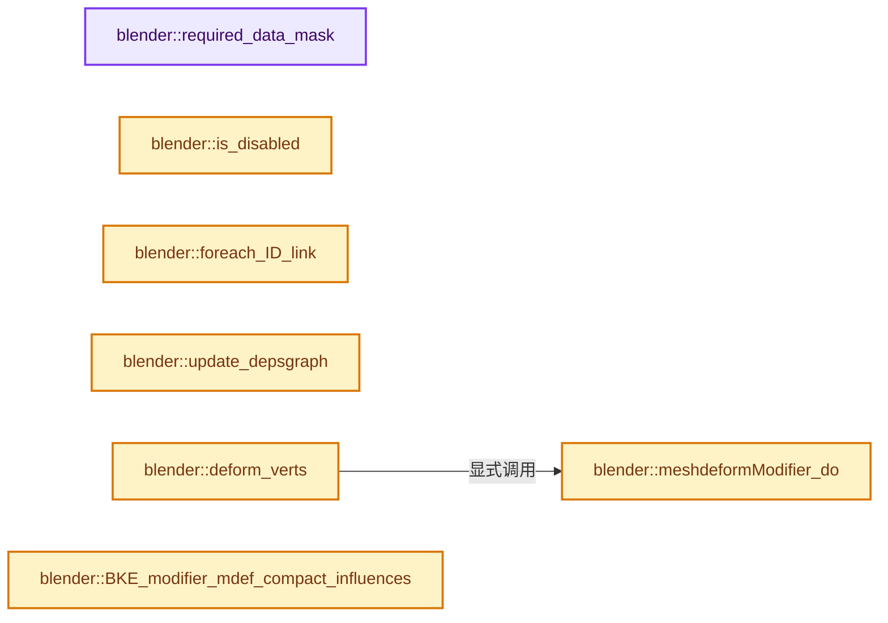

# 实现依赖专题：source/blender/modifiers/intern/MOD_meshdeform.cc

[方向导航](README.md) · [符号索引](../%E7%AC%A6%E5%8F%B7%E4%BE%9D%E8%B5%96%E4%B8%8E%E5%AE%9E%E7%8E%B0%E7%B4%A2%E5%BC%95.md)

本专题从正文实际调用进入，集中保存共享实现。函数有稳定锚点，可从调用处直接跳到对应完整函数；递归与互相调用通过回链组织。

## 本文件的实现关系




## 完整成员与函数实现

<a id="f-67731415e18301fa"></a>

### `blender::required_data_mask`

实现位置：[source/blender/modifiers/intern/MOD_meshdeform.cc](../../../../../source/blender/modifiers/intern/MOD_meshdeform.cc) · L104—L112。

接口参数：

- `ModifierData *md`
- `CustomData_MeshMasks *r_cddata_masks`

**教学注释版**

<!-- annotated:781309cdae898e -->

```cpp
static void required_data_mask(ModifierData *md, CustomData_MeshMasks *r_cddata_masks)
{
  MeshDeformModifierData *mmd = reinterpret_cast<MeshDeformModifierData *>(md);

  /* Ask for vertex-groups if we need them. */
  if (mmd->defgrp_name[0] != '\0') {
    r_cddata_masks->vmask |= CD_MASK_MDEFORMVERT;
  }
}
```

<details>
<summary>核对原始源码：source/blender/modifiers/intern/MOD_meshdeform.cc · L104—L112</summary>

<!-- original:781309cdae898e:source/blender/modifiers/intern/MOD_meshdeform.cc:104:112 -->

```cpp
static void required_data_mask(ModifierData *md, CustomData_MeshMasks *r_cddata_masks)
{
  MeshDeformModifierData *mmd = reinterpret_cast<MeshDeformModifierData *>(md);

  /* Ask for vertex-groups if we need them. */
  if (mmd->defgrp_name[0] != '\0') {
    r_cddata_masks->vmask |= CD_MASK_MDEFORMVERT;
  }
}
```

</details>

**沿实际写入检查状态**

- `r_cddata_masks->vmask |= CD_MASK_MDEFORMVERT;`

**继续追踪实现**

本实现没有需要继续展开的显式调用；检查返回表达式、对象转换和调用者前置条件。

<a id="f-54680412759ac2f7"></a>

### `blender::is_disabled`

实现位置：[source/blender/modifiers/intern/MOD_meshdeform.cc](../../../../../source/blender/modifiers/intern/MOD_meshdeform.cc) · L114—L124。

接口参数：

- `const Scene *`
- `ModifierData *md`
- `bool`

**教学注释版**

<!-- annotated:e02079d8899562 -->

```cpp
static bool is_disabled(const Scene * /*scene*/, ModifierData *md, bool /*use_render_params*/)
{
  MeshDeformModifierData *mmd = reinterpret_cast<MeshDeformModifierData *>(md);

  /* The object type check is only needed here in case we have a placeholder
   * object assigned (because the library containing the mesh is missing).
   *
   * In other cases it should be impossible to have a type mismatch.
   */
  return !mmd->object || mmd->object->type != OB_MESH;
}
```

<details>
<summary>核对原始源码：source/blender/modifiers/intern/MOD_meshdeform.cc · L114—L124</summary>

<!-- original:e02079d8899562:source/blender/modifiers/intern/MOD_meshdeform.cc:114:124 -->

```cpp
static bool is_disabled(const Scene * /*scene*/, ModifierData *md, bool /*use_render_params*/)
{
  MeshDeformModifierData *mmd = reinterpret_cast<MeshDeformModifierData *>(md);

  /* The object type check is only needed here in case we have a placeholder
   * object assigned (because the library containing the mesh is missing).
   *
   * In other cases it should be impossible to have a type mismatch.
   */
  return !mmd->object || mmd->object->type != OB_MESH;
}
```

</details>

**结果出口**

- `return !mmd->object || mmd->object->type != OB_MESH;`

**继续追踪实现**

本实现没有需要继续展开的显式调用；检查返回表达式、对象转换和调用者前置条件。

<a id="f-0ce00988ea7ecb9e"></a>

### `blender::foreach_ID_link`

实现位置：[source/blender/modifiers/intern/MOD_meshdeform.cc](../../../../../source/blender/modifiers/intern/MOD_meshdeform.cc) · L126—L131。

接口参数：

- `ModifierData *md`
- `Object *ob`
- `IDWalkFunc walk`
- `void *user_data`

**教学注释版**

<!-- annotated:7d85df2fa0d504 -->

```cpp
static void foreach_ID_link(ModifierData *md, Object *ob, IDWalkFunc walk, void *user_data)
{
  MeshDeformModifierData *mmd = reinterpret_cast<MeshDeformModifierData *>(md);

  walk(user_data, ob, reinterpret_cast<ID **>(&mmd->object), IDWALK_CB_NOP);
}
```

<details>
<summary>核对原始源码：source/blender/modifiers/intern/MOD_meshdeform.cc · L126—L131</summary>

<!-- original:7d85df2fa0d504:source/blender/modifiers/intern/MOD_meshdeform.cc:126:131 -->

```cpp
static void foreach_ID_link(ModifierData *md, Object *ob, IDWalkFunc walk, void *user_data)
{
  MeshDeformModifierData *mmd = reinterpret_cast<MeshDeformModifierData *>(md);

  walk(user_data, ob, reinterpret_cast<ID **>(&mmd->object), IDWALK_CB_NOP);
}
```

</details>

**继续追踪实现**

- `walk` → [调用协议](../%E6%A8%A1%E6%9D%BF%E5%AE%8F%E4%B8%8E%E5%8A%A8%E6%80%81%E5%88%86%E6%B4%BE%E5%8D%8F%E8%AE%AE.md)：局部可调用对象，须结合其初始化与捕获环境。调用位置L130。

<a id="f-cb5100e6ad0369e1"></a>

### `blender::update_depsgraph`

实现位置：[source/blender/modifiers/intern/MOD_meshdeform.cc](../../../../../source/blender/modifiers/intern/MOD_meshdeform.cc) · L133—L142。

接口参数：

- `ModifierData *md`
- `const ModifierUpdateDepsgraphContext *ctx`

**教学注释版**

<!-- annotated:eb30aa70d1b7e1 -->

```cpp
static void update_depsgraph(ModifierData *md, const ModifierUpdateDepsgraphContext *ctx)
{
  MeshDeformModifierData *mmd = reinterpret_cast<MeshDeformModifierData *>(md);
  if (mmd->object != nullptr) {
    DEG_add_object_relation(ctx->node, mmd->object, DEG_OB_COMP_TRANSFORM, "Mesh Deform Modifier");
    DEG_add_object_relation(ctx->node, mmd->object, DEG_OB_COMP_GEOMETRY, "Mesh Deform Modifier");
  }
  /* We need our own transformation as well. */
  DEG_add_depends_on_transform_relation(ctx->node, "Mesh Deform Modifier");
}
```

<details>
<summary>核对原始源码：source/blender/modifiers/intern/MOD_meshdeform.cc · L133—L142</summary>

<!-- original:eb30aa70d1b7e1:source/blender/modifiers/intern/MOD_meshdeform.cc:133:142 -->

```cpp
static void update_depsgraph(ModifierData *md, const ModifierUpdateDepsgraphContext *ctx)
{
  MeshDeformModifierData *mmd = reinterpret_cast<MeshDeformModifierData *>(md);
  if (mmd->object != nullptr) {
    DEG_add_object_relation(ctx->node, mmd->object, DEG_OB_COMP_TRANSFORM, "Mesh Deform Modifier");
    DEG_add_object_relation(ctx->node, mmd->object, DEG_OB_COMP_GEOMETRY, "Mesh Deform Modifier");
  }
  /* We need our own transformation as well. */
  DEG_add_depends_on_transform_relation(ctx->node, "Mesh Deform Modifier");
}
```

</details>

**继续追踪实现**

- `DEG_add_object_relation` → [blender::DEG_add_object_relation · L123](../11-Depsgraph%E4%B8%8E%E5%B9%B6%E8%A1%8C%E4%BB%BB%E5%8A%A1%E7%B3%BB%E7%BB%9F/%E4%BE%9D%E8%B5%96-depsgraph_build-ea2fc8.md#f-f570cffae97e273c)。
- `DEG_add_depends_on_transform_relation` → [blender::DEG_add_depends_on_transform_relation · L240](../11-Depsgraph%E4%B8%8E%E5%B9%B6%E8%A1%8C%E4%BB%BB%E5%8A%A1%E7%B3%BB%E7%BB%9F/%E4%BE%9D%E8%B5%96-depsgraph_build-ea2fc8.md#f-47c32a354defa20d)。

<a id="f-72b1b878a256e4f2"></a>

### `blender::meshdeformModifier_do`

实现位置：[source/blender/modifiers/intern/MOD_meshdeform.cc](../../../../../source/blender/modifiers/intern/MOD_meshdeform.cc) · L301—L414。

接口参数：

- `ModifierData *md`
- `const ModifierEvalContext *ctx`
- `Mesh *mesh`
- `float (*vertexCos)[3]`
- `const int verts_num`

**教学注释版**

<!-- annotated:7094cad28e721c -->

```cpp
static void meshdeformModifier_do(ModifierData *md,
                                  const ModifierEvalContext *ctx,
                                  Mesh *mesh,
                                  float (*vertexCos)[3],
                                  const int verts_num)
{
  MeshDeformModifierData *mmd = reinterpret_cast<MeshDeformModifierData *>(md);
  Object *ob = ctx->object;

  Mesh *cagemesh;
  const MDeformVert *dvert = nullptr;
  float imat[4][4], cagemat[4][4], iobmat[4][4], icagemat[3][3], cmat[4][4];
  const float (*bindcagecos)[3];
  int a, cage_verts_num, defgrp_index;
  MeshdeformUserdata data;

  static int recursive_bind_sentinel = 0;

  if (mmd->object == nullptr || (mmd->bindcagecos == nullptr && mmd->bindfunc == nullptr)) {
    return;
  }

  /* Get cage mesh.
   *
   * Only do this is the target object is in edit mode by itself, meaning
   * we don't allow linked edit meshes here.
   * This is because editbmesh_get_mesh_cage_and_final() might easily
   * conflict with the thread which evaluates object which is in the edit
   * mode for this mesh.
   *
   * We'll support this case once granular dependency graph is landed.
   */
  Object *ob_target = mmd->object;
  cagemesh = BKE_modifier_get_evaluated_mesh_from_evaluated_object(ob_target);
  if (cagemesh == nullptr) {
    BKE_modifier_set_error(ctx->object, md, "Cannot get mesh from cage object");
    return;
  }

  /* compute matrices to go in and out of cage object space */
  invert_m4_m4(imat, ob_target->object_to_world().ptr());
  mul_m4_m4m4(cagemat, imat, ob->object_to_world().ptr());
  mul_m4_m4m4(cmat, mmd->bindmat, cagemat);
  invert_m4_m4(iobmat, cmat);
  copy_m3_m4(icagemat, iobmat);

  /* bind weights if needed */
  if (!mmd->bindcagecos) {
    /* progress bar redraw can make this recursive. */
    if (!DEG_is_active(ctx->depsgraph)) {
      BKE_modifier_set_error(ob, md, "Attempt to bind from inactive dependency graph");
      return;
    }
    if (!recursive_bind_sentinel) {
      recursive_bind_sentinel = 1;
      mmd->bindfunc(ob, mmd, cagemesh, reinterpret_cast<float *>(vertexCos), verts_num, cagemat);
      recursive_bind_sentinel = 0;
    }

    return;
  }

  /* verify we have compatible weights */
  cage_verts_num = BKE_mesh_wrapper_vert_len(cagemesh);

  if (mmd->verts_num != verts_num) {
    BKE_modifier_set_error(ob, md, "Vertices changed from %d to %d", mmd->verts_num, verts_num);
    return;
  }
  if (mmd->cage_verts_num != cage_verts_num) {
    BKE_modifier_set_error(
        ob, md, "Cage vertices changed from %d to %d", mmd->cage_verts_num, cage_verts_num);
    return;
  }
  if (mmd->bindcagecos == nullptr) {
    BKE_modifier_set_error(ob, md, "Bind data missing");
    return;
  }

  /* We allocate 1 element extra to make it possible to
   * load the values to SSE registers, which are float4.
   */
  Array<float3> dco(cage_verts_num + 1);
  zero_v3(dco[cage_verts_num]);

  /* setup deformation data */
  // [讲解] dco.as_mutable_span：提供数组的借用访问入口。
  BKE_mesh_wrapper_vert_coords_copy(cagemesh, dco.as_mutable_span().take_front(cage_verts_num));
  bindcagecos = reinterpret_cast<const float (*)[3]>(mmd->bindcagecos);

  for (a = 0; a < cage_verts_num; a++) {
    /* Get cage vertex in world-space with binding transform. */
    float co[3];
    mul_v3_m4v3(co, mmd->bindmat, dco[a]);
    /* compute difference with world space bind coord */
    sub_v3_v3v3(dco[a], co, bindcagecos[a]);
  }

  MOD_get_vgroup(ob, mesh, mmd->defgrp_name, &dvert, &defgrp_index);

  /* Initialize data to be pass to the for body function. */
  data.mmd = mmd;
  data.dvert = dvert;
  // [讲解] dco.data：提供数组的借用访问入口。
  data.dco = reinterpret_cast<float (*)[3]>(dco.data());
  data.defgrp_index = defgrp_index;
  data.vertexCos = vertexCos;
  data.cagemat = cagemat;
  data.icagemat = icagemat;

  /* Do deformation. */
  TaskParallelSettings settings;
  BLI_parallel_range_settings_defaults(&settings);
  settings.min_iter_per_thread = 16;
  BLI_task_parallel_range(0, verts_num, &data, meshdeform_vert_task, &settings);
}
```

<details>
<summary>核对原始源码：source/blender/modifiers/intern/MOD_meshdeform.cc · L301—L414</summary>

<!-- original:7094cad28e721c:source/blender/modifiers/intern/MOD_meshdeform.cc:301:414 -->

```cpp
static void meshdeformModifier_do(ModifierData *md,
                                  const ModifierEvalContext *ctx,
                                  Mesh *mesh,
                                  float (*vertexCos)[3],
                                  const int verts_num)
{
  MeshDeformModifierData *mmd = reinterpret_cast<MeshDeformModifierData *>(md);
  Object *ob = ctx->object;

  Mesh *cagemesh;
  const MDeformVert *dvert = nullptr;
  float imat[4][4], cagemat[4][4], iobmat[4][4], icagemat[3][3], cmat[4][4];
  const float (*bindcagecos)[3];
  int a, cage_verts_num, defgrp_index;
  MeshdeformUserdata data;

  static int recursive_bind_sentinel = 0;

  if (mmd->object == nullptr || (mmd->bindcagecos == nullptr && mmd->bindfunc == nullptr)) {
    return;
  }

  /* Get cage mesh.
   *
   * Only do this is the target object is in edit mode by itself, meaning
   * we don't allow linked edit meshes here.
   * This is because editbmesh_get_mesh_cage_and_final() might easily
   * conflict with the thread which evaluates object which is in the edit
   * mode for this mesh.
   *
   * We'll support this case once granular dependency graph is landed.
   */
  Object *ob_target = mmd->object;
  cagemesh = BKE_modifier_get_evaluated_mesh_from_evaluated_object(ob_target);
  if (cagemesh == nullptr) {
    BKE_modifier_set_error(ctx->object, md, "Cannot get mesh from cage object");
    return;
  }

  /* compute matrices to go in and out of cage object space */
  invert_m4_m4(imat, ob_target->object_to_world().ptr());
  mul_m4_m4m4(cagemat, imat, ob->object_to_world().ptr());
  mul_m4_m4m4(cmat, mmd->bindmat, cagemat);
  invert_m4_m4(iobmat, cmat);
  copy_m3_m4(icagemat, iobmat);

  /* bind weights if needed */
  if (!mmd->bindcagecos) {
    /* progress bar redraw can make this recursive. */
    if (!DEG_is_active(ctx->depsgraph)) {
      BKE_modifier_set_error(ob, md, "Attempt to bind from inactive dependency graph");
      return;
    }
    if (!recursive_bind_sentinel) {
      recursive_bind_sentinel = 1;
      mmd->bindfunc(ob, mmd, cagemesh, reinterpret_cast<float *>(vertexCos), verts_num, cagemat);
      recursive_bind_sentinel = 0;
    }

    return;
  }

  /* verify we have compatible weights */
  cage_verts_num = BKE_mesh_wrapper_vert_len(cagemesh);

  if (mmd->verts_num != verts_num) {
    BKE_modifier_set_error(ob, md, "Vertices changed from %d to %d", mmd->verts_num, verts_num);
    return;
  }
  if (mmd->cage_verts_num != cage_verts_num) {
    BKE_modifier_set_error(
        ob, md, "Cage vertices changed from %d to %d", mmd->cage_verts_num, cage_verts_num);
    return;
  }
  if (mmd->bindcagecos == nullptr) {
    BKE_modifier_set_error(ob, md, "Bind data missing");
    return;
  }

  /* We allocate 1 element extra to make it possible to
   * load the values to SSE registers, which are float4.
   */
  Array<float3> dco(cage_verts_num + 1);
  zero_v3(dco[cage_verts_num]);

  /* setup deformation data */
  BKE_mesh_wrapper_vert_coords_copy(cagemesh, dco.as_mutable_span().take_front(cage_verts_num));
  bindcagecos = reinterpret_cast<const float (*)[3]>(mmd->bindcagecos);

  for (a = 0; a < cage_verts_num; a++) {
    /* Get cage vertex in world-space with binding transform. */
    float co[3];
    mul_v3_m4v3(co, mmd->bindmat, dco[a]);
    /* compute difference with world space bind coord */
    sub_v3_v3v3(dco[a], co, bindcagecos[a]);
  }

  MOD_get_vgroup(ob, mesh, mmd->defgrp_name, &dvert, &defgrp_index);

  /* Initialize data to be pass to the for body function. */
  data.mmd = mmd;
  data.dvert = dvert;
  data.dco = reinterpret_cast<float (*)[3]>(dco.data());
  data.defgrp_index = defgrp_index;
  data.vertexCos = vertexCos;
  data.cagemat = cagemat;
  data.icagemat = icagemat;

  /* Do deformation. */
  TaskParallelSettings settings;
  BLI_parallel_range_settings_defaults(&settings);
  settings.min_iter_per_thread = 16;
  BLI_task_parallel_range(0, verts_num, &data, meshdeform_vert_task, &settings);
}
```

</details>

**沿实际写入检查状态**

- `cagemesh = BKE_modifier_get_evaluated_mesh_from_evaluated_object(ob_target);`
- `recursive_bind_sentinel = 1;`
- `recursive_bind_sentinel = 0;`
- `cage_verts_num = BKE_mesh_wrapper_vert_len(cagemesh);`
- `bindcagecos = reinterpret_cast<const float (*)[3]>(mmd->bindcagecos);`
- `data.mmd = mmd;`
- `data.dvert = dvert;`
- `data.dco = reinterpret_cast<float (*)[3]>(dco.data());`
- `data.defgrp_index = defgrp_index;`
- `data.vertexCos = vertexCos;`
- `data.cagemat = cagemat;`
- `data.icagemat = icagemat;`
- `settings.min_iter_per_thread = 16;`

**继续追踪实现**

- `BKE_modifier_get_evaluated_mesh_from_evaluated_object` → [blender::BKE_modifier_get_evaluated_mesh_from_evaluated_object · L1041](%E4%BE%9D%E8%B5%96-modifier-ab0273.md#f-75729c35b147b115)。
- `BKE_modifier_set_error` → [blender::BKE_modifier_set_error · L416](%E4%BE%9D%E8%B5%96-modifier-ab0273.md#f-6241829f21c08456)。
- `invert_m4_m4` → [blender::invert_m4_m4 · L1150](../12-%E7%A9%BA%E9%97%B4%E6%95%B0%E6%8D%AE%E7%BB%93%E6%9E%84%E4%B8%8E%E5%87%A0%E4%BD%95%E7%AE%97%E6%B3%95/%E4%BE%9D%E8%B5%96-math_matrix_c-004123.md#f-c75789f10cdd5b92)。
- `ob_target->object_to_world().ptr` → [调用协议](../%E6%A8%A1%E6%9D%BF%E5%AE%8F%E4%B8%8E%E5%8A%A8%E6%80%81%E5%88%86%E6%B4%BE%E5%8D%8F%E8%AE%AE.md)：接收对象类型依赖auto、返回值或模板实例；不按同名猜测目标。调用位置L341。
- `ob_target->object_to_world` → [blender::Object::object_to_world · L5761](%E4%BE%9D%E8%B5%96-object-843689.md#f-12fc20026327d50c)。
- `mul_m4_m4m4` → [blender::mul_m4_m4m4 · L217](../12-%E7%A9%BA%E9%97%B4%E6%95%B0%E6%8D%AE%E7%BB%93%E6%9E%84%E4%B8%8E%E5%87%A0%E4%BD%95%E7%AE%97%E6%B3%95/%E4%BE%9D%E8%B5%96-math_matrix_c-004123.md#f-b5272136b543b73b)。
- `ob->object_to_world().ptr` → [调用协议](../%E6%A8%A1%E6%9D%BF%E5%AE%8F%E4%B8%8E%E5%8A%A8%E6%80%81%E5%88%86%E6%B4%BE%E5%8D%8F%E8%AE%AE.md)：接收对象类型依赖auto、返回值或模板实例；不按同名猜测目标。调用位置L342。
- `ob->object_to_world` → [blender::Object::object_to_world · L5761](%E4%BE%9D%E8%B5%96-object-843689.md#f-12fc20026327d50c)。
- `copy_m3_m4` → [blender::copy_m3_m4 · L94](../12-%E7%A9%BA%E9%97%B4%E6%95%B0%E6%8D%AE%E7%BB%93%E6%9E%84%E4%B8%8E%E5%87%A0%E4%BD%95%E7%AE%97%E6%B3%95/%E4%BE%9D%E8%B5%96-math_matrix_c-004123.md#f-1141cb3624c754b0)。
- `DEG_is_active` → [blender::DEG_is_active · L324](../11-Depsgraph%E4%B8%8E%E5%B9%B6%E8%A1%8C%E4%BB%BB%E5%8A%A1%E7%B3%BB%E7%BB%9F/%E4%BE%9D%E8%B5%96-depsgraph-177fcb.md#f-d561ff15ce03c64a)。
- `mmd->bindfunc` → [调用协议](../%E6%A8%A1%E6%9D%BF%E5%AE%8F%E4%B8%8E%E5%8A%A8%E6%80%81%E5%88%86%E6%B4%BE%E5%8D%8F%E8%AE%AE.md)：由接收对象具体类型或运行时策略提供实现。调用位置L356。
- `BKE_mesh_wrapper_vert_len` → [blender::BKE_mesh_wrapper_vert_len · L253](%E4%BE%9D%E8%B5%96-mesh_wrapper-33fdae.md#f-386380c15d2cf0cb)。
- `zero_v3` → [blender::zero_v3 · L26](../12-%E7%A9%BA%E9%97%B4%E6%95%B0%E6%8D%AE%E7%BB%93%E6%9E%84%E4%B8%8E%E5%87%A0%E4%BD%95%E7%AE%97%E6%B3%95/%E4%BE%9D%E8%B5%96-math_vector_inline-0c8541.md#f-13235b08fdecb098)。
- `BKE_mesh_wrapper_vert_coords_copy` → [blender::BKE_mesh_wrapper_vert_coords_copy · L181](%E4%BE%9D%E8%B5%96-mesh_wrapper-33fdae.md#f-551b2f3a2de3a58f)。
- `dco.as_mutable_span().take_front` → [调用协议](../%E6%A8%A1%E6%9D%BF%E5%AE%8F%E4%B8%8E%E5%8A%A8%E6%80%81%E5%88%86%E6%B4%BE%E5%8D%8F%E8%AE%AE.md)：接收对象类型依赖auto、返回值或模板实例；不按同名猜测目标。调用位置L387。
- `dco.as_mutable_span` → [blender::Array::as_mutable_span · L259](../01-%E5%9F%BA%E7%A1%80%E5%AE%B9%E5%99%A8%E4%B8%8E%E7%8E%B0%E4%BB%A3CPP/08-Array%E5%A4%8D%E5%88%B6%E7%A7%BB%E5%8A%A8%E4%B8%8E%E9%94%80%E6%AF%81.md#f-4e91de9f1337c144)。
- `mul_v3_m4v3` → [blender::mul_v3_m4v3 · L687](../12-%E7%A9%BA%E9%97%B4%E6%95%B0%E6%8D%AE%E7%BB%93%E6%9E%84%E4%B8%8E%E5%87%A0%E4%BD%95%E7%AE%97%E6%B3%95/%E4%BE%9D%E8%B5%96-math_matrix_c-004123.md#f-31076c71c40783a8)。
- `sub_v3_v3v3` → [blender::sub_v3_v3v3 · L360](../12-%E7%A9%BA%E9%97%B4%E6%95%B0%E6%8D%AE%E7%BB%93%E6%9E%84%E4%B8%8E%E5%87%A0%E4%BD%95%E7%AE%97%E6%B3%95/%E4%BE%9D%E8%B5%96-math_vector_inline-0c8541.md#f-23781c252db8b30c)。
- `MOD_get_vgroup` → [blender::MOD_get_vgroup · L158](%E4%BE%9D%E8%B5%96-MOD_util-83ca4b.md#f-f461611d86b94405)。
- `dco.data` → [blender::Array::data · L323](../01-%E5%9F%BA%E7%A1%80%E5%AE%B9%E5%99%A8%E4%B8%8E%E7%8E%B0%E4%BB%A3CPP/08-Array%E5%A4%8D%E5%88%B6%E7%A7%BB%E5%8A%A8%E4%B8%8E%E9%94%80%E6%AF%81.md#f-95648c799002f4ba)；[blender::Array::data · L327](../01-%E5%9F%BA%E7%A1%80%E5%AE%B9%E5%99%A8%E4%B8%8E%E7%8E%B0%E4%BB%A3CPP/08-Array%E5%A4%8D%E5%88%B6%E7%A7%BB%E5%8A%A8%E4%B8%8E%E9%94%80%E6%AF%81.md#f-50c18301f8c40f9e)。同名重载需按实参类型选择。
- `BLI_parallel_range_settings_defaults` → [blender::BLI_parallel_range_settings_defaults · L218](../01-%E5%9F%BA%E7%A1%80%E5%AE%B9%E5%99%A8%E4%B8%8E%E7%8E%B0%E4%BB%A3CPP/%E4%BE%9D%E8%B5%96-BLI_task_c-917a71.md#f-3858ad801a98e123)。
- `BLI_task_parallel_range` → [blender::BLI_task_parallel_range · L101](../11-Depsgraph%E4%B8%8E%E5%B9%B6%E8%A1%8C%E4%BB%BB%E5%8A%A1%E7%B3%BB%E7%BB%9F/08-%E4%BB%BB%E5%8A%A1%E9%9A%94%E7%A6%BB%E6%AD%BB%E9%94%81%E4%B8%8E%E5%AE%9E%E6%88%98.md#f-9d237d7e4e78d7e2)。

<a id="f-1962f813b7776661"></a>

### `blender::deform_verts`

实现位置：[source/blender/modifiers/intern/MOD_meshdeform.cc](../../../../../source/blender/modifiers/intern/MOD_meshdeform.cc) · L416—L425。

接口参数：

- `ModifierData *md`
- `const ModifierEvalContext *ctx`
- `Mesh *mesh`
- `MutableSpan<float3> positions`

**教学注释版**

<!-- annotated:df6055c9ee82bc -->

```cpp
static void deform_verts(ModifierData *md,
                         const ModifierEvalContext *ctx,
                         Mesh *mesh,
                         MutableSpan<float3> positions)
{
  /* if next modifier needs original vertices */
  // [讲解] positions.data：返回借用范围的地址。
  MOD_previous_vcos_store(md, reinterpret_cast<float (*)[3]>(positions.data()));
  meshdeformModifier_do(
      // [讲解] positions.size：查询视图长度或生成对应有效索引区间。
      md, ctx, mesh, reinterpret_cast<float (*)[3]>(positions.data()), positions.size());
}
```

<details>
<summary>核对原始源码：source/blender/modifiers/intern/MOD_meshdeform.cc · L416—L425</summary>

<!-- original:df6055c9ee82bc:source/blender/modifiers/intern/MOD_meshdeform.cc:416:425 -->

```cpp
static void deform_verts(ModifierData *md,
                         const ModifierEvalContext *ctx,
                         Mesh *mesh,
                         MutableSpan<float3> positions)
{
  /* if next modifier needs original vertices */
  MOD_previous_vcos_store(md, reinterpret_cast<float (*)[3]>(positions.data()));
  meshdeformModifier_do(
      md, ctx, mesh, reinterpret_cast<float (*)[3]>(positions.data()), positions.size());
}
```

</details>

**继续追踪实现**

- `MOD_previous_vcos_store` → [blender::MOD_previous_vcos_store · L144](%E4%BE%9D%E8%B5%96-MOD_util-83ca4b.md#f-3c67667357b76b7a)。
- `positions.data` → [blender::MutableSpan::data · L545](../01-%E5%9F%BA%E7%A1%80%E5%AE%B9%E5%99%A8%E4%B8%8E%E7%8E%B0%E4%BB%A3CPP/06-MutableSpan%E5%8F%AF%E5%86%99%E8%A7%86%E5%9B%BE.md#f-eb45a6e4d8211efd)；[blender::gpu::shader::parser::MutableSpan::data · L82](%E4%BE%9D%E8%B5%96-utils-06433d.md#f-ad0a09cec9741c65)。同名重载需按实参类型选择。
- `meshdeformModifier_do` → [blender::meshdeformModifier_do · L301](%E4%BE%9D%E8%B5%96-MOD_meshdeform-fc8efd.md#f-72b1b878a256e4f2)。
- `positions.size` → [blender::MutableSpan::size · L499](../01-%E5%9F%BA%E7%A1%80%E5%AE%B9%E5%99%A8%E4%B8%8E%E7%8E%B0%E4%BB%A3CPP/06-MutableSpan%E5%8F%AF%E5%86%99%E8%A7%86%E5%9B%BE.md#f-1de6a66839c304a8)；[blender::gpu::shader::parser::MutableSpan::size · L87](%E4%BE%9D%E8%B5%96-utils-06433d.md#f-5e684af6ee7990e9)。同名重载需按实参类型选择。

<a id="f-d454677b81e53dcf"></a>

### `blender::BKE_modifier_mdef_compact_influences`

实现位置：[source/blender/modifiers/intern/MOD_meshdeform.cc](../../../../../source/blender/modifiers/intern/MOD_meshdeform.cc) · L429—L499。

接口参数：

- `ModifierData *md`

**教学注释版**

<!-- annotated:4181366edb6329 -->

```cpp
void BKE_modifier_mdef_compact_influences(ModifierData *md)
{
  MeshDeformModifierData *mmd = reinterpret_cast<MeshDeformModifierData *>(md);
  float weight, totweight;
  int influences_num, verts_num, cage_verts_num, a, b;

  const float *weights = mmd->bindweights;
  if (!weights) {
    return;
  }

  verts_num = mmd->verts_num;
  cage_verts_num = mmd->cage_verts_num;

  if (verts_num == 0) {
    MEM_delete(mmd->bindweights);
    mmd->bindweights = nullptr;
    return;
  }

  /* count number of influences above threshold */
  for (b = 0; b < verts_num; b++) {
    for (a = 0; a < cage_verts_num; a++) {
      weight = weights[a + b * cage_verts_num];

      if (weight > MESHDEFORM_MIN_INFLUENCE) {
        mmd->influences_num++;
      }
    }
  }

  /* allocate bind influences */
  mmd->bindinfluences = MEM_new_array<MDefInfluence>(mmd->influences_num, __func__);
  mmd->bindinfluences_sharing_info = implicit_sharing::info_for_mem_free(mmd->bindinfluences);
  mmd->bindoffsets = MEM_new_array_zeroed<int>(size_t(verts_num) + 1, __func__);
  mmd->bindoffsets_sharing_info = implicit_sharing::info_for_mem_free(mmd->bindoffsets);

  /* write influences */
  influences_num = 0;

  for (b = 0; b < verts_num; b++) {
    mmd->bindoffsets[b] = influences_num;
    totweight = 0.0f;

    /* sum total weight */
    for (a = 0; a < cage_verts_num; a++) {
      weight = weights[a + b * cage_verts_num];

      if (weight > MESHDEFORM_MIN_INFLUENCE) {
        totweight += weight;
      }
    }

    /* assign weights normalized */
    for (a = 0; a < cage_verts_num; a++) {
      weight = weights[a + b * cage_verts_num];

      if (weight > MESHDEFORM_MIN_INFLUENCE) {
        mmd->bindinfluences[influences_num].weight = weight / totweight;
        mmd->bindinfluences[influences_num].vertex = a;
        influences_num++;
      }
    }
  }

  mmd->bindoffsets[b] = influences_num;

  /* free */
  MEM_delete(mmd->bindweights);
  mmd->bindweights = nullptr;
}
```

<details>
<summary>核对原始源码：source/blender/modifiers/intern/MOD_meshdeform.cc · L429—L499</summary>

<!-- original:4181366edb6329:source/blender/modifiers/intern/MOD_meshdeform.cc:429:499 -->

```cpp
void BKE_modifier_mdef_compact_influences(ModifierData *md)
{
  MeshDeformModifierData *mmd = reinterpret_cast<MeshDeformModifierData *>(md);
  float weight, totweight;
  int influences_num, verts_num, cage_verts_num, a, b;

  const float *weights = mmd->bindweights;
  if (!weights) {
    return;
  }

  verts_num = mmd->verts_num;
  cage_verts_num = mmd->cage_verts_num;

  if (verts_num == 0) {
    MEM_delete(mmd->bindweights);
    mmd->bindweights = nullptr;
    return;
  }

  /* count number of influences above threshold */
  for (b = 0; b < verts_num; b++) {
    for (a = 0; a < cage_verts_num; a++) {
      weight = weights[a + b * cage_verts_num];

      if (weight > MESHDEFORM_MIN_INFLUENCE) {
        mmd->influences_num++;
      }
    }
  }

  /* allocate bind influences */
  mmd->bindinfluences = MEM_new_array<MDefInfluence>(mmd->influences_num, __func__);
  mmd->bindinfluences_sharing_info = implicit_sharing::info_for_mem_free(mmd->bindinfluences);
  mmd->bindoffsets = MEM_new_array_zeroed<int>(size_t(verts_num) + 1, __func__);
  mmd->bindoffsets_sharing_info = implicit_sharing::info_for_mem_free(mmd->bindoffsets);

  /* write influences */
  influences_num = 0;

  for (b = 0; b < verts_num; b++) {
    mmd->bindoffsets[b] = influences_num;
    totweight = 0.0f;

    /* sum total weight */
    for (a = 0; a < cage_verts_num; a++) {
      weight = weights[a + b * cage_verts_num];

      if (weight > MESHDEFORM_MIN_INFLUENCE) {
        totweight += weight;
      }
    }

    /* assign weights normalized */
    for (a = 0; a < cage_verts_num; a++) {
      weight = weights[a + b * cage_verts_num];

      if (weight > MESHDEFORM_MIN_INFLUENCE) {
        mmd->bindinfluences[influences_num].weight = weight / totweight;
        mmd->bindinfluences[influences_num].vertex = a;
        influences_num++;
      }
    }
  }

  mmd->bindoffsets[b] = influences_num;

  /* free */
  MEM_delete(mmd->bindweights);
  mmd->bindweights = nullptr;
}
```

</details>

**沿实际写入检查状态**

- `verts_num = mmd->verts_num;`
- `cage_verts_num = mmd->cage_verts_num;`
- `mmd->bindweights = nullptr;`
- `weight = weights[a + b * cage_verts_num];`
- `mmd->bindinfluences = MEM_new_array<MDefInfluence>(mmd->influences_num, __func__);`
- `mmd->bindinfluences_sharing_info = implicit_sharing::info_for_mem_free(mmd->bindinfluences);`
- `mmd->bindoffsets = MEM_new_array_zeroed<int>(size_t(verts_num) + 1, __func__);`
- `mmd->bindoffsets_sharing_info = implicit_sharing::info_for_mem_free(mmd->bindoffsets);`
- `influences_num = 0;`
- `mmd->bindoffsets[b] = influences_num;`
- `totweight = 0.0f;`
- `totweight += weight;`
- `mmd->bindinfluences[influences_num].weight = weight / totweight;`
- `mmd->bindinfluences[influences_num].vertex = a;`

**继续追踪实现**

- `MEM_delete` → [MEM_delete · L400](../03-%E5%86%85%E5%AD%98%E5%88%86%E9%85%8D%E4%B8%8E%E8%BF%90%E8%A1%8C%E6%97%B6%E7%B1%BB%E5%9E%8B/%E4%BE%9D%E8%B5%96-MEM_guardedalloc-b54eca.md#f-9049ffdd1682887c)。
- `MEM_new_array<MDefInfluence>` → [MEM_new_array · L372](../03-%E5%86%85%E5%AD%98%E5%88%86%E9%85%8D%E4%B8%8E%E8%BF%90%E8%A1%8C%E6%97%B6%E7%B1%BB%E5%9E%8B/%E4%BE%9D%E8%B5%96-MEM_guardedalloc-b54eca.md#f-56b8fe3d391af460)。
- `implicit_sharing::info_for_mem_free` → [blender::implicit_sharing::info_for_mem_free · L301](../06-%E9%9A%90%E5%BC%8F%E5%85%B1%E4%BA%AB%E4%B8%8E%E7%BC%93%E5%AD%98%E7%B3%BB%E7%BB%9F/02-ImplicitSharingInfo%E8%AE%A1%E6%95%B0.md#f-7ad95caa930eb54d)。
- `MEM_new_array_zeroed<int>` → [MEM_new_array_zeroed · L566](../03-%E5%86%85%E5%AD%98%E5%88%86%E9%85%8D%E4%B8%8E%E8%BF%90%E8%A1%8C%E6%97%B6%E7%B1%BB%E5%9E%8B/%E4%BE%9D%E8%B5%96-MEM_guardedalloc-b54eca.md#f-3a0cf63fb5216500)；[MEM_new_array_zeroed · L119](../03-%E5%86%85%E5%AD%98%E5%88%86%E9%85%8D%E4%B8%8E%E8%BF%90%E8%A1%8C%E6%97%B6%E7%B1%BB%E5%9E%8B/%E4%BE%9D%E8%B5%96-mallocn-afdcd4.md#f-6825557da566fdbe)。同名重载需按实参类型选择。
