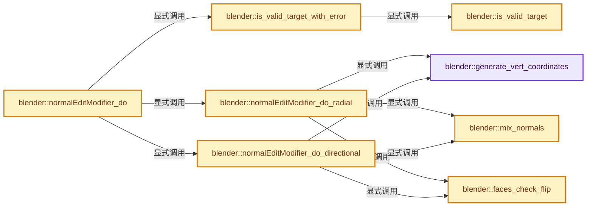
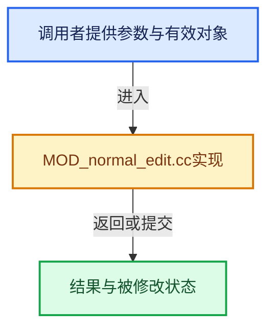

# 实现依赖专题：source/blender/modifiers/intern/MOD_normal_edit.cc

[方向导航](README.md) · [符号索引](../%E7%AC%A6%E5%8F%B7%E4%BE%9D%E8%B5%96%E4%B8%8E%E5%AE%9E%E7%8E%B0%E7%B4%A2%E5%BC%95.md)

本专题从正文实际调用进入，集中保存共享实现。函数有稳定锚点，可从调用处直接跳到对应完整函数；递归与互相调用通过回链组织。

## 本文件的实现关系






## 完整成员与函数实现

<a id="f-c7ac24422555e38f"></a>

### `blender::generate_vert_coordinates`

实现位置：[source/blender/modifiers/intern/MOD_normal_edit.cc](../../../../../source/blender/modifiers/intern/MOD_normal_edit.cc) · L43—L117。

接口参数：

- `Mesh *mesh`
- `Object *ob`
- `Object *ob_center`
- `const float offset[3]`
- `const int verts_num`
- `float (*r_cos)[3]`
- `float3 *r_size`

**教学注释版**

<!-- annotated:cf82a883b93bb9 -->

```cpp
static void generate_vert_coordinates(Mesh *mesh,
                                      Object *ob,
                                      Object *ob_center,
                                      const float offset[3],
                                      const int verts_num,
                                      float (*r_cos)[3],
                                      float3 *r_size)
{
  float min_co[3], max_co[3];
  float diff[3];
  bool do_diff = false;

  INIT_MINMAX(min_co, max_co);

  const Span<float3> positions = mesh->vert_positions();
  for (int i = 0; i < mesh->verts_num; i++) {
    copy_v3_v3(r_cos[i], positions[i]);
    if (r_size != nullptr && ob_center == nullptr) {
      minmax_v3v3_v3(min_co, max_co, r_cos[i]);
    }
  }

  /* Get size (i.e. deformation of the spheroid generating normals),
   * either from target object, or geometry. */
  if (r_size != nullptr) {
    if (ob_center != nullptr) {
      /* Using 'scale' as 'size' here. The input object is typically an empty
       * who's scale is used to define an ellipsoid instead of a simple sphere. */

      /* Not we are not interested in signs here - they are even troublesome actually,
       * due to security clamping! */
      *r_size = math::abs(float3(ob_center->scale));
    }
    else {
      /* Set size. */
      sub_v3_v3v3(*r_size, max_co, min_co);
    }

    /* Error checks - we do not want one or more of our sizes to be null! */
    if (is_zero_v3(*r_size)) {
      *r_size = float3(1.0f);
    }
    else {
      CLAMP_MIN((*r_size)[0], FLT_EPSILON);
      CLAMP_MIN((*r_size)[1], FLT_EPSILON);
      CLAMP_MIN((*r_size)[2], FLT_EPSILON);
    }
  }

  if (ob_center != nullptr) {
    float inv_obmat[4][4];

    /* Translate our coordinates so that center of ob_center is at (0, 0, 0). */
    /* Get ob_center (world) coordinates in ob local coordinates.
     * No need to take into account ob_center's space here, see #44027. */
    invert_m4_m4(inv_obmat, ob->object_to_world().ptr());
    mul_v3_m4v3(diff, inv_obmat, ob_center->object_to_world().location());
    negate_v3(diff);

    do_diff = true;
  }
  else if (offset != nullptr && !is_zero_v3(offset)) {
    negate_v3_v3(diff, offset);

    do_diff = true;
  }
  /* Else, no need to change coordinates! */

  if (do_diff) {
    int i = verts_num;
    while (i--) {
      add_v3_v3(r_cos[i], diff);
    }
  }
}
```

<details>
<summary>核对原始源码：source/blender/modifiers/intern/MOD_normal_edit.cc · L43—L117</summary>

<!-- original:cf82a883b93bb9:source/blender/modifiers/intern/MOD_normal_edit.cc:43:117 -->

```cpp
static void generate_vert_coordinates(Mesh *mesh,
                                      Object *ob,
                                      Object *ob_center,
                                      const float offset[3],
                                      const int verts_num,
                                      float (*r_cos)[3],
                                      float3 *r_size)
{
  float min_co[3], max_co[3];
  float diff[3];
  bool do_diff = false;

  INIT_MINMAX(min_co, max_co);

  const Span<float3> positions = mesh->vert_positions();
  for (int i = 0; i < mesh->verts_num; i++) {
    copy_v3_v3(r_cos[i], positions[i]);
    if (r_size != nullptr && ob_center == nullptr) {
      minmax_v3v3_v3(min_co, max_co, r_cos[i]);
    }
  }

  /* Get size (i.e. deformation of the spheroid generating normals),
   * either from target object, or geometry. */
  if (r_size != nullptr) {
    if (ob_center != nullptr) {
      /* Using 'scale' as 'size' here. The input object is typically an empty
       * who's scale is used to define an ellipsoid instead of a simple sphere. */

      /* Not we are not interested in signs here - they are even troublesome actually,
       * due to security clamping! */
      *r_size = math::abs(float3(ob_center->scale));
    }
    else {
      /* Set size. */
      sub_v3_v3v3(*r_size, max_co, min_co);
    }

    /* Error checks - we do not want one or more of our sizes to be null! */
    if (is_zero_v3(*r_size)) {
      *r_size = float3(1.0f);
    }
    else {
      CLAMP_MIN((*r_size)[0], FLT_EPSILON);
      CLAMP_MIN((*r_size)[1], FLT_EPSILON);
      CLAMP_MIN((*r_size)[2], FLT_EPSILON);
    }
  }

  if (ob_center != nullptr) {
    float inv_obmat[4][4];

    /* Translate our coordinates so that center of ob_center is at (0, 0, 0). */
    /* Get ob_center (world) coordinates in ob local coordinates.
     * No need to take into account ob_center's space here, see #44027. */
    invert_m4_m4(inv_obmat, ob->object_to_world().ptr());
    mul_v3_m4v3(diff, inv_obmat, ob_center->object_to_world().location());
    negate_v3(diff);

    do_diff = true;
  }
  else if (offset != nullptr && !is_zero_v3(offset)) {
    negate_v3_v3(diff, offset);

    do_diff = true;
  }
  /* Else, no need to change coordinates! */

  if (do_diff) {
    int i = verts_num;
    while (i--) {
      add_v3_v3(r_cos[i], diff);
    }
  }
}
```

</details>

**沿实际写入检查状态**

- `do_diff = true;`

**继续追踪实现**

- `INIT_MINMAX` → [INIT_MINMAX · L31](../01-%E5%9F%BA%E7%A1%80%E5%AE%B9%E5%99%A8%E4%B8%8E%E7%8E%B0%E4%BB%A3CPP/%E4%BE%9D%E8%B5%96-BLI_utildefines-293a0a.md#m-958c70eca94e)。宏定义由构建条件选择。
- `mesh->vert_positions` → [Mesh::vert_positions · L1193](03-MPoly%E8%BF%81%E7%A7%BB%E4%B8%8E%E5%85%BC%E5%AE%B9.md#f-ae4177e5c5f2b371)。
- `copy_v3_v3` → [blender::copy_v3_v3 · L47](../12-%E7%A9%BA%E9%97%B4%E6%95%B0%E6%8D%AE%E7%BB%93%E6%9E%84%E4%B8%8E%E5%87%A0%E4%BD%95%E7%AE%97%E6%B3%95/%E4%BE%9D%E8%B5%96-math_vector_inline-0c8541.md#f-037a0d5fa5060bd6)。
- `minmax_v3v3_v3` → [blender::minmax_v3v3_v3 · L716](../12-%E7%A9%BA%E9%97%B4%E6%95%B0%E6%8D%AE%E7%BB%93%E6%9E%84%E4%B8%8E%E5%87%A0%E4%BD%95%E7%AE%97%E6%B3%95/%E4%BE%9D%E8%B5%96-math_vector-5f35fa.md#f-9d9c3397f2360838)。
- `math::abs` → [blender::math::abs · L38](../12-%E7%A9%BA%E9%97%B4%E6%95%B0%E6%8D%AE%E7%BB%93%E6%9E%84%E4%B8%8E%E5%87%A0%E4%BD%95%E7%AE%97%E6%B3%95/%E4%BE%9D%E8%B5%96-BLI_math_vector-906a87.md#f-e755530125bc2198)；[blender::math::abs · L201](../12-%E7%A9%BA%E9%97%B4%E6%95%B0%E6%8D%AE%E7%BB%93%E6%9E%84%E4%B8%8E%E5%87%A0%E4%BD%95%E7%AE%97%E6%B3%95/%E4%BE%9D%E8%B5%96-BLI_math_basis_types-fc7090.md#f-a137ffce39989ffc)；[blender::math::abs · L33](../12-%E7%A9%BA%E9%97%B4%E6%95%B0%E6%8D%AE%E7%BB%93%E6%9E%84%E4%B8%8E%E5%87%A0%E4%BD%95%E7%AE%97%E6%B3%95/%E4%BE%9D%E8%B5%96-BLI_math_base-0728eb.md#f-a2c9c981f4e8420c)。同名重载需按实参类型选择。
- `float3` → [float3 · L641](%E4%BE%9D%E8%B5%96-smaa-b67bc2.md#m-0ea8254cfdb4)。宏定义由构建条件选择。
- `sub_v3_v3v3` → [blender::sub_v3_v3v3 · L360](../12-%E7%A9%BA%E9%97%B4%E6%95%B0%E6%8D%AE%E7%BB%93%E6%9E%84%E4%B8%8E%E5%87%A0%E4%BD%95%E7%AE%97%E6%B3%95/%E4%BE%9D%E8%B5%96-math_vector_inline-0c8541.md#f-23781c252db8b30c)。
- `is_zero_v3` → [blender::is_zero_v3 · L963](../12-%E7%A9%BA%E9%97%B4%E6%95%B0%E6%8D%AE%E7%BB%93%E6%9E%84%E4%B8%8E%E5%87%A0%E4%BD%95%E7%AE%97%E6%B3%95/%E4%BE%9D%E8%B5%96-math_vector_inline-0c8541.md#f-80d0c8ecffdfad5b)。
- `CLAMP_MIN` → [CLAMP_MIN · L219](../01-%E5%9F%BA%E7%A1%80%E5%AE%B9%E5%99%A8%E4%B8%8E%E7%8E%B0%E4%BB%A3CPP/%E4%BE%9D%E8%B5%96-BLI_utildefines-293a0a.md#m-fd63318fbafb)。宏定义由构建条件选择。
- `invert_m4_m4` → [blender::invert_m4_m4 · L1150](../12-%E7%A9%BA%E9%97%B4%E6%95%B0%E6%8D%AE%E7%BB%93%E6%9E%84%E4%B8%8E%E5%87%A0%E4%BD%95%E7%AE%97%E6%B3%95/%E4%BE%9D%E8%B5%96-math_matrix_c-004123.md#f-c75789f10cdd5b92)。
- `ob->object_to_world().ptr` → [调用协议](../%E6%A8%A1%E6%9D%BF%E5%AE%8F%E4%B8%8E%E5%8A%A8%E6%80%81%E5%88%86%E6%B4%BE%E5%8D%8F%E8%AE%AE.md)：接收对象类型依赖auto、返回值或模板实例；不按同名猜测目标。调用位置L98。
- `ob->object_to_world` → [blender::Object::object_to_world · L5761](%E4%BE%9D%E8%B5%96-object-843689.md#f-12fc20026327d50c)。
- `mul_v3_m4v3` → [blender::mul_v3_m4v3 · L687](../12-%E7%A9%BA%E9%97%B4%E6%95%B0%E6%8D%AE%E7%BB%93%E6%9E%84%E4%B8%8E%E5%87%A0%E4%BD%95%E7%AE%97%E6%B3%95/%E4%BE%9D%E8%B5%96-math_matrix_c-004123.md#f-31076c71c40783a8)。
- `ob_center->object_to_world().location` → [调用协议](../%E6%A8%A1%E6%9D%BF%E5%AE%8F%E4%B8%8E%E5%8A%A8%E6%80%81%E5%88%86%E6%B4%BE%E5%8D%8F%E8%AE%AE.md)：接收对象类型依赖auto、返回值或模板实例；不按同名猜测目标。调用位置L99。
- `ob_center->object_to_world` → [blender::Object::object_to_world · L5761](%E4%BE%9D%E8%B5%96-object-843689.md#f-12fc20026327d50c)。
- `negate_v3` → [blender::negate_v3 · L571](../12-%E7%A9%BA%E9%97%B4%E6%95%B0%E6%8D%AE%E7%BB%93%E6%9E%84%E4%B8%8E%E5%87%A0%E4%BD%95%E7%AE%97%E6%B3%95/%E4%BE%9D%E8%B5%96-math_vector_inline-0c8541.md#f-10baf09f690bcba8)。
- `negate_v3_v3` → [blender::negate_v3_v3 · L578](../12-%E7%A9%BA%E9%97%B4%E6%95%B0%E6%8D%AE%E7%BB%93%E6%9E%84%E4%B8%8E%E5%87%A0%E4%BD%95%E7%AE%97%E6%B3%95/%E4%BE%9D%E8%B5%96-math_vector_inline-0c8541.md#f-b680e10c32373391)。
- `add_v3_v3` → [blender::add_v3_v3 · L286](../12-%E7%A9%BA%E9%97%B4%E6%95%B0%E6%8D%AE%E7%BB%93%E6%9E%84%E4%B8%8E%E5%87%A0%E4%BD%95%E7%AE%97%E6%B3%95/%E4%BE%9D%E8%B5%96-math_vector_inline-0c8541.md#f-e7930c6fdefe462c)。

<a id="f-00c42841738053f5"></a>

### `blender::mix_normals`

实现位置：[source/blender/modifiers/intern/MOD_normal_edit.cc](../../../../../source/blender/modifiers/intern/MOD_normal_edit.cc) · L120—L172。

接口参数：

- `const float mix_factor`
- `const MDeformVert *dvert`
- `const int defgrp_index`
- `const bool use_invert_vgroup`
- `const float mix_limit`
- `const short mix_mode`
- `const int verts_num`
- `const Span<int> corner_verts`
- `float3 *nos_old`
- `float3 *nos_new`

**教学注释版**

<!-- annotated:fb85c25cb4dc38 -->

```cpp
static void mix_normals(const float mix_factor,
                        const MDeformVert *dvert,
                        const int defgrp_index,
                        const bool use_invert_vgroup,
                        const float mix_limit,
                        const short mix_mode,
                        const int verts_num,
                        const Span<int> corner_verts,
                        float3 *nos_old,
                        float3 *nos_new)
{
  /* Mix with org normals... */
  float *facs = nullptr, *wfac;
  float3 *no_new, *no_old;
  int i;

  if (dvert) {
    // [讲解] corner_verts.size：查询视图长度或生成对应有效索引区间。
    facs = MEM_new_array_uninitialized<float>(size_t(corner_verts.size()), __func__);
    BKE_defvert_extract_vgroup_to_loopweights(
        dvert, defgrp_index, verts_num, corner_verts, use_invert_vgroup, facs);
  }

  for (i = corner_verts.size(), no_new = nos_new, no_old = nos_old, wfac = facs; i--;
       no_new++, no_old++, wfac++)
  {
    const float fac = facs ? *wfac * mix_factor : mix_factor;

    switch (mix_mode) {
      case MOD_NORMALEDIT_MIX_ADD:
        add_v3_v3(*no_new, *no_old);
        normalize_v3(*no_new);
        break;
      case MOD_NORMALEDIT_MIX_SUB:
        sub_v3_v3(*no_new, *no_old);
        normalize_v3(*no_new);
        break;
      case MOD_NORMALEDIT_MIX_MUL:
        mul_v3_v3(*no_new, *no_old);
        normalize_v3(*no_new);
        break;
      case MOD_NORMALEDIT_MIX_COPY:
        break;
    }

    interp_v3_v3v3_slerp_safe(
        *no_new,
        *no_old,
        *no_new,
        (mix_limit < float(M_PI)) ? min_ff(fac, mix_limit / angle_v3v3(*no_new, *no_old)) : fac);
  }

  MEM_SAFE_DELETE(facs);
}
```

<details>
<summary>核对原始源码：source/blender/modifiers/intern/MOD_normal_edit.cc · L120—L172</summary>

<!-- original:fb85c25cb4dc38:source/blender/modifiers/intern/MOD_normal_edit.cc:120:172 -->

```cpp
static void mix_normals(const float mix_factor,
                        const MDeformVert *dvert,
                        const int defgrp_index,
                        const bool use_invert_vgroup,
                        const float mix_limit,
                        const short mix_mode,
                        const int verts_num,
                        const Span<int> corner_verts,
                        float3 *nos_old,
                        float3 *nos_new)
{
  /* Mix with org normals... */
  float *facs = nullptr, *wfac;
  float3 *no_new, *no_old;
  int i;

  if (dvert) {
    facs = MEM_new_array_uninitialized<float>(size_t(corner_verts.size()), __func__);
    BKE_defvert_extract_vgroup_to_loopweights(
        dvert, defgrp_index, verts_num, corner_verts, use_invert_vgroup, facs);
  }

  for (i = corner_verts.size(), no_new = nos_new, no_old = nos_old, wfac = facs; i--;
       no_new++, no_old++, wfac++)
  {
    const float fac = facs ? *wfac * mix_factor : mix_factor;

    switch (mix_mode) {
      case MOD_NORMALEDIT_MIX_ADD:
        add_v3_v3(*no_new, *no_old);
        normalize_v3(*no_new);
        break;
      case MOD_NORMALEDIT_MIX_SUB:
        sub_v3_v3(*no_new, *no_old);
        normalize_v3(*no_new);
        break;
      case MOD_NORMALEDIT_MIX_MUL:
        mul_v3_v3(*no_new, *no_old);
        normalize_v3(*no_new);
        break;
      case MOD_NORMALEDIT_MIX_COPY:
        break;
    }

    interp_v3_v3v3_slerp_safe(
        *no_new,
        *no_old,
        *no_new,
        (mix_limit < float(M_PI)) ? min_ff(fac, mix_limit / angle_v3v3(*no_new, *no_old)) : fac);
  }

  MEM_SAFE_DELETE(facs);
}
```

</details>

**沿实际写入检查状态**

- `facs = MEM_new_array_uninitialized<float>(size_t(corner_verts.size()), __func__);`

**继续追踪实现**

- `MEM_new_array_uninitialized<float>` → [MEM_new_array_uninitialized · L608](../03-%E5%86%85%E5%AD%98%E5%88%86%E9%85%8D%E4%B8%8E%E8%BF%90%E8%A1%8C%E6%97%B6%E7%B1%BB%E5%9E%8B/%E4%BE%9D%E8%B5%96-MEM_guardedalloc-b54eca.md#f-b7103eae8eb57b05)；[MEM_new_array_uninitialized · L129](../03-%E5%86%85%E5%AD%98%E5%88%86%E9%85%8D%E4%B8%8E%E8%BF%90%E8%A1%8C%E6%97%B6%E7%B1%BB%E5%9E%8B/%E4%BE%9D%E8%B5%96-mallocn-afdcd4.md#f-bf6ef4ddcfb6e5df)。同名重载需按实参类型选择。
- `corner_verts.size` → [blender::Span::size · L256](../01-%E5%9F%BA%E7%A1%80%E5%AE%B9%E5%99%A8%E4%B8%8E%E7%8E%B0%E4%BB%A3CPP/05-Span%E5%8F%AA%E8%AF%BB%E8%BF%9E%E7%BB%AD%E8%A7%86%E5%9B%BE.md#f-5f80fa006089c998)。
- `BKE_defvert_extract_vgroup_to_loopweights` → [blender::BKE_defvert_extract_vgroup_to_loopweights · L1140](%E4%BE%9D%E8%B5%96-deform-6949f4.md#f-f6c45cb1476a0b89)。
- `add_v3_v3` → [blender::add_v3_v3 · L286](../12-%E7%A9%BA%E9%97%B4%E6%95%B0%E6%8D%AE%E7%BB%93%E6%9E%84%E4%B8%8E%E5%87%A0%E4%BD%95%E7%AE%97%E6%B3%95/%E4%BE%9D%E8%B5%96-math_vector_inline-0c8541.md#f-e7930c6fdefe462c)。
- `normalize_v3` → [blender::normalize_v3 · L933](../12-%E7%A9%BA%E9%97%B4%E6%95%B0%E6%8D%AE%E7%BB%93%E6%9E%84%E4%B8%8E%E5%87%A0%E4%BD%95%E7%AE%97%E6%B3%95/%E4%BE%9D%E8%B5%96-math_vector_inline-0c8541.md#f-5f3257e657ef732c)。
- `sub_v3_v3` → [blender::sub_v3_v3 · L353](../12-%E7%A9%BA%E9%97%B4%E6%95%B0%E6%8D%AE%E7%BB%93%E6%9E%84%E4%B8%8E%E5%87%A0%E4%BD%95%E7%AE%97%E6%B3%95/%E4%BE%9D%E8%B5%96-math_vector_inline-0c8541.md#f-da39d7342c417f4b)。
- `mul_v3_v3` → [blender::mul_v3_v3 · L441](../12-%E7%A9%BA%E9%97%B4%E6%95%B0%E6%8D%AE%E7%BB%93%E6%9E%84%E4%B8%8E%E5%87%A0%E4%BD%95%E7%AE%97%E6%B3%95/%E4%BE%9D%E8%B5%96-math_vector_inline-0c8541.md#f-7c71ba13f60a806a)。
- `interp_v3_v3v3_slerp_safe` → [blender::interp_v3_v3v3_slerp_safe · L83](../12-%E7%A9%BA%E9%97%B4%E6%95%B0%E6%8D%AE%E7%BB%93%E6%9E%84%E4%B8%8E%E5%87%A0%E4%BD%95%E7%AE%97%E6%B3%95/%E4%BE%9D%E8%B5%96-math_vector-5f35fa.md#f-34fc9501dccd76ff)。
- `min_ff` → [blender::min_ff · L321](../12-%E7%A9%BA%E9%97%B4%E6%95%B0%E6%8D%AE%E7%BB%93%E6%9E%84%E4%B8%8E%E5%87%A0%E4%BD%95%E7%AE%97%E6%B3%95/%E4%BE%9D%E8%B5%96-math_base_inline-546b00.md#f-5b8d83d6f191be1a)。
- `angle_v3v3` → [blender::angle_v3v3 · L276](../12-%E7%A9%BA%E9%97%B4%E6%95%B0%E6%8D%AE%E7%BB%93%E6%9E%84%E4%B8%8E%E5%87%A0%E4%BD%95%E7%AE%97%E6%B3%95/%E4%BE%9D%E8%B5%96-math_vector-5f35fa.md#f-19f04f581481dab6)。
- `MEM_SAFE_DELETE` → [MEM_SAFE_DELETE · L436](../03-%E5%86%85%E5%AD%98%E5%88%86%E9%85%8D%E4%B8%8E%E8%BF%90%E8%A1%8C%E6%97%B6%E7%B1%BB%E5%9E%8B/%E4%BE%9D%E8%B5%96-MEM_guardedalloc-b54eca.md#m-eadb3bc5b902)。宏定义由构建条件选择。

<a id="f-7cb1ddab6b304189"></a>

### `blender::faces_check_flip`

实现位置：[source/blender/modifiers/intern/MOD_normal_edit.cc](../../../../../source/blender/modifiers/intern/MOD_normal_edit.cc) · L176—L201。

接口参数：

- `Mesh &mesh`
- `MutableSpan<float3> nos`
- `const Span<float3> face_normals`

**教学注释版**

<!-- annotated:da6a175b8e4d9e -->

```cpp
static void faces_check_flip(Mesh &mesh, MutableSpan<float3> nos, const Span<float3> face_normals)
{
  const OffsetIndices faces = mesh.faces();
  IndexMaskMemory memory;
  const IndexMask faces_to_flip = IndexMask::from_predicate(
      faces.index_range(), memory, [&](const int i) {
        const IndexRange face = faces[i];
        float norsum[3] = {0.0f};

        for (const int64_t j : face) {
          add_v3_v3(norsum, nos[j]);
        }
        if (!normalize_v3(norsum)) {
          return false;
        }

        /* If average of new loop normals is opposed to face normal, flip face. */
        if (dot_v3v3(face_normals[i], norsum) < 0.0f) {
          // [讲解] nos.slice：建立原连续范围的子视图。
          nos.slice(faces[i].drop_front(1)).reverse();
          return true;
        }
        return false;
      });

  bke::mesh_flip_faces(mesh, faces_to_flip);
}
```

<details>
<summary>核对原始源码：source/blender/modifiers/intern/MOD_normal_edit.cc · L176—L201</summary>

<!-- original:da6a175b8e4d9e:source/blender/modifiers/intern/MOD_normal_edit.cc:176:201 -->

```cpp
static void faces_check_flip(Mesh &mesh, MutableSpan<float3> nos, const Span<float3> face_normals)
{
  const OffsetIndices faces = mesh.faces();
  IndexMaskMemory memory;
  const IndexMask faces_to_flip = IndexMask::from_predicate(
      faces.index_range(), memory, [&](const int i) {
        const IndexRange face = faces[i];
        float norsum[3] = {0.0f};

        for (const int64_t j : face) {
          add_v3_v3(norsum, nos[j]);
        }
        if (!normalize_v3(norsum)) {
          return false;
        }

        /* If average of new loop normals is opposed to face normal, flip face. */
        if (dot_v3v3(face_normals[i], norsum) < 0.0f) {
          nos.slice(faces[i].drop_front(1)).reverse();
          return true;
        }
        return false;
      });

  bke::mesh_flip_faces(mesh, faces_to_flip);
}
```

</details>

**结果出口**

- `return false;`
- `return true;`

**继续追踪实现**

- `mesh.faces` → [Mesh::faces · L1217](03-MPoly%E8%BF%81%E7%A7%BB%E4%B8%8E%E5%85%BC%E5%AE%B9.md#f-ea444760154e17b2)。
- `IndexMask::from_predicate` → [blender::index_mask::IndexMask::from_predicate · L1073](../04-%E8%99%9A%E6%8B%9F%E6%95%B0%E7%BB%84%E4%B8%8E%E7%B4%A2%E5%BC%95%E9%80%89%E6%8B%A9/12-%E9%87%8D%E6%9E%84%E5%8E%86%E5%8F%B2%E4%B8%8E%E5%9F%BA%E5%87%86%E7%BB%83%E4%B9%A0.md#f-3864daa059098df8)。
- `faces.index_range` → [blender::offset_indices::OffsetIndices::index_range · L77](02-OffsetIndices%E5%AE%8C%E6%95%B4%E6%8E%A5%E5%8F%A3.md#f-19b5ca1456de007d)。
- `add_v3_v3` → [blender::add_v3_v3 · L286](../12-%E7%A9%BA%E9%97%B4%E6%95%B0%E6%8D%AE%E7%BB%93%E6%9E%84%E4%B8%8E%E5%87%A0%E4%BD%95%E7%AE%97%E6%B3%95/%E4%BE%9D%E8%B5%96-math_vector_inline-0c8541.md#f-e7930c6fdefe462c)。
- `normalize_v3` → [blender::normalize_v3 · L933](../12-%E7%A9%BA%E9%97%B4%E6%95%B0%E6%8D%AE%E7%BB%93%E6%9E%84%E4%B8%8E%E5%87%A0%E4%BD%95%E7%AE%97%E6%B3%95/%E4%BE%9D%E8%B5%96-math_vector_inline-0c8541.md#f-5f3257e657ef732c)。
- `dot_v3v3` → [blender::dot_v3v3 · L646](../12-%E7%A9%BA%E9%97%B4%E6%95%B0%E6%8D%AE%E7%BB%93%E6%9E%84%E4%B8%8E%E5%87%A0%E4%BD%95%E7%AE%97%E6%B3%95/%E4%BE%9D%E8%B5%96-math_vector_inline-0c8541.md#f-c88befa67d07591a)。
- `nos.slice(faces[i].drop_front(1)).reverse` → [调用协议](../%E6%A8%A1%E6%9D%BF%E5%AE%8F%E4%B8%8E%E5%8A%A8%E6%80%81%E5%88%86%E6%B4%BE%E5%8D%8F%E8%AE%AE.md)：接收对象类型依赖auto、返回值或模板实例；不按同名猜测目标。调用位置L194。
- `nos.slice` → [blender::MutableSpan::slice · L579](../01-%E5%9F%BA%E7%A1%80%E5%AE%B9%E5%99%A8%E4%B8%8E%E7%8E%B0%E4%BB%A3CPP/06-MutableSpan%E5%8F%AF%E5%86%99%E8%A7%86%E5%9B%BE.md#f-6808b4aefbf58808)；[blender::MutableSpan::slice · L587](../01-%E5%9F%BA%E7%A1%80%E5%AE%B9%E5%99%A8%E4%B8%8E%E7%8E%B0%E4%BB%A3CPP/06-MutableSpan%E5%8F%AF%E5%86%99%E8%A7%86%E5%9B%BE.md#f-c05b010821861e4f)。同名重载需按实参类型选择。
- `faces[i].drop_front` → [调用协议](../%E6%A8%A1%E6%9D%BF%E5%AE%8F%E4%B8%8E%E5%8A%A8%E6%80%81%E5%88%86%E6%B4%BE%E5%8D%8F%E8%AE%AE.md)：接收对象类型依赖auto、返回值或模板实例；不按同名猜测目标。调用位置L194。
- `bke::mesh_flip_faces` → [blender::bke::mesh_flip_faces · L44](%E4%BE%9D%E8%B5%96-mesh_flip_faces-227102.md#f-1927c93904e9c37f)。

<a id="f-4d62c2bb78dc5889"></a>

### `blender::normalEditModifier_do_radial`

实现位置：[source/blender/modifiers/intern/MOD_normal_edit.cc](../../../../../source/blender/modifiers/intern/MOD_normal_edit.cc) · L203—L325。

接口参数：

- `NormalEditModifierData *enmd`
- `const ModifierEvalContext *`
- `Object *ob`
- `Mesh *mesh`
- `MutableSpan<short2> clnors`
- `MutableSpan<float3> corner_normals`
- `const short mix_mode`
- `const float mix_factor`
- `const float mix_limit`
- `const MDeformVert *dvert`
- `const int defgrp_index`
- `const bool use_invert_vgroup`
- `Span<float3> vert_positions`
- `MutableSpan<bool> sharp_edges`
- `MutableSpan<int> corner_verts`
- `MutableSpan<int> corner_edges`
- `const OffsetIndices<int> faces`

**教学注释版**

<!-- annotated:2c1ec781706abd -->

```cpp
static void normalEditModifier_do_radial(NormalEditModifierData *enmd,
                                         const ModifierEvalContext * /*ctx*/,
                                         Object *ob,
                                         Mesh *mesh,
                                         MutableSpan<short2> clnors,
                                         MutableSpan<float3> corner_normals,
                                         const short mix_mode,
                                         const float mix_factor,
                                         const float mix_limit,
                                         const MDeformVert *dvert,
                                         const int defgrp_index,
                                         const bool use_invert_vgroup,
                                         Span<float3> vert_positions,
                                         MutableSpan<bool> sharp_edges,
                                         MutableSpan<int> corner_verts,
                                         MutableSpan<int> corner_edges,
                                         const OffsetIndices<int> faces)
{
  Object *ob_target = enmd->target;

  const bool do_facenors_fix = (enmd->flag & MOD_NORMALEDIT_NO_POLYNORS_FIX) == 0;

  // [讲解] vert_positions.size：查询视图长度或生成对应有效索引区间。
  float (*cos)[3] = MEM_new_array_uninitialized<float[3]>(size_t(vert_positions.size()), __func__);
  Array<float3> nos(corner_verts.size());
  float3 size;

  BLI_bitmap *done_verts = BLI_BITMAP_NEW(size_t(vert_positions.size()), __func__);

  generate_vert_coordinates(mesh, ob, ob_target, enmd->offset, vert_positions.size(), cos, &size);

  /**
   * size gives us our spheroid coefficients `(A, B, C)`.
   * Then, we want to find out for each vert its (a, b, c) triple (proportional to (A, B, C) one).
   *
   * Ellipsoid basic equation: `(x^2/a^2) + (y^2/b^2) + (z^2/c^2) = 1`.
   * Since we want to find (a, b, c) matching this equation and proportional to (A, B, C),
   * we can do:
   * <pre>
   *     m = B / A
   *     n = C / A
   * </pre>
   *
   * hence:
   * <pre>
   *     (x^2/a^2) + (y^2/b^2) + (z^2/c^2) = 1
   *  -> b^2*c^2*x^2 + a^2*c^2*y^2 + a^2*b^2*z^2 = a^2*b^2*c^2
   *     b = ma
   *     c = na
   *  -> m^2*a^2*n^2*a^2*x^2 + a^2*n^2*a^2*y^2 + a^2*m^2*a^2*z^2 = a^2*m^2*a^2*n^2*a^2
   *  -> m^2*n^2*a^4*x^2 + n^2*a^4*y^2 + m^2*a^4*z^2 = m^2*n^2*a^6
   *  -> a^2 = (m^2*n^2*x^2 + n^2y^2 + m^2z^2) / (m^2*n^2) = x^2 + (y^2 / m^2) + (z^2 / n^2)
   *  -> b^2 = (m^2*n^2*x^2 + n^2y^2 + m^2z^2) / (n^2)     = (m^2 * x^2) + y^2 + (m^2 * z^2 / n^2)
   *  -> c^2 = (m^2*n^2*x^2 + n^2y^2 + m^2z^2) / (m^2)     = (n^2 * x^2) + (n^2 * y^2 / m^2) + z^2
   * </pre>
   *
   * All we have to do now is compute normal of the spheroid at that point:
   * <pre>
   *     n = (x / a^2, y / b^2, z / c^2)
   * </pre>
   * And we are done!
   */
  {
    const float a = size[0], b = size[1], c = size[2];
    const float m2 = (b * b) / (a * a);
    const float n2 = (c * c) / (a * a);

    /* We reuse cos to now store the ellipsoid-normal of the verts! */
    // [讲解] corner_verts.index_range：查询视图长度或生成对应有效索引区间。
    for (const int64_t i : corner_verts.index_range()) {
      const int vidx = corner_verts[i];
      float *co = cos[vidx];

      if (!BLI_BITMAP_TEST(done_verts, vidx)) {
        const float x2 = co[0] * co[0];
        const float y2 = co[1] * co[1];
        const float z2 = co[2] * co[2];
        const float a2 = x2 + (y2 / m2) + (z2 / n2);
        const float b2 = (m2 * x2) + y2 + (m2 * z2 / n2);
        const float c2 = (n2 * x2) + (n2 * y2 / m2) + z2;

        co[0] /= a2;
        co[1] /= b2;
        co[2] /= c2;
        normalize_v3(co);

        BLI_BITMAP_ENABLE(done_verts, vidx);
      }
      nos[i] = co;
    }
  }

  // [讲解] corner_normals.is_empty：查询视图长度或生成对应有效索引区间。
  if (!corner_normals.is_empty()) {
    mix_normals(mix_factor,
                dvert,
                defgrp_index,
                use_invert_vgroup,
                mix_limit,
                mix_mode,
                vert_positions.size(),
                corner_verts,
                // [讲解] corner_normals.data：返回借用范围的地址。
                corner_normals.data(),
                nos.data());
  }

  if (do_facenors_fix) {
    faces_check_flip(*mesh, nos, mesh->face_normals_true());
  }
  const bke::AttributeAccessor attributes = mesh->attributes();
  const VArraySpan sharp_faces = *attributes.lookup<bool>("sharp_face", bke::AttrDomain::Face);
  bke::mesh::normals_corner_custom_set(vert_positions,
                                       faces,
                                       corner_verts,
                                       corner_edges,
                                       mesh->vert_to_face_map(),
                                       mesh->vert_normals_true(),
                                       mesh->face_normals_true(),
                                       sharp_faces,
                                       sharp_edges,
                                       nos,
                                       clnors);

  MEM_delete(cos);
  MEM_delete(done_verts);
}
```

<details>
<summary>核对原始源码：source/blender/modifiers/intern/MOD_normal_edit.cc · L203—L325</summary>

<!-- original:2c1ec781706abd:source/blender/modifiers/intern/MOD_normal_edit.cc:203:325 -->

```cpp
static void normalEditModifier_do_radial(NormalEditModifierData *enmd,
                                         const ModifierEvalContext * /*ctx*/,
                                         Object *ob,
                                         Mesh *mesh,
                                         MutableSpan<short2> clnors,
                                         MutableSpan<float3> corner_normals,
                                         const short mix_mode,
                                         const float mix_factor,
                                         const float mix_limit,
                                         const MDeformVert *dvert,
                                         const int defgrp_index,
                                         const bool use_invert_vgroup,
                                         Span<float3> vert_positions,
                                         MutableSpan<bool> sharp_edges,
                                         MutableSpan<int> corner_verts,
                                         MutableSpan<int> corner_edges,
                                         const OffsetIndices<int> faces)
{
  Object *ob_target = enmd->target;

  const bool do_facenors_fix = (enmd->flag & MOD_NORMALEDIT_NO_POLYNORS_FIX) == 0;

  float (*cos)[3] = MEM_new_array_uninitialized<float[3]>(size_t(vert_positions.size()), __func__);
  Array<float3> nos(corner_verts.size());
  float3 size;

  BLI_bitmap *done_verts = BLI_BITMAP_NEW(size_t(vert_positions.size()), __func__);

  generate_vert_coordinates(mesh, ob, ob_target, enmd->offset, vert_positions.size(), cos, &size);

  /**
   * size gives us our spheroid coefficients `(A, B, C)`.
   * Then, we want to find out for each vert its (a, b, c) triple (proportional to (A, B, C) one).
   *
   * Ellipsoid basic equation: `(x^2/a^2) + (y^2/b^2) + (z^2/c^2) = 1`.
   * Since we want to find (a, b, c) matching this equation and proportional to (A, B, C),
   * we can do:
   * <pre>
   *     m = B / A
   *     n = C / A
   * </pre>
   *
   * hence:
   * <pre>
   *     (x^2/a^2) + (y^2/b^2) + (z^2/c^2) = 1
   *  -> b^2*c^2*x^2 + a^2*c^2*y^2 + a^2*b^2*z^2 = a^2*b^2*c^2
   *     b = ma
   *     c = na
   *  -> m^2*a^2*n^2*a^2*x^2 + a^2*n^2*a^2*y^2 + a^2*m^2*a^2*z^2 = a^2*m^2*a^2*n^2*a^2
   *  -> m^2*n^2*a^4*x^2 + n^2*a^4*y^2 + m^2*a^4*z^2 = m^2*n^2*a^6
   *  -> a^2 = (m^2*n^2*x^2 + n^2y^2 + m^2z^2) / (m^2*n^2) = x^2 + (y^2 / m^2) + (z^2 / n^2)
   *  -> b^2 = (m^2*n^2*x^2 + n^2y^2 + m^2z^2) / (n^2)     = (m^2 * x^2) + y^2 + (m^2 * z^2 / n^2)
   *  -> c^2 = (m^2*n^2*x^2 + n^2y^2 + m^2z^2) / (m^2)     = (n^2 * x^2) + (n^2 * y^2 / m^2) + z^2
   * </pre>
   *
   * All we have to do now is compute normal of the spheroid at that point:
   * <pre>
   *     n = (x / a^2, y / b^2, z / c^2)
   * </pre>
   * And we are done!
   */
  {
    const float a = size[0], b = size[1], c = size[2];
    const float m2 = (b * b) / (a * a);
    const float n2 = (c * c) / (a * a);

    /* We reuse cos to now store the ellipsoid-normal of the verts! */
    for (const int64_t i : corner_verts.index_range()) {
      const int vidx = corner_verts[i];
      float *co = cos[vidx];

      if (!BLI_BITMAP_TEST(done_verts, vidx)) {
        const float x2 = co[0] * co[0];
        const float y2 = co[1] * co[1];
        const float z2 = co[2] * co[2];
        const float a2 = x2 + (y2 / m2) + (z2 / n2);
        const float b2 = (m2 * x2) + y2 + (m2 * z2 / n2);
        const float c2 = (n2 * x2) + (n2 * y2 / m2) + z2;

        co[0] /= a2;
        co[1] /= b2;
        co[2] /= c2;
        normalize_v3(co);

        BLI_BITMAP_ENABLE(done_verts, vidx);
      }
      nos[i] = co;
    }
  }

  if (!corner_normals.is_empty()) {
    mix_normals(mix_factor,
                dvert,
                defgrp_index,
                use_invert_vgroup,
                mix_limit,
                mix_mode,
                vert_positions.size(),
                corner_verts,
                corner_normals.data(),
                nos.data());
  }

  if (do_facenors_fix) {
    faces_check_flip(*mesh, nos, mesh->face_normals_true());
  }
  const bke::AttributeAccessor attributes = mesh->attributes();
  const VArraySpan sharp_faces = *attributes.lookup<bool>("sharp_face", bke::AttrDomain::Face);
  bke::mesh::normals_corner_custom_set(vert_positions,
                                       faces,
                                       corner_verts,
                                       corner_edges,
                                       mesh->vert_to_face_map(),
                                       mesh->vert_normals_true(),
                                       mesh->face_normals_true(),
                                       sharp_faces,
                                       sharp_edges,
                                       nos,
                                       clnors);

  MEM_delete(cos);
  MEM_delete(done_verts);
}
```

</details>

**沿实际写入检查状态**

- `nos[i] = co;`

**继续追踪实现**

- `MEM_new_array_uninitialized<float[3]>` → [MEM_new_array_uninitialized · L608](../03-%E5%86%85%E5%AD%98%E5%88%86%E9%85%8D%E4%B8%8E%E8%BF%90%E8%A1%8C%E6%97%B6%E7%B1%BB%E5%9E%8B/%E4%BE%9D%E8%B5%96-MEM_guardedalloc-b54eca.md#f-b7103eae8eb57b05)；[MEM_new_array_uninitialized · L129](../03-%E5%86%85%E5%AD%98%E5%88%86%E9%85%8D%E4%B8%8E%E8%BF%90%E8%A1%8C%E6%97%B6%E7%B1%BB%E5%9E%8B/%E4%BE%9D%E8%B5%96-mallocn-afdcd4.md#f-bf6ef4ddcfb6e5df)。同名重载需按实参类型选择。
- `vert_positions.size` → [blender::Span::size · L256](../01-%E5%9F%BA%E7%A1%80%E5%AE%B9%E5%99%A8%E4%B8%8E%E7%8E%B0%E4%BB%A3CPP/05-Span%E5%8F%AA%E8%AF%BB%E8%BF%9E%E7%BB%AD%E8%A7%86%E5%9B%BE.md#f-5f80fa006089c998)。
- `corner_verts.size` → [blender::MutableSpan::size · L499](../01-%E5%9F%BA%E7%A1%80%E5%AE%B9%E5%99%A8%E4%B8%8E%E7%8E%B0%E4%BB%A3CPP/06-MutableSpan%E5%8F%AF%E5%86%99%E8%A7%86%E5%9B%BE.md#f-1de6a66839c304a8)；[blender::gpu::shader::parser::MutableSpan::size · L87](%E4%BE%9D%E8%B5%96-utils-06433d.md#f-5e684af6ee7990e9)。同名重载需按实参类型选择。
- `BLI_BITMAP_NEW` → [BLI_BITMAP_NEW · L39](../02-%E5%93%88%E5%B8%8C%E8%A1%A8%E4%B8%8E%E5%85%B3%E8%81%94%E6%95%B0%E6%8D%AE%E7%BB%93%E6%9E%84/%E4%BE%9D%E8%B5%96-BLI_bitmap-693b86.md#m-77dce9cd8859)。宏定义由构建条件选择。
- `generate_vert_coordinates` → [blender::generate_vert_coordinates · L43](%E4%BE%9D%E8%B5%96-MOD_normal_edit-e6de24.md#f-c7ac24422555e38f)。
- `corner_verts.index_range` → [blender::MutableSpan::index_range · L676](../01-%E5%9F%BA%E7%A1%80%E5%AE%B9%E5%99%A8%E4%B8%8E%E7%8E%B0%E4%BB%A3CPP/06-MutableSpan%E5%8F%AF%E5%86%99%E8%A7%86%E5%9B%BE.md#f-f9a9d59a69ca64b5)。
- `BLI_BITMAP_TEST` → [BLI_BITMAP_TEST · L63](../02-%E5%93%88%E5%B8%8C%E8%A1%A8%E4%B8%8E%E5%85%B3%E8%81%94%E6%95%B0%E6%8D%AE%E7%BB%93%E6%9E%84/%E4%BE%9D%E8%B5%96-BLI_bitmap-693b86.md#m-631c4702a77d)。宏定义由构建条件选择。
- `normalize_v3` → [blender::normalize_v3 · L933](../12-%E7%A9%BA%E9%97%B4%E6%95%B0%E6%8D%AE%E7%BB%93%E6%9E%84%E4%B8%8E%E5%87%A0%E4%BD%95%E7%AE%97%E6%B3%95/%E4%BE%9D%E8%B5%96-math_vector_inline-0c8541.md#f-5f3257e657ef732c)。
- `BLI_BITMAP_ENABLE` → [BLI_BITMAP_ENABLE · L80](../02-%E5%93%88%E5%B8%8C%E8%A1%A8%E4%B8%8E%E5%85%B3%E8%81%94%E6%95%B0%E6%8D%AE%E7%BB%93%E6%9E%84/%E4%BE%9D%E8%B5%96-BLI_bitmap-693b86.md#m-6b0abc936749)。宏定义由构建条件选择。
- `corner_normals.is_empty` → [blender::MutableSpan::is_empty · L515](../01-%E5%9F%BA%E7%A1%80%E5%AE%B9%E5%99%A8%E4%B8%8E%E7%8E%B0%E4%BB%A3CPP/06-MutableSpan%E5%8F%AF%E5%86%99%E8%A7%86%E5%9B%BE.md#f-be88df1422757437)。
- `mix_normals` → [blender::mix_normals · L120](%E4%BE%9D%E8%B5%96-MOD_normal_edit-e6de24.md#f-00c42841738053f5)。
- `corner_normals.data` → [blender::MutableSpan::data · L545](../01-%E5%9F%BA%E7%A1%80%E5%AE%B9%E5%99%A8%E4%B8%8E%E7%8E%B0%E4%BB%A3CPP/06-MutableSpan%E5%8F%AF%E5%86%99%E8%A7%86%E5%9B%BE.md#f-eb45a6e4d8211efd)；[blender::gpu::shader::parser::MutableSpan::data · L82](%E4%BE%9D%E8%B5%96-utils-06433d.md#f-ad0a09cec9741c65)。同名重载需按实参类型选择。
- `nos.data` → [blender::Array::data · L323](../01-%E5%9F%BA%E7%A1%80%E5%AE%B9%E5%99%A8%E4%B8%8E%E7%8E%B0%E4%BB%A3CPP/08-Array%E5%A4%8D%E5%88%B6%E7%A7%BB%E5%8A%A8%E4%B8%8E%E9%94%80%E6%AF%81.md#f-95648c799002f4ba)；[blender::Array::data · L327](../01-%E5%9F%BA%E7%A1%80%E5%AE%B9%E5%99%A8%E4%B8%8E%E7%8E%B0%E4%BB%A3CPP/08-Array%E5%A4%8D%E5%88%B6%E7%A7%BB%E5%8A%A8%E4%B8%8E%E9%94%80%E6%AF%81.md#f-50c18301f8c40f9e)。同名重载需按实参类型选择。
- `faces_check_flip` → [blender::faces_check_flip · L176](%E4%BE%9D%E8%B5%96-MOD_normal_edit-e6de24.md#f-7cb1ddab6b304189)。
- `mesh->face_normals_true` → [blender::Mesh::face_normals_true · L458](../06-%E9%9A%90%E5%BC%8F%E5%85%B1%E4%BA%AB%E4%B8%8E%E7%BC%93%E5%AD%98%E7%B3%BB%E7%BB%9F/08-%E6%B3%95%E7%BA%BF%E7%BC%93%E5%AD%98%E7%9A%84%E7%9C%9F%E5%AE%9E%E4%BE%9D%E8%B5%96.md#f-fe50f8ea920f5198)。
- `mesh->attributes` → [Mesh::attributes · L1298](03-MPoly%E8%BF%81%E7%A7%BB%E4%B8%8E%E5%85%BC%E5%AE%B9.md#f-607bbfe3e57cfc7f)。
- `attributes.lookup<bool>` → [blender::bke::AttributeAccessor::lookup · L401](%E4%BE%9D%E8%B5%96-attribute_access-bceef3.md#f-4673351b7bb3b651)；[blender::bke::AttributeAccessor::lookup · L585](08-AttributeAccessor%E6%8E%A5%E5%8F%A3.md#f-432b90c796a80893)；[blender::bke::AttributeAccessor::lookup · L602](08-AttributeAccessor%E6%8E%A5%E5%8F%A3.md#f-a60c1a45b85155d9)；[blender::bke::AttributeAccessor::lookup · L611](08-AttributeAccessor%E6%8E%A5%E5%8F%A3.md#f-16ca459803fc30a6)；[blender::bke::AttributeAccessor::lookup · L620](08-AttributeAccessor%E6%8E%A5%E5%8F%A3.md#f-403fd8a9d1a16c6d)。同名重载需按实参类型选择。
- `bke::mesh::normals_corner_custom_set` → [blender::bke::mesh::normals_corner_custom_set · L1600](../06-%E9%9A%90%E5%BC%8F%E5%85%B1%E4%BA%AB%E4%B8%8E%E7%BC%93%E5%AD%98%E7%B3%BB%E7%BB%9F/08-%E6%B3%95%E7%BA%BF%E7%BC%93%E5%AD%98%E7%9A%84%E7%9C%9F%E5%AE%9E%E4%BE%9D%E8%B5%96.md#f-047f5ce7040508c8)。
- `mesh->vert_to_face_map` → [blender::Mesh::vert_to_face_map · L119](../06-%E9%9A%90%E5%BC%8F%E5%85%B1%E4%BA%AB%E4%B8%8E%E7%BC%93%E5%AD%98%E7%B3%BB%E7%BB%9F/10-%E5%B1%80%E9%83%A8%E6%9B%B4%E6%96%B0%E4%B8%8E%E5%A4%B1%E6%95%88%E4%BF%AE%E5%A4%8D.md#f-343af7b6eb5a9239)。
- `mesh->vert_normals_true` → [blender::Mesh::vert_normals_true · L400](../06-%E9%9A%90%E5%BC%8F%E5%85%B1%E4%BA%AB%E4%B8%8E%E7%BC%93%E5%AD%98%E7%B3%BB%E7%BB%9F/08-%E6%B3%95%E7%BA%BF%E7%BC%93%E5%AD%98%E7%9A%84%E7%9C%9F%E5%AE%9E%E4%BE%9D%E8%B5%96.md#f-9f843a18ab6ce3ef)。
- `MEM_delete` → [MEM_delete · L400](../03-%E5%86%85%E5%AD%98%E5%88%86%E9%85%8D%E4%B8%8E%E8%BF%90%E8%A1%8C%E6%97%B6%E7%B1%BB%E5%9E%8B/%E4%BE%9D%E8%B5%96-MEM_guardedalloc-b54eca.md#f-9049ffdd1682887c)。

<a id="f-1fa7b8c2452b7e72"></a>

### `blender::normalEditModifier_do_directional`

实现位置：[source/blender/modifiers/intern/MOD_normal_edit.cc](../../../../../source/blender/modifiers/intern/MOD_normal_edit.cc) · L327—L425。

接口参数：

- `NormalEditModifierData *enmd`
- `const ModifierEvalContext *`
- `Object *ob`
- `Mesh *mesh`
- `MutableSpan<short2> clnors`
- `MutableSpan<float3> corner_normals`
- `const short mix_mode`
- `const float mix_factor`
- `const float mix_limit`
- `const MDeformVert *dvert`
- `const int defgrp_index`
- `const bool use_invert_vgroup`
- `const Span<float3> positions`
- `MutableSpan<bool> sharp_edges`
- `MutableSpan<int> corner_verts`
- `MutableSpan<int> corner_edges`
- `const OffsetIndices<int> faces`

**教学注释版**

<!-- annotated:0951d048498c3c -->

```cpp
static void normalEditModifier_do_directional(NormalEditModifierData *enmd,
                                              const ModifierEvalContext * /*ctx*/,
                                              Object *ob,
                                              Mesh *mesh,
                                              MutableSpan<short2> clnors,
                                              MutableSpan<float3> corner_normals,
                                              const short mix_mode,
                                              const float mix_factor,
                                              const float mix_limit,
                                              const MDeformVert *dvert,
                                              const int defgrp_index,
                                              const bool use_invert_vgroup,
                                              const Span<float3> positions,
                                              MutableSpan<bool> sharp_edges,
                                              MutableSpan<int> corner_verts,
                                              MutableSpan<int> corner_edges,
                                              const OffsetIndices<int> faces)
{
  Object *ob_target = enmd->target;

  const bool do_facenors_fix = (enmd->flag & MOD_NORMALEDIT_NO_POLYNORS_FIX) == 0;
  const bool use_parallel_normals = (enmd->flag & MOD_NORMALEDIT_USE_DIRECTION_PARALLEL) != 0;

  // [讲解] corner_verts.size：查询视图长度或生成对应有效索引区间。
  Array<float3> nos(corner_verts.size());

  float target_co[3];
  int i;

  /* Get target's center coordinates in ob local coordinates. */
  float mat[4][4];

  invert_m4_m4(mat, ob->object_to_world().ptr());
  mul_m4_m4m4(mat, mat, ob_target->object_to_world().ptr());
  copy_v3_v3(target_co, mat[3]);

  if (use_parallel_normals) {
    float no[3];

    sub_v3_v3v3(no, target_co, enmd->offset);
    normalize_v3(no);

    for (i = corner_verts.size(); i--;) {
      copy_v3_v3(nos[i], no);
    }
  }
  else {
    float (*cos)[3] = MEM_new_array_uninitialized<float[3]>(size_t(positions.size()), __func__);
    generate_vert_coordinates(mesh, ob, ob_target, nullptr, positions.size(), cos, nullptr);

    BLI_bitmap *done_verts = BLI_BITMAP_NEW(size_t(positions.size()), __func__);

    /* We reuse cos to now store the 'to target' normal of the verts! */
    // [讲解] corner_verts.index_range：查询视图长度或生成对应有效索引区间。
    for (const int64_t i : corner_verts.index_range()) {
      const int vidx = corner_verts[i];
      float *co = cos[vidx];

      if (!BLI_BITMAP_TEST(done_verts, vidx)) {
        sub_v3_v3v3(co, target_co, co);
        normalize_v3(co);

        BLI_BITMAP_ENABLE(done_verts, vidx);
      }
      nos[i] = co;
    }

    MEM_delete(done_verts);
    MEM_delete(cos);
  }

  // [讲解] corner_normals.is_empty：查询视图长度或生成对应有效索引区间。
  if (!corner_normals.is_empty()) {
    mix_normals(mix_factor,
                dvert,
                defgrp_index,
                use_invert_vgroup,
                mix_limit,
                mix_mode,
                positions.size(),
                corner_verts,
                // [讲解] corner_normals.data：返回借用范围的地址。
                corner_normals.data(),
                nos.data());
  }

  if (do_facenors_fix) {
    faces_check_flip(*mesh, nos, mesh->face_normals_true());
  }
  const bke::AttributeAccessor attributes = mesh->attributes();
  const VArraySpan sharp_faces = *attributes.lookup<bool>("sharp_face", bke::AttrDomain::Face);
  bke::mesh::normals_corner_custom_set(positions,
                                       faces,
                                       corner_verts,
                                       corner_edges,
                                       mesh->vert_to_face_map(),
                                       mesh->vert_normals_true(),
                                       mesh->face_normals_true(),
                                       sharp_faces,
                                       sharp_edges,
                                       nos,
                                       clnors);
}
```

<details>
<summary>核对原始源码：source/blender/modifiers/intern/MOD_normal_edit.cc · L327—L425</summary>

<!-- original:0951d048498c3c:source/blender/modifiers/intern/MOD_normal_edit.cc:327:425 -->

```cpp
static void normalEditModifier_do_directional(NormalEditModifierData *enmd,
                                              const ModifierEvalContext * /*ctx*/,
                                              Object *ob,
                                              Mesh *mesh,
                                              MutableSpan<short2> clnors,
                                              MutableSpan<float3> corner_normals,
                                              const short mix_mode,
                                              const float mix_factor,
                                              const float mix_limit,
                                              const MDeformVert *dvert,
                                              const int defgrp_index,
                                              const bool use_invert_vgroup,
                                              const Span<float3> positions,
                                              MutableSpan<bool> sharp_edges,
                                              MutableSpan<int> corner_verts,
                                              MutableSpan<int> corner_edges,
                                              const OffsetIndices<int> faces)
{
  Object *ob_target = enmd->target;

  const bool do_facenors_fix = (enmd->flag & MOD_NORMALEDIT_NO_POLYNORS_FIX) == 0;
  const bool use_parallel_normals = (enmd->flag & MOD_NORMALEDIT_USE_DIRECTION_PARALLEL) != 0;

  Array<float3> nos(corner_verts.size());

  float target_co[3];
  int i;

  /* Get target's center coordinates in ob local coordinates. */
  float mat[4][4];

  invert_m4_m4(mat, ob->object_to_world().ptr());
  mul_m4_m4m4(mat, mat, ob_target->object_to_world().ptr());
  copy_v3_v3(target_co, mat[3]);

  if (use_parallel_normals) {
    float no[3];

    sub_v3_v3v3(no, target_co, enmd->offset);
    normalize_v3(no);

    for (i = corner_verts.size(); i--;) {
      copy_v3_v3(nos[i], no);
    }
  }
  else {
    float (*cos)[3] = MEM_new_array_uninitialized<float[3]>(size_t(positions.size()), __func__);
    generate_vert_coordinates(mesh, ob, ob_target, nullptr, positions.size(), cos, nullptr);

    BLI_bitmap *done_verts = BLI_BITMAP_NEW(size_t(positions.size()), __func__);

    /* We reuse cos to now store the 'to target' normal of the verts! */
    for (const int64_t i : corner_verts.index_range()) {
      const int vidx = corner_verts[i];
      float *co = cos[vidx];

      if (!BLI_BITMAP_TEST(done_verts, vidx)) {
        sub_v3_v3v3(co, target_co, co);
        normalize_v3(co);

        BLI_BITMAP_ENABLE(done_verts, vidx);
      }
      nos[i] = co;
    }

    MEM_delete(done_verts);
    MEM_delete(cos);
  }

  if (!corner_normals.is_empty()) {
    mix_normals(mix_factor,
                dvert,
                defgrp_index,
                use_invert_vgroup,
                mix_limit,
                mix_mode,
                positions.size(),
                corner_verts,
                corner_normals.data(),
                nos.data());
  }

  if (do_facenors_fix) {
    faces_check_flip(*mesh, nos, mesh->face_normals_true());
  }
  const bke::AttributeAccessor attributes = mesh->attributes();
  const VArraySpan sharp_faces = *attributes.lookup<bool>("sharp_face", bke::AttrDomain::Face);
  bke::mesh::normals_corner_custom_set(positions,
                                       faces,
                                       corner_verts,
                                       corner_edges,
                                       mesh->vert_to_face_map(),
                                       mesh->vert_normals_true(),
                                       mesh->face_normals_true(),
                                       sharp_faces,
                                       sharp_edges,
                                       nos,
                                       clnors);
}
```

</details>

**沿实际写入检查状态**

- `nos[i] = co;`

**继续追踪实现**

- `corner_verts.size` → [blender::MutableSpan::size · L499](../01-%E5%9F%BA%E7%A1%80%E5%AE%B9%E5%99%A8%E4%B8%8E%E7%8E%B0%E4%BB%A3CPP/06-MutableSpan%E5%8F%AF%E5%86%99%E8%A7%86%E5%9B%BE.md#f-1de6a66839c304a8)；[blender::gpu::shader::parser::MutableSpan::size · L87](%E4%BE%9D%E8%B5%96-utils-06433d.md#f-5e684af6ee7990e9)。同名重载需按实参类型选择。
- `invert_m4_m4` → [blender::invert_m4_m4 · L1150](../12-%E7%A9%BA%E9%97%B4%E6%95%B0%E6%8D%AE%E7%BB%93%E6%9E%84%E4%B8%8E%E5%87%A0%E4%BD%95%E7%AE%97%E6%B3%95/%E4%BE%9D%E8%B5%96-math_matrix_c-004123.md#f-c75789f10cdd5b92)。
- `ob->object_to_world().ptr` → [调用协议](../%E6%A8%A1%E6%9D%BF%E5%AE%8F%E4%B8%8E%E5%8A%A8%E6%80%81%E5%88%86%E6%B4%BE%E5%8D%8F%E8%AE%AE.md)：接收对象类型依赖auto、返回值或模板实例；不按同名猜测目标。调用位置L358。
- `ob->object_to_world` → [blender::Object::object_to_world · L5761](%E4%BE%9D%E8%B5%96-object-843689.md#f-12fc20026327d50c)。
- `mul_m4_m4m4` → [blender::mul_m4_m4m4 · L217](../12-%E7%A9%BA%E9%97%B4%E6%95%B0%E6%8D%AE%E7%BB%93%E6%9E%84%E4%B8%8E%E5%87%A0%E4%BD%95%E7%AE%97%E6%B3%95/%E4%BE%9D%E8%B5%96-math_matrix_c-004123.md#f-b5272136b543b73b)。
- `ob_target->object_to_world().ptr` → [调用协议](../%E6%A8%A1%E6%9D%BF%E5%AE%8F%E4%B8%8E%E5%8A%A8%E6%80%81%E5%88%86%E6%B4%BE%E5%8D%8F%E8%AE%AE.md)：接收对象类型依赖auto、返回值或模板实例；不按同名猜测目标。调用位置L359。
- `ob_target->object_to_world` → [blender::Object::object_to_world · L5761](%E4%BE%9D%E8%B5%96-object-843689.md#f-12fc20026327d50c)。
- `copy_v3_v3` → [blender::copy_v3_v3 · L47](../12-%E7%A9%BA%E9%97%B4%E6%95%B0%E6%8D%AE%E7%BB%93%E6%9E%84%E4%B8%8E%E5%87%A0%E4%BD%95%E7%AE%97%E6%B3%95/%E4%BE%9D%E8%B5%96-math_vector_inline-0c8541.md#f-037a0d5fa5060bd6)。
- `sub_v3_v3v3` → [blender::sub_v3_v3v3 · L360](../12-%E7%A9%BA%E9%97%B4%E6%95%B0%E6%8D%AE%E7%BB%93%E6%9E%84%E4%B8%8E%E5%87%A0%E4%BD%95%E7%AE%97%E6%B3%95/%E4%BE%9D%E8%B5%96-math_vector_inline-0c8541.md#f-23781c252db8b30c)。
- `normalize_v3` → [blender::normalize_v3 · L933](../12-%E7%A9%BA%E9%97%B4%E6%95%B0%E6%8D%AE%E7%BB%93%E6%9E%84%E4%B8%8E%E5%87%A0%E4%BD%95%E7%AE%97%E6%B3%95/%E4%BE%9D%E8%B5%96-math_vector_inline-0c8541.md#f-5f3257e657ef732c)。
- `MEM_new_array_uninitialized<float[3]>` → [MEM_new_array_uninitialized · L608](../03-%E5%86%85%E5%AD%98%E5%88%86%E9%85%8D%E4%B8%8E%E8%BF%90%E8%A1%8C%E6%97%B6%E7%B1%BB%E5%9E%8B/%E4%BE%9D%E8%B5%96-MEM_guardedalloc-b54eca.md#f-b7103eae8eb57b05)；[MEM_new_array_uninitialized · L129](../03-%E5%86%85%E5%AD%98%E5%88%86%E9%85%8D%E4%B8%8E%E8%BF%90%E8%A1%8C%E6%97%B6%E7%B1%BB%E5%9E%8B/%E4%BE%9D%E8%B5%96-mallocn-afdcd4.md#f-bf6ef4ddcfb6e5df)。同名重载需按实参类型选择。
- `positions.size` → [blender::Span::size · L256](../01-%E5%9F%BA%E7%A1%80%E5%AE%B9%E5%99%A8%E4%B8%8E%E7%8E%B0%E4%BB%A3CPP/05-Span%E5%8F%AA%E8%AF%BB%E8%BF%9E%E7%BB%AD%E8%A7%86%E5%9B%BE.md#f-5f80fa006089c998)。
- `generate_vert_coordinates` → [blender::generate_vert_coordinates · L43](%E4%BE%9D%E8%B5%96-MOD_normal_edit-e6de24.md#f-c7ac24422555e38f)。
- `BLI_BITMAP_NEW` → [BLI_BITMAP_NEW · L39](../02-%E5%93%88%E5%B8%8C%E8%A1%A8%E4%B8%8E%E5%85%B3%E8%81%94%E6%95%B0%E6%8D%AE%E7%BB%93%E6%9E%84/%E4%BE%9D%E8%B5%96-BLI_bitmap-693b86.md#m-77dce9cd8859)。宏定义由构建条件选择。
- `corner_verts.index_range` → [blender::MutableSpan::index_range · L676](../01-%E5%9F%BA%E7%A1%80%E5%AE%B9%E5%99%A8%E4%B8%8E%E7%8E%B0%E4%BB%A3CPP/06-MutableSpan%E5%8F%AF%E5%86%99%E8%A7%86%E5%9B%BE.md#f-f9a9d59a69ca64b5)。
- `BLI_BITMAP_TEST` → [BLI_BITMAP_TEST · L63](../02-%E5%93%88%E5%B8%8C%E8%A1%A8%E4%B8%8E%E5%85%B3%E8%81%94%E6%95%B0%E6%8D%AE%E7%BB%93%E6%9E%84/%E4%BE%9D%E8%B5%96-BLI_bitmap-693b86.md#m-631c4702a77d)。宏定义由构建条件选择。
- `BLI_BITMAP_ENABLE` → [BLI_BITMAP_ENABLE · L80](../02-%E5%93%88%E5%B8%8C%E8%A1%A8%E4%B8%8E%E5%85%B3%E8%81%94%E6%95%B0%E6%8D%AE%E7%BB%93%E6%9E%84/%E4%BE%9D%E8%B5%96-BLI_bitmap-693b86.md#m-6b0abc936749)。宏定义由构建条件选择。
- `MEM_delete` → [MEM_delete · L400](../03-%E5%86%85%E5%AD%98%E5%88%86%E9%85%8D%E4%B8%8E%E8%BF%90%E8%A1%8C%E6%97%B6%E7%B1%BB%E5%9E%8B/%E4%BE%9D%E8%B5%96-MEM_guardedalloc-b54eca.md#f-9049ffdd1682887c)。
- `corner_normals.is_empty` → [blender::MutableSpan::is_empty · L515](../01-%E5%9F%BA%E7%A1%80%E5%AE%B9%E5%99%A8%E4%B8%8E%E7%8E%B0%E4%BB%A3CPP/06-MutableSpan%E5%8F%AF%E5%86%99%E8%A7%86%E5%9B%BE.md#f-be88df1422757437)。
- `mix_normals` → [blender::mix_normals · L120](%E4%BE%9D%E8%B5%96-MOD_normal_edit-e6de24.md#f-00c42841738053f5)。
- `corner_normals.data` → [blender::MutableSpan::data · L545](../01-%E5%9F%BA%E7%A1%80%E5%AE%B9%E5%99%A8%E4%B8%8E%E7%8E%B0%E4%BB%A3CPP/06-MutableSpan%E5%8F%AF%E5%86%99%E8%A7%86%E5%9B%BE.md#f-eb45a6e4d8211efd)；[blender::gpu::shader::parser::MutableSpan::data · L82](%E4%BE%9D%E8%B5%96-utils-06433d.md#f-ad0a09cec9741c65)。同名重载需按实参类型选择。
- `nos.data` → [blender::Array::data · L323](../01-%E5%9F%BA%E7%A1%80%E5%AE%B9%E5%99%A8%E4%B8%8E%E7%8E%B0%E4%BB%A3CPP/08-Array%E5%A4%8D%E5%88%B6%E7%A7%BB%E5%8A%A8%E4%B8%8E%E9%94%80%E6%AF%81.md#f-95648c799002f4ba)；[blender::Array::data · L327](../01-%E5%9F%BA%E7%A1%80%E5%AE%B9%E5%99%A8%E4%B8%8E%E7%8E%B0%E4%BB%A3CPP/08-Array%E5%A4%8D%E5%88%B6%E7%A7%BB%E5%8A%A8%E4%B8%8E%E9%94%80%E6%AF%81.md#f-50c18301f8c40f9e)。同名重载需按实参类型选择。
- `faces_check_flip` → [blender::faces_check_flip · L176](%E4%BE%9D%E8%B5%96-MOD_normal_edit-e6de24.md#f-7cb1ddab6b304189)。
- `mesh->face_normals_true` → [blender::Mesh::face_normals_true · L458](../06-%E9%9A%90%E5%BC%8F%E5%85%B1%E4%BA%AB%E4%B8%8E%E7%BC%93%E5%AD%98%E7%B3%BB%E7%BB%9F/08-%E6%B3%95%E7%BA%BF%E7%BC%93%E5%AD%98%E7%9A%84%E7%9C%9F%E5%AE%9E%E4%BE%9D%E8%B5%96.md#f-fe50f8ea920f5198)。
- `mesh->attributes` → [Mesh::attributes · L1298](03-MPoly%E8%BF%81%E7%A7%BB%E4%B8%8E%E5%85%BC%E5%AE%B9.md#f-607bbfe3e57cfc7f)。
- `attributes.lookup<bool>` → [blender::bke::AttributeAccessor::lookup · L401](%E4%BE%9D%E8%B5%96-attribute_access-bceef3.md#f-4673351b7bb3b651)；[blender::bke::AttributeAccessor::lookup · L585](08-AttributeAccessor%E6%8E%A5%E5%8F%A3.md#f-432b90c796a80893)；[blender::bke::AttributeAccessor::lookup · L602](08-AttributeAccessor%E6%8E%A5%E5%8F%A3.md#f-a60c1a45b85155d9)；[blender::bke::AttributeAccessor::lookup · L611](08-AttributeAccessor%E6%8E%A5%E5%8F%A3.md#f-16ca459803fc30a6)；[blender::bke::AttributeAccessor::lookup · L620](08-AttributeAccessor%E6%8E%A5%E5%8F%A3.md#f-403fd8a9d1a16c6d)。同名重载需按实参类型选择。
- `bke::mesh::normals_corner_custom_set` → [blender::bke::mesh::normals_corner_custom_set · L1600](../06-%E9%9A%90%E5%BC%8F%E5%85%B1%E4%BA%AB%E4%B8%8E%E7%BC%93%E5%AD%98%E7%B3%BB%E7%BB%9F/08-%E6%B3%95%E7%BA%BF%E7%BC%93%E5%AD%98%E7%9A%84%E7%9C%9F%E5%AE%9E%E4%BE%9D%E8%B5%96.md#f-047f5ce7040508c8)。
- `mesh->vert_to_face_map` → [blender::Mesh::vert_to_face_map · L119](../06-%E9%9A%90%E5%BC%8F%E5%85%B1%E4%BA%AB%E4%B8%8E%E7%BC%93%E5%AD%98%E7%B3%BB%E7%BB%9F/10-%E5%B1%80%E9%83%A8%E6%9B%B4%E6%96%B0%E4%B8%8E%E5%A4%B1%E6%95%88%E4%BF%AE%E5%A4%8D.md#f-343af7b6eb5a9239)。
- `mesh->vert_normals_true` → [blender::Mesh::vert_normals_true · L400](../06-%E9%9A%90%E5%BC%8F%E5%85%B1%E4%BA%AB%E4%B8%8E%E7%BC%93%E5%AD%98%E7%B3%BB%E7%BB%9F/08-%E6%B3%95%E7%BA%BF%E7%BC%93%E5%AD%98%E7%9A%84%E7%9C%9F%E5%AE%9E%E4%BE%9D%E8%B5%96.md#f-9f843a18ab6ce3ef)。

<a id="f-49c64e1c3b4d4993"></a>

### `blender::is_valid_target`

实现位置：[source/blender/modifiers/intern/MOD_normal_edit.cc](../../../../../source/blender/modifiers/intern/MOD_normal_edit.cc) · L427—L436。

接口参数：

- `NormalEditModifierData *enmd`

**教学注释版**

<!-- annotated:38df0a6b63c52a -->

```cpp
static bool is_valid_target(NormalEditModifierData *enmd)
{
  if (enmd->mode == MOD_NORMALEDIT_MODE_RADIAL) {
    return true;
  }
  if ((enmd->mode == MOD_NORMALEDIT_MODE_DIRECTIONAL) && enmd->target) {
    return true;
  }
  return false;
}
```

<details>
<summary>核对原始源码：source/blender/modifiers/intern/MOD_normal_edit.cc · L427—L436</summary>

<!-- original:38df0a6b63c52a:source/blender/modifiers/intern/MOD_normal_edit.cc:427:436 -->

```cpp
static bool is_valid_target(NormalEditModifierData *enmd)
{
  if (enmd->mode == MOD_NORMALEDIT_MODE_RADIAL) {
    return true;
  }
  if ((enmd->mode == MOD_NORMALEDIT_MODE_DIRECTIONAL) && enmd->target) {
    return true;
  }
  return false;
}
```

</details>

**结果出口**

- `return true;`
- `return false;`

**继续追踪实现**

本实现没有需要继续展开的显式调用；检查返回表达式、对象转换和调用者前置条件。

<a id="f-b10eecc79c275085"></a>

### `blender::is_valid_target_with_error`

实现位置：[source/blender/modifiers/intern/MOD_normal_edit.cc](../../../../../source/blender/modifiers/intern/MOD_normal_edit.cc) · L438—L445。

接口参数：

- `const Object *ob`
- `NormalEditModifierData *enmd`

**教学注释版**

<!-- annotated:abaced9f7dde03 -->

```cpp
static bool is_valid_target_with_error(const Object *ob, NormalEditModifierData *enmd)
{
  if (is_valid_target(enmd)) {
    return true;
  }
  BKE_modifier_set_error(ob, reinterpret_cast<ModifierData *>(enmd), "Invalid target settings");
  return false;
}
```

<details>
<summary>核对原始源码：source/blender/modifiers/intern/MOD_normal_edit.cc · L438—L445</summary>

<!-- original:abaced9f7dde03:source/blender/modifiers/intern/MOD_normal_edit.cc:438:445 -->

```cpp
static bool is_valid_target_with_error(const Object *ob, NormalEditModifierData *enmd)
{
  if (is_valid_target(enmd)) {
    return true;
  }
  BKE_modifier_set_error(ob, reinterpret_cast<ModifierData *>(enmd), "Invalid target settings");
  return false;
}
```

</details>

**结果出口**

- `return true;`
- `return false;`

**继续追踪实现**

- `is_valid_target` → [blender::is_valid_target · L427](%E4%BE%9D%E8%B5%96-MOD_normal_edit-e6de24.md#f-49c64e1c3b4d4993)。
- `BKE_modifier_set_error` → [blender::BKE_modifier_set_error · L416](%E4%BE%9D%E8%B5%96-modifier-ab0273.md#f-6241829f21c08456)。

<a id="f-94ad450279743662"></a>

### `blender::normalEditModifier_do`

实现位置：[source/blender/modifiers/intern/MOD_normal_edit.cc](../../../../../source/blender/modifiers/intern/MOD_normal_edit.cc) · L447—L555。

接口参数：

- `NormalEditModifierData *enmd`
- `const ModifierEvalContext *ctx`
- `Object *ob`
- `Mesh *mesh`

**教学注释版**

<!-- annotated:3632dc9fb504ed -->

```cpp
static Mesh *normalEditModifier_do(NormalEditModifierData *enmd,
                                   const ModifierEvalContext *ctx,
                                   Object *ob,
                                   Mesh *mesh)
{
  const bool use_invert_vgroup = ((enmd->flag & MOD_NORMALEDIT_INVERT_VGROUP) != 0);
  const bool use_current_clnors = !((enmd->mix_mode == MOD_NORMALEDIT_MIX_COPY) &&
                                    (enmd->mix_factor == 1.0f) && (enmd->defgrp_name[0] == '\0') &&
                                    (enmd->mix_limit == float(M_PI)));

  /* Do not run that modifier at all if auto-smooth is disabled! */
  if (!is_valid_target_with_error(ctx->object, enmd) || mesh->corners_num == 0) {
    return mesh;
  }

  Mesh *result;
  if (mesh->edges().data() == (id_cast<Mesh *>(ob->data))->edges().data()) {
    /* We need to duplicate data here, otherwise setting custom normals
     * (which may also affect sharp edges) could
     * modify original mesh, see #43671. */
    result = id_cast<Mesh *>(BKE_id_copy_ex(nullptr, &mesh->id, nullptr, LIB_ID_COPY_LOCALIZE));
  }
  else {
    result = mesh;
  }

  const Span<float3> positions = result->vert_positions();
  const OffsetIndices faces = result->faces();
  MutableSpan<int> corner_verts = result->corner_verts_for_write();
  MutableSpan<int> corner_edges = result->corner_edges_for_write();

  int defgrp_index;
  const MDeformVert *dvert;

  Array<float3> corner_normals;

  bke::MutableAttributeAccessor attributes = result->attributes_for_write();
  bke::SpanAttributeWriter<bool> sharp_edges = attributes.lookup_or_add_for_write_span<bool>(
      "sharp_edge", bke::AttrDomain::Edge);

  bke::SpanAttributeWriter custom_nors_dst = attributes.lookup_or_add_for_write_span<short2>(
      "custom_normal", bke::AttrDomain::Corner);
  if (!custom_nors_dst) {
    return result;
  }
  if (use_current_clnors) {
    // [讲解] corner_normals.reinitialize：以新长度重建数组。
    corner_normals.reinitialize(corner_verts.size());
    const VArraySpan sharp_faces = *attributes.lookup<bool>("sharp_face", bke::AttrDomain::Face);
    bke::mesh::normals_calc_corners(positions,
                                    faces,
                                    corner_verts,
                                    corner_edges,
                                    result->vert_to_face_map(),
                                    result->face_normals_true(),
                                    sharp_edges.span,
                                    sharp_faces,
                                    custom_nors_dst.span,
                                    nullptr,
                                    corner_normals);
  }

  MOD_get_vgroup(ob, result, enmd->defgrp_name, &dvert, &defgrp_index);

  if (enmd->mode == MOD_NORMALEDIT_MODE_RADIAL) {
    normalEditModifier_do_radial(enmd,
                                 ctx,
                                 ob,
                                 result,
                                 custom_nors_dst.span,
                                 corner_normals,
                                 enmd->mix_mode,
                                 enmd->mix_factor,
                                 enmd->mix_limit,
                                 dvert,
                                 defgrp_index,
                                 use_invert_vgroup,
                                 positions,
                                 sharp_edges.span,
                                 corner_verts,
                                 corner_edges,
                                 faces);
  }
  else if (enmd->mode == MOD_NORMALEDIT_MODE_DIRECTIONAL) {
    normalEditModifier_do_directional(enmd,
                                      ctx,
                                      ob,
                                      result,
                                      custom_nors_dst.span,
                                      corner_normals,
                                      enmd->mix_mode,
                                      enmd->mix_factor,
                                      enmd->mix_limit,
                                      dvert,
                                      defgrp_index,
                                      use_invert_vgroup,
                                      positions,
                                      sharp_edges.span,
                                      corner_verts,
                                      corner_edges,
                                      faces);
  }

  result->runtime->is_original_bmesh = false;

  custom_nors_dst.finish();
  sharp_edges.finish();

  return result;
}
```

<details>
<summary>核对原始源码：source/blender/modifiers/intern/MOD_normal_edit.cc · L447—L555</summary>

<!-- original:3632dc9fb504ed:source/blender/modifiers/intern/MOD_normal_edit.cc:447:555 -->

```cpp
static Mesh *normalEditModifier_do(NormalEditModifierData *enmd,
                                   const ModifierEvalContext *ctx,
                                   Object *ob,
                                   Mesh *mesh)
{
  const bool use_invert_vgroup = ((enmd->flag & MOD_NORMALEDIT_INVERT_VGROUP) != 0);
  const bool use_current_clnors = !((enmd->mix_mode == MOD_NORMALEDIT_MIX_COPY) &&
                                    (enmd->mix_factor == 1.0f) && (enmd->defgrp_name[0] == '\0') &&
                                    (enmd->mix_limit == float(M_PI)));

  /* Do not run that modifier at all if auto-smooth is disabled! */
  if (!is_valid_target_with_error(ctx->object, enmd) || mesh->corners_num == 0) {
    return mesh;
  }

  Mesh *result;
  if (mesh->edges().data() == (id_cast<Mesh *>(ob->data))->edges().data()) {
    /* We need to duplicate data here, otherwise setting custom normals
     * (which may also affect sharp edges) could
     * modify original mesh, see #43671. */
    result = id_cast<Mesh *>(BKE_id_copy_ex(nullptr, &mesh->id, nullptr, LIB_ID_COPY_LOCALIZE));
  }
  else {
    result = mesh;
  }

  const Span<float3> positions = result->vert_positions();
  const OffsetIndices faces = result->faces();
  MutableSpan<int> corner_verts = result->corner_verts_for_write();
  MutableSpan<int> corner_edges = result->corner_edges_for_write();

  int defgrp_index;
  const MDeformVert *dvert;

  Array<float3> corner_normals;

  bke::MutableAttributeAccessor attributes = result->attributes_for_write();
  bke::SpanAttributeWriter<bool> sharp_edges = attributes.lookup_or_add_for_write_span<bool>(
      "sharp_edge", bke::AttrDomain::Edge);

  bke::SpanAttributeWriter custom_nors_dst = attributes.lookup_or_add_for_write_span<short2>(
      "custom_normal", bke::AttrDomain::Corner);
  if (!custom_nors_dst) {
    return result;
  }
  if (use_current_clnors) {
    corner_normals.reinitialize(corner_verts.size());
    const VArraySpan sharp_faces = *attributes.lookup<bool>("sharp_face", bke::AttrDomain::Face);
    bke::mesh::normals_calc_corners(positions,
                                    faces,
                                    corner_verts,
                                    corner_edges,
                                    result->vert_to_face_map(),
                                    result->face_normals_true(),
                                    sharp_edges.span,
                                    sharp_faces,
                                    custom_nors_dst.span,
                                    nullptr,
                                    corner_normals);
  }

  MOD_get_vgroup(ob, result, enmd->defgrp_name, &dvert, &defgrp_index);

  if (enmd->mode == MOD_NORMALEDIT_MODE_RADIAL) {
    normalEditModifier_do_radial(enmd,
                                 ctx,
                                 ob,
                                 result,
                                 custom_nors_dst.span,
                                 corner_normals,
                                 enmd->mix_mode,
                                 enmd->mix_factor,
                                 enmd->mix_limit,
                                 dvert,
                                 defgrp_index,
                                 use_invert_vgroup,
                                 positions,
                                 sharp_edges.span,
                                 corner_verts,
                                 corner_edges,
                                 faces);
  }
  else if (enmd->mode == MOD_NORMALEDIT_MODE_DIRECTIONAL) {
    normalEditModifier_do_directional(enmd,
                                      ctx,
                                      ob,
                                      result,
                                      custom_nors_dst.span,
                                      corner_normals,
                                      enmd->mix_mode,
                                      enmd->mix_factor,
                                      enmd->mix_limit,
                                      dvert,
                                      defgrp_index,
                                      use_invert_vgroup,
                                      positions,
                                      sharp_edges.span,
                                      corner_verts,
                                      corner_edges,
                                      faces);
  }

  result->runtime->is_original_bmesh = false;

  custom_nors_dst.finish();
  sharp_edges.finish();

  return result;
}
```

</details>

**沿实际写入检查状态**

- `result = id_cast<Mesh *>(BKE_id_copy_ex(nullptr, &mesh->id, nullptr, LIB_ID_COPY_LOCALIZE));`
- `result = mesh;`
- `result->runtime->is_original_bmesh = false;`

**结果出口**

- `return mesh;`
- `return result;`

**继续追踪实现**

- `is_valid_target_with_error` → [blender::is_valid_target_with_error · L438](%E4%BE%9D%E8%B5%96-MOD_normal_edit-e6de24.md#f-b10eecc79c275085)。
- `mesh->edges().data` → [调用协议](../%E6%A8%A1%E6%9D%BF%E5%AE%8F%E4%B8%8E%E5%8A%A8%E6%80%81%E5%88%86%E6%B4%BE%E5%8D%8F%E8%AE%AE.md)：接收对象类型依赖auto、返回值或模板实例；不按同名猜测目标。调用位置L463。
- `mesh->edges` → [Mesh::edges · L1205](03-MPoly%E8%BF%81%E7%A7%BB%E4%B8%8E%E5%85%BC%E5%AE%B9.md#f-7232f6756b674d12)。
- `(id_cast<Mesh *>(ob->data))->edges().data` → [调用协议](../%E6%A8%A1%E6%9D%BF%E5%AE%8F%E4%B8%8E%E5%8A%A8%E6%80%81%E5%88%86%E6%B4%BE%E5%8D%8F%E8%AE%AE.md)：接收对象类型依赖auto、返回值或模板实例；不按同名猜测目标。调用位置L463。
- `(id_cast<Mesh *>(ob->data))->edges` → [调用协议](../%E6%A8%A1%E6%9D%BF%E5%AE%8F%E4%B8%8E%E5%8A%A8%E6%80%81%E5%88%86%E6%B4%BE%E5%8D%8F%E8%AE%AE.md)：接收对象类型依赖auto、返回值或模板实例；不按同名猜测目标。调用位置L463。
- `id_cast<Mesh *>` → [blender::id_cast · L1417](%E4%BE%9D%E8%B5%96-DNA_ID-3eb091.md#f-6c8ac6412850ac5a)。
- `BKE_id_copy_ex` → [blender::BKE_id_copy_ex · L851](%E4%BE%9D%E8%B5%96-lib_id-d4e6bd.md#f-24272170c95f49fb)。
- `result->vert_positions` → [Mesh::vert_positions · L1193](03-MPoly%E8%BF%81%E7%A7%BB%E4%B8%8E%E5%85%BC%E5%AE%B9.md#f-ae4177e5c5f2b371)。
- `result->faces` → [Mesh::faces · L1217](03-MPoly%E8%BF%81%E7%A7%BB%E4%B8%8E%E5%85%BC%E5%AE%B9.md#f-ea444760154e17b2)。
- `result->corner_verts_for_write` → [Mesh::corner_verts_for_write · L1246](03-MPoly%E8%BF%81%E7%A7%BB%E4%B8%8E%E5%85%BC%E5%AE%B9.md#f-6dfaf316a81ba215)。
- `result->corner_edges_for_write` → [Mesh::corner_edges_for_write · L1260](03-MPoly%E8%BF%81%E7%A7%BB%E4%B8%8E%E5%85%BC%E5%AE%B9.md#f-51e939a4353adb83)。
- `result->attributes_for_write` → [Mesh::attributes_for_write · L1303](03-MPoly%E8%BF%81%E7%A7%BB%E4%B8%8E%E5%85%BC%E5%AE%B9.md#f-ca7af2f1a15f0bc4)。
- `attributes.lookup_or_add_for_write_span<bool>` → [blender::bke::MutableAttributeAccessor::lookup_or_add_for_write_span · L533](%E4%BE%9D%E8%B5%96-attribute_access-bceef3.md#f-c533eff1b9a4973e)；[blender::bke::MutableAttributeAccessor::lookup_or_add_for_write_span · L861](08-AttributeAccessor%E6%8E%A5%E5%8F%A3.md#f-aa4c0d5a61437381)。同名重载需按实参类型选择。
- `attributes.lookup_or_add_for_write_span<short2>` → [blender::bke::MutableAttributeAccessor::lookup_or_add_for_write_span · L533](%E4%BE%9D%E8%B5%96-attribute_access-bceef3.md#f-c533eff1b9a4973e)；[blender::bke::MutableAttributeAccessor::lookup_or_add_for_write_span · L861](08-AttributeAccessor%E6%8E%A5%E5%8F%A3.md#f-aa4c0d5a61437381)。同名重载需按实参类型选择。
- `corner_normals.reinitialize` → [blender::Array::reinitialize · L430](../01-%E5%9F%BA%E7%A1%80%E5%AE%B9%E5%99%A8%E4%B8%8E%E7%8E%B0%E4%BB%A3CPP/08-Array%E5%A4%8D%E5%88%B6%E7%A7%BB%E5%8A%A8%E4%B8%8E%E9%94%80%E6%AF%81.md#f-3414f619e246b688)。
- `corner_verts.size` → [blender::MutableSpan::size · L499](../01-%E5%9F%BA%E7%A1%80%E5%AE%B9%E5%99%A8%E4%B8%8E%E7%8E%B0%E4%BB%A3CPP/06-MutableSpan%E5%8F%AF%E5%86%99%E8%A7%86%E5%9B%BE.md#f-1de6a66839c304a8)；[blender::gpu::shader::parser::MutableSpan::size · L87](%E4%BE%9D%E8%B5%96-utils-06433d.md#f-5e684af6ee7990e9)。同名重载需按实参类型选择。
- `attributes.lookup<bool>` → [blender::GLVaoCache::lookup · L182](%E4%BE%9D%E8%B5%96-gl_batch-d8877a.md#f-e4f56cc3d9a969de)。
- `bke::mesh::normals_calc_corners` → [blender::bke::mesh::normals_calc_corners · L1239](../06-%E9%9A%90%E5%BC%8F%E5%85%B1%E4%BA%AB%E4%B8%8E%E7%BC%93%E5%AD%98%E7%B3%BB%E7%BB%9F/08-%E6%B3%95%E7%BA%BF%E7%BC%93%E5%AD%98%E7%9A%84%E7%9C%9F%E5%AE%9E%E4%BE%9D%E8%B5%96.md#f-be88fbe319bfb500)。
- `result->vert_to_face_map` → [blender::Mesh::vert_to_face_map · L119](../06-%E9%9A%90%E5%BC%8F%E5%85%B1%E4%BA%AB%E4%B8%8E%E7%BC%93%E5%AD%98%E7%B3%BB%E7%BB%9F/10-%E5%B1%80%E9%83%A8%E6%9B%B4%E6%96%B0%E4%B8%8E%E5%A4%B1%E6%95%88%E4%BF%AE%E5%A4%8D.md#f-343af7b6eb5a9239)。
- `result->face_normals_true` → [blender::Mesh::face_normals_true · L458](../06-%E9%9A%90%E5%BC%8F%E5%85%B1%E4%BA%AB%E4%B8%8E%E7%BC%93%E5%AD%98%E7%B3%BB%E7%BB%9F/08-%E6%B3%95%E7%BA%BF%E7%BC%93%E5%AD%98%E7%9A%84%E7%9C%9F%E5%AE%9E%E4%BE%9D%E8%B5%96.md#f-fe50f8ea920f5198)。
- `MOD_get_vgroup` → [blender::MOD_get_vgroup · L158](%E4%BE%9D%E8%B5%96-MOD_util-83ca4b.md#f-f461611d86b94405)。
- `normalEditModifier_do_radial` → [blender::normalEditModifier_do_radial · L203](%E4%BE%9D%E8%B5%96-MOD_normal_edit-e6de24.md#f-4d62c2bb78dc5889)。
- `normalEditModifier_do_directional` → [blender::normalEditModifier_do_directional · L327](%E4%BE%9D%E8%B5%96-MOD_normal_edit-e6de24.md#f-1fa7b8c2452b7e72)。
- `custom_nors_dst.finish` → [blender::bke::SpanAttributeWriter::finish · L279](08-AttributeAccessor%E6%8E%A5%E5%8F%A3.md#f-585970a3b1bd4da4)。
- `sharp_edges.finish` → [blender::bke::SpanAttributeWriter::finish · L279](08-AttributeAccessor%E6%8E%A5%E5%8F%A3.md#f-585970a3b1bd4da4)。

<a id="f-235a85a5c508960f"></a>

### `blender::required_data_mask`

实现位置：[source/blender/modifiers/intern/MOD_normal_edit.cc](../../../../../source/blender/modifiers/intern/MOD_normal_edit.cc) · L563—L571。

接口参数：

- `ModifierData *md`
- `CustomData_MeshMasks *r_cddata_masks`

**教学注释版**

<!-- annotated:b94fa3bedbdadc -->

```cpp
static void required_data_mask(ModifierData *md, CustomData_MeshMasks *r_cddata_masks)
{
  NormalEditModifierData *enmd = reinterpret_cast<NormalEditModifierData *>(md);

  /* Ask for vertex-groups if we need them. */
  if (enmd->defgrp_name[0] != '\0') {
    r_cddata_masks->vmask |= CD_MASK_MDEFORMVERT;
  }
}
```

<details>
<summary>核对原始源码：source/blender/modifiers/intern/MOD_normal_edit.cc · L563—L571</summary>

<!-- original:b94fa3bedbdadc:source/blender/modifiers/intern/MOD_normal_edit.cc:563:571 -->

```cpp
static void required_data_mask(ModifierData *md, CustomData_MeshMasks *r_cddata_masks)
{
  NormalEditModifierData *enmd = reinterpret_cast<NormalEditModifierData *>(md);

  /* Ask for vertex-groups if we need them. */
  if (enmd->defgrp_name[0] != '\0') {
    r_cddata_masks->vmask |= CD_MASK_MDEFORMVERT;
  }
}
```

</details>

**沿实际写入检查状态**

- `r_cddata_masks->vmask |= CD_MASK_MDEFORMVERT;`

**继续追踪实现**

本实现没有需要继续展开的显式调用；检查返回表达式、对象转换和调用者前置条件。

<a id="f-8552fdcc0a59008b"></a>

### `blender::foreach_ID_link`

实现位置：[source/blender/modifiers/intern/MOD_normal_edit.cc](../../../../../source/blender/modifiers/intern/MOD_normal_edit.cc) · L573—L578。

接口参数：

- `ModifierData *md`
- `Object *ob`
- `IDWalkFunc walk`
- `void *user_data`

**教学注释版**

<!-- annotated:c37ba869425210 -->

```cpp
static void foreach_ID_link(ModifierData *md, Object *ob, IDWalkFunc walk, void *user_data)
{
  NormalEditModifierData *enmd = reinterpret_cast<NormalEditModifierData *>(md);

  walk(user_data, ob, reinterpret_cast<ID **>(&enmd->target), IDWALK_CB_NOP);
}
```

<details>
<summary>核对原始源码：source/blender/modifiers/intern/MOD_normal_edit.cc · L573—L578</summary>

<!-- original:c37ba869425210:source/blender/modifiers/intern/MOD_normal_edit.cc:573:578 -->

```cpp
static void foreach_ID_link(ModifierData *md, Object *ob, IDWalkFunc walk, void *user_data)
{
  NormalEditModifierData *enmd = reinterpret_cast<NormalEditModifierData *>(md);

  walk(user_data, ob, reinterpret_cast<ID **>(&enmd->target), IDWALK_CB_NOP);
}
```

</details>

**继续追踪实现**

- `walk` → [调用协议](../%E6%A8%A1%E6%9D%BF%E5%AE%8F%E4%B8%8E%E5%8A%A8%E6%80%81%E5%88%86%E6%B4%BE%E5%8D%8F%E8%AE%AE.md)：局部可调用对象，须结合其初始化与捕获环境。调用位置L577。

<a id="f-0b8fc4fcaedab259"></a>

### `blender::is_disabled`

实现位置：[source/blender/modifiers/intern/MOD_normal_edit.cc](../../../../../source/blender/modifiers/intern/MOD_normal_edit.cc) · L580—L585。

接口参数：

- `const Scene *`
- `ModifierData *md`
- `bool`

**教学注释版**

<!-- annotated:dfa5967eae8d03 -->

```cpp
static bool is_disabled(const Scene * /*scene*/, ModifierData *md, bool /*use_render_params*/)
{
  NormalEditModifierData *enmd = reinterpret_cast<NormalEditModifierData *>(md);

  return !is_valid_target(enmd);
}
```

<details>
<summary>核对原始源码：source/blender/modifiers/intern/MOD_normal_edit.cc · L580—L585</summary>

<!-- original:dfa5967eae8d03:source/blender/modifiers/intern/MOD_normal_edit.cc:580:585 -->

```cpp
static bool is_disabled(const Scene * /*scene*/, ModifierData *md, bool /*use_render_params*/)
{
  NormalEditModifierData *enmd = reinterpret_cast<NormalEditModifierData *>(md);

  return !is_valid_target(enmd);
}
```

</details>

**结果出口**

- `return !is_valid_target(enmd);`

**继续追踪实现**

- `is_valid_target` → [blender::is_valid_target · L427](%E4%BE%9D%E8%B5%96-MOD_normal_edit-e6de24.md#f-49c64e1c3b4d4993)。

<a id="f-e86331a26183792d"></a>

### `blender::update_depsgraph`

实现位置：[source/blender/modifiers/intern/MOD_normal_edit.cc](../../../../../source/blender/modifiers/intern/MOD_normal_edit.cc) · L587—L594。

接口参数：

- `ModifierData *md`
- `const ModifierUpdateDepsgraphContext *ctx`

**教学注释版**

<!-- annotated:ea55a0ce28bf42 -->

```cpp
static void update_depsgraph(ModifierData *md, const ModifierUpdateDepsgraphContext *ctx)
{
  NormalEditModifierData *enmd = reinterpret_cast<NormalEditModifierData *>(md);
  if (enmd->target) {
    DEG_add_object_relation(ctx->node, enmd->target, DEG_OB_COMP_TRANSFORM, "NormalEdit Modifier");
    DEG_add_depends_on_transform_relation(ctx->node, "NormalEdit Modifier");
  }
}
```

<details>
<summary>核对原始源码：source/blender/modifiers/intern/MOD_normal_edit.cc · L587—L594</summary>

<!-- original:ea55a0ce28bf42:source/blender/modifiers/intern/MOD_normal_edit.cc:587:594 -->

```cpp
static void update_depsgraph(ModifierData *md, const ModifierUpdateDepsgraphContext *ctx)
{
  NormalEditModifierData *enmd = reinterpret_cast<NormalEditModifierData *>(md);
  if (enmd->target) {
    DEG_add_object_relation(ctx->node, enmd->target, DEG_OB_COMP_TRANSFORM, "NormalEdit Modifier");
    DEG_add_depends_on_transform_relation(ctx->node, "NormalEdit Modifier");
  }
}
```

</details>

**继续追踪实现**

- `DEG_add_object_relation` → [blender::DEG_add_object_relation · L123](../11-Depsgraph%E4%B8%8E%E5%B9%B6%E8%A1%8C%E4%BB%BB%E5%8A%A1%E7%B3%BB%E7%BB%9F/%E4%BE%9D%E8%B5%96-depsgraph_build-ea2fc8.md#f-f570cffae97e273c)。
- `DEG_add_depends_on_transform_relation` → [blender::DEG_add_depends_on_transform_relation · L240](../11-Depsgraph%E4%B8%8E%E5%B9%B6%E8%A1%8C%E4%BB%BB%E5%8A%A1%E7%B3%BB%E7%BB%9F/%E4%BE%9D%E8%B5%96-depsgraph_build-ea2fc8.md#f-47c32a354defa20d)。

<a id="f-cdb7c40448b9ba5c"></a>

### `blender::modify_mesh`

实现位置：[source/blender/modifiers/intern/MOD_normal_edit.cc](../../../../../source/blender/modifiers/intern/MOD_normal_edit.cc) · L596—L600。

接口参数：

- `ModifierData *md`
- `const ModifierEvalContext *ctx`
- `Mesh *mesh`

**教学注释版**

<!-- annotated:fbba66c2af644d -->

```cpp
static Mesh *modify_mesh(ModifierData *md, const ModifierEvalContext *ctx, Mesh *mesh)
{
  return normalEditModifier_do(
      reinterpret_cast<NormalEditModifierData *>(md), ctx, ctx->object, mesh);
}
```

<details>
<summary>核对原始源码：source/blender/modifiers/intern/MOD_normal_edit.cc · L596—L600</summary>

<!-- original:fbba66c2af644d:source/blender/modifiers/intern/MOD_normal_edit.cc:596:600 -->

```cpp
static Mesh *modify_mesh(ModifierData *md, const ModifierEvalContext *ctx, Mesh *mesh)
{
  return normalEditModifier_do(
      reinterpret_cast<NormalEditModifierData *>(md), ctx, ctx->object, mesh);
}
```

</details>

**结果出口**

- `return normalEditModifier_do(`

**继续追踪实现**

- `normalEditModifier_do` → [blender::normalEditModifier_do · L447](%E4%BE%9D%E8%B5%96-MOD_normal_edit-e6de24.md#f-94ad450279743662)。
