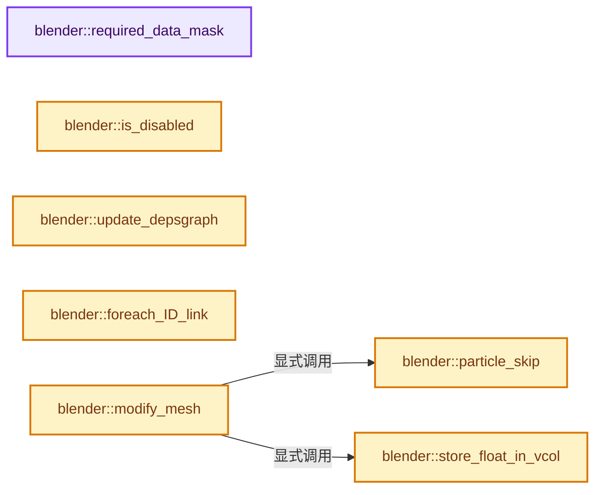
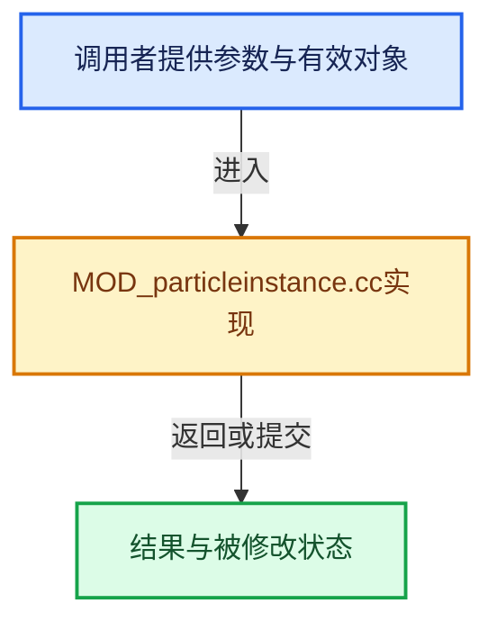

# 实现依赖专题：source/blender/modifiers/intern/MOD_particleinstance.cc

[方向导航](README.md) · [符号索引](../%E7%AC%A6%E5%8F%B7%E4%BE%9D%E8%B5%96%E4%B8%8E%E5%AE%9E%E7%8E%B0%E7%B4%A2%E5%BC%95.md)

本专题从正文实际调用进入，集中保存共享实现。函数有稳定锚点，可从调用处直接跳到对应完整函数；递归与互相调用通过回链组织。

## 本文件的实现关系






## 完整成员与函数实现

<a id="f-47fad74295a18ac6"></a>

### `blender::required_data_mask`

实现位置：[source/blender/modifiers/intern/MOD_particleinstance.cc](../../../../../source/blender/modifiers/intern/MOD_particleinstance.cc) · L52—L59。

接口参数：

- `ModifierData *md`
- `CustomData_MeshMasks *r_cddata_masks`

**教学注释版**

<!-- annotated:78cd38903fae1a -->

```cpp
static void required_data_mask(ModifierData *md, CustomData_MeshMasks *r_cddata_masks)
{
  ParticleInstanceModifierData *pimd = reinterpret_cast<ParticleInstanceModifierData *>(md);

  if (pimd->index_layer_name[0] != '\0' || pimd->value_layer_name[0] != '\0') {
    r_cddata_masks->lmask |= CD_MASK_PROP_BYTE_COLOR;
  }
}
```

<details>
<summary>核对原始源码：source/blender/modifiers/intern/MOD_particleinstance.cc · L52—L59</summary>

<!-- original:78cd38903fae1a:source/blender/modifiers/intern/MOD_particleinstance.cc:52:59 -->

```cpp
static void required_data_mask(ModifierData *md, CustomData_MeshMasks *r_cddata_masks)
{
  ParticleInstanceModifierData *pimd = reinterpret_cast<ParticleInstanceModifierData *>(md);

  if (pimd->index_layer_name[0] != '\0' || pimd->value_layer_name[0] != '\0') {
    r_cddata_masks->lmask |= CD_MASK_PROP_BYTE_COLOR;
  }
}
```

</details>

**沿实际写入检查状态**

- `r_cddata_masks->lmask |= CD_MASK_PROP_BYTE_COLOR;`

**继续追踪实现**

本实现没有需要继续展开的显式调用；检查返回表达式、对象转换和调用者前置条件。

<a id="f-59047440a73ab867"></a>

### `blender::is_disabled`

实现位置：[source/blender/modifiers/intern/MOD_particleinstance.cc](../../../../../source/blender/modifiers/intern/MOD_particleinstance.cc) · L61—L106。

接口参数：

- `const Scene *scene`
- `ModifierData *md`
- `bool use_render_params`

**教学注释版**

<!-- annotated:57819e2c0fc51a -->

```cpp
static bool is_disabled(const Scene *scene, ModifierData *md, bool use_render_params)
{
  ParticleInstanceModifierData *pimd = reinterpret_cast<ParticleInstanceModifierData *>(md);
  ParticleSystem *psys;

  /* The object type check is only needed here in case we have a placeholder
   * object assigned (because the library containing the mesh is missing).
   *
   * In other cases it should be impossible to have a type mismatch.
   */
  if (!pimd->ob || pimd->ob->type != OB_MESH) {
    return true;
  }

  psys = static_cast<ParticleSystem *>(BLI_findlink(&pimd->ob->particlesystem, pimd->psys - 1));
  if (psys == nullptr) {
    return true;
  }

  /* If the psys modifier is disabled we cannot use its data.
   * First look up the psys modifier from the object, then check if it is enabled.
   */
  for (ModifierData &ob_md : pimd->ob->modifiers) {
    if (ob_md.type == eModifierType_ParticleSystem) {
      ParticleSystemModifierData *psmd = reinterpret_cast<ParticleSystemModifierData *>(&ob_md);
      if (psmd->psys == psys) {
        int required_mode;

        if (use_render_params) {
          required_mode = eModifierMode_Render;
        }
        else {
          required_mode = eModifierMode_Realtime;
        }

        if (!BKE_modifier_is_enabled(scene, &ob_md, required_mode)) {
          return true;
        }

        break;
      }
    }
  }

  return false;
}
```

<details>
<summary>核对原始源码：source/blender/modifiers/intern/MOD_particleinstance.cc · L61—L106</summary>

<!-- original:57819e2c0fc51a:source/blender/modifiers/intern/MOD_particleinstance.cc:61:106 -->

```cpp
static bool is_disabled(const Scene *scene, ModifierData *md, bool use_render_params)
{
  ParticleInstanceModifierData *pimd = reinterpret_cast<ParticleInstanceModifierData *>(md);
  ParticleSystem *psys;

  /* The object type check is only needed here in case we have a placeholder
   * object assigned (because the library containing the mesh is missing).
   *
   * In other cases it should be impossible to have a type mismatch.
   */
  if (!pimd->ob || pimd->ob->type != OB_MESH) {
    return true;
  }

  psys = static_cast<ParticleSystem *>(BLI_findlink(&pimd->ob->particlesystem, pimd->psys - 1));
  if (psys == nullptr) {
    return true;
  }

  /* If the psys modifier is disabled we cannot use its data.
   * First look up the psys modifier from the object, then check if it is enabled.
   */
  for (ModifierData &ob_md : pimd->ob->modifiers) {
    if (ob_md.type == eModifierType_ParticleSystem) {
      ParticleSystemModifierData *psmd = reinterpret_cast<ParticleSystemModifierData *>(&ob_md);
      if (psmd->psys == psys) {
        int required_mode;

        if (use_render_params) {
          required_mode = eModifierMode_Render;
        }
        else {
          required_mode = eModifierMode_Realtime;
        }

        if (!BKE_modifier_is_enabled(scene, &ob_md, required_mode)) {
          return true;
        }

        break;
      }
    }
  }

  return false;
}
```

</details>

**沿实际写入检查状态**

- `psys = static_cast<ParticleSystem *>(BLI_findlink(&pimd->ob->particlesystem, pimd->psys - 1));`
- `required_mode = eModifierMode_Render;`
- `required_mode = eModifierMode_Realtime;`

**结果出口**

- `return true;`
- `return false;`

**继续追踪实现**

- `BLI_findlink` → [blender::BLI_findlink · L541](../01-%E5%9F%BA%E7%A1%80%E5%AE%B9%E5%99%A8%E4%B8%8E%E7%8E%B0%E4%BB%A3CPP/%E4%BE%9D%E8%B5%96-listbase-2816d9.md#f-6d3fd65974b4e808)。
- `BKE_modifier_is_enabled` → [blender::BKE_modifier_is_enabled · L529](%E4%BE%9D%E8%B5%96-modifier-ab0273.md#f-1debd86d0fcbcc8e)。

<a id="f-896b709ad0aade9a"></a>

### `blender::update_depsgraph`

实现位置：[source/blender/modifiers/intern/MOD_particleinstance.cc](../../../../../source/blender/modifiers/intern/MOD_particleinstance.cc) · L108—L117。

接口参数：

- `ModifierData *md`
- `const ModifierUpdateDepsgraphContext *ctx`

**教学注释版**

<!-- annotated:33a01087b7fecf -->

```cpp
static void update_depsgraph(ModifierData *md, const ModifierUpdateDepsgraphContext *ctx)
{
  ParticleInstanceModifierData *pimd = reinterpret_cast<ParticleInstanceModifierData *>(md);
  if (pimd->ob != nullptr) {
    DEG_add_object_relation(
        ctx->node, pimd->ob, DEG_OB_COMP_TRANSFORM, "Particle Instance Modifier");
    DEG_add_object_relation(
        ctx->node, pimd->ob, DEG_OB_COMP_GEOMETRY, "Particle Instance Modifier");
  }
}
```

<details>
<summary>核对原始源码：source/blender/modifiers/intern/MOD_particleinstance.cc · L108—L117</summary>

<!-- original:33a01087b7fecf:source/blender/modifiers/intern/MOD_particleinstance.cc:108:117 -->

```cpp
static void update_depsgraph(ModifierData *md, const ModifierUpdateDepsgraphContext *ctx)
{
  ParticleInstanceModifierData *pimd = reinterpret_cast<ParticleInstanceModifierData *>(md);
  if (pimd->ob != nullptr) {
    DEG_add_object_relation(
        ctx->node, pimd->ob, DEG_OB_COMP_TRANSFORM, "Particle Instance Modifier");
    DEG_add_object_relation(
        ctx->node, pimd->ob, DEG_OB_COMP_GEOMETRY, "Particle Instance Modifier");
  }
}
```

</details>

**继续追踪实现**

- `DEG_add_object_relation` → [blender::DEG_add_object_relation · L123](../11-Depsgraph%E4%B8%8E%E5%B9%B6%E8%A1%8C%E4%BB%BB%E5%8A%A1%E7%B3%BB%E7%BB%9F/%E4%BE%9D%E8%B5%96-depsgraph_build-ea2fc8.md#f-f570cffae97e273c)。

<a id="f-baaa847e0b48e812"></a>

### `blender::foreach_ID_link`

实现位置：[source/blender/modifiers/intern/MOD_particleinstance.cc](../../../../../source/blender/modifiers/intern/MOD_particleinstance.cc) · L119—L124。

接口参数：

- `ModifierData *md`
- `Object *ob`
- `IDWalkFunc walk`
- `void *user_data`

**教学注释版**

<!-- annotated:b0616c441d1bd1 -->

```cpp
static void foreach_ID_link(ModifierData *md, Object *ob, IDWalkFunc walk, void *user_data)
{
  ParticleInstanceModifierData *pimd = reinterpret_cast<ParticleInstanceModifierData *>(md);

  walk(user_data, ob, reinterpret_cast<ID **>(&pimd->ob), IDWALK_CB_NOP);
}
```

<details>
<summary>核对原始源码：source/blender/modifiers/intern/MOD_particleinstance.cc · L119—L124</summary>

<!-- original:b0616c441d1bd1:source/blender/modifiers/intern/MOD_particleinstance.cc:119:124 -->

```cpp
static void foreach_ID_link(ModifierData *md, Object *ob, IDWalkFunc walk, void *user_data)
{
  ParticleInstanceModifierData *pimd = reinterpret_cast<ParticleInstanceModifierData *>(md);

  walk(user_data, ob, reinterpret_cast<ID **>(&pimd->ob), IDWALK_CB_NOP);
}
```

</details>

**继续追踪实现**

- `walk` → [调用协议](../%E6%A8%A1%E6%9D%BF%E5%AE%8F%E4%B8%8E%E5%8A%A8%E6%80%81%E5%88%86%E6%B4%BE%E5%8D%8F%E8%AE%AE.md)：局部可调用对象，须结合其初始化与捕获环境。调用位置L123。

<a id="f-fb81de9f48c46f84"></a>

### `blender::particle_skip`

实现位置：[source/blender/modifiers/intern/MOD_particleinstance.cc](../../../../../source/blender/modifiers/intern/MOD_particleinstance.cc) · L126—L178。

接口参数：

- `ParticleInstanceModifierData *pimd`
- `ParticleSystem *psys`
- `int p`

**教学注释版**

<!-- annotated:dea3a89fd85847 -->

```cpp
static bool particle_skip(ParticleInstanceModifierData *pimd, ParticleSystem *psys, int p)
{
  const bool between = (psys->part->childtype == PART_CHILD_FACES);
  ParticleData *pa;
  int totpart, randp, minp, maxp;

  if (p >= psys->totpart) {
    ChildParticle *cpa = psys->child + (p - psys->totpart);
    pa = psys->particles + (between ? cpa->pa[0] : cpa->parent);
  }
  else {
    pa = psys->particles + p;
  }

  if (pa) {
    if (pa->alive == PARS_UNBORN && (pimd->flag & eParticleInstanceFlag_Unborn) == 0) {
      return true;
    }
    if (pa->alive == PARS_ALIVE && (pimd->flag & eParticleInstanceFlag_Alive) == 0) {
      return true;
    }
    if (pa->alive == PARS_DEAD && (pimd->flag & eParticleInstanceFlag_Dead) == 0) {
      return true;
    }
    if (pa->flag & (PARS_UNEXIST | PARS_NO_DISP)) {
      return true;
    }
  }

  if (pimd->particle_amount == 1.0f) {
    /* Early output, all particles are to be instanced. */
    return false;
  }

  /* Randomly skip particles based on desired amount of visible particles. */

  totpart = psys->totpart + psys->totchild;

  /* TODO: make randomization optional? */
  randp = int(psys_frand(psys, 3578 + p) * totpart) % totpart;

  minp = int(totpart * pimd->particle_offset) % (totpart + 1);
  maxp = int(totpart * (pimd->particle_offset + pimd->particle_amount)) % (totpart + 1);

  if (maxp > minp) {
    return randp < minp || randp >= maxp;
  }
  if (maxp < minp) {
    return randp < minp && randp >= maxp;
  }

  return true;
}
```

<details>
<summary>核对原始源码：source/blender/modifiers/intern/MOD_particleinstance.cc · L126—L178</summary>

<!-- original:dea3a89fd85847:source/blender/modifiers/intern/MOD_particleinstance.cc:126:178 -->

```cpp
static bool particle_skip(ParticleInstanceModifierData *pimd, ParticleSystem *psys, int p)
{
  const bool between = (psys->part->childtype == PART_CHILD_FACES);
  ParticleData *pa;
  int totpart, randp, minp, maxp;

  if (p >= psys->totpart) {
    ChildParticle *cpa = psys->child + (p - psys->totpart);
    pa = psys->particles + (between ? cpa->pa[0] : cpa->parent);
  }
  else {
    pa = psys->particles + p;
  }

  if (pa) {
    if (pa->alive == PARS_UNBORN && (pimd->flag & eParticleInstanceFlag_Unborn) == 0) {
      return true;
    }
    if (pa->alive == PARS_ALIVE && (pimd->flag & eParticleInstanceFlag_Alive) == 0) {
      return true;
    }
    if (pa->alive == PARS_DEAD && (pimd->flag & eParticleInstanceFlag_Dead) == 0) {
      return true;
    }
    if (pa->flag & (PARS_UNEXIST | PARS_NO_DISP)) {
      return true;
    }
  }

  if (pimd->particle_amount == 1.0f) {
    /* Early output, all particles are to be instanced. */
    return false;
  }

  /* Randomly skip particles based on desired amount of visible particles. */

  totpart = psys->totpart + psys->totchild;

  /* TODO: make randomization optional? */
  randp = int(psys_frand(psys, 3578 + p) * totpart) % totpart;

  minp = int(totpart * pimd->particle_offset) % (totpart + 1);
  maxp = int(totpart * (pimd->particle_offset + pimd->particle_amount)) % (totpart + 1);

  if (maxp > minp) {
    return randp < minp || randp >= maxp;
  }
  if (maxp < minp) {
    return randp < minp && randp >= maxp;
  }

  return true;
}
```

</details>

**沿实际写入检查状态**

- `pa = psys->particles + (between ? cpa->pa[0] : cpa->parent);`
- `pa = psys->particles + p;`
- `totpart = psys->totpart + psys->totchild;`
- `randp = int(psys_frand(psys, 3578 + p) * totpart) % totpart;`
- `minp = int(totpart * pimd->particle_offset) % (totpart + 1);`
- `maxp = int(totpart * (pimd->particle_offset + pimd->particle_amount)) % (totpart + 1);`

**结果出口**

- `return true;`
- `return false;`
- `return randp < minp || randp >= maxp;`
- `return randp < minp && randp >= maxp;`

**继续追踪实现**

- `psys_frand` → [blender::psys_frand · L256](%E4%BE%9D%E8%B5%96-BKE_particle-4071a0.md#f-0374069a50cd2f66)。

<a id="f-4656be6ed30d831c"></a>

### `blender::store_float_in_vcol`

实现位置：[source/blender/modifiers/intern/MOD_particleinstance.cc](../../../../../source/blender/modifiers/intern/MOD_particleinstance.cc) · L180—L185。

接口参数：

- `ColorGeometry4b *vcol`
- `float float_value`

**教学注释版**

<!-- annotated:b143cf5aee97b0 -->

```cpp
static void store_float_in_vcol(ColorGeometry4b *vcol, float float_value)
{
  const uchar value = unit_float_to_uchar_clamp(float_value);
  vcol->r = vcol->g = vcol->b = value;
  vcol->a = 1.0f;
}
```

<details>
<summary>核对原始源码：source/blender/modifiers/intern/MOD_particleinstance.cc · L180—L185</summary>

<!-- original:b143cf5aee97b0:source/blender/modifiers/intern/MOD_particleinstance.cc:180:185 -->

```cpp
static void store_float_in_vcol(ColorGeometry4b *vcol, float float_value)
{
  const uchar value = unit_float_to_uchar_clamp(float_value);
  vcol->r = vcol->g = vcol->b = value;
  vcol->a = 1.0f;
}
```

</details>

**沿实际写入检查状态**

- `vcol->r = vcol->g = vcol->b = value;`
- `vcol->a = 1.0f;`

**继续追踪实现**

- `unit_float_to_uchar_clamp` → [blender::unit_float_to_uchar_clamp · L579](../12-%E7%A9%BA%E9%97%B4%E6%95%B0%E6%8D%AE%E7%BB%93%E6%9E%84%E4%B8%8E%E5%87%A0%E4%BD%95%E7%AE%97%E6%B3%95/%E4%BE%9D%E8%B5%96-math_base_inline-546b00.md#f-078b5581dbbfbc81)。

<a id="f-00d648e50cd89a76"></a>

### `blender::modify_mesh`

实现位置：[source/blender/modifiers/intern/MOD_particleinstance.cc](../../../../../source/blender/modifiers/intern/MOD_particleinstance.cc) · L187—L531。

接口参数：

- `ModifierData *md`
- `const ModifierEvalContext *ctx`
- `Mesh *mesh`

**教学注释版**

<!-- annotated:5ccec4603572da -->

```cpp
static Mesh *modify_mesh(ModifierData *md, const ModifierEvalContext *ctx, Mesh *mesh)
{
  Mesh *result;
  ParticleInstanceModifierData *pimd = reinterpret_cast<ParticleInstanceModifierData *>(md);
  Scene *scene = DEG_get_evaluated_scene(ctx->depsgraph);
  ParticleSimulationData sim;
  ParticleSystem *psys = nullptr;
  ParticleData *pa = nullptr;
  int totvert, faces_num, totloop, totedge;
  int maxvert, maxpoly, maxloop, maxedge, part_end = 0, part_start;
  int k, p, p_skip;
  const uint track = uint(ctx->object->trackflag) % 3;
  short trackneg, axis = pimd->axis;
  float max_co = 0.0, min_co = 0.0, temp_co[3];
  float *size = nullptr;
  float spacemat[4][4];
  const bool use_parents = pimd->flag & eParticleInstanceFlag_Parents;
  const bool use_children = pimd->flag & eParticleInstanceFlag_Children;
  bool between;

  trackneg = ((ctx->object->trackflag > 2) ? 1 : 0);

  if (pimd->ob == ctx->object) {
    pimd->ob = nullptr;
    return mesh;
  }

  if (pimd->ob) {
    psys = static_cast<ParticleSystem *>(BLI_findlink(&pimd->ob->particlesystem, pimd->psys - 1));
    if (psys == nullptr || psys->totpart == 0) {
      return mesh;
    }
  }
  else {
    return mesh;
  }

  part_start = use_parents ? 0 : psys->totpart;

  part_end = 0;
  if (use_parents) {
    part_end += psys->totpart;
  }
  if (use_children) {
    part_end += psys->totchild;
  }

  if (part_end == 0) {
    return mesh;
  }

  sim.depsgraph = ctx->depsgraph;
  sim.scene = scene;
  sim.ob = pimd->ob;
  sim.psys = psys;
  sim.psmd = psys_get_modifier(pimd->ob, psys);
  between = (psys->part->childtype == PART_CHILD_FACES);

  if (pimd->flag & eParticleInstanceFlag_UseSize) {
    float *si;
    si = size = MEM_new_array_zeroed<float>(part_end, __func__);

    if (pimd->flag & eParticleInstanceFlag_Parents) {
      for (p = 0, pa = psys->particles; p < psys->totpart; p++, pa++, si++) {
        *si = pa->size;
      }
    }

    if (pimd->flag & eParticleInstanceFlag_Children) {
      ChildParticle *cpa = psys->child;

      for (p = 0; p < psys->totchild; p++, cpa++, si++) {
        *si = psys_get_child_size(psys, cpa, 0.0f, nullptr);
      }
    }
  }

  switch (pimd->space) {
    case eParticleInstanceSpace_World:
      /* particle states are in world space already */
      unit_m4(spacemat);
      break;
    case eParticleInstanceSpace_Local:
      /* get particle states in the particle object's local space */
      invert_m4_m4(spacemat, pimd->ob->object_to_world().ptr());
      break;
    default:
      /* should not happen */
      BLI_assert(false);
      break;
  }

  totvert = mesh->verts_num;
  faces_num = mesh->faces_num;
  totloop = mesh->corners_num;
  totedge = mesh->edges_num;

  /* count particles */
  maxvert = 0;
  maxpoly = 0;
  maxloop = 0;
  maxedge = 0;

  for (p = part_start; p < part_end; p++) {
    if (particle_skip(pimd, psys, p)) {
      continue;
    }

    maxvert += totvert;
    maxpoly += faces_num;
    maxloop += totloop;
    maxedge += totedge;
  }

  psys_sim_data_init(&sim);

  if (psys->flag & (PSYS_HAIR_DONE | PSYS_KEYED) || psys->pointcache->flag & PTCACHE_BAKED) {
    if (const std::optional<Bounds<float3>> bounds = mesh->bounds_min_max()) {
      min_co = bounds->min[track];
      max_co = bounds->max[track];
    }
  }

  result = BKE_mesh_new_nomain_from_template(mesh, maxvert, maxedge, maxpoly, maxloop);

  const OffsetIndices orig_faces = mesh->faces();
  const Span<int> orig_corner_verts = mesh->corner_verts();
  const Span<int> orig_corner_edges = mesh->corner_edges();
  MutableSpan<float3> positions = result->vert_positions_for_write();
  MutableSpan<int2> edges = result->edges_for_write();
  MutableSpan<int> face_offsets = result->face_offsets_for_write();
  MutableSpan<int> corner_verts = result->corner_verts_for_write();
  MutableSpan<int> corner_edges = result->corner_edges_for_write();
  bke::MutableAttributeAccessor attributes = result->attributes_for_write();
  bke::SpanAttributeWriter mloopcols_index =
      attributes.lookup_or_add_for_write_span<ColorGeometry4b>(pimd->index_layer_name,
                                                               bke::AttrDomain::Corner);
  bke::SpanAttributeWriter mloopcols_value =
      attributes.lookup_or_add_for_write_span<ColorGeometry4b>(pimd->value_layer_name,
                                                               bke::AttrDomain::Corner);

  bke::LegacyMeshInterpolator vert_interp(*mesh, *result, bke::AttrDomain::Point);
  bke::LegacyMeshInterpolator edge_interp(*mesh, *result, bke::AttrDomain::Edge);
  bke::LegacyMeshInterpolator face_interp(*mesh, *result, bke::AttrDomain::Face);
  bke::LegacyMeshInterpolator corner_interp(*mesh, *result, bke::AttrDomain::Corner);

  int *vert_part_index = nullptr;
  float *vert_part_value = nullptr;
  if (mloopcols_index) {
    vert_part_index = MEM_new_array_zeroed<int>(maxvert, "vertex part index array");
  }
  if (mloopcols_value) {
    vert_part_value = MEM_new_array_zeroed<float>(maxvert, "vertex part value array");
  }

  for (p = part_start, p_skip = 0; p < part_end; p++) {
    float prev_dir[3];
    float frame[4]; /* frame orientation quaternion */
    float p_random = psys_frand(psys, 77091 + 283 * p);

    /* skip particle? */
    if (particle_skip(pimd, psys, p)) {
      continue;
    }

    /* set vertices coordinates */

    vert_interp.copy(0, p_skip * totvert, totvert);

    for (k = 0; k < totvert; k++) {
      ParticleKey state;
      int vindex = p_skip * totvert + k;

      if (vert_part_index != nullptr) {
        vert_part_index[vindex] = p;
      }
      if (vert_part_value != nullptr) {
        vert_part_value[vindex] = p_random;
      }

      /* Change orientation based on object trackflag. */
      copy_v3_v3(temp_co, positions[vindex]);
      positions[vindex][axis] = temp_co[track];
      positions[vindex][(axis + 1) % 3] = temp_co[(track + 1) % 3];
      positions[vindex][(axis + 2) % 3] = temp_co[(track + 2) % 3];

      /* get particle state */
      if ((psys->flag & (PSYS_HAIR_DONE | PSYS_KEYED) || psys->pointcache->flag & PTCACHE_BAKED) &&
          (pimd->flag & eParticleInstanceFlag_Path))
      {
        float ran = 0.0f;
        if (pimd->random_position != 0.0f) {
          ran = pimd->random_position * BLI_hash_frand(psys->seed + p);
        }

        if (pimd->flag & eParticleInstanceFlag_KeepShape) {
          state.time = pimd->position * (1.0f - ran);
        }
        else {
          state.time = (positions[vindex][axis] - min_co) / (max_co - min_co) * pimd->position *
                       (1.0f - ran);

          if (trackneg) {
            state.time = 1.0f - state.time;
          }

          positions[vindex][axis] = 0.0;
        }

        psys_get_particle_on_path(&sim, p, &state, true);

        normalize_v3(state.vel);

        /* Incrementally Rotating Frame (Bishop Frame) */
        if (k == 0) {
          float hairmat[4][4];
          float mat[3][3];

          if (p < psys->totpart) {
            pa = psys->particles + p;
          }
          else {
            ChildParticle *cpa = psys->child + (p - psys->totpart);
            pa = psys->particles + (between ? cpa->pa[0] : cpa->parent);
          }
          psys_mat_hair_to_global(sim.ob, sim.psmd->mesh_final, sim.psys->part->from, pa, hairmat);
          copy_m3_m4(mat, hairmat);
          /* to quaternion */
          mat3_to_quat(frame, mat);

          if (pimd->rotation > 0.0f || pimd->random_rotation > 0.0f) {
            float angle = 2.0f * M_PI *
                          (pimd->rotation +
                           pimd->random_rotation * (psys_frand(psys, 19957323 + p) - 0.5f));
            const float eul[3] = {0.0f, 0.0f, angle};
            float rot[4];

            eul_to_quat(rot, eul);
            mul_qt_qtqt(frame, frame, rot);
          }

          /* NOTE: direction is same as normal vector currently,
           * but best to keep this separate so the frame can be
           * rotated later if necessary
           */
          copy_v3_v3(prev_dir, state.vel);
        }
        else {
          float rot[4];

          /* incrementally rotate along bend direction */
          rotation_between_vecs_to_quat(rot, prev_dir, state.vel);
          mul_qt_qtqt(frame, rot, frame);

          copy_v3_v3(prev_dir, state.vel);
        }

        copy_qt_qt(state.rot, frame);
#if 0
        /* Absolute Frame (Frenet Frame) */
        if (state.vel[axis] < -0.9999f || state.vel[axis] > 0.9999f) {
          unit_qt(state.rot);
        }
        else {
          float cross[3];
          float temp[3] = {0.0f, 0.0f, 0.0f};
          temp[axis] = 1.0f;

          cross_v3_v3v3(cross, temp, state.vel);

          /* state.vel[axis] is the only component surviving from a dot product with the axis */
          axis_angle_to_quat(state.rot, cross, safe_acosf(state.vel[axis]));
        }
#endif
      }
      else {
        state.time = -1.0;
        psys_get_particle_state(&sim, p, &state, true);
      }

      mul_qt_v3(state.rot, positions[vindex]);
      if (pimd->flag & eParticleInstanceFlag_UseSize) {
        mul_v3_fl(positions[vindex], size[p]);
      }
      add_v3_v3(positions[vindex], state.co);

      mul_m4_v3(spacemat, positions[vindex]);
    }

    /* Create edges and adjust edge vertex indices. */
    edge_interp.copy(0, p_skip * totedge, totedge);
    int2 *edge = &edges[p_skip * totedge];
    for (k = 0; k < totedge; k++, edge++) {
      (*edge)[0] += p_skip * totvert;
      (*edge)[1] += p_skip * totvert;
    }

    face_interp.copy(0, p_skip * faces_num, faces_num);
    corner_interp.copy(0, p_skip * totloop, totloop);

    /* create faces and loops */
    for (k = 0; k < faces_num; k++) {
      const IndexRange in_face = orig_faces[k];

      // [讲解] in_face.start：读取连续区间或分组的边界信息。
      const int dst_face_start = in_face.start() + p_skip * totloop;
      face_offsets[p_skip * faces_num + k] = dst_face_start;

      {
        int orig_corner_i = in_face.start();
        int dst_corner_i = dst_face_start;
        // [讲解] in_face.size：读取连续区间或分组的边界信息。
        int j = in_face.size();

        for (; j; j--, orig_corner_i++, dst_corner_i++) {
          corner_verts[dst_corner_i] = orig_corner_verts[orig_corner_i] + (p_skip * totvert);
          corner_edges[dst_corner_i] = orig_corner_edges[orig_corner_i] + (p_skip * totedge);
          const int vert = corner_verts[dst_corner_i];
          if (mloopcols_index) {
            const int part_index = vert_part_index[vert];
            store_float_in_vcol(&mloopcols_index.span[dst_corner_i],
                                float(part_index) / float(psys->totpart - 1));
          }
          if (mloopcols_value) {
            const float part_value = vert_part_value[vert];
            store_float_in_vcol(&mloopcols_value.span[dst_corner_i], part_value);
          }
        }
      }
    }
    p_skip++;
  }

  psys_sim_data_free(&sim);

  if (size) {
    MEM_delete(size);
  }

  MEM_SAFE_DELETE(vert_part_index);
  MEM_SAFE_DELETE(vert_part_value);

  mloopcols_index.finish();
  mloopcols_value.finish();

  return result;
}
```

<details>
<summary>核对原始源码：source/blender/modifiers/intern/MOD_particleinstance.cc · L187—L531</summary>

<!-- original:5ccec4603572da:source/blender/modifiers/intern/MOD_particleinstance.cc:187:531 -->

```cpp
static Mesh *modify_mesh(ModifierData *md, const ModifierEvalContext *ctx, Mesh *mesh)
{
  Mesh *result;
  ParticleInstanceModifierData *pimd = reinterpret_cast<ParticleInstanceModifierData *>(md);
  Scene *scene = DEG_get_evaluated_scene(ctx->depsgraph);
  ParticleSimulationData sim;
  ParticleSystem *psys = nullptr;
  ParticleData *pa = nullptr;
  int totvert, faces_num, totloop, totedge;
  int maxvert, maxpoly, maxloop, maxedge, part_end = 0, part_start;
  int k, p, p_skip;
  const uint track = uint(ctx->object->trackflag) % 3;
  short trackneg, axis = pimd->axis;
  float max_co = 0.0, min_co = 0.0, temp_co[3];
  float *size = nullptr;
  float spacemat[4][4];
  const bool use_parents = pimd->flag & eParticleInstanceFlag_Parents;
  const bool use_children = pimd->flag & eParticleInstanceFlag_Children;
  bool between;

  trackneg = ((ctx->object->trackflag > 2) ? 1 : 0);

  if (pimd->ob == ctx->object) {
    pimd->ob = nullptr;
    return mesh;
  }

  if (pimd->ob) {
    psys = static_cast<ParticleSystem *>(BLI_findlink(&pimd->ob->particlesystem, pimd->psys - 1));
    if (psys == nullptr || psys->totpart == 0) {
      return mesh;
    }
  }
  else {
    return mesh;
  }

  part_start = use_parents ? 0 : psys->totpart;

  part_end = 0;
  if (use_parents) {
    part_end += psys->totpart;
  }
  if (use_children) {
    part_end += psys->totchild;
  }

  if (part_end == 0) {
    return mesh;
  }

  sim.depsgraph = ctx->depsgraph;
  sim.scene = scene;
  sim.ob = pimd->ob;
  sim.psys = psys;
  sim.psmd = psys_get_modifier(pimd->ob, psys);
  between = (psys->part->childtype == PART_CHILD_FACES);

  if (pimd->flag & eParticleInstanceFlag_UseSize) {
    float *si;
    si = size = MEM_new_array_zeroed<float>(part_end, __func__);

    if (pimd->flag & eParticleInstanceFlag_Parents) {
      for (p = 0, pa = psys->particles; p < psys->totpart; p++, pa++, si++) {
        *si = pa->size;
      }
    }

    if (pimd->flag & eParticleInstanceFlag_Children) {
      ChildParticle *cpa = psys->child;

      for (p = 0; p < psys->totchild; p++, cpa++, si++) {
        *si = psys_get_child_size(psys, cpa, 0.0f, nullptr);
      }
    }
  }

  switch (pimd->space) {
    case eParticleInstanceSpace_World:
      /* particle states are in world space already */
      unit_m4(spacemat);
      break;
    case eParticleInstanceSpace_Local:
      /* get particle states in the particle object's local space */
      invert_m4_m4(spacemat, pimd->ob->object_to_world().ptr());
      break;
    default:
      /* should not happen */
      BLI_assert(false);
      break;
  }

  totvert = mesh->verts_num;
  faces_num = mesh->faces_num;
  totloop = mesh->corners_num;
  totedge = mesh->edges_num;

  /* count particles */
  maxvert = 0;
  maxpoly = 0;
  maxloop = 0;
  maxedge = 0;

  for (p = part_start; p < part_end; p++) {
    if (particle_skip(pimd, psys, p)) {
      continue;
    }

    maxvert += totvert;
    maxpoly += faces_num;
    maxloop += totloop;
    maxedge += totedge;
  }

  psys_sim_data_init(&sim);

  if (psys->flag & (PSYS_HAIR_DONE | PSYS_KEYED) || psys->pointcache->flag & PTCACHE_BAKED) {
    if (const std::optional<Bounds<float3>> bounds = mesh->bounds_min_max()) {
      min_co = bounds->min[track];
      max_co = bounds->max[track];
    }
  }

  result = BKE_mesh_new_nomain_from_template(mesh, maxvert, maxedge, maxpoly, maxloop);

  const OffsetIndices orig_faces = mesh->faces();
  const Span<int> orig_corner_verts = mesh->corner_verts();
  const Span<int> orig_corner_edges = mesh->corner_edges();
  MutableSpan<float3> positions = result->vert_positions_for_write();
  MutableSpan<int2> edges = result->edges_for_write();
  MutableSpan<int> face_offsets = result->face_offsets_for_write();
  MutableSpan<int> corner_verts = result->corner_verts_for_write();
  MutableSpan<int> corner_edges = result->corner_edges_for_write();
  bke::MutableAttributeAccessor attributes = result->attributes_for_write();
  bke::SpanAttributeWriter mloopcols_index =
      attributes.lookup_or_add_for_write_span<ColorGeometry4b>(pimd->index_layer_name,
                                                               bke::AttrDomain::Corner);
  bke::SpanAttributeWriter mloopcols_value =
      attributes.lookup_or_add_for_write_span<ColorGeometry4b>(pimd->value_layer_name,
                                                               bke::AttrDomain::Corner);

  bke::LegacyMeshInterpolator vert_interp(*mesh, *result, bke::AttrDomain::Point);
  bke::LegacyMeshInterpolator edge_interp(*mesh, *result, bke::AttrDomain::Edge);
  bke::LegacyMeshInterpolator face_interp(*mesh, *result, bke::AttrDomain::Face);
  bke::LegacyMeshInterpolator corner_interp(*mesh, *result, bke::AttrDomain::Corner);

  int *vert_part_index = nullptr;
  float *vert_part_value = nullptr;
  if (mloopcols_index) {
    vert_part_index = MEM_new_array_zeroed<int>(maxvert, "vertex part index array");
  }
  if (mloopcols_value) {
    vert_part_value = MEM_new_array_zeroed<float>(maxvert, "vertex part value array");
  }

  for (p = part_start, p_skip = 0; p < part_end; p++) {
    float prev_dir[3];
    float frame[4]; /* frame orientation quaternion */
    float p_random = psys_frand(psys, 77091 + 283 * p);

    /* skip particle? */
    if (particle_skip(pimd, psys, p)) {
      continue;
    }

    /* set vertices coordinates */

    vert_interp.copy(0, p_skip * totvert, totvert);

    for (k = 0; k < totvert; k++) {
      ParticleKey state;
      int vindex = p_skip * totvert + k;

      if (vert_part_index != nullptr) {
        vert_part_index[vindex] = p;
      }
      if (vert_part_value != nullptr) {
        vert_part_value[vindex] = p_random;
      }

      /* Change orientation based on object trackflag. */
      copy_v3_v3(temp_co, positions[vindex]);
      positions[vindex][axis] = temp_co[track];
      positions[vindex][(axis + 1) % 3] = temp_co[(track + 1) % 3];
      positions[vindex][(axis + 2) % 3] = temp_co[(track + 2) % 3];

      /* get particle state */
      if ((psys->flag & (PSYS_HAIR_DONE | PSYS_KEYED) || psys->pointcache->flag & PTCACHE_BAKED) &&
          (pimd->flag & eParticleInstanceFlag_Path))
      {
        float ran = 0.0f;
        if (pimd->random_position != 0.0f) {
          ran = pimd->random_position * BLI_hash_frand(psys->seed + p);
        }

        if (pimd->flag & eParticleInstanceFlag_KeepShape) {
          state.time = pimd->position * (1.0f - ran);
        }
        else {
          state.time = (positions[vindex][axis] - min_co) / (max_co - min_co) * pimd->position *
                       (1.0f - ran);

          if (trackneg) {
            state.time = 1.0f - state.time;
          }

          positions[vindex][axis] = 0.0;
        }

        psys_get_particle_on_path(&sim, p, &state, true);

        normalize_v3(state.vel);

        /* Incrementally Rotating Frame (Bishop Frame) */
        if (k == 0) {
          float hairmat[4][4];
          float mat[3][3];

          if (p < psys->totpart) {
            pa = psys->particles + p;
          }
          else {
            ChildParticle *cpa = psys->child + (p - psys->totpart);
            pa = psys->particles + (between ? cpa->pa[0] : cpa->parent);
          }
          psys_mat_hair_to_global(sim.ob, sim.psmd->mesh_final, sim.psys->part->from, pa, hairmat);
          copy_m3_m4(mat, hairmat);
          /* to quaternion */
          mat3_to_quat(frame, mat);

          if (pimd->rotation > 0.0f || pimd->random_rotation > 0.0f) {
            float angle = 2.0f * M_PI *
                          (pimd->rotation +
                           pimd->random_rotation * (psys_frand(psys, 19957323 + p) - 0.5f));
            const float eul[3] = {0.0f, 0.0f, angle};
            float rot[4];

            eul_to_quat(rot, eul);
            mul_qt_qtqt(frame, frame, rot);
          }

          /* NOTE: direction is same as normal vector currently,
           * but best to keep this separate so the frame can be
           * rotated later if necessary
           */
          copy_v3_v3(prev_dir, state.vel);
        }
        else {
          float rot[4];

          /* incrementally rotate along bend direction */
          rotation_between_vecs_to_quat(rot, prev_dir, state.vel);
          mul_qt_qtqt(frame, rot, frame);

          copy_v3_v3(prev_dir, state.vel);
        }

        copy_qt_qt(state.rot, frame);
#if 0
        /* Absolute Frame (Frenet Frame) */
        if (state.vel[axis] < -0.9999f || state.vel[axis] > 0.9999f) {
          unit_qt(state.rot);
        }
        else {
          float cross[3];
          float temp[3] = {0.0f, 0.0f, 0.0f};
          temp[axis] = 1.0f;

          cross_v3_v3v3(cross, temp, state.vel);

          /* state.vel[axis] is the only component surviving from a dot product with the axis */
          axis_angle_to_quat(state.rot, cross, safe_acosf(state.vel[axis]));
        }
#endif
      }
      else {
        state.time = -1.0;
        psys_get_particle_state(&sim, p, &state, true);
      }

      mul_qt_v3(state.rot, positions[vindex]);
      if (pimd->flag & eParticleInstanceFlag_UseSize) {
        mul_v3_fl(positions[vindex], size[p]);
      }
      add_v3_v3(positions[vindex], state.co);

      mul_m4_v3(spacemat, positions[vindex]);
    }

    /* Create edges and adjust edge vertex indices. */
    edge_interp.copy(0, p_skip * totedge, totedge);
    int2 *edge = &edges[p_skip * totedge];
    for (k = 0; k < totedge; k++, edge++) {
      (*edge)[0] += p_skip * totvert;
      (*edge)[1] += p_skip * totvert;
    }

    face_interp.copy(0, p_skip * faces_num, faces_num);
    corner_interp.copy(0, p_skip * totloop, totloop);

    /* create faces and loops */
    for (k = 0; k < faces_num; k++) {
      const IndexRange in_face = orig_faces[k];

      const int dst_face_start = in_face.start() + p_skip * totloop;
      face_offsets[p_skip * faces_num + k] = dst_face_start;

      {
        int orig_corner_i = in_face.start();
        int dst_corner_i = dst_face_start;
        int j = in_face.size();

        for (; j; j--, orig_corner_i++, dst_corner_i++) {
          corner_verts[dst_corner_i] = orig_corner_verts[orig_corner_i] + (p_skip * totvert);
          corner_edges[dst_corner_i] = orig_corner_edges[orig_corner_i] + (p_skip * totedge);
          const int vert = corner_verts[dst_corner_i];
          if (mloopcols_index) {
            const int part_index = vert_part_index[vert];
            store_float_in_vcol(&mloopcols_index.span[dst_corner_i],
                                float(part_index) / float(psys->totpart - 1));
          }
          if (mloopcols_value) {
            const float part_value = vert_part_value[vert];
            store_float_in_vcol(&mloopcols_value.span[dst_corner_i], part_value);
          }
        }
      }
    }
    p_skip++;
  }

  psys_sim_data_free(&sim);

  if (size) {
    MEM_delete(size);
  }

  MEM_SAFE_DELETE(vert_part_index);
  MEM_SAFE_DELETE(vert_part_value);

  mloopcols_index.finish();
  mloopcols_value.finish();

  return result;
}
```

</details>

**沿实际写入检查状态**

- `trackneg = ((ctx->object->trackflag > 2) ? 1 : 0);`
- `pimd->ob = nullptr;`
- `psys = static_cast<ParticleSystem *>(BLI_findlink(&pimd->ob->particlesystem, pimd->psys - 1));`
- `part_start = use_parents ? 0 : psys->totpart;`
- `part_end = 0;`
- `part_end += psys->totpart;`
- `part_end += psys->totchild;`
- `sim.depsgraph = ctx->depsgraph;`
- `sim.scene = scene;`
- `sim.ob = pimd->ob;`
- `sim.psys = psys;`
- `sim.psmd = psys_get_modifier(pimd->ob, psys);`
- `between = (psys->part->childtype == PART_CHILD_FACES);`
- `si = size = MEM_new_array_zeroed<float>(part_end, __func__);`
- `totvert = mesh->verts_num;`
- `faces_num = mesh->faces_num;`
- `totloop = mesh->corners_num;`
- `totedge = mesh->edges_num;`
- `maxvert = 0;`
- `maxpoly = 0;`
- `maxloop = 0;`
- `maxedge = 0;`
- `maxvert += totvert;`
- `maxpoly += faces_num;`
- `maxloop += totloop;`
- `maxedge += totedge;`
- `min_co = bounds->min[track];`
- `max_co = bounds->max[track];`
- `result = BKE_mesh_new_nomain_from_template(mesh, maxvert, maxedge, maxpoly, maxloop);`
- `vert_part_index = MEM_new_array_zeroed<int>(maxvert, "vertex part index array");`
- `vert_part_value = MEM_new_array_zeroed<float>(maxvert, "vertex part value array");`
- `vert_part_index[vindex] = p;`
- `vert_part_value[vindex] = p_random;`
- `positions[vindex][axis] = temp_co[track];`
- `ran = pimd->random_position * BLI_hash_frand(psys->seed + p);`
- `state.time = pimd->position * (1.0f - ran);`
- `state.time = (positions[vindex][axis] - min_co) / (max_co - min_co) * pimd->position *`
- `state.time = 1.0f - state.time;`
- `positions[vindex][axis] = 0.0;`
- `pa = psys->particles + p;`
- `pa = psys->particles + (between ? cpa->pa[0] : cpa->parent);`
- `temp[axis] = 1.0f;`
- `state.time = -1.0;`
- `corner_verts[dst_corner_i] = orig_corner_verts[orig_corner_i] + (p_skip * totvert);`
- `corner_edges[dst_corner_i] = orig_corner_edges[orig_corner_i] + (p_skip * totedge);`

**结果出口**

- `return mesh;`
- `return result;`

**继续追踪实现**

- `DEG_get_evaluated_scene` → [blender::DEG_get_evaluated_scene · L212](../11-Depsgraph%E4%B8%8E%E5%B9%B6%E8%A1%8C%E4%BB%BB%E5%8A%A1%E7%B3%BB%E7%BB%9F/%E4%BE%9D%E8%B5%96-depsgraph_query-e8b1e4.md#f-be7729d26a71d3fd)。
- `BLI_findlink` → [blender::BLI_findlink · L541](../01-%E5%9F%BA%E7%A1%80%E5%AE%B9%E5%99%A8%E4%B8%8E%E7%8E%B0%E4%BB%A3CPP/%E4%BE%9D%E8%B5%96-listbase-2816d9.md#f-6d3fd65974b4e808)。
- `psys_get_modifier` → [psys_get_modifier · L2157](%E4%BE%9D%E8%B5%96-particle-765be1.md#f-5e2a73eb0484900c)。
- `MEM_new_array_zeroed<float>` → [MEM_new_array_zeroed · L566](../03-%E5%86%85%E5%AD%98%E5%88%86%E9%85%8D%E4%B8%8E%E8%BF%90%E8%A1%8C%E6%97%B6%E7%B1%BB%E5%9E%8B/%E4%BE%9D%E8%B5%96-MEM_guardedalloc-b54eca.md#f-3a0cf63fb5216500)；[MEM_new_array_zeroed · L119](../03-%E5%86%85%E5%AD%98%E5%88%86%E9%85%8D%E4%B8%8E%E8%BF%90%E8%A1%8C%E6%97%B6%E7%B1%BB%E5%9E%8B/%E4%BE%9D%E8%B5%96-mallocn-afdcd4.md#f-6825557da566fdbe)。同名重载需按实参类型选择。
- `psys_get_child_size` → [psys_get_child_size · L4521](%E4%BE%9D%E8%B5%96-particle-765be1.md#f-9483bcee40c263ff)。
- `unit_m4` → [blender::unit_m4 · L55](../12-%E7%A9%BA%E9%97%B4%E6%95%B0%E6%8D%AE%E7%BB%93%E6%9E%84%E4%B8%8E%E5%87%A0%E4%BD%95%E7%AE%97%E6%B3%95/%E4%BE%9D%E8%B5%96-math_matrix_c-004123.md#f-e6cd812aae119176)。
- `invert_m4_m4` → [blender::invert_m4_m4 · L1150](../12-%E7%A9%BA%E9%97%B4%E6%95%B0%E6%8D%AE%E7%BB%93%E6%9E%84%E4%B8%8E%E5%87%A0%E4%BD%95%E7%AE%97%E6%B3%95/%E4%BE%9D%E8%B5%96-math_matrix_c-004123.md#f-c75789f10cdd5b92)。
- `pimd->ob->object_to_world().ptr` → [调用协议](../%E6%A8%A1%E6%9D%BF%E5%AE%8F%E4%B8%8E%E5%8A%A8%E6%80%81%E5%88%86%E6%B4%BE%E5%8D%8F%E8%AE%AE.md)：接收对象类型依赖auto、返回值或模板实例；不按同名猜测目标。调用位置L271。
- `pimd->ob->object_to_world` → [调用协议](../%E6%A8%A1%E6%9D%BF%E5%AE%8F%E4%B8%8E%E5%8A%A8%E6%80%81%E5%88%86%E6%B4%BE%E5%8D%8F%E8%AE%AE.md)：接收对象类型依赖auto、返回值或模板实例；不按同名猜测目标。调用位置L271。
- `BLI_assert` → [BLI_assert · L48](../01-%E5%9F%BA%E7%A1%80%E5%AE%B9%E5%99%A8%E4%B8%8E%E7%8E%B0%E4%BB%A3CPP/%E4%BE%9D%E8%B5%96-BLI_assert-cc98e8.md#m-57a88495704d)；[BLI_assert · L63](../01-%E5%9F%BA%E7%A1%80%E5%AE%B9%E5%99%A8%E4%B8%8E%E7%8E%B0%E4%BB%A3CPP/%E4%BE%9D%E8%B5%96-BLI_assert-cc98e8.md#m-d07050020cb5)。宏定义由构建条件选择。
- `particle_skip` → [blender::particle_skip · L126](%E4%BE%9D%E8%B5%96-MOD_particleinstance-7571a9.md#f-fb81de9f48c46f84)。
- `psys_sim_data_init` → [psys_sim_data_init · L588](%E4%BE%9D%E8%B5%96-particle-765be1.md#f-872abe6c35893054)。
- `mesh->bounds_min_max` → [Mesh::bounds_min_max · L1942](03-MPoly%E8%BF%81%E7%A7%BB%E4%B8%8E%E5%85%BC%E5%AE%B9.md#f-1a7c466d855d52a6)。
- `BKE_mesh_new_nomain_from_template` → [BKE_mesh_new_nomain_from_template · L1567](03-MPoly%E8%BF%81%E7%A7%BB%E4%B8%8E%E5%85%BC%E5%AE%B9.md#f-ec9d18994432323b)。
- `mesh->faces` → [Mesh::faces · L1217](03-MPoly%E8%BF%81%E7%A7%BB%E4%B8%8E%E5%85%BC%E5%AE%B9.md#f-ea444760154e17b2)。
- `mesh->corner_verts` → [Mesh::corner_verts · L1238](03-MPoly%E8%BF%81%E7%A7%BB%E4%B8%8E%E5%85%BC%E5%AE%B9.md#f-a59c61f583b64bc4)。
- `mesh->corner_edges` → [Mesh::corner_edges · L1252](03-MPoly%E8%BF%81%E7%A7%BB%E4%B8%8E%E5%85%BC%E5%AE%B9.md#f-687b790868e7f257)。
- `result->vert_positions_for_write` → [Mesh::vert_positions_for_write · L1199](03-MPoly%E8%BF%81%E7%A7%BB%E4%B8%8E%E5%85%BC%E5%AE%B9.md#f-ae8d77205112d843)。
- `result->edges_for_write` → [Mesh::edges_for_write · L1211](03-MPoly%E8%BF%81%E7%A7%BB%E4%B8%8E%E5%85%BC%E5%AE%B9.md#f-a4c919c44eeede7c)。
- `result->face_offsets_for_write` → [Mesh::face_offsets_for_write · L1228](03-MPoly%E8%BF%81%E7%A7%BB%E4%B8%8E%E5%85%BC%E5%AE%B9.md#f-483f42747ab436a2)。
- `result->corner_verts_for_write` → [Mesh::corner_verts_for_write · L1246](03-MPoly%E8%BF%81%E7%A7%BB%E4%B8%8E%E5%85%BC%E5%AE%B9.md#f-6dfaf316a81ba215)。
- `result->corner_edges_for_write` → [Mesh::corner_edges_for_write · L1260](03-MPoly%E8%BF%81%E7%A7%BB%E4%B8%8E%E5%85%BC%E5%AE%B9.md#f-51e939a4353adb83)。
- `result->attributes_for_write` → [Mesh::attributes_for_write · L1303](03-MPoly%E8%BF%81%E7%A7%BB%E4%B8%8E%E5%85%BC%E5%AE%B9.md#f-ca7af2f1a15f0bc4)。
- `attributes.lookup_or_add_for_write_span<ColorGeometry4b>` → [blender::bke::MutableAttributeAccessor::lookup_or_add_for_write_span · L533](%E4%BE%9D%E8%B5%96-attribute_access-bceef3.md#f-c533eff1b9a4973e)；[blender::bke::MutableAttributeAccessor::lookup_or_add_for_write_span · L861](08-AttributeAccessor%E6%8E%A5%E5%8F%A3.md#f-aa4c0d5a61437381)。同名重载需按实参类型选择。
- `MEM_new_array_zeroed<int>` → [MEM_new_array_zeroed · L566](../03-%E5%86%85%E5%AD%98%E5%88%86%E9%85%8D%E4%B8%8E%E8%BF%90%E8%A1%8C%E6%97%B6%E7%B1%BB%E5%9E%8B/%E4%BE%9D%E8%B5%96-MEM_guardedalloc-b54eca.md#f-3a0cf63fb5216500)；[MEM_new_array_zeroed · L119](../03-%E5%86%85%E5%AD%98%E5%88%86%E9%85%8D%E4%B8%8E%E8%BF%90%E8%A1%8C%E6%97%B6%E7%B1%BB%E5%9E%8B/%E4%BE%9D%E8%B5%96-mallocn-afdcd4.md#f-6825557da566fdbe)。同名重载需按实参类型选择。
- `psys_frand` → [blender::psys_frand · L256](%E4%BE%9D%E8%B5%96-BKE_particle-4071a0.md#f-0374069a50cd2f66)。
- `vert_interp.copy` → [blender::bke::LegacyMeshInterpolator::copy · L348](%E4%BE%9D%E8%B5%96-attribute_legacy_convert-5c03a1.md#f-4e462b4a9febc9f7)。
- `copy_v3_v3` → [blender::copy_v3_v3 · L47](../12-%E7%A9%BA%E9%97%B4%E6%95%B0%E6%8D%AE%E7%BB%93%E6%9E%84%E4%B8%8E%E5%87%A0%E4%BD%95%E7%AE%97%E6%B3%95/%E4%BE%9D%E8%B5%96-math_vector_inline-0c8541.md#f-037a0d5fa5060bd6)。
- `BLI_hash_frand` → [RNG::BLI_hash_frand · L150](../01-%E5%9F%BA%E7%A1%80%E5%AE%B9%E5%99%A8%E4%B8%8E%E7%8E%B0%E4%BB%A3CPP/%E4%BE%9D%E8%B5%96-rand-171ca2.md#f-06ccdca9974d0388)。
- `psys_get_particle_on_path` → [psys_get_particle_on_path · L4610](%E4%BE%9D%E8%B5%96-particle-765be1.md#f-c6a755c949091e5d)。
- `normalize_v3` → [blender::normalize_v3 · L933](../12-%E7%A9%BA%E9%97%B4%E6%95%B0%E6%8D%AE%E7%BB%93%E6%9E%84%E4%B8%8E%E5%87%A0%E4%BD%95%E7%AE%97%E6%B3%95/%E4%BE%9D%E8%B5%96-math_vector_inline-0c8541.md#f-5f3257e657ef732c)。
- `psys_mat_hair_to_global` → [psys_mat_hair_to_global · L3911](%E4%BE%9D%E8%B5%96-particle-765be1.md#f-8d7e06c64a61bbb3)。
- `copy_m3_m4` → [blender::copy_m3_m4 · L94](../12-%E7%A9%BA%E9%97%B4%E6%95%B0%E6%8D%AE%E7%BB%93%E6%9E%84%E4%B8%8E%E5%87%A0%E4%BD%95%E7%AE%97%E6%B3%95/%E4%BE%9D%E8%B5%96-math_matrix_c-004123.md#f-1141cb3624c754b0)。
- `mat3_to_quat` → [blender::mat3_to_quat · L403](../12-%E7%A9%BA%E9%97%B4%E6%95%B0%E6%8D%AE%E7%BB%93%E6%9E%84%E4%B8%8E%E5%87%A0%E4%BD%95%E7%AE%97%E6%B3%95/%E4%BE%9D%E8%B5%96-math_rotation_c-8e57f4.md#f-2ec601d2a48b83c5)。
- `eul_to_quat` → [blender::eul_to_quat · L1487](../12-%E7%A9%BA%E9%97%B4%E6%95%B0%E6%8D%AE%E7%BB%93%E6%9E%84%E4%B8%8E%E5%87%A0%E4%BD%95%E7%AE%97%E6%B3%95/%E4%BE%9D%E8%B5%96-math_rotation_c-8e57f4.md#f-13853c0fd671c3e9)。
- `mul_qt_qtqt` → [blender::mul_qt_qtqt · L64](../12-%E7%A9%BA%E9%97%B4%E6%95%B0%E6%8D%AE%E7%BB%93%E6%9E%84%E4%B8%8E%E5%87%A0%E4%BD%95%E7%AE%97%E6%B3%95/%E4%BE%9D%E8%B5%96-math_rotation_c-8e57f4.md#f-a42c1e370be54b71)。
- `rotation_between_vecs_to_quat` → [blender::rotation_between_vecs_to_quat · L530](../12-%E7%A9%BA%E9%97%B4%E6%95%B0%E6%8D%AE%E7%BB%93%E6%9E%84%E4%B8%8E%E5%87%A0%E4%BD%95%E7%AE%97%E6%B3%95/%E4%BE%9D%E8%B5%96-math_rotation_c-8e57f4.md#f-4d07743fc9f21b3a)。
- `copy_qt_qt` → [blender::copy_qt_qt · L51](../12-%E7%A9%BA%E9%97%B4%E6%95%B0%E6%8D%AE%E7%BB%93%E6%9E%84%E4%B8%8E%E5%87%A0%E4%BD%95%E7%AE%97%E6%B3%95/%E4%BE%9D%E8%B5%96-math_rotation_c-8e57f4.md#f-503531a8e10b755b)。
- `unit_qt` → [blender::unit_qt · L45](../12-%E7%A9%BA%E9%97%B4%E6%95%B0%E6%8D%AE%E7%BB%93%E6%9E%84%E4%B8%8E%E5%87%A0%E4%BD%95%E7%AE%97%E6%B3%95/%E4%BE%9D%E8%B5%96-math_rotation_c-8e57f4.md#f-6323eadd66d3989a)。
- `cross_v3_v3v3` → [blender::cross_v3_v3v3 · L690](../12-%E7%A9%BA%E9%97%B4%E6%95%B0%E6%8D%AE%E7%BB%93%E6%9E%84%E4%B8%8E%E5%87%A0%E4%BD%95%E7%AE%97%E6%B3%95/%E4%BE%9D%E8%B5%96-math_vector_inline-0c8541.md#f-ac8d04405fb5dad4)。
- `axis_angle_to_quat` → [blender::axis_angle_to_quat · L1075](../12-%E7%A9%BA%E9%97%B4%E6%95%B0%E6%8D%AE%E7%BB%93%E6%9E%84%E4%B8%8E%E5%87%A0%E4%BD%95%E7%AE%97%E6%B3%95/%E4%BE%9D%E8%B5%96-math_rotation_c-8e57f4.md#f-c1fc0c33fafbf227)。
- `safe_acosf` → [blender::safe_acosf · L55](../12-%E7%A9%BA%E9%97%B4%E6%95%B0%E6%8D%AE%E7%BB%93%E6%9E%84%E4%B8%8E%E5%87%A0%E4%BD%95%E7%AE%97%E6%B3%95/%E4%BE%9D%E8%B5%96-math_base_safe_inline-c0d62b.md#f-ea1b330e846761a7)。
- `psys_get_particle_state` → [psys_get_particle_state · L4897](%E4%BE%9D%E8%B5%96-particle-765be1.md#f-1b07e801823be7b7)。
- `mul_qt_v3` → [blender::mul_qt_v3 · L77](../12-%E7%A9%BA%E9%97%B4%E6%95%B0%E6%8D%AE%E7%BB%93%E6%9E%84%E4%B8%8E%E5%87%A0%E4%BD%95%E7%AE%97%E6%B3%95/%E4%BE%9D%E8%B5%96-math_rotation_c-8e57f4.md#f-de1eaa8cb3a56e7b)。
- `mul_v3_fl` → [blender::mul_v3_fl · L414](../12-%E7%A9%BA%E9%97%B4%E6%95%B0%E6%8D%AE%E7%BB%93%E6%9E%84%E4%B8%8E%E5%87%A0%E4%BD%95%E7%AE%97%E6%B3%95/%E4%BE%9D%E8%B5%96-math_vector_inline-0c8541.md#f-00165156a06d1224)。
- `add_v3_v3` → [blender::add_v3_v3 · L286](../12-%E7%A9%BA%E9%97%B4%E6%95%B0%E6%8D%AE%E7%BB%93%E6%9E%84%E4%B8%8E%E5%87%A0%E4%BD%95%E7%AE%97%E6%B3%95/%E4%BE%9D%E8%B5%96-math_vector_inline-0c8541.md#f-e7930c6fdefe462c)。
- `mul_m4_v3` → [blender::mul_m4_v3 · L677](../12-%E7%A9%BA%E9%97%B4%E6%95%B0%E6%8D%AE%E7%BB%93%E6%9E%84%E4%B8%8E%E5%87%A0%E4%BD%95%E7%AE%97%E6%B3%95/%E4%BE%9D%E8%B5%96-math_matrix_c-004123.md#f-14a8c267710d47a3)。
- `edge_interp.copy` → [blender::bke::LegacyMeshInterpolator::copy · L348](%E4%BE%9D%E8%B5%96-attribute_legacy_convert-5c03a1.md#f-4e462b4a9febc9f7)。
- `face_interp.copy` → [blender::bke::LegacyMeshInterpolator::copy · L348](%E4%BE%9D%E8%B5%96-attribute_legacy_convert-5c03a1.md#f-4e462b4a9febc9f7)。
- `corner_interp.copy` → [blender::bke::LegacyMeshInterpolator::copy · L348](%E4%BE%9D%E8%B5%96-attribute_legacy_convert-5c03a1.md#f-4e462b4a9febc9f7)。
- `in_face.start` → [blender::IndexRange::start · L243](../01-%E5%9F%BA%E7%A1%80%E5%AE%B9%E5%99%A8%E4%B8%8E%E7%8E%B0%E4%BB%A3CPP/04-IndexRange%E8%BF%9E%E7%BB%AD%E6%95%B4%E6%95%B0%E5%8C%BA%E9%97%B4.md#f-99d2195bd9cfd1f0)。
- `in_face.size` → [blender::IndexRange::size · L156](../01-%E5%9F%BA%E7%A1%80%E5%AE%B9%E5%99%A8%E4%B8%8E%E7%8E%B0%E4%BB%A3CPP/04-IndexRange%E8%BF%9E%E7%BB%AD%E6%95%B4%E6%95%B0%E5%8C%BA%E9%97%B4.md#f-05f66c3ebb2fdfec)。
- `store_float_in_vcol` → [blender::store_float_in_vcol · L180](%E4%BE%9D%E8%B5%96-MOD_particleinstance-7571a9.md#f-4656be6ed30d831c)。
- `psys_sim_data_free` → [psys_sim_data_free · L629](%E4%BE%9D%E8%B5%96-particle-765be1.md#f-6580337f40740928)。
- `MEM_delete` → [MEM_delete · L400](../03-%E5%86%85%E5%AD%98%E5%88%86%E9%85%8D%E4%B8%8E%E8%BF%90%E8%A1%8C%E6%97%B6%E7%B1%BB%E5%9E%8B/%E4%BE%9D%E8%B5%96-MEM_guardedalloc-b54eca.md#f-9049ffdd1682887c)。
- `MEM_SAFE_DELETE` → [MEM_SAFE_DELETE · L436](../03-%E5%86%85%E5%AD%98%E5%88%86%E9%85%8D%E4%B8%8E%E8%BF%90%E8%A1%8C%E6%97%B6%E7%B1%BB%E5%9E%8B/%E4%BE%9D%E8%B5%96-MEM_guardedalloc-b54eca.md#m-eadb3bc5b902)。宏定义由构建条件选择。
- `mloopcols_index.finish` → [blender::bke::SpanAttributeWriter::finish · L279](08-AttributeAccessor%E6%8E%A5%E5%8F%A3.md#f-585970a3b1bd4da4)。
- `mloopcols_value.finish` → [blender::bke::SpanAttributeWriter::finish · L279](08-AttributeAccessor%E6%8E%A5%E5%8F%A3.md#f-585970a3b1bd4da4)。
