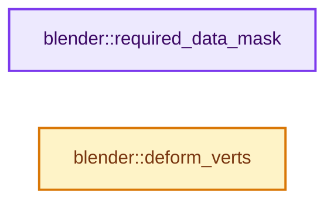
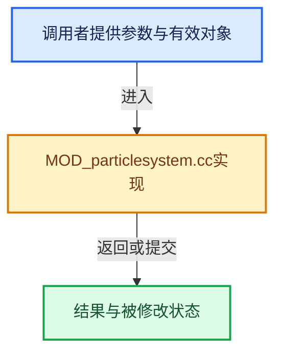

# 实现依赖专题：source/blender/modifiers/intern/MOD_particlesystem.cc

[方向导航](README.md) · [符号索引](../%E7%AC%A6%E5%8F%B7%E4%BE%9D%E8%B5%96%E4%B8%8E%E5%AE%9E%E7%8E%B0%E7%B4%A2%E5%BC%95.md)

本专题从正文实际调用进入，集中保存共享实现。函数有稳定锚点，可从调用处直接跳到对应完整函数；递归与互相调用通过回链组织。

## 本文件的实现关系






## 完整成员与函数实现

<a id="f-b9a74c74614db93f"></a>

### `blender::required_data_mask`

实现位置：[source/blender/modifiers/intern/MOD_particlesystem.cc](../../../../../source/blender/modifiers/intern/MOD_particlesystem.cc) · L85—L90。

接口参数：

- `ModifierData *md`
- `CustomData_MeshMasks *r_cddata_masks`

**教学注释版**

<!-- annotated:8db3aa0ed78e5b -->

```cpp
static void required_data_mask(ModifierData *md, CustomData_MeshMasks *r_cddata_masks)
{
  ParticleSystemModifierData *psmd = reinterpret_cast<ParticleSystemModifierData *>(md);

  psys_emitter_customdata_mask(psmd->psys, r_cddata_masks);
}
```

<details>
<summary>核对原始源码：source/blender/modifiers/intern/MOD_particlesystem.cc · L85—L90</summary>

<!-- original:8db3aa0ed78e5b:source/blender/modifiers/intern/MOD_particlesystem.cc:85:90 -->

```cpp
static void required_data_mask(ModifierData *md, CustomData_MeshMasks *r_cddata_masks)
{
  ParticleSystemModifierData *psmd = reinterpret_cast<ParticleSystemModifierData *>(md);

  psys_emitter_customdata_mask(psmd->psys, r_cddata_masks);
}
```

</details>

**继续追踪实现**

- `psys_emitter_customdata_mask` → [psys_emitter_customdata_mask · L2213](%E4%BE%9D%E8%B5%96-particle-765be1.md#f-bf0b9a3fdadf4a4d)。

<a id="f-0e74765bf7dcf203"></a>

### `blender::deform_verts`

实现位置：[source/blender/modifiers/intern/MOD_particlesystem.cc](../../../../../source/blender/modifiers/intern/MOD_particlesystem.cc) · L93—L209。

接口参数：

- `ModifierData *md`
- `const ModifierEvalContext *ctx`
- `Mesh *mesh`
- `MutableSpan<float3> positions`

**教学注释版**

<!-- annotated:cdbd16613dee30 -->

```cpp
static void deform_verts(ModifierData *md,
                         const ModifierEvalContext *ctx,
                         Mesh *mesh,
                         MutableSpan<float3> positions)
{
  ParticleSystemModifierData *psmd = reinterpret_cast<ParticleSystemModifierData *>(md);
  ParticleSystem *psys = nullptr;

  if (ctx->object->particlesystem.first()) {
    psys = psmd->psys;
  }
  else {
    return;
  }

  if (!psys_check_enabled(ctx->object, psys, (ctx->flag & MOD_APPLY_RENDER) != 0)) {
    return;
  }

  /* Clear old evaluated mesh. */
  bool had_mesh_final = (psmd->mesh_final != nullptr);
  if (psmd->mesh_final) {
    BKE_id_free(nullptr, psmd->mesh_final);
    psmd->mesh_final = nullptr;
    if (psmd->mesh_original) {
      BKE_id_free(nullptr, psmd->mesh_original);
      psmd->mesh_original = nullptr;
    }
  }
  else if (psmd->flag & eParticleSystemFlag_file_loaded) {
    /* in file read mesh just wasn't saved in file so no need to reset everything */
    psmd->flag &= ~eParticleSystemFlag_file_loaded;
    if (psys->particles == nullptr) {
      psys->recalc |= ID_RECALC_PSYS_RESET;
    }
    /* TODO(sergey): This is not how particles were working prior to copy on
     * write, but now evaluation is similar to case when one duplicates the
     * object. In that case particles were doing reset here.
     *
     * Don't do reset when entering particle edit mode, as that will destroy the edit mode data.
     * Shouldn't be an issue, since particles are supposed to be evaluated once prior to entering
     * edit mode anyway.
     * Could in theory be an issue when everything is done in a script, but then solution is
     * not known to me. */
    if (ctx->object->mode != OB_MODE_PARTICLE_EDIT) {
      psys->recalc |= ID_RECALC_PSYS_RESET;
    }
  }

  /* make new mesh */
  psmd->mesh_final = BKE_mesh_copy_for_eval(*mesh);
  psmd->mesh_final->vert_positions_for_write().copy_from(positions);
  psmd->mesh_final->tag_positions_changed();

  BKE_mesh_tessface_ensure(psmd->mesh_final);

  if (!psmd->mesh_final->runtime->deformed_only) {
    /* Get the original mesh from the object, this is what the particles
     * are attached to so in case of non-deform modifiers we need to remap
     * them to the final mesh (typically subdivision surfaces). */
    Mesh *mesh_original = nullptr;

    if (ctx->object->type == OB_MESH) {
      if (BMesh *bm = BKE_editmesh_bmesh_get_for_write(ctx->object)) {
        /* In edit mode get directly from the edit mesh. */
        psmd->mesh_original = BKE_mesh_from_bmesh_for_eval_nomain(bm, nullptr, mesh);
      }
      else {
        /* Otherwise get regular mesh. */
        mesh_original = id_cast<Mesh *>(ctx->object->data);
      }
    }
    else {
      mesh_original = mesh;
    }

    if (mesh_original) {
      /* Make a persistent copy of the mesh. We don't actually need
       * all this data, just some topology for remapping. Could be
       * optimized once. */
      psmd->mesh_original = BKE_mesh_copy_for_eval(*mesh_original);
    }

    BKE_mesh_tessface_ensure(psmd->mesh_original);
  }

  /* Report change in mesh structure.
   * This is an unreliable check for the topology check, but allows some
   * handy configuration like emitting particles from inside particle
   * instance. */
  if (had_mesh_final && (psmd->mesh_final->verts_num != psmd->totdmvert ||
                         psmd->mesh_final->edges_num != psmd->totdmedge ||
                         psmd->mesh_final->totface_legacy != psmd->totdmface))
  {
    psys->recalc |= ID_RECALC_PSYS_RESET;
  }
  psmd->totdmvert = psmd->mesh_final->verts_num;
  psmd->totdmedge = psmd->mesh_final->edges_num;
  psmd->totdmface = psmd->mesh_final->totface_legacy;

  {
    Scene *scene = DEG_get_evaluated_scene(ctx->depsgraph);
    psmd->flag &= ~eParticleSystemFlag_psys_updated;
    particle_system_update(
        ctx->depsgraph, scene, ctx->object, psys, (ctx->flag & MOD_APPLY_RENDER) != 0);
    psmd->flag |= eParticleSystemFlag_psys_updated;
  }

  if (DEG_is_active(ctx->depsgraph)) {
    Object *object_orig = DEG_get_original(ctx->object);
    ModifierData *md_orig = BKE_modifiers_findby_name(object_orig, psmd->modifier.name);
    BLI_assert(md_orig != nullptr);
    ParticleSystemModifierData *psmd_orig = reinterpret_cast<ParticleSystemModifierData *>(
        md_orig);
    psmd_orig->flag = psmd->flag;
  }
}
```

<details>
<summary>核对原始源码：source/blender/modifiers/intern/MOD_particlesystem.cc · L93—L209</summary>

<!-- original:cdbd16613dee30:source/blender/modifiers/intern/MOD_particlesystem.cc:93:209 -->

```cpp
static void deform_verts(ModifierData *md,
                         const ModifierEvalContext *ctx,
                         Mesh *mesh,
                         MutableSpan<float3> positions)
{
  ParticleSystemModifierData *psmd = reinterpret_cast<ParticleSystemModifierData *>(md);
  ParticleSystem *psys = nullptr;

  if (ctx->object->particlesystem.first()) {
    psys = psmd->psys;
  }
  else {
    return;
  }

  if (!psys_check_enabled(ctx->object, psys, (ctx->flag & MOD_APPLY_RENDER) != 0)) {
    return;
  }

  /* Clear old evaluated mesh. */
  bool had_mesh_final = (psmd->mesh_final != nullptr);
  if (psmd->mesh_final) {
    BKE_id_free(nullptr, psmd->mesh_final);
    psmd->mesh_final = nullptr;
    if (psmd->mesh_original) {
      BKE_id_free(nullptr, psmd->mesh_original);
      psmd->mesh_original = nullptr;
    }
  }
  else if (psmd->flag & eParticleSystemFlag_file_loaded) {
    /* in file read mesh just wasn't saved in file so no need to reset everything */
    psmd->flag &= ~eParticleSystemFlag_file_loaded;
    if (psys->particles == nullptr) {
      psys->recalc |= ID_RECALC_PSYS_RESET;
    }
    /* TODO(sergey): This is not how particles were working prior to copy on
     * write, but now evaluation is similar to case when one duplicates the
     * object. In that case particles were doing reset here.
     *
     * Don't do reset when entering particle edit mode, as that will destroy the edit mode data.
     * Shouldn't be an issue, since particles are supposed to be evaluated once prior to entering
     * edit mode anyway.
     * Could in theory be an issue when everything is done in a script, but then solution is
     * not known to me. */
    if (ctx->object->mode != OB_MODE_PARTICLE_EDIT) {
      psys->recalc |= ID_RECALC_PSYS_RESET;
    }
  }

  /* make new mesh */
  psmd->mesh_final = BKE_mesh_copy_for_eval(*mesh);
  psmd->mesh_final->vert_positions_for_write().copy_from(positions);
  psmd->mesh_final->tag_positions_changed();

  BKE_mesh_tessface_ensure(psmd->mesh_final);

  if (!psmd->mesh_final->runtime->deformed_only) {
    /* Get the original mesh from the object, this is what the particles
     * are attached to so in case of non-deform modifiers we need to remap
     * them to the final mesh (typically subdivision surfaces). */
    Mesh *mesh_original = nullptr;

    if (ctx->object->type == OB_MESH) {
      if (BMesh *bm = BKE_editmesh_bmesh_get_for_write(ctx->object)) {
        /* In edit mode get directly from the edit mesh. */
        psmd->mesh_original = BKE_mesh_from_bmesh_for_eval_nomain(bm, nullptr, mesh);
      }
      else {
        /* Otherwise get regular mesh. */
        mesh_original = id_cast<Mesh *>(ctx->object->data);
      }
    }
    else {
      mesh_original = mesh;
    }

    if (mesh_original) {
      /* Make a persistent copy of the mesh. We don't actually need
       * all this data, just some topology for remapping. Could be
       * optimized once. */
      psmd->mesh_original = BKE_mesh_copy_for_eval(*mesh_original);
    }

    BKE_mesh_tessface_ensure(psmd->mesh_original);
  }

  /* Report change in mesh structure.
   * This is an unreliable check for the topology check, but allows some
   * handy configuration like emitting particles from inside particle
   * instance. */
  if (had_mesh_final && (psmd->mesh_final->verts_num != psmd->totdmvert ||
                         psmd->mesh_final->edges_num != psmd->totdmedge ||
                         psmd->mesh_final->totface_legacy != psmd->totdmface))
  {
    psys->recalc |= ID_RECALC_PSYS_RESET;
  }
  psmd->totdmvert = psmd->mesh_final->verts_num;
  psmd->totdmedge = psmd->mesh_final->edges_num;
  psmd->totdmface = psmd->mesh_final->totface_legacy;

  {
    Scene *scene = DEG_get_evaluated_scene(ctx->depsgraph);
    psmd->flag &= ~eParticleSystemFlag_psys_updated;
    particle_system_update(
        ctx->depsgraph, scene, ctx->object, psys, (ctx->flag & MOD_APPLY_RENDER) != 0);
    psmd->flag |= eParticleSystemFlag_psys_updated;
  }

  if (DEG_is_active(ctx->depsgraph)) {
    Object *object_orig = DEG_get_original(ctx->object);
    ModifierData *md_orig = BKE_modifiers_findby_name(object_orig, psmd->modifier.name);
    BLI_assert(md_orig != nullptr);
    ParticleSystemModifierData *psmd_orig = reinterpret_cast<ParticleSystemModifierData *>(
        md_orig);
    psmd_orig->flag = psmd->flag;
  }
}
```

</details>

**沿实际写入检查状态**

- `psys = psmd->psys;`
- `psmd->mesh_final = nullptr;`
- `psmd->mesh_original = nullptr;`
- `psmd->flag &= ~eParticleSystemFlag_file_loaded;`
- `psys->recalc |= ID_RECALC_PSYS_RESET;`
- `psmd->mesh_final = BKE_mesh_copy_for_eval(*mesh);`
- `psmd->mesh_original = BKE_mesh_from_bmesh_for_eval_nomain(bm, nullptr, mesh);`
- `mesh_original = id_cast<Mesh *>(ctx->object->data);`
- `mesh_original = mesh;`
- `psmd->mesh_original = BKE_mesh_copy_for_eval(*mesh_original);`
- `psmd->totdmvert = psmd->mesh_final->verts_num;`
- `psmd->totdmedge = psmd->mesh_final->edges_num;`
- `psmd->totdmface = psmd->mesh_final->totface_legacy;`
- `psmd->flag &= ~eParticleSystemFlag_psys_updated;`
- `psmd->flag |= eParticleSystemFlag_psys_updated;`
- `psmd_orig->flag = psmd->flag;`

**继续追踪实现**

- `ctx->object->particlesystem.first` → [调用协议](../%E6%A8%A1%E6%9D%BF%E5%AE%8F%E4%B8%8E%E5%8A%A8%E6%80%81%E5%88%86%E6%B4%BE%E5%8D%8F%E8%AE%AE.md)：接收对象类型依赖auto、返回值或模板实例；不按同名猜测目标。调用位置L101。
- `psys_check_enabled` → [psys_check_enabled · L706](%E4%BE%9D%E8%B5%96-particle-765be1.md#f-ecccf7e9e00a9741)。
- `BKE_id_free` → [blender::BKE_id_free · L224](%E4%BE%9D%E8%B5%96-lib_id_delete-0cb33f.md#f-28ed02c41d0f2d5b)。
- `BKE_mesh_copy_for_eval` → [BKE_mesh_copy_for_eval · L1577](03-MPoly%E8%BF%81%E7%A7%BB%E4%B8%8E%E5%85%BC%E5%AE%B9.md#f-32e8f0e51faecc10)。
- `psmd->mesh_final->vert_positions_for_write().copy_from` → [调用协议](../%E6%A8%A1%E6%9D%BF%E5%AE%8F%E4%B8%8E%E5%8A%A8%E6%80%81%E5%88%86%E6%B4%BE%E5%8D%8F%E8%AE%AE.md)：接收对象类型依赖auto、返回值或模板实例；不按同名猜测目标。调用位置L144。
- `psmd->mesh_final->vert_positions_for_write` → [调用协议](../%E6%A8%A1%E6%9D%BF%E5%AE%8F%E4%B8%8E%E5%8A%A8%E6%80%81%E5%88%86%E6%B4%BE%E5%8D%8F%E8%AE%AE.md)：接收对象类型依赖auto、返回值或模板实例；不按同名猜测目标。调用位置L144。
- `psmd->mesh_final->tag_positions_changed` → [调用协议](../%E6%A8%A1%E6%9D%BF%E5%AE%8F%E4%B8%8E%E5%8A%A8%E6%80%81%E5%88%86%E6%B4%BE%E5%8D%8F%E8%AE%AE.md)：接收对象类型依赖auto、返回值或模板实例；不按同名猜测目标。调用位置L145。
- `BKE_mesh_tessface_ensure` → [BKE_mesh_tessface_ensure · L1246](%E4%BE%9D%E8%B5%96-mesh_legacy_convert-87e0b4.md#f-75cbf0000e6885fb)。
- `BKE_editmesh_bmesh_get_for_write` → [blender::BKE_editmesh_bmesh_get_for_write · L79](%E4%BE%9D%E8%B5%96-editmesh-1ee56f.md#f-fa556ba8fafc4b41)；[blender::BKE_editmesh_bmesh_get_for_write · L87](%E4%BE%9D%E8%B5%96-editmesh-1ee56f.md#f-6137590869c86e48)。同名重载需按实参类型选择。
- `BKE_mesh_from_bmesh_for_eval_nomain` → [BKE_mesh_from_bmesh_for_eval_nomain · L1620](03-MPoly%E8%BF%81%E7%A7%BB%E4%B8%8E%E5%85%BC%E5%AE%B9.md#f-92b713674a1be50c)。
- `id_cast<Mesh *>` → [blender::id_cast · L1417](%E4%BE%9D%E8%B5%96-DNA_ID-3eb091.md#f-6c8ac6412850ac5a)。
- `DEG_get_evaluated_scene` → [blender::DEG_get_evaluated_scene · L212](../11-Depsgraph%E4%B8%8E%E5%B9%B6%E8%A1%8C%E4%BB%BB%E5%8A%A1%E7%B3%BB%E7%BB%9F/%E4%BE%9D%E8%B5%96-depsgraph_query-e8b1e4.md#f-be7729d26a71d3fd)。
- `particle_system_update` → [particle_system_update · L4786](%E4%BE%9D%E8%B5%96-particle_system-a2d1f4.md#f-618ea9ee01667b2d)。
- `DEG_is_active` → [blender::DEG_is_active · L324](../11-Depsgraph%E4%B8%8E%E5%B9%B6%E8%A1%8C%E4%BB%BB%E5%8A%A1%E7%B3%BB%E7%BB%9F/%E4%BE%9D%E8%B5%96-depsgraph-177fcb.md#f-d561ff15ce03c64a)。
- `DEG_get_original` → [blender::DEG_get_original · L128](../11-Depsgraph%E4%B8%8E%E5%B9%B6%E8%A1%8C%E4%BB%BB%E5%8A%A1%E7%B3%BB%E7%BB%9F/%E4%BE%9D%E8%B5%96-DEG_depsgraph_query-db0d31.md#f-79782eab82a92d86)；[blender::DEG_get_original · L134](../11-Depsgraph%E4%B8%8E%E5%B9%B6%E8%A1%8C%E4%BB%BB%E5%8A%A1%E7%B3%BB%E7%BB%9F/%E4%BE%9D%E8%B5%96-DEG_depsgraph_query-db0d31.md#f-c032f06e9ef8f0cb)。同名重载需按实参类型选择。
- `BKE_modifiers_findby_name` → [blender::BKE_modifiers_findby_name · L266](%E4%BE%9D%E8%B5%96-modifier-ab0273.md#f-cf0acdc5b2818add)。
- `BLI_assert` → [BLI_assert · L48](../01-%E5%9F%BA%E7%A1%80%E5%AE%B9%E5%99%A8%E4%B8%8E%E7%8E%B0%E4%BB%A3CPP/%E4%BE%9D%E8%B5%96-BLI_assert-cc98e8.md#m-57a88495704d)；[BLI_assert · L63](../01-%E5%9F%BA%E7%A1%80%E5%AE%B9%E5%99%A8%E4%B8%8E%E7%8E%B0%E4%BB%A3CPP/%E4%BE%9D%E8%B5%96-BLI_assert-cc98e8.md#m-d07050020cb5)。宏定义由构建条件选择。
