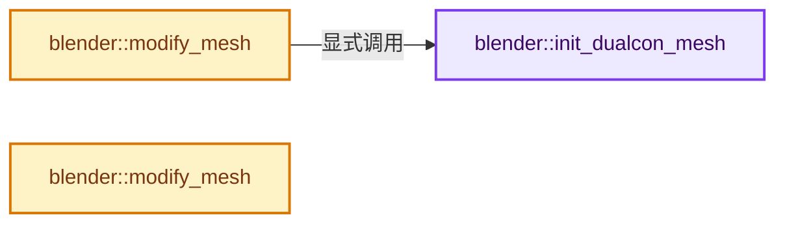
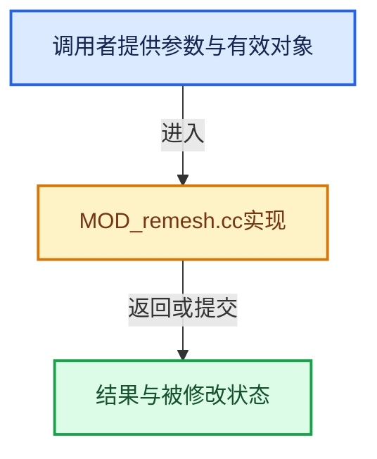

# 实现依赖专题：source/blender/modifiers/intern/MOD_remesh.cc

[方向导航](README.md) · [符号索引](../%E7%AC%A6%E5%8F%B7%E4%BE%9D%E8%B5%96%E4%B8%8E%E5%AE%9E%E7%8E%B0%E7%B4%A2%E5%BC%95.md)

本专题从正文实际调用进入，集中保存共享实现。函数有稳定锚点，可从调用处直接跳到对应完整函数；递归与互相调用通过回链组织。

## 本文件的实现关系






## 完整成员与函数实现

<a id="f-7ffae4b915c0ccb7"></a>

### `blender::init_dualcon_mesh`

实现位置：[source/blender/modifiers/intern/MOD_remesh.cc](../../../../../source/blender/modifiers/intern/MOD_remesh.cc) · L54—L72。

接口参数：

- `DualConInput *input`
- `Mesh *mesh`

**教学注释版**

<!-- annotated:15027779e92078 -->

```cpp
static void init_dualcon_mesh(DualConInput *input, Mesh *mesh)
{
  // [讲解] memset：填充字节，不调用T构造函数，也不保证任意类型的全零表示是合法或期望值。
  memset(input, 0, sizeof(DualConInput));

  input->co = (DualConCo)mesh->vert_positions().data();
  input->co_stride = sizeof(float3);
  input->totco = mesh->verts_num;

  input->corner_verts = (DualConCornerVerts)mesh->corner_verts().data();
  input->corner_verts_stride = sizeof(int);

  input->corner_tris = (DualConTri)mesh->corner_tris().data();
  input->tri_stride = sizeof(int3);
  input->tottri = BKE_mesh_runtime_corner_tris_len(mesh);

  const Bounds<float3> bounds = *mesh->bounds_min_max();
  copy_v3_v3(input->min, bounds.min);
  copy_v3_v3(input->max, bounds.max);
}
```

<details>
<summary>核对原始源码：source/blender/modifiers/intern/MOD_remesh.cc · L54—L72</summary>

<!-- original:15027779e92078:source/blender/modifiers/intern/MOD_remesh.cc:54:72 -->

```cpp
static void init_dualcon_mesh(DualConInput *input, Mesh *mesh)
{
  memset(input, 0, sizeof(DualConInput));

  input->co = (DualConCo)mesh->vert_positions().data();
  input->co_stride = sizeof(float3);
  input->totco = mesh->verts_num;

  input->corner_verts = (DualConCornerVerts)mesh->corner_verts().data();
  input->corner_verts_stride = sizeof(int);

  input->corner_tris = (DualConTri)mesh->corner_tris().data();
  input->tri_stride = sizeof(int3);
  input->tottri = BKE_mesh_runtime_corner_tris_len(mesh);

  const Bounds<float3> bounds = *mesh->bounds_min_max();
  copy_v3_v3(input->min, bounds.min);
  copy_v3_v3(input->max, bounds.max);
}
```

</details>

**沿实际写入检查状态**

- `input->co = (DualConCo)mesh->vert_positions().data();`
- `input->co_stride = sizeof(float3);`
- `input->totco = mesh->verts_num;`
- `input->corner_verts = (DualConCornerVerts)mesh->corner_verts().data();`
- `input->corner_verts_stride = sizeof(int);`
- `input->corner_tris = (DualConTri)mesh->corner_tris().data();`
- `input->tri_stride = sizeof(int3);`
- `input->tottri = BKE_mesh_runtime_corner_tris_len(mesh);`

**继续追踪实现**

- `memset` → [外部契约](https://eel.is/c++draft/cstring.syn)：填充字节，不调用T构造函数，也不保证任意类型的全零表示是合法或期望值。
- `mesh->vert_positions().data` → [调用协议](../%E6%A8%A1%E6%9D%BF%E5%AE%8F%E4%B8%8E%E5%8A%A8%E6%80%81%E5%88%86%E6%B4%BE%E5%8D%8F%E8%AE%AE.md)：接收对象类型依赖auto、返回值或模板实例；不按同名猜测目标。调用位置L58。
- `mesh->vert_positions` → [Mesh::vert_positions · L1193](03-MPoly%E8%BF%81%E7%A7%BB%E4%B8%8E%E5%85%BC%E5%AE%B9.md#f-ae4177e5c5f2b371)。
- `mesh->corner_verts().data` → [调用协议](../%E6%A8%A1%E6%9D%BF%E5%AE%8F%E4%B8%8E%E5%8A%A8%E6%80%81%E5%88%86%E6%B4%BE%E5%8D%8F%E8%AE%AE.md)：接收对象类型依赖auto、返回值或模板实例；不按同名猜测目标。调用位置L62。
- `mesh->corner_verts` → [Mesh::corner_verts · L1238](03-MPoly%E8%BF%81%E7%A7%BB%E4%B8%8E%E5%85%BC%E5%AE%B9.md#f-a59c61f583b64bc4)。
- `mesh->corner_tris().data` → [调用协议](../%E6%A8%A1%E6%9D%BF%E5%AE%8F%E4%B8%8E%E5%8A%A8%E6%80%81%E5%88%86%E6%B4%BE%E5%8D%8F%E8%AE%AE.md)：接收对象类型依赖auto、返回值或模板实例；不按同名猜测目标。调用位置L65。
- `mesh->corner_tris` → [blender::Mesh::corner_tris · L264](../06-%E9%9A%90%E5%BC%8F%E5%85%B1%E4%BA%AB%E4%B8%8E%E7%BC%93%E5%AD%98%E7%B3%BB%E7%BB%9F/10-%E5%B1%80%E9%83%A8%E6%9B%B4%E6%96%B0%E4%B8%8E%E5%A4%B1%E6%95%88%E4%BF%AE%E5%A4%8D.md#f-9bb421790000fc20)。
- `BKE_mesh_runtime_corner_tris_len` → [blender::BKE_mesh_runtime_corner_tris_len · L295](../06-%E9%9A%90%E5%BC%8F%E5%85%B1%E4%BA%AB%E4%B8%8E%E7%BC%93%E5%AD%98%E7%B3%BB%E7%BB%9F/10-%E5%B1%80%E9%83%A8%E6%9B%B4%E6%96%B0%E4%B8%8E%E5%A4%B1%E6%95%88%E4%BF%AE%E5%A4%8D.md#f-0c13526c31ccfacd)。
- `mesh->bounds_min_max` → [Mesh::bounds_min_max · L1942](03-MPoly%E8%BF%81%E7%A7%BB%E4%B8%8E%E5%85%BC%E5%AE%B9.md#f-1a7c466d855d52a6)。
- `copy_v3_v3` → [blender::copy_v3_v3 · L47](../12-%E7%A9%BA%E9%97%B4%E6%95%B0%E6%8D%AE%E7%BB%93%E6%9E%84%E4%B8%8E%E5%87%A0%E4%BD%95%E7%AE%97%E6%B3%95/%E4%BE%9D%E8%B5%96-math_vector_inline-0c8541.md#f-037a0d5fa5060bd6)。

<a id="f-702db60b0f535f6d"></a>

### `blender::modify_mesh`

实现位置：[source/blender/modifiers/intern/MOD_remesh.cc](../../../../../source/blender/modifiers/intern/MOD_remesh.cc) · L128—L206。

接口参数：

- `ModifierData *md`
- `const ModifierEvalContext *ctx`
- `Mesh *mesh`

**教学注释版**

<!-- annotated:61803d622e3e4b -->

```cpp
static Mesh *modify_mesh(ModifierData *md, const ModifierEvalContext *ctx, Mesh *mesh)
{
  RemeshModifierData *rmd = (RemeshModifierData *)md;
  Mesh *result;

  if (rmd->mode == MOD_REMESH_VOXEL) {
    /* OpenVDB modes. */
    if (rmd->voxel_size == 0.0f) {
      BKE_modifier_set_error(ctx->object, md, "Zero voxel size cannot be solved");
      return nullptr;
    }
    result = BKE_mesh_remesh_voxel(mesh, rmd->voxel_size, rmd->adaptivity, 0.0f, ctx->object, md);
    if (result == nullptr) {
      return nullptr;
    }
  }
  else {
    if (rmd->scale == 0.0f) {
      BKE_modifier_set_error(ctx->object, md, "Zero scale cannot be solved");
      return nullptr;
    }

    DualConOutput *output;
    DualConInput input;
    DualConFlags flags = DualConFlags(0);
    DualConMode mode = DualConMode(0);

    /* Dualcon modes. */
    init_dualcon_mesh(&input, mesh);

    if (rmd->flag & MOD_REMESH_FLOOD_FILL) {
      flags = DualConFlags(flags | DUALCON_FLOOD_FILL);
    }

    switch (rmd->mode) {
      case MOD_REMESH_CENTROID:
        mode = DUALCON_CENTROID;
        break;
      case MOD_REMESH_MASS_POINT:
        mode = DUALCON_MASS_POINT;
        break;
      case MOD_REMESH_SHARP_FEATURES:
        mode = DUALCON_SHARP_FEATURES;
        break;
      case MOD_REMESH_VOXEL:
        /* Should have been processed before as an OpenVDB operation. */
        BLI_assert(false);
        break;
    }
    /* TODO(jbakker): Dualcon crashes when run in parallel. Could be related to incorrect
     * input data or that the library isn't thread safe.
     * This was identified when changing the task isolation's during #76553. */
    static Mutex dualcon_mutex;
    {
      std::scoped_lock lock(dualcon_mutex);
      output = static_cast<DualConOutput *>(dualcon(&input,
                                                    dualcon_alloc_output,
                                                    dualcon_add_vert,
                                                    dualcon_add_quad,
                                                    flags,
                                                    mode,
                                                    rmd->threshold,
                                                    rmd->hermite_num,
                                                    rmd->scale,
                                                    rmd->depth));
    }
    result = output->mesh;
    MEM_delete(output);
  }

  bke::mesh_smooth_set(*result, rmd->flag & MOD_REMESH_SMOOTH_SHADING);

  BKE_mesh_copy_parameters_for_eval(result, mesh);
  bke::mesh_calc_edges(*result, true, false);

  geometry::debug_randomize_mesh_order(result);

  return result;
}
```

<details>
<summary>核对原始源码：source/blender/modifiers/intern/MOD_remesh.cc · L128—L206</summary>

<!-- original:61803d622e3e4b:source/blender/modifiers/intern/MOD_remesh.cc:128:206 -->

```cpp
static Mesh *modify_mesh(ModifierData *md, const ModifierEvalContext *ctx, Mesh *mesh)
{
  RemeshModifierData *rmd = (RemeshModifierData *)md;
  Mesh *result;

  if (rmd->mode == MOD_REMESH_VOXEL) {
    /* OpenVDB modes. */
    if (rmd->voxel_size == 0.0f) {
      BKE_modifier_set_error(ctx->object, md, "Zero voxel size cannot be solved");
      return nullptr;
    }
    result = BKE_mesh_remesh_voxel(mesh, rmd->voxel_size, rmd->adaptivity, 0.0f, ctx->object, md);
    if (result == nullptr) {
      return nullptr;
    }
  }
  else {
    if (rmd->scale == 0.0f) {
      BKE_modifier_set_error(ctx->object, md, "Zero scale cannot be solved");
      return nullptr;
    }

    DualConOutput *output;
    DualConInput input;
    DualConFlags flags = DualConFlags(0);
    DualConMode mode = DualConMode(0);

    /* Dualcon modes. */
    init_dualcon_mesh(&input, mesh);

    if (rmd->flag & MOD_REMESH_FLOOD_FILL) {
      flags = DualConFlags(flags | DUALCON_FLOOD_FILL);
    }

    switch (rmd->mode) {
      case MOD_REMESH_CENTROID:
        mode = DUALCON_CENTROID;
        break;
      case MOD_REMESH_MASS_POINT:
        mode = DUALCON_MASS_POINT;
        break;
      case MOD_REMESH_SHARP_FEATURES:
        mode = DUALCON_SHARP_FEATURES;
        break;
      case MOD_REMESH_VOXEL:
        /* Should have been processed before as an OpenVDB operation. */
        BLI_assert(false);
        break;
    }
    /* TODO(jbakker): Dualcon crashes when run in parallel. Could be related to incorrect
     * input data or that the library isn't thread safe.
     * This was identified when changing the task isolation's during #76553. */
    static Mutex dualcon_mutex;
    {
      std::scoped_lock lock(dualcon_mutex);
      output = static_cast<DualConOutput *>(dualcon(&input,
                                                    dualcon_alloc_output,
                                                    dualcon_add_vert,
                                                    dualcon_add_quad,
                                                    flags,
                                                    mode,
                                                    rmd->threshold,
                                                    rmd->hermite_num,
                                                    rmd->scale,
                                                    rmd->depth));
    }
    result = output->mesh;
    MEM_delete(output);
  }

  bke::mesh_smooth_set(*result, rmd->flag & MOD_REMESH_SMOOTH_SHADING);

  BKE_mesh_copy_parameters_for_eval(result, mesh);
  bke::mesh_calc_edges(*result, true, false);

  geometry::debug_randomize_mesh_order(result);

  return result;
}
```

</details>

**沿实际写入检查状态**

- `result = BKE_mesh_remesh_voxel(mesh, rmd->voxel_size, rmd->adaptivity, 0.0f, ctx->object, md);`
- `flags = DualConFlags(flags | DUALCON_FLOOD_FILL);`
- `mode = DUALCON_CENTROID;`
- `mode = DUALCON_MASS_POINT;`
- `mode = DUALCON_SHARP_FEATURES;`
- `output = static_cast<DualConOutput *>(dualcon(&input,`
- `result = output->mesh;`

**结果出口**

- `return nullptr;`
- `return result;`

**继续追踪实现**

- `BKE_modifier_set_error` → [blender::BKE_modifier_set_error · L416](%E4%BE%9D%E8%B5%96-modifier-ab0273.md#f-6241829f21c08456)。
- `BKE_mesh_remesh_voxel` → [blender::BKE_mesh_remesh_voxel · L246](%E4%BE%9D%E8%B5%96-mesh_remesh_voxel-ec8066.md#f-51c8ee82383c0742)；[blender::BKE_mesh_remesh_voxel · L278](%E4%BE%9D%E8%B5%96-mesh_remesh_voxel-ec8066.md#f-4df1343a8a5372a0)。同名重载需按实参类型选择。
- `DualConFlags` → [调用协议](../%E6%A8%A1%E6%9D%BF%E5%AE%8F%E4%B8%8E%E5%8A%A8%E6%80%81%E5%88%86%E6%B4%BE%E5%8D%8F%E8%AE%AE.md)：函数指针、局部可调用对象或未展开的宏；必须结合调用者环境。调用位置L152。
- `DualConMode` → [调用协议](../%E6%A8%A1%E6%9D%BF%E5%AE%8F%E4%B8%8E%E5%8A%A8%E6%80%81%E5%88%86%E6%B4%BE%E5%8D%8F%E8%AE%AE.md)：函数指针、局部可调用对象或未展开的宏；必须结合调用者环境。调用位置L153。
- `init_dualcon_mesh` → [blender::init_dualcon_mesh · L54](%E4%BE%9D%E8%B5%96-MOD_remesh-819440.md#f-7ffae4b915c0ccb7)。
- `BLI_assert` → [BLI_assert · L48](../01-%E5%9F%BA%E7%A1%80%E5%AE%B9%E5%99%A8%E4%B8%8E%E7%8E%B0%E4%BB%A3CPP/%E4%BE%9D%E8%B5%96-BLI_assert-cc98e8.md#m-57a88495704d)；[BLI_assert · L63](../01-%E5%9F%BA%E7%A1%80%E5%AE%B9%E5%99%A8%E4%B8%8E%E7%8E%B0%E4%BB%A3CPP/%E4%BE%9D%E8%B5%96-BLI_assert-cc98e8.md#m-d07050020cb5)。宏定义由构建条件选择。
- `dualcon` → [dualcon · L144](%E4%BE%9D%E8%B5%96-dualcon_c_api-e6fd00.md#f-5368118f05498460)。
- `MEM_delete` → [MEM_delete · L400](../03-%E5%86%85%E5%AD%98%E5%88%86%E9%85%8D%E4%B8%8E%E8%BF%90%E8%A1%8C%E6%97%B6%E7%B1%BB%E5%9E%8B/%E4%BE%9D%E8%B5%96-MEM_guardedalloc-b54eca.md#f-9049ffdd1682887c)。
- `bke::mesh_smooth_set` → [bke::mesh_smooth_set · L1900](03-MPoly%E8%BF%81%E7%A7%BB%E4%B8%8E%E5%85%BC%E5%AE%B9.md#f-61497df030106e04)。
- `BKE_mesh_copy_parameters_for_eval` → [BKE_mesh_copy_parameters_for_eval · L1484](03-MPoly%E8%BF%81%E7%A7%BB%E4%B8%8E%E5%85%BC%E5%AE%B9.md#f-71bebe4e73fe4c13)。
- `bke::mesh_calc_edges` → [blender::bke::mesh_calc_edges · L234](%E4%BE%9D%E8%B5%96-mesh_calc_edges-37447c.md#f-8dc1463382ec6743)；[blender::bke::mesh_calc_edges · L578](%E4%BE%9D%E8%B5%96-mesh_calc_edges-37447c.md#f-1312012cc732ca47)。同名重载需按实参类型选择。
- `geometry::debug_randomize_mesh_order` → [blender::geometry::debug_randomize_mesh_order · L305](%E4%BE%9D%E8%B5%96-randomize-2d10a6.md#f-268bd8d8f3608806)。

<a id="f-ce53748128827805"></a>

### `blender::modify_mesh`

实现位置：[source/blender/modifiers/intern/MOD_remesh.cc](../../../../../source/blender/modifiers/intern/MOD_remesh.cc) · L210—L213。

接口参数：

- `ModifierData *`
- `const ModifierEvalContext *`
- `Mesh *mesh`

**教学注释版**

<!-- annotated:c32a5021d73d4a -->

```cpp
static Mesh *modify_mesh(ModifierData * /*md*/, const ModifierEvalContext * /*ctx*/, Mesh *mesh)
{
  return mesh;
}
```

<details>
<summary>核对原始源码：source/blender/modifiers/intern/MOD_remesh.cc · L210—L213</summary>

<!-- original:c32a5021d73d4a:source/blender/modifiers/intern/MOD_remesh.cc:210:213 -->

```cpp
static Mesh *modify_mesh(ModifierData * /*md*/, const ModifierEvalContext * /*ctx*/, Mesh *mesh)
{
  return mesh;
}
```

</details>

**结果出口**

- `return mesh;`

**继续追踪实现**

本实现没有需要继续展开的显式调用；检查返回表达式、对象转换和调用者前置条件。
