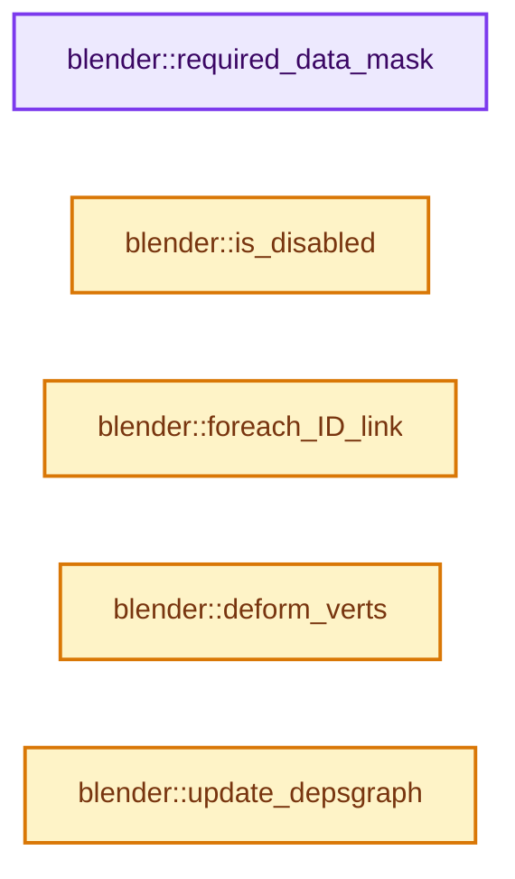
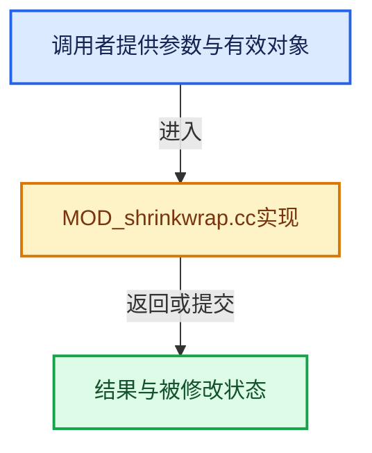

# 实现依赖专题：source/blender/modifiers/intern/MOD_shrinkwrap.cc

[方向导航](README.md) · [符号索引](../%E7%AC%A6%E5%8F%B7%E4%BE%9D%E8%B5%96%E4%B8%8E%E5%AE%9E%E7%8E%B0%E7%B4%A2%E5%BC%95.md)

本专题从正文实际调用进入，集中保存共享实现。函数有稳定锚点，可从调用处直接跳到对应完整函数；递归与互相调用通过回链组织。

## 本文件的实现关系






## 完整成员与函数实现

<a id="f-3bf8f0e2b5f29ca2"></a>

### `blender::required_data_mask`

实现位置：[source/blender/modifiers/intern/MOD_shrinkwrap.cc](../../../../../source/blender/modifiers/intern/MOD_shrinkwrap.cc) · L41—L49。

接口参数：

- `ModifierData *md`
- `CustomData_MeshMasks *r_cddata_masks`

**教学注释版**

<!-- annotated:4653405a7753c5 -->

```cpp
static void required_data_mask(ModifierData *md, CustomData_MeshMasks *r_cddata_masks)
{
  ShrinkwrapModifierData *smd = reinterpret_cast<ShrinkwrapModifierData *>(md);

  /* Ask for vertex-groups if we need them. */
  if (smd->vgroup_name[0] != '\0') {
    r_cddata_masks->vmask |= CD_MASK_MDEFORMVERT;
  }
}
```

<details>
<summary>核对原始源码：source/blender/modifiers/intern/MOD_shrinkwrap.cc · L41—L49</summary>

<!-- original:4653405a7753c5:source/blender/modifiers/intern/MOD_shrinkwrap.cc:41:49 -->

```cpp
static void required_data_mask(ModifierData *md, CustomData_MeshMasks *r_cddata_masks)
{
  ShrinkwrapModifierData *smd = reinterpret_cast<ShrinkwrapModifierData *>(md);

  /* Ask for vertex-groups if we need them. */
  if (smd->vgroup_name[0] != '\0') {
    r_cddata_masks->vmask |= CD_MASK_MDEFORMVERT;
  }
}
```

</details>

**沿实际写入检查状态**

- `r_cddata_masks->vmask |= CD_MASK_MDEFORMVERT;`

**继续追踪实现**

本实现没有需要继续展开的显式调用；检查返回表达式、对象转换和调用者前置条件。

<a id="f-0e46fe7fdc27da7c"></a>

### `blender::is_disabled`

实现位置：[source/blender/modifiers/intern/MOD_shrinkwrap.cc](../../../../../source/blender/modifiers/intern/MOD_shrinkwrap.cc) · L51—L67。

接口参数：

- `const Scene *`
- `ModifierData *md`
- `bool`

**教学注释版**

<!-- annotated:b2e20d249bec0e -->

```cpp
static bool is_disabled(const Scene * /*scene*/, ModifierData *md, bool /*use_render_params*/)
{
  ShrinkwrapModifierData *smd = reinterpret_cast<ShrinkwrapModifierData *>(md);

  /* The object type check is only needed here in case we have a placeholder
   * object assigned (because the library containing the mesh is missing).
   *
   * In other cases it should be impossible to have a type mismatch.
   */
  if (!smd->target || smd->target->type != OB_MESH) {
    return true;
  }
  if (smd->auxTarget && smd->auxTarget->type != OB_MESH) {
    return true;
  }
  return false;
}
```

<details>
<summary>核对原始源码：source/blender/modifiers/intern/MOD_shrinkwrap.cc · L51—L67</summary>

<!-- original:b2e20d249bec0e:source/blender/modifiers/intern/MOD_shrinkwrap.cc:51:67 -->

```cpp
static bool is_disabled(const Scene * /*scene*/, ModifierData *md, bool /*use_render_params*/)
{
  ShrinkwrapModifierData *smd = reinterpret_cast<ShrinkwrapModifierData *>(md);

  /* The object type check is only needed here in case we have a placeholder
   * object assigned (because the library containing the mesh is missing).
   *
   * In other cases it should be impossible to have a type mismatch.
   */
  if (!smd->target || smd->target->type != OB_MESH) {
    return true;
  }
  if (smd->auxTarget && smd->auxTarget->type != OB_MESH) {
    return true;
  }
  return false;
}
```

</details>

**结果出口**

- `return true;`
- `return false;`

**继续追踪实现**

本实现没有需要继续展开的显式调用；检查返回表达式、对象转换和调用者前置条件。

<a id="f-2783308b7e5ae798"></a>

### `blender::foreach_ID_link`

实现位置：[source/blender/modifiers/intern/MOD_shrinkwrap.cc](../../../../../source/blender/modifiers/intern/MOD_shrinkwrap.cc) · L69—L75。

接口参数：

- `ModifierData *md`
- `Object *ob`
- `IDWalkFunc walk`
- `void *user_data`

**教学注释版**

<!-- annotated:bf64b9d4d30bdb -->

```cpp
static void foreach_ID_link(ModifierData *md, Object *ob, IDWalkFunc walk, void *user_data)
{
  ShrinkwrapModifierData *smd = reinterpret_cast<ShrinkwrapModifierData *>(md);

  walk(user_data, ob, reinterpret_cast<ID **>(&smd->target), IDWALK_CB_NOP);
  walk(user_data, ob, reinterpret_cast<ID **>(&smd->auxTarget), IDWALK_CB_NOP);
}
```

<details>
<summary>核对原始源码：source/blender/modifiers/intern/MOD_shrinkwrap.cc · L69—L75</summary>

<!-- original:bf64b9d4d30bdb:source/blender/modifiers/intern/MOD_shrinkwrap.cc:69:75 -->

```cpp
static void foreach_ID_link(ModifierData *md, Object *ob, IDWalkFunc walk, void *user_data)
{
  ShrinkwrapModifierData *smd = reinterpret_cast<ShrinkwrapModifierData *>(md);

  walk(user_data, ob, reinterpret_cast<ID **>(&smd->target), IDWALK_CB_NOP);
  walk(user_data, ob, reinterpret_cast<ID **>(&smd->auxTarget), IDWALK_CB_NOP);
}
```

</details>

**继续追踪实现**

- `walk` → [调用协议](../%E6%A8%A1%E6%9D%BF%E5%AE%8F%E4%B8%8E%E5%8A%A8%E6%80%81%E5%88%86%E6%B4%BE%E5%8D%8F%E8%AE%AE.md)：局部可调用对象，须结合其初始化与捕获环境。调用位置L73。

<a id="f-a55a40eb67d99344"></a>

### `blender::deform_verts`

实现位置：[source/blender/modifiers/intern/MOD_shrinkwrap.cc](../../../../../source/blender/modifiers/intern/MOD_shrinkwrap.cc) · L77—L98。

接口参数：

- `ModifierData *md`
- `const ModifierEvalContext *ctx`
- `Mesh *mesh`
- `MutableSpan<float3> positions`

**教学注释版**

<!-- annotated:7028d618136f9b -->

```cpp
static void deform_verts(ModifierData *md,
                         const ModifierEvalContext *ctx,
                         Mesh *mesh,
                         MutableSpan<float3> positions)
{
  ShrinkwrapModifierData *swmd = reinterpret_cast<ShrinkwrapModifierData *>(md);
  Scene *scene = DEG_get_evaluated_scene(ctx->depsgraph);

  const MDeformVert *dvert = nullptr;
  int defgrp_index = -1;
  MOD_get_vgroup(ctx->object, mesh, swmd->vgroup_name, &dvert, &defgrp_index);

  shrinkwrapModifier_deform(swmd,
                            ctx,
                            scene,
                            ctx->object,
                            mesh,
                            dvert,
                            defgrp_index,
                            // [讲解] positions.data：返回借用范围的地址。
                            reinterpret_cast<float (*)[3]>(positions.data()),
                            // [讲解] positions.size：查询视图长度或生成对应有效索引区间。
                            positions.size());
}
```

<details>
<summary>核对原始源码：source/blender/modifiers/intern/MOD_shrinkwrap.cc · L77—L98</summary>

<!-- original:7028d618136f9b:source/blender/modifiers/intern/MOD_shrinkwrap.cc:77:98 -->

```cpp
static void deform_verts(ModifierData *md,
                         const ModifierEvalContext *ctx,
                         Mesh *mesh,
                         MutableSpan<float3> positions)
{
  ShrinkwrapModifierData *swmd = reinterpret_cast<ShrinkwrapModifierData *>(md);
  Scene *scene = DEG_get_evaluated_scene(ctx->depsgraph);

  const MDeformVert *dvert = nullptr;
  int defgrp_index = -1;
  MOD_get_vgroup(ctx->object, mesh, swmd->vgroup_name, &dvert, &defgrp_index);

  shrinkwrapModifier_deform(swmd,
                            ctx,
                            scene,
                            ctx->object,
                            mesh,
                            dvert,
                            defgrp_index,
                            reinterpret_cast<float (*)[3]>(positions.data()),
                            positions.size());
}
```

</details>

**继续追踪实现**

- `DEG_get_evaluated_scene` → [blender::DEG_get_evaluated_scene · L212](../11-Depsgraph%E4%B8%8E%E5%B9%B6%E8%A1%8C%E4%BB%BB%E5%8A%A1%E7%B3%BB%E7%BB%9F/%E4%BE%9D%E8%B5%96-depsgraph_query-e8b1e4.md#f-be7729d26a71d3fd)。
- `MOD_get_vgroup` → [blender::MOD_get_vgroup · L158](%E4%BE%9D%E8%B5%96-MOD_util-83ca4b.md#f-f461611d86b94405)。
- `shrinkwrapModifier_deform` → [blender::shrinkwrapModifier_deform · L1315](%E4%BE%9D%E8%B5%96-shrinkwrap-e3f168.md#f-b885162ebdd551df)。
- `positions.data` → [blender::MutableSpan::data · L545](../01-%E5%9F%BA%E7%A1%80%E5%AE%B9%E5%99%A8%E4%B8%8E%E7%8E%B0%E4%BB%A3CPP/06-MutableSpan%E5%8F%AF%E5%86%99%E8%A7%86%E5%9B%BE.md#f-eb45a6e4d8211efd)；[blender::gpu::shader::parser::MutableSpan::data · L82](%E4%BE%9D%E8%B5%96-utils-06433d.md#f-ad0a09cec9741c65)。同名重载需按实参类型选择。
- `positions.size` → [blender::MutableSpan::size · L499](../01-%E5%9F%BA%E7%A1%80%E5%AE%B9%E5%99%A8%E4%B8%8E%E7%8E%B0%E4%BB%A3CPP/06-MutableSpan%E5%8F%AF%E5%86%99%E8%A7%86%E5%9B%BE.md#f-1de6a66839c304a8)；[blender::gpu::shader::parser::MutableSpan::size · L87](%E4%BE%9D%E8%B5%96-utils-06433d.md#f-5e684af6ee7990e9)。同名重载需按实参类型选择。

<a id="f-28e0f66081194320"></a>

### `blender::update_depsgraph`

实现位置：[source/blender/modifiers/intern/MOD_shrinkwrap.cc](../../../../../source/blender/modifiers/intern/MOD_shrinkwrap.cc) · L100—L120。

接口参数：

- `ModifierData *md`
- `const ModifierUpdateDepsgraphContext *ctx`

**教学注释版**

<!-- annotated:458758e7f235c2 -->

```cpp
static void update_depsgraph(ModifierData *md, const ModifierUpdateDepsgraphContext *ctx)
{
  ShrinkwrapModifierData *smd = reinterpret_cast<ShrinkwrapModifierData *>(md);
  if (smd->target != nullptr) {
    DEG_add_object_relation(ctx->node, smd->target, DEG_OB_COMP_TRANSFORM, "Shrinkwrap Modifier");
    DEG_add_object_relation(ctx->node, smd->target, DEG_OB_COMP_GEOMETRY, "Shrinkwrap Modifier");
    if (smd->shrinkType == MOD_SHRINKWRAP_TARGET_PROJECT) {
      DEG_add_special_eval_flag(ctx->node, &smd->target->id, DAG_EVAL_NEED_SHRINKWRAP_BOUNDARY);
    }
  }
  if (smd->auxTarget != nullptr) {
    DEG_add_object_relation(
        ctx->node, smd->auxTarget, DEG_OB_COMP_TRANSFORM, "Shrinkwrap Modifier");
    DEG_add_object_relation(
        ctx->node, smd->auxTarget, DEG_OB_COMP_GEOMETRY, "Shrinkwrap Modifier");
    if (smd->shrinkType == MOD_SHRINKWRAP_TARGET_PROJECT) {
      DEG_add_special_eval_flag(ctx->node, &smd->auxTarget->id, DAG_EVAL_NEED_SHRINKWRAP_BOUNDARY);
    }
  }
  DEG_add_depends_on_transform_relation(ctx->node, "Shrinkwrap Modifier");
}
```

<details>
<summary>核对原始源码：source/blender/modifiers/intern/MOD_shrinkwrap.cc · L100—L120</summary>

<!-- original:458758e7f235c2:source/blender/modifiers/intern/MOD_shrinkwrap.cc:100:120 -->

```cpp
static void update_depsgraph(ModifierData *md, const ModifierUpdateDepsgraphContext *ctx)
{
  ShrinkwrapModifierData *smd = reinterpret_cast<ShrinkwrapModifierData *>(md);
  if (smd->target != nullptr) {
    DEG_add_object_relation(ctx->node, smd->target, DEG_OB_COMP_TRANSFORM, "Shrinkwrap Modifier");
    DEG_add_object_relation(ctx->node, smd->target, DEG_OB_COMP_GEOMETRY, "Shrinkwrap Modifier");
    if (smd->shrinkType == MOD_SHRINKWRAP_TARGET_PROJECT) {
      DEG_add_special_eval_flag(ctx->node, &smd->target->id, DAG_EVAL_NEED_SHRINKWRAP_BOUNDARY);
    }
  }
  if (smd->auxTarget != nullptr) {
    DEG_add_object_relation(
        ctx->node, smd->auxTarget, DEG_OB_COMP_TRANSFORM, "Shrinkwrap Modifier");
    DEG_add_object_relation(
        ctx->node, smd->auxTarget, DEG_OB_COMP_GEOMETRY, "Shrinkwrap Modifier");
    if (smd->shrinkType == MOD_SHRINKWRAP_TARGET_PROJECT) {
      DEG_add_special_eval_flag(ctx->node, &smd->auxTarget->id, DAG_EVAL_NEED_SHRINKWRAP_BOUNDARY);
    }
  }
  DEG_add_depends_on_transform_relation(ctx->node, "Shrinkwrap Modifier");
}
```

</details>

**继续追踪实现**

- `DEG_add_object_relation` → [blender::DEG_add_object_relation · L123](../11-Depsgraph%E4%B8%8E%E5%B9%B6%E8%A1%8C%E4%BB%BB%E5%8A%A1%E7%B3%BB%E7%BB%9F/%E4%BE%9D%E8%B5%96-depsgraph_build-ea2fc8.md#f-f570cffae97e273c)。
- `DEG_add_special_eval_flag` → [blender::DEG_add_special_eval_flag · L253](../11-Depsgraph%E4%B8%8E%E5%B9%B6%E8%A1%8C%E4%BB%BB%E5%8A%A1%E7%B3%BB%E7%BB%9F/%E4%BE%9D%E8%B5%96-depsgraph_build-ea2fc8.md#f-d68e9c73ded33dd2)。
- `DEG_add_depends_on_transform_relation` → [blender::DEG_add_depends_on_transform_relation · L240](../11-Depsgraph%E4%B8%8E%E5%B9%B6%E8%A1%8C%E4%BB%BB%E5%8A%A1%E7%B3%BB%E7%BB%9F/%E4%BE%9D%E8%B5%96-depsgraph_build-ea2fc8.md#f-47c32a354defa20d)。
