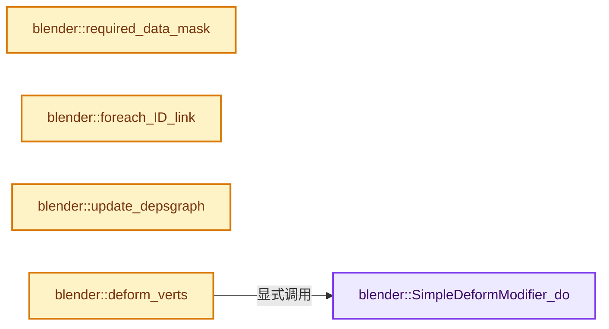
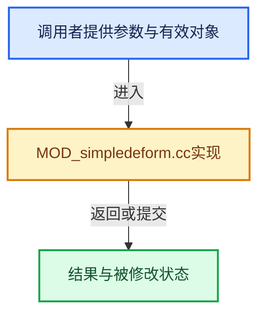

# 实现依赖专题：source/blender/modifiers/intern/MOD_simpledeform.cc

[方向导航](README.md) · [符号索引](../%E7%AC%A6%E5%8F%B7%E4%BE%9D%E8%B5%96%E4%B8%8E%E5%AE%9E%E7%8E%B0%E7%B4%A2%E5%BC%95.md)

本专题从正文实际调用进入，集中保存共享实现。函数有稳定锚点，可从调用处直接跳到对应完整函数；递归与互相调用通过回链组织。

## 本文件的实现关系






## 完整成员与函数实现

<a id="f-016c8f7eb45bd320"></a>

### `blender::SimpleDeformModifier_do`

实现位置：[source/blender/modifiers/intern/MOD_simpledeform.cc](../../../../../source/blender/modifiers/intern/MOD_simpledeform.cc) · L272—L388。

接口参数：

- `SimpleDeformModifierData *smd`
- `const ModifierEvalContext *`
- `Object *ob`
- `Mesh *mesh`
- `float (*vertexCos)[3]`
- `int verts_num`

**教学注释版**

<!-- annotated:5ef9b116c4853e -->

```cpp
static void SimpleDeformModifier_do(SimpleDeformModifierData *smd,
                                    const ModifierEvalContext * /*ctx*/,
                                    Object *ob,
                                    Mesh *mesh,
                                    float (*vertexCos)[3],
                                    int verts_num)
{
  int i;
  float smd_limit[2], smd_factor;
  SpaceTransform *transf = nullptr, tmp_transf;
  int vgroup;
  const MDeformVert *dvert;

  /* This is historically the lock axis, _not_ the deform axis as the name would imply */
  const int deform_axis = std::clamp(int(smd->deform_axis), 0, 2);
  int lock_axis = smd->axis;
  if (smd->mode == MOD_SIMPLEDEFORM_MODE_BEND) { /* Bend mode shouldn't have any lock axis */
    lock_axis = 0;
  }
  else {
    /* Don't lock axis if it is the chosen deform axis, as this flattens
     * the geometry */
    if (deform_axis == 0) {
      lock_axis &= ~MOD_SIMPLEDEFORM_LOCK_AXIS_X;
    }
    if (deform_axis == 1) {
      lock_axis &= ~MOD_SIMPLEDEFORM_LOCK_AXIS_Y;
    }
    if (deform_axis == 2) {
      lock_axis &= ~MOD_SIMPLEDEFORM_LOCK_AXIS_Z;
    }
  }

  /* Safe-check */
  if (smd->origin == ob) {
    smd->origin = nullptr; /* No self references */
  }

  // [讲解] std::max：按比较关系选取较大值。本讲解中的增长公式同时满足最低请求和几何增长；若保存返回引用，还需注意实参寿命。
  smd->limit[0] = std::max(smd->limit[0], 0.0f);
  // [讲解] std::min：按比较关系选取较小值；截断范围时还需先满足非负和可表示范围，min本身不会证明边界安全。
  smd->limit[0] = std::min(smd->limit[0], 1.0f);

  smd->limit[0] = min_ff(smd->limit[0], smd->limit[1]); /* Upper limit >= than lower limit */

  /* Calculate matrix to convert between coordinate spaces. */
  if (smd->origin != nullptr) {
    transf = &tmp_transf;
    BLI_SPACE_TRANSFORM_SETUP(transf, ob, smd->origin);
  }

  /* Update limits if needed */
  int limit_axis = deform_axis;
  if (smd->mode == MOD_SIMPLEDEFORM_MODE_BEND) {
    /* Bend is a special case. */
    switch (deform_axis) {
      case 0:
        ATTR_FALLTHROUGH;
      case 1:
        limit_axis = 2;
        break;
      default:
        limit_axis = 0;
    }
  }

  {
    float lower = FLT_MAX;
    float upper = -FLT_MAX;

    for (i = 0; i < verts_num; i++) {
      float tmp[3];
      copy_v3_v3(tmp, vertexCos[i]);

      if (transf) {
        BLI_space_transform_apply(transf, tmp);
      }

      lower = min_ff(lower, tmp[limit_axis]);
      upper = max_ff(upper, tmp[limit_axis]);
    }

    /* SMD values are normalized to the BV, calculate the absolute values */
    smd_limit[1] = lower + (upper - lower) * smd->limit[1];
    smd_limit[0] = lower + (upper - lower) * smd->limit[0];

    smd_factor = smd->factor / max_ff(FLT_EPSILON, smd_limit[1] - smd_limit[0]);
  }

  if (smd->mode == MOD_SIMPLEDEFORM_MODE_BEND) {
    if (fabsf(smd_factor) < BEND_EPS) {
      return;
    }
  }

  MOD_get_vgroup(ob, mesh, smd->vgroup_name, &dvert, &vgroup);
  const bool invert_vgroup = (smd->flag & MOD_SIMPLEDEFORM_FLAG_INVERT_VGROUP) != 0;

  /* Build our data. */
  DeformUserData deform_pool_data{};
  deform_pool_data.mode = smd->mode;
  deform_pool_data.smd_factor = smd_factor;
  deform_pool_data.deform_axis = deform_axis;
  deform_pool_data.transf = transf;
  deform_pool_data.vertexCos = vertexCos;
  deform_pool_data.invert_vgroup = invert_vgroup;
  deform_pool_data.lock_axis = lock_axis;
  deform_pool_data.vgroup = vgroup;
  deform_pool_data.smd_limit[0] = smd_limit[0];
  deform_pool_data.smd_limit[1] = smd_limit[1];
  deform_pool_data.dvert = dvert;
  deform_pool_data.limit_axis = limit_axis;

  /* Do deformation. */
  TaskParallelSettings settings;
  BLI_parallel_range_settings_defaults(&settings);
  BLI_task_parallel_range(
      0, verts_num, static_cast<void *>(&deform_pool_data), simple_helper, &settings);
}
```

<details>
<summary>核对原始源码：source/blender/modifiers/intern/MOD_simpledeform.cc · L272—L388</summary>

<!-- original:5ef9b116c4853e:source/blender/modifiers/intern/MOD_simpledeform.cc:272:388 -->

```cpp
static void SimpleDeformModifier_do(SimpleDeformModifierData *smd,
                                    const ModifierEvalContext * /*ctx*/,
                                    Object *ob,
                                    Mesh *mesh,
                                    float (*vertexCos)[3],
                                    int verts_num)
{
  int i;
  float smd_limit[2], smd_factor;
  SpaceTransform *transf = nullptr, tmp_transf;
  int vgroup;
  const MDeformVert *dvert;

  /* This is historically the lock axis, _not_ the deform axis as the name would imply */
  const int deform_axis = std::clamp(int(smd->deform_axis), 0, 2);
  int lock_axis = smd->axis;
  if (smd->mode == MOD_SIMPLEDEFORM_MODE_BEND) { /* Bend mode shouldn't have any lock axis */
    lock_axis = 0;
  }
  else {
    /* Don't lock axis if it is the chosen deform axis, as this flattens
     * the geometry */
    if (deform_axis == 0) {
      lock_axis &= ~MOD_SIMPLEDEFORM_LOCK_AXIS_X;
    }
    if (deform_axis == 1) {
      lock_axis &= ~MOD_SIMPLEDEFORM_LOCK_AXIS_Y;
    }
    if (deform_axis == 2) {
      lock_axis &= ~MOD_SIMPLEDEFORM_LOCK_AXIS_Z;
    }
  }

  /* Safe-check */
  if (smd->origin == ob) {
    smd->origin = nullptr; /* No self references */
  }

  smd->limit[0] = std::max(smd->limit[0], 0.0f);
  smd->limit[0] = std::min(smd->limit[0], 1.0f);

  smd->limit[0] = min_ff(smd->limit[0], smd->limit[1]); /* Upper limit >= than lower limit */

  /* Calculate matrix to convert between coordinate spaces. */
  if (smd->origin != nullptr) {
    transf = &tmp_transf;
    BLI_SPACE_TRANSFORM_SETUP(transf, ob, smd->origin);
  }

  /* Update limits if needed */
  int limit_axis = deform_axis;
  if (smd->mode == MOD_SIMPLEDEFORM_MODE_BEND) {
    /* Bend is a special case. */
    switch (deform_axis) {
      case 0:
        ATTR_FALLTHROUGH;
      case 1:
        limit_axis = 2;
        break;
      default:
        limit_axis = 0;
    }
  }

  {
    float lower = FLT_MAX;
    float upper = -FLT_MAX;

    for (i = 0; i < verts_num; i++) {
      float tmp[3];
      copy_v3_v3(tmp, vertexCos[i]);

      if (transf) {
        BLI_space_transform_apply(transf, tmp);
      }

      lower = min_ff(lower, tmp[limit_axis]);
      upper = max_ff(upper, tmp[limit_axis]);
    }

    /* SMD values are normalized to the BV, calculate the absolute values */
    smd_limit[1] = lower + (upper - lower) * smd->limit[1];
    smd_limit[0] = lower + (upper - lower) * smd->limit[0];

    smd_factor = smd->factor / max_ff(FLT_EPSILON, smd_limit[1] - smd_limit[0]);
  }

  if (smd->mode == MOD_SIMPLEDEFORM_MODE_BEND) {
    if (fabsf(smd_factor) < BEND_EPS) {
      return;
    }
  }

  MOD_get_vgroup(ob, mesh, smd->vgroup_name, &dvert, &vgroup);
  const bool invert_vgroup = (smd->flag & MOD_SIMPLEDEFORM_FLAG_INVERT_VGROUP) != 0;

  /* Build our data. */
  DeformUserData deform_pool_data{};
  deform_pool_data.mode = smd->mode;
  deform_pool_data.smd_factor = smd_factor;
  deform_pool_data.deform_axis = deform_axis;
  deform_pool_data.transf = transf;
  deform_pool_data.vertexCos = vertexCos;
  deform_pool_data.invert_vgroup = invert_vgroup;
  deform_pool_data.lock_axis = lock_axis;
  deform_pool_data.vgroup = vgroup;
  deform_pool_data.smd_limit[0] = smd_limit[0];
  deform_pool_data.smd_limit[1] = smd_limit[1];
  deform_pool_data.dvert = dvert;
  deform_pool_data.limit_axis = limit_axis;

  /* Do deformation. */
  TaskParallelSettings settings;
  BLI_parallel_range_settings_defaults(&settings);
  BLI_task_parallel_range(
      0, verts_num, static_cast<void *>(&deform_pool_data), simple_helper, &settings);
}
```

</details>

**沿实际写入检查状态**

- `lock_axis = 0;`
- `lock_axis &= ~MOD_SIMPLEDEFORM_LOCK_AXIS_X;`
- `lock_axis &= ~MOD_SIMPLEDEFORM_LOCK_AXIS_Y;`
- `lock_axis &= ~MOD_SIMPLEDEFORM_LOCK_AXIS_Z;`
- `smd->origin = nullptr; /* No self references */`
- `smd->limit[0] = std::max(smd->limit[0], 0.0f);`
- `smd->limit[0] = std::min(smd->limit[0], 1.0f);`
- `smd->limit[0] = min_ff(smd->limit[0], smd->limit[1]); /* Upper limit >= than lower limit */`
- `transf = &tmp_transf;`
- `limit_axis = 2;`
- `limit_axis = 0;`
- `lower = min_ff(lower, tmp[limit_axis]);`
- `upper = max_ff(upper, tmp[limit_axis]);`
- `smd_limit[1] = lower + (upper - lower) * smd->limit[1];`
- `smd_limit[0] = lower + (upper - lower) * smd->limit[0];`
- `smd_factor = smd->factor / max_ff(FLT_EPSILON, smd_limit[1] - smd_limit[0]);`
- `deform_pool_data.mode = smd->mode;`
- `deform_pool_data.smd_factor = smd_factor;`
- `deform_pool_data.deform_axis = deform_axis;`
- `deform_pool_data.transf = transf;`
- `deform_pool_data.vertexCos = vertexCos;`
- `deform_pool_data.invert_vgroup = invert_vgroup;`
- `deform_pool_data.lock_axis = lock_axis;`
- `deform_pool_data.vgroup = vgroup;`
- `deform_pool_data.smd_limit[0] = smd_limit[0];`
- `deform_pool_data.smd_limit[1] = smd_limit[1];`
- `deform_pool_data.dvert = dvert;`
- `deform_pool_data.limit_axis = limit_axis;`

**继续追踪实现**

- `std::clamp` → [外部契约](https://eel.is/c++draft/)：这个边界按实际表达式及所属类型核对参数、返回值、寿命与失败行为。这里提供接口入口，不声称已解释该第三方版本的内部实现。
- `std::max` → [外部契约](https://eel.is/c++draft/alg.min.max)：按比较关系选取较大值。本讲解中的增长公式同时满足最低请求和几何增长；若保存返回引用，还需注意实参寿命。
- `std::min` → [外部契约](https://eel.is/c++draft/alg.min.max)：按比较关系选取较小值；截断范围时还需先满足非负和可表示范围，min本身不会证明边界安全。
- `min_ff` → [blender::min_ff · L321](../12-%E7%A9%BA%E9%97%B4%E6%95%B0%E6%8D%AE%E7%BB%93%E6%9E%84%E4%B8%8E%E5%87%A0%E4%BD%95%E7%AE%97%E6%B3%95/%E4%BE%9D%E8%B5%96-math_base_inline-546b00.md#f-5b8d83d6f191be1a)。
- `BLI_SPACE_TRANSFORM_SETUP` → [BLI_SPACE_TRANSFORM_SETUP · L571](../12-%E7%A9%BA%E9%97%B4%E6%95%B0%E6%8D%AE%E7%BB%93%E6%9E%84%E4%B8%8E%E5%87%A0%E4%BD%95%E7%AE%97%E6%B3%95/%E4%BE%9D%E8%B5%96-BLI_math_matrix_c-8ca9e4.md#m-19c543923357)。宏定义由构建条件选择。
- `copy_v3_v3` → [blender::copy_v3_v3 · L47](../12-%E7%A9%BA%E9%97%B4%E6%95%B0%E6%8D%AE%E7%BB%93%E6%9E%84%E4%B8%8E%E5%87%A0%E4%BD%95%E7%AE%97%E6%B3%95/%E4%BE%9D%E8%B5%96-math_vector_inline-0c8541.md#f-037a0d5fa5060bd6)。
- `BLI_space_transform_apply` → [blender::BLI_space_transform_apply · L2991](../12-%E7%A9%BA%E9%97%B4%E6%95%B0%E6%8D%AE%E7%BB%93%E6%9E%84%E4%B8%8E%E5%87%A0%E4%BD%95%E7%AE%97%E6%B3%95/%E4%BE%9D%E8%B5%96-math_matrix_c-004123.md#f-1fc98857c1302945)。
- `max_ff` → [blender::max_ff · L325](../12-%E7%A9%BA%E9%97%B4%E6%95%B0%E6%8D%AE%E7%BB%93%E6%9E%84%E4%B8%8E%E5%87%A0%E4%BD%95%E7%AE%97%E6%B3%95/%E4%BE%9D%E8%B5%96-math_base_inline-546b00.md#f-05a351a3afd7dc2a)。
- `fabsf` → [fabsf · L21](%E4%BE%9D%E8%B5%96-radial_tiling_shared-98abf9.md#m-02cc4c69cfb3)；[fabsf · L43](%E4%BE%9D%E8%B5%96-radial_tiling_shared-98abf9.md#m-04effe61803b)；[fabsf · L74](%E4%BE%9D%E8%B5%96-radial_tiling_shared-98abf9.md#m-927dd4eba7dc)；[fabsf · L25](../01-%E5%9F%BA%E7%A1%80%E5%AE%B9%E5%99%A8%E4%B8%8E%E7%8E%B0%E4%BB%A3CPP/%E4%BE%9D%E8%B5%96-radial_tiling_shared-7989a4.md#m-8348d6b3d08f)；[fabsf · L47](../01-%E5%9F%BA%E7%A1%80%E5%AE%B9%E5%99%A8%E4%B8%8E%E7%8E%B0%E4%BB%A3CPP/%E4%BE%9D%E8%B5%96-radial_tiling_shared-7989a4.md#m-13b7e0b6d84f)；[fabsf · L78](../01-%E5%9F%BA%E7%A1%80%E5%AE%B9%E5%99%A8%E4%B8%8E%E7%8E%B0%E4%BB%A3CPP/%E4%BE%9D%E8%B5%96-radial_tiling_shared-7989a4.md#m-326c83464a0d)；[fabsf · L21](%E4%BE%9D%E8%B5%96-node_radial_tiling_shared-b14bc2.md#m-7c3ee12fc119)；[fabsf · L43](%E4%BE%9D%E8%B5%96-node_radial_tiling_shared-b14bc2.md#m-9112db0e2dd1)；[fabsf · L74](%E4%BE%9D%E8%B5%96-node_radial_tiling_shared-b14bc2.md#m-ee4e61908a6f)；[fabsf · L167](%E4%BE%9D%E8%B5%96-compat-56205c.md#m-b039ee6c1601)；[fabsf · L265](%E4%BE%9D%E8%B5%96-compat-efe0e9.md#m-6b21869e9f3f)。宏定义由构建条件选择。
- `MOD_get_vgroup` → [blender::MOD_get_vgroup · L158](%E4%BE%9D%E8%B5%96-MOD_util-83ca4b.md#f-f461611d86b94405)。
- `BLI_parallel_range_settings_defaults` → [blender::BLI_parallel_range_settings_defaults · L218](../01-%E5%9F%BA%E7%A1%80%E5%AE%B9%E5%99%A8%E4%B8%8E%E7%8E%B0%E4%BB%A3CPP/%E4%BE%9D%E8%B5%96-BLI_task_c-917a71.md#f-3858ad801a98e123)。
- `BLI_task_parallel_range` → [blender::BLI_task_parallel_range · L101](../11-Depsgraph%E4%B8%8E%E5%B9%B6%E8%A1%8C%E4%BB%BB%E5%8A%A1%E7%B3%BB%E7%BB%9F/08-%E4%BB%BB%E5%8A%A1%E9%9A%94%E7%A6%BB%E6%AD%BB%E9%94%81%E4%B8%8E%E5%AE%9E%E6%88%98.md#f-9d237d7e4e78d7e2)。

<a id="f-bbbdf2c5f7b8d54e"></a>

### `blender::required_data_mask`

实现位置：[source/blender/modifiers/intern/MOD_simpledeform.cc](../../../../../source/blender/modifiers/intern/MOD_simpledeform.cc) · L397—L405。

接口参数：

- `ModifierData *md`
- `CustomData_MeshMasks *r_cddata_masks`

**教学注释版**

<!-- annotated:110a07d365e54f -->

```cpp
static void required_data_mask(ModifierData *md, CustomData_MeshMasks *r_cddata_masks)
{
  SimpleDeformModifierData *smd = reinterpret_cast<SimpleDeformModifierData *>(md);

  /* Ask for vertex-groups if we need them. */
  if (smd->vgroup_name[0] != '\0') {
    r_cddata_masks->vmask |= CD_MASK_MDEFORMVERT;
  }
}
```

<details>
<summary>核对原始源码：source/blender/modifiers/intern/MOD_simpledeform.cc · L397—L405</summary>

<!-- original:110a07d365e54f:source/blender/modifiers/intern/MOD_simpledeform.cc:397:405 -->

```cpp
static void required_data_mask(ModifierData *md, CustomData_MeshMasks *r_cddata_masks)
{
  SimpleDeformModifierData *smd = reinterpret_cast<SimpleDeformModifierData *>(md);

  /* Ask for vertex-groups if we need them. */
  if (smd->vgroup_name[0] != '\0') {
    r_cddata_masks->vmask |= CD_MASK_MDEFORMVERT;
  }
}
```

</details>

**沿实际写入检查状态**

- `r_cddata_masks->vmask |= CD_MASK_MDEFORMVERT;`

**继续追踪实现**

本实现没有需要继续展开的显式调用；检查返回表达式、对象转换和调用者前置条件。

<a id="f-0f0f551e5cbcafb6"></a>

### `blender::foreach_ID_link`

实现位置：[source/blender/modifiers/intern/MOD_simpledeform.cc](../../../../../source/blender/modifiers/intern/MOD_simpledeform.cc) · L407—L411。

接口参数：

- `ModifierData *md`
- `Object *ob`
- `IDWalkFunc walk`
- `void *user_data`

**教学注释版**

<!-- annotated:ad4f4b31278ffd -->

```cpp
static void foreach_ID_link(ModifierData *md, Object *ob, IDWalkFunc walk, void *user_data)
{
  SimpleDeformModifierData *smd = reinterpret_cast<SimpleDeformModifierData *>(md);
  walk(user_data, ob, reinterpret_cast<ID **>(&smd->origin), IDWALK_CB_NOP);
}
```

<details>
<summary>核对原始源码：source/blender/modifiers/intern/MOD_simpledeform.cc · L407—L411</summary>

<!-- original:ad4f4b31278ffd:source/blender/modifiers/intern/MOD_simpledeform.cc:407:411 -->

```cpp
static void foreach_ID_link(ModifierData *md, Object *ob, IDWalkFunc walk, void *user_data)
{
  SimpleDeformModifierData *smd = reinterpret_cast<SimpleDeformModifierData *>(md);
  walk(user_data, ob, reinterpret_cast<ID **>(&smd->origin), IDWALK_CB_NOP);
}
```

</details>

**继续追踪实现**

- `walk` → [调用协议](../%E6%A8%A1%E6%9D%BF%E5%AE%8F%E4%B8%8E%E5%8A%A8%E6%80%81%E5%88%86%E6%B4%BE%E5%8D%8F%E8%AE%AE.md)：局部可调用对象，须结合其初始化与捕获环境。调用位置L410。

<a id="f-9a09454a63121351"></a>

### `blender::update_depsgraph`

实现位置：[source/blender/modifiers/intern/MOD_simpledeform.cc](../../../../../source/blender/modifiers/intern/MOD_simpledeform.cc) · L413—L421。

接口参数：

- `ModifierData *md`
- `const ModifierUpdateDepsgraphContext *ctx`

**教学注释版**

<!-- annotated:8809483fe202ed -->

```cpp
static void update_depsgraph(ModifierData *md, const ModifierUpdateDepsgraphContext *ctx)
{
  SimpleDeformModifierData *smd = reinterpret_cast<SimpleDeformModifierData *>(md);
  if (smd->origin != nullptr) {
    DEG_add_object_relation(
        ctx->node, smd->origin, DEG_OB_COMP_TRANSFORM, "SimpleDeform Modifier");
    DEG_add_depends_on_transform_relation(ctx->node, "SimpleDeform Modifier");
  }
}
```

<details>
<summary>核对原始源码：source/blender/modifiers/intern/MOD_simpledeform.cc · L413—L421</summary>

<!-- original:8809483fe202ed:source/blender/modifiers/intern/MOD_simpledeform.cc:413:421 -->

```cpp
static void update_depsgraph(ModifierData *md, const ModifierUpdateDepsgraphContext *ctx)
{
  SimpleDeformModifierData *smd = reinterpret_cast<SimpleDeformModifierData *>(md);
  if (smd->origin != nullptr) {
    DEG_add_object_relation(
        ctx->node, smd->origin, DEG_OB_COMP_TRANSFORM, "SimpleDeform Modifier");
    DEG_add_depends_on_transform_relation(ctx->node, "SimpleDeform Modifier");
  }
}
```

</details>

**继续追踪实现**

- `DEG_add_object_relation` → [blender::DEG_add_object_relation · L123](../11-Depsgraph%E4%B8%8E%E5%B9%B6%E8%A1%8C%E4%BB%BB%E5%8A%A1%E7%B3%BB%E7%BB%9F/%E4%BE%9D%E8%B5%96-depsgraph_build-ea2fc8.md#f-f570cffae97e273c)。
- `DEG_add_depends_on_transform_relation` → [blender::DEG_add_depends_on_transform_relation · L240](../11-Depsgraph%E4%B8%8E%E5%B9%B6%E8%A1%8C%E4%BB%BB%E5%8A%A1%E7%B3%BB%E7%BB%9F/%E4%BE%9D%E8%B5%96-depsgraph_build-ea2fc8.md#f-47c32a354defa20d)。

<a id="f-9392b95e994a8195"></a>

### `blender::deform_verts`

实现位置：[source/blender/modifiers/intern/MOD_simpledeform.cc](../../../../../source/blender/modifiers/intern/MOD_simpledeform.cc) · L423—L435。

接口参数：

- `ModifierData *md`
- `const ModifierEvalContext *ctx`
- `Mesh *mesh`
- `MutableSpan<float3> positions`

**教学注释版**

<!-- annotated:70960533d77af4 -->

```cpp
static void deform_verts(ModifierData *md,
                         const ModifierEvalContext *ctx,
                         Mesh *mesh,
                         MutableSpan<float3> positions)
{
  SimpleDeformModifierData *sdmd = reinterpret_cast<SimpleDeformModifierData *>(md);
  SimpleDeformModifier_do(sdmd,
                          ctx,
                          ctx->object,
                          mesh,
                          // [讲解] positions.data：返回借用范围的地址。
                          reinterpret_cast<float (*)[3]>(positions.data()),
                          // [讲解] positions.size：查询视图长度或生成对应有效索引区间。
                          positions.size());
}
```

<details>
<summary>核对原始源码：source/blender/modifiers/intern/MOD_simpledeform.cc · L423—L435</summary>

<!-- original:70960533d77af4:source/blender/modifiers/intern/MOD_simpledeform.cc:423:435 -->

```cpp
static void deform_verts(ModifierData *md,
                         const ModifierEvalContext *ctx,
                         Mesh *mesh,
                         MutableSpan<float3> positions)
{
  SimpleDeformModifierData *sdmd = reinterpret_cast<SimpleDeformModifierData *>(md);
  SimpleDeformModifier_do(sdmd,
                          ctx,
                          ctx->object,
                          mesh,
                          reinterpret_cast<float (*)[3]>(positions.data()),
                          positions.size());
}
```

</details>

**继续追踪实现**

- `SimpleDeformModifier_do` → [blender::SimpleDeformModifier_do · L272](%E4%BE%9D%E8%B5%96-MOD_simpledeform-ac2cad.md#f-016c8f7eb45bd320)。
- `positions.data` → [blender::MutableSpan::data · L545](../01-%E5%9F%BA%E7%A1%80%E5%AE%B9%E5%99%A8%E4%B8%8E%E7%8E%B0%E4%BB%A3CPP/06-MutableSpan%E5%8F%AF%E5%86%99%E8%A7%86%E5%9B%BE.md#f-eb45a6e4d8211efd)；[blender::gpu::shader::parser::MutableSpan::data · L82](%E4%BE%9D%E8%B5%96-utils-06433d.md#f-ad0a09cec9741c65)。同名重载需按实参类型选择。
- `positions.size` → [blender::MutableSpan::size · L499](../01-%E5%9F%BA%E7%A1%80%E5%AE%B9%E5%99%A8%E4%B8%8E%E7%8E%B0%E4%BB%A3CPP/06-MutableSpan%E5%8F%AF%E5%86%99%E8%A7%86%E5%9B%BE.md#f-1de6a66839c304a8)；[blender::gpu::shader::parser::MutableSpan::size · L87](%E4%BE%9D%E8%B5%96-utils-06433d.md#f-5e684af6ee7990e9)。同名重载需按实参类型选择。
