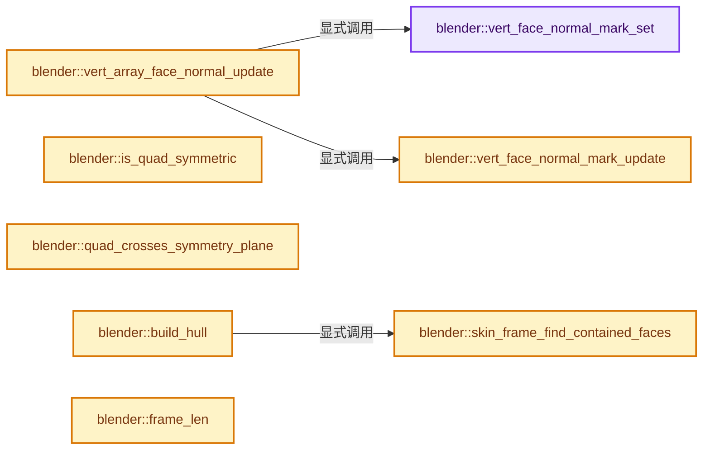
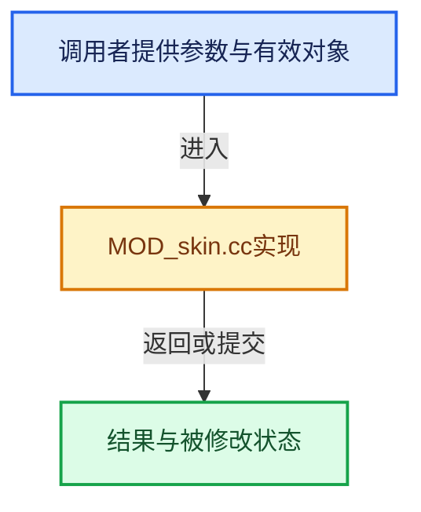

# 实现依赖专题：source/blender/modifiers/intern/MOD_skin.cc

[方向导航](README.md) · [符号索引](../%E7%AC%A6%E5%8F%B7%E4%BE%9D%E8%B5%96%E4%B8%8E%E5%AE%9E%E7%8E%B0%E7%B4%A2%E5%BC%95.md)

本专题从正文实际调用进入，集中保存共享实现。函数有稳定锚点，可从调用处直接跳到对应完整函数；递归与互相调用通过回链组织。

## 本文件的实现关系






## 相关类型布局与成员入口

<a id="t-cb6e637bd225"></a>

### `blender::SkinNodeFlag`

原始声明：[source/blender/modifiers/intern/MOD_skin.cc](../../../../../source/blender/modifiers/intern/MOD_skin.cc) · L129—L134。

以下保留类的数据声明与编译条件，成员函数实现通过后面的精确链接阅读。

<!-- annotated:1ca6fb2a3c6487 -->

```cpp
enum SkinNodeFlag {
  CAP_START = 1,
  CAP_END = 2,
  SEAM_FRAME = 4,
  FLIP_NORMAL = 8,
};
```

<details>
<summary>核对原始源码：source/blender/modifiers/intern/MOD_skin.cc · L129—L134</summary>

<!-- original:1ca6fb2a3c6487:source/blender/modifiers/intern/MOD_skin.cc:129:134 -->

```cpp
enum SkinNodeFlag {
  CAP_START = 1,
  CAP_END = 2,
  SEAM_FRAME = 4,
  FLIP_NORMAL = 8,
};
```

</details>


<a id="t-51e05cf4875e"></a>

### `blender::eSkinErrorFlag`

原始声明：[source/blender/modifiers/intern/MOD_skin.cc](../../../../../source/blender/modifiers/intern/MOD_skin.cc) · L1906—L1909。

以下保留类的数据声明与编译条件，成员函数实现通过后面的精确链接阅读。

<!-- annotated:709d6a98bd3418 -->

```cpp
enum eSkinErrorFlag {
  SKIN_ERROR_NO_VALID_ROOT = (1 << 0),
  SKIN_ERROR_HULL = (1 << 1),
};
```

<details>
<summary>核对原始源码：source/blender/modifiers/intern/MOD_skin.cc · L1906—L1909</summary>

<!-- original:709d6a98bd3418:source/blender/modifiers/intern/MOD_skin.cc:1906:1909 -->

```cpp
enum eSkinErrorFlag {
  SKIN_ERROR_NO_VALID_ROOT = (1 << 0),
  SKIN_ERROR_HULL = (1 << 1),
};
```

</details>


## 完整成员与函数实现

<a id="f-6e85b84ccec22ee5"></a>

### `blender::vert_face_normal_mark_set`

实现位置：[source/blender/modifiers/intern/MOD_skin.cc](../../../../../source/blender/modifiers/intern/MOD_skin.cc) · L86—L93。

接口参数：

- `BMVert *v`

**教学注释版**

<!-- annotated:650fd453c953d2 -->

```cpp
static void vert_face_normal_mark_set(BMVert *v)
{
  BMIter iter;
  BMFace *f;
  BM_ITER_ELEM (f, &iter, v, BM_FACES_OF_VERT) {
    f->no[0] = FLT_MAX;
  }
}
```

<details>
<summary>核对原始源码：source/blender/modifiers/intern/MOD_skin.cc · L86—L93</summary>

<!-- original:650fd453c953d2:source/blender/modifiers/intern/MOD_skin.cc:86:93 -->

```cpp
static void vert_face_normal_mark_set(BMVert *v)
{
  BMIter iter;
  BMFace *f;
  BM_ITER_ELEM (f, &iter, v, BM_FACES_OF_VERT) {
    f->no[0] = FLT_MAX;
  }
}
```

</details>

**沿实际写入检查状态**

- `f->no[0] = FLT_MAX;`

**继续追踪实现**

- `BM_ITER_ELEM` → [BM_ITER_ELEM · L97](%E4%BE%9D%E8%B5%96-bmesh_iterators-13971c.md#m-751d15be7ee4)。宏定义由构建条件选择。

<a id="f-715ab5f0a4a03158"></a>

### `blender::vert_face_normal_mark_update`

实现位置：[source/blender/modifiers/intern/MOD_skin.cc](../../../../../source/blender/modifiers/intern/MOD_skin.cc) · L95—L104。

接口参数：

- `BMVert *v`

**教学注释版**

<!-- annotated:f1f71f871e88a5 -->

```cpp
static void vert_face_normal_mark_update(BMVert *v)
{
  BMIter iter;
  BMFace *f;
  BM_ITER_ELEM (f, &iter, v, BM_FACES_OF_VERT) {
    if (f->no[0] == FLT_MAX) {
      BM_face_normal_update(f);
    }
  }
}
```

<details>
<summary>核对原始源码：source/blender/modifiers/intern/MOD_skin.cc · L95—L104</summary>

<!-- original:f1f71f871e88a5:source/blender/modifiers/intern/MOD_skin.cc:95:104 -->

```cpp
static void vert_face_normal_mark_update(BMVert *v)
{
  BMIter iter;
  BMFace *f;
  BM_ITER_ELEM (f, &iter, v, BM_FACES_OF_VERT) {
    if (f->no[0] == FLT_MAX) {
      BM_face_normal_update(f);
    }
  }
}
```

</details>

**继续追踪实现**

- `BM_ITER_ELEM` → [BM_ITER_ELEM · L97](%E4%BE%9D%E8%B5%96-bmesh_iterators-13971c.md#m-751d15be7ee4)。宏定义由构建条件选择。
- `BM_face_normal_update` → [blender::BM_face_normal_update · L851](%E4%BE%9D%E8%B5%96-bmesh_polygon-a8ec8c.md#f-d8c9aad00022af01)。

<a id="f-ba2e95d9c3d864da"></a>

### `blender::vert_array_face_normal_update`

实现位置：[source/blender/modifiers/intern/MOD_skin.cc](../../../../../source/blender/modifiers/intern/MOD_skin.cc) · L109—L118。

接口参数：

- `BMVert **verts`
- `int verts_len`

**教学注释版**

<!-- annotated:27724ae3cc2081 -->

```cpp
static void vert_array_face_normal_update(BMVert **verts, int verts_len)
{
  for (int i = 0; i < verts_len; i++) {
    vert_face_normal_mark_set(verts[i]);
  }

  for (int i = 0; i < verts_len; i++) {
    vert_face_normal_mark_update(verts[i]);
  }
}
```

<details>
<summary>核对原始源码：source/blender/modifiers/intern/MOD_skin.cc · L109—L118</summary>

<!-- original:27724ae3cc2081:source/blender/modifiers/intern/MOD_skin.cc:109:118 -->

```cpp
static void vert_array_face_normal_update(BMVert **verts, int verts_len)
{
  for (int i = 0; i < verts_len; i++) {
    vert_face_normal_mark_set(verts[i]);
  }

  for (int i = 0; i < verts_len; i++) {
    vert_face_normal_mark_update(verts[i]);
  }
}
```

</details>

**继续追踪实现**

- `vert_face_normal_mark_set` → [blender::vert_face_normal_mark_set · L86](%E4%BE%9D%E8%B5%96-MOD_skin-4e2c68.md#f-6e85b84ccec22ee5)。
- `vert_face_normal_mark_update` → [blender::vert_face_normal_mark_update · L95](%E4%BE%9D%E8%B5%96-MOD_skin-4e2c68.md#f-715ab5f0a4a03158)。

<a id="f-96f4e36ff3e8dc03"></a>

### `blender::is_quad_symmetric`

实现位置：[source/blender/modifiers/intern/MOD_skin.cc](../../../../../source/blender/modifiers/intern/MOD_skin.cc) · L182—L213。

接口参数：

- `BMVert *quad[4]`
- `const SkinModifierData *smd`

**教学注释版**

<!-- annotated:9c3a0aa7643e2a -->

```cpp
static bool is_quad_symmetric(BMVert *quad[4], const SkinModifierData *smd)
{
  const float threshold = 0.0001f;
  const float threshold_squared = threshold * threshold;
  int axis;

  for (axis = 0; axis < 3; axis++) {
    if (smd->symmetry_axes & (1 << axis)) {
      float a[3];

      copy_v3_v3(a, quad[0]->co);
      a[axis] = -a[axis];

      if (len_squared_v3v3(a, quad[1]->co) < threshold_squared) {
        copy_v3_v3(a, quad[2]->co);
        a[axis] = -a[axis];
        if (len_squared_v3v3(a, quad[3]->co) < threshold_squared) {
          return true;
        }
      }
      else if (len_squared_v3v3(a, quad[3]->co) < threshold_squared) {
        copy_v3_v3(a, quad[2]->co);
        a[axis] = -a[axis];
        if (len_squared_v3v3(a, quad[1]->co) < threshold_squared) {
          return true;
        }
      }
    }
  }

  return false;
}
```

<details>
<summary>核对原始源码：source/blender/modifiers/intern/MOD_skin.cc · L182—L213</summary>

<!-- original:9c3a0aa7643e2a:source/blender/modifiers/intern/MOD_skin.cc:182:213 -->

```cpp
static bool is_quad_symmetric(BMVert *quad[4], const SkinModifierData *smd)
{
  const float threshold = 0.0001f;
  const float threshold_squared = threshold * threshold;
  int axis;

  for (axis = 0; axis < 3; axis++) {
    if (smd->symmetry_axes & (1 << axis)) {
      float a[3];

      copy_v3_v3(a, quad[0]->co);
      a[axis] = -a[axis];

      if (len_squared_v3v3(a, quad[1]->co) < threshold_squared) {
        copy_v3_v3(a, quad[2]->co);
        a[axis] = -a[axis];
        if (len_squared_v3v3(a, quad[3]->co) < threshold_squared) {
          return true;
        }
      }
      else if (len_squared_v3v3(a, quad[3]->co) < threshold_squared) {
        copy_v3_v3(a, quad[2]->co);
        a[axis] = -a[axis];
        if (len_squared_v3v3(a, quad[1]->co) < threshold_squared) {
          return true;
        }
      }
    }
  }

  return false;
}
```

</details>

**沿实际写入检查状态**

- `a[axis] = -a[axis];`

**结果出口**

- `return true;`
- `return false;`

**继续追踪实现**

- `copy_v3_v3` → [blender::copy_v3_v3 · L47](../12-%E7%A9%BA%E9%97%B4%E6%95%B0%E6%8D%AE%E7%BB%93%E6%9E%84%E4%B8%8E%E5%87%A0%E4%BD%95%E7%AE%97%E6%B3%95/%E4%BE%9D%E8%B5%96-math_vector_inline-0c8541.md#f-037a0d5fa5060bd6)。
- `len_squared_v3v3` → [blender::len_squared_v3v3 · L794](../12-%E7%A9%BA%E9%97%B4%E6%95%B0%E6%8D%AE%E7%BB%93%E6%9E%84%E4%B8%8E%E5%87%A0%E4%BD%95%E7%AE%97%E6%B3%95/%E4%BE%9D%E8%B5%96-math_vector_inline-0c8541.md#f-ae487ac3ef64aa87)。

<a id="f-47add1a049545962"></a>

### `blender::quad_crosses_symmetry_plane`

实现位置：[source/blender/modifiers/intern/MOD_skin.cc](../../../../../source/blender/modifiers/intern/MOD_skin.cc) · L216—L241。

接口参数：

- `BMVert *quad[4]`
- `const SkinModifierData *smd`

**教学注释版**

<!-- annotated:84b4194b4c8b2e -->

```cpp
static bool quad_crosses_symmetry_plane(BMVert *quad[4], const SkinModifierData *smd)
{
  int axis;

  for (axis = 0; axis < 3; axis++) {
    if (smd->symmetry_axes & (1 << axis)) {
      bool left = false, right = false;
      int i;

      for (i = 0; i < 4; i++) {
        if (quad[i]->co[axis] < 0.0f) {
          left = true;
        }
        else if (quad[i]->co[axis] > 0.0f) {
          right = true;
        }

        if (left && right) {
          return true;
        }
      }
    }
  }

  return false;
}
```

<details>
<summary>核对原始源码：source/blender/modifiers/intern/MOD_skin.cc · L216—L241</summary>

<!-- original:84b4194b4c8b2e:source/blender/modifiers/intern/MOD_skin.cc:216:241 -->

```cpp
static bool quad_crosses_symmetry_plane(BMVert *quad[4], const SkinModifierData *smd)
{
  int axis;

  for (axis = 0; axis < 3; axis++) {
    if (smd->symmetry_axes & (1 << axis)) {
      bool left = false, right = false;
      int i;

      for (i = 0; i < 4; i++) {
        if (quad[i]->co[axis] < 0.0f) {
          left = true;
        }
        else if (quad[i]->co[axis] > 0.0f) {
          right = true;
        }

        if (left && right) {
          return true;
        }
      }
    }
  }

  return false;
}
```

</details>

**沿实际写入检查状态**

- `left = true;`
- `right = true;`

**结果出口**

- `return true;`
- `return false;`

**继续追踪实现**

本实现没有需要继续展开的显式调用；检查返回表达式、对象转换和调用者前置条件。

<a id="f-4f4988c94c7d3aee"></a>

### `blender::skin_frame_find_contained_faces`

实现位置：[source/blender/modifiers/intern/MOD_skin.cc](../../../../../source/blender/modifiers/intern/MOD_skin.cc) · L247—L262。

接口参数：

- `const Frame *frame`
- `BMFace *fill_faces[2]`

**教学注释版**

<!-- annotated:02d5eb25599432 -->

```cpp
static bool skin_frame_find_contained_faces(const Frame *frame, BMFace *fill_faces[2])
{
  BMEdge *diag;

  /* See if the frame is bisected by a diagonal edge */
  diag = BM_edge_exists(frame->verts[0], frame->verts[2]);
  if (!diag) {
    diag = BM_edge_exists(frame->verts[1], frame->verts[3]);
  }

  if (diag) {
    return BM_edge_face_pair(diag, &fill_faces[0], &fill_faces[1]);
  }

  return false;
}
```

<details>
<summary>核对原始源码：source/blender/modifiers/intern/MOD_skin.cc · L247—L262</summary>

<!-- original:02d5eb25599432:source/blender/modifiers/intern/MOD_skin.cc:247:262 -->

```cpp
static bool skin_frame_find_contained_faces(const Frame *frame, BMFace *fill_faces[2])
{
  BMEdge *diag;

  /* See if the frame is bisected by a diagonal edge */
  diag = BM_edge_exists(frame->verts[0], frame->verts[2]);
  if (!diag) {
    diag = BM_edge_exists(frame->verts[1], frame->verts[3]);
  }

  if (diag) {
    return BM_edge_face_pair(diag, &fill_faces[0], &fill_faces[1]);
  }

  return false;
}
```

</details>

**沿实际写入检查状态**

- `diag = BM_edge_exists(frame->verts[0], frame->verts[2]);`
- `diag = BM_edge_exists(frame->verts[1], frame->verts[3]);`

**结果出口**

- `return BM_edge_face_pair(diag, &fill_faces[0], &fill_faces[1]);`
- `return false;`

**继续追踪实现**

- `BM_edge_exists` → [blender::BM_edge_exists · L1551](%E4%BE%9D%E8%B5%96-bmesh_query-b0f8d6.md#f-f9a007e7659d480b)；[blender::BM_edge_exists · L1568](%E4%BE%9D%E8%B5%96-bmesh_query-b0f8d6.md#f-e774a553f01590ed)。同名重载需按实参类型选择。
- `BM_edge_face_pair` → [blender::BM_edge_face_pair · L550](%E4%BE%9D%E8%B5%96-bmesh_query-b0f8d6.md#f-ac1d8967087da3d0)。

<a id="f-e85bf2feda21658b"></a>

### `blender::build_hull`

实现位置：[source/blender/modifiers/intern/MOD_skin.cc](../../../../../source/blender/modifiers/intern/MOD_skin.cc) · L267—L385。

接口参数：

- `SkinOutput *so`
- `Frame **frames`
- `int totframe`

**教学注释版**

<!-- annotated:f5239a0861b54c -->

```cpp
static bool build_hull(SkinOutput *so, Frame **frames, int totframe)
{
#ifdef WITH_BULLET
  BMesh *bm = so->bm;
  BMOperator op;
  BMIter iter;
  BMOIter oiter;
  BMVert *v;
  BMFace *f;
  BMEdge *e;
  int i, j;

  BM_mesh_elem_hflag_disable_all(bm, BM_VERT, BM_ELEM_TAG, false);

  for (i = 0; i < totframe; i++) {
    for (j = 0; j < 4; j++) {
      BM_elem_flag_enable(frames[i]->verts[j], BM_ELEM_TAG);
    }
  }

  /* Deselect all faces so that only new hull output faces are
   * selected after the operator is run */
  BM_mesh_elem_hflag_disable_all(bm, BM_ALL_NOLOOP, BM_ELEM_SELECT, false);

  BMO_op_initf(
      bm, &op, (BMO_FLAG_DEFAULTS & ~BMO_FLAG_RESPECT_HIDE), "convex_hull input=%hv", BM_ELEM_TAG);
  BMO_op_exec(bm, &op);

  if (BMO_error_occurred_at_level(bm, BMO_ERROR_CANCEL)) {
    BMO_op_finish(bm, &op);
    return false;
  }

  /* Apply face attributes to hull output */
  BMO_ITER (f, &oiter, op.slots_out, "geom.out", BM_FACE) {
    BM_face_normal_update(f);
    if (so->smd->flag & MOD_SKIN_SMOOTH_SHADING) {
      BM_elem_flag_enable(f, BM_ELEM_SMOOTH);
    }
    f->mat_nr = so->mat_nr;
  }

  /* Mark interior frames */
  BMO_ITER (v, &oiter, op.slots_out, "geom_interior.out", BM_VERT) {
    for (i = 0; i < totframe; i++) {
      Frame *frame = frames[i];

      if (!frame->detached) {
        for (j = 0; j < 4; j++) {
          if (frame->verts[j] == v) {
            frame->inside_hull[j] = true;
            frame->detached = true;
            break;
          }
        }
      }
    }
  }

  /* Also mark frames as interior if an edge is not in the hull */
  for (i = 0; i < totframe; i++) {
    Frame *frame = frames[i];

    if (!frame->detached && (!BM_edge_exists(frame->verts[0], frame->verts[1]) ||
                             !BM_edge_exists(frame->verts[1], frame->verts[2]) ||
                             !BM_edge_exists(frame->verts[2], frame->verts[3]) ||
                             !BM_edge_exists(frame->verts[3], frame->verts[0])))
    {
      frame->detached = true;
    }
  }

  /* Remove triangles that would fill the original frames -- skip if
   * frame is partially detached */
  BM_mesh_elem_hflag_disable_all(bm, BM_ALL_NOLOOP, BM_ELEM_TAG, false);
  for (i = 0; i < totframe; i++) {
    Frame *frame = frames[i];
    if (!frame->detached) {
      BMFace *fill_faces[2];

      /* Check if the frame is filled by precisely two
       * triangles. If so, delete the triangles and their shared
       * edge. Otherwise, give up and mark the frame as
       * detached. */
      if (skin_frame_find_contained_faces(frame, fill_faces)) {
        BM_elem_flag_enable(fill_faces[0], BM_ELEM_TAG);
        BM_elem_flag_enable(fill_faces[1], BM_ELEM_TAG);
      }
      else {
        frame->detached = true;
      }
    }
  }

  /* Check if removing triangles above will create wire triangles,
   * mark them too */
  BMO_ITER (e, &oiter, op.slots_out, "geom.out", BM_EDGE) {
    bool is_wire = true;
    BM_ITER_ELEM (f, &iter, e, BM_FACES_OF_EDGE) {
      if (!BM_elem_flag_test(f, BM_ELEM_TAG)) {
        is_wire = false;
        break;
      }
    }
    if (is_wire) {
      BM_elem_flag_enable(e, BM_ELEM_TAG);
    }
  }

  BMO_op_finish(bm, &op);

  BM_mesh_delete_hflag_tagged(bm, BM_ELEM_TAG, BM_EDGE | BM_FACE);

  return true;
#else
  UNUSED_VARS(so, frames, totframe);
  return false;
#endif
}
```

<details>
<summary>核对原始源码：source/blender/modifiers/intern/MOD_skin.cc · L267—L385</summary>

<!-- original:f5239a0861b54c:source/blender/modifiers/intern/MOD_skin.cc:267:385 -->

```cpp
static bool build_hull(SkinOutput *so, Frame **frames, int totframe)
{
#ifdef WITH_BULLET
  BMesh *bm = so->bm;
  BMOperator op;
  BMIter iter;
  BMOIter oiter;
  BMVert *v;
  BMFace *f;
  BMEdge *e;
  int i, j;

  BM_mesh_elem_hflag_disable_all(bm, BM_VERT, BM_ELEM_TAG, false);

  for (i = 0; i < totframe; i++) {
    for (j = 0; j < 4; j++) {
      BM_elem_flag_enable(frames[i]->verts[j], BM_ELEM_TAG);
    }
  }

  /* Deselect all faces so that only new hull output faces are
   * selected after the operator is run */
  BM_mesh_elem_hflag_disable_all(bm, BM_ALL_NOLOOP, BM_ELEM_SELECT, false);

  BMO_op_initf(
      bm, &op, (BMO_FLAG_DEFAULTS & ~BMO_FLAG_RESPECT_HIDE), "convex_hull input=%hv", BM_ELEM_TAG);
  BMO_op_exec(bm, &op);

  if (BMO_error_occurred_at_level(bm, BMO_ERROR_CANCEL)) {
    BMO_op_finish(bm, &op);
    return false;
  }

  /* Apply face attributes to hull output */
  BMO_ITER (f, &oiter, op.slots_out, "geom.out", BM_FACE) {
    BM_face_normal_update(f);
    if (so->smd->flag & MOD_SKIN_SMOOTH_SHADING) {
      BM_elem_flag_enable(f, BM_ELEM_SMOOTH);
    }
    f->mat_nr = so->mat_nr;
  }

  /* Mark interior frames */
  BMO_ITER (v, &oiter, op.slots_out, "geom_interior.out", BM_VERT) {
    for (i = 0; i < totframe; i++) {
      Frame *frame = frames[i];

      if (!frame->detached) {
        for (j = 0; j < 4; j++) {
          if (frame->verts[j] == v) {
            frame->inside_hull[j] = true;
            frame->detached = true;
            break;
          }
        }
      }
    }
  }

  /* Also mark frames as interior if an edge is not in the hull */
  for (i = 0; i < totframe; i++) {
    Frame *frame = frames[i];

    if (!frame->detached && (!BM_edge_exists(frame->verts[0], frame->verts[1]) ||
                             !BM_edge_exists(frame->verts[1], frame->verts[2]) ||
                             !BM_edge_exists(frame->verts[2], frame->verts[3]) ||
                             !BM_edge_exists(frame->verts[3], frame->verts[0])))
    {
      frame->detached = true;
    }
  }

  /* Remove triangles that would fill the original frames -- skip if
   * frame is partially detached */
  BM_mesh_elem_hflag_disable_all(bm, BM_ALL_NOLOOP, BM_ELEM_TAG, false);
  for (i = 0; i < totframe; i++) {
    Frame *frame = frames[i];
    if (!frame->detached) {
      BMFace *fill_faces[2];

      /* Check if the frame is filled by precisely two
       * triangles. If so, delete the triangles and their shared
       * edge. Otherwise, give up and mark the frame as
       * detached. */
      if (skin_frame_find_contained_faces(frame, fill_faces)) {
        BM_elem_flag_enable(fill_faces[0], BM_ELEM_TAG);
        BM_elem_flag_enable(fill_faces[1], BM_ELEM_TAG);
      }
      else {
        frame->detached = true;
      }
    }
  }

  /* Check if removing triangles above will create wire triangles,
   * mark them too */
  BMO_ITER (e, &oiter, op.slots_out, "geom.out", BM_EDGE) {
    bool is_wire = true;
    BM_ITER_ELEM (f, &iter, e, BM_FACES_OF_EDGE) {
      if (!BM_elem_flag_test(f, BM_ELEM_TAG)) {
        is_wire = false;
        break;
      }
    }
    if (is_wire) {
      BM_elem_flag_enable(e, BM_ELEM_TAG);
    }
  }

  BMO_op_finish(bm, &op);

  BM_mesh_delete_hflag_tagged(bm, BM_ELEM_TAG, BM_EDGE | BM_FACE);

  return true;
#else
  UNUSED_VARS(so, frames, totframe);
  return false;
#endif
}
```

</details>

**沿实际写入检查状态**

- `f->mat_nr = so->mat_nr;`
- `frame->inside_hull[j] = true;`
- `frame->detached = true;`
- `is_wire = false;`

**结果出口**

- `return false;`
- `return true;`

**继续追踪实现**

- `BM_mesh_elem_hflag_disable_all` → [blender::BM_mesh_elem_hflag_disable_all · L1481](%E4%BE%9D%E8%B5%96-bmesh_marking-fbaba1.md#f-601d34b24dc72396)。
- `BM_elem_flag_enable` → [BM_elem_flag_enable · L23](%E4%BE%9D%E8%B5%96-bmesh_inline-74f1be.md#m-4400242f1540)。宏定义由构建条件选择。
- `BMO_op_initf` → [blender::BMO_op_initf · L1884](%E4%BE%9D%E8%B5%96-bmesh_operators-ef2e74.md#f-f2bf723e95b087ed)。
- `BMO_op_exec` → [blender::BMO_op_exec · L168](%E4%BE%9D%E8%B5%96-bmesh_operators-ef2e74.md#f-ee792a4c12a5fa82)。
- `BMO_error_occurred_at_level` → [blender::BMO_error_occurred_at_level · L1499](%E4%BE%9D%E8%B5%96-bmesh_operators-ef2e74.md#f-1202f37254616234)。
- `BMO_op_finish` → [blender::BMO_op_finish · L187](%E4%BE%9D%E8%B5%96-bmesh_operators-ef2e74.md#f-46b0ea2e3bf3ab00)。
- `BMO_ITER` → [BMO_ITER · L832](%E4%BE%9D%E8%B5%96-bmesh_operator_api-4be594.md#m-234e0d75cc35)。宏定义由构建条件选择。
- `BM_face_normal_update` → [blender::BM_face_normal_update · L851](%E4%BE%9D%E8%B5%96-bmesh_polygon-a8ec8c.md#f-d8c9aad00022af01)。
- `BM_edge_exists` → [blender::BM_edge_exists · L1551](%E4%BE%9D%E8%B5%96-bmesh_query-b0f8d6.md#f-f9a007e7659d480b)；[blender::BM_edge_exists · L1568](%E4%BE%9D%E8%B5%96-bmesh_query-b0f8d6.md#f-e774a553f01590ed)。同名重载需按实参类型选择。
- `skin_frame_find_contained_faces` → [blender::skin_frame_find_contained_faces · L247](%E4%BE%9D%E8%B5%96-MOD_skin-4e2c68.md#f-4f4988c94c7d3aee)。
- `BM_ITER_ELEM` → [BM_ITER_ELEM · L97](%E4%BE%9D%E8%B5%96-bmesh_iterators-13971c.md#m-751d15be7ee4)。宏定义由构建条件选择。
- `BM_elem_flag_test` → [BM_elem_flag_test · L21](%E4%BE%9D%E8%B5%96-bmesh_inline-74f1be.md#m-2431d1179b41)。宏定义由构建条件选择。
- `BM_mesh_delete_hflag_tagged` → [blender::BM_mesh_delete_hflag_tagged · L261](%E4%BE%9D%E8%B5%96-bmesh_delete-b9452c.md#f-a87db72189aa9858)。
- `UNUSED_VARS` → [UNUSED_VARS · L522](../01-%E5%9F%BA%E7%A1%80%E5%AE%B9%E5%99%A8%E4%B8%8E%E7%8E%B0%E4%BB%A3CPP/%E4%BE%9D%E8%B5%96-BLI_utildefines-293a0a.md#m-013582537634)；[UNUSED_VARS · L41](%E4%BE%9D%E8%B5%96-GPU_shader_shared_utils-0adda3.md#m-05d9d7a33da0)；[UNUSED_VARS · L62](%E4%BE%9D%E8%B5%96-GPU_shader_shared_utils-0adda3.md#m-e12c683a4aca)。宏定义由构建条件选择。

<a id="f-124984156e64a120"></a>

### `blender::frame_len`

实现位置：[source/blender/modifiers/intern/MOD_skin.cc](../../../../../source/blender/modifiers/intern/MOD_skin.cc) · L389—L392。

接口参数：

- `const Frame *frame`

**教学注释版**

<!-- annotated:33cbac8951237e -->

```cpp
static float frame_len(const Frame *frame)
{
  return (len_v3v3(frame->co[0], frame->co[1]) + len_v3v3(frame->co[1], frame->co[2])) * 0.5f;
}
```

<details>
<summary>核对原始源码：source/blender/modifiers/intern/MOD_skin.cc · L389—L392</summary>

<!-- original:33cbac8951237e:source/blender/modifiers/intern/MOD_skin.cc:389:392 -->

```cpp
static float frame_len(const Frame *frame)
{
  return (len_v3v3(frame->co[0], frame->co[1]) + len_v3v3(frame->co[1], frame->co[2])) * 0.5f;
}
```

</details>

**结果出口**

- `return (len_v3v3(frame->co[0], frame->co[1]) + len_v3v3(frame->co[1], frame->co[2])) * 0.5f;`

**继续追踪实现**

- `len_v3v3` → [blender::len_v3v3 · L826](../12-%E7%A9%BA%E9%97%B4%E6%95%B0%E6%8D%AE%E7%BB%93%E6%9E%84%E4%B8%8E%E5%87%A0%E4%BD%95%E7%AE%97%E6%B3%95/%E4%BE%9D%E8%B5%96-math_vector_inline-0c8541.md#f-c873370566848169)。

<a id="f-0870b399c9188f14"></a>

### `blender::merge_frame_corners`

实现位置：[source/blender/modifiers/intern/MOD_skin.cc](../../../../../source/blender/modifiers/intern/MOD_skin.cc) · L394—L456。

接口参数：

- `Frame **frames`
- `int totframe`

**教学注释版**

<!-- annotated:0f057198e7eada -->

```cpp
static void merge_frame_corners(Frame **frames, int totframe)
{
  float dist, side_a, side_b, thresh, mid[3];
  int i, j, k, l;

  for (i = 0; i < totframe; i++) {
    side_a = frame_len(frames[i]);

    /* For each corner of each frame... */
    for (j = 0; j < 4; j++) {

      /* Ensure the merge target is not itself a merge target */
      if (frames[i]->merge[j].frame) {
        continue;
      }

      for (k = i + 1; k < totframe; k++) {
        BLI_assert(frames[i] != frames[k]);

        side_b = frame_len(frames[k]);
        thresh = min_ff(side_a, side_b) / 2.0f;

        /* Compare with each corner of all other frames... */
        for (l = 0; l < 4; l++) {
          if (frames[k]->merge[l].frame || frames[k]->merge[l].is_target) {
            continue;
          }

          /* Some additional concerns that could be checked
           * further:
           *
           * + Vertex coords are being used for the
           *   edge-length test, but are also being
           *   modified, might cause symmetry problems.
           *
           * + A frame could be merged diagonally across
           *   another, would generate a weird (bad) T
           *   junction
           */

          /* Check if corners are near each other, where
           * 'near' is based in the frames' minimum side
           * length */
          dist = len_v3v3(frames[i]->co[j], frames[k]->co[l]);
          if (dist < thresh) {
            mid_v3_v3v3(mid, frames[i]->co[j], frames[k]->co[l]);

            copy_v3_v3(frames[i]->co[j], mid);
            copy_v3_v3(frames[k]->co[l], mid);

            frames[k]->merge[l].frame = frames[i];
            frames[k]->merge[l].corner = j;
            frames[i]->merge[j].is_target = true;

            /* Can't merge another corner into the same
             * frame corner, so move on to frame k+1 */
            break;
          }
        }
      }
    }
  }
}
```

<details>
<summary>核对原始源码：source/blender/modifiers/intern/MOD_skin.cc · L394—L456</summary>

<!-- original:0f057198e7eada:source/blender/modifiers/intern/MOD_skin.cc:394:456 -->

```cpp
static void merge_frame_corners(Frame **frames, int totframe)
{
  float dist, side_a, side_b, thresh, mid[3];
  int i, j, k, l;

  for (i = 0; i < totframe; i++) {
    side_a = frame_len(frames[i]);

    /* For each corner of each frame... */
    for (j = 0; j < 4; j++) {

      /* Ensure the merge target is not itself a merge target */
      if (frames[i]->merge[j].frame) {
        continue;
      }

      for (k = i + 1; k < totframe; k++) {
        BLI_assert(frames[i] != frames[k]);

        side_b = frame_len(frames[k]);
        thresh = min_ff(side_a, side_b) / 2.0f;

        /* Compare with each corner of all other frames... */
        for (l = 0; l < 4; l++) {
          if (frames[k]->merge[l].frame || frames[k]->merge[l].is_target) {
            continue;
          }

          /* Some additional concerns that could be checked
           * further:
           *
           * + Vertex coords are being used for the
           *   edge-length test, but are also being
           *   modified, might cause symmetry problems.
           *
           * + A frame could be merged diagonally across
           *   another, would generate a weird (bad) T
           *   junction
           */

          /* Check if corners are near each other, where
           * 'near' is based in the frames' minimum side
           * length */
          dist = len_v3v3(frames[i]->co[j], frames[k]->co[l]);
          if (dist < thresh) {
            mid_v3_v3v3(mid, frames[i]->co[j], frames[k]->co[l]);

            copy_v3_v3(frames[i]->co[j], mid);
            copy_v3_v3(frames[k]->co[l], mid);

            frames[k]->merge[l].frame = frames[i];
            frames[k]->merge[l].corner = j;
            frames[i]->merge[j].is_target = true;

            /* Can't merge another corner into the same
             * frame corner, so move on to frame k+1 */
            break;
          }
        }
      }
    }
  }
}
```

</details>

**沿实际写入检查状态**

- `side_a = frame_len(frames[i]);`
- `side_b = frame_len(frames[k]);`
- `thresh = min_ff(side_a, side_b) / 2.0f;`
- `dist = len_v3v3(frames[i]->co[j], frames[k]->co[l]);`
- `frames[k]->merge[l].frame = frames[i];`
- `frames[k]->merge[l].corner = j;`
- `frames[i]->merge[j].is_target = true;`

**继续追踪实现**

- `frame_len` → [blender::frame_len · L389](%E4%BE%9D%E8%B5%96-MOD_skin-4e2c68.md#f-124984156e64a120)。
- `BLI_assert` → [BLI_assert · L48](../01-%E5%9F%BA%E7%A1%80%E5%AE%B9%E5%99%A8%E4%B8%8E%E7%8E%B0%E4%BB%A3CPP/%E4%BE%9D%E8%B5%96-BLI_assert-cc98e8.md#m-57a88495704d)；[BLI_assert · L63](../01-%E5%9F%BA%E7%A1%80%E5%AE%B9%E5%99%A8%E4%B8%8E%E7%8E%B0%E4%BB%A3CPP/%E4%BE%9D%E8%B5%96-BLI_assert-cc98e8.md#m-d07050020cb5)。宏定义由构建条件选择。
- `min_ff` → [blender::min_ff · L321](../12-%E7%A9%BA%E9%97%B4%E6%95%B0%E6%8D%AE%E7%BB%93%E6%9E%84%E4%B8%8E%E5%87%A0%E4%BD%95%E7%AE%97%E6%B3%95/%E4%BE%9D%E8%B5%96-math_base_inline-546b00.md#f-5b8d83d6f191be1a)。
- `len_v3v3` → [blender::len_v3v3 · L826](../12-%E7%A9%BA%E9%97%B4%E6%95%B0%E6%8D%AE%E7%BB%93%E6%9E%84%E4%B8%8E%E5%87%A0%E4%BD%95%E7%AE%97%E6%B3%95/%E4%BE%9D%E8%B5%96-math_vector_inline-0c8541.md#f-c873370566848169)。
- `mid_v3_v3v3` → [blender::mid_v3_v3v3 · L183](../12-%E7%A9%BA%E9%97%B4%E6%95%B0%E6%8D%AE%E7%BB%93%E6%9E%84%E4%B8%8E%E5%87%A0%E4%BD%95%E7%AE%97%E6%B3%95/%E4%BE%9D%E8%B5%96-math_vector-5f35fa.md#f-b748c1b0b472ad9b)。
- `copy_v3_v3` → [blender::copy_v3_v3 · L47](../12-%E7%A9%BA%E9%97%B4%E6%95%B0%E6%8D%AE%E7%BB%93%E6%9E%84%E4%B8%8E%E5%87%A0%E4%BD%95%E7%AE%97%E6%B3%95/%E4%BE%9D%E8%B5%96-math_vector_inline-0c8541.md#f-037a0d5fa5060bd6)。

<a id="f-17165083f899e649"></a>

### `blender::collect_hull_frames`

实现位置：[source/blender/modifiers/intern/MOD_skin.cc](../../../../../source/blender/modifiers/intern/MOD_skin.cc) · L458—L481。

接口参数：

- `int v`
- `SkinNode *frames`
- `GroupedSpan<int> emap`
- `const Span<int2> edges`
- `int *tothullframe`

**教学注释版**

<!-- annotated:04b2b0e294b3b9 -->

```cpp
static Frame **collect_hull_frames(
    int v, SkinNode *frames, GroupedSpan<int> emap, const Span<int2> edges, int *tothullframe)
{
  SkinNode *f;
  Frame **hull_frames;
  int hull_frames_num, i;

  (*tothullframe) = emap[v].size();
  hull_frames = MEM_new_array_zeroed<Frame *>(*tothullframe, __func__);
  hull_frames_num = 0;
  for (i = 0; i < emap[v].size(); i++) {
    const int2 &edge = edges[emap[v][i]];
    f = &frames[bke::mesh::edge_other_vert(edge, v)];
    /* Can't have adjacent branch nodes yet */
    if (f->totframe) {
      hull_frames[hull_frames_num++] = &f->frames[0];
    }
    else {
      (*tothullframe)--;
    }
  }

  return hull_frames;
}
```

<details>
<summary>核对原始源码：source/blender/modifiers/intern/MOD_skin.cc · L458—L481</summary>

<!-- original:04b2b0e294b3b9:source/blender/modifiers/intern/MOD_skin.cc:458:481 -->

```cpp
static Frame **collect_hull_frames(
    int v, SkinNode *frames, GroupedSpan<int> emap, const Span<int2> edges, int *tothullframe)
{
  SkinNode *f;
  Frame **hull_frames;
  int hull_frames_num, i;

  (*tothullframe) = emap[v].size();
  hull_frames = MEM_new_array_zeroed<Frame *>(*tothullframe, __func__);
  hull_frames_num = 0;
  for (i = 0; i < emap[v].size(); i++) {
    const int2 &edge = edges[emap[v][i]];
    f = &frames[bke::mesh::edge_other_vert(edge, v)];
    /* Can't have adjacent branch nodes yet */
    if (f->totframe) {
      hull_frames[hull_frames_num++] = &f->frames[0];
    }
    else {
      (*tothullframe)--;
    }
  }

  return hull_frames;
}
```

</details>

**沿实际写入检查状态**

- `hull_frames = MEM_new_array_zeroed<Frame *>(*tothullframe, __func__);`
- `hull_frames_num = 0;`
- `f = &frames[bke::mesh::edge_other_vert(edge, v)];`

**结果出口**

- `return hull_frames;`

**继续追踪实现**

- `emap[v].size` → [调用协议](../%E6%A8%A1%E6%9D%BF%E5%AE%8F%E4%B8%8E%E5%8A%A8%E6%80%81%E5%88%86%E6%B4%BE%E5%8D%8F%E8%AE%AE.md)：接收对象类型依赖auto、返回值或模板实例；不按同名猜测目标。调用位置L465。
- `MEM_new_array_zeroed<Frame *>` → [MEM_new_array_zeroed · L566](../03-%E5%86%85%E5%AD%98%E5%88%86%E9%85%8D%E4%B8%8E%E8%BF%90%E8%A1%8C%E6%97%B6%E7%B1%BB%E5%9E%8B/%E4%BE%9D%E8%B5%96-MEM_guardedalloc-b54eca.md#f-3a0cf63fb5216500)；[MEM_new_array_zeroed · L119](../03-%E5%86%85%E5%AD%98%E5%88%86%E9%85%8D%E4%B8%8E%E8%BF%90%E8%A1%8C%E6%97%B6%E7%B1%BB%E5%9E%8B/%E4%BE%9D%E8%B5%96-mallocn-afdcd4.md#f-6825557da566fdbe)。同名重载需按实参类型选择。
- `bke::mesh::edge_other_vert` → [blender::bke::mesh::edge_other_vert · L370](01-Mesh%E9%A1%B6%E7%82%B9%E8%BE%B9%E9%9D%A2%E8%A7%92%E7%82%B9.md#f-1490bc33956b55a1)。

<a id="f-a93ac60c565cf412"></a>

### `blender::node_frames_init`

实现位置：[source/blender/modifiers/intern/MOD_skin.cc](../../../../../source/blender/modifiers/intern/MOD_skin.cc) · L489—L500。

接口参数：

- `SkinNode *nf`
- `int totframe`

**教学注释版**

<!-- annotated:66547729490363 -->

```cpp
static void node_frames_init(SkinNode *nf, int totframe)
{
  int i;

  nf->totframe = totframe;
  // [讲解] memset：填充字节，不调用T构造函数，也不保证任意类型的全零表示是合法或期望值。
  memset(nf->frames, 0, sizeof(nf->frames));

  nf->flag = SkinNodeFlag(0);
  for (i = 0; i < 2; i++) {
    nf->seam_edges[i] = -1;
  }
}
```

<details>
<summary>核对原始源码：source/blender/modifiers/intern/MOD_skin.cc · L489—L500</summary>

<!-- original:66547729490363:source/blender/modifiers/intern/MOD_skin.cc:489:500 -->

```cpp
static void node_frames_init(SkinNode *nf, int totframe)
{
  int i;

  nf->totframe = totframe;
  memset(nf->frames, 0, sizeof(nf->frames));

  nf->flag = SkinNodeFlag(0);
  for (i = 0; i < 2; i++) {
    nf->seam_edges[i] = -1;
  }
}
```

</details>

**沿实际写入检查状态**

- `nf->totframe = totframe;`
- `nf->flag = SkinNodeFlag(0);`
- `nf->seam_edges[i] = -1;`

**继续追踪实现**

- `memset` → [外部契约](https://eel.is/c++draft/cstring.syn)：填充字节，不调用T构造函数，也不保证任意类型的全零表示是合法或期望值。
- `SkinNodeFlag` → [blender::SkinNodeFlag](%E4%BE%9D%E8%B5%96-MOD_skin-4e2c68.md#t-cb6e637bd225)。

<a id="f-a28a1ee77582898a"></a>

### `blender::create_frame`

实现位置：[source/blender/modifiers/intern/MOD_skin.cc](../../../../../source/blender/modifiers/intern/MOD_skin.cc) · L502—L527。

接口参数：

- `Frame *frame`
- `const float co[3]`
- `const float radius[2]`
- `const float mat[3][3]`
- `float offset`

**教学注释版**

<!-- annotated:17aa8f24e642c1 -->

```cpp
static void create_frame(
    Frame *frame, const float co[3], const float radius[2], const float mat[3][3], float offset)
{
  float rx[3], ry[3], rz[3];
  int i;

  mul_v3_v3fl(ry, mat[1], radius[0]);
  mul_v3_v3fl(rz, mat[2], radius[1]);

  add_v3_v3v3(frame->co[3], co, ry);
  add_v3_v3v3(frame->co[3], frame->co[3], rz);

  sub_v3_v3v3(frame->co[2], co, ry);
  add_v3_v3v3(frame->co[2], frame->co[2], rz);

  sub_v3_v3v3(frame->co[1], co, ry);
  sub_v3_v3v3(frame->co[1], frame->co[1], rz);

  add_v3_v3v3(frame->co[0], co, ry);
  sub_v3_v3v3(frame->co[0], frame->co[0], rz);

  mul_v3_v3fl(rx, mat[0], offset);
  for (i = 0; i < 4; i++) {
    add_v3_v3v3(frame->co[i], frame->co[i], rx);
  }
}
```

<details>
<summary>核对原始源码：source/blender/modifiers/intern/MOD_skin.cc · L502—L527</summary>

<!-- original:17aa8f24e642c1:source/blender/modifiers/intern/MOD_skin.cc:502:527 -->

```cpp
static void create_frame(
    Frame *frame, const float co[3], const float radius[2], const float mat[3][3], float offset)
{
  float rx[3], ry[3], rz[3];
  int i;

  mul_v3_v3fl(ry, mat[1], radius[0]);
  mul_v3_v3fl(rz, mat[2], radius[1]);

  add_v3_v3v3(frame->co[3], co, ry);
  add_v3_v3v3(frame->co[3], frame->co[3], rz);

  sub_v3_v3v3(frame->co[2], co, ry);
  add_v3_v3v3(frame->co[2], frame->co[2], rz);

  sub_v3_v3v3(frame->co[1], co, ry);
  sub_v3_v3v3(frame->co[1], frame->co[1], rz);

  add_v3_v3v3(frame->co[0], co, ry);
  sub_v3_v3v3(frame->co[0], frame->co[0], rz);

  mul_v3_v3fl(rx, mat[0], offset);
  for (i = 0; i < 4; i++) {
    add_v3_v3v3(frame->co[i], frame->co[i], rx);
  }
}
```

</details>

**继续追踪实现**

- `mul_v3_v3fl` → [blender::mul_v3_v3fl · L428](../12-%E7%A9%BA%E9%97%B4%E6%95%B0%E6%8D%AE%E7%BB%93%E6%9E%84%E4%B8%8E%E5%87%A0%E4%BD%95%E7%AE%97%E6%B3%95/%E4%BE%9D%E8%B5%96-math_vector_inline-0c8541.md#f-c3cb822497b967a8)。
- `add_v3_v3v3` → [blender::add_v3_v3v3 · L300](../12-%E7%A9%BA%E9%97%B4%E6%95%B0%E6%8D%AE%E7%BB%93%E6%9E%84%E4%B8%8E%E5%87%A0%E4%BD%95%E7%AE%97%E6%B3%95/%E4%BE%9D%E8%B5%96-math_vector_inline-0c8541.md#f-7343b459d0d3db69)。
- `sub_v3_v3v3` → [blender::sub_v3_v3v3 · L360](../12-%E7%A9%BA%E9%97%B4%E6%95%B0%E6%8D%AE%E7%BB%93%E6%9E%84%E4%B8%8E%E5%87%A0%E4%BD%95%E7%AE%97%E6%B3%95/%E4%BE%9D%E8%B5%96-math_vector_inline-0c8541.md#f-23781c252db8b30c)。

<a id="f-38ba4974c6ac9acc"></a>

### `blender::half_v2`

实现位置：[source/blender/modifiers/intern/MOD_skin.cc](../../../../../source/blender/modifiers/intern/MOD_skin.cc) · L529—L532。

接口参数：

- `const float v[2]`

**教学注释版**

<!-- annotated:d852c1ae95a239 -->

```cpp
static float half_v2(const float v[2])
{
  return (v[0] + v[1]) * 0.5f;
}
```

<details>
<summary>核对原始源码：source/blender/modifiers/intern/MOD_skin.cc · L529—L532</summary>

<!-- original:d852c1ae95a239:source/blender/modifiers/intern/MOD_skin.cc:529:532 -->

```cpp
static float half_v2(const float v[2])
{
  return (v[0] + v[1]) * 0.5f;
}
```

</details>

**结果出口**

- `return (v[0] + v[1]) * 0.5f;`

**继续追踪实现**

本实现没有需要继续展开的显式调用；检查返回表达式、对象转换和调用者前置条件。

<a id="f-d00f2f8129dd475c"></a>

### `blender::end_node_frames`

实现位置：[source/blender/modifiers/intern/MOD_skin.cc](../../../../../source/blender/modifiers/intern/MOD_skin.cc) · L534—L583。

接口参数：

- `int v`
- `SkinNode *skin_nodes`
- `const Span<float3> vert_positions`
- `const VArray<float2> &radius`
- `GroupedSpan<int> emap`
- `EMat *emat`

**教学注释版**

<!-- annotated:edb6f416c2d796 -->

```cpp
static void end_node_frames(int v,
                            SkinNode *skin_nodes,
                            const Span<float3> vert_positions,
                            const VArray<float2> &radius,
                            GroupedSpan<int> emap,
                            EMat *emat)
{
  const float2 rad = radius[v];
  float mat[3][3];

  if (emap[v].is_empty()) {
    float avg = half_v2(rad);

    /* For solitary nodes, just build a box (two frames) */
    node_frames_init(&skin_nodes[v], 2);
    skin_nodes[v].flag |= (CAP_START | CAP_END);

    /* Hardcoded basis */
    zero_m3(mat);
    mat[0][2] = mat[1][0] = mat[2][1] = 1;

    /* Caps */
    create_frame(&skin_nodes[v].frames[0], vert_positions[v], rad, mat, avg);
    create_frame(&skin_nodes[v].frames[1], vert_positions[v], rad, mat, -avg);
  }
  else {
    /* For nodes with an incoming edge, create a single (capped) frame */
    node_frames_init(&skin_nodes[v], 1);
    skin_nodes[v].flag |= CAP_START;

    /* Use incoming edge for orientation */
    copy_m3_m3(mat, emat[emap[v][0]].mat);
    if (emat[emap[v][0]].origin != v) {
      negate_v3(mat[0]);
    }

    Frame *frame = &skin_nodes[v].frames[0];

    /* End frame */
    create_frame(frame, vert_positions[v], rad, mat, 0);

    /* The caps might need to have their normals inverted. So check if they
     * need to be flipped when creating faces. */
    float normal[3];
    normal_quad_v3(normal, frame->co[0], frame->co[1], frame->co[2], frame->co[3]);
    if (dot_v3v3(mat[0], normal) < 0.0f) {
      skin_nodes[v].flag |= FLIP_NORMAL;
    }
  }
}
```

<details>
<summary>核对原始源码：source/blender/modifiers/intern/MOD_skin.cc · L534—L583</summary>

<!-- original:edb6f416c2d796:source/blender/modifiers/intern/MOD_skin.cc:534:583 -->

```cpp
static void end_node_frames(int v,
                            SkinNode *skin_nodes,
                            const Span<float3> vert_positions,
                            const VArray<float2> &radius,
                            GroupedSpan<int> emap,
                            EMat *emat)
{
  const float2 rad = radius[v];
  float mat[3][3];

  if (emap[v].is_empty()) {
    float avg = half_v2(rad);

    /* For solitary nodes, just build a box (two frames) */
    node_frames_init(&skin_nodes[v], 2);
    skin_nodes[v].flag |= (CAP_START | CAP_END);

    /* Hardcoded basis */
    zero_m3(mat);
    mat[0][2] = mat[1][0] = mat[2][1] = 1;

    /* Caps */
    create_frame(&skin_nodes[v].frames[0], vert_positions[v], rad, mat, avg);
    create_frame(&skin_nodes[v].frames[1], vert_positions[v], rad, mat, -avg);
  }
  else {
    /* For nodes with an incoming edge, create a single (capped) frame */
    node_frames_init(&skin_nodes[v], 1);
    skin_nodes[v].flag |= CAP_START;

    /* Use incoming edge for orientation */
    copy_m3_m3(mat, emat[emap[v][0]].mat);
    if (emat[emap[v][0]].origin != v) {
      negate_v3(mat[0]);
    }

    Frame *frame = &skin_nodes[v].frames[0];

    /* End frame */
    create_frame(frame, vert_positions[v], rad, mat, 0);

    /* The caps might need to have their normals inverted. So check if they
     * need to be flipped when creating faces. */
    float normal[3];
    normal_quad_v3(normal, frame->co[0], frame->co[1], frame->co[2], frame->co[3]);
    if (dot_v3v3(mat[0], normal) < 0.0f) {
      skin_nodes[v].flag |= FLIP_NORMAL;
    }
  }
}
```

</details>

**沿实际写入检查状态**

- `skin_nodes[v].flag |= (CAP_START | CAP_END);`
- `mat[0][2] = mat[1][0] = mat[2][1] = 1;`
- `skin_nodes[v].flag |= CAP_START;`
- `skin_nodes[v].flag |= FLIP_NORMAL;`

**继续追踪实现**

- `emap[v].is_empty` → [调用协议](../%E6%A8%A1%E6%9D%BF%E5%AE%8F%E4%B8%8E%E5%8A%A8%E6%80%81%E5%88%86%E6%B4%BE%E5%8D%8F%E8%AE%AE.md)：接收对象类型依赖auto、返回值或模板实例；不按同名猜测目标。调用位置L544。
- `half_v2` → [blender::half_v2 · L529](%E4%BE%9D%E8%B5%96-MOD_skin-4e2c68.md#f-38ba4974c6ac9acc)。
- `node_frames_init` → [blender::node_frames_init · L489](%E4%BE%9D%E8%B5%96-MOD_skin-4e2c68.md#f-a93ac60c565cf412)。
- `zero_m3` → [blender::zero_m3 · L30](../12-%E7%A9%BA%E9%97%B4%E6%95%B0%E6%8D%AE%E7%BB%93%E6%9E%84%E4%B8%8E%E5%87%A0%E4%BD%95%E7%AE%97%E6%B3%95/%E4%BE%9D%E8%B5%96-math_matrix_c-004123.md#f-f222ef9659a09668)。
- `create_frame` → [blender::create_frame · L502](%E4%BE%9D%E8%B5%96-MOD_skin-4e2c68.md#f-a28a1ee77582898a)。
- `copy_m3_m3` → [blender::copy_m3_m3 · L78](../12-%E7%A9%BA%E9%97%B4%E6%95%B0%E6%8D%AE%E7%BB%93%E6%9E%84%E4%B8%8E%E5%87%A0%E4%BD%95%E7%AE%97%E6%B3%95/%E4%BE%9D%E8%B5%96-math_matrix_c-004123.md#f-c73aa9bdf12f5c76)。
- `negate_v3` → [blender::negate_v3 · L571](../12-%E7%A9%BA%E9%97%B4%E6%95%B0%E6%8D%AE%E7%BB%93%E6%9E%84%E4%B8%8E%E5%87%A0%E4%BD%95%E7%AE%97%E6%B3%95/%E4%BE%9D%E8%B5%96-math_vector_inline-0c8541.md#f-10baf09f690bcba8)。
- `normal_quad_v3` → [blender::normal_quad_v3 · L62](../12-%E7%A9%BA%E9%97%B4%E6%95%B0%E6%8D%AE%E7%BB%93%E6%9E%84%E4%B8%8E%E5%87%A0%E4%BD%95%E7%AE%97%E6%B3%95/%E4%BE%9D%E8%B5%96-math_geom-8d91a3.md#f-edc1a63efd858f34)。
- `dot_v3v3` → [blender::dot_v3v3 · L646](../12-%E7%A9%BA%E9%97%B4%E6%95%B0%E6%8D%AE%E7%BB%93%E6%9E%84%E4%B8%8E%E5%87%A0%E4%BD%95%E7%AE%97%E6%B3%95/%E4%BE%9D%E8%B5%96-math_vector_inline-0c8541.md#f-c88befa67d07591a)。

<a id="f-fc6f34c3361b406a"></a>

### `blender::connection_node_mat`

实现位置：[source/blender/modifiers/intern/MOD_skin.cc](../../../../../source/blender/modifiers/intern/MOD_skin.cc) · L586—L617。

接口参数：

- `float mat[3][3]`
- `int v`
- `GroupedSpan<int> emap`
- `EMat *emat`

**教学注释版**

<!-- annotated:4ff40f322198cc -->

```cpp
static int connection_node_mat(float mat[3][3], int v, GroupedSpan<int> emap, EMat *emat)
{
  float axis[3], angle, ine[3][3], oute[3][3];
  EMat *e1, *e2;

  e1 = &emat[emap[v][0]];
  e2 = &emat[emap[v][1]];

  if (e1->origin != v && e2->origin == v) {
    copy_m3_m3(ine, e1->mat);
    copy_m3_m3(oute, e2->mat);
  }
  else if (e1->origin == v && e2->origin != v) {
    copy_m3_m3(ine, e2->mat);
    copy_m3_m3(oute, e1->mat);
  }
  else {
    return 1;
  }

  /* Get axis and angle to rotate frame by */
  angle = angle_normalized_v3v3(ine[0], oute[0]) / 2.0f;
  cross_v3_v3v3(axis, ine[0], oute[0]);
  normalize_v3(axis);

  /* Build frame matrix (don't care about X axis here) */
  copy_v3_v3(mat[0], ine[0]);
  rotate_normalized_v3_v3v3fl(mat[1], ine[1], axis, angle);
  rotate_normalized_v3_v3v3fl(mat[2], ine[2], axis, angle);

  return 0;
}
```

<details>
<summary>核对原始源码：source/blender/modifiers/intern/MOD_skin.cc · L586—L617</summary>

<!-- original:4ff40f322198cc:source/blender/modifiers/intern/MOD_skin.cc:586:617 -->

```cpp
static int connection_node_mat(float mat[3][3], int v, GroupedSpan<int> emap, EMat *emat)
{
  float axis[3], angle, ine[3][3], oute[3][3];
  EMat *e1, *e2;

  e1 = &emat[emap[v][0]];
  e2 = &emat[emap[v][1]];

  if (e1->origin != v && e2->origin == v) {
    copy_m3_m3(ine, e1->mat);
    copy_m3_m3(oute, e2->mat);
  }
  else if (e1->origin == v && e2->origin != v) {
    copy_m3_m3(ine, e2->mat);
    copy_m3_m3(oute, e1->mat);
  }
  else {
    return 1;
  }

  /* Get axis and angle to rotate frame by */
  angle = angle_normalized_v3v3(ine[0], oute[0]) / 2.0f;
  cross_v3_v3v3(axis, ine[0], oute[0]);
  normalize_v3(axis);

  /* Build frame matrix (don't care about X axis here) */
  copy_v3_v3(mat[0], ine[0]);
  rotate_normalized_v3_v3v3fl(mat[1], ine[1], axis, angle);
  rotate_normalized_v3_v3v3fl(mat[2], ine[2], axis, angle);

  return 0;
}
```

</details>

**沿实际写入检查状态**

- `e1 = &emat[emap[v][0]];`
- `e2 = &emat[emap[v][1]];`
- `angle = angle_normalized_v3v3(ine[0], oute[0]) / 2.0f;`

**结果出口**

- `return 1;`
- `return 0;`

**继续追踪实现**

- `copy_m3_m3` → [blender::copy_m3_m3 · L78](../12-%E7%A9%BA%E9%97%B4%E6%95%B0%E6%8D%AE%E7%BB%93%E6%9E%84%E4%B8%8E%E5%87%A0%E4%BD%95%E7%AE%97%E6%B3%95/%E4%BE%9D%E8%B5%96-math_matrix_c-004123.md#f-c73aa9bdf12f5c76)。
- `angle_normalized_v3v3` → [blender::angle_normalized_v3v3 · L336](../12-%E7%A9%BA%E9%97%B4%E6%95%B0%E6%8D%AE%E7%BB%93%E6%9E%84%E4%B8%8E%E5%87%A0%E4%BD%95%E7%AE%97%E6%B3%95/%E4%BE%9D%E8%B5%96-math_vector-5f35fa.md#f-46a4c8a9d1ed895e)。
- `cross_v3_v3v3` → [blender::cross_v3_v3v3 · L690](../12-%E7%A9%BA%E9%97%B4%E6%95%B0%E6%8D%AE%E7%BB%93%E6%9E%84%E4%B8%8E%E5%87%A0%E4%BD%95%E7%AE%97%E6%B3%95/%E4%BE%9D%E8%B5%96-math_vector_inline-0c8541.md#f-ac8d04405fb5dad4)。
- `normalize_v3` → [blender::normalize_v3 · L933](../12-%E7%A9%BA%E9%97%B4%E6%95%B0%E6%8D%AE%E7%BB%93%E6%9E%84%E4%B8%8E%E5%87%A0%E4%BD%95%E7%AE%97%E6%B3%95/%E4%BE%9D%E8%B5%96-math_vector_inline-0c8541.md#f-5f3257e657ef732c)。
- `copy_v3_v3` → [blender::copy_v3_v3 · L47](../12-%E7%A9%BA%E9%97%B4%E6%95%B0%E6%8D%AE%E7%BB%93%E6%9E%84%E4%B8%8E%E5%87%A0%E4%BD%95%E7%AE%97%E6%B3%95/%E4%BE%9D%E8%B5%96-math_vector_inline-0c8541.md#f-037a0d5fa5060bd6)。
- `rotate_normalized_v3_v3v3fl` → [blender::rotate_normalized_v3_v3v3fl · L637](../12-%E7%A9%BA%E9%97%B4%E6%95%B0%E6%8D%AE%E7%BB%93%E6%9E%84%E4%B8%8E%E5%87%A0%E4%BD%95%E7%AE%97%E6%B3%95/%E4%BE%9D%E8%B5%96-math_vector-5f35fa.md#f-e21ab1b864a023a8)。

<a id="f-a4dab7df88d05036"></a>

### `blender::connection_node_frames`

实现位置：[source/blender/modifiers/intern/MOD_skin.cc](../../../../../source/blender/modifiers/intern/MOD_skin.cc) · L619—L662。

接口参数：

- `int v`
- `SkinNode *skin_nodes`
- `const Span<float3> vert_positions`
- `const VArray<float2> &radius`
- `GroupedSpan<int> emap`
- `EMat *emat`

**教学注释版**

<!-- annotated:4dc55ed05d9b47 -->

```cpp
static void connection_node_frames(int v,
                                   SkinNode *skin_nodes,
                                   const Span<float3> vert_positions,
                                   const VArray<float2> &radius,
                                   GroupedSpan<int> emap,
                                   EMat *emat)
{
  const float2 rad = radius[v];
  float mat[3][3];
  EMat *e1, *e2;

  if (connection_node_mat(mat, v, emap, emat)) {
    float avg = half_v2(rad);

    /* Get edges */
    e1 = &emat[emap[v][0]];
    e2 = &emat[emap[v][1]];

    /* Handle seam separately to avoid twisting */
    /* Create two frames, will be hulled to neighbors later */
    node_frames_init(&skin_nodes[v], 2);
    skin_nodes[v].flag |= SEAM_FRAME;

    copy_m3_m3(mat, e1->mat);
    if (e1->origin != v) {
      negate_v3(mat[0]);
    }
    create_frame(&skin_nodes[v].frames[0], vert_positions[v], rad, mat, avg);
    skin_nodes[v].seam_edges[0] = emap[v][0];

    copy_m3_m3(mat, e2->mat);
    if (e2->origin != v) {
      negate_v3(mat[0]);
    }
    create_frame(&skin_nodes[v].frames[1], vert_positions[v], rad, mat, avg);
    skin_nodes[v].seam_edges[1] = emap[v][1];

    return;
  }

  /* Build regular frame */
  node_frames_init(&skin_nodes[v], 1);
  create_frame(&skin_nodes[v].frames[0], vert_positions[v], rad, mat, 0);
}
```

<details>
<summary>核对原始源码：source/blender/modifiers/intern/MOD_skin.cc · L619—L662</summary>

<!-- original:4dc55ed05d9b47:source/blender/modifiers/intern/MOD_skin.cc:619:662 -->

```cpp
static void connection_node_frames(int v,
                                   SkinNode *skin_nodes,
                                   const Span<float3> vert_positions,
                                   const VArray<float2> &radius,
                                   GroupedSpan<int> emap,
                                   EMat *emat)
{
  const float2 rad = radius[v];
  float mat[3][3];
  EMat *e1, *e2;

  if (connection_node_mat(mat, v, emap, emat)) {
    float avg = half_v2(rad);

    /* Get edges */
    e1 = &emat[emap[v][0]];
    e2 = &emat[emap[v][1]];

    /* Handle seam separately to avoid twisting */
    /* Create two frames, will be hulled to neighbors later */
    node_frames_init(&skin_nodes[v], 2);
    skin_nodes[v].flag |= SEAM_FRAME;

    copy_m3_m3(mat, e1->mat);
    if (e1->origin != v) {
      negate_v3(mat[0]);
    }
    create_frame(&skin_nodes[v].frames[0], vert_positions[v], rad, mat, avg);
    skin_nodes[v].seam_edges[0] = emap[v][0];

    copy_m3_m3(mat, e2->mat);
    if (e2->origin != v) {
      negate_v3(mat[0]);
    }
    create_frame(&skin_nodes[v].frames[1], vert_positions[v], rad, mat, avg);
    skin_nodes[v].seam_edges[1] = emap[v][1];

    return;
  }

  /* Build regular frame */
  node_frames_init(&skin_nodes[v], 1);
  create_frame(&skin_nodes[v].frames[0], vert_positions[v], rad, mat, 0);
}
```

</details>

**沿实际写入检查状态**

- `e1 = &emat[emap[v][0]];`
- `e2 = &emat[emap[v][1]];`
- `skin_nodes[v].flag |= SEAM_FRAME;`
- `skin_nodes[v].seam_edges[0] = emap[v][0];`
- `skin_nodes[v].seam_edges[1] = emap[v][1];`

**继续追踪实现**

- `connection_node_mat` → [blender::connection_node_mat · L586](%E4%BE%9D%E8%B5%96-MOD_skin-4e2c68.md#f-fc6f34c3361b406a)。
- `half_v2` → [blender::half_v2 · L529](%E4%BE%9D%E8%B5%96-MOD_skin-4e2c68.md#f-38ba4974c6ac9acc)。
- `node_frames_init` → [blender::node_frames_init · L489](%E4%BE%9D%E8%B5%96-MOD_skin-4e2c68.md#f-a93ac60c565cf412)。
- `copy_m3_m3` → [blender::copy_m3_m3 · L78](../12-%E7%A9%BA%E9%97%B4%E6%95%B0%E6%8D%AE%E7%BB%93%E6%9E%84%E4%B8%8E%E5%87%A0%E4%BD%95%E7%AE%97%E6%B3%95/%E4%BE%9D%E8%B5%96-math_matrix_c-004123.md#f-c73aa9bdf12f5c76)。
- `negate_v3` → [blender::negate_v3 · L571](../12-%E7%A9%BA%E9%97%B4%E6%95%B0%E6%8D%AE%E7%BB%93%E6%9E%84%E4%B8%8E%E5%87%A0%E4%BD%95%E7%AE%97%E6%B3%95/%E4%BE%9D%E8%B5%96-math_vector_inline-0c8541.md#f-10baf09f690bcba8)。
- `create_frame` → [blender::create_frame · L502](%E4%BE%9D%E8%B5%96-MOD_skin-4e2c68.md#f-a28a1ee77582898a)。

<a id="f-a1d79a63a0c38b1d"></a>

### `blender::build_frames`

实现位置：[source/blender/modifiers/intern/MOD_skin.cc](../../../../../source/blender/modifiers/intern/MOD_skin.cc) · L664—L687。

接口参数：

- `const Span<float3> vert_positions`
- `int verts_num`
- `const VArray<float2> &radius`
- `GroupedSpan<int> emap`
- `EMat *emat`

**教学注释版**

<!-- annotated:bdcbd44dad8d7a -->

```cpp
static SkinNode *build_frames(const Span<float3> vert_positions,
                              int verts_num,
                              const VArray<float2> &radius,
                              GroupedSpan<int> emap,
                              EMat *emat)
{
  int v;

  SkinNode *skin_nodes = MEM_new_array_zeroed<SkinNode>(verts_num, __func__);

  for (v = 0; v < verts_num; v++) {
    if (emap[v].size() <= 1) {
      end_node_frames(v, skin_nodes, vert_positions, radius, emap, emat);
    }
    else if (emap[v].size() == 2) {
      connection_node_frames(v, skin_nodes, vert_positions, radius, emap, emat);
    }
    else {
      /* Branch node generates no frames */
    }
  }

  return skin_nodes;
}
```

<details>
<summary>核对原始源码：source/blender/modifiers/intern/MOD_skin.cc · L664—L687</summary>

<!-- original:bdcbd44dad8d7a:source/blender/modifiers/intern/MOD_skin.cc:664:687 -->

```cpp
static SkinNode *build_frames(const Span<float3> vert_positions,
                              int verts_num,
                              const VArray<float2> &radius,
                              GroupedSpan<int> emap,
                              EMat *emat)
{
  int v;

  SkinNode *skin_nodes = MEM_new_array_zeroed<SkinNode>(verts_num, __func__);

  for (v = 0; v < verts_num; v++) {
    if (emap[v].size() <= 1) {
      end_node_frames(v, skin_nodes, vert_positions, radius, emap, emat);
    }
    else if (emap[v].size() == 2) {
      connection_node_frames(v, skin_nodes, vert_positions, radius, emap, emat);
    }
    else {
      /* Branch node generates no frames */
    }
  }

  return skin_nodes;
}
```

</details>

**结果出口**

- `return skin_nodes;`

**继续追踪实现**

- `MEM_new_array_zeroed<SkinNode>` → [MEM_new_array_zeroed · L566](../03-%E5%86%85%E5%AD%98%E5%88%86%E9%85%8D%E4%B8%8E%E8%BF%90%E8%A1%8C%E6%97%B6%E7%B1%BB%E5%9E%8B/%E4%BE%9D%E8%B5%96-MEM_guardedalloc-b54eca.md#f-3a0cf63fb5216500)；[MEM_new_array_zeroed · L119](../03-%E5%86%85%E5%AD%98%E5%88%86%E9%85%8D%E4%B8%8E%E8%BF%90%E8%A1%8C%E6%97%B6%E7%B1%BB%E5%9E%8B/%E4%BE%9D%E8%B5%96-mallocn-afdcd4.md#f-6825557da566fdbe)。同名重载需按实参类型选择。
- `emap[v].size` → [调用协议](../%E6%A8%A1%E6%9D%BF%E5%AE%8F%E4%B8%8E%E5%8A%A8%E6%80%81%E5%88%86%E6%B4%BE%E5%8D%8F%E8%AE%AE.md)：接收对象类型依赖auto、返回值或模板实例；不按同名猜测目标。调用位置L675。
- `end_node_frames` → [blender::end_node_frames · L534](%E4%BE%9D%E8%B5%96-MOD_skin-4e2c68.md#f-d00f2f8129dd475c)。
- `connection_node_frames` → [blender::connection_node_frames · L619](%E4%BE%9D%E8%B5%96-MOD_skin-4e2c68.md#f-a4dab7df88d05036)。

<a id="f-3a22bc1180050ab2"></a>

### `blender::calc_edge_mat`

实现位置：[source/blender/modifiers/intern/MOD_skin.cc](../../../../../source/blender/modifiers/intern/MOD_skin.cc) · L695—L722。

接口参数：

- `float mat[3][3]`
- `const float a[3]`
- `const float b[3]`

**教学注释版**

<!-- annotated:8ecfd517f0e4c1 -->

```cpp
static void calc_edge_mat(float mat[3][3], const float a[3], const float b[3])
{
  const float z_up[3] = {0, 0, 1};
  float dot;

  /* X = edge direction */
  sub_v3_v3v3(mat[0], b, a);
  normalize_v3(mat[0]);

  dot = dot_v3v3(mat[0], z_up);
  if (dot > -1 + FLT_EPSILON && dot < 1 - FLT_EPSILON) {
    /* Y = Z cross x */
    cross_v3_v3v3(mat[1], z_up, mat[0]);
    normalize_v3(mat[1]);

    /* Z = x cross y */
    cross_v3_v3v3(mat[2], mat[0], mat[1]);
    normalize_v3(mat[2]);
  }
  else {
    mat[1][0] = 1;
    mat[1][1] = 0;
    mat[1][2] = 0;
    mat[2][0] = 0;
    mat[2][1] = 1;
    mat[2][2] = 0;
  }
}
```

<details>
<summary>核对原始源码：source/blender/modifiers/intern/MOD_skin.cc · L695—L722</summary>

<!-- original:8ecfd517f0e4c1:source/blender/modifiers/intern/MOD_skin.cc:695:722 -->

```cpp
static void calc_edge_mat(float mat[3][3], const float a[3], const float b[3])
{
  const float z_up[3] = {0, 0, 1};
  float dot;

  /* X = edge direction */
  sub_v3_v3v3(mat[0], b, a);
  normalize_v3(mat[0]);

  dot = dot_v3v3(mat[0], z_up);
  if (dot > -1 + FLT_EPSILON && dot < 1 - FLT_EPSILON) {
    /* Y = Z cross x */
    cross_v3_v3v3(mat[1], z_up, mat[0]);
    normalize_v3(mat[1]);

    /* Z = x cross y */
    cross_v3_v3v3(mat[2], mat[0], mat[1]);
    normalize_v3(mat[2]);
  }
  else {
    mat[1][0] = 1;
    mat[1][1] = 0;
    mat[1][2] = 0;
    mat[2][0] = 0;
    mat[2][1] = 1;
    mat[2][2] = 0;
  }
}
```

</details>

**沿实际写入检查状态**

- `dot = dot_v3v3(mat[0], z_up);`
- `mat[1][0] = 1;`
- `mat[1][1] = 0;`
- `mat[1][2] = 0;`
- `mat[2][0] = 0;`
- `mat[2][1] = 1;`
- `mat[2][2] = 0;`

**继续追踪实现**

- `sub_v3_v3v3` → [blender::sub_v3_v3v3 · L360](../12-%E7%A9%BA%E9%97%B4%E6%95%B0%E6%8D%AE%E7%BB%93%E6%9E%84%E4%B8%8E%E5%87%A0%E4%BD%95%E7%AE%97%E6%B3%95/%E4%BE%9D%E8%B5%96-math_vector_inline-0c8541.md#f-23781c252db8b30c)。
- `normalize_v3` → [blender::normalize_v3 · L933](../12-%E7%A9%BA%E9%97%B4%E6%95%B0%E6%8D%AE%E7%BB%93%E6%9E%84%E4%B8%8E%E5%87%A0%E4%BD%95%E7%AE%97%E6%B3%95/%E4%BE%9D%E8%B5%96-math_vector_inline-0c8541.md#f-5f3257e657ef732c)。
- `dot_v3v3` → [blender::dot_v3v3 · L646](../12-%E7%A9%BA%E9%97%B4%E6%95%B0%E6%8D%AE%E7%BB%93%E6%9E%84%E4%B8%8E%E5%87%A0%E4%BD%95%E7%AE%97%E6%B3%95/%E4%BE%9D%E8%B5%96-math_vector_inline-0c8541.md#f-c88befa67d07591a)。
- `cross_v3_v3v3` → [blender::cross_v3_v3v3 · L690](../12-%E7%A9%BA%E9%97%B4%E6%95%B0%E6%8D%AE%E7%BB%93%E6%9E%84%E4%B8%8E%E5%87%A0%E4%BD%95%E7%AE%97%E6%B3%95/%E4%BE%9D%E8%B5%96-math_vector_inline-0c8541.md#f-ac8d04405fb5dad4)。

<a id="f-ab98b0bb25f79666"></a>

### `blender::build_emats_stack`

实现位置：[source/blender/modifiers/intern/MOD_skin.cc](../../../../../source/blender/modifiers/intern/MOD_skin.cc) · L730—L784。

接口参数：

- `BLI_Stack *stack`
- `BLI_bitmap *visited_e`
- `EMat *emat`
- `GroupedSpan<int> emap`
- `const Span<int2> edges`
- `const VArray<bool> &is_root`
- `const Span<float3> vert_positions`

**教学注释版**

<!-- annotated:c1c6c2c68333fb -->

```cpp
static void build_emats_stack(BLI_Stack *stack,
                              BLI_bitmap *visited_e,
                              EMat *emat,
                              GroupedSpan<int> emap,
                              const Span<int2> edges,
                              const VArray<bool> &is_root,
                              const Span<float3> vert_positions)
{
  EdgeStackElem stack_elem;
  float axis[3], angle;
  int i, e, v, parent_v, parent_is_branch;

  BLI_stack_pop(stack, &stack_elem);
  parent_v = stack_elem.parent_v;
  e = stack_elem.e;

  /* Skip if edge already visited */
  if (BLI_BITMAP_TEST(visited_e, e)) {
    return;
  }

  /* Mark edge as visited */
  BLI_BITMAP_ENABLE(visited_e, e);

  /* Process edge */

  parent_is_branch = ((emap[parent_v].size() > 2) || is_root[parent_v]);

  v = bke::mesh::edge_other_vert(edges[e], parent_v);
  emat[e].origin = parent_v;

  /* If parent is a branch node, start a new edge chain */
  if (parent_is_branch) {
    calc_edge_mat(emat[e].mat, vert_positions[parent_v], vert_positions[v]);
  }
  else {
    /* Build edge matrix guided by parent matrix */
    sub_v3_v3v3(emat[e].mat[0], vert_positions[v], vert_positions[parent_v]);
    normalize_v3(emat[e].mat[0]);
    angle = angle_normalized_v3v3(stack_elem.mat[0], emat[e].mat[0]);
    cross_v3_v3v3(axis, stack_elem.mat[0], emat[e].mat[0]);
    normalize_v3(axis);
    rotate_normalized_v3_v3v3fl(emat[e].mat[1], stack_elem.mat[1], axis, angle);
    rotate_normalized_v3_v3v3fl(emat[e].mat[2], stack_elem.mat[2], axis, angle);
  }

  /* Add neighbors to stack */
  for (i = 0; i < emap[v].size(); i++) {
    /* Add neighbors to stack */
    copy_m3_m3(stack_elem.mat, emat[e].mat);
    stack_elem.e = emap[v][i];
    stack_elem.parent_v = v;
    BLI_stack_push(stack, &stack_elem);
  }
}
```

<details>
<summary>核对原始源码：source/blender/modifiers/intern/MOD_skin.cc · L730—L784</summary>

<!-- original:c1c6c2c68333fb:source/blender/modifiers/intern/MOD_skin.cc:730:784 -->

```cpp
static void build_emats_stack(BLI_Stack *stack,
                              BLI_bitmap *visited_e,
                              EMat *emat,
                              GroupedSpan<int> emap,
                              const Span<int2> edges,
                              const VArray<bool> &is_root,
                              const Span<float3> vert_positions)
{
  EdgeStackElem stack_elem;
  float axis[3], angle;
  int i, e, v, parent_v, parent_is_branch;

  BLI_stack_pop(stack, &stack_elem);
  parent_v = stack_elem.parent_v;
  e = stack_elem.e;

  /* Skip if edge already visited */
  if (BLI_BITMAP_TEST(visited_e, e)) {
    return;
  }

  /* Mark edge as visited */
  BLI_BITMAP_ENABLE(visited_e, e);

  /* Process edge */

  parent_is_branch = ((emap[parent_v].size() > 2) || is_root[parent_v]);

  v = bke::mesh::edge_other_vert(edges[e], parent_v);
  emat[e].origin = parent_v;

  /* If parent is a branch node, start a new edge chain */
  if (parent_is_branch) {
    calc_edge_mat(emat[e].mat, vert_positions[parent_v], vert_positions[v]);
  }
  else {
    /* Build edge matrix guided by parent matrix */
    sub_v3_v3v3(emat[e].mat[0], vert_positions[v], vert_positions[parent_v]);
    normalize_v3(emat[e].mat[0]);
    angle = angle_normalized_v3v3(stack_elem.mat[0], emat[e].mat[0]);
    cross_v3_v3v3(axis, stack_elem.mat[0], emat[e].mat[0]);
    normalize_v3(axis);
    rotate_normalized_v3_v3v3fl(emat[e].mat[1], stack_elem.mat[1], axis, angle);
    rotate_normalized_v3_v3v3fl(emat[e].mat[2], stack_elem.mat[2], axis, angle);
  }

  /* Add neighbors to stack */
  for (i = 0; i < emap[v].size(); i++) {
    /* Add neighbors to stack */
    copy_m3_m3(stack_elem.mat, emat[e].mat);
    stack_elem.e = emap[v][i];
    stack_elem.parent_v = v;
    BLI_stack_push(stack, &stack_elem);
  }
}
```

</details>

**沿实际写入检查状态**

- `parent_v = stack_elem.parent_v;`
- `e = stack_elem.e;`
- `parent_is_branch = ((emap[parent_v].size() > 2) || is_root[parent_v]);`
- `v = bke::mesh::edge_other_vert(edges[e], parent_v);`
- `emat[e].origin = parent_v;`
- `angle = angle_normalized_v3v3(stack_elem.mat[0], emat[e].mat[0]);`
- `stack_elem.e = emap[v][i];`
- `stack_elem.parent_v = v;`

**继续追踪实现**

- `BLI_stack_pop` → [blender::BLI_stack_pop · L141](../01-%E5%9F%BA%E7%A1%80%E5%AE%B9%E5%99%A8%E4%B8%8E%E7%8E%B0%E4%BB%A3CPP/%E4%BE%9D%E8%B5%96-stack-55c7b8.md#f-0b0b7cc78d801919)。
- `BLI_BITMAP_TEST` → [BLI_BITMAP_TEST · L63](../02-%E5%93%88%E5%B8%8C%E8%A1%A8%E4%B8%8E%E5%85%B3%E8%81%94%E6%95%B0%E6%8D%AE%E7%BB%93%E6%9E%84/%E4%BE%9D%E8%B5%96-BLI_bitmap-693b86.md#m-631c4702a77d)。宏定义由构建条件选择。
- `BLI_BITMAP_ENABLE` → [BLI_BITMAP_ENABLE · L80](../02-%E5%93%88%E5%B8%8C%E8%A1%A8%E4%B8%8E%E5%85%B3%E8%81%94%E6%95%B0%E6%8D%AE%E7%BB%93%E6%9E%84/%E4%BE%9D%E8%B5%96-BLI_bitmap-693b86.md#m-6b0abc936749)。宏定义由构建条件选择。
- `emap[parent_v].size` → [调用协议](../%E6%A8%A1%E6%9D%BF%E5%AE%8F%E4%B8%8E%E5%8A%A8%E6%80%81%E5%88%86%E6%B4%BE%E5%8D%8F%E8%AE%AE.md)：接收对象类型依赖auto、返回值或模板实例；不按同名猜测目标。调用位置L756。
- `bke::mesh::edge_other_vert` → [blender::bke::mesh::edge_other_vert · L370](01-Mesh%E9%A1%B6%E7%82%B9%E8%BE%B9%E9%9D%A2%E8%A7%92%E7%82%B9.md#f-1490bc33956b55a1)。
- `calc_edge_mat` → [blender::calc_edge_mat · L695](%E4%BE%9D%E8%B5%96-MOD_skin-4e2c68.md#f-3a22bc1180050ab2)。
- `sub_v3_v3v3` → [blender::sub_v3_v3v3 · L360](../12-%E7%A9%BA%E9%97%B4%E6%95%B0%E6%8D%AE%E7%BB%93%E6%9E%84%E4%B8%8E%E5%87%A0%E4%BD%95%E7%AE%97%E6%B3%95/%E4%BE%9D%E8%B5%96-math_vector_inline-0c8541.md#f-23781c252db8b30c)。
- `normalize_v3` → [blender::normalize_v3 · L933](../12-%E7%A9%BA%E9%97%B4%E6%95%B0%E6%8D%AE%E7%BB%93%E6%9E%84%E4%B8%8E%E5%87%A0%E4%BD%95%E7%AE%97%E6%B3%95/%E4%BE%9D%E8%B5%96-math_vector_inline-0c8541.md#f-5f3257e657ef732c)。
- `angle_normalized_v3v3` → [blender::angle_normalized_v3v3 · L336](../12-%E7%A9%BA%E9%97%B4%E6%95%B0%E6%8D%AE%E7%BB%93%E6%9E%84%E4%B8%8E%E5%87%A0%E4%BD%95%E7%AE%97%E6%B3%95/%E4%BE%9D%E8%B5%96-math_vector-5f35fa.md#f-46a4c8a9d1ed895e)。
- `cross_v3_v3v3` → [blender::cross_v3_v3v3 · L690](../12-%E7%A9%BA%E9%97%B4%E6%95%B0%E6%8D%AE%E7%BB%93%E6%9E%84%E4%B8%8E%E5%87%A0%E4%BD%95%E7%AE%97%E6%B3%95/%E4%BE%9D%E8%B5%96-math_vector_inline-0c8541.md#f-ac8d04405fb5dad4)。
- `rotate_normalized_v3_v3v3fl` → [blender::rotate_normalized_v3_v3v3fl · L637](../12-%E7%A9%BA%E9%97%B4%E6%95%B0%E6%8D%AE%E7%BB%93%E6%9E%84%E4%B8%8E%E5%87%A0%E4%BD%95%E7%AE%97%E6%B3%95/%E4%BE%9D%E8%B5%96-math_vector-5f35fa.md#f-e21ab1b864a023a8)。
- `emap[v].size` → [调用协议](../%E6%A8%A1%E6%9D%BF%E5%AE%8F%E4%B8%8E%E5%8A%A8%E6%80%81%E5%88%86%E6%B4%BE%E5%8D%8F%E8%AE%AE.md)：接收对象类型依赖auto、返回值或模板实例；不按同名猜测目标。调用位置L777。
- `copy_m3_m3` → [blender::copy_m3_m3 · L78](../12-%E7%A9%BA%E9%97%B4%E6%95%B0%E6%8D%AE%E7%BB%93%E6%9E%84%E4%B8%8E%E5%87%A0%E4%BD%95%E7%AE%97%E6%B3%95/%E4%BE%9D%E8%B5%96-math_matrix_c-004123.md#f-c73aa9bdf12f5c76)。
- `BLI_stack_push` → [blender::BLI_stack_push · L135](../01-%E5%9F%BA%E7%A1%80%E5%AE%B9%E5%99%A8%E4%B8%8E%E7%8E%B0%E4%BB%A3CPP/%E4%BE%9D%E8%B5%96-stack-55c7b8.md#f-bb4e354dbf7dfc9f)。

<a id="f-d7ef39eb72352920"></a>

### `blender::build_edge_mats`

实现位置：[source/blender/modifiers/intern/MOD_skin.cc](../../../../../source/blender/modifiers/intern/MOD_skin.cc) · L786—L839。

接口参数：

- `const VArray<bool> &is_root`
- `const Span<float3> vert_positions`
- `const int verts_num`
- `const Span<int2> edges`
- `GroupedSpan<int> emap`
- `bool *has_valid_root`

**教学注释版**

<!-- annotated:ddd0f87c436284 -->

```cpp
static EMat *build_edge_mats(const VArray<bool> &is_root,
                             const Span<float3> vert_positions,
                             const int verts_num,
                             const Span<int2> edges,
                             GroupedSpan<int> emap,
                             bool *has_valid_root)
{
  BLI_Stack *stack;
  EMat *emat;
  EdgeStackElem stack_elem;
  BLI_bitmap *visited_e;
  int i, v;

  stack = BLI_stack_new(sizeof(stack_elem), "build_edge_mats.stack");

  // [讲解] edges.size：查询视图长度或生成对应有效索引区间。
  visited_e = BLI_BITMAP_NEW(edges.size(), "build_edge_mats.visited_e");
  emat = MEM_new_array_zeroed<EMat>(edges.size(), __func__);

  /* Edge matrices are built from the root nodes, add all roots with
   * children to the stack */
  for (v = 0; v < verts_num; v++) {
    if (is_root[v]) {
      if (emap[v].size() >= 1) {
        const int2 &edge = edges[emap[v][0]];
        calc_edge_mat(stack_elem.mat,
                      vert_positions[v],
                      vert_positions[bke::mesh::edge_other_vert(edge, v)]);
        stack_elem.parent_v = v;

        /* Add adjacent edges to stack */
        for (i = 0; i < emap[v].size(); i++) {
          stack_elem.e = emap[v][i];
          BLI_stack_push(stack, &stack_elem);
        }

        *has_valid_root = true;
      }
      // [讲解] edges.is_empty：查询视图长度或生成对应有效索引区间。
      else if (edges.is_empty()) {
        /* Vertex-only mesh is valid, mark valid root as well (will display error otherwise). */
        *has_valid_root = true;
        break;
      }
    }
  }

  while (!BLI_stack_is_empty(stack)) {
    build_emats_stack(stack, visited_e, emat, emap, edges, is_root, vert_positions);
  }

  MEM_delete(visited_e);
  BLI_stack_free(stack);

  return emat;
}
```

<details>
<summary>核对原始源码：source/blender/modifiers/intern/MOD_skin.cc · L786—L839</summary>

<!-- original:ddd0f87c436284:source/blender/modifiers/intern/MOD_skin.cc:786:839 -->

```cpp
static EMat *build_edge_mats(const VArray<bool> &is_root,
                             const Span<float3> vert_positions,
                             const int verts_num,
                             const Span<int2> edges,
                             GroupedSpan<int> emap,
                             bool *has_valid_root)
{
  BLI_Stack *stack;
  EMat *emat;
  EdgeStackElem stack_elem;
  BLI_bitmap *visited_e;
  int i, v;

  stack = BLI_stack_new(sizeof(stack_elem), "build_edge_mats.stack");

  visited_e = BLI_BITMAP_NEW(edges.size(), "build_edge_mats.visited_e");
  emat = MEM_new_array_zeroed<EMat>(edges.size(), __func__);

  /* Edge matrices are built from the root nodes, add all roots with
   * children to the stack */
  for (v = 0; v < verts_num; v++) {
    if (is_root[v]) {
      if (emap[v].size() >= 1) {
        const int2 &edge = edges[emap[v][0]];
        calc_edge_mat(stack_elem.mat,
                      vert_positions[v],
                      vert_positions[bke::mesh::edge_other_vert(edge, v)]);
        stack_elem.parent_v = v;

        /* Add adjacent edges to stack */
        for (i = 0; i < emap[v].size(); i++) {
          stack_elem.e = emap[v][i];
          BLI_stack_push(stack, &stack_elem);
        }

        *has_valid_root = true;
      }
      else if (edges.is_empty()) {
        /* Vertex-only mesh is valid, mark valid root as well (will display error otherwise). */
        *has_valid_root = true;
        break;
      }
    }
  }

  while (!BLI_stack_is_empty(stack)) {
    build_emats_stack(stack, visited_e, emat, emap, edges, is_root, vert_positions);
  }

  MEM_delete(visited_e);
  BLI_stack_free(stack);

  return emat;
}
```

</details>

**沿实际写入检查状态**

- `stack = BLI_stack_new(sizeof(stack_elem), "build_edge_mats.stack");`
- `visited_e = BLI_BITMAP_NEW(edges.size(), "build_edge_mats.visited_e");`
- `emat = MEM_new_array_zeroed<EMat>(edges.size(), __func__);`
- `stack_elem.parent_v = v;`
- `stack_elem.e = emap[v][i];`

**结果出口**

- `return emat;`

**继续追踪实现**

- `BLI_stack_new` → [blender::BLI_stack_new · L85](../01-%E5%9F%BA%E7%A1%80%E5%AE%B9%E5%99%A8%E4%B8%8E%E7%8E%B0%E4%BB%A3CPP/%E4%BE%9D%E8%B5%96-stack-55c7b8.md#f-72ccc69502685ca2)。
- `BLI_BITMAP_NEW` → [BLI_BITMAP_NEW · L39](../02-%E5%93%88%E5%B8%8C%E8%A1%A8%E4%B8%8E%E5%85%B3%E8%81%94%E6%95%B0%E6%8D%AE%E7%BB%93%E6%9E%84/%E4%BE%9D%E8%B5%96-BLI_bitmap-693b86.md#m-77dce9cd8859)。宏定义由构建条件选择。
- `edges.size` → [blender::Span::size · L256](../01-%E5%9F%BA%E7%A1%80%E5%AE%B9%E5%99%A8%E4%B8%8E%E7%8E%B0%E4%BB%A3CPP/05-Span%E5%8F%AA%E8%AF%BB%E8%BF%9E%E7%BB%AD%E8%A7%86%E5%9B%BE.md#f-5f80fa006089c998)。
- `MEM_new_array_zeroed<EMat>` → [MEM_new_array_zeroed · L566](../03-%E5%86%85%E5%AD%98%E5%88%86%E9%85%8D%E4%B8%8E%E8%BF%90%E8%A1%8C%E6%97%B6%E7%B1%BB%E5%9E%8B/%E4%BE%9D%E8%B5%96-MEM_guardedalloc-b54eca.md#f-3a0cf63fb5216500)；[MEM_new_array_zeroed · L119](../03-%E5%86%85%E5%AD%98%E5%88%86%E9%85%8D%E4%B8%8E%E8%BF%90%E8%A1%8C%E6%97%B6%E7%B1%BB%E5%9E%8B/%E4%BE%9D%E8%B5%96-mallocn-afdcd4.md#f-6825557da566fdbe)。同名重载需按实参类型选择。
- `emap[v].size` → [调用协议](../%E6%A8%A1%E6%9D%BF%E5%AE%8F%E4%B8%8E%E5%8A%A8%E6%80%81%E5%88%86%E6%B4%BE%E5%8D%8F%E8%AE%AE.md)：接收对象类型依赖auto、返回值或模板实例；不按同名猜测目标。调用位置L808。
- `calc_edge_mat` → [blender::calc_edge_mat · L695](%E4%BE%9D%E8%B5%96-MOD_skin-4e2c68.md#f-3a22bc1180050ab2)。
- `bke::mesh::edge_other_vert` → [blender::bke::mesh::edge_other_vert · L370](01-Mesh%E9%A1%B6%E7%82%B9%E8%BE%B9%E9%9D%A2%E8%A7%92%E7%82%B9.md#f-1490bc33956b55a1)。
- `BLI_stack_push` → [blender::BLI_stack_push · L135](../01-%E5%9F%BA%E7%A1%80%E5%AE%B9%E5%99%A8%E4%B8%8E%E7%8E%B0%E4%BB%A3CPP/%E4%BE%9D%E8%B5%96-stack-55c7b8.md#f-bb4e354dbf7dfc9f)。
- `edges.is_empty` → [blender::Span::is_empty · L264](../01-%E5%9F%BA%E7%A1%80%E5%AE%B9%E5%99%A8%E4%B8%8E%E7%8E%B0%E4%BB%A3CPP/05-Span%E5%8F%AA%E8%AF%BB%E8%BF%9E%E7%BB%AD%E8%A7%86%E5%9B%BE.md#f-8cc1d7ba8feb50e6)。
- `BLI_stack_is_empty` → [blender::BLI_stack_is_empty · L253](../01-%E5%9F%BA%E7%A1%80%E5%AE%B9%E5%99%A8%E4%B8%8E%E7%8E%B0%E4%BB%A3CPP/%E4%BE%9D%E8%B5%96-stack-55c7b8.md#f-bf424cdd09c84fd1)。
- `build_emats_stack` → [blender::build_emats_stack · L730](%E4%BE%9D%E8%B5%96-MOD_skin-4e2c68.md#f-ab98b0bb25f79666)。
- `MEM_delete` → [MEM_delete · L400](../03-%E5%86%85%E5%AD%98%E5%88%86%E9%85%8D%E4%B8%8E%E8%BF%90%E8%A1%8C%E6%97%B6%E7%B1%BB%E5%9E%8B/%E4%BE%9D%E8%B5%96-MEM_guardedalloc-b54eca.md#f-9049ffdd1682887c)。
- `BLI_stack_free` → [blender::BLI_stack_free · L99](../01-%E5%9F%BA%E7%A1%80%E5%AE%B9%E5%99%A8%E4%B8%8E%E7%8E%B0%E4%BB%A3CPP/%E4%BE%9D%E8%B5%96-stack-55c7b8.md#f-f9bf85f0324bff40)。

<a id="f-68d2ac8aafdf7d98"></a>

### `blender::calc_edge_subdivisions`

实现位置：[source/blender/modifiers/intern/MOD_skin.cc](../../../../../source/blender/modifiers/intern/MOD_skin.cc) · L852—L903。

接口参数：

- `const Span<float3> vert_positions`
- `const VArray<float2> &radius`
- `const VArray<bool> &is_loose`
- `const int2 &edge`
- `const Span<int> degree`

**教学注释版**

<!-- annotated:5c3a389f495e7b -->

```cpp
static int calc_edge_subdivisions(const Span<float3> vert_positions,
                                  const VArray<float2> &radius,
                                  const VArray<bool> &is_loose,
                                  const int2 &edge,
                                  const Span<int> degree)
{
  /* prevent memory errors #38003. */
#define NUM_SUBDIVISIONS_MAX 128

  float avg_radius;
  const bool v1_branch = degree[edge[0]] > 2;
  const bool v2_branch = degree[edge[1]] > 2;
  int subdivisions_num;

  /* If either end is a branch node marked 'loose', don't subdivide
   * the edge (or subdivide just twice if both are branches) */
  if ((v1_branch && is_loose[edge[0]]) || (v2_branch && is_loose[edge[1]])) {
    if (v1_branch && v2_branch) {
      return 2;
    }

    return 0;
  }

  avg_radius = half_v2(radius[edge[0]]) + half_v2(radius[edge[1]]);

  if (avg_radius != 0.0f) {
    /* possible (but unlikely) that we overflow INT_MAX */
    float subdivisions_num_fl;
    const float edge_len = len_v3v3(vert_positions[edge[0]], vert_positions[edge[1]]);
    subdivisions_num_fl = (edge_len / avg_radius);
    if (subdivisions_num_fl < NUM_SUBDIVISIONS_MAX) {
      subdivisions_num = int(subdivisions_num_fl);
    }
    else {
      subdivisions_num = NUM_SUBDIVISIONS_MAX;
    }
  }
  else {
    subdivisions_num = 0;
  }

  /* If both ends are branch nodes, two intermediate nodes are
   * required */
  if (subdivisions_num < 2 && v1_branch && v2_branch) {
    subdivisions_num = 2;
  }

  return subdivisions_num;

#undef NUM_SUBDIVISIONS_MAX
}
```

<details>
<summary>核对原始源码：source/blender/modifiers/intern/MOD_skin.cc · L852—L903</summary>

<!-- original:5c3a389f495e7b:source/blender/modifiers/intern/MOD_skin.cc:852:903 -->

```cpp
static int calc_edge_subdivisions(const Span<float3> vert_positions,
                                  const VArray<float2> &radius,
                                  const VArray<bool> &is_loose,
                                  const int2 &edge,
                                  const Span<int> degree)
{
  /* prevent memory errors #38003. */
#define NUM_SUBDIVISIONS_MAX 128

  float avg_radius;
  const bool v1_branch = degree[edge[0]] > 2;
  const bool v2_branch = degree[edge[1]] > 2;
  int subdivisions_num;

  /* If either end is a branch node marked 'loose', don't subdivide
   * the edge (or subdivide just twice if both are branches) */
  if ((v1_branch && is_loose[edge[0]]) || (v2_branch && is_loose[edge[1]])) {
    if (v1_branch && v2_branch) {
      return 2;
    }

    return 0;
  }

  avg_radius = half_v2(radius[edge[0]]) + half_v2(radius[edge[1]]);

  if (avg_radius != 0.0f) {
    /* possible (but unlikely) that we overflow INT_MAX */
    float subdivisions_num_fl;
    const float edge_len = len_v3v3(vert_positions[edge[0]], vert_positions[edge[1]]);
    subdivisions_num_fl = (edge_len / avg_radius);
    if (subdivisions_num_fl < NUM_SUBDIVISIONS_MAX) {
      subdivisions_num = int(subdivisions_num_fl);
    }
    else {
      subdivisions_num = NUM_SUBDIVISIONS_MAX;
    }
  }
  else {
    subdivisions_num = 0;
  }

  /* If both ends are branch nodes, two intermediate nodes are
   * required */
  if (subdivisions_num < 2 && v1_branch && v2_branch) {
    subdivisions_num = 2;
  }

  return subdivisions_num;

#undef NUM_SUBDIVISIONS_MAX
}
```

</details>

**沿实际写入检查状态**

- `avg_radius = half_v2(radius[edge[0]]) + half_v2(radius[edge[1]]);`
- `subdivisions_num_fl = (edge_len / avg_radius);`
- `subdivisions_num = int(subdivisions_num_fl);`
- `subdivisions_num = NUM_SUBDIVISIONS_MAX;`
- `subdivisions_num = 0;`
- `subdivisions_num = 2;`

**结果出口**

- `return 2;`
- `return 0;`
- `return subdivisions_num;`

**继续追踪实现**

- `half_v2` → [blender::half_v2 · L529](%E4%BE%9D%E8%B5%96-MOD_skin-4e2c68.md#f-38ba4974c6ac9acc)。
- `len_v3v3` → [blender::len_v3v3 · L826](../12-%E7%A9%BA%E9%97%B4%E6%95%B0%E6%8D%AE%E7%BB%93%E6%9E%84%E4%B8%8E%E5%87%A0%E4%BD%95%E7%AE%97%E6%B3%95/%E4%BE%9D%E8%B5%96-math_vector_inline-0c8541.md#f-c873370566848169)。

<a id="f-c08477589711b1ef"></a>

### `blender::subdivide_base`

实现位置：[source/blender/modifiers/intern/MOD_skin.cc](../../../../../source/blender/modifiers/intern/MOD_skin.cc) · L907—L1045。

接口参数：

- `const Mesh *orig`

**教学注释版**

<!-- annotated:afdb09a0efbb08 -->

```cpp
static Mesh *subdivide_base(const Mesh *orig)
{
  int subd_num;
  int i, j, k, u, v;
  float radrat;

  const bke::AttributeAccessor orig_attributes = orig->attributes();
  const VArray<float2> orig_radius = *orig_attributes.lookup_or_default<float2>(
      "skin_modifier_radius", bke::AttrDomain::Point, float2(0.25f));
  const VArray<bool> orig_loose = *orig_attributes.lookup_or_default<bool>(
      "skin_modifier_loose", bke::AttrDomain::Point, false);
  const Span<float3> orig_vert_positions = orig->vert_positions();
  const Span<int2> orig_edges = orig->edges();
  const MDeformVert *origdvert = orig->deform_verts().data();
  int orig_vert_num = orig->verts_num;
  int orig_edge_num = orig->edges_num;

  /* Get degree of all vertices */
  Array<int> degree(orig_vert_num, 0);
  // [讲解] orig_edges.cast<int>：按类型与布局约束重新解释视图。
  array_utils::count_indices(orig_edges.cast<int>(), degree);

  /* Per edge, store how many subdivisions are needed */
  Array<int> edge_subd(orig_edge_num, 0);
  for (i = 0, subd_num = 0; i < orig_edge_num; i++) {
    edge_subd[i] += calc_edge_subdivisions(
        orig_vert_positions, orig_radius, orig_loose, orig_edges[i], degree);
    BLI_assert(edge_subd[i] >= 0);
    subd_num += edge_subd[i];
  }

  /* Allocate output mesh */
  Mesh *result = BKE_mesh_new_nomain_from_template(
      orig, orig_vert_num + subd_num, orig_edge_num + subd_num, 0, 0);

  MutableSpan<float3> out_vert_positions = result->vert_positions_for_write();
  MutableSpan<int2> result_edges = result->edges_for_write();
  bke::MutableAttributeAccessor attributes = result->attributes_for_write();
  bke::SpanAttributeWriter<float2> outnode = attributes.convert_or_add_for_write_span<float2>(
      "skin_modifier_radius", bke::AttrDomain::Point);
  MDeformVert *outdvert = nullptr;
  if (origdvert) {
    outdvert = result->deform_verts_for_write().data();
  }

  /* Copy original vertex data */
  bke::LegacyMeshInterpolator vert_interp(*orig, *result, bke::AttrDomain::Point);
  vert_interp.copy(0, 0, orig_vert_num);

  /* Subdivide edges */
  int result_edge_i = 0;
  for (i = 0, v = orig_vert_num; i < orig_edge_num; i++) {
    struct VGroupData {
      /* Vertex group number */
      int def_nr;
      float w1, w2;
    };
    VGroupData *vgroups = nullptr, *vg;
    int vgroups_num = 0;

    const int2 &edge = orig_edges[i];

    if (origdvert) {
      const MDeformVert *dv1 = &origdvert[edge[0]];
      const MDeformVert *dv2 = &origdvert[edge[1]];
      vgroups = MEM_new_array_zeroed<VGroupData>(dv1->totweight, __func__);

      /* Only want vertex groups used by both vertices */
      for (j = 0; j < dv1->totweight; j++) {
        vg = nullptr;
        for (k = 0; k < dv2->totweight; k++) {
          if (dv1->dw[j].def_nr == dv2->dw[k].def_nr) {
            vg = &vgroups[vgroups_num];
            vgroups_num++;
            break;
          }
        }

        if (vg) {
          vg->def_nr = dv1->dw[j].def_nr;
          vg->w1 = dv1->dw[j].weight;
          vg->w2 = dv2->dw[k].weight;
        }
      }
    }

    u = edge[0];
    radrat = (half_v2(outnode.span[edge[1]]) / half_v2(outnode.span[edge[0]]));
    if (isfinite(radrat)) {
      radrat = (radrat + 1) / 2;
    }
    else {
      /* Happens when skin is scaled to zero. */
      radrat = 1.0f;
    }

    /* Add vertices and edge segments */
    for (j = 0; j < edge_subd[i]; j++, v++) {
      float r = (j + 1) / float(edge_subd[i] + 1);
      float t = powf(r, radrat);

      /* Interpolate vertex coord */
      interp_v3_v3v3(
          out_vert_positions[v], out_vert_positions[edge[0]], out_vert_positions[edge[1]], t);

      /* Interpolate skin radii */
      interp_v2_v2v2(outnode.span[v], orig_radius[edge[0]], orig_radius[edge[1]], t);

      /* Interpolate vertex group weights */
      for (k = 0; k < vgroups_num; k++) {
        float weight;

        vg = &vgroups[k];
        weight = interpf(vg->w2, vg->w1, t);

        if (weight > 0) {
          BKE_defvert_add_index_notest(&outdvert[v], vg->def_nr, weight);
        }
      }

      result_edges[result_edge_i][0] = u;
      result_edges[result_edge_i][1] = v;
      result_edge_i++;
      u = v;
    }

    if (vgroups) {
      MEM_delete(vgroups);
    }

    /* Link up to final vertex */
    result_edges[result_edge_i][0] = u;
    result_edges[result_edge_i][1] = edge[1];
    result_edge_i++;
  }

  outnode.finish();

  return result;
}
```

<details>
<summary>核对原始源码：source/blender/modifiers/intern/MOD_skin.cc · L907—L1045</summary>

<!-- original:afdb09a0efbb08:source/blender/modifiers/intern/MOD_skin.cc:907:1045 -->

```cpp
static Mesh *subdivide_base(const Mesh *orig)
{
  int subd_num;
  int i, j, k, u, v;
  float radrat;

  const bke::AttributeAccessor orig_attributes = orig->attributes();
  const VArray<float2> orig_radius = *orig_attributes.lookup_or_default<float2>(
      "skin_modifier_radius", bke::AttrDomain::Point, float2(0.25f));
  const VArray<bool> orig_loose = *orig_attributes.lookup_or_default<bool>(
      "skin_modifier_loose", bke::AttrDomain::Point, false);
  const Span<float3> orig_vert_positions = orig->vert_positions();
  const Span<int2> orig_edges = orig->edges();
  const MDeformVert *origdvert = orig->deform_verts().data();
  int orig_vert_num = orig->verts_num;
  int orig_edge_num = orig->edges_num;

  /* Get degree of all vertices */
  Array<int> degree(orig_vert_num, 0);
  array_utils::count_indices(orig_edges.cast<int>(), degree);

  /* Per edge, store how many subdivisions are needed */
  Array<int> edge_subd(orig_edge_num, 0);
  for (i = 0, subd_num = 0; i < orig_edge_num; i++) {
    edge_subd[i] += calc_edge_subdivisions(
        orig_vert_positions, orig_radius, orig_loose, orig_edges[i], degree);
    BLI_assert(edge_subd[i] >= 0);
    subd_num += edge_subd[i];
  }

  /* Allocate output mesh */
  Mesh *result = BKE_mesh_new_nomain_from_template(
      orig, orig_vert_num + subd_num, orig_edge_num + subd_num, 0, 0);

  MutableSpan<float3> out_vert_positions = result->vert_positions_for_write();
  MutableSpan<int2> result_edges = result->edges_for_write();
  bke::MutableAttributeAccessor attributes = result->attributes_for_write();
  bke::SpanAttributeWriter<float2> outnode = attributes.convert_or_add_for_write_span<float2>(
      "skin_modifier_radius", bke::AttrDomain::Point);
  MDeformVert *outdvert = nullptr;
  if (origdvert) {
    outdvert = result->deform_verts_for_write().data();
  }

  /* Copy original vertex data */
  bke::LegacyMeshInterpolator vert_interp(*orig, *result, bke::AttrDomain::Point);
  vert_interp.copy(0, 0, orig_vert_num);

  /* Subdivide edges */
  int result_edge_i = 0;
  for (i = 0, v = orig_vert_num; i < orig_edge_num; i++) {
    struct VGroupData {
      /* Vertex group number */
      int def_nr;
      float w1, w2;
    };
    VGroupData *vgroups = nullptr, *vg;
    int vgroups_num = 0;

    const int2 &edge = orig_edges[i];

    if (origdvert) {
      const MDeformVert *dv1 = &origdvert[edge[0]];
      const MDeformVert *dv2 = &origdvert[edge[1]];
      vgroups = MEM_new_array_zeroed<VGroupData>(dv1->totweight, __func__);

      /* Only want vertex groups used by both vertices */
      for (j = 0; j < dv1->totweight; j++) {
        vg = nullptr;
        for (k = 0; k < dv2->totweight; k++) {
          if (dv1->dw[j].def_nr == dv2->dw[k].def_nr) {
            vg = &vgroups[vgroups_num];
            vgroups_num++;
            break;
          }
        }

        if (vg) {
          vg->def_nr = dv1->dw[j].def_nr;
          vg->w1 = dv1->dw[j].weight;
          vg->w2 = dv2->dw[k].weight;
        }
      }
    }

    u = edge[0];
    radrat = (half_v2(outnode.span[edge[1]]) / half_v2(outnode.span[edge[0]]));
    if (isfinite(radrat)) {
      radrat = (radrat + 1) / 2;
    }
    else {
      /* Happens when skin is scaled to zero. */
      radrat = 1.0f;
    }

    /* Add vertices and edge segments */
    for (j = 0; j < edge_subd[i]; j++, v++) {
      float r = (j + 1) / float(edge_subd[i] + 1);
      float t = powf(r, radrat);

      /* Interpolate vertex coord */
      interp_v3_v3v3(
          out_vert_positions[v], out_vert_positions[edge[0]], out_vert_positions[edge[1]], t);

      /* Interpolate skin radii */
      interp_v2_v2v2(outnode.span[v], orig_radius[edge[0]], orig_radius[edge[1]], t);

      /* Interpolate vertex group weights */
      for (k = 0; k < vgroups_num; k++) {
        float weight;

        vg = &vgroups[k];
        weight = interpf(vg->w2, vg->w1, t);

        if (weight > 0) {
          BKE_defvert_add_index_notest(&outdvert[v], vg->def_nr, weight);
        }
      }

      result_edges[result_edge_i][0] = u;
      result_edges[result_edge_i][1] = v;
      result_edge_i++;
      u = v;
    }

    if (vgroups) {
      MEM_delete(vgroups);
    }

    /* Link up to final vertex */
    result_edges[result_edge_i][0] = u;
    result_edges[result_edge_i][1] = edge[1];
    result_edge_i++;
  }

  outnode.finish();

  return result;
}
```

</details>

**沿实际写入检查状态**

- `edge_subd[i] += calc_edge_subdivisions(`
- `subd_num += edge_subd[i];`
- `outdvert = result->deform_verts_for_write().data();`
- `vgroups = MEM_new_array_zeroed<VGroupData>(dv1->totweight, __func__);`
- `vg = nullptr;`
- `vg = &vgroups[vgroups_num];`
- `vg->def_nr = dv1->dw[j].def_nr;`
- `vg->w1 = dv1->dw[j].weight;`
- `vg->w2 = dv2->dw[k].weight;`
- `u = edge[0];`
- `radrat = (half_v2(outnode.span[edge[1]]) / half_v2(outnode.span[edge[0]]));`
- `radrat = (radrat + 1) / 2;`
- `radrat = 1.0f;`
- `vg = &vgroups[k];`
- `weight = interpf(vg->w2, vg->w1, t);`
- `result_edges[result_edge_i][0] = u;`
- `result_edges[result_edge_i][1] = v;`
- `u = v;`
- `result_edges[result_edge_i][1] = edge[1];`

**结果出口**

- `return result;`

**继续追踪实现**

- `orig->attributes` → [Mesh::attributes · L1298](03-MPoly%E8%BF%81%E7%A7%BB%E4%B8%8E%E5%85%BC%E5%AE%B9.md#f-607bbfe3e57cfc7f)。
- `orig_attributes.lookup_or_default<float2>` → [blender::bke::AttributeAccessor::lookup_or_default · L415](%E4%BE%9D%E8%B5%96-attribute_access-bceef3.md#f-a0cc3e316f1da4bd)；[blender::bke::AttributeAccessor::lookup_or_default · L643](08-AttributeAccessor%E6%8E%A5%E5%8F%A3.md#f-e3d2ed81ebe0af61)。同名重载需按实参类型选择。
- `float2` → [float2::float2 · L45](%E4%BE%9D%E8%B5%96-sky_math-8091a6.md#f-04c2783f21f996aa)；[float2::float2 · L47](%E4%BE%9D%E8%B5%96-sky_math-8091a6.md#f-dba79c4c10e5ea46)；[float2::float2 · L49](%E4%BE%9D%E8%B5%96-sky_math-8091a6.md#f-920ca90efa37bf0b)；[float2::float2 · L51](%E4%BE%9D%E8%B5%96-sky_math-8091a6.md#f-4b3fbf848d719a63)；[float2::float2 · L53](%E4%BE%9D%E8%B5%96-sky_math-8091a6.md#f-9b2acd8475cc2843)；[float2::float2 · L55](%E4%BE%9D%E8%B5%96-sky_math-8091a6.md#f-1e9233a9a231be51)。同名重载需按实参类型选择。
- `orig_attributes.lookup_or_default<bool>` → [blender::bke::AttributeAccessor::lookup_or_default · L415](%E4%BE%9D%E8%B5%96-attribute_access-bceef3.md#f-a0cc3e316f1da4bd)；[blender::bke::AttributeAccessor::lookup_or_default · L643](08-AttributeAccessor%E6%8E%A5%E5%8F%A3.md#f-e3d2ed81ebe0af61)。同名重载需按实参类型选择。
- `orig->vert_positions` → [Mesh::vert_positions · L1193](03-MPoly%E8%BF%81%E7%A7%BB%E4%B8%8E%E5%85%BC%E5%AE%B9.md#f-ae4177e5c5f2b371)。
- `orig->edges` → [Mesh::edges · L1205](03-MPoly%E8%BF%81%E7%A7%BB%E4%B8%8E%E5%85%BC%E5%AE%B9.md#f-7232f6756b674d12)。
- `orig->deform_verts().data` → [调用协议](../%E6%A8%A1%E6%9D%BF%E5%AE%8F%E4%B8%8E%E5%8A%A8%E6%80%81%E5%88%86%E6%B4%BE%E5%8D%8F%E8%AE%AE.md)：接收对象类型依赖auto、返回值或模板实例；不按同名猜测目标。调用位置L920。
- `orig->deform_verts` → [Mesh::deform_verts · L1266](03-MPoly%E8%BF%81%E7%A7%BB%E4%B8%8E%E5%85%BC%E5%AE%B9.md#f-4c0433aad24aa301)。
- `array_utils::count_indices` → [blender::array_utils::count_indices · L147](../01-%E5%9F%BA%E7%A1%80%E5%AE%B9%E5%99%A8%E4%B8%8E%E7%8E%B0%E4%BB%A3CPP/%E4%BE%9D%E8%B5%96-array_utils-cbb70f.md#f-edf8c2e3ad390d06)。
- `orig_edges.cast<int>` → [blender::Span::cast · L422](../01-%E5%9F%BA%E7%A1%80%E5%AE%B9%E5%99%A8%E4%B8%8E%E7%8E%B0%E4%BB%A3CPP/05-Span%E5%8F%AA%E8%AF%BB%E8%BF%9E%E7%BB%AD%E8%A7%86%E5%9B%BE.md#f-e082d823028af8f6)。
- `calc_edge_subdivisions` → [blender::calc_edge_subdivisions · L852](%E4%BE%9D%E8%B5%96-MOD_skin-4e2c68.md#f-68d2ac8aafdf7d98)。
- `BLI_assert` → [BLI_assert · L48](../01-%E5%9F%BA%E7%A1%80%E5%AE%B9%E5%99%A8%E4%B8%8E%E7%8E%B0%E4%BB%A3CPP/%E4%BE%9D%E8%B5%96-BLI_assert-cc98e8.md#m-57a88495704d)；[BLI_assert · L63](../01-%E5%9F%BA%E7%A1%80%E5%AE%B9%E5%99%A8%E4%B8%8E%E7%8E%B0%E4%BB%A3CPP/%E4%BE%9D%E8%B5%96-BLI_assert-cc98e8.md#m-d07050020cb5)。宏定义由构建条件选择。
- `BKE_mesh_new_nomain_from_template` → [BKE_mesh_new_nomain_from_template · L1567](03-MPoly%E8%BF%81%E7%A7%BB%E4%B8%8E%E5%85%BC%E5%AE%B9.md#f-ec9d18994432323b)。
- `result->vert_positions_for_write` → [Mesh::vert_positions_for_write · L1199](03-MPoly%E8%BF%81%E7%A7%BB%E4%B8%8E%E5%85%BC%E5%AE%B9.md#f-ae8d77205112d843)。
- `result->edges_for_write` → [Mesh::edges_for_write · L1211](03-MPoly%E8%BF%81%E7%A7%BB%E4%B8%8E%E5%85%BC%E5%AE%B9.md#f-a4c919c44eeede7c)。
- `result->attributes_for_write` → [Mesh::attributes_for_write · L1303](03-MPoly%E8%BF%81%E7%A7%BB%E4%B8%8E%E5%85%BC%E5%AE%B9.md#f-ca7af2f1a15f0bc4)。
- `attributes.convert_or_add_for_write_span<float2>` → [blender::bke::MutableAttributeAccessor::convert_or_add_for_write_span · L612](%E4%BE%9D%E8%B5%96-attribute_access-bceef3.md#f-e709ca290fc29dc1)；[blender::bke::MutableAttributeAccessor::convert_or_add_for_write_span · L959](08-AttributeAccessor%E6%8E%A5%E5%8F%A3.md#f-841bfd3d266ac810)。同名重载需按实参类型选择。
- `result->deform_verts_for_write().data` → [调用协议](../%E6%A8%A1%E6%9D%BF%E5%AE%8F%E4%B8%8E%E5%8A%A8%E6%80%81%E5%88%86%E6%B4%BE%E5%8D%8F%E8%AE%AE.md)：接收对象类型依赖auto、返回值或模板实例；不按同名猜测目标。调用位置L948。
- `result->deform_verts_for_write` → [Mesh::deform_verts_for_write · L1275](03-MPoly%E8%BF%81%E7%A7%BB%E4%B8%8E%E5%85%BC%E5%AE%B9.md#f-7f671db4897482dc)。
- `vert_interp.copy` → [blender::bke::LegacyMeshInterpolator::copy · L348](%E4%BE%9D%E8%B5%96-attribute_legacy_convert-5c03a1.md#f-4e462b4a9febc9f7)。
- `MEM_new_array_zeroed<VGroupData>` → [MEM_new_array_zeroed · L566](../03-%E5%86%85%E5%AD%98%E5%88%86%E9%85%8D%E4%B8%8E%E8%BF%90%E8%A1%8C%E6%97%B6%E7%B1%BB%E5%9E%8B/%E4%BE%9D%E8%B5%96-MEM_guardedalloc-b54eca.md#f-3a0cf63fb5216500)；[MEM_new_array_zeroed · L119](../03-%E5%86%85%E5%AD%98%E5%88%86%E9%85%8D%E4%B8%8E%E8%BF%90%E8%A1%8C%E6%97%B6%E7%B1%BB%E5%9E%8B/%E4%BE%9D%E8%B5%96-mallocn-afdcd4.md#f-6825557da566fdbe)。同名重载需按实参类型选择。
- `half_v2` → [blender::half_v2 · L529](%E4%BE%9D%E8%B5%96-MOD_skin-4e2c68.md#f-38ba4974c6ac9acc)。
- `isfinite` → [isfinite · L125](%E4%BE%9D%E8%B5%96-math_base-b01ba9.md#m-ec002db2e0ff)。宏定义由构建条件选择。
- `powf` → [powf · L188](%E4%BE%9D%E8%B5%96-compat-56205c.md#m-d8a2a165b5d3)；[powf · L264](%E4%BE%9D%E8%B5%96-compat-efe0e9.md#m-3de6a9230b53)；[powf · L95](%E4%BE%9D%E8%B5%96-compat-9e0a25.md#m-22a964b66221)；[powf · L93](%E4%BE%9D%E8%B5%96-compat-e9eab7.md#m-64340c9f6eb3)。宏定义由构建条件选择。
- `interp_v3_v3v3` → [blender::interp_v3_v3v3 · L41](../12-%E7%A9%BA%E9%97%B4%E6%95%B0%E6%8D%AE%E7%BB%93%E6%9E%84%E4%B8%8E%E5%87%A0%E4%BD%95%E7%AE%97%E6%B3%95/%E4%BE%9D%E8%B5%96-math_vector-5f35fa.md#f-18251c70c00824d7)。
- `interp_v2_v2v2` → [blender::interp_v2_v2v2 · L26](../12-%E7%A9%BA%E9%97%B4%E6%95%B0%E6%8D%AE%E7%BB%93%E6%9E%84%E4%B8%8E%E5%87%A0%E4%BD%95%E7%AE%97%E6%B3%95/%E4%BE%9D%E8%B5%96-math_vector-5f35fa.md#f-20d77926433c82d6)。
- `interpf` → [blender::interpf · L78](../12-%E7%A9%BA%E9%97%B4%E6%95%B0%E6%8D%AE%E7%BB%93%E6%9E%84%E4%B8%8E%E5%87%A0%E4%BD%95%E7%AE%97%E6%B3%95/%E4%BE%9D%E8%B5%96-math_base_inline-546b00.md#f-b3f626d354a18194)。
- `BKE_defvert_add_index_notest` → [blender::BKE_defvert_add_index_notest · L861](%E4%BE%9D%E8%B5%96-deform-6949f4.md#f-5c47b354ad3bd1c2)。
- `MEM_delete` → [MEM_delete · L400](../03-%E5%86%85%E5%AD%98%E5%88%86%E9%85%8D%E4%B8%8E%E8%BF%90%E8%A1%8C%E6%97%B6%E7%B1%BB%E5%9E%8B/%E4%BE%9D%E8%B5%96-MEM_guardedalloc-b54eca.md#f-9049ffdd1682887c)。
- `outnode.finish` → [blender::bke::SpanAttributeWriter::finish · L279](08-AttributeAccessor%E6%8E%A5%E5%8F%A3.md#f-585970a3b1bd4da4)。

<a id="f-d40691156b642392"></a>

### `blender::add_poly`

实现位置：[source/blender/modifiers/intern/MOD_skin.cc](../../../../../source/blender/modifiers/intern/MOD_skin.cc) · L1054—L1070。

接口参数：

- `SkinOutput *so`
- `BMVert *v1`
- `BMVert *v2`
- `BMVert *v3`
- `BMVert *v4`

**教学注释版**

<!-- annotated:8c6cd8ed082daa -->

```cpp
static void add_poly(SkinOutput *so, BMVert *v1, BMVert *v2, BMVert *v3, BMVert *v4)
{
  BMVert *verts[4] = {v1, v2, v3, v4};
  BMFace *f;

  BLI_assert(!ELEM(v1, v2, v3, v4));
  BLI_assert(!ELEM(v2, v3, v4));
  BLI_assert(v3 != v4);
  BLI_assert(v1 && v2 && v3);

  f = BM_face_create_verts(so->bm, verts, v4 ? 4 : 3, nullptr, BM_CREATE_NO_DOUBLE, true);
  BM_face_normal_update(f);
  if (so->smd->flag & MOD_SKIN_SMOOTH_SHADING) {
    BM_elem_flag_enable(f, BM_ELEM_SMOOTH);
  }
  f->mat_nr = so->mat_nr;
}
```

<details>
<summary>核对原始源码：source/blender/modifiers/intern/MOD_skin.cc · L1054—L1070</summary>

<!-- original:8c6cd8ed082daa:source/blender/modifiers/intern/MOD_skin.cc:1054:1070 -->

```cpp
static void add_poly(SkinOutput *so, BMVert *v1, BMVert *v2, BMVert *v3, BMVert *v4)
{
  BMVert *verts[4] = {v1, v2, v3, v4};
  BMFace *f;

  BLI_assert(!ELEM(v1, v2, v3, v4));
  BLI_assert(!ELEM(v2, v3, v4));
  BLI_assert(v3 != v4);
  BLI_assert(v1 && v2 && v3);

  f = BM_face_create_verts(so->bm, verts, v4 ? 4 : 3, nullptr, BM_CREATE_NO_DOUBLE, true);
  BM_face_normal_update(f);
  if (so->smd->flag & MOD_SKIN_SMOOTH_SHADING) {
    BM_elem_flag_enable(f, BM_ELEM_SMOOTH);
  }
  f->mat_nr = so->mat_nr;
}
```

</details>

**沿实际写入检查状态**

- `f = BM_face_create_verts(so->bm, verts, v4 ? 4 : 3, nullptr, BM_CREATE_NO_DOUBLE, true);`
- `f->mat_nr = so->mat_nr;`

**继续追踪实现**

- `BLI_assert` → [BLI_assert · L48](../01-%E5%9F%BA%E7%A1%80%E5%AE%B9%E5%99%A8%E4%B8%8E%E7%8E%B0%E4%BB%A3CPP/%E4%BE%9D%E8%B5%96-BLI_assert-cc98e8.md#m-57a88495704d)；[BLI_assert · L63](../01-%E5%9F%BA%E7%A1%80%E5%AE%B9%E5%99%A8%E4%B8%8E%E7%8E%B0%E4%BB%A3CPP/%E4%BE%9D%E8%B5%96-BLI_assert-cc98e8.md#m-d07050020cb5)。宏定义由构建条件选择。
- `ELEM` → [ELEM · L88](%E4%BE%9D%E8%B5%96-GHOST_utildefines-34b996.md#m-d28724a15928)；[ELEM · L135](../01-%E5%9F%BA%E7%A1%80%E5%AE%B9%E5%99%A8%E4%B8%8E%E7%8E%B0%E4%BB%A3CPP/%E4%BE%9D%E8%B5%96-BLI_utildefines-293a0a.md#m-d6572de7cae0)。宏定义由构建条件选择。
- `BM_face_create_verts` → [blender::BM_face_create_verts · L585](%E4%BE%9D%E8%B5%96-bmesh_core-9fd9f8.md#f-fd835ce429740b50)。
- `BM_face_normal_update` → [blender::BM_face_normal_update · L851](%E4%BE%9D%E8%B5%96-bmesh_polygon-a8ec8c.md#f-d8c9aad00022af01)。
- `BM_elem_flag_enable` → [BM_elem_flag_enable · L23](%E4%BE%9D%E8%B5%96-bmesh_inline-74f1be.md#m-4400242f1540)。宏定义由构建条件选择。

<a id="f-4da0ac780660337d"></a>

### `blender::connect_frames`

实现位置：[source/blender/modifiers/intern/MOD_skin.cc](../../../../../source/blender/modifiers/intern/MOD_skin.cc) · L1072—L1123。

接口参数：

- `SkinOutput *so`
- `BMVert *frame1[4]`
- `BMVert *frame2[4]`

**教学注释版**

<!-- annotated:8c38f17ecdb587 -->

```cpp
static void connect_frames(SkinOutput *so, BMVert *frame1[4], BMVert *frame2[4])
{
  BMVert *q[4][4] = {
      {frame2[0], frame2[1], frame1[1], frame1[0]},
      {frame2[1], frame2[2], frame1[2], frame1[1]},
      {frame2[2], frame2[3], frame1[3], frame1[2]},
      {frame2[3], frame2[0], frame1[0], frame1[3]},
  };
  int i;
  bool swap;

  /* Check if frame normals need swap */
#if 0
  {
    /* simple method, works mostly */
    float p[3], no[3];
    sub_v3_v3v3(p, q[3][0]->co, q[0][0]->co);
    normal_quad_v3(no, q[0][0]->co, q[0][1]->co, q[0][2]->co, q[0][3]->co);
    swap = dot_v3v3(no, p) > 0;
  }
#else
  {
    /* comprehensive method, accumulate flipping of all faces */
    float cent_sides[4][3];
    float cent[3];
    float dot = 0.0f;

    for (i = 0; i < 4; i++) {
      mid_v3_v3v3v3v3(cent_sides[i], UNPACK4_EX(, q[i], ->co));
    }
    mid_v3_v3v3v3v3(cent, UNPACK4(cent_sides));

    for (i = 0; i < 4; i++) {
      float p[3], no[3];
      normal_quad_v3(no, UNPACK4_EX(, q[i], ->co));
      sub_v3_v3v3(p, cent, cent_sides[i]);
      dot += dot_v3v3(no, p);
    }

    swap = dot > 0;
  }
#endif

  for (i = 0; i < 4; i++) {
    if (swap) {
      add_poly(so, q[i][3], q[i][2], q[i][1], q[i][0]);
    }
    else {
      add_poly(so, q[i][0], q[i][1], q[i][2], q[i][3]);
    }
  }
}
```

<details>
<summary>核对原始源码：source/blender/modifiers/intern/MOD_skin.cc · L1072—L1123</summary>

<!-- original:8c38f17ecdb587:source/blender/modifiers/intern/MOD_skin.cc:1072:1123 -->

```cpp
static void connect_frames(SkinOutput *so, BMVert *frame1[4], BMVert *frame2[4])
{
  BMVert *q[4][4] = {
      {frame2[0], frame2[1], frame1[1], frame1[0]},
      {frame2[1], frame2[2], frame1[2], frame1[1]},
      {frame2[2], frame2[3], frame1[3], frame1[2]},
      {frame2[3], frame2[0], frame1[0], frame1[3]},
  };
  int i;
  bool swap;

  /* Check if frame normals need swap */
#if 0
  {
    /* simple method, works mostly */
    float p[3], no[3];
    sub_v3_v3v3(p, q[3][0]->co, q[0][0]->co);
    normal_quad_v3(no, q[0][0]->co, q[0][1]->co, q[0][2]->co, q[0][3]->co);
    swap = dot_v3v3(no, p) > 0;
  }
#else
  {
    /* comprehensive method, accumulate flipping of all faces */
    float cent_sides[4][3];
    float cent[3];
    float dot = 0.0f;

    for (i = 0; i < 4; i++) {
      mid_v3_v3v3v3v3(cent_sides[i], UNPACK4_EX(, q[i], ->co));
    }
    mid_v3_v3v3v3v3(cent, UNPACK4(cent_sides));

    for (i = 0; i < 4; i++) {
      float p[3], no[3];
      normal_quad_v3(no, UNPACK4_EX(, q[i], ->co));
      sub_v3_v3v3(p, cent, cent_sides[i]);
      dot += dot_v3v3(no, p);
    }

    swap = dot > 0;
  }
#endif

  for (i = 0; i < 4; i++) {
    if (swap) {
      add_poly(so, q[i][3], q[i][2], q[i][1], q[i][0]);
    }
    else {
      add_poly(so, q[i][0], q[i][1], q[i][2], q[i][3]);
    }
  }
}
```

</details>

**沿实际写入检查状态**

- `swap = dot_v3v3(no, p) > 0;`
- `dot += dot_v3v3(no, p);`
- `swap = dot > 0;`

**继续追踪实现**

- `sub_v3_v3v3` → [blender::sub_v3_v3v3 · L360](../12-%E7%A9%BA%E9%97%B4%E6%95%B0%E6%8D%AE%E7%BB%93%E6%9E%84%E4%B8%8E%E5%87%A0%E4%BD%95%E7%AE%97%E6%B3%95/%E4%BE%9D%E8%B5%96-math_vector_inline-0c8541.md#f-23781c252db8b30c)。
- `normal_quad_v3` → [blender::normal_quad_v3 · L62](../12-%E7%A9%BA%E9%97%B4%E6%95%B0%E6%8D%AE%E7%BB%93%E6%9E%84%E4%B8%8E%E5%87%A0%E4%BD%95%E7%AE%97%E6%B3%95/%E4%BE%9D%E8%B5%96-math_geom-8d91a3.md#f-edc1a63efd858f34)。
- `dot_v3v3` → [blender::dot_v3v3 · L646](../12-%E7%A9%BA%E9%97%B4%E6%95%B0%E6%8D%AE%E7%BB%93%E6%9E%84%E4%B8%8E%E5%87%A0%E4%BD%95%E7%AE%97%E6%B3%95/%E4%BE%9D%E8%B5%96-math_vector_inline-0c8541.md#f-c88befa67d07591a)。
- `mid_v3_v3v3v3v3` → [blender::mid_v3_v3v3v3v3 · L209](../12-%E7%A9%BA%E9%97%B4%E6%95%B0%E6%8D%AE%E7%BB%93%E6%9E%84%E4%B8%8E%E5%87%A0%E4%BD%95%E7%AE%97%E6%B3%95/%E4%BE%9D%E8%B5%96-math_vector-5f35fa.md#f-3edaf1436af48ba5)。
- `UNPACK4_EX` → [UNPACK4_EX · L28](%E4%BE%9D%E8%B5%96-GHOST_utildefines-34b996.md#m-c7ddd34a8d19)；[UNPACK4_EX · L240](../01-%E5%9F%BA%E7%A1%80%E5%AE%B9%E5%99%A8%E4%B8%8E%E7%8E%B0%E4%BB%A3CPP/%E4%BE%9D%E8%B5%96-BLI_utildefines-293a0a.md#m-30d7eda81c62)。宏定义由构建条件选择。
- `UNPACK4` → [UNPACK4 · L24](%E4%BE%9D%E8%B5%96-GHOST_utildefines-34b996.md#m-b619f32aee40)；[UNPACK4 · L236](../01-%E5%9F%BA%E7%A1%80%E5%AE%B9%E5%99%A8%E4%B8%8E%E7%8E%B0%E4%BB%A3CPP/%E4%BE%9D%E8%B5%96-BLI_utildefines-293a0a.md#m-42ac26c4645f)；[UNPACK4 · L15](%E4%BE%9D%E8%B5%96-gpu_shader_utildefines.bsl-e9f199.md#m-7d8078767f53)。宏定义由构建条件选择。
- `add_poly` → [blender::add_poly · L1054](%E4%BE%9D%E8%B5%96-MOD_skin-4e2c68.md#f-d40691156b642392)。

<a id="f-bdb09793176e24ac"></a>

### `blender::output_frames`

实现位置：[source/blender/modifiers/intern/MOD_skin.cc](../../../../../source/blender/modifiers/intern/MOD_skin.cc) · L1125—L1147。

接口参数：

- `BMesh *bm`
- `SkinNode *sn`
- `const MDeformVert *input_dvert`

**教学注释版**

<!-- annotated:bb5e0cca7a57a6 -->

```cpp
static void output_frames(BMesh *bm, SkinNode *sn, const MDeformVert *input_dvert)
{
  Frame *f;
  int i, j;

  /* Output all frame verts */
  for (i = 0; i < sn->totframe; i++) {
    f = &sn->frames[i];
    for (j = 0; j < 4; j++) {
      if (!f->merge[j].frame) {
        BMVert *v = f->verts[j] = BM_vert_create(bm, f->co[j], nullptr, BM_CREATE_NOP);

        if (input_dvert) {
          MDeformVert *dv = static_cast<MDeformVert *>(
              CustomData_bmesh_get(&bm->vdata, v->head.data, CD_MDEFORMVERT));

          BLI_assert(dv->totweight == 0);
          BKE_defvert_copy(dv, input_dvert);
        }
      }
    }
  }
}
```

<details>
<summary>核对原始源码：source/blender/modifiers/intern/MOD_skin.cc · L1125—L1147</summary>

<!-- original:bb5e0cca7a57a6:source/blender/modifiers/intern/MOD_skin.cc:1125:1147 -->

```cpp
static void output_frames(BMesh *bm, SkinNode *sn, const MDeformVert *input_dvert)
{
  Frame *f;
  int i, j;

  /* Output all frame verts */
  for (i = 0; i < sn->totframe; i++) {
    f = &sn->frames[i];
    for (j = 0; j < 4; j++) {
      if (!f->merge[j].frame) {
        BMVert *v = f->verts[j] = BM_vert_create(bm, f->co[j], nullptr, BM_CREATE_NOP);

        if (input_dvert) {
          MDeformVert *dv = static_cast<MDeformVert *>(
              CustomData_bmesh_get(&bm->vdata, v->head.data, CD_MDEFORMVERT));

          BLI_assert(dv->totweight == 0);
          BKE_defvert_copy(dv, input_dvert);
        }
      }
    }
  }
}
```

</details>

**沿实际写入检查状态**

- `f = &sn->frames[i];`

**继续追踪实现**

- `BM_vert_create` → [blender::BM_vert_create · L130](%E4%BE%9D%E8%B5%96-bmesh_core-9fd9f8.md#f-dfad50d18825b328)。
- `CustomData_bmesh_get` → [blender::CustomData_bmesh_get · L3745](%E4%BE%9D%E8%B5%96-customdata-2eef81.md#f-35f239034780edea)。
- `BLI_assert` → [BLI_assert · L48](../01-%E5%9F%BA%E7%A1%80%E5%AE%B9%E5%99%A8%E4%B8%8E%E7%8E%B0%E4%BB%A3CPP/%E4%BE%9D%E8%B5%96-BLI_assert-cc98e8.md#m-57a88495704d)；[BLI_assert · L63](../01-%E5%9F%BA%E7%A1%80%E5%AE%B9%E5%99%A8%E4%B8%8E%E7%8E%B0%E4%BB%A3CPP/%E4%BE%9D%E8%B5%96-BLI_assert-cc98e8.md#m-d07050020cb5)。宏定义由构建条件选择。
- `BKE_defvert_copy` → [blender::BKE_defvert_copy · L130](%E4%BE%9D%E8%B5%96-deform-6949f4.md#f-c9b2597112a4d2aa)。

<a id="f-64bf637d185987b6"></a>

### `blender::calc_frame_center`

实现位置：[source/blender/modifiers/intern/MOD_skin.cc](../../../../../source/blender/modifiers/intern/MOD_skin.cc) · L1151—L1157。

接口参数：

- `float center[3]`
- `const Frame *frame`

**教学注释版**

<!-- annotated:cf69b184e2f341 -->

```cpp
static void calc_frame_center(float center[3], const Frame *frame)
{
  add_v3_v3v3(center, frame->verts[0]->co, frame->verts[1]->co);
  add_v3_v3(center, frame->verts[2]->co);
  add_v3_v3(center, frame->verts[3]->co);
  mul_v3_fl(center, 0.25f);
}
```

<details>
<summary>核对原始源码：source/blender/modifiers/intern/MOD_skin.cc · L1151—L1157</summary>

<!-- original:cf69b184e2f341:source/blender/modifiers/intern/MOD_skin.cc:1151:1157 -->

```cpp
static void calc_frame_center(float center[3], const Frame *frame)
{
  add_v3_v3v3(center, frame->verts[0]->co, frame->verts[1]->co);
  add_v3_v3(center, frame->verts[2]->co);
  add_v3_v3(center, frame->verts[3]->co);
  mul_v3_fl(center, 0.25f);
}
```

</details>

**继续追踪实现**

- `add_v3_v3v3` → [blender::add_v3_v3v3 · L300](../12-%E7%A9%BA%E9%97%B4%E6%95%B0%E6%8D%AE%E7%BB%93%E6%9E%84%E4%B8%8E%E5%87%A0%E4%BD%95%E7%AE%97%E6%B3%95/%E4%BE%9D%E8%B5%96-math_vector_inline-0c8541.md#f-7343b459d0d3db69)。
- `add_v3_v3` → [blender::add_v3_v3 · L286](../12-%E7%A9%BA%E9%97%B4%E6%95%B0%E6%8D%AE%E7%BB%93%E6%9E%84%E4%B8%8E%E5%87%A0%E4%BD%95%E7%AE%97%E6%B3%95/%E4%BE%9D%E8%B5%96-math_vector_inline-0c8541.md#f-e7930c6fdefe462c)。
- `mul_v3_fl` → [blender::mul_v3_fl · L414](../12-%E7%A9%BA%E9%97%B4%E6%95%B0%E6%8D%AE%E7%BB%93%E6%9E%84%E4%B8%8E%E5%87%A0%E4%BD%95%E7%AE%97%E6%B3%95/%E4%BE%9D%E8%B5%96-math_vector_inline-0c8541.md#f-00165156a06d1224)。

<a id="f-dc2cc1e5a4f8ad9c"></a>

### `blender::isect_ray_poly`

实现位置：[source/blender/modifiers/intern/MOD_skin.cc](../../../../../source/blender/modifiers/intern/MOD_skin.cc) · L1161—L1192。

接口参数：

- `const float ray_start[3]`
- `const float ray_dir[3]`
- `BMFace *f`
- `float *r_lambda`

**教学注释版**

<!-- annotated:393be4bfedf14a -->

```cpp
static int isect_ray_poly(const float ray_start[3],
                          const float ray_dir[3],
                          BMFace *f,
                          float *r_lambda)
{
  BMVert *v, *v_first = nullptr, *v_prev = nullptr;
  BMIter iter;
  float best_dist = FLT_MAX;
  bool hit = false;

  BM_ITER_ELEM (v, &iter, f, BM_VERTS_OF_FACE) {
    if (!v_first) {
      v_first = v;
    }
    else if (v_prev != v_first) {
      float dist;
      bool curhit;

      curhit = isect_ray_tri_v3(
          ray_start, ray_dir, v_first->co, v_prev->co, v->co, &dist, nullptr);
      if (curhit && dist < best_dist) {
        hit = true;
        best_dist = dist;
      }
    }

    v_prev = v;
  }

  *r_lambda = best_dist;
  return hit;
}
```

<details>
<summary>核对原始源码：source/blender/modifiers/intern/MOD_skin.cc · L1161—L1192</summary>

<!-- original:393be4bfedf14a:source/blender/modifiers/intern/MOD_skin.cc:1161:1192 -->

```cpp
static int isect_ray_poly(const float ray_start[3],
                          const float ray_dir[3],
                          BMFace *f,
                          float *r_lambda)
{
  BMVert *v, *v_first = nullptr, *v_prev = nullptr;
  BMIter iter;
  float best_dist = FLT_MAX;
  bool hit = false;

  BM_ITER_ELEM (v, &iter, f, BM_VERTS_OF_FACE) {
    if (!v_first) {
      v_first = v;
    }
    else if (v_prev != v_first) {
      float dist;
      bool curhit;

      curhit = isect_ray_tri_v3(
          ray_start, ray_dir, v_first->co, v_prev->co, v->co, &dist, nullptr);
      if (curhit && dist < best_dist) {
        hit = true;
        best_dist = dist;
      }
    }

    v_prev = v;
  }

  *r_lambda = best_dist;
  return hit;
}
```

</details>

**沿实际写入检查状态**

- `v_first = v;`
- `curhit = isect_ray_tri_v3(`
- `hit = true;`
- `best_dist = dist;`
- `v_prev = v;`

**结果出口**

- `return hit;`

**继续追踪实现**

- `BM_ITER_ELEM` → [BM_ITER_ELEM · L97](%E4%BE%9D%E8%B5%96-bmesh_iterators-13971c.md#m-751d15be7ee4)。宏定义由构建条件选择。
- `isect_ray_tri_v3` → [blender::isect_ray_tri_v3 · L1812](../12-%E7%A9%BA%E9%97%B4%E6%95%B0%E6%8D%AE%E7%BB%93%E6%9E%84%E4%B8%8E%E5%87%A0%E4%BD%95%E7%AE%97%E6%B3%95/%E4%BE%9D%E8%B5%96-math_geom-8d91a3.md#f-95c27997c0e1802a)。

<a id="f-f8140957a280e0ec"></a>

### `blender::collapse_face_corners`

实现位置：[source/blender/modifiers/intern/MOD_skin.cc](../../../../../source/blender/modifiers/intern/MOD_skin.cc) · L1199—L1259。

接口参数：

- `BMesh *bm`
- `BMFace *f`
- `int n`
- `BMVert **orig_verts`

**教学注释版**

<!-- annotated:787700ad804f76 -->

```cpp
static BMFace *collapse_face_corners(BMesh *bm, BMFace *f, int n, BMVert **orig_verts)
{
  int orig_len = f->len;

  BLI_assert(n >= 3);
  BLI_assert(f->len > n);
  if (f->len <= n) {
    return f;
  }

  /* Collapse shortest edge for now */
  while (f->len > n) {
    BMFace *vf;
    BMEdge *shortest_edge;
    BMVert *v_safe, *v_merge;
    BMOperator op;
    BMIter iter;
    int i;
    BMOpSlot *slot_targetmap;

    shortest_edge = BM_face_find_shortest_loop(f)->e;
    BMO_op_initf(bm, &op, (BMO_FLAG_DEFAULTS & ~BMO_FLAG_RESPECT_HIDE), "weld_verts");

    slot_targetmap = BMO_slot_get(op.slots_in, "targetmap");

    /* NOTE: could probably calculate merges in one go to be
     * faster */

    v_safe = shortest_edge->v1;
    v_merge = shortest_edge->v2;
    mid_v3_v3v3(v_safe->co, v_safe->co, v_merge->co);
    BMO_slot_map_elem_insert(&op, slot_targetmap, v_merge, v_safe);
    BMO_op_exec(bm, &op);
    BMO_op_finish(bm, &op);

    /* Find the new face */
    f = nullptr;
    BM_ITER_ELEM (vf, &iter, v_safe, BM_FACES_OF_VERT) {
      bool wrong_face = false;

      for (i = 0; i < orig_len; i++) {
        if (orig_verts[i] == v_merge) {
          orig_verts[i] = nullptr;
        }
        else if (orig_verts[i] && !BM_vert_in_face(orig_verts[i], vf)) {
          wrong_face = true;
          break;
        }
      }

      if (!wrong_face) {
        f = vf;
        break;
      }
    }

    BLI_assert(f);
  }

  return f;
}
```

<details>
<summary>核对原始源码：source/blender/modifiers/intern/MOD_skin.cc · L1199—L1259</summary>

<!-- original:787700ad804f76:source/blender/modifiers/intern/MOD_skin.cc:1199:1259 -->

```cpp
static BMFace *collapse_face_corners(BMesh *bm, BMFace *f, int n, BMVert **orig_verts)
{
  int orig_len = f->len;

  BLI_assert(n >= 3);
  BLI_assert(f->len > n);
  if (f->len <= n) {
    return f;
  }

  /* Collapse shortest edge for now */
  while (f->len > n) {
    BMFace *vf;
    BMEdge *shortest_edge;
    BMVert *v_safe, *v_merge;
    BMOperator op;
    BMIter iter;
    int i;
    BMOpSlot *slot_targetmap;

    shortest_edge = BM_face_find_shortest_loop(f)->e;
    BMO_op_initf(bm, &op, (BMO_FLAG_DEFAULTS & ~BMO_FLAG_RESPECT_HIDE), "weld_verts");

    slot_targetmap = BMO_slot_get(op.slots_in, "targetmap");

    /* NOTE: could probably calculate merges in one go to be
     * faster */

    v_safe = shortest_edge->v1;
    v_merge = shortest_edge->v2;
    mid_v3_v3v3(v_safe->co, v_safe->co, v_merge->co);
    BMO_slot_map_elem_insert(&op, slot_targetmap, v_merge, v_safe);
    BMO_op_exec(bm, &op);
    BMO_op_finish(bm, &op);

    /* Find the new face */
    f = nullptr;
    BM_ITER_ELEM (vf, &iter, v_safe, BM_FACES_OF_VERT) {
      bool wrong_face = false;

      for (i = 0; i < orig_len; i++) {
        if (orig_verts[i] == v_merge) {
          orig_verts[i] = nullptr;
        }
        else if (orig_verts[i] && !BM_vert_in_face(orig_verts[i], vf)) {
          wrong_face = true;
          break;
        }
      }

      if (!wrong_face) {
        f = vf;
        break;
      }
    }

    BLI_assert(f);
  }

  return f;
}
```

</details>

**沿实际写入检查状态**

- `shortest_edge = BM_face_find_shortest_loop(f)->e;`
- `slot_targetmap = BMO_slot_get(op.slots_in, "targetmap");`
- `v_safe = shortest_edge->v1;`
- `v_merge = shortest_edge->v2;`
- `f = nullptr;`
- `orig_verts[i] = nullptr;`
- `wrong_face = true;`
- `f = vf;`

**结果出口**

- `return f;`

**继续追踪实现**

- `BLI_assert` → [BLI_assert · L48](../01-%E5%9F%BA%E7%A1%80%E5%AE%B9%E5%99%A8%E4%B8%8E%E7%8E%B0%E4%BB%A3CPP/%E4%BE%9D%E8%B5%96-BLI_assert-cc98e8.md#m-57a88495704d)；[BLI_assert · L63](../01-%E5%9F%BA%E7%A1%80%E5%AE%B9%E5%99%A8%E4%B8%8E%E7%8E%B0%E4%BB%A3CPP/%E4%BE%9D%E8%B5%96-BLI_assert-cc98e8.md#m-d07050020cb5)。宏定义由构建条件选择。
- `BM_face_find_shortest_loop` → [blender::BM_face_find_shortest_loop · L1502](%E4%BE%9D%E8%B5%96-bmesh_query-b0f8d6.md#f-2fb7935a03307fa6)。
- `BMO_op_initf` → [blender::BMO_op_initf · L1884](%E4%BE%9D%E8%B5%96-bmesh_operators-ef2e74.md#f-f2bf723e95b087ed)。
- `BMO_slot_get` → [blender::BMO_slot_get · L210](%E4%BE%9D%E8%B5%96-bmesh_operators-ef2e74.md#f-d6270d9fda730ef7)。
- `mid_v3_v3v3` → [blender::mid_v3_v3v3 · L183](../12-%E7%A9%BA%E9%97%B4%E6%95%B0%E6%8D%AE%E7%BB%93%E6%9E%84%E4%B8%8E%E5%87%A0%E4%BD%95%E7%AE%97%E6%B3%95/%E4%BE%9D%E8%B5%96-math_vector-5f35fa.md#f-b748c1b0b472ad9b)。
- `BMO_slot_map_elem_insert` → [blender::BMO_slot_map_elem_insert · L133](%E4%BE%9D%E8%B5%96-bmesh_operator_api_inline-f4b279.md#f-3c19d6917323bf82)。
- `BMO_op_exec` → [blender::BMO_op_exec · L168](%E4%BE%9D%E8%B5%96-bmesh_operators-ef2e74.md#f-ee792a4c12a5fa82)。
- `BMO_op_finish` → [blender::BMO_op_finish · L187](%E4%BE%9D%E8%B5%96-bmesh_operators-ef2e74.md#f-46b0ea2e3bf3ab00)。
- `BM_ITER_ELEM` → [BM_ITER_ELEM · L97](%E4%BE%9D%E8%B5%96-bmesh_iterators-13971c.md#m-751d15be7ee4)。宏定义由构建条件选择。
- `BM_vert_in_face` → [blender::BM_vert_in_face · L318](%E4%BE%9D%E8%B5%96-bmesh_query-b0f8d6.md#f-9fc1e830b5454b0b)。

<a id="f-d7579e3c7ae69df0"></a>

### `blender::skin_hole_target_face`

实现位置：[source/blender/modifiers/intern/MOD_skin.cc](../../../../../source/blender/modifiers/intern/MOD_skin.cc) · L1263—L1316。

接口参数：

- `BMesh *bm`
- `Frame *frame`

**教学注释版**

<!-- annotated:f10f21e3d656a7 -->

```cpp
static BMFace *skin_hole_target_face(BMesh *bm, Frame *frame)
{
  BMFace *f, *isect_target_face, *center_target_face;
  BMIter iter;
  float frame_center[3];
  float frame_normal[3];
  float best_isect_dist = FLT_MAX;
  float best_center_dist = FLT_MAX;

  calc_frame_center(frame_center, frame);
  normal_quad_v3(frame_normal,
                 frame->verts[3]->co,
                 frame->verts[2]->co,
                 frame->verts[1]->co,
                 frame->verts[0]->co);

  /* Use a line intersection test and nearest center test against
   * all faces */
  isect_target_face = center_target_face = nullptr;
  BM_ITER_MESH (f, &iter, bm, BM_FACES_OF_MESH) {
    float dist, poly_center[3];
    int hit;

    /* Intersection test */
    hit = isect_ray_poly(frame_center, frame_normal, f, &dist);
    if (hit && dist < best_isect_dist) {
      isect_target_face = f;
      best_isect_dist = dist;
    }

    /* Nearest test */
    BM_face_calc_center_median(f, poly_center);
    dist = len_v3v3(frame_center, poly_center);
    if (dist < best_center_dist) {
      center_target_face = f;
      best_center_dist = dist;
    }
  }

  f = isect_target_face;
  if (!f || best_center_dist < best_isect_dist / 2) {
    f = center_target_face;
  }

  /* This case is unlikely now, but could still happen. Should look
   * into splitting edges to make new faces. */
#if PRINT_HOLE_INFO
  if (!f) {
    printf("no good face found\n");
  }
#endif

  return f;
}
```

<details>
<summary>核对原始源码：source/blender/modifiers/intern/MOD_skin.cc · L1263—L1316</summary>

<!-- original:f10f21e3d656a7:source/blender/modifiers/intern/MOD_skin.cc:1263:1316 -->

```cpp
static BMFace *skin_hole_target_face(BMesh *bm, Frame *frame)
{
  BMFace *f, *isect_target_face, *center_target_face;
  BMIter iter;
  float frame_center[3];
  float frame_normal[3];
  float best_isect_dist = FLT_MAX;
  float best_center_dist = FLT_MAX;

  calc_frame_center(frame_center, frame);
  normal_quad_v3(frame_normal,
                 frame->verts[3]->co,
                 frame->verts[2]->co,
                 frame->verts[1]->co,
                 frame->verts[0]->co);

  /* Use a line intersection test and nearest center test against
   * all faces */
  isect_target_face = center_target_face = nullptr;
  BM_ITER_MESH (f, &iter, bm, BM_FACES_OF_MESH) {
    float dist, poly_center[3];
    int hit;

    /* Intersection test */
    hit = isect_ray_poly(frame_center, frame_normal, f, &dist);
    if (hit && dist < best_isect_dist) {
      isect_target_face = f;
      best_isect_dist = dist;
    }

    /* Nearest test */
    BM_face_calc_center_median(f, poly_center);
    dist = len_v3v3(frame_center, poly_center);
    if (dist < best_center_dist) {
      center_target_face = f;
      best_center_dist = dist;
    }
  }

  f = isect_target_face;
  if (!f || best_center_dist < best_isect_dist / 2) {
    f = center_target_face;
  }

  /* This case is unlikely now, but could still happen. Should look
   * into splitting edges to make new faces. */
#if PRINT_HOLE_INFO
  if (!f) {
    printf("no good face found\n");
  }
#endif

  return f;
}
```

</details>

**沿实际写入检查状态**

- `isect_target_face = center_target_face = nullptr;`
- `hit = isect_ray_poly(frame_center, frame_normal, f, &dist);`
- `isect_target_face = f;`
- `best_isect_dist = dist;`
- `dist = len_v3v3(frame_center, poly_center);`
- `center_target_face = f;`
- `best_center_dist = dist;`
- `f = isect_target_face;`
- `f = center_target_face;`

**结果出口**

- `return f;`

**继续追踪实现**

- `calc_frame_center` → [blender::calc_frame_center · L1151](%E4%BE%9D%E8%B5%96-MOD_skin-4e2c68.md#f-64bf637d185987b6)。
- `normal_quad_v3` → [blender::normal_quad_v3 · L62](../12-%E7%A9%BA%E9%97%B4%E6%95%B0%E6%8D%AE%E7%BB%93%E6%9E%84%E4%B8%8E%E5%87%A0%E4%BD%95%E7%AE%97%E6%B3%95/%E4%BE%9D%E8%B5%96-math_geom-8d91a3.md#f-edc1a63efd858f34)。
- `BM_ITER_MESH` → [BM_ITER_MESH · L72](%E4%BE%9D%E8%B5%96-bmesh_iterators-13971c.md#m-cfc837c73218)。宏定义由构建条件选择。
- `isect_ray_poly` → [blender::isect_ray_poly · L1161](%E4%BE%9D%E8%B5%96-MOD_skin-4e2c68.md#f-dc2cc1e5a4f8ad9c)。
- `BM_face_calc_center_median` → [blender::BM_face_calc_center_median · L655](%E4%BE%9D%E8%B5%96-bmesh_polygon-a8ec8c.md#f-ca9310cae0d0c57b)。
- `len_v3v3` → [blender::len_v3v3 · L826](../12-%E7%A9%BA%E9%97%B4%E6%95%B0%E6%8D%AE%E7%BB%93%E6%9E%84%E4%B8%8E%E5%87%A0%E4%BD%95%E7%AE%97%E6%B3%95/%E4%BE%9D%E8%B5%96-math_vector_inline-0c8541.md#f-c873370566848169)。
- `printf` → [外部契约](https://eel.is/c++draft/)：这个边界按实际表达式及所属类型核对参数、返回值、寿命与失败行为。这里提供接口入口，不声称已解释该第三方版本的内部实现。

<a id="f-42121801e92a3eba"></a>

### `blender::skin_choose_quad_bridge_order`

实现位置：[source/blender/modifiers/intern/MOD_skin.cc](../../../../../source/blender/modifiers/intern/MOD_skin.cc) · L1319—L1347。

接口参数：

- `BMVert *a[4]`
- `BMVert *b[4]`
- `int best_order[4]`

**教学注释版**

<!-- annotated:2ef0a07fa7d796 -->

```cpp
static void skin_choose_quad_bridge_order(BMVert *a[4], BMVert *b[4], int best_order[4])
{
  int orders[8][4];
  float shortest_len;
  int i, j;

  /* Enumerate all valid orderings */
  for (i = 0; i < 4; i++) {
    for (j = 0; j < 4; j++) {
      orders[i][j] = (j + i) % 4;
      orders[i + 4][j] = 3 - ((j + i) % 4);
    }
  }

  shortest_len = FLT_MAX;
  for (i = 0; i < 8; i++) {
    float len = 0;

    /* Get total edge length for this configuration */
    for (j = 0; j < 4; j++) {
      len += len_squared_v3v3(a[j]->co, b[orders[i][j]]->co);
    }

    if (len < shortest_len) {
      shortest_len = len;
      // [讲解] memcpy：复制字节，源与目标不应重叠。类型生命周期、对齐和可复制表示须由调用者证明，不是任意对象的复制构造。
      memcpy(best_order, orders[i], sizeof(int[4]));
    }
  }
}
```

<details>
<summary>核对原始源码：source/blender/modifiers/intern/MOD_skin.cc · L1319—L1347</summary>

<!-- original:2ef0a07fa7d796:source/blender/modifiers/intern/MOD_skin.cc:1319:1347 -->

```cpp
static void skin_choose_quad_bridge_order(BMVert *a[4], BMVert *b[4], int best_order[4])
{
  int orders[8][4];
  float shortest_len;
  int i, j;

  /* Enumerate all valid orderings */
  for (i = 0; i < 4; i++) {
    for (j = 0; j < 4; j++) {
      orders[i][j] = (j + i) % 4;
      orders[i + 4][j] = 3 - ((j + i) % 4);
    }
  }

  shortest_len = FLT_MAX;
  for (i = 0; i < 8; i++) {
    float len = 0;

    /* Get total edge length for this configuration */
    for (j = 0; j < 4; j++) {
      len += len_squared_v3v3(a[j]->co, b[orders[i][j]]->co);
    }

    if (len < shortest_len) {
      shortest_len = len;
      memcpy(best_order, orders[i], sizeof(int[4]));
    }
  }
}
```

</details>

**沿实际写入检查状态**

- `orders[i][j] = (j + i) % 4;`
- `shortest_len = FLT_MAX;`
- `len += len_squared_v3v3(a[j]->co, b[orders[i][j]]->co);`
- `shortest_len = len;`

**继续追踪实现**

- `len_squared_v3v3` → [blender::len_squared_v3v3 · L794](../12-%E7%A9%BA%E9%97%B4%E6%95%B0%E6%8D%AE%E7%BB%93%E6%9E%84%E4%B8%8E%E5%87%A0%E4%BD%95%E7%AE%97%E6%B3%95/%E4%BE%9D%E8%B5%96-math_vector_inline-0c8541.md#f-ae487ac3ef64aa87)。
- `memcpy` → [外部契约](https://eel.is/c++draft/cstring.syn)：复制字节，源与目标不应重叠。类型生命周期、对齐和可复制表示须由调用者证明，不是任意对象的复制构造。

<a id="f-b7910cb93aeced54"></a>

### `blender::skin_fix_hole_no_good_verts`

实现位置：[source/blender/modifiers/intern/MOD_skin.cc](../../../../../source/blender/modifiers/intern/MOD_skin.cc) · L1354—L1455。

接口参数：

- `BMesh *bm`
- `Frame *frame`
- `BMFace *split_face`

**教学注释版**

<!-- annotated:840ec1a2a839f8 -->

```cpp
static bool skin_fix_hole_no_good_verts(BMesh *bm, Frame *frame, BMFace *split_face)
{
  BMFace *f;
  BMVert *verts[4];
  BMOIter oiter;
  BMOperator op;
  int i, best_order[4];
  BMOpSlot *slot_targetmap;

  BLI_assert(split_face->len >= 3);

  /* Extrude the split face */
  BM_mesh_elem_hflag_disable_all(bm, BM_FACE, BM_ELEM_TAG, false);
  BM_elem_flag_enable(split_face, BM_ELEM_TAG);
  BMO_op_initf(bm,
               &op,
               (BMO_FLAG_DEFAULTS & ~BMO_FLAG_RESPECT_HIDE),
               "extrude_discrete_faces faces=%hf",
               BM_ELEM_TAG);
  BMO_op_exec(bm, &op);

  /* Update split face (should only be one new face created
   * during extrusion) */
  split_face = nullptr;
  BMO_ITER (f, &oiter, op.slots_out, "faces.out", BM_FACE) {
    BLI_assert(!split_face);
    split_face = f;
  }

  BMO_op_finish(bm, &op);

  Vector<BMVert *> vert_buf;

  if (split_face->len == 3) {
    BMEdge *longest_edge;

    /* Need at least four ring edges, so subdivide longest edge if
     * face is a triangle */
    longest_edge = BM_face_find_longest_loop(split_face)->e;

    BM_mesh_elem_hflag_disable_all(bm, BM_EDGE, BM_ELEM_TAG, false);
    BM_elem_flag_enable(longest_edge, BM_ELEM_TAG);

    BMO_op_callf(bm,
                 BMO_FLAG_DEFAULTS,
                 "subdivide_edges edges=%he cuts=%i quad_corner_type=%i",
                 BM_ELEM_TAG,
                 1,
                 SUBD_CORNER_STRAIGHT_CUT);
  }
  else if (split_face->len > 4) {
    /* Maintain a dynamic vert array containing the split_face's
     * vertices, avoids frequent allocations in #collapse_face_corners(). */
    // [讲解] vert_buf.reinitialize：先销毁全部旧元素，再按新长度重新构造；旧元素不参与扩容迁移。
    vert_buf.reinitialize(split_face->len);

    /* Get split face's verts */
    BM_iter_as_array(bm,
                     BM_VERTS_OF_FACE,
                     split_face,
                     // [讲解] vert_buf.data：提供当前存储或有效范围的地址。
                     reinterpret_cast<void **>(vert_buf.data()),
                     split_face->len);

    /* Earlier edge split operations may have turned some quads
     * into higher-degree faces */
    split_face = collapse_face_corners(bm, split_face, 4, vert_buf.data());
  }

  /* `split_face` should now be a quad. */
  BLI_assert(split_face->len == 4);

  /* Account for the highly unlikely case that it's not a quad. */
  if (split_face->len != 4) {
    /* Reuse `vert_buf` for updating normals. */
    vert_buf.reinitialize(split_face->len);
    BM_iter_as_array(bm,
                     BM_FACES_OF_VERT,
                     split_face,
                     reinterpret_cast<void **>(vert_buf.data()),
                     split_face->len);

    vert_array_face_normal_update(vert_buf.data(), split_face->len);
    return false;
  }

  /* Get split face's verts */
  // BM_iter_as_array(bm, BM_VERTS_OF_FACE, split_face, (void **)verts, 4);
  BM_face_as_array_vert_quad(split_face, verts);
  skin_choose_quad_bridge_order(verts, frame->verts, best_order);

  /* Delete split face and merge */
  BM_face_kill(bm, split_face);
  BMO_op_init(bm, &op, (BMO_FLAG_DEFAULTS & ~BMO_FLAG_RESPECT_HIDE), "weld_verts");
  slot_targetmap = BMO_slot_get(op.slots_in, "targetmap");
  for (i = 0; i < 4; i++) {
    BMO_slot_map_elem_insert(&op, slot_targetmap, verts[i], frame->verts[best_order[i]]);
  }
  BMO_op_exec(bm, &op);
  BMO_op_finish(bm, &op);

  vert_array_face_normal_update(frame->verts, 4);
  return true;
}
```

<details>
<summary>核对原始源码：source/blender/modifiers/intern/MOD_skin.cc · L1354—L1455</summary>

<!-- original:840ec1a2a839f8:source/blender/modifiers/intern/MOD_skin.cc:1354:1455 -->

```cpp
static bool skin_fix_hole_no_good_verts(BMesh *bm, Frame *frame, BMFace *split_face)
{
  BMFace *f;
  BMVert *verts[4];
  BMOIter oiter;
  BMOperator op;
  int i, best_order[4];
  BMOpSlot *slot_targetmap;

  BLI_assert(split_face->len >= 3);

  /* Extrude the split face */
  BM_mesh_elem_hflag_disable_all(bm, BM_FACE, BM_ELEM_TAG, false);
  BM_elem_flag_enable(split_face, BM_ELEM_TAG);
  BMO_op_initf(bm,
               &op,
               (BMO_FLAG_DEFAULTS & ~BMO_FLAG_RESPECT_HIDE),
               "extrude_discrete_faces faces=%hf",
               BM_ELEM_TAG);
  BMO_op_exec(bm, &op);

  /* Update split face (should only be one new face created
   * during extrusion) */
  split_face = nullptr;
  BMO_ITER (f, &oiter, op.slots_out, "faces.out", BM_FACE) {
    BLI_assert(!split_face);
    split_face = f;
  }

  BMO_op_finish(bm, &op);

  Vector<BMVert *> vert_buf;

  if (split_face->len == 3) {
    BMEdge *longest_edge;

    /* Need at least four ring edges, so subdivide longest edge if
     * face is a triangle */
    longest_edge = BM_face_find_longest_loop(split_face)->e;

    BM_mesh_elem_hflag_disable_all(bm, BM_EDGE, BM_ELEM_TAG, false);
    BM_elem_flag_enable(longest_edge, BM_ELEM_TAG);

    BMO_op_callf(bm,
                 BMO_FLAG_DEFAULTS,
                 "subdivide_edges edges=%he cuts=%i quad_corner_type=%i",
                 BM_ELEM_TAG,
                 1,
                 SUBD_CORNER_STRAIGHT_CUT);
  }
  else if (split_face->len > 4) {
    /* Maintain a dynamic vert array containing the split_face's
     * vertices, avoids frequent allocations in #collapse_face_corners(). */
    vert_buf.reinitialize(split_face->len);

    /* Get split face's verts */
    BM_iter_as_array(bm,
                     BM_VERTS_OF_FACE,
                     split_face,
                     reinterpret_cast<void **>(vert_buf.data()),
                     split_face->len);

    /* Earlier edge split operations may have turned some quads
     * into higher-degree faces */
    split_face = collapse_face_corners(bm, split_face, 4, vert_buf.data());
  }

  /* `split_face` should now be a quad. */
  BLI_assert(split_face->len == 4);

  /* Account for the highly unlikely case that it's not a quad. */
  if (split_face->len != 4) {
    /* Reuse `vert_buf` for updating normals. */
    vert_buf.reinitialize(split_face->len);
    BM_iter_as_array(bm,
                     BM_FACES_OF_VERT,
                     split_face,
                     reinterpret_cast<void **>(vert_buf.data()),
                     split_face->len);

    vert_array_face_normal_update(vert_buf.data(), split_face->len);
    return false;
  }

  /* Get split face's verts */
  // BM_iter_as_array(bm, BM_VERTS_OF_FACE, split_face, (void **)verts, 4);
  BM_face_as_array_vert_quad(split_face, verts);
  skin_choose_quad_bridge_order(verts, frame->verts, best_order);

  /* Delete split face and merge */
  BM_face_kill(bm, split_face);
  BMO_op_init(bm, &op, (BMO_FLAG_DEFAULTS & ~BMO_FLAG_RESPECT_HIDE), "weld_verts");
  slot_targetmap = BMO_slot_get(op.slots_in, "targetmap");
  for (i = 0; i < 4; i++) {
    BMO_slot_map_elem_insert(&op, slot_targetmap, verts[i], frame->verts[best_order[i]]);
  }
  BMO_op_exec(bm, &op);
  BMO_op_finish(bm, &op);

  vert_array_face_normal_update(frame->verts, 4);
  return true;
}
```

</details>

**沿实际写入检查状态**

- `split_face = nullptr;`
- `split_face = f;`
- `longest_edge = BM_face_find_longest_loop(split_face)->e;`
- `split_face = collapse_face_corners(bm, split_face, 4, vert_buf.data());`
- `slot_targetmap = BMO_slot_get(op.slots_in, "targetmap");`

**结果出口**

- `return false;`
- `return true;`

**继续追踪实现**

- `BLI_assert` → [BLI_assert · L48](../01-%E5%9F%BA%E7%A1%80%E5%AE%B9%E5%99%A8%E4%B8%8E%E7%8E%B0%E4%BB%A3CPP/%E4%BE%9D%E8%B5%96-BLI_assert-cc98e8.md#m-57a88495704d)；[BLI_assert · L63](../01-%E5%9F%BA%E7%A1%80%E5%AE%B9%E5%99%A8%E4%B8%8E%E7%8E%B0%E4%BB%A3CPP/%E4%BE%9D%E8%B5%96-BLI_assert-cc98e8.md#m-d07050020cb5)。宏定义由构建条件选择。
- `BM_mesh_elem_hflag_disable_all` → [blender::BM_mesh_elem_hflag_disable_all · L1481](%E4%BE%9D%E8%B5%96-bmesh_marking-fbaba1.md#f-601d34b24dc72396)。
- `BM_elem_flag_enable` → [BM_elem_flag_enable · L23](%E4%BE%9D%E8%B5%96-bmesh_inline-74f1be.md#m-4400242f1540)。宏定义由构建条件选择。
- `BMO_op_initf` → [blender::BMO_op_initf · L1884](%E4%BE%9D%E8%B5%96-bmesh_operators-ef2e74.md#f-f2bf723e95b087ed)。
- `BMO_op_exec` → [blender::BMO_op_exec · L168](%E4%BE%9D%E8%B5%96-bmesh_operators-ef2e74.md#f-ee792a4c12a5fa82)。
- `BMO_ITER` → [BMO_ITER · L832](%E4%BE%9D%E8%B5%96-bmesh_operator_api-4be594.md#m-234e0d75cc35)。宏定义由构建条件选择。
- `BMO_op_finish` → [blender::BMO_op_finish · L187](%E4%BE%9D%E8%B5%96-bmesh_operators-ef2e74.md#f-46b0ea2e3bf3ab00)。
- `BM_face_find_longest_loop` → [blender::BM_face_find_longest_loop · L1523](%E4%BE%9D%E8%B5%96-bmesh_query-b0f8d6.md#f-ad7e86c333f0f9d8)。
- `BMO_op_callf` → [blender::BMO_op_callf · L1914](%E4%BE%9D%E8%B5%96-bmesh_operators-ef2e74.md#f-0d888ea4749b10d1)。
- `vert_buf.reinitialize` → [blender::Vector::reinitialize · L458](../01-%E5%9F%BA%E7%A1%80%E5%AE%B9%E5%99%A8%E4%B8%8E%E7%8E%B0%E4%BB%A3CPP/10-Vector%E6%89%A9%E5%AE%B9%E4%B8%8E%E5%A2%9E%E9%95%BF.md#f-9249cd61747c1405)。
- `BM_iter_as_array` → [blender::BM_iter_as_array · L83](%E4%BE%9D%E8%B5%96-bmesh_iterators-733ac7.md#f-3380abfb8a533638)。
- `vert_buf.data` → [blender::Vector::data · L954](../01-%E5%9F%BA%E7%A1%80%E5%AE%B9%E5%99%A8%E4%B8%8E%E7%8E%B0%E4%BB%A3CPP/12-Vector%E5%BC%82%E5%B8%B8%E5%AE%89%E5%85%A8%E4%B8%8E%E8%BE%B9%E7%95%8C.md#f-6e441591404715bc)；[blender::Vector::data · L962](../01-%E5%9F%BA%E7%A1%80%E5%AE%B9%E5%99%A8%E4%B8%8E%E7%8E%B0%E4%BB%A3CPP/12-Vector%E5%BC%82%E5%B8%B8%E5%AE%89%E5%85%A8%E4%B8%8E%E8%BE%B9%E7%95%8C.md#f-4bc78d4954c1021a)。同名重载需按实参类型选择。
- `collapse_face_corners` → [blender::collapse_face_corners · L1199](%E4%BE%9D%E8%B5%96-MOD_skin-4e2c68.md#f-f8140957a280e0ec)。
- `vert_array_face_normal_update` → [blender::vert_array_face_normal_update · L109](%E4%BE%9D%E8%B5%96-MOD_skin-4e2c68.md#f-ba2e95d9c3d864da)。
- `BM_face_as_array_vert_quad` → [blender::BM_face_as_array_vert_quad · L1487](%E4%BE%9D%E8%B5%96-bmesh_polygon-a8ec8c.md#f-85e40bd46b2595ab)。
- `skin_choose_quad_bridge_order` → [blender::skin_choose_quad_bridge_order · L1319](%E4%BE%9D%E8%B5%96-MOD_skin-4e2c68.md#f-42121801e92a3eba)。
- `BM_face_kill` → [blender::BM_face_kill · L957](%E4%BE%9D%E8%B5%96-bmesh_core-9fd9f8.md#f-fbdcd02b85e7db02)。
- `BMO_op_init` → [blender::BMO_op_init · L133](%E4%BE%9D%E8%B5%96-bmesh_operators-ef2e74.md#f-df04d9e344c77a6e)。
- `BMO_slot_get` → [blender::BMO_slot_get · L210](%E4%BE%9D%E8%B5%96-bmesh_operators-ef2e74.md#f-d6270d9fda730ef7)。
- `BMO_slot_map_elem_insert` → [blender::BMO_slot_map_elem_insert · L133](%E4%BE%9D%E8%B5%96-bmesh_operator_api_inline-f4b279.md#f-3c19d6917323bf82)。

<a id="f-2c1e796f1a3efec1"></a>

### `blender::skin_hole_detach_partially_attached_frame`

实现位置：[source/blender/modifiers/intern/MOD_skin.cc](../../../../../source/blender/modifiers/intern/MOD_skin.cc) · L1460—L1476。

接口参数：

- `BMesh *bm`
- `Frame *frame`

**教学注释版**

<!-- annotated:4d815642b1a376 -->

```cpp
static void skin_hole_detach_partially_attached_frame(BMesh *bm, Frame *frame)
{
  int i, attached[4], totattached = 0;

  /* Get/count attached frame corners */
  for (i = 0; i < 4; i++) {
    if (!frame->inside_hull[i]) {
      attached[totattached++] = i;
    }
  }

  /* Detach everything */
  for (i = 0; i < totattached; i++) {
    BMVert **av = &frame->verts[attached[i]];
    (*av) = BM_vert_create(bm, (*av)->co, *av, BM_CREATE_NOP);
  }
}
```

<details>
<summary>核对原始源码：source/blender/modifiers/intern/MOD_skin.cc · L1460—L1476</summary>

<!-- original:4d815642b1a376:source/blender/modifiers/intern/MOD_skin.cc:1460:1476 -->

```cpp
static void skin_hole_detach_partially_attached_frame(BMesh *bm, Frame *frame)
{
  int i, attached[4], totattached = 0;

  /* Get/count attached frame corners */
  for (i = 0; i < 4; i++) {
    if (!frame->inside_hull[i]) {
      attached[totattached++] = i;
    }
  }

  /* Detach everything */
  for (i = 0; i < totattached; i++) {
    BMVert **av = &frame->verts[attached[i]];
    (*av) = BM_vert_create(bm, (*av)->co, *av, BM_CREATE_NOP);
  }
}
```

</details>

**继续追踪实现**

- `BM_vert_create` → [blender::BM_vert_create · L130](%E4%BE%9D%E8%B5%96-bmesh_core-9fd9f8.md#f-dfad50d18825b328)。

<a id="f-37ba798f387f2be3"></a>

### `blender::skin_frame_has_interior_hull_vertex`

实现位置：[source/blender/modifiers/intern/MOD_skin.cc](../../../../../source/blender/modifiers/intern/MOD_skin.cc) · L1481—L1489。

接口参数：

- `const Frame *frame`

**教学注释版**

<!-- annotated:7b3d8a2aedc445 -->

```cpp
static bool skin_frame_has_interior_hull_vertex(const Frame *frame)
{
  for (const int k : IndexRange(4)) {
    if (frame->inside_hull[k]) {
      return true;
    }
  }
  return false;
}
```

<details>
<summary>核对原始源码：source/blender/modifiers/intern/MOD_skin.cc · L1481—L1489</summary>

<!-- original:7b3d8a2aedc445:source/blender/modifiers/intern/MOD_skin.cc:1481:1489 -->

```cpp
static bool skin_frame_has_interior_hull_vertex(const Frame *frame)
{
  for (const int k : IndexRange(4)) {
    if (frame->inside_hull[k]) {
      return true;
    }
  }
  return false;
}
```

</details>

**结果出口**

- `return true;`
- `return false;`

**继续追踪实现**

- `IndexRange` → [blender::IndexRange](../01-%E5%9F%BA%E7%A1%80%E5%AE%B9%E5%99%A8%E4%B8%8E%E7%8E%B0%E4%BB%A3CPP/%E4%BE%9D%E8%B5%96-BLI_index_range-7d7cc5.md#t-caa3466d6776)；[blender::gpu::shader::parser::IndexRange](%E4%BE%9D%E8%B5%96-utils-06433d.md#t-82d2bd4ea71c)；[blender::IndexRange](%E4%BE%9D%E8%B5%96-DNA_node_types-6708b9.md#t-0448cc889d39)。

<a id="f-712924c1d4745e4b"></a>

### `blender::skin_frame_has_coincident_hull_vertex`

实现位置：[source/blender/modifiers/intern/MOD_skin.cc](../../../../../source/blender/modifiers/intern/MOD_skin.cc) · L1499—L1513。

接口参数：

- `const Frame *frame`
- `BMFace *target_face`

**教学注释版**

<!-- annotated:09b36f531ef28f -->

```cpp
static bool skin_frame_has_coincident_hull_vertex(const Frame *frame, BMFace *target_face)
{
  BMVert *const *verts = frame->verts;
  BMVert *const *verts_end = frame->verts + 4;

  BMLoop *l_first = BM_FACE_FIRST_LOOP(target_face);
  BMLoop *l = l_first;
  do {
    if (std::find(verts, verts_end, l->v) != verts_end) {
      return true;
    }
    l = l->next;
  } while (l != l_first);
  return false;
}
```

<details>
<summary>核对原始源码：source/blender/modifiers/intern/MOD_skin.cc · L1499—L1513</summary>

<!-- original:09b36f531ef28f:source/blender/modifiers/intern/MOD_skin.cc:1499:1513 -->

```cpp
static bool skin_frame_has_coincident_hull_vertex(const Frame *frame, BMFace *target_face)
{
  BMVert *const *verts = frame->verts;
  BMVert *const *verts_end = frame->verts + 4;

  BMLoop *l_first = BM_FACE_FIRST_LOOP(target_face);
  BMLoop *l = l_first;
  do {
    if (std::find(verts, verts_end, l->v) != verts_end) {
      return true;
    }
    l = l->next;
  } while (l != l_first);
  return false;
}
```

</details>

**沿实际写入检查状态**

- `l = l->next;`

**结果出口**

- `return true;`
- `return false;`

**继续追踪实现**

- `BM_FACE_FIRST_LOOP` → [BM_FACE_FIRST_LOOP · L697](%E4%BE%9D%E8%B5%96-bmesh_class-4cf146.md#m-c7e10ffb38e6)；[BM_FACE_FIRST_LOOP · L699](%E4%BE%9D%E8%B5%96-bmesh_class-4cf146.md#m-76a054cc4770)。宏定义由构建条件选择。
- `std::find` → [外部契约](https://eel.is/c++draft/)：这个边界按实际表达式及所属类型核对参数、返回值、寿命与失败行为。这里提供接口入口，不声称已解释该第三方版本的内部实现。

<a id="f-2fa45990db337fad"></a>

### `blender::quad_from_tris`

实现位置：[source/blender/modifiers/intern/MOD_skin.cc](../../../../../source/blender/modifiers/intern/MOD_skin.cc) · L1515—L1551。

接口参数：

- `BMEdge *e`
- `BMFace *adj[2]`
- `BMVert *ndx[4]`

**教学注释版**

<!-- annotated:a6201582fbcb89 -->

```cpp
static void quad_from_tris(BMEdge *e, BMFace *adj[2], BMVert *ndx[4])
{
  BMVert *tri[2][3];
  BMVert *opp = nullptr;
  int i, j;

  BLI_assert(adj[0]->len == 3 && adj[1]->len == 3);

#if 0
  BM_iter_as_array(bm, BM_VERTS_OF_FACE, adj[0], (void **)tri[0], 3);
  BM_iter_as_array(bm, BM_VERTS_OF_FACE, adj[1], (void **)tri[1], 3);
#else
  BM_face_as_array_vert_tri(adj[0], tri[0]);
  BM_face_as_array_vert_tri(adj[1], tri[1]);
#endif

  /* Find what the second tri has that the first doesn't */
  for (i = 0; i < 3; i++) {
    if (!ELEM(tri[1][i], tri[0][0], tri[0][1], tri[0][2])) {
      opp = tri[1][i];
      break;
    }
  }
  BLI_assert(opp);

  for (i = 0, j = 0; i < 3; i++, j++) {
    ndx[j] = tri[0][i];
    /* When the triangle edge cuts across our quad-to-be,
     * throw in the second triangle's vertex */
    if (ELEM(tri[0][i], e->v1, e->v2) &&
        (tri[0][(i + 1) % 3] == e->v1 || tri[0][(i + 1) % 3] == e->v2))
    {
      j++;
      ndx[j] = opp;
    }
  }
}
```

<details>
<summary>核对原始源码：source/blender/modifiers/intern/MOD_skin.cc · L1515—L1551</summary>

<!-- original:a6201582fbcb89:source/blender/modifiers/intern/MOD_skin.cc:1515:1551 -->

```cpp
static void quad_from_tris(BMEdge *e, BMFace *adj[2], BMVert *ndx[4])
{
  BMVert *tri[2][3];
  BMVert *opp = nullptr;
  int i, j;

  BLI_assert(adj[0]->len == 3 && adj[1]->len == 3);

#if 0
  BM_iter_as_array(bm, BM_VERTS_OF_FACE, adj[0], (void **)tri[0], 3);
  BM_iter_as_array(bm, BM_VERTS_OF_FACE, adj[1], (void **)tri[1], 3);
#else
  BM_face_as_array_vert_tri(adj[0], tri[0]);
  BM_face_as_array_vert_tri(adj[1], tri[1]);
#endif

  /* Find what the second tri has that the first doesn't */
  for (i = 0; i < 3; i++) {
    if (!ELEM(tri[1][i], tri[0][0], tri[0][1], tri[0][2])) {
      opp = tri[1][i];
      break;
    }
  }
  BLI_assert(opp);

  for (i = 0, j = 0; i < 3; i++, j++) {
    ndx[j] = tri[0][i];
    /* When the triangle edge cuts across our quad-to-be,
     * throw in the second triangle's vertex */
    if (ELEM(tri[0][i], e->v1, e->v2) &&
        (tri[0][(i + 1) % 3] == e->v1 || tri[0][(i + 1) % 3] == e->v2))
    {
      j++;
      ndx[j] = opp;
    }
  }
}
```

</details>

**沿实际写入检查状态**

- `opp = tri[1][i];`
- `ndx[j] = tri[0][i];`
- `ndx[j] = opp;`

**继续追踪实现**

- `BLI_assert` → [BLI_assert · L48](../01-%E5%9F%BA%E7%A1%80%E5%AE%B9%E5%99%A8%E4%B8%8E%E7%8E%B0%E4%BB%A3CPP/%E4%BE%9D%E8%B5%96-BLI_assert-cc98e8.md#m-57a88495704d)；[BLI_assert · L63](../01-%E5%9F%BA%E7%A1%80%E5%AE%B9%E5%99%A8%E4%B8%8E%E7%8E%B0%E4%BB%A3CPP/%E4%BE%9D%E8%B5%96-BLI_assert-cc98e8.md#m-d07050020cb5)。宏定义由构建条件选择。
- `BM_iter_as_array` → [blender::BM_iter_as_array · L83](%E4%BE%9D%E8%B5%96-bmesh_iterators-733ac7.md#f-3380abfb8a533638)。
- `BM_face_as_array_vert_tri` → [blender::BM_face_as_array_vert_tri · L1474](%E4%BE%9D%E8%B5%96-bmesh_polygon-a8ec8c.md#f-e67f8f990897dbfd)。
- `ELEM` → [ELEM · L88](%E4%BE%9D%E8%B5%96-GHOST_utildefines-34b996.md#m-d28724a15928)；[ELEM · L135](../01-%E5%9F%BA%E7%A1%80%E5%AE%B9%E5%99%A8%E4%B8%8E%E7%8E%B0%E4%BB%A3CPP/%E4%BE%9D%E8%B5%96-BLI_utildefines-293a0a.md#m-d6572de7cae0)。宏定义由构建条件选择。

<a id="f-4bfd40005b94f4c3"></a>

### `blender::add_quad_from_tris`

实现位置：[source/blender/modifiers/intern/MOD_skin.cc](../../../../../source/blender/modifiers/intern/MOD_skin.cc) · L1553—L1560。

接口参数：

- `SkinOutput *so`
- `BMEdge *e`
- `BMFace *adj[2]`

**教学注释版**

<!-- annotated:b4f9405444742e -->

```cpp
static void add_quad_from_tris(SkinOutput *so, BMEdge *e, BMFace *adj[2])
{
  BMVert *quad[4];

  quad_from_tris(e, adj, quad);

  add_poly(so, quad[0], quad[1], quad[2], quad[3]);
}
```

<details>
<summary>核对原始源码：source/blender/modifiers/intern/MOD_skin.cc · L1553—L1560</summary>

<!-- original:b4f9405444742e:source/blender/modifiers/intern/MOD_skin.cc:1553:1560 -->

```cpp
static void add_quad_from_tris(SkinOutput *so, BMEdge *e, BMFace *adj[2])
{
  BMVert *quad[4];

  quad_from_tris(e, adj, quad);

  add_poly(so, quad[0], quad[1], quad[2], quad[3]);
}
```

</details>

**继续追踪实现**

- `quad_from_tris` → [blender::quad_from_tris · L1515](%E4%BE%9D%E8%B5%96-MOD_skin-4e2c68.md#f-2fa45990db337fad)。
- `add_poly` → [blender::add_poly · L1054](%E4%BE%9D%E8%B5%96-MOD_skin-4e2c68.md#f-d40691156b642392)。

<a id="f-1e06e2100bf7e89f"></a>

### `blender::hull_merge_triangles`

实现位置：[source/blender/modifiers/intern/MOD_skin.cc](../../../../../source/blender/modifiers/intern/MOD_skin.cc) · L1562—L1638。

接口参数：

- `SkinOutput *so`
- `const SkinModifierData *smd`

**教学注释版**

<!-- annotated:094e5e0308be36 -->

```cpp
static void hull_merge_triangles(SkinOutput *so, const SkinModifierData *smd)
{
  BMIter iter;
  BMEdge *e;
  HeapSimple *heap;
  float score;

  heap = BLI_heapsimple_new();

  BM_mesh_elem_hflag_disable_all(so->bm, BM_FACE, BM_ELEM_TAG, false);

  /* Build heap */
  BM_ITER_MESH (e, &iter, so->bm, BM_EDGES_OF_MESH) {
    BMFace *adj[2];

    /* Only care if the edge is used by exactly two triangles */
    if (BM_edge_face_pair(e, &adj[0], &adj[1])) {
      if (adj[0]->len == 3 && adj[1]->len == 3) {
        BMVert *quad[4];

        BLI_assert(BM_face_is_normal_valid(adj[0]));
        BLI_assert(BM_face_is_normal_valid(adj[1]));

        /* Construct quad using the two triangles adjacent to
         * the edge */
        quad_from_tris(e, adj, quad);

        /* Calculate a score for the quad, higher score for
         * triangles being closer to coplanar */
        score = ((BM_face_calc_area(adj[0]) + BM_face_calc_area(adj[1])) *
                 dot_v3v3(adj[0]->no, adj[1]->no));

        /* Check if quad crosses the axis of symmetry */
        if (quad_crosses_symmetry_plane(quad, smd)) {
          /* Increase score if the triangles form a
           * symmetric quad, otherwise don't use it */
          if (is_quad_symmetric(quad, smd)) {
            score *= 10;
          }
          else {
            continue;
          }
        }

        /* Don't use the quad if it's concave */
        if (!is_quad_convex_v3(quad[0]->co, quad[1]->co, quad[2]->co, quad[3]->co)) {
          continue;
        }

        BLI_heapsimple_insert(heap, -score, e);
      }
    }
  }

  while (!BLI_heapsimple_is_empty(heap)) {
    BMFace *adj[2];

    e = static_cast<BMEdge *>(BLI_heapsimple_pop_min(heap));

    if (BM_edge_face_pair(e, &adj[0], &adj[1])) {
      /* If both triangles still free, and if they don't already
       * share a border with another face, output as a quad */
      if (!BM_elem_flag_test(adj[0], BM_ELEM_TAG) && !BM_elem_flag_test(adj[1], BM_ELEM_TAG) &&
          !BM_face_share_face_check(adj[0], adj[1]))
      {
        add_quad_from_tris(so, e, adj);
        BM_elem_flag_enable(adj[0], BM_ELEM_TAG);
        BM_elem_flag_enable(adj[1], BM_ELEM_TAG);
        BM_elem_flag_enable(e, BM_ELEM_TAG);
      }
    }
  }

  BLI_heapsimple_free(heap, nullptr);

  BM_mesh_delete_hflag_tagged(so->bm, BM_ELEM_TAG, BM_EDGE | BM_FACE);
}
```

<details>
<summary>核对原始源码：source/blender/modifiers/intern/MOD_skin.cc · L1562—L1638</summary>

<!-- original:094e5e0308be36:source/blender/modifiers/intern/MOD_skin.cc:1562:1638 -->

```cpp
static void hull_merge_triangles(SkinOutput *so, const SkinModifierData *smd)
{
  BMIter iter;
  BMEdge *e;
  HeapSimple *heap;
  float score;

  heap = BLI_heapsimple_new();

  BM_mesh_elem_hflag_disable_all(so->bm, BM_FACE, BM_ELEM_TAG, false);

  /* Build heap */
  BM_ITER_MESH (e, &iter, so->bm, BM_EDGES_OF_MESH) {
    BMFace *adj[2];

    /* Only care if the edge is used by exactly two triangles */
    if (BM_edge_face_pair(e, &adj[0], &adj[1])) {
      if (adj[0]->len == 3 && adj[1]->len == 3) {
        BMVert *quad[4];

        BLI_assert(BM_face_is_normal_valid(adj[0]));
        BLI_assert(BM_face_is_normal_valid(adj[1]));

        /* Construct quad using the two triangles adjacent to
         * the edge */
        quad_from_tris(e, adj, quad);

        /* Calculate a score for the quad, higher score for
         * triangles being closer to coplanar */
        score = ((BM_face_calc_area(adj[0]) + BM_face_calc_area(adj[1])) *
                 dot_v3v3(adj[0]->no, adj[1]->no));

        /* Check if quad crosses the axis of symmetry */
        if (quad_crosses_symmetry_plane(quad, smd)) {
          /* Increase score if the triangles form a
           * symmetric quad, otherwise don't use it */
          if (is_quad_symmetric(quad, smd)) {
            score *= 10;
          }
          else {
            continue;
          }
        }

        /* Don't use the quad if it's concave */
        if (!is_quad_convex_v3(quad[0]->co, quad[1]->co, quad[2]->co, quad[3]->co)) {
          continue;
        }

        BLI_heapsimple_insert(heap, -score, e);
      }
    }
  }

  while (!BLI_heapsimple_is_empty(heap)) {
    BMFace *adj[2];

    e = static_cast<BMEdge *>(BLI_heapsimple_pop_min(heap));

    if (BM_edge_face_pair(e, &adj[0], &adj[1])) {
      /* If both triangles still free, and if they don't already
       * share a border with another face, output as a quad */
      if (!BM_elem_flag_test(adj[0], BM_ELEM_TAG) && !BM_elem_flag_test(adj[1], BM_ELEM_TAG) &&
          !BM_face_share_face_check(adj[0], adj[1]))
      {
        add_quad_from_tris(so, e, adj);
        BM_elem_flag_enable(adj[0], BM_ELEM_TAG);
        BM_elem_flag_enable(adj[1], BM_ELEM_TAG);
        BM_elem_flag_enable(e, BM_ELEM_TAG);
      }
    }
  }

  BLI_heapsimple_free(heap, nullptr);

  BM_mesh_delete_hflag_tagged(so->bm, BM_ELEM_TAG, BM_EDGE | BM_FACE);
}
```

</details>

**沿实际写入检查状态**

- `heap = BLI_heapsimple_new();`
- `score = ((BM_face_calc_area(adj[0]) + BM_face_calc_area(adj[1])) *`
- `score *= 10;`
- `e = static_cast<BMEdge *>(BLI_heapsimple_pop_min(heap));`

**继续追踪实现**

- `BLI_heapsimple_new` → [blender::BLI_heapsimple_new · L151](../01-%E5%9F%BA%E7%A1%80%E5%AE%B9%E5%99%A8%E4%B8%8E%E7%8E%B0%E4%BB%A3CPP/%E4%BE%9D%E8%B5%96-BLI_heap_simple-50ae5b.md#f-af0c13b50154fff4)。
- `BM_mesh_elem_hflag_disable_all` → [blender::BM_mesh_elem_hflag_disable_all · L1481](%E4%BE%9D%E8%B5%96-bmesh_marking-fbaba1.md#f-601d34b24dc72396)。
- `BM_ITER_MESH` → [BM_ITER_MESH · L72](%E4%BE%9D%E8%B5%96-bmesh_iterators-13971c.md#m-cfc837c73218)。宏定义由构建条件选择。
- `BM_edge_face_pair` → [blender::BM_edge_face_pair · L550](%E4%BE%9D%E8%B5%96-bmesh_query-b0f8d6.md#f-ac1d8967087da3d0)。
- `BLI_assert` → [BLI_assert · L48](../01-%E5%9F%BA%E7%A1%80%E5%AE%B9%E5%99%A8%E4%B8%8E%E7%8E%B0%E4%BB%A3CPP/%E4%BE%9D%E8%B5%96-BLI_assert-cc98e8.md#m-57a88495704d)；[BLI_assert · L63](../01-%E5%9F%BA%E7%A1%80%E5%AE%B9%E5%99%A8%E4%B8%8E%E7%8E%B0%E4%BB%A3CPP/%E4%BE%9D%E8%B5%96-BLI_assert-cc98e8.md#m-d07050020cb5)。宏定义由构建条件选择。
- `BM_face_is_normal_valid` → [blender::BM_face_is_normal_valid · L2129](%E4%BE%9D%E8%B5%96-bmesh_query-b0f8d6.md#f-6eb906a3b14c0fa3)。
- `quad_from_tris` → [blender::quad_from_tris · L1515](%E4%BE%9D%E8%B5%96-MOD_skin-4e2c68.md#f-2fa45990db337fad)。
- `BM_face_calc_area` → [blender::BM_face_calc_area · L214](%E4%BE%9D%E8%B5%96-bmesh_polygon-a8ec8c.md#f-68093575f608c8ea)。
- `dot_v3v3` → [blender::dot_v3v3 · L646](../12-%E7%A9%BA%E9%97%B4%E6%95%B0%E6%8D%AE%E7%BB%93%E6%9E%84%E4%B8%8E%E5%87%A0%E4%BD%95%E7%AE%97%E6%B3%95/%E4%BE%9D%E8%B5%96-math_vector_inline-0c8541.md#f-c88befa67d07591a)。
- `quad_crosses_symmetry_plane` → [blender::quad_crosses_symmetry_plane · L216](%E4%BE%9D%E8%B5%96-MOD_skin-4e2c68.md#f-47add1a049545962)。
- `is_quad_symmetric` → [blender::is_quad_symmetric · L182](%E4%BE%9D%E8%B5%96-MOD_skin-4e2c68.md#f-96f4e36ff3e8dc03)。
- `is_quad_convex_v3` → [blender::is_quad_convex_v3 · L5544](../12-%E7%A9%BA%E9%97%B4%E6%95%B0%E6%8D%AE%E7%BB%93%E6%9E%84%E4%B8%8E%E5%87%A0%E4%BD%95%E7%AE%97%E6%B3%95/%E4%BE%9D%E8%B5%96-math_geom-8d91a3.md#f-86cb32e679e8d1da)。
- `BLI_heapsimple_insert` → [blender::BLI_heapsimple_insert · L179](../01-%E5%9F%BA%E7%A1%80%E5%AE%B9%E5%99%A8%E4%B8%8E%E7%8E%B0%E4%BB%A3CPP/%E4%BE%9D%E8%B5%96-BLI_heap_simple-50ae5b.md#f-c4ee1de332620e54)。
- `BLI_heapsimple_is_empty` → [blender::BLI_heapsimple_is_empty · L190](../01-%E5%9F%BA%E7%A1%80%E5%AE%B9%E5%99%A8%E4%B8%8E%E7%8E%B0%E4%BB%A3CPP/%E4%BE%9D%E8%B5%96-BLI_heap_simple-50ae5b.md#f-60afd1a8a46caf7d)。
- `BLI_heapsimple_pop_min` → [blender::BLI_heapsimple_pop_min · L207](../01-%E5%9F%BA%E7%A1%80%E5%AE%B9%E5%99%A8%E4%B8%8E%E7%8E%B0%E4%BB%A3CPP/%E4%BE%9D%E8%B5%96-BLI_heap_simple-50ae5b.md#f-3a4fc124a9118a1e)。
- `BM_elem_flag_test` → [BM_elem_flag_test · L21](%E4%BE%9D%E8%B5%96-bmesh_inline-74f1be.md#m-2431d1179b41)。宏定义由构建条件选择。
- `BM_face_share_face_check` → [blender::BM_face_share_face_check · L965](%E4%BE%9D%E8%B5%96-bmesh_query-b0f8d6.md#f-741097b58c4b10af)。
- `add_quad_from_tris` → [blender::add_quad_from_tris · L1553](%E4%BE%9D%E8%B5%96-MOD_skin-4e2c68.md#f-4bfd40005b94f4c3)。
- `BM_elem_flag_enable` → [BM_elem_flag_enable · L23](%E4%BE%9D%E8%B5%96-bmesh_inline-74f1be.md#m-4400242f1540)。宏定义由构建条件选择。
- `BLI_heapsimple_free` → [blender::BLI_heapsimple_free · L156](../01-%E5%9F%BA%E7%A1%80%E5%AE%B9%E5%99%A8%E4%B8%8E%E7%8E%B0%E4%BB%A3CPP/%E4%BE%9D%E8%B5%96-BLI_heap_simple-50ae5b.md#f-f2457cb8cc09bc60)。
- `BM_mesh_delete_hflag_tagged` → [blender::BM_mesh_delete_hflag_tagged · L261](%E4%BE%9D%E8%B5%96-bmesh_delete-b9452c.md#f-a87db72189aa9858)。

<a id="f-e93198d60dc4f97c"></a>

### `blender::skin_merge_close_frame_verts`

实现位置：[source/blender/modifiers/intern/MOD_skin.cc](../../../../../source/blender/modifiers/intern/MOD_skin.cc) · L1640—L1656。

接口参数：

- `SkinNode *skin_nodes`
- `int verts_num`
- `GroupedSpan<int> emap`
- `const Span<int2> edges`

**教学注释版**

<!-- annotated:5d177587abca46 -->

```cpp
static void skin_merge_close_frame_verts(SkinNode *skin_nodes,
                                         int verts_num,
                                         GroupedSpan<int> emap,
                                         const Span<int2> edges)
{
  Frame **hull_frames;
  int v, tothullframe;

  for (v = 0; v < verts_num; v++) {
    /* Only check branch nodes */
    if (!skin_nodes[v].totframe) {
      hull_frames = collect_hull_frames(v, skin_nodes, emap, edges, &tothullframe);
      merge_frame_corners(hull_frames, tothullframe);
      MEM_delete(hull_frames);
    }
  }
}
```

<details>
<summary>核对原始源码：source/blender/modifiers/intern/MOD_skin.cc · L1640—L1656</summary>

<!-- original:5d177587abca46:source/blender/modifiers/intern/MOD_skin.cc:1640:1656 -->

```cpp
static void skin_merge_close_frame_verts(SkinNode *skin_nodes,
                                         int verts_num,
                                         GroupedSpan<int> emap,
                                         const Span<int2> edges)
{
  Frame **hull_frames;
  int v, tothullframe;

  for (v = 0; v < verts_num; v++) {
    /* Only check branch nodes */
    if (!skin_nodes[v].totframe) {
      hull_frames = collect_hull_frames(v, skin_nodes, emap, edges, &tothullframe);
      merge_frame_corners(hull_frames, tothullframe);
      MEM_delete(hull_frames);
    }
  }
}
```

</details>

**沿实际写入检查状态**

- `hull_frames = collect_hull_frames(v, skin_nodes, emap, edges, &tothullframe);`

**继续追踪实现**

- `collect_hull_frames` → [blender::collect_hull_frames · L458](%E4%BE%9D%E8%B5%96-MOD_skin-4e2c68.md#f-17165083f899e649)。
- `merge_frame_corners` → [blender::merge_frame_corners · L394](%E4%BE%9D%E8%B5%96-MOD_skin-4e2c68.md#f-0870b399c9188f14)。
- `MEM_delete` → [MEM_delete · L400](../03-%E5%86%85%E5%AD%98%E5%88%86%E9%85%8D%E4%B8%8E%E8%BF%90%E8%A1%8C%E6%97%B6%E7%B1%BB%E5%9E%8B/%E4%BE%9D%E8%B5%96-MEM_guardedalloc-b54eca.md#f-9049ffdd1682887c)。

<a id="f-3b044872fb42765c"></a>

### `blender::skin_update_merged_vertices`

实现位置：[source/blender/modifiers/intern/MOD_skin.cc](../../../../../source/blender/modifiers/intern/MOD_skin.cc) · L1658—L1679。

接口参数：

- `SkinNode *skin_nodes`
- `int verts_num`

**教学注释版**

<!-- annotated:9ca14fe82aaefd -->

```cpp
static void skin_update_merged_vertices(SkinNode *skin_nodes, int verts_num)
{
  int v;

  for (v = 0; v < verts_num; v++) {
    SkinNode *sn = &skin_nodes[v];
    int i, j;

    for (i = 0; i < sn->totframe; i++) {
      Frame *f = &sn->frames[i];

      for (j = 0; j < 4; j++) {
        if (f->merge[j].frame) {
          /* Merge chaining not allowed */
          BLI_assert(!f->merge[j].frame->merge[f->merge[j].corner].frame);

          f->verts[j] = f->merge[j].frame->verts[f->merge[j].corner];
        }
      }
    }
  }
}
```

<details>
<summary>核对原始源码：source/blender/modifiers/intern/MOD_skin.cc · L1658—L1679</summary>

<!-- original:9ca14fe82aaefd:source/blender/modifiers/intern/MOD_skin.cc:1658:1679 -->

```cpp
static void skin_update_merged_vertices(SkinNode *skin_nodes, int verts_num)
{
  int v;

  for (v = 0; v < verts_num; v++) {
    SkinNode *sn = &skin_nodes[v];
    int i, j;

    for (i = 0; i < sn->totframe; i++) {
      Frame *f = &sn->frames[i];

      for (j = 0; j < 4; j++) {
        if (f->merge[j].frame) {
          /* Merge chaining not allowed */
          BLI_assert(!f->merge[j].frame->merge[f->merge[j].corner].frame);

          f->verts[j] = f->merge[j].frame->verts[f->merge[j].corner];
        }
      }
    }
  }
}
```

</details>

**沿实际写入检查状态**

- `f->verts[j] = f->merge[j].frame->verts[f->merge[j].corner];`

**继续追踪实现**

- `BLI_assert` → [BLI_assert · L48](../01-%E5%9F%BA%E7%A1%80%E5%AE%B9%E5%99%A8%E4%B8%8E%E7%8E%B0%E4%BB%A3CPP/%E4%BE%9D%E8%B5%96-BLI_assert-cc98e8.md#m-57a88495704d)；[BLI_assert · L63](../01-%E5%9F%BA%E7%A1%80%E5%AE%B9%E5%99%A8%E4%B8%8E%E7%8E%B0%E4%BB%A3CPP/%E4%BE%9D%E8%B5%96-BLI_assert-cc98e8.md#m-d07050020cb5)。宏定义由构建条件选择。

<a id="f-1d1352dfbc467bf2"></a>

### `blender::skin_fix_hull_topology`

实现位置：[source/blender/modifiers/intern/MOD_skin.cc](../../../../../source/blender/modifiers/intern/MOD_skin.cc) · L1681—L1722。

接口参数：

- `BMesh *bm`
- `SkinNode *skin_nodes`
- `int verts_num`

**教学注释版**

<!-- annotated:555a12e4570901 -->

```cpp
static void skin_fix_hull_topology(BMesh *bm, SkinNode *skin_nodes, int verts_num)
{
  int v;

  for (v = 0; v < verts_num; v++) {
    SkinNode *sn = &skin_nodes[v];
    int j;

    for (j = 0; j < sn->totframe; j++) {
      Frame *f = &sn->frames[j];

      if (f->detached) {
        /* It is important to check for coincident vertices *before* detaching
         * because detaching duplicates the frame vertices, losing their identity with
         * hull vertices. Note: `skin_hole_target_face` uses vertex positions, not identity,
         * so the call order doesn't matter for it - but the coincidence check requires the
         * original vertex pointers. */
        BMFace *target_face = skin_hole_target_face(bm, f);
        const bool has_degenerate_coincidence =
            (target_face &&
             /* The frame would only create a degenerate edge (using two of the same vertex)
              * when all its vertices are on the hull. */
             !skin_frame_has_interior_hull_vertex(f) &&
             skin_frame_has_coincident_hull_vertex(f, target_face));

        skin_hole_detach_partially_attached_frame(bm, f);

        if (target_face && LIKELY(!has_degenerate_coincidence)) {
          if (skin_fix_hole_no_good_verts(bm, f, target_face)) {
            continue;
          }
        }
        /* Fallback: no target face, coincident vertices, or fix failed.
         * Create a quad from the four frame vertices to close the hole. */
        BMFace *f_cap = BM_face_create_verts(bm, f->verts, 4, nullptr, BM_CREATE_NOP, true);
        if (f_cap) {
          BM_face_normal_update(f_cap);
        }
      }
    }
  }
}
```

<details>
<summary>核对原始源码：source/blender/modifiers/intern/MOD_skin.cc · L1681—L1722</summary>

<!-- original:555a12e4570901:source/blender/modifiers/intern/MOD_skin.cc:1681:1722 -->

```cpp
static void skin_fix_hull_topology(BMesh *bm, SkinNode *skin_nodes, int verts_num)
{
  int v;

  for (v = 0; v < verts_num; v++) {
    SkinNode *sn = &skin_nodes[v];
    int j;

    for (j = 0; j < sn->totframe; j++) {
      Frame *f = &sn->frames[j];

      if (f->detached) {
        /* It is important to check for coincident vertices *before* detaching
         * because detaching duplicates the frame vertices, losing their identity with
         * hull vertices. Note: `skin_hole_target_face` uses vertex positions, not identity,
         * so the call order doesn't matter for it - but the coincidence check requires the
         * original vertex pointers. */
        BMFace *target_face = skin_hole_target_face(bm, f);
        const bool has_degenerate_coincidence =
            (target_face &&
             /* The frame would only create a degenerate edge (using two of the same vertex)
              * when all its vertices are on the hull. */
             !skin_frame_has_interior_hull_vertex(f) &&
             skin_frame_has_coincident_hull_vertex(f, target_face));

        skin_hole_detach_partially_attached_frame(bm, f);

        if (target_face && LIKELY(!has_degenerate_coincidence)) {
          if (skin_fix_hole_no_good_verts(bm, f, target_face)) {
            continue;
          }
        }
        /* Fallback: no target face, coincident vertices, or fix failed.
         * Create a quad from the four frame vertices to close the hole. */
        BMFace *f_cap = BM_face_create_verts(bm, f->verts, 4, nullptr, BM_CREATE_NOP, true);
        if (f_cap) {
          BM_face_normal_update(f_cap);
        }
      }
    }
  }
}
```

</details>

**继续追踪实现**

- `skin_hole_target_face` → [blender::skin_hole_target_face · L1263](%E4%BE%9D%E8%B5%96-MOD_skin-4e2c68.md#f-d7579e3c7ae69df0)。
- `skin_frame_has_interior_hull_vertex` → [blender::skin_frame_has_interior_hull_vertex · L1481](%E4%BE%9D%E8%B5%96-MOD_skin-4e2c68.md#f-37ba798f387f2be3)。
- `skin_frame_has_coincident_hull_vertex` → [blender::skin_frame_has_coincident_hull_vertex · L1499](%E4%BE%9D%E8%B5%96-MOD_skin-4e2c68.md#f-712924c1d4745e4b)。
- `skin_hole_detach_partially_attached_frame` → [blender::skin_hole_detach_partially_attached_frame · L1460](%E4%BE%9D%E8%B5%96-MOD_skin-4e2c68.md#f-2c1e796f1a3efec1)。
- `LIKELY` → [LIKELY · L51](../03-%E5%86%85%E5%AD%98%E5%88%86%E9%85%8D%E4%B8%8E%E8%BF%90%E8%A1%8C%E6%97%B6%E7%B1%BB%E5%9E%8B/%E4%BE%9D%E8%B5%96-mallocn_intern-e4d317.md#m-53ea5e2ff73b)；[LIKELY · L54](../03-%E5%86%85%E5%AD%98%E5%88%86%E9%85%8D%E4%B8%8E%E8%BF%90%E8%A1%8C%E6%97%B6%E7%B1%BB%E5%9E%8B/%E4%BE%9D%E8%B5%96-mallocn_intern-e4d317.md#m-bb82bdeee493)；[LIKELY · L107](%E4%BE%9D%E8%B5%96-defines-cd82f8.md#m-bd6166173f61)；[LIKELY · L110](%E4%BE%9D%E8%B5%96-defines-cd82f8.md#m-2c2ad9a348a5)；[LIKELY · L543](../01-%E5%9F%BA%E7%A1%80%E5%AE%B9%E5%99%A8%E4%B8%8E%E7%8E%B0%E4%BB%A3CPP/%E4%BE%9D%E8%B5%96-BLI_utildefines-293a0a.md#m-eeacc3e1dee8)；[LIKELY · L546](../01-%E5%9F%BA%E7%A1%80%E5%AE%B9%E5%99%A8%E4%B8%8E%E7%8E%B0%E4%BB%A3CPP/%E4%BE%9D%E8%B5%96-BLI_utildefines-293a0a.md#m-26b4114d7b77)。宏定义由构建条件选择。
- `skin_fix_hole_no_good_verts` → [blender::skin_fix_hole_no_good_verts · L1354](%E4%BE%9D%E8%B5%96-MOD_skin-4e2c68.md#f-b7910cb93aeced54)。
- `BM_face_create_verts` → [blender::BM_face_create_verts · L585](%E4%BE%9D%E8%B5%96-bmesh_core-9fd9f8.md#f-fd835ce429740b50)。
- `BM_face_normal_update` → [blender::BM_face_normal_update · L851](%E4%BE%9D%E8%B5%96-bmesh_polygon-a8ec8c.md#f-d8c9aad00022af01)。

<a id="f-ea7e7ac0440bded2"></a>

### `blender::skin_output_end_nodes`

实现位置：[source/blender/modifiers/intern/MOD_skin.cc](../../../../../source/blender/modifiers/intern/MOD_skin.cc) · L1724—L1769。

接口参数：

- `SkinOutput *so`
- `SkinNode *skin_nodes`
- `int verts_num`

**教学注释版**

<!-- annotated:e3a758dce54989 -->

```cpp
static void skin_output_end_nodes(SkinOutput *so, SkinNode *skin_nodes, int verts_num)
{
  int v;

  for (v = 0; v < verts_num; v++) {
    SkinNode *sn = &skin_nodes[v];
    /* Assuming here just two frames */
    if (sn->flag & SEAM_FRAME) {
      BMVert *v_order[4];
      int i, order[4];

      skin_choose_quad_bridge_order(sn->frames[0].verts, sn->frames[1].verts, order);
      for (i = 0; i < 4; i++) {
        v_order[i] = sn->frames[1].verts[order[i]];
      }
      connect_frames(so, sn->frames[0].verts, v_order);
    }
    else if (sn->totframe == 2) {
      connect_frames(so, sn->frames[0].verts, sn->frames[1].verts);
    }

    if (sn->flag & CAP_START) {
      if (sn->flag & FLIP_NORMAL) {
        add_poly(so,
                 sn->frames[0].verts[0],
                 sn->frames[0].verts[1],
                 sn->frames[0].verts[2],
                 sn->frames[0].verts[3]);
      }
      else {
        add_poly(so,
                 sn->frames[0].verts[3],
                 sn->frames[0].verts[2],
                 sn->frames[0].verts[1],
                 sn->frames[0].verts[0]);
      }
    }
    if (sn->flag & CAP_END) {
      add_poly(so,
               sn->frames[1].verts[0],
               sn->frames[1].verts[1],
               sn->frames[1].verts[2],
               sn->frames[1].verts[3]);
    }
  }
}
```

<details>
<summary>核对原始源码：source/blender/modifiers/intern/MOD_skin.cc · L1724—L1769</summary>

<!-- original:e3a758dce54989:source/blender/modifiers/intern/MOD_skin.cc:1724:1769 -->

```cpp
static void skin_output_end_nodes(SkinOutput *so, SkinNode *skin_nodes, int verts_num)
{
  int v;

  for (v = 0; v < verts_num; v++) {
    SkinNode *sn = &skin_nodes[v];
    /* Assuming here just two frames */
    if (sn->flag & SEAM_FRAME) {
      BMVert *v_order[4];
      int i, order[4];

      skin_choose_quad_bridge_order(sn->frames[0].verts, sn->frames[1].verts, order);
      for (i = 0; i < 4; i++) {
        v_order[i] = sn->frames[1].verts[order[i]];
      }
      connect_frames(so, sn->frames[0].verts, v_order);
    }
    else if (sn->totframe == 2) {
      connect_frames(so, sn->frames[0].verts, sn->frames[1].verts);
    }

    if (sn->flag & CAP_START) {
      if (sn->flag & FLIP_NORMAL) {
        add_poly(so,
                 sn->frames[0].verts[0],
                 sn->frames[0].verts[1],
                 sn->frames[0].verts[2],
                 sn->frames[0].verts[3]);
      }
      else {
        add_poly(so,
                 sn->frames[0].verts[3],
                 sn->frames[0].verts[2],
                 sn->frames[0].verts[1],
                 sn->frames[0].verts[0]);
      }
    }
    if (sn->flag & CAP_END) {
      add_poly(so,
               sn->frames[1].verts[0],
               sn->frames[1].verts[1],
               sn->frames[1].verts[2],
               sn->frames[1].verts[3]);
    }
  }
}
```

</details>

**沿实际写入检查状态**

- `v_order[i] = sn->frames[1].verts[order[i]];`

**继续追踪实现**

- `skin_choose_quad_bridge_order` → [blender::skin_choose_quad_bridge_order · L1319](%E4%BE%9D%E8%B5%96-MOD_skin-4e2c68.md#f-42121801e92a3eba)。
- `connect_frames` → [blender::connect_frames · L1072](%E4%BE%9D%E8%B5%96-MOD_skin-4e2c68.md#f-4da0ac780660337d)。
- `add_poly` → [blender::add_poly · L1054](%E4%BE%9D%E8%B5%96-MOD_skin-4e2c68.md#f-d40691156b642392)。

<a id="f-58c091654907dfad"></a>

### `blender::skin_output_connections`

实现位置：[source/blender/modifiers/intern/MOD_skin.cc](../../../../../source/blender/modifiers/intern/MOD_skin.cc) · L1771—L1802。

接口参数：

- `SkinOutput *so`
- `SkinNode *skin_nodes`
- `const Span<int2> edges`

**教学注释版**

<!-- annotated:62600ec966b1ee -->

```cpp
static void skin_output_connections(SkinOutput *so, SkinNode *skin_nodes, const Span<int2> edges)
{
  // [讲解] edges.index_range：查询视图长度或生成对应有效索引区间。
  for (const int e : edges.index_range()) {
    SkinNode *a, *b;
    a = &skin_nodes[edges[e][0]];
    b = &skin_nodes[edges[e][1]];

    if (a->totframe && b->totframe) {
      if ((a->flag & SEAM_FRAME) || (b->flag & SEAM_FRAME)) {
        Frame *fr[2] = {&a->frames[0], &b->frames[0]};
        BMVert *v_order[4];
        int i, order[4];

        if ((a->flag & SEAM_FRAME) && (e != a->seam_edges[0])) {
          fr[0]++;
        }
        if ((b->flag & SEAM_FRAME) && (e != b->seam_edges[0])) {
          fr[1]++;
        }

        skin_choose_quad_bridge_order(fr[0]->verts, fr[1]->verts, order);
        for (i = 0; i < 4; i++) {
          v_order[i] = fr[1]->verts[order[i]];
        }
        connect_frames(so, fr[0]->verts, v_order);
      }
      else {
        connect_frames(so, a->frames[0].verts, b->frames[0].verts);
      }
    }
  }
}
```

<details>
<summary>核对原始源码：source/blender/modifiers/intern/MOD_skin.cc · L1771—L1802</summary>

<!-- original:62600ec966b1ee:source/blender/modifiers/intern/MOD_skin.cc:1771:1802 -->

```cpp
static void skin_output_connections(SkinOutput *so, SkinNode *skin_nodes, const Span<int2> edges)
{
  for (const int e : edges.index_range()) {
    SkinNode *a, *b;
    a = &skin_nodes[edges[e][0]];
    b = &skin_nodes[edges[e][1]];

    if (a->totframe && b->totframe) {
      if ((a->flag & SEAM_FRAME) || (b->flag & SEAM_FRAME)) {
        Frame *fr[2] = {&a->frames[0], &b->frames[0]};
        BMVert *v_order[4];
        int i, order[4];

        if ((a->flag & SEAM_FRAME) && (e != a->seam_edges[0])) {
          fr[0]++;
        }
        if ((b->flag & SEAM_FRAME) && (e != b->seam_edges[0])) {
          fr[1]++;
        }

        skin_choose_quad_bridge_order(fr[0]->verts, fr[1]->verts, order);
        for (i = 0; i < 4; i++) {
          v_order[i] = fr[1]->verts[order[i]];
        }
        connect_frames(so, fr[0]->verts, v_order);
      }
      else {
        connect_frames(so, a->frames[0].verts, b->frames[0].verts);
      }
    }
  }
}
```

</details>

**沿实际写入检查状态**

- `a = &skin_nodes[edges[e][0]];`
- `b = &skin_nodes[edges[e][1]];`
- `v_order[i] = fr[1]->verts[order[i]];`

**继续追踪实现**

- `edges.index_range` → [blender::Span::index_range · L405](../01-%E5%9F%BA%E7%A1%80%E5%AE%B9%E5%99%A8%E4%B8%8E%E7%8E%B0%E4%BB%A3CPP/05-Span%E5%8F%AA%E8%AF%BB%E8%BF%9E%E7%BB%AD%E8%A7%86%E5%9B%BE.md#f-caaa9b06e13e53e0)。
- `skin_choose_quad_bridge_order` → [blender::skin_choose_quad_bridge_order · L1319](%E4%BE%9D%E8%B5%96-MOD_skin-4e2c68.md#f-42121801e92a3eba)。
- `connect_frames` → [blender::connect_frames · L1072](%E4%BE%9D%E8%B5%96-MOD_skin-4e2c68.md#f-4da0ac780660337d)。

<a id="f-143af1c91e5ef87a"></a>

### `blender::skin_smooth_hulls`

实现位置：[source/blender/modifiers/intern/MOD_skin.cc](../../../../../source/blender/modifiers/intern/MOD_skin.cc) · L1804—L1874。

接口参数：

- `BMesh *bm`
- `SkinNode *skin_nodes`
- `int verts_num`
- `const SkinModifierData *smd`

**教学注释版**

<!-- annotated:8450e5404b19a3 -->

```cpp
static void skin_smooth_hulls(BMesh *bm,
                              SkinNode *skin_nodes,
                              int verts_num,
                              const SkinModifierData *smd)
{
  BMIter iter, eiter;
  BMVert *v;
  int i, j, k, skey;

  if (smd->branch_smoothing == 0) {
    return;
  }

  /* Mark all frame vertices */
  BM_mesh_elem_hflag_disable_all(bm, BM_VERT, BM_ELEM_TAG, false);
  for (i = 0; i < verts_num; i++) {
    for (j = 0; j < skin_nodes[i].totframe; j++) {
      Frame *frame = &skin_nodes[i].frames[j];

      for (k = 0; k < 4; k++) {
        BM_elem_flag_enable(frame->verts[k], BM_ELEM_TAG);
      }
    }
  }

  /* Add temporary shape-key layer to store original coordinates. */
  BM_data_layer_add(bm, &bm->vdata, CD_SHAPEKEY);
  skey = CustomData_number_of_layers(&bm->vdata, CD_SHAPEKEY) - 1;
  BM_ITER_MESH (v, &iter, bm, BM_VERTS_OF_MESH) {
    copy_v3_v3(
        static_cast<float *>(CustomData_bmesh_get_n(&bm->vdata, v->head.data, CD_SHAPEKEY, skey)),
        v->co);
  }

  /* Smooth vertices, weight unmarked vertices more strongly (helps
   * to smooth frame vertices, but don't want to alter them too
   * much) */
  BM_ITER_MESH (v, &iter, bm, BM_VERTS_OF_MESH) {
    BMEdge *e;
    float avg[3];
    float weight = smd->branch_smoothing;
    int totv = 1;

    if (BM_elem_flag_test(v, BM_ELEM_TAG)) {
      weight *= 0.5f;
    }

    copy_v3_v3(avg, v->co);
    BM_ITER_ELEM (e, &eiter, v, BM_EDGES_OF_VERT) {
      BMVert *other = BM_edge_other_vert(e, v);

      add_v3_v3(avg,
                static_cast<float *>(
                    CustomData_bmesh_get_n(&bm->vdata, other->head.data, CD_SHAPEKEY, skey)));
      totv++;
    }

    if (totv > 1) {
      mul_v3_fl(avg, 1.0f / float(totv));
      interp_v3_v3v3(v->co, v->co, avg, weight);
    }
  }

  /* Done with original coordinates */
  BM_data_layer_free_n(bm, &bm->vdata, CD_SHAPEKEY, skey);

  BMFace *f;
  BM_ITER_MESH (f, &iter, bm, BM_FACES_OF_MESH) {
    BM_face_normal_update(f);
  }
}
```

<details>
<summary>核对原始源码：source/blender/modifiers/intern/MOD_skin.cc · L1804—L1874</summary>

<!-- original:8450e5404b19a3:source/blender/modifiers/intern/MOD_skin.cc:1804:1874 -->

```cpp
static void skin_smooth_hulls(BMesh *bm,
                              SkinNode *skin_nodes,
                              int verts_num,
                              const SkinModifierData *smd)
{
  BMIter iter, eiter;
  BMVert *v;
  int i, j, k, skey;

  if (smd->branch_smoothing == 0) {
    return;
  }

  /* Mark all frame vertices */
  BM_mesh_elem_hflag_disable_all(bm, BM_VERT, BM_ELEM_TAG, false);
  for (i = 0; i < verts_num; i++) {
    for (j = 0; j < skin_nodes[i].totframe; j++) {
      Frame *frame = &skin_nodes[i].frames[j];

      for (k = 0; k < 4; k++) {
        BM_elem_flag_enable(frame->verts[k], BM_ELEM_TAG);
      }
    }
  }

  /* Add temporary shape-key layer to store original coordinates. */
  BM_data_layer_add(bm, &bm->vdata, CD_SHAPEKEY);
  skey = CustomData_number_of_layers(&bm->vdata, CD_SHAPEKEY) - 1;
  BM_ITER_MESH (v, &iter, bm, BM_VERTS_OF_MESH) {
    copy_v3_v3(
        static_cast<float *>(CustomData_bmesh_get_n(&bm->vdata, v->head.data, CD_SHAPEKEY, skey)),
        v->co);
  }

  /* Smooth vertices, weight unmarked vertices more strongly (helps
   * to smooth frame vertices, but don't want to alter them too
   * much) */
  BM_ITER_MESH (v, &iter, bm, BM_VERTS_OF_MESH) {
    BMEdge *e;
    float avg[3];
    float weight = smd->branch_smoothing;
    int totv = 1;

    if (BM_elem_flag_test(v, BM_ELEM_TAG)) {
      weight *= 0.5f;
    }

    copy_v3_v3(avg, v->co);
    BM_ITER_ELEM (e, &eiter, v, BM_EDGES_OF_VERT) {
      BMVert *other = BM_edge_other_vert(e, v);

      add_v3_v3(avg,
                static_cast<float *>(
                    CustomData_bmesh_get_n(&bm->vdata, other->head.data, CD_SHAPEKEY, skey)));
      totv++;
    }

    if (totv > 1) {
      mul_v3_fl(avg, 1.0f / float(totv));
      interp_v3_v3v3(v->co, v->co, avg, weight);
    }
  }

  /* Done with original coordinates */
  BM_data_layer_free_n(bm, &bm->vdata, CD_SHAPEKEY, skey);

  BMFace *f;
  BM_ITER_MESH (f, &iter, bm, BM_FACES_OF_MESH) {
    BM_face_normal_update(f);
  }
}
```

</details>

**沿实际写入检查状态**

- `skey = CustomData_number_of_layers(&bm->vdata, CD_SHAPEKEY) - 1;`
- `weight *= 0.5f;`

**继续追踪实现**

- `BM_mesh_elem_hflag_disable_all` → [blender::BM_mesh_elem_hflag_disable_all · L1481](%E4%BE%9D%E8%B5%96-bmesh_marking-fbaba1.md#f-601d34b24dc72396)。
- `BM_elem_flag_enable` → [BM_elem_flag_enable · L23](%E4%BE%9D%E8%B5%96-bmesh_inline-74f1be.md#m-4400242f1540)。宏定义由构建条件选择。
- `BM_data_layer_add` → [blender::BM_data_layer_add · L851](%E4%BE%9D%E8%B5%96-bmesh_interp-cac3db.md#f-23c500bf5f39ed6a)。
- `CustomData_number_of_layers` → [blender::CustomData_number_of_layers · L3010](%E4%BE%9D%E8%B5%96-customdata-2eef81.md#f-32d0d8916c76103d)。
- `BM_ITER_MESH` → [BM_ITER_MESH · L72](%E4%BE%9D%E8%B5%96-bmesh_iterators-13971c.md#m-cfc837c73218)。宏定义由构建条件选择。
- `copy_v3_v3` → [blender::copy_v3_v3 · L47](../12-%E7%A9%BA%E9%97%B4%E6%95%B0%E6%8D%AE%E7%BB%93%E6%9E%84%E4%B8%8E%E5%87%A0%E4%BD%95%E7%AE%97%E6%B3%95/%E4%BE%9D%E8%B5%96-math_vector_inline-0c8541.md#f-037a0d5fa5060bd6)。
- `CustomData_bmesh_get_n` → [blender::CustomData_bmesh_get_n · L3755](%E4%BE%9D%E8%B5%96-customdata-2eef81.md#f-078d92617d985106)。
- `BM_elem_flag_test` → [BM_elem_flag_test · L21](%E4%BE%9D%E8%B5%96-bmesh_inline-74f1be.md#m-2431d1179b41)。宏定义由构建条件选择。
- `BM_ITER_ELEM` → [BM_ITER_ELEM · L97](%E4%BE%9D%E8%B5%96-bmesh_iterators-13971c.md#m-751d15be7ee4)。宏定义由构建条件选择。
- `BM_edge_other_vert` → [blender::BM_edge_other_vert · L52](%E4%BE%9D%E8%B5%96-bmesh_query_inline-c93392.md#f-464fb9614b23d180)。
- `add_v3_v3` → [blender::add_v3_v3 · L286](../12-%E7%A9%BA%E9%97%B4%E6%95%B0%E6%8D%AE%E7%BB%93%E6%9E%84%E4%B8%8E%E5%87%A0%E4%BD%95%E7%AE%97%E6%B3%95/%E4%BE%9D%E8%B5%96-math_vector_inline-0c8541.md#f-e7930c6fdefe462c)。
- `mul_v3_fl` → [blender::mul_v3_fl · L414](../12-%E7%A9%BA%E9%97%B4%E6%95%B0%E6%8D%AE%E7%BB%93%E6%9E%84%E4%B8%8E%E5%87%A0%E4%BD%95%E7%AE%97%E6%B3%95/%E4%BE%9D%E8%B5%96-math_vector_inline-0c8541.md#f-00165156a06d1224)。
- `interp_v3_v3v3` → [blender::interp_v3_v3v3 · L41](../12-%E7%A9%BA%E9%97%B4%E6%95%B0%E6%8D%AE%E7%BB%93%E6%9E%84%E4%B8%8E%E5%87%A0%E4%BD%95%E7%AE%97%E6%B3%95/%E4%BE%9D%E8%B5%96-math_vector-5f35fa.md#f-18251c70c00824d7)。
- `BM_data_layer_free_n` → [blender::BM_data_layer_free_n · L959](%E4%BE%9D%E8%B5%96-bmesh_interp-cac3db.md#f-a912b60165e0bf58)。
- `BM_face_normal_update` → [blender::BM_face_normal_update · L851](%E4%BE%9D%E8%B5%96-bmesh_polygon-a8ec8c.md#f-d8c9aad00022af01)。

<a id="f-09a252ba56168edb"></a>

### `blender::skin_output_branch_hulls`

实现位置：[source/blender/modifiers/intern/MOD_skin.cc](../../../../../source/blender/modifiers/intern/MOD_skin.cc) · L1877—L1904。

接口参数：

- `SkinOutput *so`
- `SkinNode *skin_nodes`
- `int verts_num`
- `GroupedSpan<int> emap`
- `const Span<int2> edges`

**教学注释版**

<!-- annotated:8773bebfc19259 -->

```cpp
static bool skin_output_branch_hulls(SkinOutput *so,
                                     SkinNode *skin_nodes,
                                     int verts_num,
                                     GroupedSpan<int> emap,
                                     const Span<int2> edges)
{
  bool result = true;
  int v;

  for (v = 0; v < verts_num; v++) {
    SkinNode *sn = &skin_nodes[v];

    /* Branch node hulls */
    if (!sn->totframe) {
      Frame **hull_frames;
      int tothullframe;

      hull_frames = collect_hull_frames(v, skin_nodes, emap, edges, &tothullframe);
      if (!build_hull(so, hull_frames, tothullframe)) {
        result = false;
      }

      MEM_delete(hull_frames);
    }
  }

  return result;
}
```

<details>
<summary>核对原始源码：source/blender/modifiers/intern/MOD_skin.cc · L1877—L1904</summary>

<!-- original:8773bebfc19259:source/blender/modifiers/intern/MOD_skin.cc:1877:1904 -->

```cpp
static bool skin_output_branch_hulls(SkinOutput *so,
                                     SkinNode *skin_nodes,
                                     int verts_num,
                                     GroupedSpan<int> emap,
                                     const Span<int2> edges)
{
  bool result = true;
  int v;

  for (v = 0; v < verts_num; v++) {
    SkinNode *sn = &skin_nodes[v];

    /* Branch node hulls */
    if (!sn->totframe) {
      Frame **hull_frames;
      int tothullframe;

      hull_frames = collect_hull_frames(v, skin_nodes, emap, edges, &tothullframe);
      if (!build_hull(so, hull_frames, tothullframe)) {
        result = false;
      }

      MEM_delete(hull_frames);
    }
  }

  return result;
}
```

</details>

**沿实际写入检查状态**

- `hull_frames = collect_hull_frames(v, skin_nodes, emap, edges, &tothullframe);`
- `result = false;`

**结果出口**

- `return result;`

**继续追踪实现**

- `collect_hull_frames` → [blender::collect_hull_frames · L458](%E4%BE%9D%E8%B5%96-MOD_skin-4e2c68.md#f-17165083f899e649)。
- `build_hull` → [blender::build_hull · L267](%E4%BE%9D%E8%B5%96-MOD_skin-4e2c68.md#f-e85bf2feda21658b)。
- `MEM_delete` → [MEM_delete · L400](../03-%E5%86%85%E5%AD%98%E5%88%86%E9%85%8D%E4%B8%8E%E8%BF%90%E8%A1%8C%E6%97%B6%E7%B1%BB%E5%9E%8B/%E4%BE%9D%E8%B5%96-MEM_guardedalloc-b54eca.md#f-9049ffdd1682887c)。

<a id="f-1b866be50fdfcd05"></a>

### `blender::build_skin`

实现位置：[source/blender/modifiers/intern/MOD_skin.cc](../../../../../source/blender/modifiers/intern/MOD_skin.cc) · L1912—L1982。

接口参数：

- `SkinNode *skin_nodes`
- `int verts_num`
- `GroupedSpan<int> emap`
- `const Span<int2> edges`
- `const MDeformVert *input_dvert`
- `SkinModifierData *smd`
- `eSkinErrorFlag *r_error`

**教学注释版**

<!-- annotated:f560c704b2c3f3 -->

```cpp
static BMesh *build_skin(SkinNode *skin_nodes,
                         int verts_num,
                         GroupedSpan<int> emap,
                         const Span<int2> edges,
                         const MDeformVert *input_dvert,
                         SkinModifierData *smd,
                         eSkinErrorFlag *r_error)
{
  SkinOutput so;
  int v;

  so.smd = smd;
  BMeshCreateParams create_params{};
  create_params.use_toolflags = true;
  so.bm = BM_mesh_create(&bm_mesh_allocsize_default, &create_params);
  so.mat_nr = 0;

  /* BMESH_TODO: bumping up the stack level (see MOD_array.cc) */
  BM_mesh_elem_toolflags_ensure(so.bm);
  BMO_push(so.bm, nullptr);
  bmesh_edit_begin(so.bm, BMOpTypeFlag(0));

  if (input_dvert) {
    BM_data_layer_add(so.bm, &so.bm->vdata, CD_MDEFORMVERT);
  }

  /* Check for mergeable frame corners around hulls before
   * outputting vertices */
  skin_merge_close_frame_verts(skin_nodes, verts_num, emap, edges);

  /* Write out all frame vertices to the mesh */
  for (v = 0; v < verts_num; v++) {
    if (skin_nodes[v].totframe) {
      output_frames(so.bm, &skin_nodes[v], input_dvert ? &input_dvert[v] : nullptr);
    }
  }

  /* Update vertex pointers for merged frame corners */
  skin_update_merged_vertices(skin_nodes, verts_num);

  if (!skin_output_branch_hulls(&so, skin_nodes, verts_num, emap, edges)) {
    *r_error |= SKIN_ERROR_HULL;
  }

  /* Merge triangles here in the hope of providing better target
   * faces for skin_fix_hull_topology() to connect to */
  hull_merge_triangles(&so, smd);

  /* Using convex hulls may not generate a nice manifold mesh. Two
   * problems can occur: an input frame's edges may be inside the
   * hull, and/or an input frame's vertices may be inside the hull.
   *
   * General fix to produce manifold mesh: for any frame that is
   * partially detached, first detach it fully, then find a suitable
   * existing face to merge with. (Note that we do this after
   * creating all hull faces, but before creating any other
   * faces).
   */
  skin_fix_hull_topology(so.bm, skin_nodes, verts_num);

  skin_smooth_hulls(so.bm, skin_nodes, verts_num, smd);

  skin_output_end_nodes(&so, skin_nodes, verts_num);
  skin_output_connections(&so, skin_nodes, edges);
  hull_merge_triangles(&so, smd);

  bmesh_edit_end(so.bm, BMOpTypeFlag(0));
  BMO_pop(so.bm);

  return so.bm;
}
```

<details>
<summary>核对原始源码：source/blender/modifiers/intern/MOD_skin.cc · L1912—L1982</summary>

<!-- original:f560c704b2c3f3:source/blender/modifiers/intern/MOD_skin.cc:1912:1982 -->

```cpp
static BMesh *build_skin(SkinNode *skin_nodes,
                         int verts_num,
                         GroupedSpan<int> emap,
                         const Span<int2> edges,
                         const MDeformVert *input_dvert,
                         SkinModifierData *smd,
                         eSkinErrorFlag *r_error)
{
  SkinOutput so;
  int v;

  so.smd = smd;
  BMeshCreateParams create_params{};
  create_params.use_toolflags = true;
  so.bm = BM_mesh_create(&bm_mesh_allocsize_default, &create_params);
  so.mat_nr = 0;

  /* BMESH_TODO: bumping up the stack level (see MOD_array.cc) */
  BM_mesh_elem_toolflags_ensure(so.bm);
  BMO_push(so.bm, nullptr);
  bmesh_edit_begin(so.bm, BMOpTypeFlag(0));

  if (input_dvert) {
    BM_data_layer_add(so.bm, &so.bm->vdata, CD_MDEFORMVERT);
  }

  /* Check for mergeable frame corners around hulls before
   * outputting vertices */
  skin_merge_close_frame_verts(skin_nodes, verts_num, emap, edges);

  /* Write out all frame vertices to the mesh */
  for (v = 0; v < verts_num; v++) {
    if (skin_nodes[v].totframe) {
      output_frames(so.bm, &skin_nodes[v], input_dvert ? &input_dvert[v] : nullptr);
    }
  }

  /* Update vertex pointers for merged frame corners */
  skin_update_merged_vertices(skin_nodes, verts_num);

  if (!skin_output_branch_hulls(&so, skin_nodes, verts_num, emap, edges)) {
    *r_error |= SKIN_ERROR_HULL;
  }

  /* Merge triangles here in the hope of providing better target
   * faces for skin_fix_hull_topology() to connect to */
  hull_merge_triangles(&so, smd);

  /* Using convex hulls may not generate a nice manifold mesh. Two
   * problems can occur: an input frame's edges may be inside the
   * hull, and/or an input frame's vertices may be inside the hull.
   *
   * General fix to produce manifold mesh: for any frame that is
   * partially detached, first detach it fully, then find a suitable
   * existing face to merge with. (Note that we do this after
   * creating all hull faces, but before creating any other
   * faces).
   */
  skin_fix_hull_topology(so.bm, skin_nodes, verts_num);

  skin_smooth_hulls(so.bm, skin_nodes, verts_num, smd);

  skin_output_end_nodes(&so, skin_nodes, verts_num);
  skin_output_connections(&so, skin_nodes, edges);
  hull_merge_triangles(&so, smd);

  bmesh_edit_end(so.bm, BMOpTypeFlag(0));
  BMO_pop(so.bm);

  return so.bm;
}
```

</details>

**沿实际写入检查状态**

- `so.smd = smd;`
- `create_params.use_toolflags = true;`
- `so.bm = BM_mesh_create(&bm_mesh_allocsize_default, &create_params);`
- `so.mat_nr = 0;`

**结果出口**

- `return so.bm;`

**继续追踪实现**

- `BM_mesh_create` → [blender::BM_mesh_create · L128](%E4%BE%9D%E8%B5%96-bmesh_mesh-283e2d.md#f-af852087bbdba512)。
- `BM_mesh_elem_toolflags_ensure` → [blender::BM_mesh_elem_toolflags_ensure · L78](%E4%BE%9D%E8%B5%96-bmesh_mesh-283e2d.md#f-fa1651f520d88161)。
- `BMO_push` → [blender::BMO_push · L62](%E4%BE%9D%E8%B5%96-bmesh_operators-ef2e74.md#f-5d13d9c531e76298)。
- `bmesh_edit_begin` → [blender::bmesh_edit_begin · L278](%E4%BE%9D%E8%B5%96-bmesh_mesh-283e2d.md#f-9037d3aa8785b91c)。
- `BMOpTypeFlag` → [blender::BMOpTypeFlag](%E4%BE%9D%E8%B5%96-bmesh_operator_api-4be594.md#t-b59fa50b2cc6)。
- `BM_data_layer_add` → [blender::BM_data_layer_add · L851](%E4%BE%9D%E8%B5%96-bmesh_interp-cac3db.md#f-23c500bf5f39ed6a)。
- `skin_merge_close_frame_verts` → [blender::skin_merge_close_frame_verts · L1640](%E4%BE%9D%E8%B5%96-MOD_skin-4e2c68.md#f-e93198d60dc4f97c)。
- `output_frames` → [blender::output_frames · L1125](%E4%BE%9D%E8%B5%96-MOD_skin-4e2c68.md#f-bdb09793176e24ac)。
- `skin_update_merged_vertices` → [blender::skin_update_merged_vertices · L1658](%E4%BE%9D%E8%B5%96-MOD_skin-4e2c68.md#f-3b044872fb42765c)。
- `skin_output_branch_hulls` → [blender::skin_output_branch_hulls · L1877](%E4%BE%9D%E8%B5%96-MOD_skin-4e2c68.md#f-09a252ba56168edb)。
- `hull_merge_triangles` → [blender::hull_merge_triangles · L1562](%E4%BE%9D%E8%B5%96-MOD_skin-4e2c68.md#f-1e06e2100bf7e89f)。
- `skin_fix_hull_topology` → [blender::skin_fix_hull_topology · L1681](%E4%BE%9D%E8%B5%96-MOD_skin-4e2c68.md#f-1d1352dfbc467bf2)。
- `skin_smooth_hulls` → [blender::skin_smooth_hulls · L1804](%E4%BE%9D%E8%B5%96-MOD_skin-4e2c68.md#f-143af1c91e5ef87a)。
- `skin_output_end_nodes` → [blender::skin_output_end_nodes · L1724](%E4%BE%9D%E8%B5%96-MOD_skin-4e2c68.md#f-ea7e7ac0440bded2)。
- `skin_output_connections` → [blender::skin_output_connections · L1771](%E4%BE%9D%E8%B5%96-MOD_skin-4e2c68.md#f-58c091654907dfad)。
- `bmesh_edit_end` → [blender::bmesh_edit_end · L298](%E4%BE%9D%E8%B5%96-bmesh_mesh-283e2d.md#f-cdb6571e24c7db6a)。
- `BMO_pop` → [blender::BMO_pop · L77](%E4%BE%9D%E8%B5%96-bmesh_operators-ef2e74.md#f-d80f7e85d98669a9)。

<a id="f-871fc3651752b01f"></a>

### `blender::skin_set_orig_indices`

实现位置：[source/blender/modifiers/intern/MOD_skin.cc](../../../../../source/blender/modifiers/intern/MOD_skin.cc) · L1984—L1989。

接口参数：

- `Mesh *mesh`

**教学注释版**

<!-- annotated:5743d3a57decd4 -->

```cpp
static void skin_set_orig_indices(Mesh *mesh)
{
  int *orig = static_cast<int *>(
      CustomData_add_layer(&mesh->face_data, CD_ORIGINDEX, CD_CONSTRUCT, mesh->faces_num));
  std::fill_n(orig, mesh->faces_num, ORIGINDEX_NONE);
}
```

<details>
<summary>核对原始源码：source/blender/modifiers/intern/MOD_skin.cc · L1984—L1989</summary>

<!-- original:5743d3a57decd4:source/blender/modifiers/intern/MOD_skin.cc:1984:1989 -->

```cpp
static void skin_set_orig_indices(Mesh *mesh)
{
  int *orig = static_cast<int *>(
      CustomData_add_layer(&mesh->face_data, CD_ORIGINDEX, CD_CONSTRUCT, mesh->faces_num));
  std::fill_n(orig, mesh->faces_num, ORIGINDEX_NONE);
}
```

</details>

**继续追踪实现**

- `CustomData_add_layer` → [blender::CustomData_add_layer · L2851](%E4%BE%9D%E8%B5%96-customdata-2eef81.md#f-4c7988e825541059)。
- `std::fill_n` → [外部契约](https://eel.is/c++draft/)：这个边界按实际表达式及所属类型核对参数、返回值、寿命与失败行为。这里提供接口入口，不声称已解释该第三方版本的内部实现。

<a id="f-08f76d57275842e9"></a>

### `blender::base_skin`

实现位置：[source/blender/modifiers/intern/MOD_skin.cc](../../../../../source/blender/modifiers/intern/MOD_skin.cc) · L1997—L2044。

接口参数：

- `Mesh *origmesh`
- `SkinModifierData *smd`
- `eSkinErrorFlag *r_error`

**教学注释版**

<!-- annotated:e39fa52d2c88cb -->

```cpp
static Mesh *base_skin(Mesh *origmesh, SkinModifierData *smd, eSkinErrorFlag *r_error)
{
  Mesh *result;
  BMesh *bm;
  EMat *emat;
  SkinNode *skin_nodes;
  bool has_valid_root = false;

  const bke::AttributeAccessor attributes = origmesh->attributes();
  const VArray<float2> radius = *attributes.lookup_or_default<float2>(
      "skin_modifier_radius", bke::AttrDomain::Point, float2(0.25f));
  const VArray<bool> is_root = *attributes.lookup_or_default<bool>(
      "skin_modifier_root", bke::AttrDomain::Point, false);

  const Span<float3> vert_positions = origmesh->vert_positions();
  const Span<int2> edges = origmesh->edges();
  const MDeformVert *dvert = origmesh->deform_verts().data();
  const int verts_num = origmesh->verts_num;

  Array<int> vert_to_edge_offsets;
  Array<int> vert_to_edge_indices;
  const GroupedSpan<int> vert_to_edge = bke::mesh::build_vert_to_edge_map(
      edges, verts_num, vert_to_edge_offsets, vert_to_edge_indices);

  emat = build_edge_mats(is_root, vert_positions, verts_num, edges, vert_to_edge, &has_valid_root);
  skin_nodes = build_frames(vert_positions, verts_num, radius, vert_to_edge, emat);
  MEM_delete(emat);
  emat = nullptr;

  bm = build_skin(skin_nodes, verts_num, vert_to_edge, edges, dvert, smd, r_error);

  MEM_delete(skin_nodes);

  if (!has_valid_root) {
    *r_error |= SKIN_ERROR_NO_VALID_ROOT;
  }

  if (!bm) {
    return nullptr;
  }

  result = BKE_mesh_from_bmesh_for_eval_nomain(bm, nullptr, origmesh);
  BM_mesh_free(bm);

  skin_set_orig_indices(result);

  return result;
}
```

<details>
<summary>核对原始源码：source/blender/modifiers/intern/MOD_skin.cc · L1997—L2044</summary>

<!-- original:e39fa52d2c88cb:source/blender/modifiers/intern/MOD_skin.cc:1997:2044 -->

```cpp
static Mesh *base_skin(Mesh *origmesh, SkinModifierData *smd, eSkinErrorFlag *r_error)
{
  Mesh *result;
  BMesh *bm;
  EMat *emat;
  SkinNode *skin_nodes;
  bool has_valid_root = false;

  const bke::AttributeAccessor attributes = origmesh->attributes();
  const VArray<float2> radius = *attributes.lookup_or_default<float2>(
      "skin_modifier_radius", bke::AttrDomain::Point, float2(0.25f));
  const VArray<bool> is_root = *attributes.lookup_or_default<bool>(
      "skin_modifier_root", bke::AttrDomain::Point, false);

  const Span<float3> vert_positions = origmesh->vert_positions();
  const Span<int2> edges = origmesh->edges();
  const MDeformVert *dvert = origmesh->deform_verts().data();
  const int verts_num = origmesh->verts_num;

  Array<int> vert_to_edge_offsets;
  Array<int> vert_to_edge_indices;
  const GroupedSpan<int> vert_to_edge = bke::mesh::build_vert_to_edge_map(
      edges, verts_num, vert_to_edge_offsets, vert_to_edge_indices);

  emat = build_edge_mats(is_root, vert_positions, verts_num, edges, vert_to_edge, &has_valid_root);
  skin_nodes = build_frames(vert_positions, verts_num, radius, vert_to_edge, emat);
  MEM_delete(emat);
  emat = nullptr;

  bm = build_skin(skin_nodes, verts_num, vert_to_edge, edges, dvert, smd, r_error);

  MEM_delete(skin_nodes);

  if (!has_valid_root) {
    *r_error |= SKIN_ERROR_NO_VALID_ROOT;
  }

  if (!bm) {
    return nullptr;
  }

  result = BKE_mesh_from_bmesh_for_eval_nomain(bm, nullptr, origmesh);
  BM_mesh_free(bm);

  skin_set_orig_indices(result);

  return result;
}
```

</details>

**沿实际写入检查状态**

- `emat = build_edge_mats(is_root, vert_positions, verts_num, edges, vert_to_edge, &has_valid_root);`
- `skin_nodes = build_frames(vert_positions, verts_num, radius, vert_to_edge, emat);`
- `emat = nullptr;`
- `bm = build_skin(skin_nodes, verts_num, vert_to_edge, edges, dvert, smd, r_error);`
- `result = BKE_mesh_from_bmesh_for_eval_nomain(bm, nullptr, origmesh);`

**结果出口**

- `return nullptr;`
- `return result;`

**继续追踪实现**

- `origmesh->attributes` → [Mesh::attributes · L1298](03-MPoly%E8%BF%81%E7%A7%BB%E4%B8%8E%E5%85%BC%E5%AE%B9.md#f-607bbfe3e57cfc7f)。
- `attributes.lookup_or_default<float2>` → [blender::bke::AttributeAccessor::lookup_or_default · L415](%E4%BE%9D%E8%B5%96-attribute_access-bceef3.md#f-a0cc3e316f1da4bd)；[blender::bke::AttributeAccessor::lookup_or_default · L643](08-AttributeAccessor%E6%8E%A5%E5%8F%A3.md#f-e3d2ed81ebe0af61)。同名重载需按实参类型选择。
- `float2` → [float2::float2 · L45](%E4%BE%9D%E8%B5%96-sky_math-8091a6.md#f-04c2783f21f996aa)；[float2::float2 · L47](%E4%BE%9D%E8%B5%96-sky_math-8091a6.md#f-dba79c4c10e5ea46)；[float2::float2 · L49](%E4%BE%9D%E8%B5%96-sky_math-8091a6.md#f-920ca90efa37bf0b)；[float2::float2 · L51](%E4%BE%9D%E8%B5%96-sky_math-8091a6.md#f-4b3fbf848d719a63)；[float2::float2 · L53](%E4%BE%9D%E8%B5%96-sky_math-8091a6.md#f-9b2acd8475cc2843)；[float2::float2 · L55](%E4%BE%9D%E8%B5%96-sky_math-8091a6.md#f-1e9233a9a231be51)。同名重载需按实参类型选择。
- `attributes.lookup_or_default<bool>` → [blender::bke::AttributeAccessor::lookup_or_default · L415](%E4%BE%9D%E8%B5%96-attribute_access-bceef3.md#f-a0cc3e316f1da4bd)；[blender::bke::AttributeAccessor::lookup_or_default · L643](08-AttributeAccessor%E6%8E%A5%E5%8F%A3.md#f-e3d2ed81ebe0af61)。同名重载需按实参类型选择。
- `origmesh->vert_positions` → [Mesh::vert_positions · L1193](03-MPoly%E8%BF%81%E7%A7%BB%E4%B8%8E%E5%85%BC%E5%AE%B9.md#f-ae4177e5c5f2b371)。
- `origmesh->edges` → [Mesh::edges · L1205](03-MPoly%E8%BF%81%E7%A7%BB%E4%B8%8E%E5%85%BC%E5%AE%B9.md#f-7232f6756b674d12)。
- `origmesh->deform_verts().data` → [调用协议](../%E6%A8%A1%E6%9D%BF%E5%AE%8F%E4%B8%8E%E5%8A%A8%E6%80%81%E5%88%86%E6%B4%BE%E5%8D%8F%E8%AE%AE.md)：接收对象类型依赖auto、返回值或模板实例；不按同名猜测目标。调用位置L2013。
- `origmesh->deform_verts` → [Mesh::deform_verts · L1266](03-MPoly%E8%BF%81%E7%A7%BB%E4%B8%8E%E5%85%BC%E5%AE%B9.md#f-4c0433aad24aa301)。
- `bke::mesh::build_vert_to_edge_map` → [blender::bke::mesh::build_vert_to_edge_map · L278](06-%E6%8B%93%E6%89%91%E6%98%A0%E5%B0%84%E6%9E%84%E5%BB%BA.md#f-066f7f6eb05684e1)。
- `build_edge_mats` → [blender::build_edge_mats · L786](%E4%BE%9D%E8%B5%96-MOD_skin-4e2c68.md#f-d7ef39eb72352920)。
- `build_frames` → [blender::build_frames · L664](%E4%BE%9D%E8%B5%96-MOD_skin-4e2c68.md#f-a1d79a63a0c38b1d)。
- `MEM_delete` → [MEM_delete · L400](../03-%E5%86%85%E5%AD%98%E5%88%86%E9%85%8D%E4%B8%8E%E8%BF%90%E8%A1%8C%E6%97%B6%E7%B1%BB%E5%9E%8B/%E4%BE%9D%E8%B5%96-MEM_guardedalloc-b54eca.md#f-9049ffdd1682887c)。
- `build_skin` → [blender::build_skin · L1912](%E4%BE%9D%E8%B5%96-MOD_skin-4e2c68.md#f-1b866be50fdfcd05)。
- `BKE_mesh_from_bmesh_for_eval_nomain` → [BKE_mesh_from_bmesh_for_eval_nomain · L1620](03-MPoly%E8%BF%81%E7%A7%BB%E4%B8%8E%E5%85%BC%E5%AE%B9.md#f-92b713674a1be50c)。
- `BM_mesh_free` → [blender::BM_mesh_free · L264](%E4%BE%9D%E8%B5%96-bmesh_mesh-283e2d.md#f-3871ddd58daba48c)。
- `skin_set_orig_indices` → [blender::skin_set_orig_indices · L1984](%E4%BE%9D%E8%B5%96-MOD_skin-4e2c68.md#f-871fc3651752b01f)。

<a id="f-507790b794546493"></a>

### `blender::final_skin`

实现位置：[source/blender/modifiers/intern/MOD_skin.cc](../../../../../source/blender/modifiers/intern/MOD_skin.cc) · L2046—L2060。

接口参数：

- `SkinModifierData *smd`
- `Mesh *mesh`
- `eSkinErrorFlag *r_error`

**教学注释版**

<!-- annotated:497faf5a1fb564 -->

```cpp
static Mesh *final_skin(SkinModifierData *smd, Mesh *mesh, eSkinErrorFlag *r_error)
{
  Mesh *result;

  /* Skin vertex radius attribute is required. */
  if (!mesh->attributes().contains("skin_modifier_radius")) {
    return mesh;
  }

  mesh = subdivide_base(mesh);
  result = base_skin(mesh, smd, r_error);

  BKE_id_free(nullptr, mesh);
  return result;
}
```

<details>
<summary>核对原始源码：source/blender/modifiers/intern/MOD_skin.cc · L2046—L2060</summary>

<!-- original:497faf5a1fb564:source/blender/modifiers/intern/MOD_skin.cc:2046:2060 -->

```cpp
static Mesh *final_skin(SkinModifierData *smd, Mesh *mesh, eSkinErrorFlag *r_error)
{
  Mesh *result;

  /* Skin vertex radius attribute is required. */
  if (!mesh->attributes().contains("skin_modifier_radius")) {
    return mesh;
  }

  mesh = subdivide_base(mesh);
  result = base_skin(mesh, smd, r_error);

  BKE_id_free(nullptr, mesh);
  return result;
}
```

</details>

**沿实际写入检查状态**

- `mesh = subdivide_base(mesh);`
- `result = base_skin(mesh, smd, r_error);`

**结果出口**

- `return mesh;`
- `return result;`

**继续追踪实现**

- `mesh->attributes().contains` → [调用协议](../%E6%A8%A1%E6%9D%BF%E5%AE%8F%E4%B8%8E%E5%8A%A8%E6%80%81%E5%88%86%E6%B4%BE%E5%8D%8F%E8%AE%AE.md)：接收对象类型依赖auto、返回值或模板实例；不按同名猜测目标。调用位置L2051。
- `mesh->attributes` → [Mesh::attributes · L1298](03-MPoly%E8%BF%81%E7%A7%BB%E4%B8%8E%E5%85%BC%E5%AE%B9.md#f-607bbfe3e57cfc7f)。
- `subdivide_base` → [blender::subdivide_base · L907](%E4%BE%9D%E8%B5%96-MOD_skin-4e2c68.md#f-c08477589711b1ef)。
- `base_skin` → [blender::base_skin · L1997](%E4%BE%9D%E8%B5%96-MOD_skin-4e2c68.md#f-08f76d57275842e9)。
- `BKE_id_free` → [blender::BKE_id_free · L224](%E4%BE%9D%E8%B5%96-lib_id_delete-0cb33f.md#f-28ed02c41d0f2d5b)。

<a id="f-55f9d97a3370780c"></a>

### `blender::modify_mesh`

实现位置：[source/blender/modifiers/intern/MOD_skin.cc](../../../../../source/blender/modifiers/intern/MOD_skin.cc) · L2077—L2099。

接口参数：

- `ModifierData *md`
- `const ModifierEvalContext *ctx`
- `Mesh *mesh`

**教学注释版**

<!-- annotated:a9e03766a11838 -->

```cpp
static Mesh *modify_mesh(ModifierData *md, const ModifierEvalContext *ctx, Mesh *mesh)
{
  eSkinErrorFlag error = eSkinErrorFlag(0);
  Mesh *result = final_skin(reinterpret_cast<SkinModifierData *>(md), mesh, &error);

  if (error & SKIN_ERROR_NO_VALID_ROOT) {
    error &= ~SKIN_ERROR_NO_VALID_ROOT;
    BKE_modifier_set_error(
        ctx->object,
        md,
        "No valid root vertex found (you need one per mesh island you want to skin)");
  }
  if (error & SKIN_ERROR_HULL) {
    error &= ~SKIN_ERROR_HULL;
    BKE_modifier_set_error(ctx->object, md, "Hull error");
  }
  BLI_assert(error == 0);

  if (result == nullptr) {
    return mesh;
  }
  return result;
}
```

<details>
<summary>核对原始源码：source/blender/modifiers/intern/MOD_skin.cc · L2077—L2099</summary>

<!-- original:a9e03766a11838:source/blender/modifiers/intern/MOD_skin.cc:2077:2099 -->

```cpp
static Mesh *modify_mesh(ModifierData *md, const ModifierEvalContext *ctx, Mesh *mesh)
{
  eSkinErrorFlag error = eSkinErrorFlag(0);
  Mesh *result = final_skin(reinterpret_cast<SkinModifierData *>(md), mesh, &error);

  if (error & SKIN_ERROR_NO_VALID_ROOT) {
    error &= ~SKIN_ERROR_NO_VALID_ROOT;
    BKE_modifier_set_error(
        ctx->object,
        md,
        "No valid root vertex found (you need one per mesh island you want to skin)");
  }
  if (error & SKIN_ERROR_HULL) {
    error &= ~SKIN_ERROR_HULL;
    BKE_modifier_set_error(ctx->object, md, "Hull error");
  }
  BLI_assert(error == 0);

  if (result == nullptr) {
    return mesh;
  }
  return result;
}
```

</details>

**沿实际写入检查状态**

- `error &= ~SKIN_ERROR_NO_VALID_ROOT;`
- `error &= ~SKIN_ERROR_HULL;`

**结果出口**

- `return mesh;`
- `return result;`

**继续追踪实现**

- `eSkinErrorFlag` → [blender::eSkinErrorFlag](%E4%BE%9D%E8%B5%96-MOD_skin-4e2c68.md#t-51e05cf4875e)。
- `final_skin` → [blender::final_skin · L2046](%E4%BE%9D%E8%B5%96-MOD_skin-4e2c68.md#f-507790b794546493)。
- `BKE_modifier_set_error` → [blender::BKE_modifier_set_error · L416](%E4%BE%9D%E8%B5%96-modifier-ab0273.md#f-6241829f21c08456)。
- `BLI_assert` → [BLI_assert · L48](../01-%E5%9F%BA%E7%A1%80%E5%AE%B9%E5%99%A8%E4%B8%8E%E7%8E%B0%E4%BB%A3CPP/%E4%BE%9D%E8%B5%96-BLI_assert-cc98e8.md#m-57a88495704d)；[BLI_assert · L63](../01-%E5%9F%BA%E7%A1%80%E5%AE%B9%E5%99%A8%E4%B8%8E%E7%8E%B0%E4%BB%A3CPP/%E4%BE%9D%E8%B5%96-BLI_assert-cc98e8.md#m-d07050020cb5)。宏定义由构建条件选择。

<a id="f-874b9141fa71b530"></a>

### `blender::required_data_mask`

实现位置：[source/blender/modifiers/intern/MOD_skin.cc](../../../../../source/blender/modifiers/intern/MOD_skin.cc) · L2101—L2104。

接口参数：

- `ModifierData *`
- `CustomData_MeshMasks *r_cddata_masks`

**教学注释版**

<!-- annotated:ac79bc701ec1fc -->

```cpp
static void required_data_mask(ModifierData * /*md*/, CustomData_MeshMasks *r_cddata_masks)
{
  r_cddata_masks->vmask |= CD_MASK_MDEFORMVERT;
}
```

<details>
<summary>核对原始源码：source/blender/modifiers/intern/MOD_skin.cc · L2101—L2104</summary>

<!-- original:ac79bc701ec1fc:source/blender/modifiers/intern/MOD_skin.cc:2101:2104 -->

```cpp
static void required_data_mask(ModifierData * /*md*/, CustomData_MeshMasks *r_cddata_masks)
{
  r_cddata_masks->vmask |= CD_MASK_MDEFORMVERT;
}
```

</details>

**沿实际写入检查状态**

- `r_cddata_masks->vmask |= CD_MASK_MDEFORMVERT;`

**继续追踪实现**

本实现没有需要继续展开的显式调用；检查返回表达式、对象转换和调用者前置条件。
