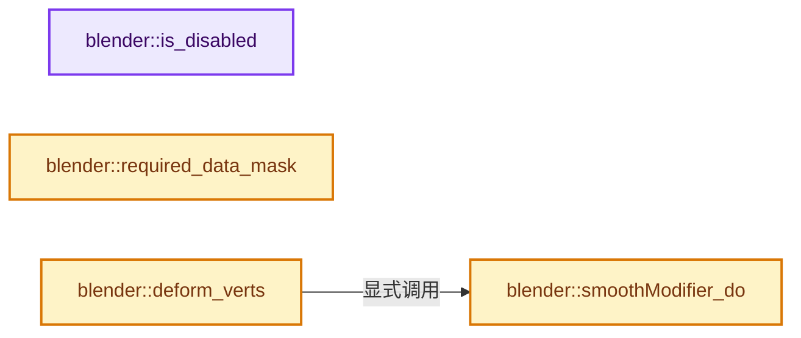
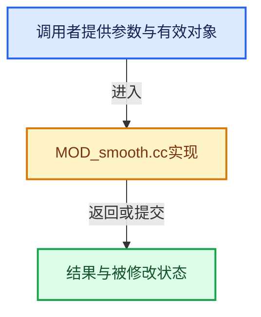

# 实现依赖专题：source/blender/modifiers/intern/MOD_smooth.cc

[方向导航](README.md) · [符号索引](../%E7%AC%A6%E5%8F%B7%E4%BE%9D%E8%B5%96%E4%B8%8E%E5%AE%9E%E7%8E%B0%E7%B4%A2%E5%BC%95.md)

本专题从正文实际调用进入，集中保存共享实现。函数有稳定锚点，可从调用处直接跳到对应完整函数；递归与互相调用通过回链组织。

## 本文件的实现关系






## 完整成员与函数实现

<a id="f-89ecdefddba1e6ee"></a>

### `blender::is_disabled`

实现位置：[source/blender/modifiers/intern/MOD_smooth.cc](../../../../../source/blender/modifiers/intern/MOD_smooth.cc) · L40—L52。

接口参数：

- `const Scene *`
- `ModifierData *md`
- `bool`

**教学注释版**

<!-- annotated:5fc0755ef7d55d -->

```cpp
static bool is_disabled(const Scene * /*scene*/, ModifierData *md, bool /*use_render_params*/)
{
  SmoothModifierData *smd = reinterpret_cast<SmoothModifierData *>(md);

  const short flag = smd->flag & (MOD_SMOOTH_X | MOD_SMOOTH_Y | MOD_SMOOTH_Z);

  /* disable if modifier is off for X, Y and Z or if factor is 0 */
  if (smd->fac == 0.0f || flag == 0) {
    return true;
  }

  return false;
}
```

<details>
<summary>核对原始源码：source/blender/modifiers/intern/MOD_smooth.cc · L40—L52</summary>

<!-- original:5fc0755ef7d55d:source/blender/modifiers/intern/MOD_smooth.cc:40:52 -->

```cpp
static bool is_disabled(const Scene * /*scene*/, ModifierData *md, bool /*use_render_params*/)
{
  SmoothModifierData *smd = reinterpret_cast<SmoothModifierData *>(md);

  const short flag = smd->flag & (MOD_SMOOTH_X | MOD_SMOOTH_Y | MOD_SMOOTH_Z);

  /* disable if modifier is off for X, Y and Z or if factor is 0 */
  if (smd->fac == 0.0f || flag == 0) {
    return true;
  }

  return false;
}
```

</details>

**结果出口**

- `return true;`
- `return false;`

**继续追踪实现**

本实现没有需要继续展开的显式调用；检查返回表达式、对象转换和调用者前置条件。

<a id="f-506f5574d2a5ede2"></a>

### `blender::required_data_mask`

实现位置：[source/blender/modifiers/intern/MOD_smooth.cc](../../../../../source/blender/modifiers/intern/MOD_smooth.cc) · L54—L62。

接口参数：

- `ModifierData *md`
- `CustomData_MeshMasks *r_cddata_masks`

**教学注释版**

<!-- annotated:d7f41190b666e5 -->

```cpp
static void required_data_mask(ModifierData *md, CustomData_MeshMasks *r_cddata_masks)
{
  SmoothModifierData *smd = reinterpret_cast<SmoothModifierData *>(md);

  /* Ask for vertex-groups if we need them. */
  if (smd->defgrp_name[0] != '\0') {
    r_cddata_masks->vmask |= CD_MASK_MDEFORMVERT;
  }
}
```

<details>
<summary>核对原始源码：source/blender/modifiers/intern/MOD_smooth.cc · L54—L62</summary>

<!-- original:d7f41190b666e5:source/blender/modifiers/intern/MOD_smooth.cc:54:62 -->

```cpp
static void required_data_mask(ModifierData *md, CustomData_MeshMasks *r_cddata_masks)
{
  SmoothModifierData *smd = reinterpret_cast<SmoothModifierData *>(md);

  /* Ask for vertex-groups if we need them. */
  if (smd->defgrp_name[0] != '\0') {
    r_cddata_masks->vmask |= CD_MASK_MDEFORMVERT;
  }
}
```

</details>

**沿实际写入检查状态**

- `r_cddata_masks->vmask |= CD_MASK_MDEFORMVERT;`

**继续追踪实现**

本实现没有需要继续展开的显式调用；检查返回表达式、对象转换和调用者前置条件。

<a id="f-03522f6de680ec96"></a>

### `blender::smoothModifier_do`

实现位置：[source/blender/modifiers/intern/MOD_smooth.cc](../../../../../source/blender/modifiers/intern/MOD_smooth.cc) · L64—L164。

接口参数：

- `SmoothModifierData *smd`
- `Object *ob`
- `Mesh *mesh`
- `float (*vertexCos)[3]`
- `int verts_num`

**教学注释版**

<!-- annotated:0e094a6d199132 -->

```cpp
static void smoothModifier_do(
    SmoothModifierData *smd, Object *ob, Mesh *mesh, float (*vertexCos)[3], int verts_num)
{
  if (mesh == nullptr) {
    return;
  }

  float (*accumulated_vecs)[3] = MEM_new_array_zeroed<float[3]>(verts_num, __func__);
  if (!accumulated_vecs) {
    return;
  }

  uint *accumulated_vecs_count = MEM_new_array_zeroed<uint>(verts_num, __func__);
  if (!accumulated_vecs_count) {
    MEM_delete(accumulated_vecs);
    return;
  }

  const float fac_new = smd->fac;
  const float fac_orig = 1.0f - fac_new;
  const bool invert_vgroup = (smd->flag & MOD_SMOOTH_INVERT_VGROUP) != 0;

  const Span<int2> edges = mesh->edges();

  const MDeformVert *dvert;
  int defgrp_index;
  MOD_get_vgroup(ob, mesh, smd->defgrp_name, &dvert, &defgrp_index);

  for (int j = 0; j < smd->repeat; j++) {
    if (j != 0) {
      // [讲解] memset：填充字节，不调用T构造函数，也不保证任意类型的全零表示是合法或期望值。
      memset(accumulated_vecs, 0, sizeof(*accumulated_vecs) * size_t(verts_num));
      memset(accumulated_vecs_count, 0, sizeof(*accumulated_vecs_count) * size_t(verts_num));
    }

    // [讲解] edges.index_range：查询视图长度或生成对应有效索引区间。
    for (const int i : edges.index_range()) {
      float fvec[3];
      const uint idx1 = edges[i][0];
      const uint idx2 = edges[i][1];

      mid_v3_v3v3(fvec, vertexCos[idx1], vertexCos[idx2]);

      accumulated_vecs_count[idx1]++;
      add_v3_v3(accumulated_vecs[idx1], fvec);

      accumulated_vecs_count[idx2]++;
      add_v3_v3(accumulated_vecs[idx2], fvec);
    }

    const short flag = smd->flag;
    if (dvert) {
      const MDeformVert *dv = dvert;
      for (int i = 0; i < verts_num; i++, dv++) {
        float *vco_orig = vertexCos[i];
        if (accumulated_vecs_count[i] > 0) {
          mul_v3_fl(accumulated_vecs[i], 1.0f / float(accumulated_vecs_count[i]));
        }
        float *vco_new = accumulated_vecs[i];

        const float f_vgroup = invert_vgroup ? (1.0f - BKE_defvert_find_weight(dv, defgrp_index)) :
                                               BKE_defvert_find_weight(dv, defgrp_index);
        if (f_vgroup <= 0.0f) {
          continue;
        }
        const float f_new = f_vgroup * fac_new;
        const float f_orig = 1.0f - f_new;

        if (flag & MOD_SMOOTH_X) {
          vco_orig[0] = f_orig * vco_orig[0] + f_new * vco_new[0];
        }
        if (flag & MOD_SMOOTH_Y) {
          vco_orig[1] = f_orig * vco_orig[1] + f_new * vco_new[1];
        }
        if (flag & MOD_SMOOTH_Z) {
          vco_orig[2] = f_orig * vco_orig[2] + f_new * vco_new[2];
        }
      }
    }
    else { /* no vertex group */
      for (int i = 0; i < verts_num; i++) {
        float *vco_orig = vertexCos[i];
        if (accumulated_vecs_count[i] > 0) {
          mul_v3_fl(accumulated_vecs[i], 1.0f / float(accumulated_vecs_count[i]));
        }
        float *vco_new = accumulated_vecs[i];

        if (flag & MOD_SMOOTH_X) {
          vco_orig[0] = fac_orig * vco_orig[0] + fac_new * vco_new[0];
        }
        if (flag & MOD_SMOOTH_Y) {
          vco_orig[1] = fac_orig * vco_orig[1] + fac_new * vco_new[1];
        }
        if (flag & MOD_SMOOTH_Z) {
          vco_orig[2] = fac_orig * vco_orig[2] + fac_new * vco_new[2];
        }
      }
    }
  }

  MEM_delete(accumulated_vecs);
  MEM_delete(accumulated_vecs_count);
}
```

<details>
<summary>核对原始源码：source/blender/modifiers/intern/MOD_smooth.cc · L64—L164</summary>

<!-- original:0e094a6d199132:source/blender/modifiers/intern/MOD_smooth.cc:64:164 -->

```cpp
static void smoothModifier_do(
    SmoothModifierData *smd, Object *ob, Mesh *mesh, float (*vertexCos)[3], int verts_num)
{
  if (mesh == nullptr) {
    return;
  }

  float (*accumulated_vecs)[3] = MEM_new_array_zeroed<float[3]>(verts_num, __func__);
  if (!accumulated_vecs) {
    return;
  }

  uint *accumulated_vecs_count = MEM_new_array_zeroed<uint>(verts_num, __func__);
  if (!accumulated_vecs_count) {
    MEM_delete(accumulated_vecs);
    return;
  }

  const float fac_new = smd->fac;
  const float fac_orig = 1.0f - fac_new;
  const bool invert_vgroup = (smd->flag & MOD_SMOOTH_INVERT_VGROUP) != 0;

  const Span<int2> edges = mesh->edges();

  const MDeformVert *dvert;
  int defgrp_index;
  MOD_get_vgroup(ob, mesh, smd->defgrp_name, &dvert, &defgrp_index);

  for (int j = 0; j < smd->repeat; j++) {
    if (j != 0) {
      memset(accumulated_vecs, 0, sizeof(*accumulated_vecs) * size_t(verts_num));
      memset(accumulated_vecs_count, 0, sizeof(*accumulated_vecs_count) * size_t(verts_num));
    }

    for (const int i : edges.index_range()) {
      float fvec[3];
      const uint idx1 = edges[i][0];
      const uint idx2 = edges[i][1];

      mid_v3_v3v3(fvec, vertexCos[idx1], vertexCos[idx2]);

      accumulated_vecs_count[idx1]++;
      add_v3_v3(accumulated_vecs[idx1], fvec);

      accumulated_vecs_count[idx2]++;
      add_v3_v3(accumulated_vecs[idx2], fvec);
    }

    const short flag = smd->flag;
    if (dvert) {
      const MDeformVert *dv = dvert;
      for (int i = 0; i < verts_num; i++, dv++) {
        float *vco_orig = vertexCos[i];
        if (accumulated_vecs_count[i] > 0) {
          mul_v3_fl(accumulated_vecs[i], 1.0f / float(accumulated_vecs_count[i]));
        }
        float *vco_new = accumulated_vecs[i];

        const float f_vgroup = invert_vgroup ? (1.0f - BKE_defvert_find_weight(dv, defgrp_index)) :
                                               BKE_defvert_find_weight(dv, defgrp_index);
        if (f_vgroup <= 0.0f) {
          continue;
        }
        const float f_new = f_vgroup * fac_new;
        const float f_orig = 1.0f - f_new;

        if (flag & MOD_SMOOTH_X) {
          vco_orig[0] = f_orig * vco_orig[0] + f_new * vco_new[0];
        }
        if (flag & MOD_SMOOTH_Y) {
          vco_orig[1] = f_orig * vco_orig[1] + f_new * vco_new[1];
        }
        if (flag & MOD_SMOOTH_Z) {
          vco_orig[2] = f_orig * vco_orig[2] + f_new * vco_new[2];
        }
      }
    }
    else { /* no vertex group */
      for (int i = 0; i < verts_num; i++) {
        float *vco_orig = vertexCos[i];
        if (accumulated_vecs_count[i] > 0) {
          mul_v3_fl(accumulated_vecs[i], 1.0f / float(accumulated_vecs_count[i]));
        }
        float *vco_new = accumulated_vecs[i];

        if (flag & MOD_SMOOTH_X) {
          vco_orig[0] = fac_orig * vco_orig[0] + fac_new * vco_new[0];
        }
        if (flag & MOD_SMOOTH_Y) {
          vco_orig[1] = fac_orig * vco_orig[1] + fac_new * vco_new[1];
        }
        if (flag & MOD_SMOOTH_Z) {
          vco_orig[2] = fac_orig * vco_orig[2] + fac_new * vco_new[2];
        }
      }
    }
  }

  MEM_delete(accumulated_vecs);
  MEM_delete(accumulated_vecs_count);
}
```

</details>

**沿实际写入检查状态**

- `vco_orig[0] = f_orig * vco_orig[0] + f_new * vco_new[0];`
- `vco_orig[1] = f_orig * vco_orig[1] + f_new * vco_new[1];`
- `vco_orig[2] = f_orig * vco_orig[2] + f_new * vco_new[2];`
- `vco_orig[0] = fac_orig * vco_orig[0] + fac_new * vco_new[0];`
- `vco_orig[1] = fac_orig * vco_orig[1] + fac_new * vco_new[1];`
- `vco_orig[2] = fac_orig * vco_orig[2] + fac_new * vco_new[2];`

**继续追踪实现**

- `MEM_new_array_zeroed<float[3]>` → [MEM_new_array_zeroed · L566](../03-%E5%86%85%E5%AD%98%E5%88%86%E9%85%8D%E4%B8%8E%E8%BF%90%E8%A1%8C%E6%97%B6%E7%B1%BB%E5%9E%8B/%E4%BE%9D%E8%B5%96-MEM_guardedalloc-b54eca.md#f-3a0cf63fb5216500)；[MEM_new_array_zeroed · L119](../03-%E5%86%85%E5%AD%98%E5%88%86%E9%85%8D%E4%B8%8E%E8%BF%90%E8%A1%8C%E6%97%B6%E7%B1%BB%E5%9E%8B/%E4%BE%9D%E8%B5%96-mallocn-afdcd4.md#f-6825557da566fdbe)。同名重载需按实参类型选择。
- `MEM_new_array_zeroed<uint>` → [MEM_new_array_zeroed · L566](../03-%E5%86%85%E5%AD%98%E5%88%86%E9%85%8D%E4%B8%8E%E8%BF%90%E8%A1%8C%E6%97%B6%E7%B1%BB%E5%9E%8B/%E4%BE%9D%E8%B5%96-MEM_guardedalloc-b54eca.md#f-3a0cf63fb5216500)；[MEM_new_array_zeroed · L119](../03-%E5%86%85%E5%AD%98%E5%88%86%E9%85%8D%E4%B8%8E%E8%BF%90%E8%A1%8C%E6%97%B6%E7%B1%BB%E5%9E%8B/%E4%BE%9D%E8%B5%96-mallocn-afdcd4.md#f-6825557da566fdbe)。同名重载需按实参类型选择。
- `MEM_delete` → [MEM_delete · L400](../03-%E5%86%85%E5%AD%98%E5%88%86%E9%85%8D%E4%B8%8E%E8%BF%90%E8%A1%8C%E6%97%B6%E7%B1%BB%E5%9E%8B/%E4%BE%9D%E8%B5%96-MEM_guardedalloc-b54eca.md#f-9049ffdd1682887c)。
- `mesh->edges` → [Mesh::edges · L1205](03-MPoly%E8%BF%81%E7%A7%BB%E4%B8%8E%E5%85%BC%E5%AE%B9.md#f-7232f6756b674d12)。
- `MOD_get_vgroup` → [blender::MOD_get_vgroup · L158](%E4%BE%9D%E8%B5%96-MOD_util-83ca4b.md#f-f461611d86b94405)。
- `memset` → [外部契约](https://eel.is/c++draft/cstring.syn)：填充字节，不调用T构造函数，也不保证任意类型的全零表示是合法或期望值。
- `edges.index_range` → [blender::Span::index_range · L405](../01-%E5%9F%BA%E7%A1%80%E5%AE%B9%E5%99%A8%E4%B8%8E%E7%8E%B0%E4%BB%A3CPP/05-Span%E5%8F%AA%E8%AF%BB%E8%BF%9E%E7%BB%AD%E8%A7%86%E5%9B%BE.md#f-caaa9b06e13e53e0)。
- `mid_v3_v3v3` → [blender::mid_v3_v3v3 · L183](../12-%E7%A9%BA%E9%97%B4%E6%95%B0%E6%8D%AE%E7%BB%93%E6%9E%84%E4%B8%8E%E5%87%A0%E4%BD%95%E7%AE%97%E6%B3%95/%E4%BE%9D%E8%B5%96-math_vector-5f35fa.md#f-b748c1b0b472ad9b)。
- `add_v3_v3` → [blender::add_v3_v3 · L286](../12-%E7%A9%BA%E9%97%B4%E6%95%B0%E6%8D%AE%E7%BB%93%E6%9E%84%E4%B8%8E%E5%87%A0%E4%BD%95%E7%AE%97%E6%B3%95/%E4%BE%9D%E8%B5%96-math_vector_inline-0c8541.md#f-e7930c6fdefe462c)。
- `mul_v3_fl` → [blender::mul_v3_fl · L414](../12-%E7%A9%BA%E9%97%B4%E6%95%B0%E6%8D%AE%E7%BB%93%E6%9E%84%E4%B8%8E%E5%87%A0%E4%BD%95%E7%AE%97%E6%B3%95/%E4%BE%9D%E8%B5%96-math_vector_inline-0c8541.md#f-00165156a06d1224)。
- `BKE_defvert_find_weight` → [blender::BKE_defvert_find_weight · L779](%E4%BE%9D%E8%B5%96-deform-6949f4.md#f-c117fcd05c4fd453)。

<a id="f-e340cd99ecd4b8fd"></a>

### `blender::deform_verts`

实现位置：[source/blender/modifiers/intern/MOD_smooth.cc](../../../../../source/blender/modifiers/intern/MOD_smooth.cc) · L166—L174。

接口参数：

- `ModifierData *md`
- `const ModifierEvalContext *ctx`
- `Mesh *mesh`
- `MutableSpan<float3> positions`

**教学注释版**

<!-- annotated:19ba167dc167e7 -->

```cpp
static void deform_verts(ModifierData *md,
                         const ModifierEvalContext *ctx,
                         Mesh *mesh,
                         MutableSpan<float3> positions)
{
  SmoothModifierData *smd = reinterpret_cast<SmoothModifierData *>(md);
  smoothModifier_do(
      // [讲解] positions.data：返回借用范围的地址。
      smd, ctx->object, mesh, reinterpret_cast<float (*)[3]>(positions.data()), positions.size());
}
```

<details>
<summary>核对原始源码：source/blender/modifiers/intern/MOD_smooth.cc · L166—L174</summary>

<!-- original:19ba167dc167e7:source/blender/modifiers/intern/MOD_smooth.cc:166:174 -->

```cpp
static void deform_verts(ModifierData *md,
                         const ModifierEvalContext *ctx,
                         Mesh *mesh,
                         MutableSpan<float3> positions)
{
  SmoothModifierData *smd = reinterpret_cast<SmoothModifierData *>(md);
  smoothModifier_do(
      smd, ctx->object, mesh, reinterpret_cast<float (*)[3]>(positions.data()), positions.size());
}
```

</details>

**继续追踪实现**

- `smoothModifier_do` → [blender::smoothModifier_do · L64](%E4%BE%9D%E8%B5%96-MOD_smooth-c5a1bf.md#f-03522f6de680ec96)。
- `positions.data` → [blender::MutableSpan::data · L545](../01-%E5%9F%BA%E7%A1%80%E5%AE%B9%E5%99%A8%E4%B8%8E%E7%8E%B0%E4%BB%A3CPP/06-MutableSpan%E5%8F%AF%E5%86%99%E8%A7%86%E5%9B%BE.md#f-eb45a6e4d8211efd)；[blender::gpu::shader::parser::MutableSpan::data · L82](%E4%BE%9D%E8%B5%96-utils-06433d.md#f-ad0a09cec9741c65)。同名重载需按实参类型选择。
- `positions.size` → [blender::MutableSpan::size · L499](../01-%E5%9F%BA%E7%A1%80%E5%AE%B9%E5%99%A8%E4%B8%8E%E7%8E%B0%E4%BB%A3CPP/06-MutableSpan%E5%8F%AF%E5%86%99%E8%A7%86%E5%9B%BE.md#f-1de6a66839c304a8)；[blender::gpu::shader::parser::MutableSpan::size · L87](%E4%BE%9D%E8%B5%96-utils-06433d.md#f-5e684af6ee7990e9)。同名重载需按实参类型选择。
