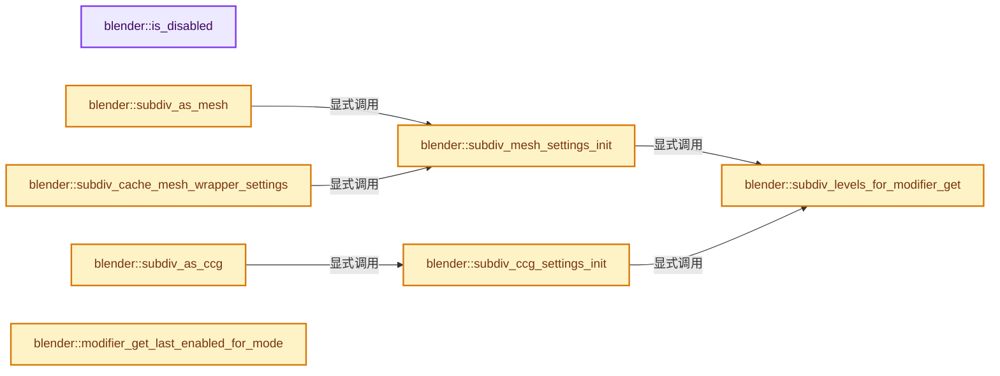
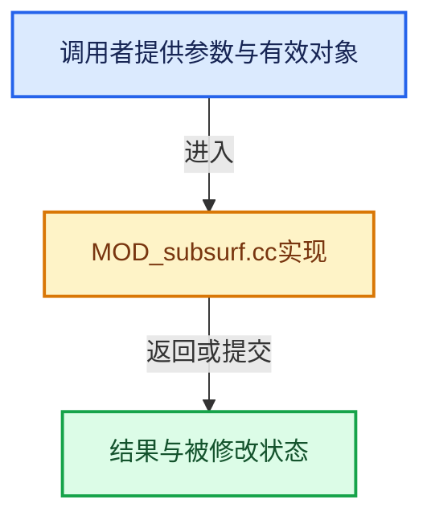

# 实现依赖专题：source/blender/modifiers/intern/MOD_subsurf.cc

[方向导航](README.md) · [符号索引](../%E7%AC%A6%E5%8F%B7%E4%BE%9D%E8%B5%96%E4%B8%8E%E5%AE%9E%E7%8E%B0%E7%B4%A2%E5%BC%95.md)

本专题从正文实际调用进入，集中保存共享实现。函数有稳定锚点，可从调用处直接跳到对应完整函数；递归与互相调用通过回链组织。

## 本文件的实现关系






## 完整成员与函数实现

<a id="f-ad8eaec305d9e17f"></a>

### `blender::is_disabled`

实现位置：[source/blender/modifiers/intern/MOD_subsurf.cc](../../../../../source/blender/modifiers/intern/MOD_subsurf.cc) · L83—L89。

接口参数：

- `const Scene *scene`
- `ModifierData *md`
- `bool use_render_params`

**教学注释版**

<!-- annotated:279fa264e544a5 -->

```cpp
static bool is_disabled(const Scene *scene, ModifierData *md, bool use_render_params)
{
  SubsurfModifierData *smd = reinterpret_cast<SubsurfModifierData *>(md);
  int levels = (use_render_params) ? smd->renderLevels : smd->levels;

  return get_render_subsurf_level(&scene->r, levels, use_render_params != 0) == 0;
}
```

<details>
<summary>核对原始源码：source/blender/modifiers/intern/MOD_subsurf.cc · L83—L89</summary>

<!-- original:279fa264e544a5:source/blender/modifiers/intern/MOD_subsurf.cc:83:89 -->

```cpp
static bool is_disabled(const Scene *scene, ModifierData *md, bool use_render_params)
{
  SubsurfModifierData *smd = reinterpret_cast<SubsurfModifierData *>(md);
  int levels = (use_render_params) ? smd->renderLevels : smd->levels;

  return get_render_subsurf_level(&scene->r, levels, use_render_params != 0) == 0;
}
```

</details>

**结果出口**

- `return get_render_subsurf_level(&scene->r, levels, use_render_params != 0) == 0;`

**继续追踪实现**

- `get_render_subsurf_level` → [blender::get_render_subsurf_level · L3016](%E4%BE%9D%E8%B5%96-scene-94f43c.md#f-a87e1e516b7a9874)。

<a id="f-7e4cabe67e482d8c"></a>

### `blender::subdiv_levels_for_modifier_get`

实现位置：[source/blender/modifiers/intern/MOD_subsurf.cc](../../../../../source/blender/modifiers/intern/MOD_subsurf.cc) · L91—L98。

接口参数：

- `const SubsurfModifierData *smd`
- `const ModifierEvalContext *ctx`

**教学注释版**

<!-- annotated:fbbe93e66ab98a -->

```cpp
static int subdiv_levels_for_modifier_get(const SubsurfModifierData *smd,
                                          const ModifierEvalContext *ctx)
{
  Scene *scene = DEG_get_evaluated_scene(ctx->depsgraph);
  const bool use_render_params = (ctx->flag & MOD_APPLY_RENDER);
  const int requested_levels = (use_render_params) ? smd->renderLevels : smd->levels;
  return get_render_subsurf_level(&scene->r, requested_levels, use_render_params);
}
```

<details>
<summary>核对原始源码：source/blender/modifiers/intern/MOD_subsurf.cc · L91—L98</summary>

<!-- original:fbbe93e66ab98a:source/blender/modifiers/intern/MOD_subsurf.cc:91:98 -->

```cpp
static int subdiv_levels_for_modifier_get(const SubsurfModifierData *smd,
                                          const ModifierEvalContext *ctx)
{
  Scene *scene = DEG_get_evaluated_scene(ctx->depsgraph);
  const bool use_render_params = (ctx->flag & MOD_APPLY_RENDER);
  const int requested_levels = (use_render_params) ? smd->renderLevels : smd->levels;
  return get_render_subsurf_level(&scene->r, requested_levels, use_render_params);
}
```

</details>

**结果出口**

- `return get_render_subsurf_level(&scene->r, requested_levels, use_render_params);`

**继续追踪实现**

- `DEG_get_evaluated_scene` → [blender::DEG_get_evaluated_scene · L212](../11-Depsgraph%E4%B8%8E%E5%B9%B6%E8%A1%8C%E4%BB%BB%E5%8A%A1%E7%B3%BB%E7%BB%9F/%E4%BE%9D%E8%B5%96-depsgraph_query-e8b1e4.md#f-be7729d26a71d3fd)。
- `get_render_subsurf_level` → [blender::get_render_subsurf_level · L3016](%E4%BE%9D%E8%B5%96-scene-94f43c.md#f-a87e1e516b7a9874)。

<a id="f-ac356617174b2fbc"></a>

### `blender::subdiv_mesh_settings_init`

实现位置：[source/blender/modifiers/intern/MOD_subsurf.cc](../../../../../source/blender/modifiers/intern/MOD_subsurf.cc) · L102—L110。

接口参数：

- `bke::subdiv::ToMeshSettings *settings`
- `const SubsurfModifierData *smd`
- `const ModifierEvalContext *ctx`

**教学注释版**

<!-- annotated:9e943e25c90712 -->

```cpp
static void subdiv_mesh_settings_init(bke::subdiv::ToMeshSettings *settings,
                                      const SubsurfModifierData *smd,
                                      const ModifierEvalContext *ctx)
{
  const int level = subdiv_levels_for_modifier_get(smd, ctx);
  settings->resolution = (1 << level) + 1;
  settings->use_optimal_display = (smd->flags & eSubsurfModifierFlag_ControlEdges) &&
                                  !(ctx->flag & MOD_APPLY_TO_ORIGINAL);
}
```

<details>
<summary>核对原始源码：source/blender/modifiers/intern/MOD_subsurf.cc · L102—L110</summary>

<!-- original:9e943e25c90712:source/blender/modifiers/intern/MOD_subsurf.cc:102:110 -->

```cpp
static void subdiv_mesh_settings_init(bke::subdiv::ToMeshSettings *settings,
                                      const SubsurfModifierData *smd,
                                      const ModifierEvalContext *ctx)
{
  const int level = subdiv_levels_for_modifier_get(smd, ctx);
  settings->resolution = (1 << level) + 1;
  settings->use_optimal_display = (smd->flags & eSubsurfModifierFlag_ControlEdges) &&
                                  !(ctx->flag & MOD_APPLY_TO_ORIGINAL);
}
```

</details>

**沿实际写入检查状态**

- `settings->resolution = (1 << level) + 1;`
- `settings->use_optimal_display = (smd->flags & eSubsurfModifierFlag_ControlEdges) &&`

**继续追踪实现**

- `subdiv_levels_for_modifier_get` → [blender::subdiv_levels_for_modifier_get · L91](%E4%BE%9D%E8%B5%96-MOD_subsurf-270fc2.md#f-7e4cabe67e482d8c)。

<a id="f-15a45bcb97065848"></a>

### `blender::subdiv_as_mesh`

实现位置：[source/blender/modifiers/intern/MOD_subsurf.cc](../../../../../source/blender/modifiers/intern/MOD_subsurf.cc) · L112—L125。

接口参数：

- `SubsurfModifierData *smd`
- `const ModifierEvalContext *ctx`
- `Mesh *mesh`
- `bke::subdiv::Subdiv *subdiv`

**教学注释版**

<!-- annotated:97588620b9898b -->

```cpp
static Mesh *subdiv_as_mesh(SubsurfModifierData *smd,
                            const ModifierEvalContext *ctx,
                            Mesh *mesh,
                            bke::subdiv::Subdiv *subdiv)
{
  Mesh *result = mesh;
  bke::subdiv::ToMeshSettings mesh_settings;
  subdiv_mesh_settings_init(&mesh_settings, smd, ctx);
  if (mesh_settings.resolution < 3) {
    return result;
  }
  result = bke::subdiv::subdiv_to_mesh(subdiv, &mesh_settings, mesh);
  return result;
}
```

<details>
<summary>核对原始源码：source/blender/modifiers/intern/MOD_subsurf.cc · L112—L125</summary>

<!-- original:97588620b9898b:source/blender/modifiers/intern/MOD_subsurf.cc:112:125 -->

```cpp
static Mesh *subdiv_as_mesh(SubsurfModifierData *smd,
                            const ModifierEvalContext *ctx,
                            Mesh *mesh,
                            bke::subdiv::Subdiv *subdiv)
{
  Mesh *result = mesh;
  bke::subdiv::ToMeshSettings mesh_settings;
  subdiv_mesh_settings_init(&mesh_settings, smd, ctx);
  if (mesh_settings.resolution < 3) {
    return result;
  }
  result = bke::subdiv::subdiv_to_mesh(subdiv, &mesh_settings, mesh);
  return result;
}
```

</details>

**沿实际写入检查状态**

- `result = bke::subdiv::subdiv_to_mesh(subdiv, &mesh_settings, mesh);`

**结果出口**

- `return result;`

**继续追踪实现**

- `subdiv_mesh_settings_init` → [blender::subdiv_mesh_settings_init · L102](%E4%BE%9D%E8%B5%96-MOD_subsurf-270fc2.md#f-ac356617174b2fbc)。
- `bke::subdiv::subdiv_to_mesh` → [blender::bke::subdiv::subdiv_to_mesh · L1458](%E4%BE%9D%E8%B5%96-subdiv_mesh-062851.md#f-fb2d00a1de7732e7)。

<a id="f-0ea28d97a670b3ec"></a>

### `blender::subdiv_ccg_settings_init`

实现位置：[source/blender/modifiers/intern/MOD_subsurf.cc](../../../../../source/blender/modifiers/intern/MOD_subsurf.cc) · L129—L137。

接口参数：

- `SubdivToCCGSettings *settings`
- `const SubsurfModifierData *smd`
- `const ModifierEvalContext *ctx`

**教学注释版**

<!-- annotated:d936e7fe0753e7 -->

```cpp
static void subdiv_ccg_settings_init(SubdivToCCGSettings *settings,
                                     const SubsurfModifierData *smd,
                                     const ModifierEvalContext *ctx)
{
  const int level = subdiv_levels_for_modifier_get(smd, ctx);
  settings->resolution = (1 << level) + 1;
  settings->need_normal = true;
  settings->need_mask = false;
}
```

<details>
<summary>核对原始源码：source/blender/modifiers/intern/MOD_subsurf.cc · L129—L137</summary>

<!-- original:d936e7fe0753e7:source/blender/modifiers/intern/MOD_subsurf.cc:129:137 -->

```cpp
static void subdiv_ccg_settings_init(SubdivToCCGSettings *settings,
                                     const SubsurfModifierData *smd,
                                     const ModifierEvalContext *ctx)
{
  const int level = subdiv_levels_for_modifier_get(smd, ctx);
  settings->resolution = (1 << level) + 1;
  settings->need_normal = true;
  settings->need_mask = false;
}
```

</details>

**沿实际写入检查状态**

- `settings->resolution = (1 << level) + 1;`
- `settings->need_normal = true;`
- `settings->need_mask = false;`

**继续追踪实现**

- `subdiv_levels_for_modifier_get` → [blender::subdiv_levels_for_modifier_get · L91](%E4%BE%9D%E8%B5%96-MOD_subsurf-270fc2.md#f-7e4cabe67e482d8c)。

<a id="f-fb55ab626bd1bd98"></a>

### `blender::subdiv_as_ccg`

实现位置：[source/blender/modifiers/intern/MOD_subsurf.cc](../../../../../source/blender/modifiers/intern/MOD_subsurf.cc) · L139—L152。

接口参数：

- `SubsurfModifierData *smd`
- `const ModifierEvalContext *ctx`
- `Mesh *mesh`
- `bke::subdiv::Subdiv *subdiv`

**教学注释版**

<!-- annotated:3356d7b71cd61a -->

```cpp
static Mesh *subdiv_as_ccg(SubsurfModifierData *smd,
                           const ModifierEvalContext *ctx,
                           Mesh *mesh,
                           bke::subdiv::Subdiv *subdiv)
{
  Mesh *result = mesh;
  SubdivToCCGSettings ccg_settings;
  subdiv_ccg_settings_init(&ccg_settings, smd, ctx);
  if (ccg_settings.resolution < 3) {
    return result;
  }
  result = BKE_subdiv_to_ccg_mesh(*subdiv, ccg_settings, *mesh);
  return result;
}
```

<details>
<summary>核对原始源码：source/blender/modifiers/intern/MOD_subsurf.cc · L139—L152</summary>

<!-- original:3356d7b71cd61a:source/blender/modifiers/intern/MOD_subsurf.cc:139:152 -->

```cpp
static Mesh *subdiv_as_ccg(SubsurfModifierData *smd,
                           const ModifierEvalContext *ctx,
                           Mesh *mesh,
                           bke::subdiv::Subdiv *subdiv)
{
  Mesh *result = mesh;
  SubdivToCCGSettings ccg_settings;
  subdiv_ccg_settings_init(&ccg_settings, smd, ctx);
  if (ccg_settings.resolution < 3) {
    return result;
  }
  result = BKE_subdiv_to_ccg_mesh(*subdiv, ccg_settings, *mesh);
  return result;
}
```

</details>

**沿实际写入检查状态**

- `result = BKE_subdiv_to_ccg_mesh(*subdiv, ccg_settings, *mesh);`

**结果出口**

- `return result;`

**继续追踪实现**

- `subdiv_ccg_settings_init` → [blender::subdiv_ccg_settings_init · L129](%E4%BE%9D%E8%B5%96-MOD_subsurf-270fc2.md#f-0ea28d97a670b3ec)。
- `BKE_subdiv_to_ccg_mesh` → [blender::BKE_subdiv_to_ccg_mesh · L408](%E4%BE%9D%E8%B5%96-subdiv_ccg-2071ed.md#f-64f42dce16f5df3f)。

<a id="f-9d2d24cd8e1f7d09"></a>

### `blender::subdiv_cache_mesh_wrapper_settings`

实现位置：[source/blender/modifiers/intern/MOD_subsurf.cc](../../../../../source/blender/modifiers/intern/MOD_subsurf.cc) · L156—L171。

接口参数：

- `const ModifierEvalContext *ctx`
- `Mesh *mesh`
- `SubsurfModifierData *smd`
- `SubsurfRuntimeData *runtime_data`
- `const bool has_gpu_subdiv`

**教学注释版**

<!-- annotated:3cbf3c12fc70a9 -->

```cpp
static void subdiv_cache_mesh_wrapper_settings(const ModifierEvalContext *ctx,
                                               Mesh *mesh,
                                               SubsurfModifierData *smd,
                                               SubsurfRuntimeData *runtime_data,
                                               const bool has_gpu_subdiv)
{
  bke::subdiv::ToMeshSettings mesh_settings;
  subdiv_mesh_settings_init(&mesh_settings, smd, ctx);

  runtime_data->has_gpu_subdiv = has_gpu_subdiv;
  runtime_data->resolution = mesh_settings.resolution;
  runtime_data->use_optimal_display = mesh_settings.use_optimal_display;
  runtime_data->use_loop_normals = (smd->flags & eSubsurfModifierFlag_UseCustomNormals);

  mesh->runtime->subsurf_runtime_data = runtime_data;
}
```

<details>
<summary>核对原始源码：source/blender/modifiers/intern/MOD_subsurf.cc · L156—L171</summary>

<!-- original:3cbf3c12fc70a9:source/blender/modifiers/intern/MOD_subsurf.cc:156:171 -->

```cpp
static void subdiv_cache_mesh_wrapper_settings(const ModifierEvalContext *ctx,
                                               Mesh *mesh,
                                               SubsurfModifierData *smd,
                                               SubsurfRuntimeData *runtime_data,
                                               const bool has_gpu_subdiv)
{
  bke::subdiv::ToMeshSettings mesh_settings;
  subdiv_mesh_settings_init(&mesh_settings, smd, ctx);

  runtime_data->has_gpu_subdiv = has_gpu_subdiv;
  runtime_data->resolution = mesh_settings.resolution;
  runtime_data->use_optimal_display = mesh_settings.use_optimal_display;
  runtime_data->use_loop_normals = (smd->flags & eSubsurfModifierFlag_UseCustomNormals);

  mesh->runtime->subsurf_runtime_data = runtime_data;
}
```

</details>

**沿实际写入检查状态**

- `runtime_data->has_gpu_subdiv = has_gpu_subdiv;`
- `runtime_data->resolution = mesh_settings.resolution;`
- `runtime_data->use_optimal_display = mesh_settings.use_optimal_display;`
- `runtime_data->use_loop_normals = (smd->flags & eSubsurfModifierFlag_UseCustomNormals);`
- `mesh->runtime->subsurf_runtime_data = runtime_data;`

**继续追踪实现**

- `subdiv_mesh_settings_init` → [blender::subdiv_mesh_settings_init · L102](%E4%BE%9D%E8%B5%96-MOD_subsurf-270fc2.md#f-ac356617174b2fbc)。

<a id="f-8193af272681d942"></a>

### `blender::modifier_get_last_enabled_for_mode`

实现位置：[source/blender/modifiers/intern/MOD_subsurf.cc](../../../../../source/blender/modifiers/intern/MOD_subsurf.cc) · L173—L188。

接口参数：

- `const Scene *scene`
- `const Object *ob`
- `int required_mode`

**教学注释版**

<!-- annotated:73de1fc56ed23b -->

```cpp
static ModifierData *modifier_get_last_enabled_for_mode(const Scene *scene,
                                                        const Object *ob,
                                                        int required_mode)
{
  ModifierData *md = ob->modifiers.last();

  while (md) {
    if (BKE_modifier_is_enabled(scene, md, required_mode)) {
      break;
    }

    md = md->prev;
  }

  return md;
}
```

<details>
<summary>核对原始源码：source/blender/modifiers/intern/MOD_subsurf.cc · L173—L188</summary>

<!-- original:73de1fc56ed23b:source/blender/modifiers/intern/MOD_subsurf.cc:173:188 -->

```cpp
static ModifierData *modifier_get_last_enabled_for_mode(const Scene *scene,
                                                        const Object *ob,
                                                        int required_mode)
{
  ModifierData *md = ob->modifiers.last();

  while (md) {
    if (BKE_modifier_is_enabled(scene, md, required_mode)) {
      break;
    }

    md = md->prev;
  }

  return md;
}
```

</details>

**沿实际写入检查状态**

- `md = md->prev;`

**结果出口**

- `return md;`

**继续追踪实现**

- `ob->modifiers.last` → [调用协议](../%E6%A8%A1%E6%9D%BF%E5%AE%8F%E4%B8%8E%E5%8A%A8%E6%80%81%E5%88%86%E6%B4%BE%E5%8D%8F%E8%AE%AE.md)：接收对象类型依赖auto、返回值或模板实例；不按同名猜测目标。调用位置L177。
- `BKE_modifier_is_enabled` → [blender::BKE_modifier_is_enabled · L529](%E4%BE%9D%E8%B5%96-modifier-ab0273.md#f-1debd86d0fcbcc8e)。

<a id="f-d9135367697e81ab"></a>

### `blender::modify_mesh`

实现位置：[source/blender/modifiers/intern/MOD_subsurf.cc](../../../../../source/blender/modifiers/intern/MOD_subsurf.cc) · L192—L284。

接口参数：

- `ModifierData *md`
- `const ModifierEvalContext *ctx`
- `Mesh *mesh`

**教学注释版**

<!-- annotated:4cc22322479adb -->

```cpp
static Mesh *modify_mesh(ModifierData *md, const ModifierEvalContext *ctx, Mesh *mesh)
{
  Mesh *result = mesh;
#if !defined(WITH_OPENSUBDIV)
  BKE_modifier_set_error(ctx->object, md, "Disabled, built without OpenSubdiv");
  return result;
#endif
  SubsurfModifierData *smd = reinterpret_cast<SubsurfModifierData *>(md);
  if (!BKE_subsurf_modifier_runtime_init(smd, (ctx->flag & MOD_APPLY_RENDER) != 0)) {
    return result;
  }

  SubsurfRuntimeData *runtime_data = static_cast<SubsurfRuntimeData *>(smd->modifier.runtime);

  /* Decrement the recent usage counters. */
  if (runtime_data->used_cpu) {
    runtime_data->used_cpu--;
  }

  if (runtime_data->used_gpu) {
    runtime_data->used_gpu--;
  }

  /* Delay evaluation to the draw code if possible, provided we do not have to apply the modifier.
   */
  if ((ctx->flag & MOD_APPLY_TO_ORIGINAL) == 0) {
    Scene *scene = DEG_get_evaluated_scene(ctx->depsgraph);

    /* Same check as in `DRW_mesh_batch_cache_create_requested` to keep both code coherent. The
     * difference is that here we do not check for the final edit mesh pointer as it is not yet
     * assigned at this stage of modifier stack evaluation. */
    const bool is_render_mode = (ctx->flag & MOD_APPLY_RENDER) != 0;
    const bool is_editmode = (mesh->runtime->edit_mesh != nullptr);
    const int required_mode = BKE_subsurf_modifier_eval_required_mode(is_render_mode, is_editmode);

    /* Check if we are the last modifier in the stack. */
    ModifierData *md = modifier_get_last_enabled_for_mode(scene, ctx->object, required_mode);
    if (md == reinterpret_cast<const ModifierData *>(smd)) {
      const bool has_gpu_subdiv = BKE_subsurf_modifier_can_do_gpu_subdiv(smd, mesh);
      subdiv_cache_mesh_wrapper_settings(ctx, mesh, smd, runtime_data, has_gpu_subdiv);

      /* Delay for:
       * - Background mode: Not sure if we are going to use the tessellated mesh.
       * - Render: Engine might do its own subdivision and not need this.
       * - GPU subdivision support: Might only need to display and not access tessellated mesh.
       *
       * If we can't delay, we still create the wrapper so external renderers can get the base
       * mesh. But we tessellate immediately to take advantage of better parallellization
       * as part of multithreaded depsgraph evaluation. */
      const bool delay = G.background || is_render_mode || has_gpu_subdiv;
      if (!delay) {
        BKE_mesh_wrapper_ensure_subdivision(mesh);
      }

      return result;
    }
  }

  bke::subdiv::Subdiv *subdiv = BKE_subsurf_modifier_subdiv_descriptor_ensure(
      runtime_data, mesh, false);
  if (subdiv == nullptr) {
    /* Happens on bad topology, but also on empty input mesh. */
    return result;
  }
  const bool use_clnors = BKE_subsurf_modifier_use_custom_loop_normals(smd, mesh);
  if (use_clnors) {
    void *data = CustomData_add_layer(
        &mesh->corner_data, CD_NORMAL, CD_CONSTRUCT, mesh->corners_num);
    // [讲解] memcpy：复制字节，源与目标不应重叠。类型生命周期、对齐和可复制表示须由调用者证明，不是任意对象的复制构造。
    memcpy(data, mesh->corner_normals().data(), mesh->corner_normals().size_in_bytes());
  }
  /* TODO(sergey): Decide whether we ever want to use CCG for subsurf,
   * maybe when it is a last modifier in the stack? */
  if (true) {
    result = subdiv_as_mesh(smd, ctx, mesh, subdiv);
  }
  else {
    result = subdiv_as_ccg(smd, ctx, mesh, subdiv);
  }

  if (use_clnors) {
    bke::mesh_set_custom_normals_normalized(
        *result,
        {static_cast<float3 *>(
             CustomData_get_layer_for_write(&result->corner_data, CD_NORMAL, result->corners_num)),
         result->corners_num});
    CustomData_free_layers(&result->corner_data, CD_NORMAL);
  }
  // bke::subdiv::stats_print(&subdiv->stats);
  if (!ELEM(subdiv, runtime_data->subdiv_cpu, runtime_data->subdiv_gpu)) {
    // [讲解] bke::subdiv::free：归还相匹配的C分配存储，不自动执行C++析构；不可用于Windows的_aligned_malloc结果。
    bke::subdiv::free(subdiv);
  }
  return result;
}
```

<details>
<summary>核对原始源码：source/blender/modifiers/intern/MOD_subsurf.cc · L192—L284</summary>

<!-- original:4cc22322479adb:source/blender/modifiers/intern/MOD_subsurf.cc:192:284 -->

```cpp
static Mesh *modify_mesh(ModifierData *md, const ModifierEvalContext *ctx, Mesh *mesh)
{
  Mesh *result = mesh;
#if !defined(WITH_OPENSUBDIV)
  BKE_modifier_set_error(ctx->object, md, "Disabled, built without OpenSubdiv");
  return result;
#endif
  SubsurfModifierData *smd = reinterpret_cast<SubsurfModifierData *>(md);
  if (!BKE_subsurf_modifier_runtime_init(smd, (ctx->flag & MOD_APPLY_RENDER) != 0)) {
    return result;
  }

  SubsurfRuntimeData *runtime_data = static_cast<SubsurfRuntimeData *>(smd->modifier.runtime);

  /* Decrement the recent usage counters. */
  if (runtime_data->used_cpu) {
    runtime_data->used_cpu--;
  }

  if (runtime_data->used_gpu) {
    runtime_data->used_gpu--;
  }

  /* Delay evaluation to the draw code if possible, provided we do not have to apply the modifier.
   */
  if ((ctx->flag & MOD_APPLY_TO_ORIGINAL) == 0) {
    Scene *scene = DEG_get_evaluated_scene(ctx->depsgraph);

    /* Same check as in `DRW_mesh_batch_cache_create_requested` to keep both code coherent. The
     * difference is that here we do not check for the final edit mesh pointer as it is not yet
     * assigned at this stage of modifier stack evaluation. */
    const bool is_render_mode = (ctx->flag & MOD_APPLY_RENDER) != 0;
    const bool is_editmode = (mesh->runtime->edit_mesh != nullptr);
    const int required_mode = BKE_subsurf_modifier_eval_required_mode(is_render_mode, is_editmode);

    /* Check if we are the last modifier in the stack. */
    ModifierData *md = modifier_get_last_enabled_for_mode(scene, ctx->object, required_mode);
    if (md == reinterpret_cast<const ModifierData *>(smd)) {
      const bool has_gpu_subdiv = BKE_subsurf_modifier_can_do_gpu_subdiv(smd, mesh);
      subdiv_cache_mesh_wrapper_settings(ctx, mesh, smd, runtime_data, has_gpu_subdiv);

      /* Delay for:
       * - Background mode: Not sure if we are going to use the tessellated mesh.
       * - Render: Engine might do its own subdivision and not need this.
       * - GPU subdivision support: Might only need to display and not access tessellated mesh.
       *
       * If we can't delay, we still create the wrapper so external renderers can get the base
       * mesh. But we tessellate immediately to take advantage of better parallellization
       * as part of multithreaded depsgraph evaluation. */
      const bool delay = G.background || is_render_mode || has_gpu_subdiv;
      if (!delay) {
        BKE_mesh_wrapper_ensure_subdivision(mesh);
      }

      return result;
    }
  }

  bke::subdiv::Subdiv *subdiv = BKE_subsurf_modifier_subdiv_descriptor_ensure(
      runtime_data, mesh, false);
  if (subdiv == nullptr) {
    /* Happens on bad topology, but also on empty input mesh. */
    return result;
  }
  const bool use_clnors = BKE_subsurf_modifier_use_custom_loop_normals(smd, mesh);
  if (use_clnors) {
    void *data = CustomData_add_layer(
        &mesh->corner_data, CD_NORMAL, CD_CONSTRUCT, mesh->corners_num);
    memcpy(data, mesh->corner_normals().data(), mesh->corner_normals().size_in_bytes());
  }
  /* TODO(sergey): Decide whether we ever want to use CCG for subsurf,
   * maybe when it is a last modifier in the stack? */
  if (true) {
    result = subdiv_as_mesh(smd, ctx, mesh, subdiv);
  }
  else {
    result = subdiv_as_ccg(smd, ctx, mesh, subdiv);
  }

  if (use_clnors) {
    bke::mesh_set_custom_normals_normalized(
        *result,
        {static_cast<float3 *>(
             CustomData_get_layer_for_write(&result->corner_data, CD_NORMAL, result->corners_num)),
         result->corners_num});
    CustomData_free_layers(&result->corner_data, CD_NORMAL);
  }
  // bke::subdiv::stats_print(&subdiv->stats);
  if (!ELEM(subdiv, runtime_data->subdiv_cpu, runtime_data->subdiv_gpu)) {
    bke::subdiv::free(subdiv);
  }
  return result;
}
```

</details>

**沿实际写入检查状态**

- `result = subdiv_as_mesh(smd, ctx, mesh, subdiv);`
- `result = subdiv_as_ccg(smd, ctx, mesh, subdiv);`

**结果出口**

- `return result;`

**继续追踪实现**

- `BKE_modifier_set_error` → [blender::BKE_modifier_set_error · L416](%E4%BE%9D%E8%B5%96-modifier-ab0273.md#f-6241829f21c08456)。
- `BKE_subsurf_modifier_runtime_init` → [blender::BKE_subsurf_modifier_runtime_init · L48](%E4%BE%9D%E8%B5%96-subdiv_modifier-14496d.md#f-e9f9a7262ddf6787)。
- `DEG_get_evaluated_scene` → [blender::DEG_get_evaluated_scene · L212](../11-Depsgraph%E4%B8%8E%E5%B9%B6%E8%A1%8C%E4%BB%BB%E5%8A%A1%E7%B3%BB%E7%BB%9F/%E4%BE%9D%E8%B5%96-depsgraph_query-e8b1e4.md#f-be7729d26a71d3fd)。
- `BKE_subsurf_modifier_eval_required_mode` → [blender::BKE_subsurf_modifier_eval_required_mode · L146](%E4%BE%9D%E8%B5%96-subdiv_modifier-14496d.md#f-dbbd341d956bf28c)。
- `modifier_get_last_enabled_for_mode` → [blender::modifier_get_last_enabled_for_mode · L173](%E4%BE%9D%E8%B5%96-MOD_subsurf-270fc2.md#f-8193af272681d942)。
- `BKE_subsurf_modifier_can_do_gpu_subdiv` → [blender::BKE_subsurf_modifier_can_do_gpu_subdiv · L122](%E4%BE%9D%E8%B5%96-subdiv_modifier-14496d.md#f-a882930cd6c9ef47)。
- `subdiv_cache_mesh_wrapper_settings` → [blender::subdiv_cache_mesh_wrapper_settings · L156](%E4%BE%9D%E8%B5%96-MOD_subsurf-270fc2.md#f-9d2d24cd8e1f7d09)。
- `BKE_mesh_wrapper_ensure_subdivision` → [blender::BKE_mesh_wrapper_ensure_subdivision · L380](%E4%BE%9D%E8%B5%96-mesh_wrapper-33fdae.md#f-a140cbf2ffa716c8)；[blender::BKE_mesh_wrapper_ensure_subdivision · L403](%E4%BE%9D%E8%B5%96-mesh_wrapper-33fdae.md#f-3f4bc2c278da5751)。同名重载需按实参类型选择。
- `BKE_subsurf_modifier_subdiv_descriptor_ensure` → [blender::BKE_subsurf_modifier_subdiv_descriptor_ensure · L131](%E4%BE%9D%E8%B5%96-subdiv_modifier-14496d.md#f-634f64edee888a48)。
- `BKE_subsurf_modifier_use_custom_loop_normals` → [blender::BKE_subsurf_modifier_use_custom_loop_normals · L74](%E4%BE%9D%E8%B5%96-subdiv_modifier-14496d.md#f-d6cacee5adb47bd5)。
- `CustomData_add_layer` → [blender::CustomData_add_layer · L2851](%E4%BE%9D%E8%B5%96-customdata-2eef81.md#f-4c7988e825541059)。
- `memcpy` → [外部契约](https://eel.is/c++draft/cstring.syn)：复制字节，源与目标不应重叠。类型生命周期、对齐和可复制表示须由调用者证明，不是任意对象的复制构造。
- `mesh->corner_normals().data` → [调用协议](../%E6%A8%A1%E6%9D%BF%E5%AE%8F%E4%B8%8E%E5%8A%A8%E6%80%81%E5%88%86%E6%B4%BE%E5%8D%8F%E8%AE%AE.md)：接收对象类型依赖auto、返回值或模板实例；不按同名猜测目标。调用位置L260。
- `mesh->corner_normals` → [blender::Mesh::corner_normals · L468](../06-%E9%9A%90%E5%BC%8F%E5%85%B1%E4%BA%AB%E4%B8%8E%E7%BC%93%E5%AD%98%E7%B3%BB%E7%BB%9F/08-%E6%B3%95%E7%BA%BF%E7%BC%93%E5%AD%98%E7%9A%84%E7%9C%9F%E5%AE%9E%E4%BE%9D%E8%B5%96.md#f-91d46c2a581e44bc)。
- `mesh->corner_normals().size_in_bytes` → [调用协议](../%E6%A8%A1%E6%9D%BF%E5%AE%8F%E4%B8%8E%E5%8A%A8%E6%80%81%E5%88%86%E6%B4%BE%E5%8D%8F%E8%AE%AE.md)：接收对象类型依赖auto、返回值或模板实例；不按同名猜测目标。调用位置L260。
- `subdiv_as_mesh` → [blender::subdiv_as_mesh · L112](%E4%BE%9D%E8%B5%96-MOD_subsurf-270fc2.md#f-15a45bcb97065848)。
- `subdiv_as_ccg` → [blender::subdiv_as_ccg · L139](%E4%BE%9D%E8%B5%96-MOD_subsurf-270fc2.md#f-fb55ab626bd1bd98)。
- `bke::mesh_set_custom_normals_normalized` → [blender::bke::mesh_set_custom_normals_normalized · L1700](../06-%E9%9A%90%E5%BC%8F%E5%85%B1%E4%BA%AB%E4%B8%8E%E7%BC%93%E5%AD%98%E7%B3%BB%E7%BB%9F/08-%E6%B3%95%E7%BA%BF%E7%BC%93%E5%AD%98%E7%9A%84%E7%9C%9F%E5%AE%9E%E4%BE%9D%E8%B5%96.md#f-96e05ccd6d9a9c03)。
- `CustomData_get_layer_for_write` → [blender::CustomData_get_layer_for_write · L3318](%E4%BE%9D%E8%B5%96-customdata-2eef81.md#f-6af158905e2c1274)。
- `CustomData_free_layers` → [blender::CustomData_free_layers · L2988](%E4%BE%9D%E8%B5%96-customdata-2eef81.md#f-13fed7d5cd3b8b69)。
- `ELEM` → [ELEM · L88](%E4%BE%9D%E8%B5%96-GHOST_utildefines-34b996.md#m-d28724a15928)；[ELEM · L135](../01-%E5%9F%BA%E7%A1%80%E5%AE%B9%E5%99%A8%E4%B8%8E%E7%8E%B0%E4%BB%A3CPP/%E4%BE%9D%E8%B5%96-BLI_utildefines-293a0a.md#m-d6572de7cae0)。宏定义由构建条件选择。
- `bke::subdiv::free` → [外部契约](https://eel.is/c++draft/c.malloc)：归还相匹配的C分配存储，不自动执行C++析构；不可用于Windows的_aligned_malloc结果。

<a id="f-3ea037cf3219c485"></a>

### `blender::deform_matrices`

实现位置：[source/blender/modifiers/intern/MOD_subsurf.cc](../../../../../source/blender/modifiers/intern/MOD_subsurf.cc) · L286—L314。

接口参数：

- `ModifierData *md`
- `const ModifierEvalContext *ctx`
- `Mesh *mesh`
- `MutableSpan<float3> positions`
- `MutableSpan<float3x3>`

**教学注释版**

<!-- annotated:1a3690c6ca4eca -->

```cpp
static void deform_matrices(ModifierData *md,
                            const ModifierEvalContext *ctx,
                            Mesh *mesh,
                            MutableSpan<float3> positions,
                            MutableSpan<float3x3> /*matrices*/)
{
#if !defined(WITH_OPENSUBDIV)
  BKE_modifier_set_error(ctx->object, md, "Disabled, built without OpenSubdiv");
  return;
#endif

  /* Subsurf does not require extra space mapping, keep matrices as is. */

  SubsurfModifierData *smd = reinterpret_cast<SubsurfModifierData *>(md);
  if (!BKE_subsurf_modifier_runtime_init(smd, (ctx->flag & MOD_APPLY_RENDER) != 0)) {
    return;
  }
  SubsurfRuntimeData *runtime_data = static_cast<SubsurfRuntimeData *>(smd->modifier.runtime);
  bke::subdiv::Subdiv *subdiv = BKE_subsurf_modifier_subdiv_descriptor_ensure(
      runtime_data, mesh, false);
  if (subdiv == nullptr) {
    /* Happens on bad topology, but also on empty input mesh. */
    return;
  }
  bke::subdiv::deform_coarse_vertices(subdiv, mesh, positions);
  if (!ELEM(subdiv, runtime_data->subdiv_cpu, runtime_data->subdiv_gpu)) {
    // [讲解] bke::subdiv::free：归还相匹配的C分配存储，不自动执行C++析构；不可用于Windows的_aligned_malloc结果。
    bke::subdiv::free(subdiv);
  }
}
```

<details>
<summary>核对原始源码：source/blender/modifiers/intern/MOD_subsurf.cc · L286—L314</summary>

<!-- original:1a3690c6ca4eca:source/blender/modifiers/intern/MOD_subsurf.cc:286:314 -->

```cpp
static void deform_matrices(ModifierData *md,
                            const ModifierEvalContext *ctx,
                            Mesh *mesh,
                            MutableSpan<float3> positions,
                            MutableSpan<float3x3> /*matrices*/)
{
#if !defined(WITH_OPENSUBDIV)
  BKE_modifier_set_error(ctx->object, md, "Disabled, built without OpenSubdiv");
  return;
#endif

  /* Subsurf does not require extra space mapping, keep matrices as is. */

  SubsurfModifierData *smd = reinterpret_cast<SubsurfModifierData *>(md);
  if (!BKE_subsurf_modifier_runtime_init(smd, (ctx->flag & MOD_APPLY_RENDER) != 0)) {
    return;
  }
  SubsurfRuntimeData *runtime_data = static_cast<SubsurfRuntimeData *>(smd->modifier.runtime);
  bke::subdiv::Subdiv *subdiv = BKE_subsurf_modifier_subdiv_descriptor_ensure(
      runtime_data, mesh, false);
  if (subdiv == nullptr) {
    /* Happens on bad topology, but also on empty input mesh. */
    return;
  }
  bke::subdiv::deform_coarse_vertices(subdiv, mesh, positions);
  if (!ELEM(subdiv, runtime_data->subdiv_cpu, runtime_data->subdiv_gpu)) {
    bke::subdiv::free(subdiv);
  }
}
```

</details>

**继续追踪实现**

- `BKE_modifier_set_error` → [blender::BKE_modifier_set_error · L416](%E4%BE%9D%E8%B5%96-modifier-ab0273.md#f-6241829f21c08456)。
- `BKE_subsurf_modifier_runtime_init` → [blender::BKE_subsurf_modifier_runtime_init · L48](%E4%BE%9D%E8%B5%96-subdiv_modifier-14496d.md#f-e9f9a7262ddf6787)。
- `BKE_subsurf_modifier_subdiv_descriptor_ensure` → [blender::BKE_subsurf_modifier_subdiv_descriptor_ensure · L131](%E4%BE%9D%E8%B5%96-subdiv_modifier-14496d.md#f-634f64edee888a48)。
- `bke::subdiv::deform_coarse_vertices` → [blender::bke::subdiv::deform_coarse_vertices · L182](%E4%BE%9D%E8%B5%96-subdiv_deform-ec6b49.md#f-5bab0e29c9adc4d5)。
- `ELEM` → [ELEM · L88](%E4%BE%9D%E8%B5%96-GHOST_utildefines-34b996.md#m-d28724a15928)；[ELEM · L135](../01-%E5%9F%BA%E7%A1%80%E5%AE%B9%E5%99%A8%E4%B8%8E%E7%8E%B0%E4%BB%A3CPP/%E4%BE%9D%E8%B5%96-BLI_utildefines-293a0a.md#m-d6572de7cae0)。宏定义由构建条件选择。
- `bke::subdiv::free` → [外部契约](https://eel.is/c++draft/c.malloc)：归还相匹配的C分配存储，不自动执行C++析构；不可用于Windows的_aligned_malloc结果。
